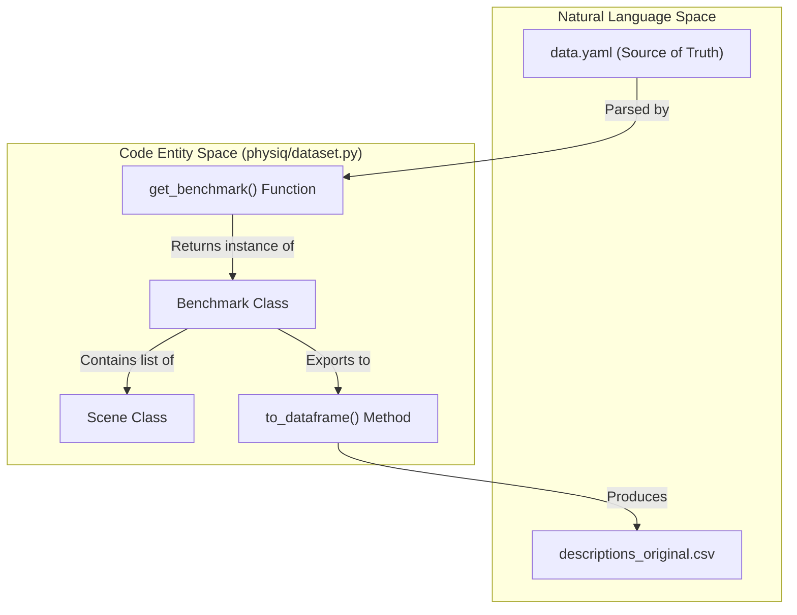
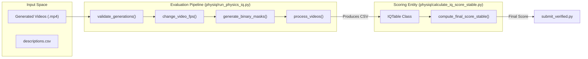

<!-- source: DeepWiki mcp.deepwiki.com · repo google-deepmind/physics-IQ-benchmark · page 9 Glossary · fetched 2026-10-26 -->

# Glossary

Relevant source files

The following files were used as context for generating this wiki page:

- [README.md](README.md)
- [descriptions/best_practice/descriptions_base.csv](descriptions/best_practice/descriptions_base.csv)
- [physiq/calculate_iq_score_stable.py](physiq/calculate_iq_score_stable.py)
- [physiq/dataset.py](physiq/dataset.py)
- [physiq/generate_descriptions.py](physiq/generate_descriptions.py)
- [physiq/run_physics_iq.py](physiq/run_physics_iq.py)
- [physiq/submit_verified.py](physiq/submit_verified.py)
- [physiq/tests/__init__.py](physiq/tests/__init__.py)
- [submission_verified/example/submission.yaml](submission_verified/example/submission.yaml)
- [submission_verified/submission.yaml](submission_verified/submission.yaml)

This page provides definitions for codebase-specific terms, abbreviations, and domain concepts used throughout the Physics-IQ benchmark system. It serves as a technical reference for onboarding engineers to understand the implementation details and data flow.

## Core Concepts

### Physics-IQ Benchmark
A benchmarking system designed to evaluate the physical understanding of generative video models. It compares model-generated videos against high-quality, real-world ground truth recordings across five physics categories.
*   **Original Variant**: The baseline benchmark using original prompts and scoring logic [README.md:12-14]().
*   **Verified Variant**: The recommended variant featuring improved prompt quality (Best Practice Prompts) and a stabilized scoring metric (`final_score_view`) [README.md:10-12](), [physiq/calculate_iq_score_stable.py:42-42]().

### Best Practice Prompts (bpp)
Detailed, model-specific prompts generated using the `Templater` system to maximize the performance of video generation models. These contrast with **Original Prompts (op)**, which are the basic descriptions provided in the initial dataset [README.md:60-60](), [physiq/generate_descriptions.py:30-40]().

### Scenario
A specific physical event (e.g., "ball-hits-duck") recorded from a specific perspective and take. A scenario is the atomic unit of evaluation in the benchmark [physiq/dataset.py:30-56]().

---

## Dataset Terminology

| Term | Definition | Code Pointer |
| :--- | :--- | :--- |
| **Perspective** | The camera angle used for recording. The benchmark uses three: `left`, `center`, and `right` [physiq/dataset.py:103-113](). | `physiq/dataset.py` |
| **Take** | One of two repeated recordings of the same physical setup. Multiple takes capture natural physical variance [physiq/dataset.py:35-35](). | `physiq/dataset.py` |
| **Switch Frame** | The specific frame index where the conditioning ends and the model must begin generating the future [README.md:233-233](). | `descriptions/data.yaml` |
| **Binary Mask** | A black-and-white video where white pixels represent moving objects of interest, used for IoU calculations [physiq/run_physics_iq.py:28-28](). | `physiq/binary_mask_generator.py` |

### Natural Language to Code Entity Space: Dataset Model
The following diagram maps the logical dataset concepts to the Pydantic models and functions that manage them.

**Sources:** [physiq/dataset.py:24-132](), [physiq/generate_descriptions.py:42-43]()

---

## Scoring and Metrics

### Physics-IQ Score Formula
The final score is a composite metric calculated by normalizing model performance against physical variance.
*   **Formula**: `(Spatial IoU + Weighted Spatial IoU + Spatiotemporal IoU) / 3 - MSE_Score` [physiq/calculate_iq_score_stable.py:57-71]().
*   **Stable Scoring**: In the Verified variant, each component is clipped to `[0, 1]` before aggregation to prevent outliers from dominating the final score [physiq/calculate_iq_score_stable.py:67-71]().

### Metric Families
1.  **Spatial IoU (`spatial_iou_v1`)**: Measures the overlap of the union of all object masks across the entire video duration [physiq/calculate_iq_score_stable.py:73-73]().
2.  **Weighted Spatial IoU (`weighted_spatial_iou_v1`)**: Similar to Spatial IoU but weights pixels by motion intensity [physiq/calculate_iq_score_stable.py:74-74]().
3.  **Spatiotemporal IoU (`spatiotemporal_iou_v1`)**: Frame-by-frame intersection-over-union calculation [physiq/calculate_iq_score_stable.py:75-75]().
4.  **MSE (`v1_mse`)**: Pixel-level Mean Squared Error between generated and ground truth frames [physiq/calculate_iq_score_stable.py:76-76]().

### Physical Variance
The empirical variance between `take-1` and `take-2` of the ground truth. It acts as a denominator to normalize the difficulty of scenarios where outcomes are naturally stochastic [physiq/calculate_iq_score_stable.py:59-62]().

---

## Submission and Pipeline Jargon

### IQTable
The central data structure used to store per-scenario metrics and compute aggregated scores. It handles the complexity of cross-view averaging and variance normalization [physiq/calculate_iq_score_stable.py:50-83]().

### Run ID
A unique identifier for a model evaluation run, following the format: `<org>__<model_id>__<YYYY-MM-DD>` [physiq/submit_verified.py:65-65]().

### Submission Card
A YAML file (`submission.yaml`) containing metadata about the model, generation parameters, and self-reported scores required for leaderboard entry [submission_verified/submission.yaml:1-145]().

### Pipeline Execution Flow
The following diagram illustrates the data flow from raw generated videos to the final leaderboard submission.

**Sources:** [physiq/run_physics_iq.py:28-32](), [physiq/run_physics_iq.py:168-170](), [physiq/calculate_iq_score_stable.py:31-71](), [physiq/submit_verified.py:16-49]()

---

## Abbreviations

*   **i2v**: Image-to-Video generation [physiq/dataset.py:51-51]().
*   **t2v**: Text-to-Video generation [submission_verified/example/submission.yaml:8-8]().
*   **v2v**: Video-to-Video (or multiframe-to-video) generation [README.md:45-45]().
*   **BoN**: Best-of-N sampling; generating multiple candidates and selecting the best one via a reward model [submission_verified/submission.yaml:31-33]().
*   **GT**: Ground Truth; the real-world video recordings [physiq/dataset.py:77-77]().
*   **IoU**: Intersection over Union; a standard metric for measuring overlap between two masks [physiq/calculate_iq_score_stable.py:59-59]().

**Sources:** [README.md:1-60](), [physiq/run_physics_iq.py:1-200](), [physiq/dataset.py:1-132](), [physiq/calculate_iq_score_stable.py:1-112](), [physiq/generate_descriptions.py:1-60](), [physiq/submit_verified.py:1-180](), [submission_verified/submission.yaml:1-145]()