# Page: Overview

# Overview

<details>
<summary>Relevant source files</summary>

The following files were used as context for generating this wiki page:

- [.gitignore](.gitignore)
- [LICENSE](LICENSE)
- [README.md](README.md)
- [physiq/__init__.py](physiq/__init__.py)
- [pyproject.toml](pyproject.toml)

</details>


This document provides a comprehensive introduction to the Physics-IQ benchmark system, explaining its purpose, architecture, and key components. Physics-IQ is a benchmark framework for evaluating whether generative video models understand real-world physics principles through a comparison of generated videos against high-quality ground truth recordings.

**Scope**: This overview covers the system's purpose, architecture, components, and workflow at a high level. For detailed information about specific subsystems, see:
- Core concepts and physics categories: [What is Physics-IQ?](#1.1)
- Pipeline stages and workflow: [System Architecture](#1.2)
- Rankings and score aggregation: [Leaderboard and Results](#1.3)

## Introduction

Physics-IQ is a high-quality benchmark dataset and evaluation framework that tests whether generative video models understand physical phenomena. Unlike synthetic benchmarks that use rendered videos, Physics-IQ consists of real-world videos captured at 3840×2160 resolution and 30 frames per second [README.md:18-22]().

The system offers two primary variants:
- **Physics-IQ (Original)**: The baseline benchmark using original text prompts and scoring logic.
- **Physics-IQ Verified**: An improved variant with higher-quality prompts (best-practice prompts) and refined metric calculations [README.md:9-12]().

The benchmark covers five physics domains: Solid Mechanics, Fluid Dynamics, Optics, Thermodynamics, and Magnetism [README.md:19-19](). It supports two model input types:
- **Image-to-video (i2v)**: Models generating video from a single static "switch-frame" [README.md:129-130]().
- **Multiframe-to-video (v2v)**: Models generating video from short "conditioning-clips" [README.md:127-128]().

**Sources**: [README.md:1-53](); [README.md:123-131]()

## System Architecture

The Physics-IQ system consists of two independent phases: video generation (external) and evaluation (internal). Users generate videos using their models based on provided prompts and conditioning data, then run the evaluation pipeline to compute Physics-IQ scores.

### Natural Language to Code Entity Mapping
The following diagram maps the logical stages of the benchmark to the specific scripts and data structures defined in the codebase.

Title: Physics-IQ Pipeline Entity Map
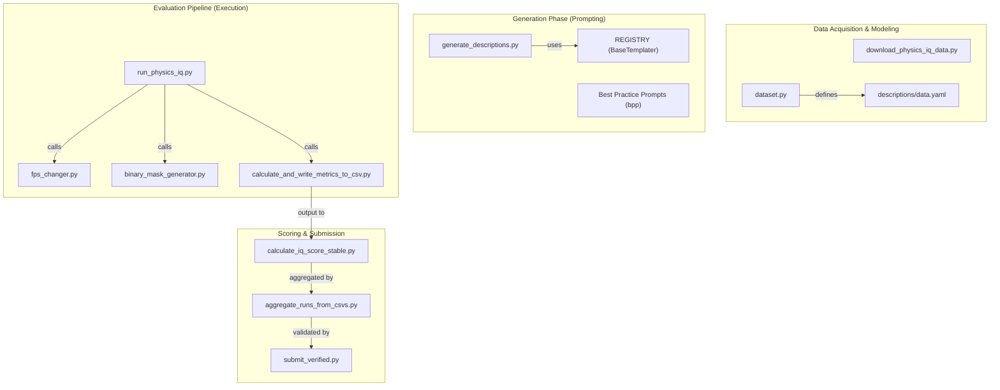

**Sources**: [physiq/dataset.py:1-50](); [physiq/run_physics_iq.py:1-100](); [physiq/generate_descriptions.py:1-40]()

### Evaluation Workflow
The evaluation pipeline is orchestrated by `run_physics_iq.py`, which sequentially invokes processing modules to transform raw generated videos into standardized metrics.

Title: Evaluation Data Flow
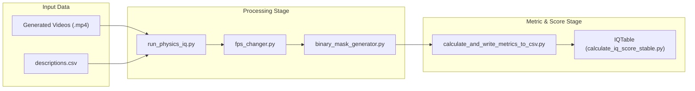

**Sources**: [README.md:156-168](); [physiq/run_physics_iq.py:463-535]()

## Core Components

The Physics-IQ codebase is organized into functional categories that handle the lifecycle of a benchmark run.

### Dataset and Metadata Layer
Managed primarily in `dataset.py`, this layer uses Pydantic models like `Benchmark` and `Scene` to represent the physical scenarios [physiq/dataset.py:34-118](). It handles filename inference and integrity checks for the 198 videos (66 scenarios × 3 perspectives) required for a complete run.

### Prompting Subsystem
The `generate_descriptions.py` script utilizes a `BaseTemplater` and a `REGISTRY` pattern to generate model-specific prompts [physiq/generate_descriptions.py:31-64](). This allows researchers to use "Best Practice Prompts" (bpp) tailored to their model's specific requirements.

### Evaluation Pipeline
The pipeline enforces strict validation:
- Exactly 198 videos must be present [physiq/run_physics_iq.py:145-146]().
- Each video must be exactly 5 seconds in duration [physiq/run_physics_iq.py:148-149]().
- Videos are normalized to a target FPS (e.g., 30, 24, 16, 8) using `fps_changer.py` [physiq/run_physics_iq.py:488-500]().

### Scoring and Aggregation
The final Physics-IQ score is a variance-normalized metric. The `IQTable` class in `calculate_iq_score_stable.py` computes scores by comparing generated videos to two separate "takes" of the ground truth to account for natural physical randomness [physiq/calculate_iq_score_stable.py:45-120]().

**Sources**: [physiq/dataset.py:34-118](); [physiq/run_physics_iq.py:140-160](); [physiq/calculate_iq_score_stable.py:45-120]()

## Leaderboard and Results

The benchmark maintains leaderboards for both the **Verified** and **Original** variants. The **Verified Score** (calculated via `compute_final_score_stable`) is the current standard for submissions, emphasizing stable variance normalization [physiq/calculate_iq_score_stable.py:168-200]().

Performance is tracked across:
- **Input Modality**: Image-to-Video (i2v) vs. Multiframe (v2v).
- **Metric Components**: Spatiotemporal IoU, Spatial IoU, and MSE [README.md:43-56]().

For detailed submission instructions and current rankings, see [Leaderboard and Results](#1.3).

**Sources**: [README.md:36-80](); [physiq/calculate_iq_score_stable.py:168-200]()

---

# Page: What is Physics-IQ?

# 1.1 What is Physics-IQ?

<details>
<summary>Relevant source files</summary>

The following files were used as context for generating this wiki page:

- [README.md](README.md)
- [descriptions/best_practice/descriptions_base.csv](descriptions/best_practice/descriptions_base.csv)
- [physiq/generate_descriptions.py](physiq/generate_descriptions.py)

</details>


**Purpose**: This page explains the core concept of Physics-IQ as a benchmark system for evaluating physical understanding in generative video models. It describes the distinction between the Original and Verified variants, the variance-based scoring strategy, and the physical categories tested.

For details on the system's architecture and pipeline stages, see [System Architecture](1.2). For current model performance data, see [Leaderboard and Results](1.3).

---

## Core Concept

Physics-IQ is a benchmark dataset and evaluation system designed to quantify whether generative video models understand real-world physics. The benchmark tests models by having them generate videos of physical scenarios, then comparing those generated videos against high-quality ground truth recordings of actual physical experiments.

The central premise is that physically realistic video generation requires more than visual plausibility—it requires adherence to fundamental physics principles such as momentum conservation, gravity, material properties, fluid dynamics, and electromagnetic interactions [README.md:7-19]().

### Original vs. Verified Variants

The benchmark exists in two primary variants:
*   **Physics-IQ Original**: The initial release focusing on real-world video recordings and baseline metrics [README.md:65-77]().
*   **Physics-IQ Verified**: An improved version with refined prompt quality and metric robustness. It introduces "Best-Practice Prompts" (`bpp`) generated via model-specific templaters and a more stable scoring formula [README.md:10-15](), [README.md:58-63]().

### Data Flow and Code Entities

The following diagram bridges the logical evaluation flow to the specific Python classes and scripts responsible for execution.

**Diagram 1: Natural Language Space to Code Entity Space (Evaluation)**

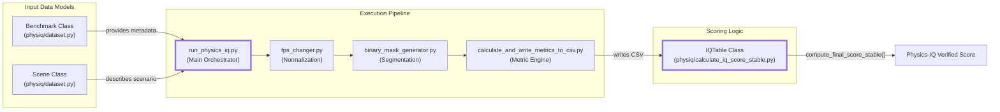
**Sources**: [physiq/dataset.py:28-118](), [physiq/calculate_iq_score_stable.py:34-45](), [physiq/calculate_and_write_metrics_to_csv.py:33-40]()

---

## The Take-1/Take-2 Variance Strategy

A unique feature of Physics-IQ is the use of two independent recordings ("takes") for every scenario and perspective. This design addresses the inherent randomness in physical systems.

*   **Take-1 vs. Take-2**: Each scenario is recorded twice under identical conditions to capture natural physical variations (e.g., micro-vibrations, air currents) [README.md:21-21]().
*   **Variance Baseline**: The system calculates the difference between `take-1` and `take-2` to establish a baseline of "acceptable" divergence. A model is not penalized for differing from ground truth if that difference is within the range of natural physical randomness [README.md:37-37]().
*   **Implementation**: The `IQTable` class in [physiq/calculate_iq_score_stable.py:34-45]() handles this by storing metrics for both takes and using them to normalize the final score.

---

## Physics Categories

The benchmark covers 66 unique scenarios categorized into five physical domains. These categories are defined in the dataset metadata and used for sub-score reporting.

| Category | Description | Example Scenarios |
| :--- | :--- | :--- |
| **Solid Mechanics** | Rigid body dynamics, collisions, and gravity. | Ball and block fall, ball hitting duck [descriptions/best_practice/descriptions_base.csv:2-13]() |
| **Fluid Dynamics** | Liquid behavior, flow, and buoyancy. | Water pouring, objects floating |
| **Optics** | Light interaction, shadows, and reflections. | Shadow movement, mirror reflections |
| **Thermodynamics** | Heat-related physical changes. | Melting ice, steam patterns |
| **Magnetism** | Electromagnetic forces and attraction. | Magnets attracting metal objects |

**Sources**: [README.md:19-19](), [physiq/dataset.py:38-38](), [descriptions/best_practice/descriptions_base.csv:2-13]()

---

## Prompting System: Best-Practice vs. Original

Physics-IQ Verified introduces a structured prompting system to ensure models are evaluated fairly based on their specific instruction-following capabilities.

**Diagram 2: Prompt Generation Architecture**

```mermaid
graph TD
    subgraph "Metadata Source"
        YAML["data.yaml<br/>(Scenario Details)"]
    end
    
    subgraph "physiq/generate_descriptions.py"
        REG["REGISTRY<br/>(Templater Map)"]
        BASE["BaseTemplater<br/>(Abstract Class)"]
        MODEL["ModelTemplaters<br/>(e.g., Llama, Cosmos)"]
    end
    
    YAML -->|"Benchmark.from_yaml()"| REG
    REG -->|"instantiates"| MODEL
    MODEL --|> BASE
    MODEL -->|"generate_prompt()"| CSV["descriptions_model.csv"]
    
    style REG stroke-width:4px
    style BASE stroke-width:4px
```

*   **Original Prompts (op)**: Simple descriptions used in the initial benchmark release.
*   **Best-Practice Prompts (bpp)**: Verbose, high-quality prompts generated by model-specific classes inheriting from `BaseTemplater` in the `physiq.templater` registry [physiq/generate_descriptions.py:22-47]().
*   **Action Suffix**: Verified evaluation typically appends a subject-action postfix to prompts to clarify the intended physical evolution [physiq/generate_descriptions.py:36-39]().

**Sources**: [physiq/generate_descriptions.py:25-66](), [README.md:60-60]()

---

## Technical Specifications

To maintain integrity, all generated videos must adhere to strict requirements processed by the pipeline:

*   **Resolution**: 3840 × 2160 (4K) source [README.md:22-22]().
*   **Duration**: Exactly 5 seconds. The pipeline uses `trim_videos.py` (referenced in architecture) to enforce this.
*   **Frame Rate**: Canonical 30 FPS, with support for 24, 16, and 8 FPS via `fps_changer.py` [README.md:22-22]().
*   **Naming Convention**: A 4-digit zero-padded prefix (e.g., `0001_...`) mapping to `descriptions.csv` [descriptions/best_practice/descriptions_base.csv:2-13]().

**Sources**: [README.md:22-22](), [physiq/generate_descriptions.py:50-58](), [descriptions/best_practice/descriptions_base.csv:1-15]()

---

# Page: System Architecture

# System Architecture

<details>
<summary>Relevant source files</summary>

The following files were used as context for generating this wiki page:

- [README.md](README.md)
- [physiq/dataset.py](physiq/dataset.py)
- [physiq/run_physics_iq.py](physiq/run_physics_iq.py)
- [physiq/tests/__init__.py](physiq/tests/__init__.py)

</details>


## Purpose and Scope

This document describes the high-level architecture of the Physics-IQ benchmark system, including the two-phase workflow (external video generation and internal evaluation), core component interactions, and data flow patterns. It covers both the **Original** and **Verified** workflow variants.

For detailed information about specific subsystems, see:
- Dataset structure and organization: [2. Dataset]()
- Evaluation pipeline execution: [4. Evaluation Pipeline]()
- Metric computation details: [5. Metrics and Scoring]()
- Submission process: [6. Submission Pipeline]()

---

## Two-Phase System Design

The Physics-IQ benchmark operates as a two-phase system with a clear separation between video generation (external to this repository) and evaluation (internal to this repository).

### Architecture Overview

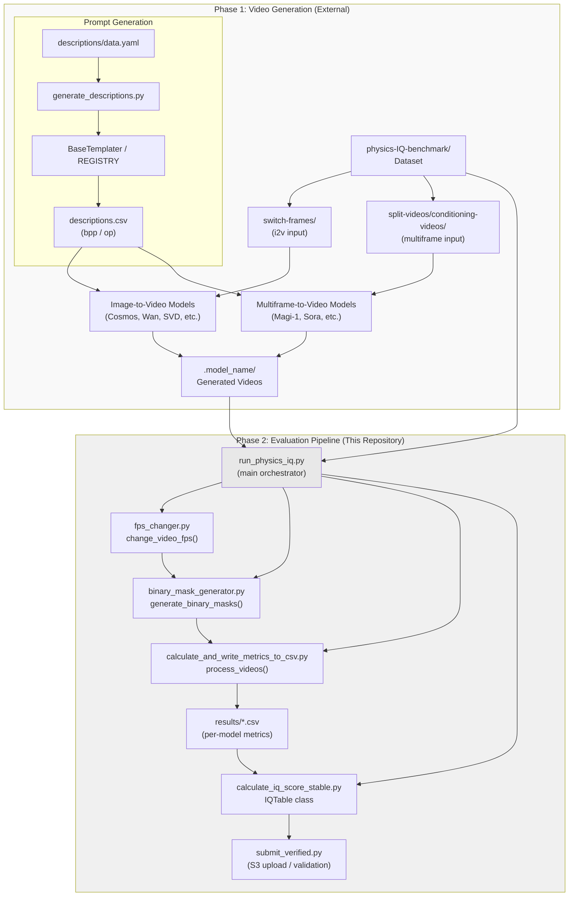

**Phase 1: Video Generation (External)**
- Researchers generate prompts using `generate_descriptions.py` [physiq/generate_descriptions.py:1-70](), which uses a `BaseTemplater` [physiq/generate_descriptions.py:32-44]() to create model-specific Best Practice Prompts (`bpp`) or Original Prompts (`op`).
- Input modalities: single image (`switch-frames/`) for i2v models, or short video segments (`split-videos/conditioning-videos/`) for multiframe models.
- Output: 198 videos (exactly 5 seconds each) saved with 4-digit zero-padded prefixes [physiq/run_physics_iq.py:168-201]().

**Phase 2: Evaluation Pipeline (This Repository)**
- Automated evaluation via `run_physics_iq.py` [physiq/run_physics_iq.py:346-455]().
- Standardized pipeline: FPS normalization → mask generation → metric calculation → score aggregation via the `IQTable` class [physiq/calculate_iq_score_stable.py:43-62]().
- Output: CSV metrics and a submission-ready package validated by `submit_verified.py` [physiq/submit_verified.py:350-424]().

**Sources:** [README.md:12-22](), [physiq/run_physics_iq.py:28-34](), [physiq/generate_descriptions.py:1-70](), [physiq/calculate_iq_score_stable.py:43-62]()

---

## Core Components and Data Model

The system uses a structured data model to represent the benchmark scenarios and manages the pipeline through specialized modules.

### Data Model to Code Entity Mapping

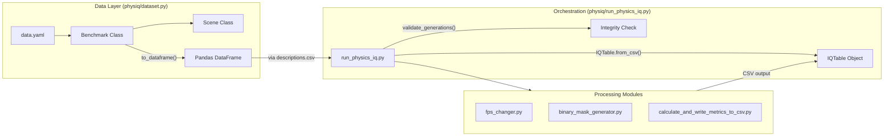

**Component Responsibilities:**

| Component | Function | Input | Output | Location |
|-----------|----------|-------|--------|----------|
| `Benchmark` / `Scene` | Pydantic data models for scenario metadata | `descriptions/data.yaml` | DataFrame / Metadata | [physiq/dataset.py:29-132]() |
| `run_physics_iq.py` | Main orchestrator and validator | Generated videos, descriptions | Evaluation metrics | [physiq/run_physics_iq.py:346-455]() |
| `fps_changer.py` | FPS normalization via linear interpolation | Source video, target FPS | Normalized video | [physiq/fps_changer.py:22-68]() |
| `binary_mask_generator.py` | Adaptive background subtraction for object isolation | Video | Binary mask video | [physiq/binary_mask_generator.py:21-82]() |
| `IQTable` | Stable score aggregation and variance normalization | Metric CSVs | Physics-IQ Score | [physiq/calculate_iq_score_stable.py:43-238]() |

**Sources:** [physiq/dataset.py:29-132](), [physiq/run_physics_iq.py:28-34](), [physiq/calculate_iq_score_stable.py:43-62]()

---

## Evaluation Pipeline Data Flow

The evaluation pipeline processes videos through a sequential series of transformations. It supports two main modes: **Verified** (recommended, uses `IQTable` stable scoring) and **Original** (legacy).

### Sequential Processing Flow

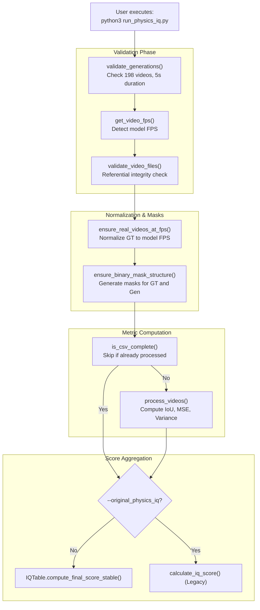

**Key Features:**
1. **FPS Normalization:** The system automatically detects the frame rate of generated videos and downsamples the 30 FPS ground truth videos to match using `change_video_fps` [physiq/run_physics_iq.py:272-313]().
2. **Mask Generation:** Moving objects are isolated using `generate_binary_masks` which employs adaptive background subtraction [physiq/binary_mask_generator.py:21-82]().
3. **Stable Scoring:** The `IQTable` class in `calculate_iq_score_stable.py` performs variance normalization, comparing model performance against the natural variance between `take-1` and `take-2` of the ground truth [physiq/calculate_iq_score_stable.py:126-170]().

**Sources:** [physiq/run_physics_iq.py:272-344](), [physiq/calculate_iq_score_stable.py:126-170](), [physiq/binary_mask_generator.py:21-82]()

---

## File System Organization

The system maintains a strict directory structure for both the original dataset and the verified variant.

### Directory Structure

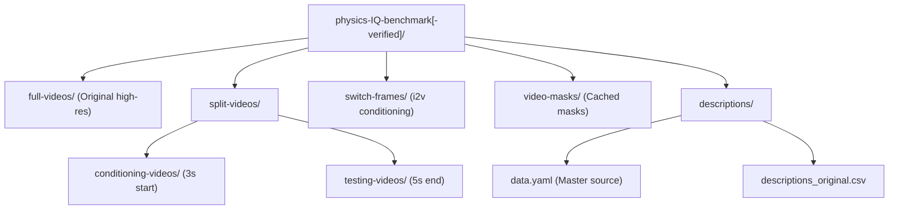

**Naming Conventions:**
- **Generated Videos:** Must use the `0001_...` prefix. The `rename_generated_videos` function standardizes these to `{ID}_{perspective}_{scenario_name}.mp4` for internal processing [physiq/run_physics_iq.py:71-104]().
- **Ground Truth:** Standardized as `{ID}_testing-videos_{FPS}FPS_{perspective}_{take}_{scenario_name}.mp4` [physiq/dataset.py:77-81]().

**Sources:** [physiq/dataset.py:69-91](), [physiq/run_physics_iq.py:71-104](), [README.md:123-156]()

---

## Submission Pipeline

For the **Physics-IQ Verified** leaderboard, a specific submission workflow is required.

1. **Generation:** Use `generate_descriptions.py` to get prompts [physiq/generate_descriptions.py:70]().
2. **Evaluation:** Run `run_physics_iq.py` to generate the results CSV [physiq/run_physics_iq.py:346-455]().
3. **Packaging:** Create a `submission.yaml` card and use `submit_verified.py` [physiq/submit_verified.py:350-424]().
4. **Validation:** `submit_verified.py` performs strict checks on video count (198), duration (5s), and metadata integrity before allowing upload [physiq/submit_verified.py:104-187]().

**Sources:** [physiq/submit_verified.py:104-187](), [physiq/submit_verified.py:350-424]()

---

# Page: Leaderboard and Results

# Leaderboard and Results

<details>
<summary>Relevant source files</summary>

The following files were used as context for generating this wiki page:

- [README.md](README.md)
- [physiq/aggregate_runs_from_csvs.py](physiq/aggregate_runs_from_csvs.py)
- [physiq/tests/test_descriptions.py](physiq/tests/test_descriptions.py)

</details>


## Purpose and Scope

This page presents the Physics-IQ benchmark leaderboard, showing how generative video models rank based on their physical understanding capabilities. The leaderboard compares models across two input modalities (image-to-video and multiframe-to-video) using a standardized 0-100% scoring system. 

The benchmark currently supports two scoring variants: **Original Physics-IQ** and **Physics-IQ Verified**. The Verified variant is the recommended benchmark, featuring improved prompt quality and more robust metric aggregation.

**Sources:** [README.md:5-15](), [README.md:36-58]()

---

## Score Interpretation: Original vs. Verified

The Physics-IQ score ranges from **0 to 100**, where 100 represents a model that perfectly adheres to physical principles, differing from ground truth only by natural physical randomness.

### The Verified Score
The **Verified Score** (`final_score_view`) is the primary metric for the Physics-IQ Verified leaderboard. It implements a "stable" calculation method that averages metrics across three camera views (Left, Center, Right) before final aggregation. This reduces noise and provides a more holistic assessment of 3D physical consistency.
*   **Metric Components**: Spatial IoU, Spatiotemporal IoU, Weighted Spatial IoU, and MSE.
*   **Implementation**: Handled by `IQTable.compute_final_score_stable()` in `physiq/calculate_iq_score_stable.py`.

### The Original Score
The **Original Score** (`final_score`) is maintained for backward compatibility with the initial Physics-IQ release. It aggregates metrics across all scenarios without the specific per-view averaging logic of the Verified variant.
*   **Implementation**: Handled by `IQTable.compute_final_score_orig()` in `physiq/calculate_iq_score_stable.py`.

**Sources:** [physiq/calculate_iq_score_stable.py:214-266](), [README.md:37-39]()

---

## Physics-IQ Verified Leaderboard

The leaderboard is ranked by the **Verified Score**. To claim State-of-the-Art (SOTA), reporting the mean and standard deviation across **4 independent runs** is required.

| # | Model | Input Type | Physics-IQ Verified | Date Added |
|---|---|---|---|---|
| 1 | [Magi-1 24B](https://arxiv.org/abs/2505.13211) + GeoPhys (BoN) | v2v | **58.2** ± 1.8 | 2026-06-19 |
| 2 | [Magi-1 24B](https://arxiv.org/abs/2505.13211) | v2v | **48.4** ± 1.1 | 2026-06-19 |
| 3 | [Cosmos3-Super-Image2Video](https://arxiv.org/abs/2606.02800) | i2v | **39.5** ± 0.8 | 2026-06-18 |
| 4 | [Grok Imagine Video](https://x.ai/news/grok-imagine-api) | i2v | **34.8** ± 0.6 | 2026-06-17 |
| 5 | [Hunyuan Video 1.5](https://arxiv.org/abs/2511.18870) | i2v | **33.4** ± 0.8 | 2026-06-17 |

*Note: `(op)` denotes Original Prompts; all others use Best Practice Prompts (`bpp`).*

**Sources:** [README.md:43-63]()

---

## Result Aggregation Pipeline

To produce a single leaderboard entry from multiple model runs, the system uses `aggregate_runs_from_csvs.py`. This script processes multiple evaluation outputs to compute statistical significance.

### Data Flow for Leaderboard Entry
The following diagram illustrates how raw model outputs are transformed into a validated leaderboard entry.

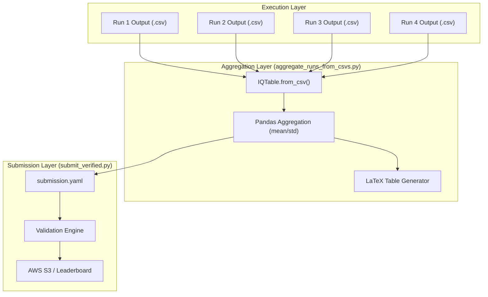

**Key Functions:**
*   `IQTable.from_csv(path)`: Loads individual run results [physiq/aggregate_runs_from_csvs.py:73-75]().
*   `scores_df.agg(["mean", "std"])`: Calculates the final leaderboard metrics [physiq/aggregate_runs_from_csvs.py:78-78]().
*   `_fmt(col)`: Formats scores into the LaTeX-ready `mean ± std` string used in papers [physiq/aggregate_runs_from_csvs.py:82-84]().

**Sources:** [physiq/aggregate_runs_from_csvs.py:43-109]()

---

## Submission Process

The submission process is strictly governed by `submit_verified.py` to ensure data integrity and comparability.

### 1. The Submission Card (`submission.yaml`)
Every submission must include a manifest containing:
*   **Public Info**: Organization name, model name, and paper links.
*   **Reported Scores**: The `physiq_mean` (Verified Score) and sub-metrics.
*   **Warranties**: Confirmation that the model was not trained on the benchmark test set.

### 2. Validation Requirements
The `submit_verified.py` script enforces the following before accepting a submission:
*   **File Count**: Exactly 198 MP4 files (66 scenarios × 3 views).
*   **Naming**: Files must use the 4-digit zero-padded prefix (e.g., `0001_*.mp4`).
*   **Duration**: Each video must be exactly 5 seconds long.
*   **Referential Integrity**: All generated filenames must match the entries in the benchmark's `descriptions.csv`.

### 3. Submission Command
Submissions are packaged and uploaded using:
```bash
python submit_verified.py --run_dir ./my_model_run/ --submission_card submission.yaml --validate-only
```
Using `--validate-only` allows local checking before final upload to the benchmark's S3 bucket.

**Sources:** [physiq/submit_verified.py:34-118](), [README.md:61-63]()

---

## Visualization and Plotting

The benchmark provides a `plot_settings.py` utility to standardize model appearances in results visualizations.

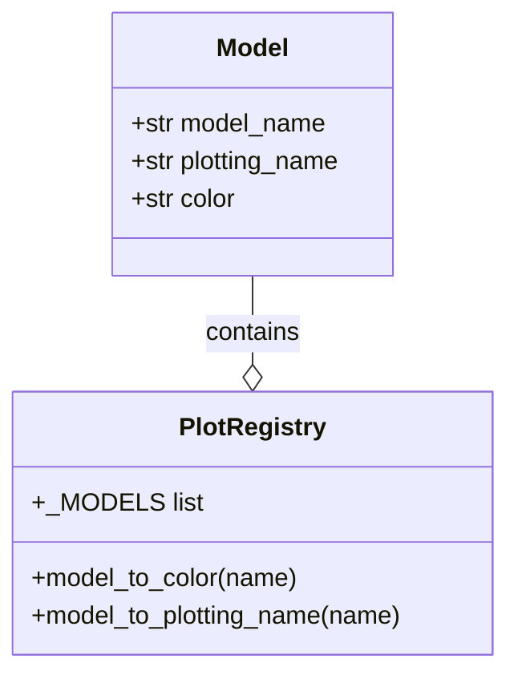

**Implementation Details:**
*   **Color Mapping**: `model_to_color` ensures that specific models (like Magi-1 or Cosmos) have consistent colors across different papers and reports [physiq/plot_settings.py:78-79]().
*   **Display Names**: `model_to_plotting_name` converts internal identifiers (e.g., `Magi-1_24B_v2v`) into human-readable labels for charts [physiq/plot_settings.py:81-82]().

**Sources:** [physiq/plot_settings.py:18-83]()

---

# Page: Dataset

# Dataset

<details>
<summary>Relevant source files</summary>

The following files were used as context for generating this wiki page:

- [descriptions/data.yaml](descriptions/data.yaml)
- [descriptions/descriptions_original.csv](descriptions/descriptions_original.csv)
- [physiq/dataset.py](physiq/dataset.py)
- [physiq/download_physics_iq_data.py](physiq/download_physics_iq_data.py)
- [physiq/plot_settings.py](physiq/plot_settings.py)
- [physiq/tests/__init__.py](physiq/tests/__init__.py)

</details>


This document provides comprehensive documentation of the Physics-IQ benchmark dataset, including its structure, contents, acquisition methods, and metadata organization. The dataset contains 396 real-world physics videos across 66 unique scenarios designed to evaluate physical understanding in generative video models.

For information about using this dataset to generate videos, see [Video Generation](#3). For details on the evaluation pipeline that processes these videos, see [Evaluation Pipeline](#4).

---

## Overview

The Physics-IQ dataset consists of 396 high-quality video recordings of real-world physics experiments. Each video captures physical phenomena across five domains: Solid Mechanics, Fluid Dynamics, Optics, Thermodynamics, and Magnetism. All videos are recorded at 3840 × 2160 resolution and 30 frames per second with static camera positioning.

The benchmark exists in two primary variants:
1.  **Original Physics-IQ**: The initial dataset used for baseline evaluations.
2.  **Physics-IQ Verified**: An updated version with refined descriptions and metadata for standardized leaderboard submissions.

The dataset is organized to support two model types: **image-to-video (i2v)** models that generate from a single frame, and **multiframe-to-video (m2v)** models that use short video segments as conditioning input.

Sources: [README.md:13-19](), [README.md:33-52](), [physiq/download_physics_iq_data.py:66-73]()

---

## Dataset Organization

The Physics-IQ benchmark dataset follows a hierarchical directory structure designed to separate different data modalities and FPS variants.

### Directory Structure

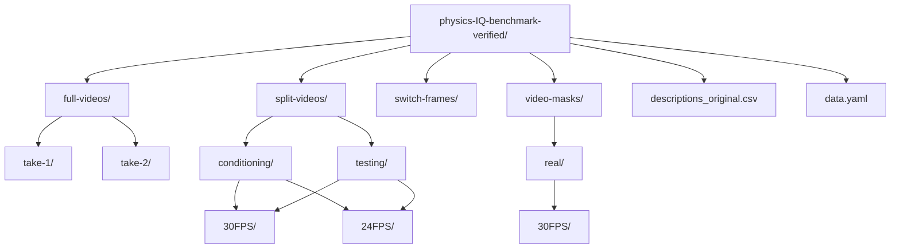

**Directory Structure: Physics-IQ Verified Dataset Organization**

### Directory Descriptions

| Directory | Purpose | Contents |
|-----------|---------|----------|
| `full-videos/` | Complete unprocessed recordings | Raw video files before splitting, separated by `take-1` and `take-2`. |
| `split-videos/conditioning/` | Input for multiframe models | First 3 seconds of each scenario (multiple FPS). |
| `split-videos/testing/` | Ground truth for evaluation | Final 5 seconds after conditioning segment (multiple FPS). |
| `switch-frames/` | Input for i2v models | Single JPEG frame extracted at the 3-second transition point. |
| `video-masks/real/` | Ground truth segmentation | Binary masks for object tracking in real videos. |
| `descriptions_original.csv` | Metadata registry | Legacy CSV format for scenario descriptions and categories. |
| `data.yaml` | Source Metadata | The primary Pydantic-backed source of truth for the Verified dataset. |

For a deep dive into the folder layout and specific file counts, see [Dataset Organization](#2.1).

Sources: [physiq/download_physics_iq_data.py:77-85](), [physiq/dataset.py:24-26]()

---

## Downloading the Dataset

The dataset is hosted on Google Cloud Storage. Users should use the `download_physics_iq_data.py` script to ensure correct directory structures and automatic downsampling for non-standard frame rates.

### Using download_physics_iq_data.py

The script `download_physics_iq_data.py` manages the synchronization between the cloud bucket and local storage.

```python
# Example: Download the verified dataset at 30 and 24 FPS
python3 physiq/download_physics_iq_data.py --fps 30 24 --benchmark_base_folder ./data
```

### Key Features:
- **Automatic Downsampling**: If a requested FPS (e.g., 12 FPS) is not pre-computed on the server, the script downloads the 30 FPS version and uses `change_video_fps` from `physiq/fps_changer.py` to generate it locally [physiq/download_physics_iq_data.py:97-111]().
- **Verified vs. Original**: The `--original_physics_iq` flag toggles between the `physics-IQ-benchmark` and `physics-IQ-benchmark-verified` directory targets [physiq/download_physics_iq_data.py:66-70]().
- **Integrity**: Always downloads 30 FPS data as a base for any local resampling [physiq/download_physics_iq_data.py:57-58]().

For detailed instructions and CLI arguments, see [Downloading the Dataset](#2.2).

Sources: [physiq/download_physics_iq_data.py:46-55](), [physiq/download_physics_iq_data.py:116-138]()

---

## Physics Categories

The dataset spans five fundamental physics domains, categorized to test specific aspects of physical reasoning.

| Category | Description |
|----------|-------------|
| **Solid Mechanics** | Collisions, gravity, and material properties (e.g., `ball-and-block-fall`). |
| **Fluid Dynamics** | Liquids, gases, and buoyancy (e.g., `fill-glass-red-drink`). |
| **Optics** | Light, shadows, and reflections (e.g., `light-on-block`). |
| **Thermodynamics** | Heat, combustion, and phase changes (e.g., `lit-candle`). |
| **Magnetism** | Magnetic forces and attraction (e.g., `magnet-wrench`). |

The `Scene` data model in `physiq/dataset.py` explicitly tracks the `category` for each entry [physiq/dataset.py:34](). For a full list of scenarios and examples, see [Physics Categories](#2.3).

Sources: [descriptions/data.yaml:6-104](), [physiq/dataset.py:33-34]()

---

## Multi-View and Multi-Take Structure

Physics-IQ utilizes a redundant recording strategy to enable robust evaluation and variance quantification.

### The 3-Perspective / 2-Take Strategy
Each physical event is recorded:
1.  **From 3 Perspectives**: `left`, `center`, and `right` views are captured simultaneously.
2.  **In 2 Takes**: The entire physical setup is reset and the experiment is performed twice (`take-1` and `take-2`).

This results in **6 videos per scenario**. This structure is codified in the `Scene` class, which contains a list of `takes` mapping perspectives to unique IDs [physiq/dataset.py:35]().

For details on how this structure enables variance-normalized scoring, see [Multi-View and Multi-Take Structure](#2.4).

Sources: [physiq/dataset.py:30-36](), [descriptions/data.yaml:10-18]()

---

## Dataset Metadata and Data Model

The dataset's metadata is managed through a structured data layer in `physiq/dataset.py`, moving away from flat CSVs to a Pydantic-based hierarchy.

### Data Entities

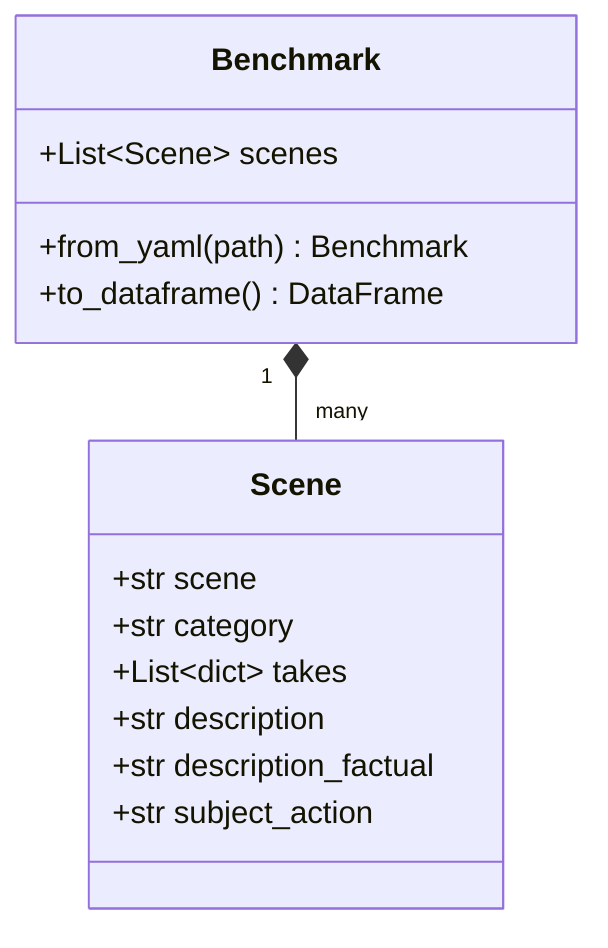

**Entity Mapping: Metadata Data Model**

### Key Components:
- **`Benchmark` Class**: The root container for the dataset. It provides `to_dataframe()` to generate the runtime `descriptions.csv` used by the evaluation pipeline [physiq/dataset.py:59-60](), [physiq/dataset.py:92]().
- **`Scene` Class**: Represents a single physical experiment. It maps YAML keys (like `subject-action`) to Python attributes and handles multi-take ID mapping [physiq/dataset.py:30-56]().
- **Filename Inference**: The `Benchmark` class contains static methods like `_infer_test_scenario` and `_infer_fn_mask` to programmatically generate file paths based on ID, perspective, and take [physiq/dataset.py:68-90]().
- **Source of Truth**: The `descriptions/data.yaml` file is the primary source, which is loaded via `get_benchmark()` [physiq/dataset.py:131-132]().

For technical details on the Pydantic models and metadata fields, see [Dataset Metadata and Data Model](#2.5).

Sources: [physiq/dataset.py:29-60](), [physiq/dataset.py:131-132]()

---

# Page: Dataset Organization

# Dataset Organization

<details>
<summary>Relevant source files</summary>

The following files were used as context for generating this wiki page:

- [physiq/dataset.py](physiq/dataset.py)
- [physiq/download_physics_iq_data.py](physiq/download_physics_iq_data.py)
- [physiq/tests/__init__.py](physiq/tests/__init__.py)

</details>


This page documents the hierarchical directory structure and file organization of the Physics-IQ benchmark dataset. It explains the purpose of each directory, how files are named and linked together, and the role of the metadata registry defined in the `Benchmark` data model.

For information about downloading the dataset, see [Downloading the Dataset](#2.2). For details about the physics domains covered, see [Physics Categories](#2.3). For the recording strategy details, see [Multi-View and Multi-Take Structure](#2.4).

---

## Directory Structure Overview

The Physics-IQ benchmark dataset is organized into five primary directories. The dataset is typically stored in either `physics-IQ-benchmark/` (original) or `physics-IQ-benchmark-verified/` (verified variant) [physiq/download_physics_iq_data.py:66-70]().

**Directory Hierarchy**

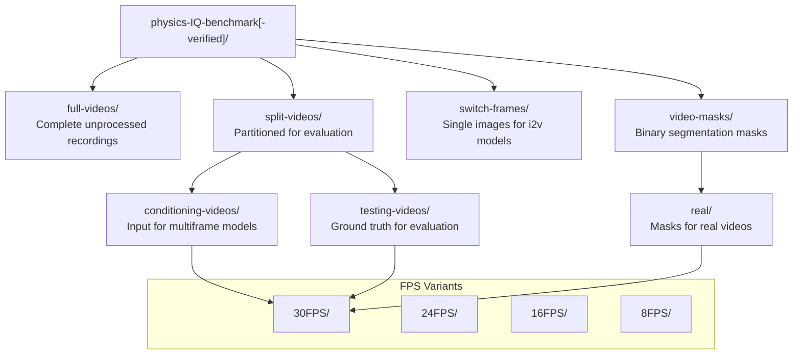

**Sources:** [physiq/download_physics_iq_data.py:77-84](), [physiq/dataset.py:77-86]()

---

## File Types and Purposes

### full-videos/
Contains the complete, unprocessed video recordings of all physics scenarios. These are the raw source videos from which all other variants are derived. Organized by `take-1` and `take-2` subdirectories [physiq/download_physics_iq_data.py:78-79]().

### split-videos/
Partitioned videos that separate the temporal sequence into conditioning and testing phases.

#### conditioning-videos/
The initial portion of each video, used as input for multiframe-to-video models.
- **Organization**: Subdirectories by FPS (30FPS, 24FPS, 16FPS, 8FPS) [physiq/download_physics_iq_data.py:80]().

#### testing-videos/
The remaining portion of each video after conditioning frames, used as ground truth for evaluation.
- **Duration**: 5 seconds exactly.
- **Organization**: Subdirectories by FPS [physiq/download_physics_iq_data.py:81]().
- **Naming Pattern**: Inferred via `Benchmark._infer_gt_fn_video` [physiq/dataset.py:77-81]().

### switch-frames/
Single-frame images extracted from the boundary between conditioning and testing phases.
- **Purpose**: Initial frame input for image-to-video models.
- **FPS-Independence**: Labeled as `anyFPS` in naming conventions [physiq/dataset.py:73]().
- **Count**: 198 images (66 scenarios × 3 perspectives, take-1 only).

### video-masks/
Binary segmentation masks that isolate moving objects from static backgrounds.
- **real/**: Contains masks for the real ground truth videos [physiq/download_physics_iq_data.py:83]().
- **Naming Pattern**: Inferred via `Benchmark._infer_fn_mask` [physiq/dataset.py:83-87]().

---

## The Data Model and Metadata

Instead of a static CSV, the modern Physics-IQ pipeline uses a Pydantic-based data model defined in `physiq/dataset.py`. The source of truth is `descriptions/data.yaml` [physiq/dataset.py:24-26]().

**Data Model Structure**

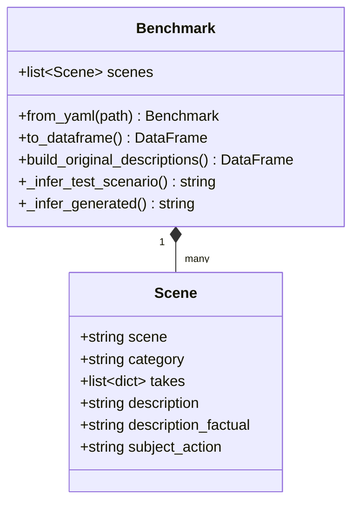

**Metadata Fields in Scene:**
The `Scene` class handles mapping between YAML keys and Python attributes [physiq/dataset.py:30-56]():
- `description_factual`: The corrected, physics-accurate description used in the Verified benchmark.
- `subject_action`: Used by the prompt templater system.
- `takes`: A list of dictionaries mapping perspectives (`left`, `center`, `right`) to 4-digit IDs.

**Sources:** [physiq/dataset.py:29-60](), [physiq/dataset.py:92-124]()

---

## File Naming Conventions

The `Benchmark` class provides static methods to programmatically infer filenames based on ID, perspective, and scenario name.

| File Type | Inference Method | Example Format |
|-----------|------------------|----------------|
| **Testing Video** | `_infer_gt_fn_video` | `0001_testing-videos_30FPS_perspective-left_take-1_trimmed-ball-and-block-fall.mp4` |
| **Mask** | `_infer_fn_mask` | `0001_video-masks_30FPS_perspective-left_take-1_trimmed-ball-and-block-fall.mp4` |
| **Generated** | `_infer_generated` | `0001_perspective-left_trimmed-ball-and-block-fall.mp4` |
| **Scenario ID** | `_infer_test_scenario` | `0001_perspective-left_take-1_trimmed-ball-and-block-fall.mp4` |

**Sources:** [physiq/dataset.py:68-91]()

---

## FPS Handling and Downsampling

The dataset maintains multiple frame rate variants. The `download_physics_iq_data.py` script manages the acquisition and local generation of these variants.

**FPS Logic Flow**

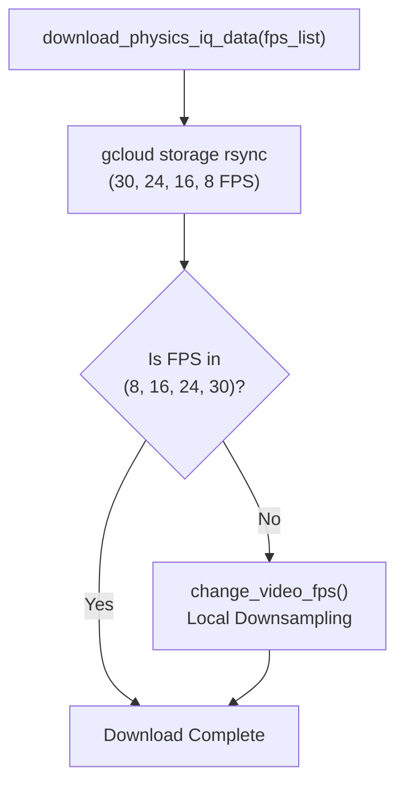

- **Pre-computed**: 8, 16, 24, and 30 FPS are available on GCS [physiq/download_physics_iq_data.py:52-54]().
- **Local Downsampling**: Any other FPS in range [1, 30] is generated locally from the 30 FPS source using `change_video_fps` [physiq/download_physics_iq_data.py:97-112]().
- **Mask Exception**: Binary masks are *not* downsampled via linear interpolation to avoid non-binary pixels; they are regenerated during evaluation if needed [physiq/download_physics_iq_data.py:98-100]().

**Sources:** [physiq/download_physics_iq_data.py:46-65](), [physiq/download_physics_iq_data.py:101-112]()

---

## Cross-Variant Organization

The benchmark distinguishes between the **Original** and **Verified** layouts.

| Feature | Original (`physics-IQ-benchmark`) | Verified (`physics-IQ-benchmark-verified`) |
|---------|-----------------------------------|--------------------------------------------|
| **Source URL** | `gs://physics-iq-benchmark` | Link provided in README |
| **Descriptions** | `descriptions_original.csv` | `data.yaml` / `descriptions_updated.csv` |
| **Prompting** | Original Prompts (op) | Best Practice Prompts (bpp) |
| **Integrity** | Based on `descriptions_original.csv` | Based on `data.yaml` Pydantic model |

The `get_benchmark()` function in `physiq/dataset.py` is the entry point for loading the verified metadata, while `build_original_descriptions()` provides backward compatibility by generating the original CSV format from the new YAML source [physiq/dataset.py:126-132]().

**Sources:** [physiq/download_physics_iq_data.py:66-76](), [physiq/dataset.py:126-132]()

---

# Page: Downloading the Dataset

# Downloading the Dataset

<details>
<summary>Relevant source files</summary>

The following files were used as context for generating this wiki page:

- [physiq/download_physics_iq_data.py](physiq/download_physics_iq_data.py)

</details>


This page explains how to use `download_physics_iq_data.py` to obtain the Physics-IQ benchmark dataset from Google Cloud Storage. The script handles directory synchronization, FPS-specific downloads, and local downsampling for non-standard frame rates.

---

## Overview

The Physics-IQ dataset is hosted on Google Cloud Storage. The download utility uses `gcloud storage rsync` to mirror remote directories to a local path. It supports two main dataset variants:
*   **Original Physics-IQ**: The baseline benchmark dataset.
*   **Verified Physics-IQ**: The curated version used for official leaderboard submissions.

**Sources:** [physiq/download_physics_iq_data.py:66-76](), [physiq/download_physics_iq_data.py:128-131]()

---

## Implementation Architecture

The download process is orchestrated by `download_physics_iq_data.py`, which manages the mapping between remote GCS paths and the local hierarchical structure.

### System Flow: Natural Language to Code Entity

This diagram maps the high-level download requirements to the specific functions and logic in the codebase.

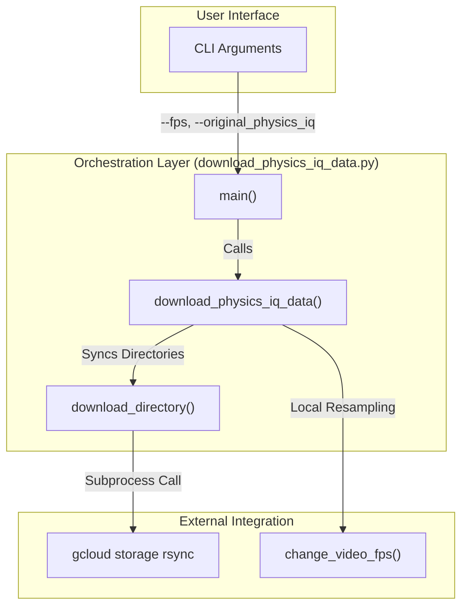

**Sources:** [physiq/download_physics_iq_data.py:26-44](), [physiq/download_physics_iq_data.py:46-114](), [physiq/download_physics_iq_data.py:116-145]()

---

## Download Logic and FPS Selection

The script implements a strategy to minimize bandwidth by downloading pre-computed FPS variants when available, while falling back to local downsampling for custom frame rates.

### Data Flow: FPS Handling

The following diagram illustrates how the system decides between downloading a pre-computed variant or performing local processing.

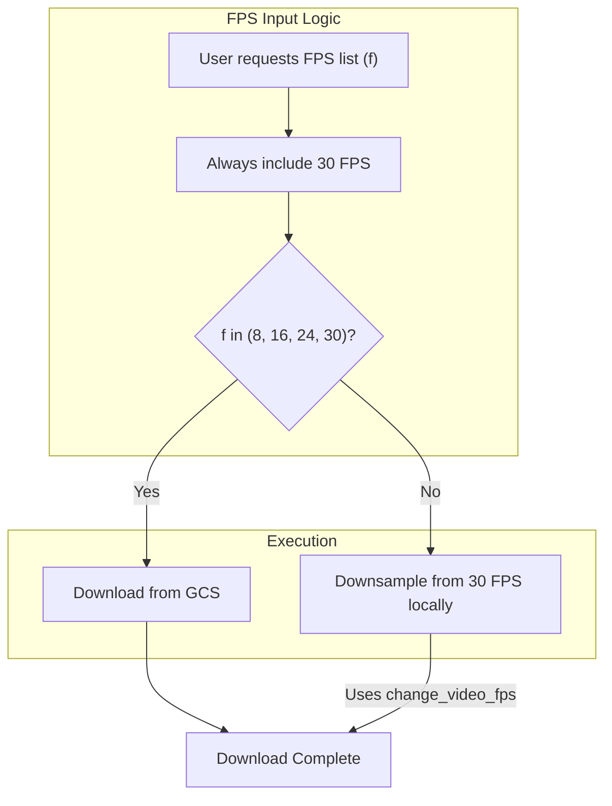

**Sources:** [physiq/download_physics_iq_data.py:57-64](), [physiq/download_physics_iq_data.py:88-91](), [physiq/download_physics_iq_data.py:101-111]()

### Key Functions

*   **`download_directory(remote_path, local_path)`**: Wraps the `gcloud storage rsync --recursive` command. It ensures the local directory exists via `os.makedirs` before initiating the sync [physiq/download_physics_iq_data.py:26-44]().
*   **`download_physics_iq_data(fps, base_dir, verified)`**: The main entry point. It defines the directory structure for `full-videos`, `split-videos`, `switch-frames`, and `video-masks` [physiq/download_physics_iq_data.py:77-84]().
*   **`change_video_fps(...)`**: Imported from `physiq.fps_changer`, this is called when a user requests an FPS value that is not pre-computed on the server [physiq/download_physics_iq_data.py:109-111]().

---

## Dataset Variants: Original vs. Verified

The script supports two target datasets, controlled by the `--original_physics_iq` flag.

| Feature | Original Dataset (`--original_physics_iq`) | Verified Dataset (Default) |
| :--- | :--- | :--- |
| **GCS Bucket** | `gs://physics-iq-benchmark` | `gs://physics-iq-benchmark` |
| **Local Folder** | `physics-IQ-benchmark` | `physics-IQ-benchmark-verified` |
| **Verified Flag** | `False` | `True` |

**Note on Verified Dataset**: As of the current implementation, the verified dataset requires manual download from links provided in the project README if the GCS path is not yet public [physiq/download_physics_iq_data.py:71-73]().

**Sources:** [physiq/download_physics_iq_data.py:66-75](), [physiq/download_physics_iq_data.py:128-131]()

---

## Local Downsampling Implementation

For non-standard frame rates (values in `[1, 30]` excluding 8, 16, 24, and 30), the script performs the following steps:
1.  Downloads the **30 FPS** version of all required directories [physiq/download_physics_iq_data.py:58]().
2.  Iterates through the local 30 FPS files.
3.  Calls `change_video_fps` to create a new directory for the target FPS [physiq/download_physics_iq_data.py:101-111]().

**Exception for Masks**: The script explicitly skips downsampling `video-masks/real` locally. This is because linear frame interpolation on binary masks would produce non-binary (grayscale) pixels. Instead, the evaluation pipeline (`run_physics_iq.py`) is designed to regenerate binary masks from the downsampled real videos at runtime [physiq/download_physics_iq_data.py:97-100]().

**Sources:** [physiq/download_physics_iq_data.py:97-111]()

---

## Technical Configuration

### Multiprocessing
The script sets the multiprocessing start method to `"spawn"` at the top level [physiq/download_physics_iq_data.py:23](). This ensures consistent behavior across different operating systems when spawning subprocesses for `gcloud` or `ffmpeg`.

### CLI Arguments
| Argument | Type | Default | Description |
| :--- | :--- | :--- | :--- |
| `--fps` | `int` (list) | `[30]` | Desired FPS values. Pre-computed: 8, 16, 24, 30. |
| `--original_physics_iq` | `flag` | `False` | If set, downloads the original rather than verified dataset. |
| `--benchmark_base_folder` | `str` | `"."` | The parent directory for the downloaded data. |

**Sources:** [physiq/download_physics_iq_data.py:23](), [physiq/download_physics_iq_data.py:116-138]()

---

# Page: Physics Categories

# Physics Categories

<details>
<summary>Relevant source files</summary>

The following files were used as context for generating this wiki page:

- [descriptions/best_practice/descriptions_base.csv](descriptions/best_practice/descriptions_base.csv)
- [descriptions/data.yaml](descriptions/data.yaml)
- [descriptions/descriptions_original.csv](descriptions/descriptions_original.csv)
- [physiq/generate_descriptions.py](physiq/generate_descriptions.py)
- [physiq/plot_settings.py](physiq/plot_settings.py)

</details>


This page describes the five physics domains covered in the Physics-IQ benchmark dataset. Each category tests generative video models on distinct physical principles through carefully designed real-world scenarios. For information about dataset structure and file organization, see [Dataset Organization](#2.1). For details on the metadata file that tags each scenario with its category, see [Dataset Metadata and Data Model](#2.5).

---

## Category Distribution

The Physics-IQ dataset comprises 66 unique physical scenarios. In the evaluation pipeline, each scenario is recorded from 3 perspectives with 2 takes, yielding 396 total videos (66 × 3 × 2) that form the ground truth comparison set.

**Category Breakdown:**

| Category | Scenarios | Key Physical Principles |
|----------|-----------|------------------------|
| Solid Mechanics | 42 | Collisions, gravity, friction, material deformation |
| Fluid Dynamics | 11 | Liquid behavior, displacement, absorption, mixing |
| Optics | 6 | Shadows, reflections, light propagation |
| Thermodynamics | 4 | Combustion, heat transfer, thermal expansion |
| Magnetism | 3 | Magnetic attraction, ferromagnetic materials |

**Sources:** [descriptions/data.yaml:1-558](), [descriptions/best_practice/descriptions_base.csv:1-200]()

---

## Category Distribution Diagram

```mermaid
graph TD
    subgraph "Physics-IQ Dataset: 66 Scenarios"
        ROOT["data.yaml<br/>category field"]
    end
    
    subgraph "Solid Mechanics: 42 scenarios"
        SM1["Collisions<br/>ball-hits-duck<br/>balls-collide<br/>ball-train"]
        SM2["Gravity & Falls<br/>ball-and-block-fall<br/>duck-falls-in-box<br/>ball-in-basket"]
        SM3["Material Properties<br/>mug-breaks<br/>cut-orange<br/>cut-paper"]
        SM4["Mechanical Systems<br/>single-cradle<br/>double-cradle<br/>dominos-with-space"]
    end
    
    subgraph "Fluid Dynamics: 11 scenarios"
        FD1["Liquid Pouring<br/>fill-glass-red-drink<br/>liquid-overfill<br/>juice-in-water"]
        FD2["Buoyancy & Displacement<br/>potato-in-water<br/>paper-in-water<br/>domino-in-juice"]
        FD3["Absorption<br/>napkin-soak<br/>paper-fall-water"]
    end
    
    subgraph "Optics: 6 scenarios"
        OP1["Shadows<br/>light-on-block<br/>light-on-mug<br/>light-on-statue"]
        OP2["Reflections<br/>mirror-ball-fall<br/>mirror-ball-rotate<br/>rolling-reflection"]
    end
    
    subgraph "Thermodynamics: 4 scenarios"
        TH1["Combustion<br/>lit-candle<br/>paper-smoke<br/>match-blows-balloon"]
    end
    
    subgraph "Magnetism: 3 scenarios"
        MAG1["Magnetic Attraction<br/>magnet-wrench<br/>magnet-domino"]
    end
    
    ROOT --> SM1 & SM2 & SM3 & SM4
    ROOT --> FD1 & FD2 & FD3
    ROOT --> OP1 & OP2
    ROOT --> TH1
    ROOT --> MAG1
```

**Sources:** [descriptions/data.yaml:6-557]()

---

## Solid Mechanics

Solid Mechanics is the dominant category, representing the majority of the dataset. These scenarios test understanding of classical mechanics principles including collision dynamics, gravitational motion, friction, elastic/inelastic deformation, and rigid body interactions.

### Key Subcategories

**Collision Dynamics:**
- `ball-hits-duck`: Tennis ball rolling into stationary rubber duck [descriptions/data.yaml:42]()
- `balls-collide`: Two tennis balls rolling toward each other [descriptions/data.yaml:184]()
- `ball-train`: Ball collision creating chain reaction [descriptions/data.yaml:175]()

**Gravitational Motion:**
- `ball-and-block-fall`: Simultaneous drop of ball and block onto pillows [descriptions/data.yaml:2]()
- `ball-in-basket`: Basketball dropped into crate [descriptions/data.yaml:83]()
- `ball-rolls-off`: Ball rolling off table edge [descriptions/data.yaml:138]()

**Material Deformation & Fracture:**
- `mug-breaks`: Ceramic mug dropped onto concrete brick [descriptions/data.yaml:374]()
- `cut-orange`: Knife slicing through tangerine [descriptions/data.yaml:206]()
- `cut-paper`: Paper tearing under tensile stress [descriptions/data.yaml:215]()

**Mechanical Systems:**
- `single-cradle`: Newton's cradle with one ball [descriptions/data.yaml:468]()
- `double-cradle`: Newton's cradle with two balls [descriptions/data.yaml:244]()
- `block-domino`: Rotating stick knocking domino chain [descriptions/data.yaml:194]()

### Example Scenario Detail

The `ball-ramp` scenario [descriptions/data.yaml:118]() illustrates multiple mechanical principles:
- **Initial condition:** Cardboard ramp propped by blue block, black pipe at left.
- **Physics tested:** Rolling motion, inclined plane dynamics, energy conversion.
- **Challenge for models:** Correctly predict ball trajectory up ramp, arc at peak, and descent.

**Sources:** [descriptions/data.yaml:2-198](), [descriptions/best_practice/descriptions_base.csv:2-20]()

---

## Fluid Dynamics

Fluid Dynamics scenarios test understanding of liquid behavior, including pouring, displacement, mixing, absorption, and surface tension.

### Key Subcategories

**Liquid Pouring & Filling:**
- `fill-glass-red-drink`: Beverage dispenser filling glass [descriptions/data.yaml:274]()
- `liquid-overfill`: Glass overflow onto tray [descriptions/data.yaml:344]()
- `liquid-on-duck`: Liquid pouring onto rubber duck in pan [descriptions/data.yaml:334]()

**Buoyancy & Displacement:**
- `potato-in-water`: Potato dropped into glass, water level rises [descriptions/data.yaml:423]()
- `paper-in-water`: Crumpled paper in colored liquid [descriptions/data.yaml:403]()
- `domino-in-juice`: White domino dropped into dark liquid in mug [descriptions/data.yaml:225]()

**Mixing & Diffusion:**
- `juice-in-water`: Grapefruit juice mixing with water [descriptions/data.yaml:284]()
- `water-in-juice`: Water dispensing into juice [descriptions/data.yaml:548]()

**Absorption & Capillary Action:**
- `napkin-soak`: Paper towel dropped onto blue liquid [descriptions/data.yaml:384]()
- `paper-fall-water`: Crumpled paper released into water bowl [descriptions/data.yaml:394]()

**Sources:** [descriptions/data.yaml:225-558]()

---

## Optics

Optics scenarios evaluate understanding of light behavior, including shadow formation, reflection, and geometric optics.

### Key Subcategories

**Shadow Dynamics:**
- `light-on-block`: Blue block on rotating turntable, spotlight casting shadow [descriptions/data.yaml:294]()
- `light-on-mug`: Yellow mug shadow on wall [descriptions/data.yaml:304]()
- `light-on-statue`: Porcelain statue shadow projection [descriptions/data.yaml:324]()

**Reflection & Mirrors:**
- `mirror-ball-fall`: Tennis ball lowered in front of mirror [descriptions/data.yaml:354]()
- `mirror-ball-rotate`: Smiley ball rotating, mirror shows unmarked side [descriptions/data.yaml:364]()
- `rolling-reflection`: Tennis ball rolling toward kettlebell near mirror [descriptions/data.yaml:458]()

**Sources:** [descriptions/data.yaml:294-467]()

---

## Thermodynamics

Thermodynamics scenarios test heat transfer, combustion, and thermal expansion principles.

### Scenarios

**Steady-State Combustion:**
- `lit-candle`: Two candles, one burning continuously [descriptions/data.yaml:334]()
- Tests: Flame shape, wax melting, smoke behavior.

**Thermal Destruction:**
- `match-blows-balloon`: Lit match on rotating platform touches balloon [descriptions/data.yaml:344]()
- Tests: Heat transfer, rubber rupture, sudden volume change.

**Combustion Products:**
- `paper-smoke`: Paper burning on glass cutting board [descriptions/data.yaml:413]()
- Tests: Smoke emission, flame propagation, material consumption.

**Sources:** [descriptions/data.yaml:334-422]()

---

## Magnetism

Magnetism scenarios test understanding of magnetic forces and ferromagnetic material interactions.

### Scenarios

**Ferromagnetic Attraction:**
- `magnet-wrench`: Metal wrench on rotating platform approaching powerful magnet [descriptions/data.yaml:314]()
- Tests: Magnetic force gradient, object acceleration, rotational dynamics.

**Non-Magnetic Materials:**
- `magnet-domino`: Plastic domino on rotating platform near magnet [descriptions/data.yaml:304]()
- Tests: Absence of magnetic response, continued rotation.

**Note:** The `magnet-transparent-peakaboo` scenario [descriptions/data.yaml:324]() is categorized as **Solid Mechanics** despite "magnet" in its name, as it primarily tests object permanence.

**Sources:** [descriptions/data.yaml:304-333]()

---

## Category Assignment in Code

### Metadata Storage

Categories are stored in the `category` column of `descriptions_base.csv` [descriptions/best_practice/descriptions_base.csv:1]() and defined in the `category` field of the `Scene` Pydantic model [physiq/dataset.py:44]().

### Example Lookup Pattern

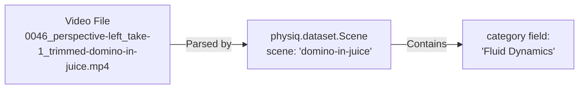

**Sources:** [physiq/dataset.py:41-44](), [descriptions/best_practice/descriptions_base.csv:1-200]()

---

## Category-Based Evaluation

The Physics-IQ score is calculated across all scenarios, but the system allows for category-level analysis by filtering the output of the evaluation pipeline.

### Evaluation Data Flow

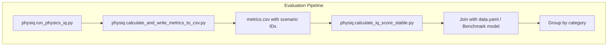

**Sources:** [physiq/run_physics_iq.py:25-50](), [physiq/calculate_iq_score_stable.py:38-45](), [physiq/dataset.py:80-100]()

---

# Page: Multi-View and Multi-Take Structure

# Multi-View and Multi-Take Structure

<details>
<summary>Relevant source files</summary>

The following files were used as context for generating this wiki page:

- [physiq/dataset.py](physiq/dataset.py)
- [physiq/tests/__init__.py](physiq/tests/__init__.py)

</details>


## Purpose and Scope

This document describes the multi-view and multi-take recording strategy used in the Physics-IQ benchmark dataset. Each physical scenario is captured from three camera perspectives (left, center, right) and recorded twice (take-1, take-2), resulting in a total of 396 videos from 66 unique scenarios. This redundant capture strategy enables both robust multi-perspective evaluation and quantification of natural physical variance.

The data model for this structure is implemented in `physiq/dataset.py`, which provides Pydantic-validated classes for managing scenes and their associated perspectives and takes.

---

## Data Model Implementation

The benchmark's structure is programmatically represented using the `Scene` and `Benchmark` classes.

### Scene Data Model
The `Scene` class [physiq/dataset.py:30-56]() represents a single physical scenario. It maps the hierarchical structure of takes and perspectives to unique video IDs.

- **`takes`**: A list of dictionaries where each entry corresponds to a recording session (take). Each dictionary maps perspective names (e.g., "left", "center") to their 4-digit ID [physiq/dataset.py:35]().
- **Metadata Aliases**: The model uses Pydantic aliases to map hyphenated YAML keys (e.g., `subject-action`) to Pythonic attributes [physiq/dataset.py:40-55]().

### Benchmark Orchestrator
The `Benchmark` class [physiq/dataset.py:59-132]() acts as the container for all scenes and provides logic for filename inference and data conversion.

- **`to_dataframe()`**: Flattens the nested structure into a tabular format, generating one row per video while calculating the `scenario` and `generated_video_name` strings [physiq/dataset.py:92-124]().
- **Filename Inference**: Static methods like `_infer_test_scenario` and `_infer_gt_fn_video` centralize the logic for constructing canonical filenames [physiq/dataset.py:69-90]().

**Sources:** [physiq/dataset.py:30-56](), [physiq/dataset.py:59-124]()

---

## Overview of Recording Strategy

The Physics-IQ benchmark employs a **2 × 3 recording matrix** for each of the 66 unique physical scenarios:

| Dimension | Values | Purpose |
|-----------|--------|---------|
| **Takes** | take-1, take-2 | Capture natural physical variation for variance quantification |
| **Perspectives** | left, center, right | Enable multi-view analysis and robustness testing |
| **Total Videos** | 66 scenarios × 2 takes × 3 views = **396 videos** | Comprehensive coverage with built-in variance baseline |

### Mapping Natural Structure to Code Entities

The following diagram bridges the conceptual recording strategy to the `physiq/dataset.py` data structures:

```mermaid
graph TD
    subgraph "Natural Language / Recording Space"
        Experiment["Physical Experiment (e.g., 'ball-hits-duck')"]
        T1["Take 1"]
        T2["Take 2"]
        P_L["Left View"]
        P_C["Center View"]
        P_R["Right View"]
    end

    subgraph "Code Entity Space (physiq/dataset.py)"
        SCENE_OBJ["Scene Class Instance"]
        TAKES_LIST["takes: list[dict[str, int]]"]
        INFER_FUNC["_infer_test_scenario()"]
        DF_ROW["pd.DataFrame Row"]
    end

    Experiment --> SCENE_OBJ
    T1 --> TAKES_LIST
    T2 --> TAKES_LIST
    P_L --> TAKES_LIST
    P_C --> TAKES_LIST
    P_R --> TAKES_LIST

    SCENE_OBJ --> TAKES_LIST
    TAKES_LIST --> INFER_FUNC
    INFER_FUNC --> DF_ROW
```

**Sources:** [physiq/dataset.py:30-35](), [physiq/dataset.py:69-74](), [physiq/dataset.py:92-124]()

---

## Filename Inference and Naming Conventions

The benchmark enforces strict naming conventions through the `Benchmark` class static methods. This ensures that generated videos, ground truth videos, and masks can be programmatically associated.

### Implementation Logic
The following diagram shows how `physiq/dataset.py` transforms a `Scene` ID into various file paths used by the evaluation pipeline:

```mermaid
graph TD
    ID["ID: 0001"]
    PERS["Perspective: 'left'"]
    TAKE["Take: 1"]
    NAME["Scene: 'ball-and-block-fall'"]

    ID & PERS & TAKE & NAME --> INF_TEST["Benchmark._infer_test_scenario()"]
    ID & PERS & TAKE & NAME --> INF_GT["Benchmark._infer_gt_fn_video()"]
    ID & PERS & NAME --> INF_GEN["Benchmark._infer_generated()"]

    INF_TEST --> F1["0001_perspective-left_take-1_trimmed-ball-and-block-fall.mp4"]
    INF_GT --> F2["0001_testing-videos_30FPS_perspective-left_take-1_trimmed-ball-and-block-fall.mp4"]
    INF_GEN --> F3["0001_perspective-left_trimmed-ball-and-block-fall.mp4"]
```

**Key Observation**: The `_infer_generated` method [physiq/dataset.py:89-90]() specifically omits the `take` identifier. This is because models are expected to generate one video per perspective, which is then compared against both ground truth takes during evaluation.

**Sources:** [physiq/dataset.py:69-90]()

---

## Data Integrity and CSV Export

The dataset structure is verified through hash comparison between the YAML source and the legacy CSV format.

### CSV Generation
The `build_original_descriptions` method [physiq/dataset.py:126-129]() exports the data model into a format compatible with the evaluation pipeline's `descriptions.csv` requirements. It selects specific columns: `scenario`, `description`, `category`, and `generated_video_name`.

### Integrity Check
The `__main__` block in `physiq/dataset.py` demonstrates how the system ensures consistency:
1. Loads the benchmark from `data.yaml` [physiq/dataset.py:136]().
2. Generates a DataFrame via `build_original_descriptions()` [physiq/dataset.py:138]().
3. Compares the `joblib.hash` of the generated DataFrame against the existing `descriptions_original.csv` [physiq/dataset.py:144-148]().

**Sources:** [physiq/dataset.py:126-129](), [physiq/dataset.py:135-159]()

---

## Dual-Take Variance Rationale

### Variance as a Normalization Factor
The dual-take design serves a critical purpose in the evaluation methodology: **establishing a baseline for acceptable physical variation**. By recording each scenario twice, the benchmark can compute variance metrics that quantify natural differences.

These variance values are then used to normalize the evaluation of generated videos. A scenario with high natural variance (e.g., fluid dynamics with turbulence) receives more lenient scoring than one with low variance (e.g., a static object).

**Sources:** [physiq/dataset.py:35](), [physiq/dataset.py:112]()

---

## Summary of Structure Representation

| Entity | Code Representation | Location |
|--------|---------------------|----------|
| **Scenario** | `Scene` class | [physiq/dataset.py:30]() |
| **View/Take Mapping** | `Scene.takes` (List of Dicts) | [physiq/dataset.py:35]() |
| **Dataset Registry** | `Benchmark` class | [physiq/dataset.py:59]() |
| **Scenario ID** | `int` (converted to 4-digit string) | [physiq/dataset.py:114]() |
| **YAML Source** | `descriptions/data.yaml` | [physiq/dataset.py:24]() |

**Sources:** [physiq/dataset.py:24-60]()

---

# Page: Dataset Metadata and Data Model

# Dataset Metadata and Data Model

<details>
<summary>Relevant source files</summary>

The following files were used as context for generating this wiki page:

- [descriptions/data.yaml](descriptions/data.yaml)
- [descriptions/descriptions_original.csv](descriptions/descriptions_original.csv)
- [physiq/aggregate_runs_from_csvs.py](physiq/aggregate_runs_from_csvs.py)
- [physiq/dataset.py](physiq/dataset.py)
- [physiq/plot_settings.py](physiq/plot_settings.py)
- [physiq/tests/__init__.py](physiq/tests/__init__.py)
- [physiq/tests/test_descriptions.py](physiq/tests/test_descriptions.py)

</details>


The Physics-IQ benchmark utilizes a structured metadata layer to manage 66 unique physical scenarios across multiple perspectives and takes. This layer bridges raw video files with natural language descriptions and physics categories, providing the programmatic foundation for generation, evaluation, and scoring.

---

## Data Model Architecture

The data model is implemented using Pydantic in `physiq/dataset.py`. It provides a strictly typed representation of the benchmark hierarchy, enabling validation of the source YAML and consistent inference of filenames across the pipeline.

### Scene and Benchmark Models

The `Scene` class represents a single physical experiment (e.g., "ball-and-block-fall"), containing its metadata and the specific IDs assigned to every recording of that experiment. The `Benchmark` class acts as a container for the collection of scenes.

| Class | Role | Key Attributes |
| :--- | :--- | :--- |
| `Scene` | Represents one physical setup | `scene`, `category`, `description`, `takes` |
| `Benchmark` | Collection of all scenes | `scenes: list[Scene]` |

**Sources**: [physiq/dataset.py:29-60]()

### Data Flow Diagram

The following diagram illustrates how raw YAML metadata is transformed into the internal data model and then exported for different pipeline stages.

```mermaid
graph TD
    YAML["descriptions/data.yaml"] -- "Benchmark.from_yaml()" --> BM["Benchmark (Pydantic)"]
    BM -- "contains" --> SCENE["Scene (Pydantic)"]
    
    BM -- "to_dataframe()" --> DF["Pandas DataFrame"]
    DF -- "build_original_descriptions()" --> CSV_GEN["Generated Metadata"]
    
    CSV_GEN -- "joblib.hash check" --> INTEGRITY["Integrity Verification"]
    DISK_CSV["descriptions_original.csv"] -- "pd.read_csv()" --> INTEGRITY
    
    BM -- "filename inference" --> FILENAMES["Inferred File Paths"]
```

**Sources**: [physiq/dataset.py:62-66](), [physiq/dataset.py:92-129](), [physiq/dataset.py:135-149]()

---

## Metadata Source: data.yaml

The `descriptions/data.yaml` file is the primary source of truth for the benchmark. It contains rich metadata that is not present in the simplified CSV exports, including specific fields for the prompt templater and annotations for known errors in the original dataset.

### YAML Schema and Pydantic Mapping

The `Scene` model uses Pydantic aliases to map hyphenated YAML keys to valid Python attributes.

| YAML Key | Pydantic Attribute | Purpose |
| :--- | :--- | :--- |
| `description-factual` | `description_factual` | Refined description for Verified benchmark |
| `subject-action` | `subject_action` | Core action for templated prompts |
| `scene-description` | `scene_description` | Background context for templated prompts |
| `takes` | `takes` | List of dicts mapping perspectives to 4-digit IDs |

**Sources**: [physiq/dataset.py:30-55](), [descriptions/data.yaml:1-18]()

### Filename Inference Conventions

The `Benchmark` class provides static methods to ensure consistent filename construction across the codebase. This prevents "magic string" errors when the pipeline needs to locate ground truth videos, masks, or model outputs.

| Method | Target Directory | Format Pattern |
| :--- | :--- | :--- |
| `_infer_test_scenario` | `testing-videos/` | `{id:04}_perspective-{p}_take-{t}_trimmed-{s}.mp4` |
| `_infer_gt_fn_video` | `testing-videos/` (w/ FPS) | `{id:04}_testing-videos_{fps}FPS_perspective-{p}_take-{t}_trimmed-{s}.mp4` |
| `_infer_fn_mask` | `video-masks/` | `{id:04}_video-masks_{fps}FPS_perspective-{p}_take-{t}_trimmed-{s}.mp4` |
| `_infer_generated` | `model_output/` | `{id:04}_perspective-{p}_trimmed-{s}.mp4` |

**Sources**: [physiq/dataset.py:68-90]()

---

## Integrity Verification

To ensure the codebase remains synchronized with the published dataset, `dataset.py` includes an integrity check that compares the dynamically generated metadata against the static `descriptions_original.csv`.

### Verification Logic

1.  **Loading**: The benchmark is loaded from `data.yaml` via `get_benchmark()`.
2.  **Generation**: `build_original_descriptions()` produces a DataFrame containing only the four columns required for the original benchmark: `scenario`, `description`, `category`, and `generated_video_name`.
3.  **Hashing**: `joblib.hash` is used to compare the generated DataFrame against the disk-based CSV.
4.  **Testing**: The `physiq/tests/test_descriptions.py` module uses `pd.testing.assert_frame_equal` to enforce this check during CI.

**Sources**: [physiq/dataset.py:126-148](), [physiq/tests/test_descriptions.py:22-28]()

---

## Entrypoints and Utilities

### get_benchmark()
The primary entrypoint for other modules to access the data model. It resolves the path to `descriptions/data.yaml` relative to the file location.
**Sources**: [physiq/dataset.py:24-26](), [physiq/dataset.py:131-132]()

### Multi-View Mapping
The `to_dataframe()` method flattens the hierarchical YAML structure (Scene -> Takes -> Perspectives) into a tabular format. During this process, it prioritizes `description_factual` over the original `description` if available, supporting the "Verified" variant of the benchmark.
**Sources**: [physiq/dataset.py:92-124]()

### Result Aggregation
The `aggregate_runs_from_csvs.py` script uses the data model's outputs (via `IQTable`) to combine multiple evaluation runs. It supports two score types:
*   **Original**: Uses the standard Physics-IQ scoring formula.
*   **Verified**: Uses the variance-normalized scoring formula.

**Sources**: [physiq/aggregate_runs_from_csvs.py:24-40](), [physiq/aggregate_runs_from_csvs.py:73-78]()

---

## Plotting and Visualization Metadata

Model-specific metadata for plotting (colors and display names) is managed in `physiq/plot_settings.py`. This allows the leaderboard and visualization tools to maintain consistent aesthetics across different models (e.g., Lumiere, VideoPoet, Sora).

**Sources**: [physiq/plot_settings.py:21-32](), [physiq/plot_settings.py:91-100]()

---

# Page: Video Generation

# Video Generation

<details>
<summary>Relevant source files</summary>

The following files were used as context for generating this wiki page:

- [README.md](README.md)
- [descriptions/best_practice/descriptions_base.csv](descriptions/best_practice/descriptions_base.csv)
- [physiq/generate_descriptions.py](physiq/generate_descriptions.py)

</details>


This page provides instructions for generating videos that can be evaluated by the Physics-IQ benchmark. It covers the requirements and conventions that generative video models must follow to produce outputs compatible with the evaluation pipeline, including the prompt generation system and specific model workflows.

For information about evaluating generated videos, see [Evaluation Pipeline](#4). For dataset structure and downloading, see [Dataset](#2).

---

## Overview

The Physics-IQ benchmark supports two types of generative video models, each with distinct input requirements and workflows. Models must generate videos that adhere to strict naming conventions and output formats to enable automated evaluation.

### Model Type Comparison

```mermaid
graph TB
    subgraph "Input Data (physics-IQ-benchmark/)"
        SF["switch-frames/<br/>{ID}_switch-frames_anyFPS_{perspective}_{scenario}.jpg"]
        CV["split-videos/conditioning-videos/{FPS}/<br/>{ID}_conditioning-videos_{FPS}_{perspective}_{take}_{scenario}.mp4"]
        DESC["descriptions.csv<br/>scenario descriptions and metadata"]
    end
    
    subgraph "I2V [Image-to-Video Models]"
        I2V_INPUT["Single frame + optional text"]
        I2V_PROCESS["Generate 5-second video<br/>from static initial condition"]
        I2V_OUTPUT[".model_name/<br/>{ID}_{anything}.mp4"]
    end
    
    subgraph "M2V [Multiframe-to-Video Models]"
        M2V_INPUT["Video segment + optional text"]
        M2V_PROCESS["Continue video generation<br/>from temporal context"]
        M2V_OUTPUT[".model_name/<br/>{ID}_{perspective}_{scenario}.mp4"]
    end
    
    SF --> I2V_INPUT
    DESC -.->|"optional text prompt"| I2V_INPUT
    I2V_INPUT --> I2V_PROCESS
    I2V_PROCESS --> I2V_OUTPUT
    
    CV --> M2V_INPUT
    DESC -.->|"optional text prompt"| M2V_INPUT
    M2V_INPUT --> M2V_PROCESS
    M2V_PROCESS --> M2V_OUTPUT
    
    style I2V_OUTPUT fill:#f0f0f0
    style M2V_OUTPUT fill:#f0f0f0
```

**Model Selection Impact**: The leaderboard shows multiframe models achieve significantly higher scores (top: 56.0% - 64.5%) compared to i2v models (top: ~30-40%), indicating that temporal context provides substantial advantages for physical realism.

Sources: [README.md:36-82](), [README.md:94-108]()

---

## Image-to-Video Models (#3.1)

Image-to-video (i2v) models generate videos from a single static frame as the initial condition. This represents a challenging evaluation mode, as models must infer all physical properties and dynamics from a single image.

### Input Requirements
- **Initial Frame**: `physics-IQ-benchmark/switch-frames/` (198 JPEG images).
- **Text Description**: Generated via `physiq/generate_descriptions.py` using a model-specific templater.

### Generation Process
1. **Load Frame**: Use the image corresponding to the target `{ID}`.
2. **Apply Prompt**: Use the "best-practice prompt" (bpp) generated for your specific model.
3. **Generate**: Produce a video starting exactly from the state shown in the switch-frame.
4. **Enforce Duration**: The output must be exactly **5 seconds**.

For detailed requirements on input handling and naming, see [Image-to-Video Models](#3.1).

Sources: [README.md:76-89](), [physiq/generate_descriptions.py:42-59]()

---

## Multiframe-to-Video Models (#3.2)

Multiframe-to-video models (also called video-to-video or v2v) generate videos using a short video segment as conditioning input. This provides temporal context about object motion, velocities, and physical properties.

### Input Requirements
- **Conditioning Frames**: `split-videos/conditioning-videos/{FPS}/` (198 MP4 files).
- **FPS Selection**: 8, 16, 24, or 30 FPS.

### Generation Process
1. **Conditioning**: Provide the first 3 seconds of the scenario to the model.
2. **Extension**: Generate the subsequent 5 seconds of physical motion.
3. **Post-Processing**: The evaluation pipeline expects the final **5-second** segment. If your model outputs the full 8 seconds (3s conditioning + 5s generated), you must trim the conditioning segment.

For details on FPS options and segment removal, see [Multiframe-to-Video Models](#3.2).

Sources: [README.md:94-108](), [README.md:67-69]()

---

## Output Requirements and Naming Conventions (#3.3)

All generated videos must adhere to strict requirements to enable automated evaluation. The evaluation pipeline validates these constraints before processing.

### Naming and Structure
- **Directory**: Must start with a dot (e.g., `.my-model-name/`).
- **Files**: Exactly 198 MP4 files.
- **Prefix**: Each file must start with a 4-digit zero-padded ID (e.g., `0001_...`).

### Video Constraints
- **Duration**: Exactly 5 seconds. The `trim_videos.py` utility can be used to ensure this.
- **Format**: `.mp4` container.

For the full specification and directory layout, see [Output Requirements and Naming Conventions](#3.3).

Sources: [README.md:84-89](), [README.md:154-157]()

---

## Prompt Generation (Templater System) (#3.4)

Physics-IQ uses a pluggable templater system to generate prompts tailored to specific models. This ensures that models are evaluated using their "best-practice" prompt formats.

### The Templater Subsystem

```mermaid
classDiagram
    class BaseTemplater {
        <<abstract>>
        +df: DataFrame
        +use_action_suffix: bool
        +generate_prompt(scenario_name: str)*
    }
    class MagiTemplater {
        +generate_prompt(scenario_name: str)
    }
    class SoraTemplater {
        +generate_prompt(scenario_name: str)
    }
    class REGISTRY {
        <<map>>
        "magi": MagiTemplater
        "sora": SoraTemplater
    }
    BaseTemplater <|-- MagiTemplater
    BaseTemplater <|-- SoraTemplater
    REGISTRY ..> BaseTemplater : stores
```

### Key Components
- **`generate_descriptions.py`**: The CLI tool to produce model-specific CSV files.
- **Best-Practice Prompts (bpp)**: Recommended for the Verified benchmark to maximize model performance.
- **Action Suffix**: An optional descriptive suffix (e.g., "...The grabber tools release the ball") appended to the base description.

For instructions on adding new model templaters and using the generation script, see [Prompt Generation (Templater System)](#3.4).

Sources: [physiq/generate_descriptions.py:25-66](), [physiq/templater.py:22-50]()

---

# Page: Image-to-Video Models

# Image-to-Video Models

<details>
<summary>Relevant source files</summary>

The following files were used as context for generating this wiki page:

- [README.md](README.md)
- [descriptions/best_practice/descriptions_base.csv](descriptions/best_practice/descriptions_base.csv)
- [physiq/generate_descriptions.py](physiq/generate_descriptions.py)

</details>


## Purpose and Scope

This document specifies the input requirements and output format for **image-to-video (i2v) models** being evaluated on the Physics-IQ benchmark. Image-to-video models generate video sequences from a single static image frame, typically conditioned on text descriptions. 

In the Physics-IQ framework, i2v models are tested on their ability to predict physical outcomes (e.g., collisions, fluid flow) starting from a single "switch frame" that captures the state of a scene just before a physical action begins [README.md:79-80]().

For information about multiframe-to-video models that use video segments as input, see [Multiframe-to-Video Models](3.2). For details on how generated videos are evaluated, see [Evaluation Pipeline](4).

**Sources:** [README.md:76-89]()

---

## Input Requirements

Image-to-video models in Physics-IQ consume two types of inputs: a required initial frame and a text description.

### Switch Frames Directory

The primary input for i2v models is a single static image extracted from each physics scenario. These frames are located in the `switch-frames/` directory of the benchmark dataset [README.md:141-144]().

**Directory Structure:**
```
physics-IQ-benchmark/
└── switch-frames/
    ├── 0001_switch-frames_anyFPS_perspective-left_trimmed-ball-and-block-fall.jpg
    ├── 0002_switch-frames_anyFPS_perspective-center_trimmed-ball-and-block-fall.jpg
    ├── 0003_switch-frames_anyFPS_perspective-right_trimmed-ball-and-block-fall.jpg
    └── ...
```

**File Naming Convention:**
Each switch frame filename follows the pattern: `{ID}_switch-frames_anyFPS_{perspective}_{scenario-name}.jpg` [README.md:141-144]().

| Component | Description | Example Values |
|-----------|-------------|----------------|
| `{ID}` | Zero-padded 4-digit unique identifier | `0001`, `0002`, ..., `0198` |
| `switch-frames` | Fixed literal indicating frame type | `switch-frames` |
| `anyFPS` | Frame rate indicator | `anyFPS` |
| `{perspective}` | Camera angle | `perspective-left`, `perspective-center`, `perspective-right` |
| `{scenario-name}` | Descriptive name of physics scenario | `trimmed-ball-and-block-fall` |

**Sources:** [README.md:141-144]()

---

### Text Descriptions and Prompting

Models use text descriptions of the physics scenarios to guide video generation. These descriptions are provided in the `descriptions.csv` metadata file [physiq/generate_descriptions.py:49-60]().

**Prompt Variants:**
The benchmark supports two types of prompts:
1.  **Original Prompts (op):** The baseline descriptions used in the original Physics-IQ release.
2.  **Best Practice Prompts (bpp):** Model-specific prompts generated using the `physiq/generate_descriptions.py` tool. These prompts include a specific subject-action postfix to improve model adherence [physiq/generate_descriptions.py:35-39]().

**Templater System:**
Prompts are generated via the `REGISTRY` pattern in `physiq/generate_descriptions.py` [physiq/generate_descriptions.py:22-29](). Users should select the templater corresponding to their model to generate the appropriate `descriptions_{templater}.csv` file [physiq/generate_descriptions.py:61-65]().

**Sources:** [README.md:60-62](), [physiq/generate_descriptions.py:25-66](), [descriptions/best_practice/descriptions_base.csv:1-15]()

---

## Output Requirements

Generated videos must follow strict naming conventions and format specifications to be processed by the evaluation pipeline.

### Directory Structure and Naming

All generated videos from a single model must be placed in a model-specific directory. The evaluation script `run_physics_iq.py` expects a flat directory of MP4 files [README.md:84-88]().

**File Naming Convention:**
Each generated video filename must preserve the unique 4-digit ID from its corresponding switch frame input:
`{ID}_{custom-suffix}.mp4`

**Requirements:**
- **Must** start with the 4-digit zero-padded ID (e.g., `0001_`) [README.md:156]().
- **Must** use `.mp4` extension.
- **Must** result in exactly 198 videos (66 scenarios × 3 perspectives) [README.md:156]().

**Sources:** [README.md:84-88](), [README.md:154-156]()

---

### Video Duration and Format

**Duration:**
Generated videos **must be exactly 5 seconds long** [README.md:156](). The evaluation pipeline processes only the first 5 seconds. If a model generates longer videos, the `trim_videos.py` utility can be used to enforce the constraint.

**Format:**
- **Container:** MP4.
- **Frame Rate:** Any FPS is accepted; the pipeline uses `fps_changer.py` to normalize generated videos to the ground truth FPS (typically 30 FPS) [README.md:156]().

**Sources:** [README.md:156]()

---

## Data Flow: From Input to Generation

The following diagram bridges the natural language space (prompts) and the code entities used to prepare inputs for i2v models.

```mermaid
graph TB
    subgraph "Natural_Language_Space"
        Prompt["Scenario Description<br/>'The tennis ball rolls...'"]
    end

    subgraph "Code_Entity_Space"
        YAML["descriptions/data.yaml"]
        GEN_DESC["physiq/generate_descriptions.py"]
        REG["physiq/templater.py: REGISTRY"]
        CSV["descriptions_model.csv"]
        BM["dataset.py: Benchmark"]
    end

    subgraph "Input_Files"
        SF["switch-frames/*.jpg"]
    end

    YAML --> BM
    BM --> GEN_DESC
    REG --> GEN_DESC
    GEN_DESC --> CSV
    CSV --> Prompt
    SF --> |"Visual Initial State"| I2V_Model
    Prompt --> |"Textual Conditioning"| I2V_Model
    I2V_Model --> |"Generates"| OUT[".model_name/0001_output.mp4"]
```

**Sources:** [physiq/generate_descriptions.py:25-66](), [dataset.py:20-43](), [README.md:141-144]()

---

## Validation and Integrity

Before evaluation, the system validates the generated outputs to ensure they match the dataset metadata.

```mermaid
graph TD
    subgraph "Validation_Logic"
        V_SCRIPT["run_physics_iq.py: validate_generations"]
        V_FILES["run_physics_iq.py: validate_video_files"]
        RENAME["run_physics_iq.py: rename_generated_videos"]
    end

    subgraph "Checks"
        C1["Count == 198?"]
        C2["4-digit Prefix Matches?"]
        C3["Duration == 5s?"]
    end

    DIR[".model_name/"] --> V_SCRIPT
    V_SCRIPT --> V_FILES
    V_FILES --> C1
    V_FILES --> C2
    V_FILES --> C3
    C1 & C2 & C3 --> RENAME
    RENAME --> |"Normalized Names"| EVAL_START["Metric Calculation"]
```

**Sources:** [README.md:156](), [run_physics_iq.py: validation logic described in README]()

---

## Leaderboard Performance (i2v)

As of the current benchmark results, i2v models generally underperform compared to multiframe models. The following table highlights top i2v performers on the **Physics-IQ Verified** leaderboard [README.md:43-57]().

| Rank | Model | Physics-IQ Verified Score | Input Type |
|------|-------|---------------------------|------------|
| 3 | Cosmos3-Super-Image2Video | **39.5** ± 0.8 | i2v |
| 4 | Grok Imagine Video | **34.8** ± 0.6 | i2v |
| 5 | Magi-1 24B + GeoPhys (op) | **33.7** ± 1.4 | i2v |
| 6 | Hunyuan Video 1.5 | **33.4** ± 0.8 | i2v |

**Sources:** [README.md:43-57]()

---

# Page: Multiframe-to-Video Models

# Multiframe-to-Video Models

<details>
<summary>Relevant source files</summary>

The following files were used as context for generating this wiki page:

- [README.md](README.md)
- [physiq/trim_videos.py](physiq/trim_videos.py)

</details>


**Purpose**: This page specifies the requirements for running multiframe-to-video (also called video-to-video or v2v) models on the Physics-IQ benchmark. It covers input conditioning videos, FPS selection, text descriptions, output formatting, and naming conventions.

For image-to-video model requirements, see [Image-to-Video Models](#3.1). For general output requirements that apply to both model types, see [Output Requirements and Naming Conventions](#3.3).

---

## Overview

Multiframe-to-video models generate future video frames by conditioning on a short video segment that captures initial motion and scene dynamics. In Physics-IQ, these models receive conditioning frames showing the first portion of each physics scenario and must predict the continuation.

**Key Advantage**: Multiframe models significantly outperform image-to-video models on Physics-IQ. The top multiframe model (Magi-1 24B + GeoPhys) achieves **58.2** on Physics-IQ Verified, while the top i2v model (Cosmos3-Super) achieves **39.5** — a substantial gap. This demonstrates that temporal context from conditioning frames provides significant advantages for understanding physical dynamics.

### System Data Flow: Multiframe Generation
The following diagram maps the logical data flow to the specific scripts and data structures used in the Physics-IQ codebase.

```mermaid
graph LR
    subgraph "Input: Conditioning Data"
        CV["split-videos/conditioning-videos/FPS/\n{ID}_conditioning-videos_{FPS}_{perspective}_{take}_{scenario}.mp4"]
        DESC["descriptions_base.csv / data.yaml\n(Text Prompts via BaseTemplater)"]
    end
    
    subgraph "Generation Orchestration"
        GEN_SCRIPT["generate_descriptions.py\n(Prompt Generation)"]
        MODEL["Multiframe Model\n(e.g., Magi-1, Cosmos3)"]
    end
    
    subgraph "Output: Generated Continuation"
        GEN_DIR[".model_name/ directory"]
        GEN_FILE["{ID}_{perspective}_{scenario}.mp4\n(Exactly 5 seconds)"]
    end
    
    CV --> MODEL
    DESC --> GEN_SCRIPT
    GEN_SCRIPT --> MODEL
    MODEL --> GEN_FILE
    GEN_FILE --> GEN_DIR
```

**Sources**: [README.md:43-57](), [README.md:92-108]()

---

## Input Requirements

### Conditioning Video Frames

Multiframe models must use conditioning videos from the `split-videos/conditioning-videos/` directory. These videos contain the initial frames of each physics scenario before the key physical event occurs.

**Location Structure**:
```
physics-IQ-benchmark/split-videos/conditioning-videos/{FPS}/
```

**Available Frame Rates**:
- `30FPS` (always available)
- `24FPS` (optional)
- `16FPS` (optional)  
- `8FPS` (optional)

If your desired FPS does not exist, the `download_physics_iq_data.py` script will automatically generate it by downsampling from the 30 FPS version.

**File Naming Pattern**:
```
{ID}_conditioning-videos_{FPS}_{perspective}_{take}_{scenario-name}.mp4
```

**Example Files**:
```
0001_conditioning-videos_30FPS_perspective-left_take-1_trimmed-ball-and-block-fall.mp4
0001_conditioning-videos_30FPS_perspective-center_take-1_trimmed-ball-and-block-fall.mp4
0001_conditioning-videos_30FPS_perspective-right_take-1_trimmed-ball-and-block-fall.mp4
```

**Important Notes**:
- Only **take-1** videos are provided in `conditioning-videos/` (198 total files) [README.md:132-140]().
- Each scenario has 3 perspectives: `perspective-left`, `perspective-center`, `perspective-right` [README.md:20-20]().
- Total count: 66 scenarios × 3 perspectives × 1 take = 198 conditioning videos [README.md:156-156]().
- The conditioning segment duration varies by scenario but is typically the first 1-2 seconds.

**Sources**: [README.md:94-99](), [README.md:132-140]()

---

### Text Descriptions and Prompts

Models may optionally use text descriptions as additional conditioning input. The benchmark provides a templater system to generate model-specific prompts.

**Location**: `descriptions_base.csv` or `physiq/descriptions/data.yaml`.

**Prompt Generation**:
The script `generate_descriptions.py` uses the `BaseTemplater` class and model-specific subclasses (e.g., `HunyuanVideoTemplater` in `physiq/physiq_verified.py`) to generate "Best Practice Prompts" (`bpp`).

**Usage**:
```bash
python physiq/generate_descriptions.py --model_name your_model --output_file prompts.csv
```

**Relevant Columns in Output**:
- `unique_id`: Video identifier (0001-0198)
- `description`: The generated text prompt for the model.
- `generated_video_name`: The required filename for the output video.

**Sources**: [README.md:60-60](), [README.md:153-153](), [physiq/physiq_verified.py:34-40]()

---

## Output Requirements

### Directory Structure and Duration

Generated videos must be saved in a model-specific directory. The evaluation pipeline `run_physics_iq.py` expects exactly 198 videos, each exactly 5 seconds long.

**Requirement Summary**:
- **Format**: MP4 (H.264/AVC1 codec recommended).
- **Duration**: Exactly 5 seconds. Use `physiq/trim_videos.py` to enforce this if your model produces variable lengths [physiq/trim_videos.py:22-31]().
- **Resolution**: Typically 3840x2160 or downscaled, but must be consistent.
- **Naming**: Directory must be `.model_name/`.

**Sources**: [README.md:102-107](), [README.md:156-156](), [physiq/trim_videos.py:52-53]()

---

### Naming Conventions

Output filenames must follow the strict pattern defined in the benchmark metadata. This is validated by `validate_video_files` in `run_physics_iq.py`.

**Pattern**:
```
{ID}_{perspective}_{scenario-name}.mp4
```

**Mapping Table**:

| Input Component | Output Component | Example |
| :--- | :--- | :--- |
| ID | 4-digit ID | `0001` |
| Perspective | perspective-name | `perspective-left` |
| Scenario | scenario-slug | `trimmed-ball-and-block-fall` |

**Final Example**: `0001_perspective-left_trimmed-ball-and-block-fall.mp4`

**Sources**: [README.md:104-107](), [physiq/run_physics_iq.py:105-120]()

---

## The 3-Second Removal Requirement

For **Multiframe/V2V** evaluation, it is critical to understand how the generated video is processed. The conditioning video segment provided as input is **not** part of the evaluation.

1.  The model receives a conditioning segment (e.g., 2 seconds).
2.  The model generates a 5-second continuation.
3.  The benchmark evaluation script `run_physics_iq.py` compares the **entire 5-second generated file** against the corresponding 5-second segment of the ground truth (Testing Videos).

**Note**: Do not prepend the conditioning frames to your output file. The output file should be the 5-second prediction starting immediately after the conditioning segment.

**Sources**: [README.md:102-108](), [README.md:132-140]()

---

## FPS Handling and Normalization

Your generated videos should ideally match the FPS of the conditioning input. If there is a mismatch, the evaluation pipeline uses `physiq/fps_changer.py` to normalize the frame rates.

### Code Entity Space: FPS Normalization Logic
This diagram shows how the system handles FPS discrepancies between generated videos and ground truth.

```mermaid
graph TD
    subgraph "physiq/run_physics_iq.py"
        VAL["validate_generations()"]
        ENSURE["ensure_real_videos_at_fps()"]
    end
    
    subgraph "physiq/fps_changer.py"
        CHANGE["change_video_fps()"]
        FFPROBE["ffprobe (detect FPS)"]
        FFMPEG["ffmpeg (linear interpolation)"]
    end
    
    VAL --> ENSURE
    ENSURE --> CHANGE
    CHANGE --> FFPROBE
    CHANGE --> FFMPEG
```

**Key Functions**:
- `change_video_fps`: Uses `ffmpeg` with `minterpolate` or simple dropped/duplicated frames to match the target FPS [physiq/fps_changer.py:23-45]().
- `ensure_real_videos_at_fps`: Orchestrates the conversion of ground truth videos to match the model's output FPS [physiq/run_physics_iq.py:210-230]().

**Sources**: [physiq/fps_changer.py:23-80](), [physiq/run_physics_iq.py:210-235]()

---

## Validation Checklist

Before submitting or running evaluation, ensure:

1.  **Count**: Exactly 198 videos are present in the `.model_name/` folder [README.md:156-156]().
2.  **Duration**: Each video is exactly 5.0 seconds (use `trim_videos.py` if necessary) [physiq/trim_videos.py:52-53]().
3.  **Naming**: Filenames start with the 4-digit ID (e.g., `0001_...`) [README.md:104-107]().
4.  **Content**: The video contains the physical continuation of the conditioning segment, not the conditioning segment itself.
5.  **Metadata**: You have a `descriptions.csv` file generated by `generate_descriptions.py` that matches your output filenames.

**Sources**: [README.md:156-156](), [physiq/run_physics_iq.py:105-120](), [physiq/trim_videos.py:22-31]()

---

# Page: Output Requirements and Naming Conventions

# Output Requirements and Naming Conventions

<details>
<summary>Relevant source files</summary>

The following files were used as context for generating this wiki page:

- [README.md](README.md)
- [generated_videos_5s/.gitkeep](generated_videos_5s/.gitkeep)
- [generated_videos_5s/README.md](generated_videos_5s/README.md)
- [physiq/trim_videos.py](physiq/trim_videos.py)

</details>


This page specifies the exact output format, naming conventions, directory structure, and validation requirements that generated videos must satisfy for Physics-IQ benchmark evaluation. These requirements ensure consistent processing across all models and enable automated metric computation.

For information about input data and conditioning frames, see [Image-to-Video Models](#3.1) and [Multiframe-to-Video Models](#3.2). For the evaluation process that validates these outputs, see [Validation and Setup](#4.2).

---

## Overview

All generative video models must produce outputs that conform to strict specifications:

- **Exactly 198 videos** corresponding to the 198 test cases (66 scenarios × 3 perspectives, excluding take-2).
- **Exactly 5 seconds duration** for each video.
- **MP4 file format** with consistent encoding.
- **Specific naming conventions** that preserve scenario ID prefixes.
- **Organized directory structure** following the `<model_name>-<prompt_setting>-run_01` pattern.

These requirements enable the evaluation pipeline in `run_physics_iq.py` to automatically process, validate, and score model outputs without manual intervention.

Sources: [README.md:43-57](), [generated_videos_5s/README.md:5-9](), [physiq/trim_videos.py:22-25]()

---

## File Naming Conventions

### 4-Digit Zero-Padded Prefix
Every generated video must begin with a 4-digit zero-padded identifier from `0001` to `0198`. This prefix is mandatory for the internal mapping logic to associate the generated file with the correct ground truth scenario and perspective metadata.

### Image-to-Video Models
Image-to-video models must use the following naming pattern:
`{ID}_{anything-you-like}.mp4`

**Components:**
- `{ID}`: 4-digit zero-padded identifier from `0001` to `0198`.
- `_`: Underscore separator (required).
- `{anything-you-like}`: Arbitrary string describing the model or scenario.
- `.mp4`: File extension (required).

### Multiframe-to-Video Models
Multiframe models must follow a more specific naming convention that preserves perspective and scenario information:
`{ID}_{perspective}_{scenario_name}.mp4`

**Components:**
- `{ID}`: 4-digit zero-padded identifier (0001-0198).
- `{perspective}`: Camera view - one of: `perspective-left`, `perspective-center`, `perspective-right`.
- `{scenario_name}`: Descriptive scenario name (e.g., `trimmed-ball-and-block-fall`).

Sources: [README.md:78-88](), [README.md:94-107]()

---

## Duration Requirements and Enforcement

### The 5-Second Constraint
**Critical Requirement:** All generated videos must be exactly **5.0 seconds** in duration. The evaluation pipeline only processes the first 5 seconds of each video, corresponding to the continuation of the conditioning frames.

### Using `trim_videos.py`
To assist developers in meeting this requirement, the codebase provides `physiq/trim_videos.py`. This utility automates the trimming process for an entire directory of generated videos.

**Implementation Details:**
- **Function:** `trim_videos(input_folder, output_folder)` [physiq/trim_videos.py:22-29]().
- **Logic:** It calculates the required frame count based on the video's FPS (`max_frames = int(5 * fps)`) [physiq/trim_videos.py:52-52]().
- **Codec:** It enforces the `avc1` (H.264) codec [physiq/trim_videos.py:57-57]().
- **Dimension Safety:** It ensures even dimensions (width/height) to maintain H.264 compatibility [physiq/trim_videos.py:49-50]().

**Execution:**
```bash
python3 physiq/trim_videos.py --input_folder ./raw_outputs --output_folder ./generated_videos_5s/my-model-run_01
```

Sources: [physiq/trim_videos.py:22-79](), [generated_videos_5s/README.md:1-11]()

---

## Directory Structure

Generated videos must be placed in a model-specific directory within the `generated_videos_5s` root. The structure follows a hierarchy that includes the model name and the specific run identifier.

### Output Folder Organization
```text
generated_videos_5s/
└── <model_name>-<prompt_setting>-run_01/
    ├── 0001_{...}.mp4
    ├── 0002_{...}.mp4
    ├── ...
    └── 0198_{...}.mp4
```

The directory name becomes the model identifier used in evaluation results and leaderboard plots.

Sources: [generated_videos_5s/README.md:5-11]()

---

## Data Flow: From Generation to Validation

The following diagrams bridge the gap between the file system (Output Space) and the evaluation code (Code Entity Space).

### File-to-Code Entity Mapping
This diagram shows how the file naming convention is consumed by the evaluation script `run_physics_iq.py`.

```mermaid
graph LR
    subgraph "File System (Output Space)"
        VFile["0042_perspective-center_ball-fall.mp4"]
    end

    subgraph "run_physics_iq.py (Code Space)"
        VGen["validate_generations()"]
        VFPS["get_video_fps()"]
        Rename["rename_generated_videos()"]
        Map["name_mapping dict"]
    end

    VFile --> VGen
    VGen -->|"Extracts ID '0042'"| VFPS
    VFPS --> Rename
    Rename -->|"Standardizes Filename"| Map
```
Sources: [physiq/trim_videos.py:33-40](), [generated_videos_5s/README.md:8-11]()

### Video Trimming Logic
This diagram details the implementation flow within `trim_videos.py`.

```mermaid
graph TD
    subgraph "physiq/trim_videos.py"
        Start["trim_videos()"]
        Cap["cv2.VideoCapture"]
        GetFPS["cap.get(CAP_PROP_FPS)"]
        Calc["max_frames = 5 * fps"]
        Writer["cv2.VideoWriter(avc1)"]
        Loop["Frame Loop (count < max_frames)"]
        Save["out.write(frame)"]
    end

    Start --> Cap
    Cap --> GetFPS
    GetFPS --> Calc
    Calc --> Writer
    Writer --> Loop
    Loop --> Save
```
Sources: [physiq/trim_videos.py:44-68]()

---

## File Format and Compatibility

### Video Codec and Container
- **Required Format:** MP4 container (`.mp4` extension).
- **Codec:** While the pipeline uses `cv2.VideoCapture`, `avc1` (H.264) is the standard enforced by the trimming utility [physiq/trim_videos.py:57-57]().
- **Resolution:** Any resolution is accepted, but even-numbered dimensions are required for H.264 compatibility [physiq/trim_videos.py:49-50]().

### Frame Rate (FPS) Consistency
All 198 videos within a single run folder must have the **same frame rate**. The pipeline detects the FPS of the first video and expects all subsequent videos in that folder to match. If you generate at 24 FPS, all 198 files must be 24 FPS.

Sources: [physiq/trim_videos.py:45-58](), [generated_videos_5s/README.md:8-11]()

---

# Page: Prompt Generation (Templater System)

# Prompt Generation (Templater System)

<details>
<summary>Relevant source files</summary>

The following files were used as context for generating this wiki page:

- [descriptions/best_practice/descriptions_base.csv](descriptions/best_practice/descriptions_base.csv)
- [physiq/generate_descriptions.py](physiq/generate_descriptions.py)
- [physiq/templater/__init__.py](physiq/templater/__init__.py)
- [physiq/templater/base.py](physiq/templater/base.py)
- [physiq/templater/physiq_verified.py](physiq/templater/physiq_verified.py)

</details>


The Physics-IQ benchmark utilizes a pluggable **Templater System** to generate text descriptions for video generation models. This system ensures that prompts are consistent across different physics scenarios while allowing for model-specific formatting requirements. The system supports "Best-Practice Prompts" (BPP), which are structured to provide optimal guidance to generative models, as well as "Original Prompts" (OP) for legacy comparisons.

### System Overview

The core of the prompt generation logic resides in the `physiq.templater` package. It uses a **Registry Pattern** to manage different templating strategies. The primary entry point for generating these prompts is the `generate_descriptions.py` script.

#### Data Flow: Prompt Generation

```mermaid
graph TD
    subgraph "Input Space"
        YAML["descriptions/data.yaml"]
    end

    subgraph "Code Entity Space"
        BM["Benchmark.from_yaml() [dataset.py]"]
        DF["pd.DataFrame [dataset.py]"]
        GD["generate_descriptions.py"]
        REG["REGISTRY [physiq/templater/base.py]"]
        BT["BaseTemplater [physiq/templater/base.py]"]
        PVT["PVideoTemplater [physiq/templater/physiq_verified.py]"]
    end

    subgraph "Output Space"
        CSV["descriptions/best_practice/descriptions_*.csv"]
    end

    YAML --> BM
    BM --> DF
    DF --> GD
    GD --> REG
    REG -- "instantiates" --> PVT
    PVT -- "inherits" --> BT
    PVT -- "generate_prompt()" --> CSV
```

**Sources:**
- [physiq/generate_descriptions.py:25-66]()
- [physiq/templater/base.py:20-32]()
- [physiq/templater/physiq_verified.py:19-27]()

---

### The Templater Registry

The system uses a decorator-based registry to map string identifiers (e.g., `"pvideo"`, `"sora2"`) to specific class implementations.

*   **`REGISTRY`**: A dictionary defined in `physiq/templater/base.py` that stores the mapping of names to `BaseTemplater` subclasses [[physiq/templater/base.py:20]]().
*   **`@register(name)`**: A decorator function used to add new templaters to the system [[physiq/templater/base.py:23-28]]().

### BaseTemplater Class

The `BaseTemplater` serves as the foundation for all prompt generation logic. It defines the standard components of a Physics-IQ prompt:

| Property / Method | Description | Source |
| :--- | :--- | :--- |
| `camera_description` | Defines a static, locked-off camera shot. | [[physiq/templater/base.py:51-53]]() |
| `style_description` | Sets the tone as a realistic scientific demonstration. | [[physiq/templater/base.py:55-57]]() |
| `action_description` | Constraints the scene to only the described setup. | [[physiq/templater/base.py:59-61]]() |
| `get_subjectaction_description` | Combines the core action with an optional postfix. | [[physiq/templater/base.py:94-111]]() |
| `generate_prompt` | The default assembly logic for the final text string. | [[physiq/templater/base.py:128-147]]() |

**Sources:**
- [physiq/templater/base.py:32-147]()

---

### Model-Specific Implementations

Different video generation models respond better to specific prompt structures. The `physiq_verified.py` file contains specialized templaters for the Verified benchmark.

#### P-Video Templater (`pvideo`)
Implements the "subject, action, scene, camera, lighting, style, audio" guideline. It merges the scene setup and scene description into a single block [[physiq/templater/physiq_verified.py:20-51]]().

#### Sora Templater (`sora2`)
Follows the official Sora prompting guide, using specific headers for `Style:`, `Cinematography:`, and `Actions:` [[physiq/templater/physiq_verified.py:54-88]]().

**Sources:**
- [physiq/templater/physiq_verified.py:19-88]()

---

### Execution and Configuration

The `generate_descriptions.py` script orchestrates the generation process. It loads the benchmark metadata via `Benchmark.from_yaml(DESCRIPTIONS_PATH)` [[physiq/generate_descriptions.py:42]]() and iterates through every scenario to apply the selected templater.

#### Key CLI Arguments:
*   **`templater`**: Positional argument to select the registered templater [[physiq/generate_descriptions.py:29]]().
*   **`--no-action-suffix`**: Disables the appending of the `subject_action_postfix` [[physiq/generate_descriptions.py:36-39]](). Note: This should **not** be used for verified evaluations, as the suffix often contains critical physical context.
*   **`--output-dir`**: Specifies where the resulting CSV will be saved (defaulting to `descriptions/best_practice`) [[physiq/generate_descriptions.py:31-34]]().

#### Internal Mapping to CSV
The script produces a CSV file with the following columns required by the evaluation pipeline:
1.  `scenario`: The unique identifier for the video take.
2.  `description`: The fully rendered prompt string.
3.  `category`: The physics domain (e.g., Solid Mechanics).
4.  `generated_video_name`: The expected filename for the model's output.

**Sources:**
- [physiq/generate_descriptions.py:45-66]()
- [descriptions/best_practice/descriptions_base.csv:1-15]()

### Implementation Detail: Subject-Action Postfix

The `BaseTemplater` includes logic to handle the `subject_action_postfix`. If `use_action_suffix` is True (default), the templater fetches the postfix from the data source and appends it to the primary action description [[physiq/templater/base.py:104-110]](). This is critical for scenarios where the primary action (e.g., "The ball rolls") needs specific physical context (e.g., "and hits the duck") to be correctly generated.

**Sources:**
- [physiq/templater/base.py:94-111]()

---

# Page: Evaluation Pipeline

# Evaluation Pipeline

<details>
<summary>Relevant source files</summary>

The following files were used as context for generating this wiki page:

- [physiq/calculate_and_write_metrics_to_csv.py](physiq/calculate_and_write_metrics_to_csv.py)
- [physiq/run_physics_iq.py](physiq/run_physics_iq.py)

</details>


The evaluation pipeline is the core system for processing generated videos and computing Physics-IQ scores. Implemented in `physiq/run_physics_iq.py` [physiq/run_physics_iq.py:1-432](), it orchestrates FPS normalization, binary mask generation, metric calculation, and score aggregation. This document describes the pipeline's architecture, validation mechanisms, and execution flow.

For details on the specific metrics computed, see [Metric Calculation](#4.5). For information on generating videos to feed into this pipeline, see [Video Generation](#3). For the raw metric calculation algorithms, see [API Reference](#7).

---

## Pipeline Overview

The evaluation pipeline operates as a sequential workflow that transforms generated videos and ground truth data into quantitative Physics-IQ scores. It bridges the gap between raw video files and structured metric data.

### Natural Language to Code Entity Space

| System Component | Code Entity (File/Class/Function) | Role |
| :--- | :--- | :--- |
| **Input Validation** | `validate_generations` [physiq/run_physics_iq.py:168-202]() | Enforces 198 videos and 5s duration. |
| **FPS Matcher** | `ensure_real_videos_at_fps` [physiq/run_physics_iq.py:272-312]() | Orchestrates `fps_changer.py` to match real data to model FPS. |
| **Mask Manager** | `ensure_binary_mask_structure` [physiq/run_physics_iq.py:315-343]() | Caches and manages `binary_mask_generator.py` outputs. |
| **Metric Engine** | `process_videos` [physiq/calculate_and_write_metrics_to_csv.py:260-353]() | Parallel frame-by-frame comparison logic. |
| **Score Aggregator** | `IQTable` [physiq/calculate_iq_score_stable.py:38-344]() | Aggregates per-scenario metrics into final IQ scores. |

**Sources:** [physiq/run_physics_iq.py:1-432](), [physiq/calculate_and_write_metrics_to_csv.py:1-353](), [physiq/calculate_iq_score_stable.py:38-344]()

### Pipeline Execution Flow

```mermaid
graph TB
    subgraph Input["Input Validation"]
        VI["validate_generations()"]
        VDIR["validate_path_exists()"]
        VF["validate_video_files()"]
    end
    
    subgraph FPS["FPS Detection & Normalization"]
        GFPS["get_video_fps()"]
        ERV["ensure_real_videos_at_fps()"]
        CVFPS["fps_changer.change_video_fps()"]
    end
    
    subgraph Masks["Binary Mask Generation"]
        EBMR["ensure_binary_mask_structure()<br/>is_real=True"]
        EBMG["ensure_binary_mask_structure()<br/>is_real=False"]
        GENBM["binary_mask_generator.generate_binary_masks()"]
    end
    
    subgraph Metrics["Metric Computation"]
        CSVC["is_csv_complete()"]
        PV["calculate_and_write_metrics_to_csv.process_videos()"]
    end
    
    subgraph Scores["Score Aggregation"]
        IQST["IQTable.from_csv()"]
        IQSC["IQTable.compute_final_score_stable()"]
    end
    
    VI --> GFPS
    VDIR --> GFPS
    VF --> GFPS
    
    GFPS --> ERV
    ERV --> CVFPS
    
    CVFPS --> EBMR
    EBMR --> GENBM
    
    GENBM --> EBMG
    EBMG --> CSVC
    
    CSVC --> PV
    PV --> IQST
    IQST --> IQSC
```

**Sources:** [physiq/run_physics_iq.py:346-432](), [physiq/calculate_and_write_metrics_to_csv.py:260-353]()

---

## Child Pages

For detailed documentation on each stage, refer to the following pages:

### [Running Evaluation](#4.1)
Step-by-step instructions for executing `run_physics_iq.py`. Covers CLI arguments like `--input_folders`, `--output_folder`, and the `--original_physics_iq` flag for legacy scoring. Details the expected directory structure and output locations for CSV and JSON metrics.
**Sources:** [physiq/run_physics_iq.py:346-372]()

### [Validation and Setup](#4.2)
Explains the rigorous validation logic in `validate_generations` [physiq/run_physics_iq.py:168-202]() and `validate_video_files` [physiq/run_physics_iq.py:203-235](). Covers the 198-video requirement, 5-second duration enforcement via `ffprobe`, and the `rename_generated_videos` [physiq/run_physics_iq.py:71-103]() logic that maps 4-digit prefixes to canonical filenames.
**Sources:** [physiq/run_physics_iq.py:71-235]()

### [FPS Normalization](#4.3)
Describes how the system handles varying model frame rates. Details `get_video_fps` [physiq/run_physics_iq.py:237-269]() for detection and the orchestration of `fps_changer.py` to ensure ground truth videos are interpolated to match the model's output frequency.
**Sources:** [physiq/run_physics_iq.py:272-312](), [physiq/fps_changer.py:1-117]()

### [Binary Mask Generation](#4.4)
Explains the adaptive background subtraction technique (MOG2) used in `binary_mask_generator.py` to isolate moving objects. Describes the `ensure_binary_mask_structure` [physiq/run_physics_iq.py:315-343]() caching layer that stores masks in a dedicated hierarchy to avoid redundant computation.
**Sources:** [physiq/run_physics_iq.py:315-343](), [physiq/binary_mask_generator.py:1-150]()

### [Metric Calculation](#4.5)
Details the frame-by-frame computation process in `calculate_and_write_metrics_to_csv.py` [physiq/calculate_and_write_metrics_to_csv.py:260-353](). Explains how the pipeline compares generated videos to ground truth across Spatial IoU, Spatiotemporal IoU, Weighted Spatial IoU, and MSE dimensions.
**Sources:** [physiq/calculate_and_write_metrics_to_csv.py:118-257]()

### [Score Aggregation](#4.6)
Describes the final stage where raw metrics are converted into a single Physics-IQ score. Covers the `IQTable` class [physiq/calculate_iq_score_stable.py:38-344]() and the logic in `aggregate_runs_from_csvs.py` for producing Verified Scores across multiple views and takes.
**Sources:** [physiq/calculate_iq_score_stable.py:214-257](), [physiq/aggregate_runs_from_csvs.py:1-113]()

---

# Page: Running Evaluation

# Running Evaluation

<details>
<summary>Relevant source files</summary>

The following files were used as context for generating this wiki page:

- [physiq/run_physics_iq.py](physiq/run_physics_iq.py)

</details>


This page provides step-by-step instructions for executing the Physics-IQ evaluation pipeline using `run_physics_iq.py`. It covers command-line arguments, directory structure requirements, and output locations. For detailed information about specific pipeline stages, see [Validation and Setup](#4.2), [FPS Normalization](#4.3), [Binary Mask Generation](#4.4), [Metric Calculation](#4.5), and [Score Aggregation](#4.6).

## Prerequisites

### Installation

Install required Python packages using the provided `pyproject.toml` or `requirements.txt`:

```bash
pip install .
```

**Sources:** [pyproject.toml:1-55]()

### Dataset Placement

The Physics-IQ benchmark dataset must be downloaded and placed in the working directory. The dataset must include at minimum 30FPS videos, as other frame rates can be automatically generated if needed.

**Required dataset structure:**

```
physics-IQ-benchmark/
├── split-videos/
│   ├── conditioning-videos/
│   │   └── 30FPS/
│   └── testing-videos/
│       └── 30FPS/
├── switch-frames/
└── video-masks/
    └── real/
        └── 30FPS/
```

The `descriptions.csv` metadata file must also be accessible. By default, the script looks for `descriptions_original.csv` if the `--original_physics_iq` flag is used.

**Sources:** [physiq/run_physics_iq.py:203-233](), [physiq/run_physics_iq.py:388-393]()

### Generated Videos Placement

Generated videos from your model must be organized in a dedicated directory following the naming convention:

```
./model_name/
├── 0001_{anything}.mp4
├── 0002_{anything}.mp4
├── ...
└── 0198_{anything}.mp4
```

**Critical Requirements:**
- Exactly **198 videos** must be present (one per test case) [physiq/run_physics_iq.py:168-181]()
- Each video must be exactly **5 seconds** long [physiq/run_physics_iq.py:193-199]()
- Filenames must start with 4-digit zero-padded IDs from `0001_` to `0198_` [physiq/run_physics_iq.py:183-189]()
- Only `.mp4` format is supported [physiq/run_physics_iq.py:101-102]()

**Sources:** [physiq/run_physics_iq.py:101-199]()

## Command-Line Usage

### Basic Command

```bash
python3 physiq/run_physics_iq.py \
  --input_folders <generated_videos_dir1> \
  --output_folder <output_dir> \
  --descriptions_file <path_to_descriptions.csv>
```

### Command-Line Arguments

| Argument | Type | Default | Description |
|----------|------|---------|-------------|
| `--input_folders` | `str` (list) | **Required** | Paths to directories containing generated videos. |
| `--output_folder` | `str` | **Required** | Path to directory where output CSV files and JSON metrics will be saved. |
| `--descriptions_file` | `str` | **Required** | Path to the `descriptions.csv` file containing scenario metadata. |
| `--original_physics_iq` | `bool` | `False` | If set, uses the original Physics-IQ scoring logic instead of the "Stable" (Verified) version. |
| `--n_process` | `int` | `1` | Number of parallel processes for metric calculation. |
| `--lazy_integrity` | `bool` | `False` | Skips expensive hash-based integrity checks for the dataset. |

**Sources:** [physiq/run_physics_iq.py:346-371]()

### Argument Parser Implementation

```mermaid
graph TB
    subgraph "ArgumentParser"
        PARSER["argparse.ArgumentParser<br/>'Video Processing Script'"]
        
        ARG1["--input_folders<br/>nargs='+'"]
        ARG2["--output_folder"]
        ARG3["--descriptions_file"]
        ARG4["--original_physics_iq<br/>action='store_true'"]
        ARG5["--n_process<br/>type=int"]
        ARG6["--lazy_integrity<br/>action='store_true'"]
    end
    
    subgraph "Parsed Arguments"
        ARGS["args object"]
        INPUT["args.input_folders"]
        OUTPUT["args.output_folder"]
        DESC["args.descriptions_file"]
        ORIG["args.original_physics_iq"]
        PROC["args.n_process"]
        LAZY["args.lazy_integrity"]
    end
    
    PARSER --> ARG1
    PARSER --> ARG2
    PARSER --> ARG3
    PARSER --> ARG4
    PARSER --> ARG5
    PARSER --> ARG6
    
    ARG1 --> INPUT
    ARG2 --> OUTPUT
    ARG3 --> DESC
    ARG4 --> ORIG
    ARG5 --> PROC
    ARG6 --> LAZY
    
    INPUT --> ARGS
    OUTPUT --> ARGS
    DESC --> ARGS
    ORIG --> ARGS
    PROC --> ARGS
    LAZY --> ARGS
```

**Sources:** [physiq/run_physics_iq.py:346-371]()

## Execution Flow

The `run_physics_iq.py` script orchestrates the following flow:

```mermaid
graph TD
    START["Main Entry Point<br/>physiq.run_physics_iq.main"]
    PARSE["Parse Arguments<br/>argparse"]
    
    LOOP_START["For each input_folder"]
    
    VALIDATE_GEN["validate_generations()<br/>Check 198 videos & 5s duration"]
    GET_FPS["get_video_fps()<br/>Detect FPS from generated videos"]
    
    ENSURE_REAL["ensure_real_videos_at_fps()<br/>Check/Create ground truth at target FPS"]
    
    MASK_REAL["ensure_binary_mask_structure()<br/>(is_real=True)"]
    
    RENAME_GEN["rename_generated_videos()<br/>Map 0001_ to scenario names"]
    
    MASK_GEN["ensure_binary_mask_structure()<br/>(is_real=False)"]
    
    CHECK_CSV{"is_csv_complete()?"}
    
    PROCESS["process_videos()<br/>Calculate frame-by-frame metrics"]
    
    LOOP_END["Next input_folder"]
    
    AGGREGATE["IQTable.from_csv()<br/>Aggregate to final scores"]
    PLOT["Generate scores_plot.png"]
    
    START --> PARSE
    PARSE --> LOOP_START
    
    LOOP_START --> VALIDATE_GEN
    VALIDATE_GEN --> GET_FPS
    GET_FPS --> ENSURE_REAL
    ENSURE_REAL --> MASK_REAL
    
    MASK_REAL --> RENAME_GEN
    RENAME_GEN --> MASK_GEN
    
    MASK_GEN --> CHECK_CSV
    
    CHECK_CSV -->|"No"| PROCESS
    CHECK_CSV -->|"Yes"| LOOP_END
    PROCESS --> LOOP_END
    
    LOOP_END -->|"Done"| AGGREGATE
    AGGREGATE --> PLOT
```

**Sources:** [physiq/run_physics_iq.py:373-432]()

### Key Pipeline Components

The script integrates multiple specialized modules:

| Component | Code Entity | Role |
|----------|-------------|------|
| **FPS Sync** | `change_video_fps` | Normalizes ground truth to match model output FPS. [physiq/fps_changer.py:27-29]() |
| **Masking** | `generate_binary_masks` | Isolates moving objects via background subtraction. [physiq/binary_mask_generator.py:108-111]() |
| **Metrics** | `process_videos` | Computes IoU and MSE values across takes/views. [physiq/calculate_and_write_metrics_to_csv.py:252-254]() |
| **Scoring** | `IQTable` | Aggregates metrics and applies variance normalization. [physiq/calculate_iq_score_stable.py:31-33]() |

**Sources:** [physiq/run_physics_iq.py:28-32]()

## Output Locations

After execution, the results are organized in the specified `--output_folder`:

### 1. Metrics CSV and JSON
For each input folder, a CSV containing raw scenario metrics is created in `<output_folder>/results/`. Additionally, an `iq_score.json` file is saved containing the final aggregated scores.

**Sources:** [physiq/run_physics_iq.py:417-425](), [physiq/calculate_iq_score_stable.py:218-228]()

### 2. Comparative Visualizations
If multiple folders are processed, the script generates `scores_plot.png` in the results directory, mapping model names to colors defined in `plot_settings.py`.

**Sources:** [physiq/run_physics_iq.py:427-432](), [physiq/plot_settings.py:19-54]()

### 3. Intermediate Assets
- **Normalized Videos**: Stored in `physics-IQ-benchmark/split-videos/testing-videos/{FPS}FPS/`.
- **Binary Masks**: Stored in `physics-IQ-benchmark/video-masks/real/{FPS}FPS/` and `.../generated/{model_name}/{FPS}FPS/`.

**Sources:** [physiq/run_physics_iq.py:203-233](), [physiq/run_physics_iq.py:272-311]()

## Key Functions

### `validate_generations`
[physiq/run_physics_iq.py:168-202]()
Ensures the input folder contains exactly 198 videos, each starting with the correct 4-digit prefix and having a duration of exactly 5 seconds (verified via `ffprobe`).

### `rename_generated_videos`
[physiq/run_physics_iq.py:71-103]()
Standardizes generated filenames by mapping the 4-digit prefix to the ground truth scenario name (e.g., `0001_...mp4` becomes `0001_perspective-center_trimmed-lit-candle.mp4`).

### `is_csv_complete`
[physiq/run_physics_iq.py:36-68]()
Checks if a results CSV already exists and contains all required scenarios. If true, the script skips metric calculation for that folder, enabling easy resumption of interrupted runs.

**Sources:** [physiq/run_physics_iq.py:36-202]()

---

# Page: Validation and Setup

# Validation and Setup

<details>
<summary>Relevant source files</summary>

The following files were used as context for generating this wiki page:

- [physiq/run_physics_iq.py](physiq/run_physics_iq.py)
- [physiq/tests/test_submit.py](physiq/tests/test_submit.py)

</details>


## Purpose and Scope

This page documents the validation and setup procedures that `run_physics_iq.py` performs before executing the evaluation pipeline. These validation steps ensure that generated videos meet benchmark requirements—specifically the 198-video count, 5-second duration, and 4-digit prefix naming convention—and that all necessary files exist in the correct structure. The validation phase occurs immediately after command-line argument parsing and before any processing begins.

For information about executing the evaluation pipeline after validation succeeds, see [Running Evaluation](#4.1). For details on the processing steps that follow validation, see [FPS Normalization](#4.3), [Binary Mask Generation](#4.4), and [Metric Calculation](#4.5).

---

## Validation Workflow

The validation process follows a strict sequence to verify data integrity before processing. The system validates generated videos first, then checks file structure consistency, and finally confirms CSV completeness to enable resumable processing.

**Validation Sequence Diagram**

```mermaid
graph TD
    START["run_physics_iq.py execution"]
    
    VALIDATE_DIR["validate_path_exists()<br/>Check input_folder exists"]
    VALIDATE_DESC["validate_path_exists()<br/>Check descriptions_file exists"]
    
    GET_FPS["get_video_fps()<br/>Detect & validate FPS consistency"]
    
    VALIDATE_GEN["validate_generations()<br/>198 videos, 5s duration, correct IDs"]
    
    RENAME["rename_generated_videos()<br/>Apply naming convention"]
    
    VALIDATE_FILES["validate_video_files()<br/>Match against descriptions.csv"]
    
    ENSURE_REAL["ensure_real_videos_at_fps()<br/>Check/generate real videos at target FPS"]
    
    CHECK_CSV["is_csv_complete()<br/>Check if processing already done"]
    
    SKIP{Skip processing?}
    
    CONTINUE["Continue to processing pipeline"]
    
    START --> VALIDATE_DIR
    VALIDATE_DIR --> VALIDATE_DESC
    VALIDATE_DESC --> GET_FPS
    GET_FPS --> VALIDATE_GEN
    VALIDATE_GEN --> RENAME
    RENAME --> VALIDATE_FILES
    VALIDATE_FILES --> ENSURE_REAL
    ENSURE_REAL --> CHECK_CSV
    CHECK_CSV --> SKIP
    SKIP -->|CSV incomplete| CONTINUE
    SKIP -->|CSV complete| START
```

**Sources:** [physiq/run_physics_iq.py:382-466]()

---

## Generated Video Validation

The `validate_generations()` function enforces strict requirements on the input video set. This validation occurs in [physiq/run_physics_iq.py:168-201]() and is called both directly and within the `rename_generated_videos()` function.

### Requirements Enforced

| Requirement | Value | Validation Method |
|-------------|-------|-------------------|
| Number of videos | 198 | Directory file count |
| Video duration | 5.0 seconds (±0.001s tolerance) | `ffprobe` duration query |
| Filename prefix | `0001_` through `0198_` | Sequential ID checking |
| File extension | `.mp4` | Extension filtering |

### Validation Algorithm

```mermaid
graph TD
    START["validate_generations(input_folder)"]
    
    CHECK_EXISTS["Assert folder exists and is directory"]
    
    LIST_FILES["files_in_folder = sorted .mp4 files"]
    
    CHECK_COUNT{len(files) == 198?}
    
    ITERATE["For each file (counter 1-198)"]
    
    CHECK_PREFIX{"Starts with<br/>{:04d}_?"}
    
    GET_DURATION["get_video_duration(video_path)<br/>using ffprobe"]
    
    CHECK_DURATION{"Duration ≈ 5.0s<br/>(±0.001s)?"}
    
    INCREMENT["counter += 1"]
    
    SUCCESS["Validation passed"]
    
    ERROR_COUNT["AssertionError:<br/>Wrong number of videos"]
    ERROR_PREFIX["AssertionError:<br/>Wrong video ID prefix"]
    ERROR_DURATION["AssertionError:<br/>Wrong video duration"]
    
    START --> CHECK_EXISTS
    CHECK_EXISTS --> LIST_FILES
    LIST_FILES --> CHECK_COUNT
    CHECK_COUNT -->|No| ERROR_COUNT
    CHECK_COUNT -->|Yes| ITERATE
    ITERATE --> CHECK_PREFIX
    CHECK_PREFIX -->|No| ERROR_PREFIX
    CHECK_PREFIX -->|Yes| GET_DURATION
    GET_DURATION --> CHECK_DURATION
    CHECK_DURATION -->|No| ERROR_DURATION
    CHECK_DURATION -->|Yes| INCREMENT
    INCREMENT -->|More files| CHECK_PREFIX
    INCREMENT -->|All done| SUCCESS
```

The duration check uses `ffprobe` via `subprocess` execution to query video metadata without loading the entire video into memory. The implementation is at [physiq/run_physics_iq.py:149-165]().

**Sources:** [physiq/run_physics_iq.py:168-201](), [physiq/run_physics_iq.py:149-165]()

---

## Video File Naming and Renaming

Generated videos must follow a specific naming convention to match ground truth videos. The `rename_generated_videos()` function transforms user-provided filenames into the standardized format.

### Naming Convention Transformation

**Before Renaming (User-provided format):**
```
0001_<arbitrary_name>.mp4
0002_<arbitrary_name>.mp4
...
0198_<arbitrary_name>.mp4
```

**After Renaming (Benchmark format):**
```
0001_perspective-center_<scenario-name>.mp4
0002_perspective-center_<scenario-name>.mp4
...
0198_perspective-center_<scenario-name>.mp4
```

### Renaming Process

```mermaid
graph LR
    REAL_DIR["real_video_directory<br/>(ground truth videos)"]
    
    GEN_DIR["generated_video_directory<br/>(user videos)"]
    
    BUILD_MAP["Build name_mapping<br/>prefix → standardized_name"]
    
    EXTRACT["For each real file:<br/>Extract parts from filename"]
    
    MAP_ENTRY["name_mapping[prefix] =<br/>fileID_perspective_scenario"]
    
    APPLY["For each generated file:<br/>Lookup prefix in mapping"]
    
    RENAME["os.rename(old_path, new_path)"]
    
    REAL_DIR --> EXTRACT
    EXTRACT --> MAP_ENTRY
    MAP_ENTRY --> BUILD_MAP
    
    GEN_DIR --> APPLY
    BUILD_MAP --> APPLY
    APPLY --> RENAME
```

The function extracts three components from real video filenames and reconstructs the standardized name:

**Filename Parsing Logic**

```mermaid
graph TD
    INPUT["Real filename:<br/>0092_real_videos_perspective-center_take-1_lit-candle.mp4"]
    
    SPLIT["Split by underscore (_)"]
    
    PARTS["parts = [<br/>&nbsp;&nbsp;'0092',<br/>&nbsp;&nbsp;'real',<br/>&nbsp;&nbsp;'videos',<br/>&nbsp;&nbsp;'perspective-center',<br/>&nbsp;&nbsp;'take-1',<br/>&nbsp;&nbsp;'lit-candle.mp4'<br/>]"]
    
    SELECT["Join selected parts:<br/>parts[0], parts[3], parts[5]"]
    
    OUTPUT["Standardized name:<br/>0092_perspective-center_lit-candle.mp4"]
    
    INPUT --> SPLIT
    SPLIT --> PARTS
    PARTS --> SELECT
    SELECT --> OUTPUT
```

The implementation at [physiq/run_physics_iq.py:71-103]() uses a fixed prefix length of 4 characters to create the mapping dictionary, then iterates through generated videos to perform renaming.

**Sources:** [physiq/run_physics_iq.py:71-103]()

---

## File Structure Validation

The `validate_video_files()` function ensures that all expected videos exist by cross-referencing with `descriptions.csv`. This validation occurs at multiple stages for different video types (real testing videos, generated videos, masks).

### Validation Parameters

The function signature at [physiq/run_physics_iq.py:203-273]() accepts:

| Parameter | Type | Purpose |
|-----------|------|---------|
| `input_folder` | `str` | Directory containing videos to validate |
| `descriptions_file` | `str` | Path to `descriptions.csv` |
| `video_type` | `str` | One of: `"video-masks"`, `"testing-videos"`, `""` (generated) |
| `fps` | `int` | Frame rate for filename construction |
| `include_take_2` | `bool` | Whether to include both takes (default: `False`) |

### Filename Construction

```mermaid
graph TD
    CSV["descriptions.csv<br/>scenario column"]
    
    READ["Read expected_files set<br/>from CSV"]
    
    EXAMPLE["Example from CSV:<br/>0001_perspective-center_take-1_ball-drop.mp4"]
    
    SPLIT["Split into components:<br/>file_id, view, take, scenario"]
    
    CONSTRUCT{"video_type == ''?"}
    
    GENERATED["Generated format:<br/>fileID_view_scenario"]
    
    REAL_MASK["Real/Mask format:<br/>fileID_type_FPS_view_take_scenario"]
    
    FILTER{"include_take_2?"}
    
    KEEP_ALL["Keep all files"]
    
    FILTER_TAKE2["Remove take-2 files"]
    
    VALIDATE["Compare against<br/>actual files in folder"]
    
    CSV --> READ
    READ --> EXAMPLE
    EXAMPLE --> SPLIT
    SPLIT --> CONSTRUCT
    CONSTRUCT -->|Yes| GENERATED
    CONSTRUCT -->|No| REAL_MASK
    GENERATED --> FILTER
    REAL_MASK --> FILTER
    FILTER -->|True| KEEP_ALL
    FILTER -->|False| FILTER_TAKE2
    KEEP_ALL --> VALIDATE
    FILTER_TAKE2 --> VALIDATE
```

The filename modification logic at [physiq/run_physics_iq.py:228-235]() transforms scenario entries from `descriptions.csv` into expected filenames based on the video type:

- **Generated videos** (`video_type == ""`): `{file_id}_{view}_{scenario}`
- **Real/mask videos** (`video_type != ""`): `{file_id}_{video_type}_{fps}FPS_{view}_{take}_{scenario}`

### Validation Outcomes

The function performs set operations to identify mismatches:

| Condition | Action |
|-----------|--------|
| `missing_files = expected - actual` | Raise `FileNotFoundError` with missing file list |
| `extra_files = actual - expected` | Print warning (non-fatal) |
| All files present | Print success message and return expected set |

**Sources:** [physiq/run_physics_iq.py:203-273]()

---

## Directory and Folder Validation

Two utility functions provide basic directory validation:

### validate_path_exists()

Located at [physiq/run_physics_iq.py:105-118](), this function checks for directory existence with descriptive error messages:

```python
def validate_path_exists(directory: str, description: str) -> None:
    if not os.path.exists(directory):
        raise FileNotFoundError(f"{description} not found: {directory}")
```

### validate_folder_files_exist()

Located at [physiq/run_physics_iq.py:120-147](), this function combines directory existence checking with file completeness validation:

**Folder Validation Process**

```mermaid
graph TD
    INPUT["validate_folder_files_exist(<br/>folder, expected_files, description)"]
    
    CHECK_EXISTS{"Folder exists?"}
    
    LIST_FILES["actual_files = .mp4 files in folder"]
    
    EXTRACT_FPS["Extract FPS from description string"]
    
    REPLACE_FPS["Replace '30FPS' with '{fps}FPS'<br/>in expected filenames"]
    
    COMPUTE_MISSING["missing_files = expected - actual"]
    
    CHECK_MISSING{"missing_files<br/>empty?"}
    
    SUCCESS["Print validation success"]
    
    ERROR_NOT_EXIST["FileNotFoundError:<br/>Folder does not exist"]
    
    ERROR_MISSING["FileNotFoundError:<br/>Missing files list"]
    
    INPUT --> CHECK_EXISTS
    CHECK_EXISTS -->|No| ERROR_NOT_EXIST
    CHECK_EXISTS -->|Yes| LIST_FILES
    LIST_FILES --> EXTRACT_FPS
    EXTRACT_FPS --> REPLACE_FPS
    REPLACE_FPS --> COMPUTE_MISSING
    COMPUTE_MISSING --> CHECK_MISSING
    CHECK_MISSING -->|No| ERROR_MISSING
    CHECK_MISSING -->|Yes| SUCCESS
```

The FPS replacement at [physiq/run_physics_iq.py:138-139]() handles the fact that the dataset maintains videos at multiple frame rates (30, 24, 16, 8 FPS), and expected filenames must reflect the correct FPS variant.

**Sources:** [physiq/run_physics_iq.py:105-118](), [physiq/run_physics_iq.py:120-147]()

---

## FPS Consistency Validation

The `get_video_fps()` function ensures all videos in a directory have identical frame rates, which is critical for proper evaluation.

### FPS Detection Algorithm

```mermaid
graph TD
    START["get_video_fps(input_folder)"]
    
    LIST["List all .mp4 files"]
    
    CHECK_EMPTY{"Files found?"}
    
    ITERATE["For each video file"]
    
    OPEN["cv2.VideoCapture(video_path)"]
    
    GET_FPS["fps = cap.get(cv2.CAP_PROP_FPS)"]
    
    ADD_SET["Add fps to fps_values set"]
    
    RELEASE["cap.release()"]
    
    CHECK_CONSISTENT{"len(fps_values) == 1?"}
    
    RETURN["Return single FPS value"]
    
    ERROR_EMPTY["ValueError:<br/>No MP4 files found"]
    
    ERROR_INCONSISTENT["ValueError:<br/>Inconsistent FPS values"]
    
    START --> LIST
    LIST --> CHECK_EMPTY
    CHECK_EMPTY -->|No| ERROR_EMPTY
    CHECK_EMPTY -->|Yes| ITERATE
    ITERATE --> OPEN
    OPEN --> GET_FPS
    GET_FPS --> ADD_SET
    ADD_SET --> RELEASE
    RELEASE -->|More files| OPEN
    RELEASE -->|All done| CHECK_CONSISTENT
    CHECK_CONSISTENT -->|No| ERROR_INCONSISTENT
    CHECK_CONSISTENT -->|Yes| RETURN
```

The function at [physiq/run_physics_iq.py:275-307]() uses OpenCV's `CAP_PROP_FPS` property to extract frame rate metadata without decoding video frames. By storing FPS values in a set, it automatically detects inconsistencies when the set size exceeds 1.

**Sources:** [physiq/run_physics_iq.py:275-307]()

---

## CSV Completeness Checking

The `is_csv_complete()` function enables resumable processing by checking whether metric calculations have already been performed for all scenarios. This prevents redundant computation when re-running the pipeline.

### Completeness Criteria

A CSV file is considered complete if:
1. The file exists at the specified path
2. The file contains a row for every expected scenario
3. Scenario names match after suffix stripping

### Completeness Check Logic

```mermaid
graph TD
    START["is_csv_complete(<br/>csv_file_path, expected_scenarios)"]
    
    CHECK_EXISTS{"CSV file exists?"}
    
    LOAD["df = pd.read_csv(csv_file_path)"]
    
    STRIP_EXPECTED["base_expected_scenarios =<br/>strip suffixes from expected"]
    
    EXTRACT_CSV["csv_scenarios = set(df['scenario'])"]
    
    COMPUTE_MISSING["missing_scenarios =<br/>base_expected - csv_scenarios"]
    
    CHECK_MISSING{"missing_scenarios<br/>empty?"}
    
    PRINT_COMPLETE["Print 'CSV is complete'<br/>Return True"]
    
    PRINT_INCOMPLETE["Print 'CSV is incomplete'<br/>with missing list<br/>Return False"]
    
    RETURN_FALSE["Return False"]
    
    START --> CHECK_EXISTS
    CHECK_EXISTS -->|No| RETURN_FALSE
    CHECK_EXISTS -->|Yes| LOAD
    LOAD --> STRIP_EXPECTED
    STRIP_EXPECTED --> EXTRACT_CSV
    EXTRACT_CSV --> COMPUTE_MISSING
    COMPUTE_MISSING --> CHECK_MISSING
    CHECK_MISSING -->|Yes| PRINT_COMPLETE
    CHECK_MISSING -->|No| PRINT_INCOMPLETE
```

### Suffix Stripping

The function at [physiq/run_physics_iq.py:36-69]() strips perspective and take suffixes to extract base scenario names:

**Expected scenario format:**
```
perspective-center_take-1
perspective-left_take-1
perspective-right_take-1
```

**Stripping operation** (line 54-56):
```python
base_expected_scenarios = {
    scenario.split("_")[-1] for scenario in expected_scenarios
}
```

This extracts the final component from filenames like `0001_perspective-center_take-1_ball-drop.mp4`, allowing comparison against the `scenario` column in the CSV.

The completeness check occurs at [physiq/run_physics_iq.py:452-453]() in the main processing loop, immediately before calling `process_videos()`.

**Sources:** [physiq/run_physics_iq.py:36-69](), [physiq/run_physics_iq.py:452-453]()

---

## Integration with Pipeline

The validation functions are invoked in a specific order within the main execution loop at [physiq/run_physics_iq.py:410-466]():

**Execution Order**

```mermaid
graph TD
    LOOP["For each input_folder"]
    
    V1["validate_path_exists(input_folder)"]
    V2["validate_path_exists(descriptions_file)"]
    V3["get_video_fps(input_folder)"]
    V4["ensure_real_videos_at_fps()<br/>(includes validate_video_files)"]
    V5["validate_generations(input_folder)"]
    V6["rename_generated_videos()"]
    V7["validate_video_files()<br/>(for generated videos)"]
    V8["ensure_binary_mask_structure()<br/>(includes validate_folder_files_exist)"]
    V9["is_csv_complete()"]
    
    PROCESS["process_videos()<br/>(metric calculation)"]
    
    SKIP["Skip to next folder"]
    
    LOOP --> V1
    V1 --> V2
    V2 --> V3
    V3 --> V4
    V4 --> V5
    V5 --> V6
    V6 --> V7
    V7 --> V8
    V8 --> V9
    V9 -->|Incomplete| PROCESS
    V9 -->|Complete| SKIP
```

All validation failures raise exceptions (`FileNotFoundError`, `ValueError`, `AssertionError`) that halt execution immediately, ensuring invalid data never enters the processing pipeline.

**Sources:** [physiq/run_physics_iq.py:410-466]()

---

# Page: FPS Normalization

# FPS Normalization

<details>
<summary>Relevant source files</summary>

The following files were used as context for generating this wiki page:

- [physiq/binary_mask_generator.py](physiq/binary_mask_generator.py)
- [physiq/calculate_iq_score.py](physiq/calculate_iq_score.py)
- [physiq/fps_changer.py](physiq/fps_changer.py)
- [physiq/run_physics_iq.py](physiq/run_physics_iq.py)

</details>


## Purpose and Scope

FPS (frames per second) normalization ensures that generated videos and their corresponding ground truth videos are evaluated at matching frame rates. This normalization step is critical for fair metric computation, as temporal alignment between videos is required for frame-by-frame comparison.

This document covers the FPS detection, conversion, and validation processes orchestrated by [physiq/run_physics_iq.py]() and implemented by [physiq/fps_changer.py](). For information about the binary mask generation that occurs after FPS normalization, see **4.4 Binary Mask Generation**. For details on the metrics calculated using these normalized videos, see **4.5 Metric Calculation**.

---

## FPS Normalization Workflow

The FPS normalization process follows a deterministic decision tree to ensure all videos are temporally aligned before evaluation.

**FPS Normalization Logic in `run_physics_iq.py`**
```mermaid
graph TB
    START["Start Evaluation Pipeline"]
    DETECT["get_video_fps()<br/>Detect generated video FPS"]
    CHECK{"Real videos exist<br/>at target FPS?"}
    VALIDATE_EXIST["validate_folder_files_exist()<br/>Verify completeness"]
    CONVERT["change_video_fps()<br/>Convert from 30FPS source"]
    VALIDATE_NEW["validate_folder_files_exist()<br/>Verify conversion"]
    READY["Real videos ready<br/>at target FPS"]
    NEXT["Proceed to mask generation"]
    
    START --> DETECT
    DETECT --> CHECK
    CHECK -->|"Yes"| VALIDATE_EXIST
    CHECK -->|"No"| CONVERT
    VALIDATE_EXIST -->|"Complete"| READY
    VALIDATE_EXIST -->|"Incomplete"| CONVERT
    CONVERT --> VALIDATE_NEW
    VALIDATE_NEW --> READY
    READY --> NEXT
    
    style DETECT stroke-dasharray: 5 5
    style CONVERT stroke-dasharray: 5 5
    style READY stroke-width:4px
```

**Sources:** [physiq/run_physics_iq.py:237-312]()

The workflow ensures that:
1. Generated videos dictate the target FPS (not the other way around) [physiq/run_physics_iq.py:380-383]().
2. Real videos at non-standard FPS are generated on-demand from the canonical 30FPS source [physiq/run_physics_iq.py:302-306]().
3. All conversions are validated before proceeding to mask generation [physiq/run_physics_iq.py:311-312]().

---

## FPS Detection

The system detects the frame rate of generated videos using OpenCV's video capture properties. The `get_video_fps()` function [physiq/run_physics_iq.py:237-269]() enforces consistency across all videos in a folder.

### Detection Algorithm

| Step | Operation | Implementation |
|------|-----------|---------------|
| 1 | List all `.mp4` files | [physiq/run_physics_iq.py:251]() |
| 2 | Open each video with `cv2.VideoCapture` | [physiq/run_physics_iq.py:259]() |
| 3 | Query `cv2.CAP_PROP_FPS` property | [physiq/run_physics_iq.py:260]() |
| 4 | Collect FPS values in set | [physiq/run_physics_iq.py:256-261]() |
| 5 | Validate all videos have same FPS | [physiq/run_physics_iq.py:264-265]() |

**FPS Detection Logic Flow**
```mermaid
graph LR
    INPUT["Generated videos folder"]
    LIST["video_files list<br/>[f for f in os.listdir()]"]
    LOOP["For each video_file"]
    CAPTURE["cv2.VideoCapture(video_path)"]
    QUERY["cap.get(cv2.CAP_PROP_FPS)"]
    COLLECT["fps_values.add(fps)"]
    CHECK{"len(fps_values) > 1?"}
    ERROR["ValueError:<br/>Inconsistent FPS"]
    RETURN["Return fps value"]
    
    INPUT --> LIST
    LIST --> LOOP
    LOOP --> CAPTURE
    CAPTURE --> QUERY
    QUERY --> COLLECT
    COLLECT --> CHECK
    CHECK -->|"Yes"| ERROR
    CHECK -->|"No"| RETURN
```

**Sources:** [physiq/run_physics_iq.py:237-269]()

The function raises a `ValueError` if videos have inconsistent FPS values [physiq/run_physics_iq.py:265](), ensuring the system never attempts to evaluate mixed-framerate datasets. The detected FPS is then used to determine the required real video FPS.

---

## Real Video FPS Matching

The `ensure_real_videos_at_fps()` function [physiq/run_physics_iq.py:272-312]() guarantees that real ground truth videos exist at the detected target FPS. The system maintains a canonical 30FPS source and generates other frame rates on-demand.

### Directory Structure

The system expects and maintains this structure:

```
physics-IQ-benchmark/split-videos/testing/
├── 30FPS/              # Always available (canonical source)
├── 24FPS/              # Generated on-demand if needed
├── 16FPS/              # Generated on-demand if needed
└── 8FPS/               # Generated on-demand if needed
```

**Sources:** [physiq/run_physics_iq.py:285-286]()

### Matching Logic Flow

```mermaid
graph TB
    START["ensure_real_videos_at_fps()<br/>target_fps from detection"]
    BUILD_PATH["testing_folder = '.../testing'<br/>target_fps_folder = f'{int(target_fps)}FPS'"]
    EXISTS{"os.path.exists(target_fps_folder)?"}
    VALIDATE_EXIST["validate_video_files()<br/>validate_folder_files_exist()"]
    COMPLETE{"All 396 videos present?"}
    USE["Return target_fps_folder"]
    CREATE["print('Regenerating...')"]
    LOAD_30["thirty_fps_folder = '30FPS'<br/>validate_directory_exists()"]
    CONVERT["change_video_fps(<br/>  thirty_fps_folder,<br/>  target_fps_folder,<br/>  target_fps<br/>)"]
    VALIDATE_NEW["validate_folder_files_exist()"]
    
    START --> BUILD_PATH
    BUILD_PATH --> EXISTS
    EXISTS -->|"Yes"| VALIDATE_EXIST
    EXISTS -->|"No"| CREATE
    VALIDATE_EXIST --> COMPLETE
    COMPLETE -->|"Yes"| USE
    COMPLETE -->|"No"| CREATE
    CREATE --> LOAD_30
    LOAD_30 --> CONVERT
    CONVERT --> VALIDATE_NEW
    VALIDATE_NEW --> USE
    
    style CONVERT stroke-width:4px
```

**Sources:** [physiq/run_physics_iq.py:272-312]()

The function handles three scenarios:
1. **Target FPS folder exists and is complete**: Returns path immediately [physiq/run_physics_iq.py:292-293]().
2. **Target FPS folder exists but incomplete**: Regenerates from 30FPS [physiq/run_physics_iq.py:297-308]().
3. **Target FPS folder missing**: Creates folder and generates from 30FPS [physiq/run_physics_iq.py:302-308]().

---

## Frame Interpolation Algorithm

The `change_video_fps()` function [physiq/fps_changer.py:23-117]() implements linear frame interpolation to convert videos between frame rates while preserving temporal smoothness.

### Conversion Process

```mermaid
graph TB
    INPUT["Input: 30FPS video<br/>Target: e.g. 24FPS"]
    READ["Read all frames into memory<br/>frames = [] (first 5 seconds)"]
    COUNT["frame_count_original = len(frames)<br/>frame_count_new = int(5 * fps_new)"]
    INTERP_LOOP["For j in range(frame_count_new)"]
    CALC_ALPHA["alpha = j * (count_original - 1) / (count_new - 1)<br/>idx = int(alpha)<br/>alpha -= idx"]
    GET_FRAMES["frame1 = frames[idx]<br/>frame2 = frames[idx + 1]"]
    LINEAR["frame_interp = (1 - alpha) * frame1 + alpha * frame2"]
    APPEND["frames_new.append(frame_interp)"]
    WRITE["cv2.VideoWriter with H.264 codec<br/>Write all frames_new"]
    OUTPUT["Output: New FPS video"]
    
    INPUT --> READ
    READ --> COUNT
    COUNT --> INTERP_LOOP
    INTERP_LOOP --> CALC_ALPHA
    CALC_ALPHA --> GET_FRAMES
    GET_FRAMES --> LINEAR
    LINEAR --> APPEND
    APPEND -->|"Next j"| INTERP_LOOP
    INTERP_LOOP -->|"Done"| WRITE
    WRITE --> OUTPUT
    
    style LINEAR stroke-width:4px
```

**Sources:** [physiq/fps_changer.py:47-113]()

### Mathematical Formulation

For each new frame at index `j`:

1. **Calculate fractional position**: `alpha = j * (frame_count_original - 1) / (frame_count_new - 1)` [physiq/fps_changer.py:81]()
2. **Extract integer and fractional parts**: `idx = int(alpha)`, `alpha -= idx` [physiq/fps_changer.py:82-83]()
3. **Linear blend**: `frame_interp_np = (1 - alpha) * frame1_np + alpha * frame2_np` [physiq/fps_changer.py:91]()

This ensures smooth temporal interpolation between keyframes.

### Implementation Details

| Component | Implementation | Location |
|-----------|---------------|----------|
| Video reading | `cv2.VideoCapture()` | [physiq/fps_changer.py:47]() |
| Frame extraction | Loop with `cap.read()` | [physiq/fps_changer.py:63-67]() |
| Color conversion | `cv2.cvtColor(frame, cv2.COLOR_BGR2RGB)` | [physiq/fps_changer.py:67]() |
| Interpolation | NumPy array blending | [physiq/fps_changer.py:88-91]() |
| Video writing | `cv2.VideoWriter()` with `avc1` codec | [physiq/fps_changer.py:103-108]() |
| Frame writing | `out.write()` with color reconversion | [physiq/fps_changer.py:110-111]() |

**Sources:** [physiq/fps_changer.py:40-113]()

---

## File Naming and Validation

The FPS normalization process maintains strict file naming conventions to ensure traceability.

### Filename Transformation

When converting from 30FPS to a target FPS, filenames are transformed according to this pattern:

```
Input:  0001_testing-videos_30FPS_perspective-center_take-1_scenario-name.mp4
Output: 0001_testing-videos_24FPS_perspective-center_take-1_scenario-name.mp4
         └─────────────────┬────────────────────────────────────────────────┘
                           └── Only FPS component changes
```

**Implementation:** [physiq/fps_changer.py:97-99]()

### Validation Requirements

After conversion, the system validates that:

| Validation | Method | Expected Count |
|------------|--------|---------------|
| All scenarios present | `validate_video_files()` | 396 files (66 scenarios × 2 takes × 3 views) |
| File naming correct | `validate_folder_files_exist()` | 100% match against directory expectations |
| FPS metadata accurate | `cv2.CAP_PROP_FPS` query | All match target FPS |

**Sources:** [physiq/run_physics_iq.py:203-234](), [physiq/run_physics_iq.py:120-147]()

---

## Integration with Evaluation Pipeline

The FPS normalization step is automatically invoked by the main orchestrator and feeds directly into subsequent pipeline stages.

**Evaluation Pipeline Integration**
```mermaid
graph LR
    GEN["Generated Videos<br/>(any FPS)"]
    FPS_DETECT["get_video_fps()"]
    FPS_ENSURE["ensure_real_videos_at_fps()"]
    FPS_CONVERT["change_video_fps()<br/>(if needed)"]
    MASK_REAL["generate_binary_masks()<br/>(real videos)"]
    MASK_GEN["generate_binary_masks()<br/>(generated videos)"]
    METRICS["process_videos()"]
    
    GEN --> FPS_DETECT
    FPS_DETECT --> FPS_ENSURE
    FPS_ENSURE --> FPS_CONVERT
    FPS_CONVERT --> MASK_REAL
    GEN --> MASK_GEN
    MASK_REAL --> METRICS
    MASK_GEN --> METRICS
    
    style FPS_DETECT stroke-dasharray: 5 5
    style FPS_ENSURE stroke-dasharray: 5 5
    style FPS_CONVERT stroke-dasharray: 5 5
```

**Sources:** [physiq/run_physics_iq.py:374-426]()

### Invocation in Main Loop

Normalization occurs within the main processing loop:

1. **Detect FPS**: `fps = get_video_fps(input_folder)` [physiq/run_physics_iq.py:380]().
2. **Ensure Real Videos**: `real_video_folder = ensure_real_videos_at_fps(...)` [physiq/run_physics_iq.py:383]().
3. **Mask Generation**: Binary masks are generated for both real and generated videos using the target FPS [physiq/run_physics_iq.py:388-407]().
4. **Metric Calculation**: `process_videos(...)` uses the matched video pairs [physiq/run_physics_iq.py:418-426]().

**Sources:** [physiq/run_physics_iq.py:374-426]()

---

# Page: Binary Mask Generation

# Binary Mask Generation

<details>
<summary>Relevant source files</summary>

The following files were used as context for generating this wiki page:

- [physiq/binary_mask_generator.py](physiq/binary_mask_generator.py)
- [physiq/calculate_iq_score.py](physiq/calculate_iq_score.py)
- [physiq/fps_changer.py](physiq/fps_changer.py)
- [physiq/run_physics_iq.py](physiq/run_physics_iq.py)

</details>


Binary mask generation is a critical preprocessing step in the Physics-IQ evaluation pipeline that isolates moving objects from static backgrounds using adaptive background subtraction. This process creates binary videos where white pixels represent regions of motion (objects of interest) and black pixels represent static backgrounds, enabling region-focused metric calculations.

This page covers the mask generation algorithms and file organization. For information about how these masks are used in metric computation, see [4.5 Metric Calculation](). For details on the evaluation metrics themselves, see [5.1 Spatiotemporal IOU Metrics](), [5.2 Spatial IOU Metrics](), and [5.3 Weighted Spatial IOU Metrics]().

## Purpose and Workflow

Binary masks serve two primary purposes in the Physics-IQ evaluation system:

1.  **Region-of-Interest Isolation**: Masks focus metric calculations on moving objects (bouncing balls, flowing liquids, rolling cylinders) rather than static backgrounds (tables, walls, lighting fixtures).
2.  **Fair Comparison**: By evaluating only regions where physical motion occurs, the system avoids penalizing models for background rendering differences.

The mask generation process operates on both real ground truth videos and generated model outputs, creating parallel mask video structures that mirror the source video organization.

**Sources**: [physiq/binary_mask_generator.py:1-196](), [physiq/run_physics_iq.py:315-344]()

## System Integration

```mermaid
graph TB
    subgraph Input["Input Videos"]
        RV["Real Testing Videos<br/>./physics-IQ-benchmark/split-videos/testing/{fps}FPS/"]
        GV["Generated Videos<br/>{model_name}/"]
    end
    
    subgraph Orchestration["run_physics_iq.py"]
        ENSURE["ensure_binary_mask_structure()<br/>lines 315-344"]
        VALIDATE["validate_folder_files_exist()<br/>checks mask completeness"]
    end
    
    subgraph MaskGen["binary_mask_generator.py"]
        GEN_MASKS["generate_binary_masks()<br/>lines 135-165"]
        GEN_MASK["generate_mask()<br/>lines 24-133"]
        BG_MODEL["Adaptive Background Model<br/>cv2.accumulateWeighted()"]
        THRESH["Binary Thresholding<br/>threshold_value=10"]
        MORPH["Morphological Operations<br/>opening + closing"]
    end
    
    subgraph Output["Output Masks"]
        RM["Real Masks<br/>./physics-IQ-benchmark/video-masks/real/{fps}FPS/"]
        GM["Generated Masks<br/>./physics-IQ-benchmark/video-masks/generated/{model_name}/{fps}FPS/"]
    end
    
    RV --> ENSURE
    GV --> ENSURE
    ENSURE --> GEN_MASKS
    
    GEN_MASKS --> GEN_MASK
    GEN_MASK --> BG_MODEL
    BG_MODEL --> THRESH
    THRESH --> MORPH
    
    MORPH --> RM
    MORPH --> GM
    
    RM --> VALIDATE
    GM --> VALIDATE
    
    style ENSURE fill:#f9f9f9
    style GEN_MASK fill:#f9f9f9
    style BG_MODEL fill:#f9f9f9
```

**Workflow Description**:

1.  **Orchestration**: `run_physics_iq.py` calls `ensure_binary_mask_structure()` for both real and generated video sets [physiq/run_physics_iq.py:388-403]().
2.  **Directory Creation**: If mask folders don't exist, they are created with FPS-specific subfolders [physiq/run_physics_iq.py:334-337]().
3.  **Batch Processing**: `generate_binary_masks()` iterates through all MP4 files in the input directory [physiq/binary_mask_generator.py:154-165]().
4.  **Per-Video Masking**: `generate_mask()` applies the adaptive background subtraction algorithm [physiq/binary_mask_generator.py:24-133]().
5.  **Validation**: The system verifies all expected mask files were generated successfully using `validate_folder_files_exist()` [physiq/run_physics_iq.py:339-341]().

**Sources**: [physiq/run_physics_iq.py:315-344](), [physiq/run_physics_iq.py:388-403](), [physiq/binary_mask_generator.py:135-165]()

## Adaptive Background Subtraction Algorithm

The mask generation algorithm uses a running average background model that adapts to each video's specific scene:

```mermaid
graph TB
    subgraph Init["Initialization (Frame 0)"]
        READ0["Read first frame"]
        GRAY0["Convert to grayscale"]
        BLUR0["Gaussian blur (5x5)"]
        AVG0["Initialize avg_frame as float"]
        ZERO0["Write zero mask (all black)"]
    end
    
    subgraph Loop["Frame Processing Loop (Frames 1...N)"]
        READ["Read next frame"]
        GRAY["Convert to grayscale"]
        BLUR["Gaussian blur (5x5)"]
        ACCUM["cv2.accumulateWeighted(frame, avg_frame, 0.3)<br/>Update background model"]
        CONVERT["cv2.convertScaleAbs(avg_frame)<br/>Convert to uint8"]
        DIFF["cv2.absdiff(gray_frame, avg_gray_frame)<br/>Compute absolute difference"]
        THRESHOLD["cv2.threshold(diff, 10, 255, BINARY)<br/>Binary segmentation"]
        OPEN["cv2.morphologyEx(MORPH_OPEN, 5x5)<br/>Remove noise"]
        CLOSE["cv2.morphologyEx(MORPH_CLOSE, 5x5)<br/>Fill holes"]
        WRITE["Write binary frame to output"]
    end
    
    READ0 --> GRAY0
    GRAY0 --> BLUR0
    BLUR0 --> AVG0
    AVG0 --> ZERO0
    ZERO0 --> READ
    
    READ --> GRAY
    GRAY --> BLUR
    BLUR --> ACCUM
    ACCUM --> CONVERT
    BLUR --> DIFF
    CONVERT --> DIFF
    DIFF --> THRESHOLD
    THRESHOLD --> OPEN
    OPEN --> CLOSE
    CLOSE --> WRITE
    WRITE --> READ
    
    style ACCUM fill:#f9f9f9
    style DIFF fill:#f9f9f9
    style THRESHOLD fill:#f9f9f9
```

**Algorithm Parameters**:

| Parameter | Value | Purpose |
| :--- | :--- | :--- |
| **Gaussian Blur Kernel** | 5×5 | Reduces high-frequency noise before processing [physiq/binary_mask_generator.py:93,109]() |
| **Accumulation Weight** | 0.3 | Controls background model adaptation speed (30% new frame) [physiq/binary_mask_generator.py:111]() |
| **Threshold Value** | 10 | Pixel intensity difference required to classify as foreground [physiq/binary_mask_generator.py:116-118]() |
| **Morphology Kernel** | 5×5 | Size of structuring element for opening/closing operations [physiq/binary_mask_generator.py:101]() |

**Key Algorithm Characteristics**:

1.  **First Frame Handling**: The initial frame outputs an all-black mask (no motion baseline) and initializes the background model [physiq/binary_mask_generator.py:86-98]().
2.  **Adaptive Learning**: `cv2.accumulateWeighted()` with alpha=0.3 means the background model gradually adapts to slow changes while detecting rapid motion [physiq/binary_mask_generator.py:111]().
3.  **Noise Reduction**: Gaussian blur (5×5 kernel) removes sensor noise before difference calculation [physiq/binary_mask_generator.py:93,109]().
4.  **Morphological Cleanup**: Opening operation removes isolated noise pixels, closing operation fills small holes in detected objects [physiq/binary_mask_generator.py:120-121]().

**Sources**: [physiq/binary_mask_generator.py:24-133]()

## File Organization and Naming Conventions

Binary masks maintain a parallel directory structure to source videos but with modified naming conventions to indicate they are masks:

### Real Video Masks

**Input**: `./physics-IQ-benchmark/split-videos/testing/{fps}FPS/XXXX_testing-videos_{fps}FPS_perspective-{view}_take-{N}_{scenario}.mp4`

**Output**: `./physics-IQ-benchmark/video-masks/real/{fps}FPS/XXXX_video-masks_{fps}FPS_perspective-{view}_take-{N}_{scenario}.mp4`

**Transformation**: The substring `testing-videos` is replaced with `video-masks` in the filename [physiq/binary_mask_generator.py:57-67]().

### Generated Video Masks

**Input**: `{model_name}/XXXX_perspective-{view}_{scenario}.mp4`

**Output**: `./physics-IQ-benchmark/video-masks/generated/{model_name}/{fps}FPS/XXXX_video-masks_{fps}FPS_perspective-{view}_take-1_{scenario}.mp4`

**Transformation**:
*   Inserts `video-masks_{fps}FPS` segment.
*   Adds `take-1` suffix (generated videos are treated as single-take equivalents) [physiq/binary_mask_generator.py:68-76]().

### FPS-Specific Organization

```mermaid
graph TB
    subgraph RealStructure["Real Video Masks"]
        REAL_ROOT["./physics-IQ-benchmark/video-masks/real/"]
        REAL_30["30FPS/<br/>198 masks (2 takes × 3 views × 33 scenarios)"]
        REAL_24["24FPS/<br/>198 masks"]
        REAL_16["16FPS/<br/>198 masks"]
        REAL_8["8FPS/<br/>198 masks"]
    end
    
    subgraph GenStructure["Generated Video Masks"]
        GEN_ROOT["./physics-IQ-benchmark/video-masks/generated/"]
        MODEL["model_name/"]
        GEN_FPS["fps_FPS/<br/>99 masks (1 take × 3 views × 33 scenarios)"]
    end
    
    REAL_ROOT --> REAL_30
    REAL_ROOT --> REAL_24
    REAL_ROOT --> REAL_16
    REAL_ROOT --> REAL_8
    
    GEN_ROOT --> MODEL
    MODEL --> GEN_FPS
    
    style REAL_ROOT fill:#f9f9f9
    style GEN_ROOT fill:#f9f9f9
```

**Directory Rules**:

*   **Real masks** are organized by FPS only, as they correspond to ground truth recordings [physiq/run_physics_iq.py:331]().
*   **Generated masks** are organized by model name, then FPS, allowing multiple models to coexist [physiq/run_physics_iq.py:332]().
*   Each FPS folder contains all real videos (both takes) or 198 generated videos (single take).
*   The `is_real` boolean parameter controls which naming convention is applied [physiq/binary_mask_generator.py:57-76]().

**Sources**: [physiq/binary_mask_generator.py:53-79](), [physiq/run_physics_iq.py:331-343]()

## Function Reference

### `generate_binary_masks()`

Batch processes all videos in an input directory tree, generating corresponding mask videos.

**Signature**: [physiq/binary_mask_generator.py:135-140]()
```python
def generate_binary_masks(
    input_parent_directory: str,
    output_parent_directory: str,
    is_real: bool,
    threshold_value: int = 10,
) -> None
```

**Parameters**:
*   `input_parent_directory`: Root directory containing source MP4 files.
*   `output_parent_directory`: Root directory for output mask videos.
*   `is_real`: `True` for real videos, `False` for generated videos.
*   `threshold_value`: Binary threshold for foreground detection (default: 10).

**Behavior**:
1.  Walks directory tree starting from `input_parent_directory` [physiq/binary_mask_generator.py:154]().
2.  Recreates directory structure in `output_parent_directory` [physiq/binary_mask_generator.py:155-157]().
3.  Calls `generate_mask()` for each `.mp4` file found [physiq/binary_mask_generator.py:159-164]().

**Sources**: [physiq/binary_mask_generator.py:135-165]()

### `generate_mask()`

Processes a single video file to create a binary mask using adaptive background subtraction.

**Signature**: [physiq/binary_mask_generator.py:24-26]()
```python
def generate_mask(
    in_path: str, out_video_path: str, is_real: bool, threshold_value: int = 10
) -> None
```

**Algorithm Steps**:

| Step | Code Lines | Operation |
| :--- | :--- | :--- |
| **1. Video Initialization** | [38-49]() | Open capture, read properties (FPS, dimensions), ensure even dimensions. |
| **2. Codec Setup** | [52-83]() | Configure `mp4v` codec, transform output path based on `is_real` flag. |
| **3. First Frame** | [85-99]() | Initialize background model, write zero mask. |
| **4. Frame Loop** | [103-123]() | Apply background subtraction, morphology, write binary frames. |
| **5. Cleanup** | [125-129]() | Release capture/writer, print diagnostics. |

**Output Format**:
*   Codec: `mp4v` [physiq/binary_mask_generator.py:52]().
*   Color: Grayscale single-channel (`isColor=False`) [physiq/binary_mask_generator.py:82]().
*   FPS: Matches input video [physiq/binary_mask_generator.py:43]().
*   Dimensions: Even width/height (required for codec) [physiq/binary_mask_generator.py:49]().

**Sources**: [physiq/binary_mask_generator.py:24-133]()

### `ensure_binary_mask_structure()`

Orchestrates mask generation with validation, called by the main evaluation pipeline.

**Signature**: [physiq/run_physics_iq.py:315-317]()
```python
def ensure_binary_mask_structure(
    output_folder: str,
    input_folder: str,
    target_fps: float,
    expected_files: set[str],
    is_real: bool,
) -> str
```

**Behavior**:
1.  Constructs mask folder path: `./physics-IQ-benchmark/video-masks/{real|generated/model_name}/{fps}FPS` [physiq/run_physics_iq.py:331-332]().
2.  Checks if folder exists; if not, creates it and calls `generate_binary_masks()` [physiq/run_physics_iq.py:334-337]().
3.  Validates all expected files exist using `validate_folder_files_exist()` [physiq/run_physics_iq.py:339-341]().
4.  Returns path to the binary mask folder [physiq/run_physics_iq.py:343]().

**Sources**: [physiq/run_physics_iq.py:315-344](), [physiq/run_physics_iq.py:388-403]()

## Technical Considerations

### Background Model Adaptation

The adaptive background model uses exponential weighted averaging with alpha=0.3 [physiq/binary_mask_generator.py:111]():
`avg_frame_new = 0.7 × avg_frame_old + 0.3 × current_frame`

This design choice means:
*   **Fast-moving objects** (ball trajectories, liquid splashes) are detected as foreground.
*   **Slow environmental changes** (gradual lighting shifts) are absorbed into the background.
*   **Static objects** (experimental apparatus) remain classified as background.

### Morphological Operations

Two morphological operations clean the binary mask using a 5×5 kernel [physiq/binary_mask_generator.py:101]():
1.  **Opening** (erosion followed by dilation): Removes small noise artifacts like isolated bright pixels [physiq/binary_mask_generator.py:120]().
2.  **Closing** (dilation followed by erosion): Fills small holes within detected objects [physiq/binary_mask_generator.py:121]().

### Dimension Requirements

Video dimensions must be even numbers for codec compatibility:
`width, height = width - width % 2, height - height % 2` [physiq/binary_mask_generator.py:49]().

**Sources**: [physiq/binary_mask_generator.py:49,101,111,120-121]()

---

# Page: Metric Calculation

# Metric Calculation

<details>
<summary>Relevant source files</summary>

The following files were used as context for generating this wiki page:

- [physiq/calculate_and_write_metrics_to_csv.py](physiq/calculate_and_write_metrics_to_csv.py)
- [physiq/run_physics_iq.py](physiq/run_physics_iq.py)

</details>


## Purpose and Scope

This document describes the metric calculation stage of the Physics-IQ evaluation pipeline, primarily implemented in [physiq/calculate_and_write_metrics_to_csv.py](). This stage performs frame-by-frame and aggregate comparisons between generated videos and ground truth recordings across multiple perspectives, computing four families of metrics that quantify physical accuracy.

**Scope**: This page covers the computational workflow, video/mask loading, parallel processing architecture, and CSV output format. For detailed explanations of the metric formulas themselves (spatiotemporal IOU, spatial IOU, weighted spatial IOU, MSE), see sections [5.1]() through [5.4](). For how these metrics are aggregated into the final Physics-IQ score, see [Score Aggregation (4.6)]().

---

## Overview

The `process_videos()` function [physiq/calculate_and_write_metrics_to_csv.py:218-348]() orchestrates metric calculation by:

1.  Loading real videos (take-1 and take-2) and generated videos at matching FPS.
2.  Loading corresponding binary masks for all videos.
3.  Processing each scenario across three camera perspectives in parallel.
4.  Computing per-frame and aggregate metrics for each view.
5.  Writing structured results to CSV files.

The system processes 66 unique scenarios, each with 3 views (left, center, right), resulting in 198 rows per model in the output CSV.

**Sources**: [physiq/calculate_and_write_metrics_to_csv.py:218-348](), [physiq/run_physics_iq.py:465-481]()

---

## Calculation Workflow

### Logic Flow Diagram
The following diagram bridges the high-level evaluation steps to the specific functions and classes used in the codebase.

```mermaid
graph TB
    subgraph "physiq/run_physics_iq.py"
        VALIDATE["validate_generations()<br/>Check count & duration"]
        FPS_ENSURE["ensure_real_videos_at_fps()<br/>Normalize frame rates"]
        MASK_ENSURE["ensure_binary_mask_structure()<br/>Generate masks if missing"]
        CALL_PROC["process_videos()"]
    end
    
    subgraph "physiq/calculate_and_write_metrics_to_csv.py"
        SCAN["Scan folders<br/>Parse scenario IDs"]
        THREAD_POOL["concurrent.futures.ThreadPoolExecutor<br/>Parallel view processing"]
        LOAD_VIEW["load_view()<br/>Load & Resize Frames"]
        COMP_VIEW["compute_view_metrics()<br/>Metric computation"]
        CSV_WRITE["pd.DataFrame.to_csv()"]
    end
    
    subgraph "Metric Entities"
        ST_IOU["spatiotemporal_iou_per_frame()"]
        S_IOU["spatial_binary_masks()"]
        W_IOU["weighted_spatial_mask()"]
        MSE["mse_per_frame()"]
    end
    
    VALIDATE --> FPS_ENSURE
    FPS_ENSURE --> MASK_ENSURE
    MASK_ENSURE --> CALL_PROC
    
    CALL_PROC --> SCAN
    SCAN --> THREAD_POOL
    THREAD_POOL --> LOAD_VIEW
    LOAD_VIEW --> COMP_VIEW
    
    COMP_VIEW --> ST_IOU
    COMP_VIEW --> S_IOU
    COMP_VIEW --> W_IOU
    COMP_VIEW --> MSE
    
    ST_IOU --> CSV_WRITE
    S_IOU --> CSV_WRITE
    W_IOU --> CSV_WRITE
    MSE --> CSV_WRITE
```

**Sources**: [physiq/run_physics_iq.py:410-481](), [physiq/calculate_and_write_metrics_to_csv.py:218-348]()

---

## Video and Mask Loading

### Data Containers
The system uses Pydantic-like dataclasses to manage the complex set of paths and frame arrays required for a single (scenario, view) comparison.

*   `ViewPaths`: Stores resolved filesystem paths for `real_v1`, `real_v2`, `generated`, and their respective masks [physiq/calculate_and_write_metrics_to_csv.py:41-50]().
*   `ViewFrames`: Stores the loaded `np.ndarray` frames. RGB arrays are float64 in `[0, 1]`; mask arrays are boolean [physiq/calculate_and_write_metrics_to_csv.py:53-66]().

### Frame Loading and Resizing
The `load_and_resize_video()` function [physiq/calculate_and_write_metrics_to_csv.py:68-100]() performs several operations:
1.  **Frame selection**: Extracts frames in the range `[start_frame, end_frame)`.
2.  **Downsampling**: Resizes frames to 1/4 scale (1/16 pixel count) to reduce memory usage [physiq/calculate_and_write_metrics_to_csv.py:157]().
3.  **Normalization**: Converts pixel values to `[0, 1]` range for video frames (not for masks) [physiq/calculate_and_write_metrics_to_csv.py:95-96]().

```mermaid
graph LR
    subgraph "load_and_resize_video()"
        OPEN["cv2.VideoCapture()"]
        READ["cap.read()"]
        RANGE_CHECK{"idx in range?"}
        RESIZE["cv2.resize()<br/>1/4 Scale"]
        NORMALIZE{"normalize=True?"}
        NORM_DIV["frame / 255.0"]
        APPEND["np.stack(frames)"]
    end
    
    OPEN --> READ
    READ --> RANGE_CHECK
    RANGE_CHECK -->|Yes| RESIZE
    RESIZE --> NORMALIZE
    NORMALIZE -->|Yes| NORM_DIV
    NORMALIZE -->|No| APPEND
    NORM_DIV --> APPEND
```

**Sources**: [physiq/calculate_and_write_metrics_to_csv.py:68-100](), [physiq/calculate_and_write_metrics_to_csv.py:157-181]()

---

## Metric Computation Per View

For each view, `compute_view_metrics()` [physiq/calculate_and_write_metrics_to_csv.py:205-215]() computes values organized into four families:

### 1. Spatiotemporal IoU
Calculated frame-by-frame using `spatiotemporal_iou_per_frame()` [physiq/calculate_and_write_metrics_to_csv.py:126-133](). It computes the intersection over union of binary masks for every frame in the sequence.

### 2. Spatial IoU
Uses `spatial_binary_masks()` [physiq/calculate_and_write_metrics_to_csv.py:103-111]() to collapse the time dimension. It performs a logical `OR` (any) across all frames to create a single static mask representing the total area covered by the object during the video.

### 3. Weighted Spatial IoU
Uses `weighted_spatial_mask()` [physiq/calculate_and_write_metrics_to_csv.py:113-115]() to create a "motion intensity map" where each pixel value is the fraction of frames in which that pixel was masked. `compute_weighted_spatial_iou()` [physiq/calculate_and_write_metrics_to_csv.py:136-143]() then compares these maps.

### 4. Mean Squared Error (MSE)
Calculated frame-by-frame using `mse_per_frame()` [physiq/calculate_and_write_metrics_to_csv.py:118-123]() between the RGB frames of the generated video and the ground truth.

**Sources**: [physiq/calculate_and_write_metrics_to_csv.py:78-143](), [physiq/calculate_and_write_metrics_to_csv.py:205-215]()

---

## Parallel Execution and Memory Management

### Scenario Discovery
The system scans the `real_folders` to build a mapping of scenarios to their constituent views and takes [physiq/calculate_and_write_metrics_to_csv.py:245-274](). It uses the `0000_` prefix to group related files.

### Threading Architecture
To handle the 198 comparisons efficiently, the system uses `concurrent.futures.ThreadPoolExecutor` [physiq/calculate_and_write_metrics_to_csv.py:317-331]().

```mermaid
graph TB
    subgraph "Main Process"
        SCENARIO_LIST["Get list of scenarios"]
        POOL["ThreadPoolExecutor(n_process)"]
        FUTURE["Submit compute_view_metrics tasks"]
        COLLECT["Gather results into list"]
        DF["pd.DataFrame(results)"]
    end
    
    subgraph "Worker Threads"
        T1["Process View A"]
        T2["Process View B"]
        T3["Process View C"]
    end
    
    SCENARIO_LIST --> POOL
    POOL --> T1
    POOL --> T2
    POOL --> T3
    T1 --> COLLECT
    T2 --> COLLECT
    T3 --> COLLECT
    COLLECT --> DF
```

### Memory Efficiency
Because video frames are large, the system performs explicit cleanup:
*   `load_view` only loads the frames needed for one specific comparison [physiq/calculate_and_write_metrics_to_csv.py:146-202]().
*   `gc.collect()` is called frequently within the loop to release memory from processed `np.ndarray` objects [physiq/calculate_and_write_metrics_to_csv.py:333]().

**Sources**: [physiq/calculate_and_write_metrics_to_csv.py:317-333](), [physiq/calculate_and_write_metrics_to_csv.py:146-202]()

---

## CSV Output Format

The results are written to a CSV file specified by the `--output_folder` argument. Each row contains the metrics for one view of one scenario.

| Column Name | Type | Description |
| :--- | :--- | :--- |
| `scenario` | string | The base name of the scenario (e.g., `lit-candle.mp4`). |
| `view` | string | The perspective (`perspective-center`, `left`, or `right`). |
| `spatiotemporal_iou_v1` | list | Frame-by-frame IoU against Take 1. |
| `spatiotemporal_iou_v2` | list | Frame-by-frame IoU against Take 2. |
| `spatial_iou_v1` | float | Collapsed spatial IoU against Take 1. |
| `weighted_spatial_iou_v1` | float | Motion-weighted IoU against Take 1. |
| `v1_mse` | list | Frame-by-frame MSE against Take 1. |
| `variance_spatial` | float | Baseline IoU between Take 1 and Take 2. |

**Sources**: [physiq/calculate_and_write_metrics_to_csv.py:205-215](), [physiq/calculate_and_write_metrics_to_csv.py:343-348]()

---

# Page: Score Aggregation

# Score Aggregation

<details>
<summary>Relevant source files</summary>

The following files were used as context for generating this wiki page:

- [physiq/aggregate_runs_from_csvs.py](physiq/aggregate_runs_from_csvs.py)
- [physiq/calculate_iq_score_stable.py](physiq/calculate_iq_score_stable.py)
- [physiq/tests/test_descriptions.py](physiq/tests/test_descriptions.py)

</details>


This document describes the final stage of the Physics-IQ evaluation pipeline: aggregating per-scenario metrics into a unified Physics-IQ score. The system supports two primary aggregation workflows: single-run scoring via `calculate_iq_score_stable.py` (which introduces the **Verified Score**) and multi-run aggregation via `aggregate_runs_from_csvs.py`.

## Overview

The Physics-IQ benchmark normalizes model performance by the physical variance of each scenario—specifically, how much the ground-truth outcome varies across repeated real-world trials. The aggregation logic handles multi-view data (left, center, right perspectives) and applies clipping to ensure score stability.

### Key Scoring Variants
*   **Verified Score (Stable):** The primary metric for the Physics-IQ Verified leaderboard. It clips each metric component (IoU, MSE) to the [0, 1] range before averaging, preventing extreme outliers from skewing the total. [physiq/calculate_iq_score_stable.py:64-70]()
*   **Original Score:** The legacy variant where components are aggregated first, and the final total is clipped. [physiq/calculate_iq_score_stable.py:66-66]()

**Sources:** [physiq/calculate_iq_score_stable.py:15-25](), [physiq/calculate_iq_score_stable.py:57-71]()

## The IQTable Class

The `IQTable` class in `calculate_iq_score_stable.py` is the central entity for score computation. It wraps a pandas DataFrame containing raw metrics and provides methods to compute normalized scores.

### Data Flow and Initialization
When an `IQTable` is initialized, it performs several internal transformations to prepare the data:
1.  **View Averaging:** It collapses raw per-perspective columns (e.g., `spatial_iou_v1_perspective-left`) into cross-view means. [physiq/calculate_iq_score_stable.py:94-105]()
2.  **Integrity Hashing:** It generates a `joblib.hash` of the DataFrame to ensure data is not mutated after construction, which would invalidate cached scores. [physiq/calculate_iq_score_stable.py:111-122]()

```mermaid
graph TD
    subgraph "Input Layer"
        CSV["Metrics CSV"]
        DF["pd.DataFrame"]
    end

    subgraph "IQTable Entity (calculate_iq_score_stable.py)"
        INIT["__init__()"]
        HASH["joblib.hash(df)"]
        MEAN_V["_get_list_column_mean_by_view()"]
        MEAN_S["_get_scalar_column_mean()"]
        
        subgraph "Score Methods"
            STABLE["compute_final_score_stable()"]
            ORIG["compute_final_score_orig()"]
            RATIO["compute_metric_ratio()"]
        end
    end

    subgraph "Logic Flow"
        NORM["Variance Normalization<br/>(Metric / Physical Variance)"]
        CLIP["np.clip(0, 1)"]
        AVG["Arithmetic Mean"]
    end

    CSV --> DF
    DF --> INIT
    INIT --> HASH
    INIT --> MEAN_V
    INIT --> MEAN_S
    
    MEAN_V & MEAN_S --> STABLE
    STABLE --> RATIO
    RATIO --> NORM
    NORM --> CLIP
    CLIP --> AVG
```
**Sources:** [physiq/calculate_iq_score_stable.py:50-122](), [physiq/calculate_iq_score_stable.py:183-205]()

## Scoring Formula and Components

The Physics-IQ score is composed of four metric families, each normalized by a corresponding physical variance baseline.

### Metric Mapping
| Metric Component | Key in IQTable | Variance Key |
| :--- | :--- | :--- |
| **Spatial IoU** | `spatial_iou_v1` | `variance_spatial` |
| **Spatiotemporal IoU** | `spatiotemporal_iou_v1` | `variance_spatiotemporal_iou` |
| **Weighted Spatial IoU** | `weighted_spatial_iou_v1` | `variance_weighted_spatial` |
| **MSE** | `v1_mse` | `variance_mse` |

**Sources:** [physiq/calculate_iq_score_stable.py:73-80](), [physiq/calculate_iq_score_stable.py:183-205]()

### The Stable (Verified) Calculation
The `compute_final_score_stable()` method implements the following logic:
1.  **Ratio Calculation:** For each IoU metric, it calculates `Metric / (Physical_Variance + eps)`. [physiq/calculate_iq_score_stable.py:183-205]()
2.  **MSE Inversion:** For MSE, it calculates `1 - (MSE / (Physical_Variance + eps))`. [physiq/calculate_iq_score_stable.py:202-205]()
3.  **Component Clipping:** Each resulting ratio is clipped to `[0.0, 1.0]`. [physiq/calculate_iq_score_stable.py:222-226]()
4.  **Final Aggregation:** The final score is the mean of these four clipped components. [physiq/calculate_iq_score_stable.py:228-228]()

**Sources:** [physiq/calculate_iq_score_stable.py:207-230]()

## Multi-Run Aggregation

The `aggregate_runs_from_csvs.py` script is used to combine results from multiple evaluation runs (up to 4) to produce a single leaderboard entry with mean and standard deviation.

### Aggregation Workflow
1.  **Loading:** It loads multiple CSV files into `IQTable` instances. [physiq/aggregate_runs_from_csvs.py:73-75]()
2.  **Statistical Aggregation:** It aggregates the `final_score_view` (or `final_score_orig`) and component scores using `mean` and `std`. [physiq/aggregate_runs_from_csvs.py:77-78]()
3.  **Export:**
    *   **LaTeX:** Generates a formatted table for academic papers. [physiq/aggregate_runs_from_csvs.py:93-96]()
    *   **CSV:** Produces a single-row CSV containing the final aggregated scores for submission. [physiq/aggregate_runs_from_csvs.py:98-107]()

```mermaid
graph LR
    subgraph "Natural Language Space"
        RUNS["Multiple Model Runs"]
        STATS["Mean & Std Dev"]
        PAPER["LaTeX Table"]
    end

    subgraph "Code Entity Space (aggregate_runs_from_csvs.py)"
        CLI["argparse.ArgumentParser"]
        TBL["IQTable.from_csv()"]
        OUT["get_output_dict()"]
        PIVOT["pd.DataFrame.agg(['mean', 'std'])"]
        LATEX["to_latex()"]
    end

    RUNS --> CLI
    CLI --> TBL
    TBL --> OUT
    OUT --> PIVOT
    PIVOT --> STATS
    STATS --> LATEX
    LATEX --> PAPER
```
**Sources:** [physiq/aggregate_runs_from_csvs.py:43-109]()

## Integration in run_physics_iq.py

The main evaluation orchestrator, `run_physics_iq.py`, integrates `IQTable` to provide immediate feedback after processing a model.

1.  **Integrity Check:** Before processing, it checks if a complete CSV already exists using `is_csv_complete`. [physiq/run_physics_iq.py:30-58]()
2.  **Scoring:** Once `calculate_and_write_metrics_to_csv.py` finishes, `run_physics_iq.py` instantiates `IQTable` from the resulting CSV. [physiq/run_physics_iq.py:428-429]()
3.  **Lazy Integrity:** The orchestrator uses the `lazy_integrity=True` flag to skip expensive hashing during high-throughput evaluation. [physiq/run_physics_iq.py:428-428]()

**Sources:** [physiq/run_physics_iq.py:424-431](), [physiq/calculate_iq_score_stable.py:107-112]()

---

# Page: Metrics and Scoring

# Metrics and Scoring

<details>
<summary>Relevant source files</summary>

The following files were used as context for generating this wiki page:

- [physiq/binary_mask_generator.py](physiq/binary_mask_generator.py)
- [physiq/calculate_iq_score.py](physiq/calculate_iq_score.py)
- [physiq/calculate_iq_score_stable.py](physiq/calculate_iq_score_stable.py)
- [physiq/fps_changer.py](physiq/fps_changer.py)

</details>


This document provides comprehensive technical documentation of the Physics-IQ benchmark's evaluation metrics and scoring system. The metrics quantify how accurately generated videos match real physical experiments, with particular emphasis on variance-normalized evaluation to distinguish between natural physical randomness and systematic physics violations.

For information about the broader evaluation pipeline that orchestrates metric computation, see [Evaluation Pipeline](#4).

## Dual-Take Evaluation Strategy

The Physics-IQ benchmark employs a dual-take recording strategy where each scenario is captured twice under nominally identical conditions (take-1 and take-2). This design enables the system to measure both **accuracy** (how well generated videos match ground truth) and **physical realism** (whether deviations match natural variation patterns).

### Comparison Architecture

```mermaid
graph TB
    subgraph "Ground Truth Videos"
        T1["Take-1 Video<br/>(Real Recording)"]
        T2["Take-2 Video<br/>(Real Recording)"]
    end
    
    subgraph "Generated Video"
        GEN["Generated Video<br/>(Model Output)"]
    end
    
    subgraph "Accuracy Metrics"
        V1["v1_* metrics<br/>(Take-1 vs Generated)"]
        V2["v2_* metrics<br/>(Take-2 vs Generated)"]
    end
    
    subgraph "Variance Metrics"
        VAR["variance_* metrics<br/>(Take-1 vs Take-2)"]
    end
    
    T1 --> V1
    GEN --> V1
    T2 --> V2
    GEN --> V2
    T1 --> VAR
    T2 --> VAR
    
    V1 --> SCORE["Final Physics-IQ Score"]
    V2 --> SCORE
    VAR --> SCORE
```

**Sources:** [physiq/calculate_and_write_metrics_to_csv.py:306-370]()

Each metric is computed three times per scenario:
- **`v1_*` metrics**: Compare generated video against take-1.
- **`v2_*` metrics**: Compare generated video against take-2.
- **`variance_*` metrics**: Compare take-1 against take-2 to quantify natural physical variation.

The variance metrics establish a baseline for expected differences in real physics, which the scoring formula uses to normalize accuracy metrics.

## Metric Families

The system computes four families of metrics, each capturing different aspects of physical accuracy. All metrics are calculated per frame and per view (left, center, right), then aggregated.

### Spatiotemporal IOU Metrics
Spatiotemporal Intersection-over-Union (IOU) measures frame-by-frame mask overlap, capturing the accuracy of motion trajectories over time. For details, see [Spatiotemporal IOU Metrics](#5.1).

**Implementation:** The `spatiotemporal_iou_per_frame` function [physiq/calculate_and_write_metrics_to_csv.py:171-182]() computes IOU for each frame pair.

**Sources:** [physiq/calculate_and_write_metrics_to_csv.py:171-182](), [physiq/calculate_and_write_metrics_to_csv.py:306-308](), [physiq/calculate_and_write_metrics_to_csv.py:347-349]()

### Spatial IOU Metrics
Spatial IOU collapses the temporal dimension by taking the maximum mask value at each pixel across all frames. This focuses on whether the generated video covers the correct spatial extent. For details, see [Spatial IOU Metrics](#5.2).

**Implementation:** The `spatial_binary_masks` function [physiq/calculate_and_write_metrics_to_csv.py:78-90]() performs temporal collapse.

**Sources:** [physiq/calculate_and_write_metrics_to_csv.py:78-90](), [physiq/calculate_and_write_metrics_to_csv.py:311-318](), [physiq/calculate_and_write_metrics_to_csv.py:343-345]()

### Weighted Spatial IOU Metrics
Weighted spatial IOU creates motion intensity maps by averaging mask values across time, capturing not just spatial extent but also motion frequency. For details, see [Weighted Spatial IOU Metrics](#5.3).

**Implementation:** The `weighted_spatial_mask` function [physiq/calculate_and_write_metrics_to_csv.py:92-97]() creates intensity maps.

**Sources:** [physiq/calculate_and_write_metrics_to_csv.py:92-97](), [physiq/calculate_and_write_metrics_to_csv.py:154-168](), [physiq/calculate_and_write_metrics_to_csv.py:322-340]()

### MSE Metrics
Mean Squared Error (MSE) measures pixel-level differences between video frames, providing a low-level appearance similarity metric. For details, see [MSE Metrics](#5.4).

**Implementation:** The `mse_per_frame` function [physiq/calculate_and_write_metrics_to_csv.py:100-116]() computes MSE for each frame.

**Sources:** [physiq/calculate_and_write_metrics_to_csv.py:100-116](), [physiq/calculate_and_write_metrics_to_csv.py:358-359](), [physiq/calculate_and_write_metrics_to_csv.py:352-354]()

### Variance Metrics
Variance metrics establish the baseline for natural physical randomness by comparing take-1 and take-2. For details, see [Variance Metrics](#5.5).

**Sources:** [physiq/calculate_iq_score_stable.py:77-80](), [physiq/calculate_iq_score_stable.py:157-163]()

## Physics-IQ Score Formula

The final Physics-IQ score combines all metric families using variance normalization. The primary interface for this is the `IQTable` class [physiq/calculate_iq_score_stable.py:50]().

### Scoring Variants
- **Orig**: Aggregates the three IOU scores and MSE score, then clips the total result [physiq/calculate_iq_score_stable.py:66-67]().
- **Stable**: Clips each component to [0, 1] before aggregating, preventing extreme outliers from dominating the score [physiq/calculate_iq_score_stable.py:67-69](). This is the primary reported score.

### Formula Components
1. **Metric Ratios**: IOU-based metrics are divided by their physical variance (e.g., `spatial_iou / variance_spatial`) [physiq/calculate_iq_score_stable.py:183-205]().
2. **MSE Adjustment**: MSE is adjusted by subtracting the baseline physical MSE variance [physiq/calculate_iq_score_stable.py:186]().
3. **Aggregation**: The final score is the arithmetic mean of the three normalized IOU ratios minus the adjusted MSE score [physiq/calculate_iq_score_stable.py:207-217]().

For the full mathematical breakdown and implementation, see [Physics-IQ Score Formula](#5.6).

**Sources:** [physiq/calculate_iq_score_stable.py:50-71](), [physiq/calculate_iq_score_stable.py:183-217](), [physiq/calculate_iq_score.py:179-189]()

---

# Page: Spatiotemporal IOU Metrics

# Spatiotemporal IOU Metrics

<details>
<summary>Relevant source files</summary>

The following files were used as context for generating this wiki page:

- [physiq/calculate_iq_score_stable.py](physiq/calculate_iq_score_stable.py)

</details>


## Purpose and Scope

This document details the **spatiotemporal IOU (Intersection over Union)** metric family, which measures frame-by-frame overlap between binary masks of generated and ground truth videos. Spatiotemporal IOU captures both the spatial accuracy and temporal consistency of object motion trajectories in generated videos.

In the Physics-IQ benchmark, this metric is computed using binary masks generated by `binary_mask_generator.py` [physiq/binary_mask_generator.py:1-125](). Unlike spatial IOU which collapses time, this metric maintains a per-frame granularity that is preserved in the `IQTable` data structure [physiq/calculate_iq_score_stable.py:50-112]().

---

## Metric Definition

**Spatiotemporal IOU** evaluates video generation quality by computing intersection-over-union independently for each frame, then averaging across the entire sequence. This preserves temporal information about object trajectories, unlike spatial IOU which collapses time into a single frame.

### Mathematical Formulation

For two videos represented as sequences of binary masks $M_1 = \{m_1^{(t)}\}$ and $M_2 = \{m_2^{(t)}\}$ where $t \in [0, T)$:

$$
\text{SpatiotemporalIOU}(M_1, M_2) = \frac{1}{T} \sum_{t=0}^{T-1} \frac{|m_1^{(t)} \cap m_2^{(t)}|}{|m_1^{(t)} \cup m_2^{(t)}|}
$$

For each frame $t$:
- **Intersection**: Pixel-wise logical AND between masks.
- **Union**: Pixel-wise logical OR between masks.
- **IOU**: Ratio of intersection area to union area.
- **Special case**: If both masks are empty ($union = 0$), IOU is defined as 1.0 (perfect match).

**Sources:** [physiq/calculate_and_write_metrics_to_csv.py:171-182]()

---

## Calculation Implementation

The implementation flow bridges raw video frames to per-frame metric lists stored in the final CSV output.

```mermaid
graph TB
    subgraph "Input Data Space"
        BM1["binary_v1_frames<br/>(take-1 masks)"]
        BM2["binary_v2_frames<br/>(take-2 masks)"]
        BMG["binary_generated_frames<br/>(generated masks)"]
    end
    
    subgraph "Code Entity: calculate_and_write_metrics_to_csv.py"
        subgraph "spatiotemporal_iou_per_frame()"
            LOOP["Iterate frame pairs<br/>zip(mask1, mask2)"]
            AND["np.logical_and(m1, m2).sum()"]
            OR["np.logical_or(m1, m2).sum()"]
            CHECK{"union == 0?"}
            IOU_EMPTY["IOU = 1.0"]
            IOU_CALC["IOU = intersection / union"]
            APPEND["Append to list"]
        end
    end
    
    subgraph "Output Metrics Space"
        V1["spatiotemporal_iou_v1<br/>(list of floats)"]
        V2["spatiotemporal_iou_v2<br/>(list of floats)"]
        VAR["variance_spatiotemporal_iou<br/>(list of floats)"]
    end
    
    BM1 --> LOOP
    BMG --> LOOP
    LOOP --> AND
    LOOP --> OR
    AND --> CHECK
    OR --> CHECK
    CHECK -->|Yes| IOU_EMPTY
    CHECK -->|No| IOU_CALC
    IOU_EMPTY --> APPEND
    IOU_CALC --> APPEND
    APPEND --> V1
    
    BM2 --> V2
    BM1 --> VAR
    BM2 --> VAR
```

**Sources:** [physiq/calculate_and_write_metrics_to_csv.py:171-182](), [physiq/calculate_and_write_metrics_to_csv.py:306-308](), [physiq/calculate_and_write_metrics_to_csv.py:347-349]()

---

## Data Structure in IQTable

The `IQTable` class handles the transition from per-frame lists to aggregated scores. Unlike scalar metrics (Spatial IOU, MSE), Spatiotemporal IOU is stored as a list of floats for each scenario view [physiq/calculate_iq_score_stable.py:95-103]().

| Feature | Implementation Detail | Line Reference |
|:---|:---|:---|
| **Storage** | List of floats per CSV cell | [physiq/calculate_iq_score.py:46-51]() |
| **Parsing** | `parse_list_of_floats` converts string to `np.array` | [physiq/calculate_iq_score.py:46-51]() |
| **Aggregation** | Mean taken across frames within `IQTable.__init__` | [physiq/calculate_iq_score_stable.py:96-103]() |
| **Variance Key** | `variance_spatiotemporal_iou` | [physiq/calculate_iq_score_stable.py:79]() |

**Sources:** [physiq/calculate_iq_score_stable.py:75-103](), [physiq/calculate_iq_score.py:46-51]()

---

## Dual-Take Comparison Strategy

The benchmark records each scenario twice (`take-1` and `take-2`) to establish a variance baseline for natural physical randomness. Spatiotemporal IOU is computed twice for each generated video against these takes.

```mermaid
graph LR
    subgraph "Ground Truth Entities"
        T1["Take-1<br/>binary_v1_frames"]
        T2["Take-2<br/>binary_v2_frames"]
    end
    
    subgraph "Model Output"
        GEN["Generated<br/>binary_generated_frames"]
    end
    
    subgraph "Metric Logic (calculate_and_write_metrics_to_csv.py)"
        CALC_V1["spatiotemporal_iou_per_frame(v1, gen)"]
        CALC_V2["spatiotemporal_iou_per_frame(v2, gen)"]
        CALC_VAR["spatiotemporal_iou_per_frame(v1, v2)"]
    end
    
    subgraph "IQTable Representation"
        RES_V1["spatiotemporal_iou_v1_{view}"]
        RES_V2["spatiotemporal_iou_v2_{view}"]
        RES_VAR["variance_spatiotemporal_iou_{view}"]
    end
    
    T1 --> CALC_V1
    GEN --> CALC_V1
    CALC_V1 --> RES_V1
    
    T2 --> CALC_V2
    GEN --> CALC_V2
    CALC_V2 --> RES_V2
    
    T1 --> CALC_VAR
    T2 --> CALC_VAR
    CALC_VAR --> RES_VAR
```

### Metric Variants

| Metric Name | Comparison | Purpose | Code Reference |
|:---|:---|:---|:---|
| `spatiotemporal_iou_v1_{view}` | Generated vs Take-1 | Primary accuracy score | [physiq/calculate_and_write_metrics_to_csv.py:306]() |
| `spatiotemporal_iou_v2_{view}` | Generated vs Take-2 | Secondary accuracy score | [physiq/calculate_and_write_metrics_to_csv.py:307]() |
| `variance_spatiotemporal_iou_{view}` | Take-1 vs Take-2 | Physical variance baseline | [physiq/calculate_and_write_metrics_to_csv.py:347-349]() |

**Sources:** [physiq/calculate_and_write_metrics_to_csv.py:306-308](), [physiq/calculate_and_write_metrics_to_csv.py:347-349](), [physiq/calculate_iq_score_stable.py:75-80]()

---

## Multi-View Aggregation

Each scenario is recorded from three camera perspectives: `perspective-left`, `perspective-center`, and `perspective-right` [physiq/calculate_iq_score.py:37](). The `IQTable` class collapses these views into a mean value during initialization [physiq/calculate_iq_score_stable.py:96-99]().

### View Processing Architecture

1. **Per-View Calculation**: `process_view` calculates metrics for a specific camera perspective [physiq/calculate_and_write_metrics_to_csv.py:214-374]().
2. **Merging**: Results from all three views are merged into a single dictionary per scenario [physiq/calculate_and_write_metrics_to_csv.py:423-437]().
3. **Cross-View Mean**: `IQTable` calculates `metric_mean_view` by averaging the scalar means of each perspective's frame-list [physiq/calculate_iq_score_stable.py:96-99]().

**Sources:** [physiq/calculate_and_write_metrics_to_csv.py:214-374](), [physiq/calculate_and_write_metrics_to_csv.py:423-437](), [physiq/calculate_iq_score_stable.py:96-99](), [physiq/calculate_iq_score.py:37]()

---

## Performance and Constraints

### Computational Complexity
- **Time Complexity**: $O(T \times H \times W)$ per view, where $T$ is the number of frames (typically 150 for 5 seconds at 30 FPS) and $H, W$ are the resized frame dimensions [physiq/calculate_and_write_metrics_to_csv.py:191, 242-250]().
- **Memory Optimization**: Binary masks are explicitly deleted after processing to free memory [physiq/calculate_and_write_metrics_to_csv.py:372-373]().

### Edge Case Handling
If both the ground truth and generated masks are empty for a specific frame (i.e., the object is not present in either), the `union` is 0. The code assigns an IOU of `1.0` in this case to reward the model for correctly predicting the absence of the object [physiq/calculate_and_write_metrics_to_csv.py:177-178]().

**Sources:** [physiq/calculate_and_write_metrics_to_csv.py:171-182](), [physiq/calculate_and_write_metrics_to_csv.py:191](), [physiq/calculate_and_write_metrics_to_csv.py:242-250](), [physiq/calculate_and_write_metrics_to_csv.py:372-373]()

---

# Page: Spatial IOU Metrics

# Spatial IOU Metrics

<details>
<summary>Relevant source files</summary>

The following files were used as context for generating this wiki page:

- [physiq/calculate_iq_score_stable.py](physiq/calculate_iq_score_stable.py)

</details>


## Purpose and Scope

This document describes the **spatial IOU metrics** used in the Physics-IQ benchmark evaluation pipeline. These metrics collapse the temporal dimension of binary masks to focus exclusively on the spatial extent of motion, answering the question: *"Does the generated video show motion in the same regions as the real video, regardless of timing?"*

Spatial IOU metrics differ from [Spatiotemporal IOU Metrics](#5.1), which evaluate frame-by-frame overlap, and [Weighted Spatial IOU Metrics](#5.3), which use motion intensity maps. For information about variance calculations, see [Variance Metrics](#5.5). The role of spatial IOU in the final score is documented in [Physics-IQ Score Formula](#5.6).

---

## Temporal Collapse Strategy

### Max Operation Over Time

The spatial IOU metric begins by collapsing binary mask sequences from 3D (frames × height × width) to 2D (height × width). This collapse uses a **max operation** over the temporal axis, which produces a single mask showing all pixels where motion occurred at any point during the video.

```mermaid
graph TD
    subgraph "Input: Binary Mask Sequence"
        F1["Frame 0<br/>Binary Mask"]
        F2["Frame 1<br/>Binary Mask"]
        F3["Frame 2<br/>Binary Mask"]
        DOTS["..."]
        FN["Frame N<br/>Binary Mask"]
    end
    
    subgraph "Temporal Collapse"
        MAX["np.max(mask_frames, axis=0)<br/>Max over time dimension"]
    end
    
    subgraph "Output: Spatial Mask"
        SPATIAL["Single 2D Mask<br/>Shows all motion regions"]
    end
    
    F1 --> MAX
    F2 --> MAX
    F3 --> MAX
    DOTS --> MAX
    FN --> MAX
    
    MAX --> SPATIAL
```

**Mathematical Definition:**

For binary mask sequence **M** with shape `(T, H, W)`:

```
spatial_mask[h, w] = max(M[0:T, h, w])
                   = 1 if any frame has motion at (h,w)
                   = 0 otherwise
```

The resulting spatial mask is then binarized to ensure pixel values are either 0 or 255 for consistency [physiq/calculate_and_write_metrics_to_csv.py:88-90]().

**Sources:** [physiq/calculate_and_write_metrics_to_csv.py:78-90]()

---

## Implementation: `spatial_binary_masks` Function

### Function Signature and Logic

The `spatial_binary_masks` function implements the temporal collapse operation:

```mermaid
graph LR
    INPUT["mask_frames<br/>(list of arrays)"]
    CHECK{{"Empty<br/>frames?"}}
    EMPTY["Return zeros<br/>array (1,1)"]
    MAXOP["np.max(mask_frames,<br/>axis=0)"]
    BINARIZE["(mask > 0).astype(np.uint8)<br/>* 255"]
    OUTPUT["spatial_mask<br/>(2D binary array)"]
    
    INPUT --> CHECK
    CHECK -->|"Yes"| EMPTY
    CHECK -->|"No"| MAXOP
    MAXOP --> BINARIZE
    BINARIZE --> OUTPUT
```

**Error Handling:**

The function includes defensive programming for edge cases:
- **Empty input**: Returns a `(1, 1)` zero array to prevent downstream errors [physiq/calculate_and_write_metrics_to_csv.py:81-85]().
- **Warning message**: Prints diagnostic information when empty frames are detected [physiq/calculate_and_write_metrics_to_csv.py:82-84]().

**Type Conversion:**

The binarization step `(spatial_mask > 0).astype(np.uint8) * 255` ensures:
1. Any non-zero value becomes 1 (boolean conversion)
2. Cast to unsigned 8-bit integer
3. Scale to 255 for standard binary mask representation [physiq/calculate_and_write_metrics_to_csv.py:88-90]().

**Sources:** [physiq/calculate_and_write_metrics_to_csv.py:78-90]()

---

## Spatial IOU Computation Pipeline

### Processing Flow for Each Scenario

The spatial IOU calculation follows a multi-stage pipeline that processes both real and generated videos:

```mermaid
graph TB
    subgraph "Input Masks"
        BV1["binary_v1_frames<br/>(take-1 masks)"]
        BV2["binary_v2_frames<br/>(take-2 masks)"]
        BGEN["binary_generated_frames<br/>(model output masks)"]
    end
    
    subgraph "Spatial Collapse"
        COLLAPSE1["spatial_binary_masks(binary_v1_frames)<br/>→ spatial_v1"]
        COLLAPSE2["spatial_binary_masks(binary_v2_frames)<br/>→ spatial_v2"]
        COLLAPSE3["spatial_binary_masks(binary_generated_frames)<br/>→ spatial_generated"]
    end
    
    subgraph "IOU Calculation"
        IOU1["spatiotemporal_iou_per_frame([spatial_v1],<br/>[spatial_generated])[0]<br/>→ iou_v1_spatial"]
        IOU2["spatiotemporal_iou_per_frame([spatial_v2],<br/>[spatial_generated])[0]<br/>→ iou_v2_spatial"]
    end
    
    subgraph "Output Metrics"
        OUT1["spatial_iou_v1_{view}"]
        OUT2["spatial_iou_v2_{view}"]
    end
    
    BV1 --> COLLAPSE1
    BV2 --> COLLAPSE2
    BGEN --> COLLAPSE3
    
    COLLAPSE1 --> IOU1
    COLLAPSE2 --> IOU2
    COLLAPSE3 --> IOU1
    COLLAPSE3 --> IOU2
    
    IOU1 --> OUT1
    IOU2 --> OUT2
```

**Note on Reuse:** The spatial IOU calculation reuses the `spatiotemporal_iou_per_frame` function but applies it to single-frame inputs (the collapsed spatial masks) [physiq/calculate_and_write_metrics_to_csv.py:311-318](). This is why index `[0]` is used to extract the single IOU value from the returned list.

**Sources:** [physiq/calculate_and_write_metrics_to_csv.py:310-318]()

---

## Scalar-Key Aggregation in IQTable

The `IQTable` class handles the aggregation of these spatial metrics. Unlike spatiotemporal metrics which are stored as lists of per-frame values, spatial IOU metrics are **scalar keys** because they represent a single temporal collapse [physiq/calculate_iq_score_stable.py:104-105]().

### Data Flow in IQTable

```mermaid
graph TD
    DF["Input DataFrame<br/>(from CSV)"]
    IQT["IQTable.__init__"]
    
    subgraph "Scalar Aggregation"
        GET_SCALAR["_get_scalar_column_mean(col)"]
        SET_SCALAR["self.df[col] = mean_value"]
    end
    
    DF --> IQT
    IQT --> GET_SCALAR
    GET_SCALAR --> SET_SCALAR
```

**Key Mapping:**
- `spatial_iou_v1` is defined as a primary metric key [physiq/calculate_iq_score_stable.py:73]().
- During construction, `IQTable` iterates through all views (left, center, right) and computes a cross-view mean for these scalar keys [physiq/calculate_iq_score_stable.py:104-105]().

**Sources:** [physiq/calculate_iq_score_stable.py:50-112](), [physiq/calculate_iq_score_stable.py:104-105]()

---

## Dual-Take Comparison

### V1 and V2 Metrics

The spatial IOU is calculated against both takes of the real video to capture natural variation:

| Metric | Description | Calculation | Purpose |
|--------|-------------|-------------|---------|
| `spatial_iou_v1_{view}` | Spatial overlap with take-1 | IOU(spatial_v1, spatial_generated) | Primary accuracy measure |
| `spatial_iou_v2_{view}` | Spatial overlap with take-2 | IOU(spatial_v2, spatial_generated) | Secondary accuracy measure |
| `variance_spatial_{view}` | Natural variation baseline | IOU(spatial_v1, spatial_v2) | Physical randomness quantification |

**Interpretation:**

- **High v1 and v2 scores**: Generated video shows motion in correct spatial regions.
- **Low v1 and v2 scores**: Generated video's motion is spatially misaligned.
- **High variance**: Real physics exhibits significant spatial variation (more forgiving scoring).
- **Low variance**: Real physics is deterministic (stricter scoring requirements).

**Sources:** [physiq/calculate_and_write_metrics_to_csv.py:311-318](), [physiq/calculate_and_write_metrics_to_csv.py:343-345]()

---

## Variance Calculation

### Quantifying Physical Randomness

The spatial variance metric measures how much the spatial extent of motion differs between two takes of the same physical scenario:

```mermaid
graph LR
    SV1["spatial_v1<br/>(collapsed take-1)"]
    SV2["spatial_v2<br/>(collapsed take-2)"]
    IOU["spatiotemporal_iou_per_frame<br/>([spatial_v1], [spatial_v2])"]
    MEAN["np.mean(variance_spatial)<br/>Single value per view"]
    OUTPUT["variance_spatial_{view}"]
    
    SV1 --> IOU
    SV2 --> IOU
    IOU --> MEAN
    MEAN --> OUTPUT
```

**Implementation Details:**

The variance is computed as a single-element list from `spatiotemporal_iou_per_frame`, then averaged (which in this case is a no-op, but maintains consistency with other variance metrics) [physiq/calculate_and_write_metrics_to_csv.py:343-345]().

**Sources:** [physiq/calculate_and_write_metrics_to_csv.py:343-345](), [physiq/calculate_and_write_metrics_to_csv.py:360]()

---

## Multi-View Processing

### Perspective-Specific Metrics

Spatial IOU metrics are calculated independently for each of the three camera perspectives defined in `VIEWS` [physiq/calculate_iq_score.py:33]():

```mermaid
graph TB
    subgraph "Input"
        SCENARIO["Scenario Name"]
        T1["Take-1 IDs<br/>{left, center, right}"]
        T2["Take-2 IDs<br/>{left, center, right}"]
    end
    
    subgraph "process_view Function Calls"
        LEFT["process_view(scenario, 'perspective-left', ... )"]
        CENTER["process_view(scenario, 'perspective-center', ... )"]
        RIGHT["process_view(scenario, 'perspective-right', ... )"]
    end
    
    subgraph "Outputs Per View"
        OUTLEFT["spatial_iou_v1_perspective-left<br/>variance_spatial_perspective-left"]
        OUTCENTER["spatial_iou_v1_perspective-center<br/>variance_spatial_perspective-center"]
        OUTRIGHT["spatial_iou_v1_perspective-right<br/>variance_spatial_perspective-right"]
    end
    
    SCENARIO --> LEFT
    SCENARIO --> CENTER
    SCENARIO --> RIGHT
    T1 --> LEFT
    T1 --> CENTER
    T1 --> RIGHT
    T2 --> LEFT
    T2 --> CENTER
    T2 --> RIGHT
    
    LEFT --> OUTLEFT
    CENTER --> OUTCENTER
    RIGHT --> OUTRIGHT
```

**Parallel Execution:**

The three views are processed using a thread pool with `processes=1` (effectively sequential but using async pattern) to manage resource usage [physiq/calculate_and_write_metrics_to_csv.py:423-436]().

**Sources:** [physiq/calculate_and_write_metrics_to_csv.py:423-436](), [physiq/calculate_iq_score.py:33]()

---

## Relationship to IOU Formula

### Intersection Over Union Computation

The spatial IOU relies on the `spatiotemporal_iou_per_frame` function, which implements the standard IOU formula [physiq/calculate_and_write_metrics_to_csv.py:171-182]():

```mermaid
graph TD
    M1["Mask 1<br/>(spatial_v1 or spatial_v2)"]
    M2["Mask 2<br/>(spatial_generated)"]
    
    AND["np.logical_and(m1, m2).sum()<br/>Intersection count"]
    OR["np.logical_or(m1, m2).sum()<br/>Union count"]
    
    CHECK{{"Union == 0?"}}
    PERFECT["IOU = 1.0<br/>(both empty)"]
    DIVIDE["IOU = intersection / union"]
    
    M1 --> AND
    M2 --> AND
    M1 --> OR
    M2 --> OR
    
    AND --> CHECK
    OR --> CHECK
    
    CHECK -->|"Yes"| PERFECT
    CHECK -->|"No"| DIVIDE
```

**Edge Case Handling:**

When both masks are completely empty (no motion detected), the function returns `IOU = 1.0`, representing perfect agreement that no motion occurred [physiq/calculate_and_write_metrics_to_csv.py:179-180]().

**Sources:** [physiq/calculate_and_write_metrics_to_csv.py:171-182]()

---

## Integration in Evaluation Pipeline

### Execution Context

The spatial IOU metrics are computed as part of the `process_view` function within the main `process_videos` pipeline:

```mermaid
graph TB
    MAIN["run_physics_iq.py<br/>Main orchestrator"]
    PROCESS["process_videos()<br/>in calculate_and_write_metrics_to_csv.py"]
    
    LOAD["Load videos and masks<br/>load_and_resize_video()"]
    
    COLLAPSE["Spatial collapse<br/>spatial_binary_masks()"]
    
    CALC["IOU calculation<br/>spatiotemporal_iou_per_frame()"]
    
    VAR["Variance calculation<br/>spatiotemporal_iou_per_frame(v1, v2)"]
    
    WRITE["Write to CSV<br/>df.to_csv()"]
    
    MAIN --> PROCESS
    PROCESS --> LOAD
    LOAD --> COLLAPSE
    COLLAPSE --> CALC
    COLLAPSE --> VAR
    CALC --> WRITE
    VAR --> WRITE
```

**Processing Order:**

1. FPS normalization (via `fps_changer.py`)
2. Binary mask generation (via `binary_mask_generator.py`)
3. **Spatial IOU calculation** (current step)
4. Score aggregation (via `calculate_iq_score_stable.py`)

**Sources:** [physiq/calculate_and_write_metrics_to_csv.py:42-76](), [physiq/calculate_and_write_metrics_to_csv.py:214-374]()

---

# Page: Weighted Spatial IOU Metrics

# Weighted Spatial IOU Metrics

<details>
<summary>Relevant source files</summary>

The following files were used as context for generating this wiki page:

- [physiq/calculate_iq_score_stable.py](physiq/calculate_iq_score_stable.py)

</details>


## Purpose and Scope

This page documents the **weighted spatial IOU metrics** used in the Physics-IQ benchmark evaluation pipeline. These metrics measure the similarity of motion intensity patterns between generated and real videos by creating weighted spatial maps through temporal averaging of binary masks. Unlike regular spatial IOU metrics that use max-pooling over time (see [Spatial IOU Metrics](5.2)), weighted spatial IOU captures motion frequency and intensity, providing a more nuanced evaluation of where and how often objects move in the scene.

The weighted spatial IOU family consists of three metrics:
- `weighted_spatial_iou_v1`: Comparison against take-1 real videos [physiq/calculate_and_write_metrics_to_csv.py:358-358]()
- `weighted_spatial_iou_v2`: Comparison against take-2 real videos [physiq/calculate_and_write_metrics_to_csv.py:359-359]()
- `variance_weighted_spatial`: Baseline variation between take-1 and take-2 [physiq/calculate_and_write_metrics_to_csv.py:360-360]()

These metrics are computed per camera view and contribute to the final Physics-IQ score through variance normalization (see [Physics-IQ Score Formula](5.6)).

---

## Conceptual Overview

The weighted spatial IOU metric addresses a fundamental limitation of binary spatial IOU: it cannot distinguish between objects that move once versus objects that move repeatedly through the same space. By averaging binary masks over time instead of taking their maximum, the weighted spatial approach creates **motion intensity maps** where pixel values reflect how frequently motion occurs at each location.

### Motion Intensity Maps

A motion intensity map is computed by summing binary mask frames across the temporal dimension and normalizing by the number of frames. The resulting values range from 0 (no motion) to 1 (motion in every frame):

```
motion_intensity(x, y) = (Σ mask_t(x, y)) / T
```

Where:
- `mask_t(x, y)` is the binary mask value at pixel (x, y) in frame t
- `T` is the total number of frames
- Result is normalized to [0, 1] range [physiq/calculate_and_write_metrics_to_csv.py:96-96]()

This produces a grayscale image where brightness indicates motion frequency.

**Sources:** [physiq/calculate_and_write_metrics_to_csv.py:92-97]()

---

## Computation Pipeline

The weighted spatial IOU calculation follows a multi-stage pipeline that transforms binary mask sequences into scalar similarity scores:

### Pipeline Architecture: Data to Score

```mermaid
graph TB
    subgraph "Input: Binary Mask Sequences"
        BM1["binary_v1_frames<br/>(T frames, H, W)"]
        BM2["binary_v2_frames<br/>(T frames, H, W)"]
        BMG["binary_generated_frames<br/>(T frames, H, W)"]
    end
    
    subgraph "Stage 1: Temporal Averaging"
        FUNC1["weighted_spatial_mask()"]
        WS1["weighted_spatial_v1<br/>(H, W) float array"]
        WS2["weighted_spatial_v2<br/>(H, W) float array"]
        WSG["weighted_spatial_generated<br/>(H, W) float array"]
    end
    
    subgraph "Stage 2: IOU Computation"
        FUNC2["compute_weighted_spatial_iou()"]
        IOU1["iou_v1_weighted_spatial<br/>Scalar float"]
        IOU2["iou_v2_weighted_spatial<br/>Scalar float"]
    end
    
    subgraph "Stage 3: Variance Baseline"
        VAR["variance_weighted_spatial<br/>IOU(take-1, take-2)"]
    end
    
    BM1 --> FUNC1
    BM2 --> FUNC1
    BMG --> FUNC1
    
    FUNC1 --> WS1
    FUNC1 --> WS2
    FUNC1 --> WSG
    
    WS1 --> FUNC2
    WSG --> FUNC2
    WS2 --> FUNC2
    
    FUNC2 --> IOU1
    FUNC2 --> IOU2
    
    WS1 --> VAR
    WS2 --> VAR
```

**Sources:** [physiq/calculate_and_write_metrics_to_csv.py:322-340]()

---

## Implementation Details

### Weighted Spatial Mask Generation

The `weighted_spatial_mask()` function creates motion intensity maps by averaging binary masks across time [physiq/calculate_and_write_metrics_to_csv.py:92-97]():

| Operation | Implementation | Purpose |
|-----------|---------------|---------|
| Summation | `np.sum(mask_frames, axis=0, dtype=np.uint16)` | Accumulate motion across all frames [physiq/calculate_and_write_metrics_to_csv.py:96-96]() |
| Normalization | Divide by `len(mask_frames)` | Convert counts to frequencies [0, 1] [physiq/calculate_and_write_metrics_to_csv.py:96-96]() |
| Data Type | `np.uint16` for sum | Prevent overflow during summation [physiq/calculate_and_write_metrics_to_csv.py:96-96]() |

**Key characteristics:**
- **Input:** List of binary masks (0 or 1 values), shape `(T, H, W)` [physiq/calculate_and_write_metrics_to_csv.py:92-93]()
- **Output:** Float array with values in `[0.0, 1.0]`, shape `(H, W)` [physiq/calculate_and_write_metrics_to_csv.py:97-97]()

**Sources:** [physiq/calculate_and_write_metrics_to_csv.py:92-97]()

### Weighted Spatial IOU Computation

The `compute_weighted_spatial_iou()` function extends traditional IOU to continuous-valued intensity maps [physiq/calculate_and_write_metrics_to_csv.py:154-168]():

### Weighted Spatial IOU Algorithm

```mermaid
graph LR
    subgraph "Inputs"
        WS1["weighted_spatial_1"]
        WS2["weighted_spatial_2"]
    end
    
    subgraph "Element-wise Operations"
        MIN["intersection = np.minimum(ws1, ws2)"]
        MAX["union = np.maximum(ws1, ws2)"]
    end
    
    subgraph "Aggregation"
        CHECK{"np.sum(union) == 0?"}
        PERFECT["Return 1.0"]
        COMPUTE["Return sum(intersection)<br/>/ sum(union)"]
    end
    
    WS1 --> MIN
    WS2 --> MIN
    WS1 --> MAX
    WS2 --> MAX
    
    MIN --> CHECK
    MAX --> CHECK
    
    CHECK -->|Yes| PERFECT
    CHECK -->|No| COMPUTE
```

**Mathematical Formulation:**
For continuous-valued intensity maps, the IOU is defined as:
`IOU_weighted = Σ min(I₁(x,y), I₂(x,y)) / Σ max(I₁(x,y), I₂(x,y))` [physiq/calculate_and_write_metrics_to_csv.py:168-168]()

**Sources:** [physiq/calculate_and_write_metrics_to_csv.py:154-168]()

---

## Per-View Calculation

The weighted spatial IOU is computed independently for each camera perspective (`perspective-left`, `perspective-center`, `perspective-right`) and compared against both real video takes [physiq/calculate_and_write_metrics_to_csv.py:357-370]().

### Multi-View Metrics Structure

| Metric Type | Code Identifier | Views |
|-------------|-----------------|-------|
| Comparison vs Take-1 | `weighted_spatial_iou_v1` | left, center, right |
| Comparison vs Take-2 | `weighted_spatial_iou_v2` | left, center, right |
| Ground Truth Variance | `variance_weighted_spatial` | left, center, right |

**Sources:** [physiq/calculate_and_write_metrics_to_csv.py:322-370](), [physiq/calculate_iq_score_stable.py:74-78]()

---

## Variance Calculation

The variance metric `variance_weighted_spatial` quantifies natural variation between two takes of the same physical experiment.

### Computation Process

The variance is calculated using the same `compute_weighted_spatial_iou()` function, but comparing take-1 against take-2 [physiq/calculate_and_write_metrics_to_csv.py:338-340]():

```python
# From physiq/calculate_and_write_metrics_to_csv.py:338-340
variance_weighted_spatial = compute_weighted_spatial_iou(
    weighted_spatial_v1, weighted_spatial_v2
)
```

The variance serves as a **normalization factor** in the final Physics-IQ score formula [physiq/calculate_iq_score_stable.py:186-189](). Scenarios with higher natural variation are judged more leniently.

**Sources:** [physiq/calculate_and_write_metrics_to_csv.py:338-340](), [physiq/calculate_iq_score_stable.py:59-62]()

---

## Differences from Spatial IOU

The weighted spatial IOU differs fundamentally from regular spatial IOU in how it collapses the temporal dimension:

| Aspect | Spatial IOU (Max) | Weighted Spatial IOU (Average) |
|--------|------------------|-------------------------------|
| **Temporal Operation** | `np.max(mask_frames, axis=0)` [physiq/calculate_and_write_metrics_to_csv.py:87-87]() | `np.sum(mask_frames, axis=0) / T` [physiq/calculate_and_write_metrics_to_csv.py:96-96]() |
| **Output Values** | Binary (0 or 1) | Continuous [0.0, 1.0] |
| **Captures** | Spatial extent of motion | Motion frequency/intensity |
| **IOU Algorithm** | Binary IOU on collapsed masks | Weighted IOU on intensity maps |

**Sources:** [physiq/calculate_and_write_metrics_to_csv.py:78-97](), [physiq/calculate_and_write_metrics_to_csv.py:310-329]()

---

## Use in Final Score Calculation

In `IQTable`, the weighted spatial IOU metrics are aggregated into a single ratio per scenario [physiq/calculate_iq_score_stable.py:186-189]():

```python
# Logic from compute_metric_ratio in IQTable
(self.weighted_spatial_iou_key, self.variance_weighted_spatial_key)
```

The ratio is computed as the average of `v1` and `v2` IOUs divided by the variance (plus `ratio_eps`) [physiq/calculate_iq_score_stable.py:202-205](). This component is then averaged with other metrics to produce the final Physics-IQ score [physiq/calculate_iq_score_stable.py:228-233]().

**Sources:** [physiq/calculate_iq_score_stable.py:74-82](), [physiq/calculate_iq_score_stable.py:183-206](), [physiq/calculate_iq_score_stable.py:228-233]()

---

# Page: MSE Metrics

# MSE Metrics

<details>
<summary>Relevant source files</summary>

The following files were used as context for generating this wiki page:

- [physiq/calculate_iq_score_stable.py](physiq/calculate_iq_score_stable.py)

</details>


## Purpose and Scope

This page documents the Mean Squared Error (MSE) metrics used in the Physics-IQ benchmark to evaluate pixel-level differences between generated and ground truth videos. MSE measures the average squared difference between corresponding pixels across video frames, providing a complementary perspective to the mask-based IOU metrics.

In the final Physics-IQ score formula, the MSE ratio is subtracted from the IoU-based components. This ensures that models are penalized for appearance artifacts and physical inaccuracies that might not be captured by object segmentation masks alone.

---

## Overview

MSE metrics operate directly on pixel intensities rather than binary masks, making them sensitive to appearance errors that may not be captured by structural overlap metrics. The Physics-IQ benchmark computes three distinct MSE values for each scenario and camera view:

| Metric Name | Description | Purpose |
|-------------|-------------|---------|
| `v1_mse` | MSE between generated video and take-1 of ground truth | Primary accuracy measurement against first take |
| `v2_mse` | MSE between generated video and take-2 of ground truth | Primary accuracy measurement against second take |
| `variance_mse` | MSE between take-1 and take-2 of ground truth | Baseline for natural physical variation |

Sources: [physiq/calculate_and_write_metrics_to_csv.py:358-363]()

---

## MSE Calculation Algorithm

### Frame-by-Frame Computation

The `mse_per_frame` function implements the core MSE calculation algorithm. It takes two lists of frames, validates their dimensions, and computes the mean squared difference for each frame pair.

```mermaid
graph TB
    subgraph "Entity: calculate_and_write_metrics_to_csv.py"
        V1["video1: List[np.ndarray]<br/>(normalized frames [0,1])"]
        V2["video2: List[np.ndarray]<br/>(normalized frames [0,1])"]
        
        FUNC["Function: mse_per_frame()"]
        
        CHECK{{"len(video1) == len(video2)<br/>frame1.shape == frame2.shape"}}
        
        LOOP["For each (frame1, frame2) pair"]
        
        DIFF["diff = frame1 - frame2<br/>(cast to float32)"]
        
        SQUARE["squared_diff = diff ** 2"]
        
        MEAN["mse = np.mean(squared_diff)<br/>(average over all pixels)"]
        
        APPEND["Append to frame_mses list"]
        
        RETURN["Return: List[float]<br/>(MSE value per frame)"]
    end
    
    V1 --> FUNC
    V2 --> FUNC
    FUNC --> CHECK
    CHECK -->|"Valid"| LOOP
    CHECK -->|"Invalid"| ERROR["raise ValueError"]
    LOOP --> DIFF
    DIFF --> SQUARE
    SQUARE --> MEAN
    MEAN --> APPEND
    APPEND --> LOOP
    LOOP -->|"All frames processed"| RETURN
```

**mse_per_frame Function Flow**

Sources: [physiq/calculate_and_write_metrics_to_csv.py:100-116]()

### Mathematical Formulation

For two video frames $F_1$ and $F_2$ with dimensions $(H, W, C)$:

$$\text{MSE} = \frac{1}{H \times W \times C} \sum_{h=1}^{H} \sum_{w=1}^{W} \sum_{c=1}^{C} (F_1[h,w,c] - F_2[h,w,c])^2$$

Where:
- $H$ = frame height (after resizing to 1/4 original) [physiq/calculate_and_write_metrics_to_csv.py:136-137]()
- $W$ = frame width (after resizing to 1/4 original) [physiq/calculate_and_write_metrics_to_csv.py:136-137]()
- $C$ = 3 (RGB channels)
- Pixel values are normalized to $[0, 1]$ range before computation [physiq/calculate_and_write_metrics_to_csv.py:146-147]()

---

## Three MSE Metric Types

### Metric Computation Workflow

```mermaid
graph LR
    subgraph "Data Model: calculate_and_write_metrics_to_csv.py"
        RV1["real_v1_frames<br/>(load_and_resize_video)"]
        RV2["real_v2_frames<br/>(load_and_resize_video)"]
        GV["generated_frames<br/>(load_and_resize_video)"]
        
        MSE1["mse_per_frame<br/>(real_v1, generated)"]
        MSE2["mse_per_frame<br/>(real_v2, generated)"]
        VAR["mse_per_frame<br/>(real_v1, real_v2)"]
        
        OUT1["'v1_mse_{view}'<br/>(List[float])"]
        OUT2["'v2_mse_{view}'<br/>(List[float])"]
        OUT3["'variance_mse_{view}'<br/>(List[float])"]
    end
    
    RV1 --> MSE1
    GV --> MSE1
    RV2 --> MSE2
    GV --> MSE2
    RV1 --> VAR
    RV2 --> VAR
    
    MSE1 --> OUT1
    MSE2 --> OUT2
    VAR --> OUT3
```

**MSE Metric Computation Pipeline**

Sources: [physiq/calculate_and_write_metrics_to_csv.py:252-266](), [physiq/calculate_and_write_metrics_to_csv.py:352-359]()

### v1_mse and v2_mse

These metrics quantify pixel-level differences between the generated video and each take of the ground truth. They are stored as lists of floats representing the error at each frame.

Sources: [physiq/calculate_and_write_metrics_to_csv.py:358-359]()

### variance_mse

This metric establishes the baseline for natural variation between repeated physical experiments by calculating the MSE between `real_v1` and `real_v2`. In the final score calculation, this is used as a normalization factor to ensure that models are not penalized for differences that are inherent to the physical setup.

Sources: [physiq/calculate_and_write_metrics_to_csv.py:352-354]()

---

## Integration in Score Formula

In the `IQTable` class, MSE metrics are processed through a specific ratio and inversion logic to contribute to the final Physics-IQ score.

### MSE Inversion and Ratio

Unlike IoU metrics where higher is better, MSE represents an error (lower is better). The `IQTable.compute_metric_ratio` method handles this by subtracting the MSE ratio from 1.0.

```python
# Logic from IQTable.compute_metric_ratio for MSE
# (simplified representation)
mse_ratio = (v1_mse + v2_mse) / (2 * variance_mse + ratio_eps)
score_mse = 1.0 - mse_ratio
```

Sources: [physiq/calculate_iq_score_stable.py:202-205]()

### Final Score Aggregation

The final Physics-IQ score is calculated by averaging the three IoU-based scores and subtracting the MSE-based error component (which has been transformed into a similarity score).

```mermaid
graph TD
    subgraph "Entity: IQTable (calculate_iq_score_stable.py)"
        S_SPAT["score_spatial"]
        S_ST["score_spatiotemporal"]
        S_WSPAT["score_weighted_spatial"]
        S_MSE["score_mse<br/>(1.0 - ratio)"]
        
        AVG["(S_SPAT + S_ST + S_WSPAT) / 3"]
        
        FINAL["Final Score = AVG - S_MSE"]
        
        CLIP["clip(FINAL, 0, 1)"]
    end
    
    S_SPAT --> AVG
    S_ST --> AVG
    S_WSPAT --> AVG
    AVG --> FINAL
    S_MSE --> FINAL
    FINAL --> CLIP
```

Sources: [physiq/calculate_iq_score_stable.py:246-255](), [physiq/calculate_iq_score_stable.py:270-279]()

---

## Implementation Details

### Video Preprocessing
Before MSE calculation, all videos undergo standardized preprocessing via `load_and_resize_video`. This includes resizing to 1/4 resolution (to focus on structural rather than high-frequency texture errors) and normalizing pixel values to the `[0, 1]` range.

Sources: [physiq/calculate_and_write_metrics_to_csv.py:119-151]()

### Memory Management
Because processing high-resolution video frames is memory-intensive, the pipeline explicitly deletes frame arrays and triggers garbage collection after each view is processed.

Sources: [physiq/calculate_and_write_metrics_to_csv.py:372-373]()

### Multi-View Handling
The evaluation script processes all three camera perspectives (`perspective-left`, `perspective-center`, `perspective-right`) for every scenario. The MSE results for each view are recorded separately in the output CSV.

Sources: [physiq/calculate_and_write_metrics_to_csv.py:423-437]()

---

# Page: Variance Metrics

# Variance Metrics

<details>
<summary>Relevant source files</summary>

The following files were used as context for generating this wiki page:

- [physiq/calculate_iq_score_stable.py](physiq/calculate_iq_score_stable.py)

</details>


Variance metrics quantify the natural physical variation between two identical experimental setups (take-1 and take-2), establishing a baseline for expected differences due to real-world randomness. These variance values are used to normalize evaluation scores, ensuring that generated videos are penalized for systematic physics violations rather than natural stochasticity.

In the `IQTable` implementation, these metrics are used to calculate the final Physics-IQ score by dividing IOU-based metrics by their physical variance [physiq/calculate_iq_score_stable.py:59-62]().

## Variance Computation Strategy

The Physics-IQ benchmark records each scenario twice (take-1 and take-2) under nominally identical conditions. Variance metrics compare these two takes to measure inherent unpredictability caused by factors like air currents or initial condition sensitivity.

The diagram below illustrates how the evaluation pipeline processes real video takes to generate these variance baselines.

### Natural Randomness Baseline Pipeline
```mermaid
graph TB
    subgraph "Real Video Data [physiq/calculate_and_write_metrics_to_csv.py]"
        RV1["Real Video Take-1"]
        RV2["Real Video Take-2"]
        BM1["Binary Mask Take-1"]
        BM2["Binary Mask Take-2"]
    end
    
    subgraph "Variance Functions [physiq/calculate_and_write_metrics_to_csv.py]"
        VAR_ST["spatiotemporal_iou_per_frame"]
        VAR_SP["spatial_binary_masks + IOU"]
        VAR_WS["weighted_spatial_mask + IOU"]
        VAR_MSE["mse_per_frame"]
    end
    
    subgraph "IQTable Logic [physiq/calculate_iq_score_stable.py]"
        NORM["Metric / (Variance + ratio_eps)"]
        ADJ["MSE - Variance_MSE"]
    end
    
    BM1 --> VAR_ST
    BM2 --> VAR_ST
    
    BM1 --> VAR_SP
    BM2 --> VAR_SP
    
    BM1 --> VAR_WS
    BM2 --> VAR_WS
    
    RV1 --> VAR_MSE
    RV2 --> VAR_MSE
    
    VAR_ST --> NORM
    VAR_SP --> NORM
    VAR_WS --> NORM
    VAR_MSE --> ADJ
    
    NORM --> FINAL["Final Physics-IQ Score"]
    ADJ --> FINAL
```
**Sources:** [physiq/calculate_and_write_metrics_to_csv.py:343-354](), [physiq/calculate_iq_score_stable.py:59-62](), [physiq/calculate_iq_score_stable.py:183-205]()

## Variance Metric Families

The system computes variance for all four metric families. Each variance metric measures how much take-1 and take-2 differ from each other using the same calculation method applied to generated videos.

### Variance Spatiotemporal IOU
Computed by calling `spatiotemporal_iou_per_frame(binary_v1_frames, binary_v2_frames)` [physiq/calculate_and_write_metrics_to_csv.py:347-349](). This produces a per-frame list of IOU values measuring mask overlap between the two takes.

### Variance Spatial
Computed by collapsing binary masks over time via `np.max()` in `spatial_binary_masks()` [physiq/calculate_and_write_metrics_to_csv.py:89](), then calculating IOU between the collapsed masks [physiq/calculate_and_write_metrics_to_csv.py:343-345](). This measures spatial extent variation rather than trajectory variation.

### Variance Weighted Spatial
This uses motion intensity maps created through temporal averaging. The calculation computes the intersection-over-union of these intensity maps [physiq/calculate_and_write_metrics_to_csv.py:333-340]():
- `intersection = np.minimum(weighted_spatial_v1, weighted_spatial_v2)`
- `union = np.maximum(weighted_spatial_v1, weighted_spatial_v2)`
If both masks are empty, the variance is set to `1.0` [physiq/calculate_and_write_metrics_to_csv.py:338]().

### Variance MSE
Computed via `mse_per_frame(real_v1_frames, real_v2_frames)` [physiq/calculate_and_write_metrics_to_csv.py:352-354](). This measures pixel-level differences between the two takes.

**Sources:** [physiq/calculate_and_write_metrics_to_csv.py:78-116](), [physiq/calculate_and_write_metrics_to_csv.py:333-354]()

## Division by Zero Prevention (`ratio_eps`)

When computing the ratio between a model's performance and the physical variance, the `IQTable` class uses a small constant `ratio_eps = 1e-8` [physiq/calculate_iq_score_stable.py:82]().

This constant is added to the denominator in the `compute_metric_ratio` method [physiq/calculate_iq_score_stable.py:183-205]():

```python
# Implementation logic in IQTable.compute_metric_ratio
numerator = self.df[metric_key]
denominator = self.df[variance_key]
ratio = numerator / (denominator + self.ratio_eps)
```

This ensures that if a physical scenario has zero variance (e.g., a completely static scene where take-1 and take-2 are identical), the score remains finite and stable.

**Sources:** [physiq/calculate_iq_score_stable.py:82](), [physiq/calculate_iq_score_stable.py:205]()

## Aggregation and Normalization Flow

The `IQTable` class handles the aggregation of these metrics across views and their subsequent use in scoring.

### Data Flow from CSV to Score Components
```mermaid
graph LR
    subgraph "CSV Columns [physiq/calculate_and_write_metrics_to_csv.py]"
        V_COL["variance_{metric}_{view}"]
        M_COL["{metric}_{view}"]
    end

    subgraph "IQTable Initialization [physiq/calculate_iq_score_stable.py]"
        V_MEAN["_get_scalar_column_mean<br/>(Physical Variance)"]
        M_MEAN["_get_scalar_column_mean<br/>(Model Metric)"]
    end

    subgraph "Score Calculation [physiq/calculate_iq_score_stable.py]"
        RATIO["compute_metric_ratio<br/>Metric / (Var + ratio_eps)"]
        CLIP["clip(ratio, 0, 1)"]
    end

    V_COL --> V_MEAN
    M_COL --> M_MEAN
    V_MEAN --> RATIO
    M_MEAN --> RATIO
    RATIO --> CLIP
```
**Sources:** [physiq/calculate_iq_score_stable.py:94-105](), [physiq/calculate_iq_score_stable.py:183-205](), [physiq/calculate_iq_score_stable.py:228-245]()

### Interpretation of Variance-Normalized Scores

The variance normalization implements **variance-aware scoring**:

1.  **High Variance Scenarios**: If take-1 and take-2 differ significantly (low IOU variance), the denominator in the ratio calculation is small. The model's performance is scaled relative to this baseline.
2.  **Low Variance Scenarios**: If take-1 and take-2 are nearly identical (high IOU variance), the model must match the ground truth very closely to achieve a high score.
3.  **MSE Adjustment**: Unlike IOUs, MSE variance is subtracted from the model's MSE [physiq/calculate_iq_score_stable.py:255](). This reduces the penalty for pixel-level differences that are naturally present in the physical setup.

| Metric Component | Formula in `IQTable` | Source |
| :--- | :--- | :--- |
| **IOU Ratios** | `metric / (physical_variance + 1e-8)` | [physiq/calculate_iq_score_stable.py:205]() |
| **MSE Score** | `1.0 - clip(mse - physical_variance_mse)` | [physiq/calculate_iq_score_stable.py:255]() |

**Sources:** [physiq/calculate_iq_score_stable.py:205](), [physiq/calculate_iq_score_stable.py:247-260]()

---

# Page: Physics-IQ Score Formula

# Physics-IQ Score Formula

<details>
<summary>Relevant source files</summary>

The following files were used as context for generating this wiki page:

- [physiq/calculate_iq_score_stable.py](physiq/calculate_iq_score_stable.py)
- [physiq/tests/test_scoring_equivalence.py](physiq/tests/test_scoring_equivalence.py)

</details>


## Purpose and Scope

This page documents the final Physics-IQ score calculation formula, which aggregates individual metrics (spatiotemporal IOU, spatial IOU, weighted spatial IOU, and MSE) into a single 0-100% score that quantifies a generative video model's physical understanding. The formula implements variance normalization to ensure that models are rewarded for matching natural physical randomness rather than being penalized for unavoidable variation.

The Physics-IQ benchmark supports two scoring variants:
1.  **Stable Score (Verified):** The primary metric for the Physics-IQ Verified leaderboard. It clips component ratios to [0, 1] before aggregation to prevent extreme outliers from skewing the total.
2.  **Original Score:** The legacy metric that aggregates raw ratios and clips only the final result.

The primary interface for these calculations is the `IQTable` class located in [physiq/calculate_iq_score_stable.py:50-244]().

---

## Mathematical Formula

The Physics-IQ score is derived from four underlying metrics:
*   **IoU_ST:** Spatiotemporal IOU
*   **IoU_Sp:** Spatial IOU
*   **IoU_WS:** Weighted Spatial IOU
*   **MSE:** Mean Squared Error

### The Component Ratios
For each IOU metric $M$, a ratio is calculated against its physical variance $V$:
$$Ratio_M = \frac{M}{V + \epsilon}$$
Where $\epsilon$ (`ratio_eps`) is $1e-8$ to prevent division by zero [physiq/calculate_iq_score_stable.py:82]().

For MSE, the adjustment is subtractive:
$$Adj_{MSE} = MSE - V_{MSE}$$

### Stable vs. Original Aggregation
The difference lies in when clipping is applied:

**Stable (Verified) Score:**
$$Score_{stable} = \text{mean}(\text{clip}(Ratio_{ST}), \text{clip}(Ratio_{Sp}), \text{clip}(Ratio_{WS})) - \text{clip}(Adj_{MSE})$$
*Implementation:* [physiq/calculate_iq_score_stable.py:202-224]()

**Original Score:**
$$Score_{orig} = \text{clip}\left(\text{mean}(Ratio_{ST}, Ratio_{Sp}, Ratio_{WS}) - Adj_{MSE}\right)$$
*Implementation:* [physiq/calculate_iq_score_stable.py:226-244]()

**Sources:** [physiq/calculate_iq_score_stable.py:57-71](), [physiq/calculate_iq_score_stable.py:183-200]()

---

## Formula Components Data Flow

```mermaid
graph TB
    subgraph "Input Metrics (IQTable.from_csv)"
        ST["spatiotemporal_iou_v1_[view]<br/>(list of floats)"]
        SP["spatial_iou_v1_[view]<br/>(single float)"]
        WS["weighted_spatial_iou_v1_[view]<br/>(single float)"]
        MSE["v1_mse_[view]<br/>(list of floats)"]
        
        VAR_ST["variance_spatiotemporal_iou_[view]"]
        VAR_SP["variance_spatial_[view]"]
        VAR_WS["variance_weighted_spatial_[view]"]
        VAR_MSE["variance_mse_[view]"]
    end
    
    subgraph "IQTable.__init__ Aggregation"
        AGG_ST["get_metric_mean('spatiotemporal_iou_v1')<br/>Mean across views & frames"]
        AGG_SP["get_metric_mean('spatial_iou_v1')<br/>Mean across views"]
        AGG_MSE["get_metric_mean('v1_mse')<br/>Mean across views & frames"]
        
        AGG_VAR["Physical Variance Means<br/>(variance_keys)"]
    end
    
    subgraph "compute_metric_ratio"
        RATIO_ST["Ratio ST / Var_ST"]
        RATIO_SP["Ratio Sp / Var_Sp"]
        RATIO_WS["Ratio WS / Var_WS"]
        RATIO_MSE["MSE - Var_MSE"]
    end
    
    subgraph "Final Scoring (Stable)"
        CLIP_COMP["Clip each component [0, 1]"]
        AVG_IOU["Mean(Clipped IOU Ratios)"]
        FINAL["(Avg IOU - Clipped MSE) * 100"]
    end
    
    ST --> AGG_ST
    SP --> AGG_SP
    WS --> AGG_SP
    MSE --> AGG_MSE
    
    VAR_ST --> AGG_VAR
    VAR_SP --> AGG_VAR
    
    AGG_ST --> RATIO_ST
    AGG_SP --> RATIO_SP
    AGG_MSE --> RATIO_MSE
    
    RATIO_ST --> CLIP_COMP
    RATIO_SP --> CLIP_COMP
    RATIO_MSE --> CLIP_COMP
    
    CLIP_COMP --> AVG_IOU
    AVG_IOU --> FINAL
```

**Diagram: Physics-IQ Score Calculation Pipeline**

This diagram shows how `IQTable` processes metrics. Raw metrics from the CSV file are aggregated across camera views (`perspective-left`, `perspective-center`, `perspective-right`) during object initialization [physiq/calculate_iq_score_stable.py:94-105]().

**Sources:** [physiq/calculate_iq_score_stable.py:84-112](), [physiq/calculate_iq_score_stable.py:183-224]()

---

## Metric Aggregation and View Averaging

The system processes three camera perspectives independently, then averages results. The constant `VIEWS` is defined in [physiq/calculate_iq_score.py:25]().

### List vs. Scalar Aggregation
`IQTable` distinguishes between metrics that are per-frame lists and those that are per-scenario scalars:

| Metric Type | Keys | Aggregation Logic |
| :--- | :--- | :--- |
| **List-based** | `spatiotemporal`, `mse` | Concatenates all views' frame lists before computing the mean [physiq/calculate_iq_score_stable.py:278-285](). |
| **Scalar-based** | `spatial`, `weighted_spatial` | Computes the mean across the view columns [physiq/calculate_iq_score_stable.py:287-290](). |

### Per-View Averaging (Verified Score)
For the Verified leaderboard, scores are often calculated per-view first and then averaged. `IQTable` supports this via `compute_final_score_stable(per_view=True)`, which populates `final_score_view` [physiq/calculate_iq_score_stable.py:218-224]().

**Sources:** [physiq/calculate_iq_score_stable.py:94-105](), [physiq/calculate_iq_score_stable.py:273-290]()

---

## Variance Normalization Rationale

The variance normalization step is the key innovation that distinguishes Physics-IQ. By dividing each IOU by its corresponding variance, the formula answers: **"Is the model's deviation from ground truth within the range of natural physical randomness?"**

```mermaid
graph LR
    subgraph "Deterministic Physics"
        LA["Low Variance (0.05)"]
        LB["Model IoU (0.70)"]
        LC["Ratio: 14.0<br/>(Clipped to 1.0)"]
    end
    
    subgraph "Stochastic Physics"
        HA["High Variance (0.40)"]
        HB["Model IoU (0.70)"]
        HC["Ratio: 1.75<br/>(Clipped to 1.0)"]
    end
    
    LA --> LC
    LB --> LC
    
    HA --> HC
    HB --> HC
```

**Diagram: Variance Normalization Effect**

In the **Stable** formula, component-wise clipping ensures that even if a model performs "better" than the variance baseline (Ratio > 1.0), it is capped at a perfect component score of 1.0 [physiq/calculate_iq_score_stable.py:36-38]().

**Sources:** [physiq/calculate_iq_score_stable.py:58-71](), [physiq/calculate_iq_score_stable.py:205-212]()

---

## Implementation Details

### The `IQTable` Class
The `IQTable` class acts as the central hub for scoring. It ensures data integrity by hashing the underlying DataFrame on construction [physiq/calculate_iq_score_stable.py:108-112]() and verifying it before computation [physiq/calculate_iq_score_stable.py:114-122]().

### Score Equivalence
The `Original Score` variant is maintained for backwards compatibility. Tests verify that `IQTable.compute_final_score_orig()` matches the legacy `calculate_iq_score()` function output when scaled by 100 [physiq/tests/test_scoring_equivalence.py:16-38]().

### Summary of Keys
`IQTable` uses specific internal keys for the different metric families:
*   `spatial_iou_v1` [physiq/calculate_iq_score_stable.py:73]()
*   `weighted_spatial_iou_v1` [physiq/calculate_iq_score_stable.py:74]()
*   `spatiotemporal_iou_v1` [physiq/calculate_iq_score_stable.py:75]()
*   `v1_mse` [physiq/calculate_iq_score_stable.py:76]()

**Sources:** [physiq/calculate_iq_score_stable.py:73-82](), [physiq/tests/test_scoring_equivalence.py:66-70]()

---

## Interpretation Guidelines

The final Physics-IQ score (Verified) is reported on a **0-100%** scale.

| Score Range | Interpretation |
| :--- | :--- |
| **90-100%** | Near-perfect physical understanding; model variation matches real-world variance. |
| **50-69%** | Moderate understanding; typical of state-of-the-art multiframe models. |
| **10-29%** | Limited understanding; typical of baseline Image-to-Video models. |
| **0%** | Poor understanding; errors significantly exceed physical variance baselines. |

The final rounding to 2 decimal places is performed at the output stage [physiq/calculate_iq_score.py:152]().

**Sources:** [physiq/calculate_iq_score_stable.py:216](), [physiq/calculate_iq_score.py:151-152]()

---

# Page: Submission Pipeline

# Submission Pipeline

<details>
<summary>Relevant source files</summary>

The following files were used as context for generating this wiki page:

- [physiq/submit_verified.py](physiq/submit_verified.py)
- [physiq/tests/test_submit.py](physiq/tests/test_submit.py)
- [submission_verified/example/submission.yaml](submission_verified/example/submission.yaml)
- [submission_verified/submission.yaml](submission_verified/submission.yaml)

</details>


The **Physics-IQ Verified** submission pipeline is a standardized workflow for contributing model evaluation results to the official leaderboard. It enforces strict validation on video formats, metadata accuracy, and legal warranties to ensure the integrity and reproducibility of the benchmark results.

The process involves generating a `submission.yaml` manifest, validating the local run directory against the Physics-IQ Verified dataset requirements, and uploading the package to a secure S3 bucket or a local destination for manual sharing.

### Submission Workflow Overview

The submission process is orchestrated by `submit_verified.py`, which performs automated checks before any data transfer occurs.

```mermaid
graph TD
    subgraph "Local Preparation"
        A["run_physics_iq.py"] -- "Generates" --> B["Metrics CSVs"]
        C["submission.yaml"] -- "Defines" --> D["Model Metadata"]
        E["descriptions.csv"] -- "Links" --> F["Video Files"]
    end

    subgraph "Validation [submit_verified.py]"
        G["_validate_card"] -- "Checks" --> D
        H["_validate_run_dir"] -- "Checks" --> F
        I["_validate_descriptions"] -- "Checks" --> E
    end

    subgraph "Submission Modes"
        J["S3 Upload (Default)"]
        K["Local Packaging (--dest)"]
    end

    B & G & H & I --> L{"Validation Passed?"}
    L -- "Yes" --> J
    L -- "Yes" --> K
    L -- "No" --> M["Error Report"]
```

**Sources:**
- `physiq/submit_verified.py` [15-49]()
- `physiq/tests/test_submit.py` [15-38]()

---

### 6.1 Submission Card (`submission.yaml`)
The submission card is the authoritative metadata file for a leaderboard entry. It contains:
*   **`public_info`**: Organization name, model version, `input_type` (t2v, i2v, v2v), and generation parameters.
*   **`reported_scores`**: The Physics-IQ scores (mean and std) computed by the evaluation pipeline.
*   **Conditional Fields**: Specific requirements for `generation_gpu` and `upsample_time` if the model is not accessed via API.
*   **Terms and Warranties**: Legal affirmations regarding IP rights and data privacy.

For details, see [Submission Card (submission.yaml)](#6.1).

**Sources:**
- `submission_verified/submission.yaml` [6-146]()
- `physiq/submit_verified.py` [125-179]()

---

### 6.2 Validation Requirements
To ensure fairness, `submit_verified.py` enforces a strict protocol:
*   **Video Count**: Exactly 198 MP4 files must be present [physiq/submit_verified.py:182]().
*   **Duration**: Every video must be exactly 5.0 seconds [physiq/submit_verified.py:183]().
*   **Naming**: Files must use 4-digit zero-padded prefixes (e.g., `0001_video.mp4`) [physiq/tests/test_submit.py:136-144]().
*   **Consistency**: Resolution and FPS must match the values declared in the `submission.yaml` card across all 198 videos.

For details, see [Validation Requirements](#6.2).

**Sources:**
- `physiq/submit_verified.py` [182-210]()
- `physiq/tests/test_submit.py` [105-189]()

---

### 6.3 Submitting to the Leaderboard
The submission tool supports two primary modes of operation:
1.  **S3 Upload**: Direct upload to `anates-physics-iq-submissions` using AWS session tokens [physiq/submit_verified.py:63-64]().
2.  **Local Packaging**: Using the `--dest` flag to assemble a validated submission folder locally for offline transfer [physiq/submit_verified.py:32-42]().

Submitters can use `--validate-only` to dry-run the checks without attempting an upload.

For details, see [Submitting to the Leaderboard](#6.3).

**Sources:**
- `physiq/submit_verified.py` [22-49]()

---

### 6.4 Aggregating Multiple Runs
For models that require multiple evaluation runs (e.g., to compute variance across different seeds), the `aggregate_runs_from_csvs.py` script is used. It combines up to four CSV files generated by `run_physics_iq.py` to produce the final `physiq_mean` and `physiq_std` values required for the submission card.

For details, see [Aggregating Multiple Runs](#6.4).

**Sources:**
- `physiq/submit_verified.py` [103-114]()
- `submission_verified/example/submission.yaml` [35-45]()

---

### Code Entity Map: Submission System

This diagram maps the high-level submission concepts to the specific Python functions and variables in the codebase.

```mermaid
graph LR
    subgraph "physiq/submit_verified.py"
        V_CARD["_validate_card()"]
        V_RUN["_validate_run_dir()"]
        V_DESC["_validate_descriptions()"]
        FF["_ffprobe_video_info()"]
        
        REQ_FIELDS["REQUIRED_CARD_FIELDS"]
        SCORE_FIELDS["REQUIRED_REPORTED_SCORE_FIELDS"]
        RUN_RE["RUN_ID_RE"]
    end

    subgraph "Metadata Files"
        SYAML["submission.yaml"]
        DCSV["descriptions.csv"]
    end

    subgraph "Validation Logic"
        V_CARD --> REQ_FIELDS
        V_CARD --> SCORE_FIELDS
        V_RUN --> FF
        V_DESC --> DCSV
        SYAML --> V_CARD
    end

    subgraph "External IDs"
        RID["run_id"] --> RUN_RE
    end
```

**Sources:**
- `physiq/submit_verified.py` [65-122]()
- `physiq/submit_verified.py` [188-213]()
- `physiq/tests/test_submit.py` [29-38]()

---

# Page: Submission Card (submission.yaml)

# Submission Card (submission.yaml)

<details>
<summary>Relevant source files</summary>

The following files were used as context for generating this wiki page:

- [physiq/submit_verified.py](physiq/submit_verified.py)
- [physiq/tests/test_submit.py](physiq/tests/test_submit.py)
- [submission_verified/example/submission.yaml](submission_verified/example/submission.yaml)
- [submission_verified/submission.yaml](submission_verified/submission.yaml)

</details>


The `submission.yaml` file serves as the formal manifest for submitting evaluation results to the Physics-IQ Verified leaderboard. It contains model metadata, self-reported scores, and legal warranties required for a valid submission. This document details the schema, validation logic, and the conditional requirements for different model access tiers.

## Purpose and Scope

The submission card provides the necessary context for analyzing model performance across the five physics categories. It bridges the raw evaluation metrics produced by `run_physics_iq.py` with the metadata needed for the public leaderboard. The `submit_verified.py` script uses this card to validate that the submitted video files match the claimed performance and technical specifications [physiq/submit_verified.py:16-49]().

## Submission Card Structure

The YAML file is divided into four primary sections: `public_info`, `reported_scores`, `terms`, and `warranties`.

### 1. Public Info (`public_info`)
This section documents the technical specifications of the model and the generation process.

| Field | Type | Description |
| :--- | :--- | :--- |
| `organization` | string | Submitting entity name [submission_verified/submission.yaml:8](). |
| `model` | string | Display name for the leaderboard [submission_verified/submission.yaml:11](). |
| `input_type` | string | Modality: `t2v`, `i2v`, or `v2v` [submission_verified/submission.yaml:19](). |
| `fps` | float | The frame rate of the generated videos [submission_verified/submission.yaml:26](). |
| `resolution` | string | Output resolution (e.g., "1280x720") [submission_verified/submission.yaml:29](). |
| `availability` | string | Access tier: `public`, `api`, `research`, or `private` [submission_verified/submission.yaml:64](). |
| `prompt_upsampling`| bool | Whether prompts were rewritten by a LLM [submission_verified/submission.yaml:43](). |

### 2. Reported Scores (`reported_scores`)
Submitters must include the mean and standard deviation for the core metrics calculated during the evaluation phase [submission_verified/submission.yaml:108-127]().

*   `physiq_mean` / `physiq_std`: The aggregate Physics-IQ score (0-100%).
*   `spatial_iou_mean`: Temporal collapse overlap metric.
*   `mse_mean`: Pixel-level mean squared error.
*   `spatiotemporal_iou_mean`: Frame-by-frame 3D overlap.

### 3. Terms and Warranties
The `terms` section requires explicit acceptance of the Physics-IQ Verified Submission Terms (version 1.0) [physiq/submit_verified.py:66](). The `warranties` section consists of five boolean flags (e.g., `no_ip_infringement`, `metadata_accurate`) that must all be set to `true` for a valid submission [physiq/submit_verified.py:116-122]().

**Sources:** [submission_verified/submission.yaml:6-145](), [physiq/submit_verified.py:68-122]()

---

## Validation Logic

The `submit_verified.py` script performs strict validation of the card against the provided video directory.

### Conditional Requirements
Certain fields are only required based on the values of other fields to ensure transparency in compute costs:

*   **API vs. Local:** If `availability` is not `api`, fields like `generation_gpu`, `generation_ngpu`, and `generation_time` become mandatory [physiq/submit_verified.py:151-155]().
*   **Prompt Upsampling:** If `prompt_upsampling` is `true`, the `upsample_cost` must be provided [physiq/submit_verified.py:134-139](). If the model is also not an API model, GPU details for the upsampling must be included [physiq/submit_verified.py:141-149]().

### Technical Verification of Videos
The validator (`_validate_run_dir`) uses `ffprobe` to ensure the videos in the run directory actually match the claims in the `submission.yaml` [physiq/submit_verified.py:188-210]().

| Check | Requirement | Code Pointer |
| :--- | :--- | :--- |
| **Video Count** | Exactly 198 MP4 files | [physiq/submit_verified.py:182]() |
| **Duration** | Exactly 5.0 seconds (±0.001s) | [physiq/submit_verified.py:183-184]() |
| **FPS** | Matches `public_info.fps` (±0.01) | [physiq/submit_verified.py:185]() |
| **Resolution** | Matches `public_info.resolution` | [physiq/submit_verified.py:213]() |
| **Naming** | `0001_video.mp4` through `0198_video.mp4` | [physiq/submit_verified.py:221-224]() |

**Sources:** [physiq/submit_verified.py:125-230](), [physiq/tests/test_submit.py:104-188]()

---

## System Data Flow

The following diagrams illustrate how the `submission.yaml` metadata is validated against the physical video files.

### Metadata to Code Entity Mapping
This diagram shows how YAML fields are mapped to internal Python validation variables and constants.

```mermaid
graph TD
    subgraph "submission.yaml (Natural Language/YAML Space)"
        A["public_info.fps"]
        B["public_info.resolution"]
        C["availability: api"]
        D["prompt_upsampling: true"]
    end

    subgraph "submit_verified.py (Code Entity Space)"
        E["card_fps (float)"]
        F["card_resolution (str)"]
        G["NON_API_REQUIRED_CARD_FIELDS"]
        H["UPSAMPLING_REQUIRED_CARD_FIELDS"]
        I["_validate_card()"]
        J["_validate_run_dir()"]
    end

    A --> E
    B --> F
    C -- "Conditional Trigger" --> G
    D -- "Conditional Trigger" --> H
    E --> J
    F --> J
    G --> I
    H --> I
```
**Sources:** [physiq/submit_verified.py:68-101](), [physiq/submit_verified.py:125-180]()

### Submission Validation Workflow
This diagram traces the flow from the submission manifest through the validation functions to the final upload or local package.

```mermaid
sequenceDiagram
    participant U as User (CLI)
    participant S as submit_verified.py
    participant V1 as _validate_card
    participant V2 as _validate_run_dir
    participant FF as ffprobe (External)

    U->>S: --card submission.yaml --runs <dir>
    S->>V1: Check mandatory & conditional fields
    V1-->>S: Return errors if missing
    S->>V2: Check video consistency
    loop Every Video (1..198)
        V2->>FF: Get metadata (FPS, Res, Duration)
        FF-->>V2: Metadata JSON
        V2->>V2: Compare against card_fps & card_resolution
    end
    V2-->>S: Return consistency errors
    S->>U: Final Validation Status (Pass/Fail)
```
**Sources:** [physiq/submit_verified.py:125-179](), [physiq/submit_verified.py:213-250](), [physiq/tests/test_submit.py:47-59]()

## Example Manifest
A complete example of a valid `submission.yaml` can be found in the repository at `submission_verified/example/submission.yaml`. It demonstrates the correct formatting for scores (e.g., `physiq_mean: 0.812`) and the ISO 8601 timestamp for terms acceptance [submission_verified/example/submission.yaml:36-51]().

**Sources:** [submission_verified/example/submission.yaml:1-58]()

---

# Page: Validation Requirements

# Validation Requirements

<details>
<summary>Relevant source files</summary>

The following files were used as context for generating this wiki page:

- [physiq/submit_verified.py](physiq/submit_verified.py)
- [physiq/tests/test_submit.py](physiq/tests/test_submit.py)
- [submission_verified/example/submission.yaml](submission_verified/example/submission.yaml)
- [submission_verified/submission.yaml](submission_verified/submission.yaml)

</details>


The Physics-IQ benchmark enforces a strict validation protocol for submissions to the **Verified Leaderboard**. This process ensures that all evaluated models are compared on a level playing field, with consistent video properties, naming conventions, and metadata integrity. Validation is primarily orchestrated by `submit_verified.py`, which performs automated checks before allowing a submission to be uploaded to the official repository or packaged for sharing.

## Submission ID Format

Every submission must be identified by a unique `run_id`. This ID is used as the directory name for the submission and the S3 prefix during upload.

The `run_id` must strictly follow the format: `<org>__<id>__<YYYY-MM-DD>` [physiq/submit_verified.py:65-65]().
*   **org**: The organization name (lowercase alphanumeric).
*   **id**: A unique identifier for the model or experiment (lowercase alphanumeric, dots, or hyphens).
*   **YYYY-MM-DD**: The date of the submission.

**Sources:**
* [physiq/submit_verified.py:65-65]()

---

## Technical Validation Logic

The `submit_verified.py` script performs deep inspection of the video files and metadata. It utilizes `ffprobe` to extract stream metadata and verify compliance with the submission card.

### Video Property Requirements
The benchmark requires exactly **198 MP4 files** per run [physiq/submit_verified.py:182-182](). Each file must adhere to the following technical specifications:

| Property | Requirement | Tolerance |
| :--- | :--- | :--- |
| **Duration** | Exactly 5.0 seconds [physiq/submit_verified.py:183-183]() | ±0.001s [physiq/submit_verified.py:184-184]() |
| **FPS** | Must match the `fps` field in `submission.yaml` [physiq/submit_verified.py:241-245]() | ±0.01 FPS [physiq/submit_verified.py:185-185]() |
| **Resolution** | Must match the `resolution` field in `submission.yaml` (e.g., "1280x720") [physiq/submit_verified.py:252-256]() | Exact match required |
| **Naming** | `XXXX_video.mp4` (4-digit zero-padded index) [physiq/submit_verified.py:225-230]() | Strict regex |

### Data Flow: Validation Pipeline
The following diagram illustrates how `submit_verified.py` processes a submission directory and validates it against the `submission.yaml` (the "Card").

**Submission Validation Data Flow**
```mermaid
graph TD
    subgraph Input ["Submission Assets"]
        A["submission.yaml (Card)"]
        B["descriptions.csv"]
        C["Video Directory (198 MP4s)"]
    end

    subgraph Logic ["physiq/submit_verified.py"]
        D["_validate_card()"]
        E["_validate_run_dir()"]
        F["_validate_descriptions()"]
        G["_ffprobe_video_info()"]
    end

    A --> D
    C --> E
    E --> G
    B --> F
    
    D -- "Check Required Fields" --> H{Valid?}
    E -- "Check FPS/Res/Dur/Count" --> H
    F -- "Check Referential Integrity" --> H
    
    H -- "Yes" --> I["Upload to S3 / Local Package"]
    H -- "No" --> J["Report Errors & Abort"]
```
**Sources:**
* [physiq/submit_verified.py:125-179]()
* [physiq/submit_verified.py:188-210]()
* [physiq/submit_verified.py:213-263]()
* [physiq/submit_verified.py:266-281]()

---

## Submission Card (submission.yaml)

The `submission.yaml` file acts as the manifest for the run. It contains metadata about the model, generation costs, and the scores reported by the submitter.

### Mandatory Fields
The validation logic in `_validate_card` checks for several mandatory fields [physiq/submit_verified.py:125-155]():
*   **Public Info**: `organization`, `model`, `model_version`, `input_type`, `fps`, `resolution`, `bon_sampling`, `prompt_upsampling`, `descriptions`, `availability`, `model_source`, `date`, `generation_cost`.
*   **Conditional Fields**: 
    *   If `prompt_upsampling` is true, `upsample_cost` is required [physiq/submit_verified.py:134-139]().
    *   If `availability` is not "api" (meaning the user ran the model locally), GPU details like `generation_gpu`, `generation_ngpu`, and `generation_time` are required [physiq/submit_verified.py:151-155]().

### Reported Scores
Submitters must include the scores calculated by the evaluation pipeline [physiq/submit_verified.py:103-114]():
*   `physiq_mean` and `physiq_std`
*   `spatial_iou_mean` and `spatial_iou_std`
*   `weighted_spatial_iou_mean` and `weighted_spatial_iou_std`
*   `spatiotemporal_iou_mean` and `spatiotemporal_iou_std`
*   `mse_mean` and `mse_std`

**Sources:**
* [submission_verified/submission.yaml:6-145]()
* [physiq/submit_verified.py:68-82]()
* [physiq/submit_verified.py:103-114]()

---

## Referential Integrity

The validation process ensures that the `descriptions.csv` file used for generation matches the videos provided.

1.  **Index Matching**: The `_validate_descriptions` function checks that every video file (0001 to 0198) has a corresponding entry in the `descriptions.csv` file [physiq/submit_verified.py:266-281]().
2.  **Naming Convention**: Videos must be named with a 4-digit prefix followed by `_video.mp4` (e.g., `0001_video.mp4`). If a file like `0005wrong_video.mp4` is found, the validator will flag a naming error [physiq/tests/test_submit.py:137-144]().

**Code-to-System Mapping**
```mermaid
classDiagram
    class "Submission Validator" {
        +_validate_card(card_data)
        +_validate_run_dir(run_dir, fps, res)
        +_validate_descriptions(csv_path, run_dir)
    }
    class "Video Metadata" {
        +fps: float
        +width: int
        +height: int
        +duration: float
    }
    class "submission.yaml" {
        +public_info
        +reported_scores
        +terms
        +warranties
    }

    "Submission Validator" ..> "Video Metadata" : extracted via _ffprobe_video_info()
    "Submission Validator" ..> "submission.yaml" : verifies fields
```

**Sources:**
* [physiq/submit_verified.py:213-263]()
* [physiq/submit_verified.py:266-281]()
* [physiq/tests/test_submit.py:137-144]()

---

## Verification Tests

The codebase includes a comprehensive test suite in `physiq/tests/test_submit.py` that simulates various failure modes to ensure the validator is robust.

| Test Class | Purpose |
| :--- | :--- |
| `TestVideoCount` | Verifies that exactly 198 videos are present; fails if 2 or 199 are found [physiq/tests/test_submit.py:112-127](). |
| `TestNaming` | Ensures files follow the `0000_` prefix format [physiq/tests/test_submit.py:136-149](). |
| `TestFPS` | Detects if videos deviate from the FPS declared in the submission card [physiq/tests/test_submit.py:152-165](). |
| `TestResolution` | Detects if any video resolution (e.g., 128x128) differs from the card (e.g., 64x36) [physiq/tests/test_submit.py:168-180](). |
| `TestDuration` | Flags videos that are not exactly 5.0 seconds long [physiq/tests/test_submit.py:182-189](). |

**Sources:**
* [physiq/tests/test_submit.py:104-189]()

---

# Page: Submitting to the Leaderboard

# Submitting to the Leaderboard

<details>
<summary>Relevant source files</summary>

The following files were used as context for generating this wiki page:

- [physiq/generate_verified_example_submission.py](physiq/generate_verified_example_submission.py)
- [physiq/submit_verified.py](physiq/submit_verified.py)
- [submission_verified/example/submission.yaml](submission_verified/example/submission.yaml)
- [submission_verified/submission.yaml](submission_verified/submission.yaml)

</details>


The Physics-IQ benchmark includes a standardized submission pipeline to ensure the integrity and reproducibility of leaderboard entries. Submissions are validated against strict criteria regarding video count, duration, resolution, and metadata accuracy before being uploaded to a centralized repository.

## Submission Workflow Overview

The submission process is orchestrated by `physiq/submit_verified.py`, which handles validation, packaging, and transmission of results. The system supports two primary modes: a cloud-based S3 upload (default) and a local packaging mode for manual transfers.

### Implementation and Data Flow

The data flow involves aggregating the submission card, the descriptions mapping, and the raw generated video files into a structured package.

**Submission Data Flow**

```mermaid
graph TD
    subgraph "Local Environment"
        A["submission.yaml"] -- "Metadata" --> V["submit_verified.py"]
        B["descriptions.csv"] -- "Mappings" --> V
        C["run_dir/ (198 MP4s)"] -- "Video Files" --> V
    end

    subgraph "Validation Logic"
        V --> V1["_validate_card()"]
        V --> V2["_validate_run_dir()"]
        V --> V3["_validate_descriptions()"]
    end

    V1 & V2 & V3 -- "Passed" --> P["Packaging Logic"]

    subgraph "Destination"
        P -- "S3 Upload" --> S3["AWS S3 Bucket"]
        P -- "--dest flag" --> L["Local Directory"]
    end
```

**Sources:**
- `physiq/submit_verified.py:15-49`
- `physiq/submit_verified.py:125-179`

---

## The Submission Card (`submission.yaml`)

The `submission.yaml` file is the authoritative source of metadata for the leaderboard. It bridges natural language descriptions of the model with technical parameters and reported scores.

### Key Sections
- **`public_info`**: Contains model identity (organization, model name, version), input modality (`t2v`, `i2v`, `v2v`), and generation parameters (FPS, resolution) `[submission_verified/submission.yaml:6-30]`.
- **`reported_scores`**: Contains the Physics-IQ Verified scores calculated by the evaluation pipeline, including means and standard deviations for all metric families `[submission_verified/submission.yaml:108-127]`.
- **`terms` and `warranties`**: Legal acknowledgments required for submission, including IP rights and data privacy confirmations `[submission_verified/submission.yaml:129-145]`.

### Conditional Field Requirements
The validator `_validate_card` enforces specific fields based on the model's access tier:
- If `availability` is not `api`, the submitter must provide `generation_gpu`, `generation_ngpu`, and `generation_time` `[physiq/submit_verified.py:151-155]`.
- If `prompt_upsampling` is `true`, `upsample_cost` becomes mandatory `[physiq/submit_verified.py:134-140]`.

**Sources:**
- `submission_verified/submission.yaml:1-146`
- `physiq/submit_verified.py:68-114`
- `physiq/submit_verified.py:125-179`

---

## Validation Requirements

The script `submit_verified.py` enforces strict structural and technical requirements to ensure all leaderboard entries are comparable.

### Technical Constraints
| Requirement | Value | Implementation |
| :--- | :--- | :--- |
| **Video Count** | 198 MP4 files | `EXPECTED_VIDEO_COUNT` `[physiq/submit_verified.py:182]` |
| **Duration** | 5.0 seconds | `EXPECTED_DURATION_S` `[physiq/submit_verified.py:183]` |
| **Naming** | 4-digit zero-padded prefix | `_validate_run_dir` `[physiq/submit_verified.py:213-216]` |
| **Run ID Format** | `<org>__<id>__<YYYY-MM-DD>` | `RUN_ID_RE` `[physiq/submit_verified.py:65]` |
| **Integrity** | CSV mapping matches files | `_validate_descriptions` `[physiq/submit_verified.py:236-250]` |

### Validation Logic (`_validate_run_dir`)
The script uses `ffprobe` via the `_ffprobe_video_info` helper to extract technical metadata from every generated video, ensuring they match the values declared in the `submission.yaml` card `[physiq/submit_verified.py:188-210]`.

**Sources:**
- `physiq/submit_verified.py:65-66`
- `physiq/submit_verified.py:182-185`
- `physiq/submit_verified.py:213-234`

---

## Running the Submission Tool

### 1. Local Validation (`--validate-only`)
Before attempting an upload, users should run the script in validation-only mode. This checks the card, the run directory, and the description mappings without requiring AWS credentials.
```bash
uv run physiq/submit_verified.py \
    --run <run_id> \
    --card submission.yaml \
    --descriptions descriptions.csv \
    --runs ./results/ \
    --validate-only
```
`[physiq/submit_verified.py:26-30]`

### 2. S3 Upload (Default Mode)
For official leaderboard entry, the tool uploads the package to `anates-physics-iq-submissions` in `eu-central-1`. This requires the `submission` extra dependencies and valid AWS session tokens `[physiq/submit_verified.py:18-25]`.

### 3. Local Packaging (`--dest`)
If a direct S3 upload is not possible (e.g., restricted network), the `--dest` flag assembles the submission into a local folder for manual transfer `[physiq/submit_verified.py:32-42]`.

**Sources:**
- `physiq/submit_verified.py:15-49`
- `physiq/submit_verified.py:63-64`

---

## End-to-End Testing with Example Tools

To help users verify their environment, the repository provides `physiq/generate_verified_example_submission.py`.

### Functional Role
This tool generates a "dummy" submission that satisfies all validation criteria:
1.  **Metadata**: Reads `submission_verified/example/submission.yaml` to determine required FPS and resolution `[physiq/generate_verified_example_submission.py:112-114]`.
2.  **Descriptions**: Creates a `descriptions.csv` mapping based on the first 198 entries of the original dataset `[physiq/generate_verified_example_submission.py:65-92]`.
3.  **Synthetic Videos**: Uses `ffmpeg` to generate 198 blank (black) MP4 clips that exactly match the required duration, FPS, and resolution `[physiq/generate_verified_example_submission.py:51-62]`.

### Testing Workflow
Users can run this script and then immediately point `submit_verified.py --validate-only` at the generated output to confirm their validation environment is correctly configured `[physiq/generate_verified_example_submission.py:19-20]`.

**Sources:**
- `physiq/generate_verified_example_submission.py:15-31`
- `physiq/generate_verified_example_submission.py:51-62`
- `physiq/generate_verified_example_submission.py:112-124`

---

# Page: Aggregating Multiple Runs

# Aggregating Multiple Runs

<details>
<summary>Relevant source files</summary>

The following files were used as context for generating this wiki page:

- [physiq/aggregate_runs_from_csvs.py](physiq/aggregate_runs_from_csvs.py)
- [physiq/tests/test_descriptions.py](physiq/tests/test_descriptions.py)

</details>


The `aggregate_runs_from_csvs.py` script is a utility designed to combine results from multiple evaluation runs (up to four) into a single set of metrics. It computes statistical measures (mean and standard deviation) across these runs and exports the results into formats suitable for leaderboard submission and academic publication, such as LaTeX tables and summary CSVs.

### Overview and Purpose
Physics-IQ evaluations can exhibit variance due to the stochastic nature of generative models. To ensure robust reporting, the benchmark supports aggregating multiple independent evaluation cycles. The script processes raw CSV outputs generated by the `IQTable` class and performs the following:
*   **Statistical Aggregation**: Computes the mean and standard deviation for all core Physics-IQ metrics.
*   **Score Type Selection**: Allows switching between "Original" (Physics-IQ 1.0) and "Verified" (Physics-IQ 2.0) scoring variants.
*   **Formatting**: Produces LaTeX-formatted strings (e.g., $75.2 \pm 1.4$) for scientific reporting.

**Sources:** [physiq/aggregate_runs_from_csvs.py:2-8](), [physiq/aggregate_runs_from_csvs.py:43-68]()

---

### System Architecture and Data Flow

The aggregation process acts as the final step in the evaluation pipeline, taking inputs from the `run_physics_iq.py` outputs. It utilizes the `IQTable` class to parse individual run data before performing cross-run calculations.

#### Code Entity Map: Natural Language to Code Symbols
The following diagram illustrates how the aggregation script interacts with the scoring components and data models.

**Diagram: Aggregation Data Flow**
```mermaid
graph TD
    subgraph "Input Space"
        CSV1["run1.csv"]
        CSV2["run2.csv"]
    end

    subgraph "Code Entity Space: physiq/aggregate_runs_from_csvs.py"
        Main["main()"]
        Parser["argparse.ArgumentParser"]
        IQT["IQTable.from_csv()"]
        Agg["pandas.DataFrame.agg(['mean', 'std'])"]
    end

    subgraph "Output Space"
        LTX["LaTeX Table (.tex)"]
        RES["Summary CSV (.csv)"]
    end

    CSV1 --> IQT
    CSV2 --> IQT
    IQT --> Main
    Main --> Agg
    Agg --> LTX
    Agg --> RES
    Parser --> Main
```
**Sources:** [physiq/aggregate_runs_from_csvs.py:43-75](), [physiq/aggregate_runs_from_csvs.py:93-107]()

---

### Implementation Details

#### 1. Score Type Handling
The script distinguishes between two primary scoring methodologies via the `--score-type` flag:
*   **Original**: Uses `ORIG_SCORE_KEY` and the `SCORES_LIST` (Spatial, Spatiotemporal, Weighted Spatial, and MSE) [physiq/aggregate_runs_from_csvs.py:25]().
*   **Verified**: Uses `VERIFIED_SCORE_KEY` and the `VERIFIED_SCORES_LIST` (per-view variants of the metrics) [physiq/aggregate_runs_from_csvs.py:26]().

#### 2. Metric Mapping
Internal metric keys are mapped to human-readable headers for the final output:

| Internal Key | Display Header (LaTeX/CSV) |
| :--- | :--- |
| `physiq_score_stable` | Phys-IQ orig. |
| `final_score_view` | Phys-IQ verified |
| `score_spatial_view` | SP verified |
| `score_mse_view` | MSE verified |

**Sources:** [physiq/aggregate_runs_from_csvs.py:29-40](), [physiq/calculate_iq_score_stable.py:16-22]()

#### 3. Computation Logic
The script loads each CSV into an `IQTable` instance, extracts the result dictionary via `get_output_dict()`, and builds a consolidated `pandas.DataFrame` [physiq/aggregate_runs_from_csvs.py:73-75]().
*   **Scaling**: All scores are multiplied by 100 to convert them to percentages [physiq/aggregate_runs_from_csvs.py:78]().
*   **Formatting**: The `_fmt` helper function generates LaTeX strings. If only one run is provided (standard deviation is `NaN`), it returns only the mean [physiq/aggregate_runs_from_csvs.py:82-84]().

---

### Execution and Outputs

#### Command Line Arguments
| Argument | Type | Description |
| :--- | :--- | :--- |
| `csv_files` | Positional | Up to 4 paths to evaluation CSVs. |
| `--score-type` | Choice | `original` or `verified` (default). |
| `--save-latex` | Path | File path to write the LaTeX table. |
| `--save-csv` | Path | File path for the summary leaderboard row. |
| `--model-name` | String | Name of the model for the CSV 'Model' column. |

**Sources:** [physiq/aggregate_runs_from_csvs.py:44-68]()

#### Logic for Leaderboard Export
When `--save-csv` is invoked, the script creates a single-row CSV where every metric has a `mean` and `std` column (e.g., `Phys-IQ verified mean`, `Phys-IQ verified std`). This format is used to populate the official Physics-IQ leaderboard entries.

**Diagram: Entity Relationship to Scoring Logic**
```mermaid
classDiagram
    class IQTable {
        +from_csv(path, metadata)
        +get_output_dict()
    }
    class AggregateRuns {
        +SCORE_COLS
        +SCORE_HEADERS
        +main()
    }
    class PandasDataFrame {
        +agg(["mean", "std"])
        +to_latex()
        +to_csv()
    }

    AggregateRuns ..> IQTable : uses
    AggregateRuns ..> PandasDataFrame : manipulates
```
**Sources:** [physiq/aggregate_runs_from_csvs.py:16-27](), [physiq/aggregate_runs_from_csvs.py:73-78]()

---

# Page: API Reference

# API Reference

<details>
<summary>Relevant source files</summary>

The following files were used as context for generating this wiki page:

- [physiq/binary_mask_generator.py](physiq/binary_mask_generator.py)
- [physiq/calculate_iq_score.py](physiq/calculate_iq_score.py)
- [physiq/calculate_iq_score_stable.py](physiq/calculate_iq_score_stable.py)
- [physiq/fps_changer.py](physiq/fps_changer.py)
- [physiq/run_physics_iq.py](physiq/run_physics_iq.py)

</details>


This page provides technical reference documentation for all Python scripts in the Physics-IQ benchmark codebase. It documents function signatures, parameters, return types, and behavior for developers who need to understand, use, or extend the evaluation pipeline.

For high-level explanations of how these components work together, see [Evaluation Pipeline](#4). For usage instructions and command-line examples, see [Running Evaluation](#4.1).

---

## System Components Overview

The Physics-IQ codebase consists of several core Python modules that orchestrate dataset acquisition, video processing, mask generation, metric computation, and score aggregation.

**Module Dependency Graph**

```mermaid
graph TD
    download["download_physics_iq_data.py"]
    run["run_physics_iq.py"]
    fps["fps_changer.py"]
    mask["binary_mask_generator.py"]
    metrics["calculate_and_write_metrics_to_csv.py"]
    score_stable["calculate_iq_score_stable.py"]
    score_legacy["calculate_iq_score.py"]
    dataset["dataset.py"]
    plot["plot_settings.py"]
    
    run --> fps
    run --> mask
    run --> metrics
    run --> score_stable
    score_stable --> score_legacy
    run --> dataset
    score_stable --> plot
    
    download -.->|"produces dataset"| run
    
    style run fill:#f9f9f9
    style download fill:#f9f9f9
```

**Script Purposes**

| Script | Primary Function | Imports From |
|--------|------------------|--------------|
| `download_physics_iq_data.py` | Dataset acquisition from GCS | None (standalone) |
| `run_physics_iq.py` | Main orchestrator and validation | `fps_changer`, `binary_mask_generator`, `calculate_and_write_metrics_to_csv`, `calculate_iq_score_stable`, `dataset` |
| `fps_changer.py` | FPS normalization via interpolation | None (standalone) |
| `binary_mask_generator.py` | Adaptive background subtraction | None (standalone) |
| `calculate_and_write_metrics_to_csv.py` | Metric computation and CSV output | None (standalone) |
| `calculate_iq_score_stable.py` | Stable score aggregation (IQTable) | `calculate_iq_score`, `plot_settings` |
| `dataset.py` | Pydantic data models for benchmark | None |

Sources: [physiq/run_physics_iq.py:16-34](), [physiq/calculate_iq_score_stable.py:27-33]()

---

## Module Architecture

**Function Call Flow During Evaluation**

```mermaid
graph TB
    main["main block<br/>[run_physics_iq.py:442-530]"]
    
    validate_path["validate_path_exists()"]
    get_fps["get_video_fps()"]
    ensure_real["ensure_real_videos_at_fps()"]
    validate_files["validate_video_files()"]
    ensure_mask["ensure_binary_mask_structure()"]
    rename["rename_generated_videos()"]
    validate_gen["validate_generations()"]
    is_complete["is_csv_complete()"]
    
    change_fps["change_video_fps()<br/>[fps_changer.py]"]
    generate_masks["generate_binary_masks()<br/>[binary_mask_generator.py]"]
    process_vids["process_videos()<br/>[calculate_and_write_metrics_to_csv.py]"]
    iq_table["IQTable.from_csv()<br/>[calculate_iq_score_stable.py]"]
    
    main --> validate_path
    main --> get_fps
    main --> ensure_real
    main --> validate_gen
    main --> rename
    main --> ensure_mask
    main --> is_complete
    main --> process_vids
    main --> iq_table
    
    ensure_real --> change_fps
    ensure_real --> validate_files
    ensure_mask --> generate_masks
    rename --> validate_gen
    
    style main fill:#f9f9f9
    style change_fps fill:#f0f0f0
    style generate_masks fill:#f0f0f0
    style process_vids fill:#f0f0f0
    style iq_table fill:#f0f0f0
```

Sources: [physiq/run_physics_iq.py:28-34](), [physiq/run_physics_iq.py:442-530]()

---

## 7.1 download_physics_iq_data.py

API documentation for the dataset download script. It handles the acquisition of the Physics-IQ benchmark data from Google Cloud Storage, supporting both Original and Verified variants.

For details, see [download_physics_iq_data.py](#7.1).

---

## 7.2 run_physics_iq.py

Main orchestrator script that coordinates the entire evaluation pipeline. Validates inputs, ensures data consistency, generates missing artifacts (FPS variants, masks), computes metrics, and produces final scores via `IQTable`.

### Command-Line Interface

**Arguments:**

```python
--input_folders: List[str]  # Paths to generated video directories (required)
--output_folder: str        # Output directory for results (required)
--descriptions_file: str    # Path to descriptions.csv (required)
--original_physics_iq: bool # Flag to use original Physics-IQ logic
--n_process: int            # Number of parallel processes (default: 1)
--lazy_integrity: bool      # Skip expensive joblib.hash checks in IQTable
```

Sources: [physiq/run_physics_iq.py:444-475]()

### Validation Functions

#### `validate_path_exists(directory: str, description: str) -> None`
Checks if a path exists, raising `FileNotFoundError` if missing.
Sources: [physiq/run_physics_iq.py:105-118]()

#### `validate_generations(input_folder: str, num_videos: int = 198, video_duration_s: float = 5)`
Validates generated video structure: checks count (198), 4-digit prefix naming, and exact 5-second duration using `ffprobe`.
Sources: [physiq/run_physics_iq.py:168-201]()

#### `rename_generated_videos(generated_video_directory: str, real_video_directory: str)`
Renames generated videos to match the internal naming convention (`{id}_{perspective}_{scenario}`) by mapping the 4-digit prefix to real video metadata.
Sources: [physiq/run_physics_iq.py:71-103]()

For details, see [run_physics_iq.py](#7.2).

---

## 7.3 fps_changer.py and binary_mask_generator.py

### fps_changer.py
Provides `change_video_fps(input_folder, output_folder, fps_new)`. It uses linear interpolation to adjust frame rates while ensuring videos remain exactly 5 seconds long.
Sources: [physiq/fps_changer.py:23-117]()

### binary_mask_generator.py
Provides `generate_binary_masks(input_parent_directory, output_parent_directory, is_real)`. It implements an adaptive background subtraction algorithm using `cv2.accumulateWeighted` to isolate moving physical objects.
Sources: [physiq/binary_mask_generator.py:135-165]()

For details, see [fps_changer.py and binary_mask_generator.py](#7.3).

---

## 7.4 calculate_and_write_metrics_to_csv.py

The core engine for per-frame and per-video metric calculation. It computes four metric families:
1. **Spatial IoU**: 2D overlap of object extents.
2. **Spatiotemporal IoU**: 3D frame-by-frame mask overlap.
3. **Weighted Spatial IoU**: Overlap weighted by motion intensity.
4. **MSE**: Pixel-level mean squared error.

It supports parallelization via the `n_process` argument.

For details, see [calculate_and_write_metrics_to_csv.py](#7.4).

---

## 7.5 calculate_iq_score_stable.py and calculate_iq_score.py

### calculate_iq_score_stable.py
Introduces the `IQTable` class, which manages the metrics DataFrame and computes the **Verified Score**. It uses `joblib.hash` to ensure data integrity and `cached_property` for performance.
Sources: [physiq/calculate_iq_score_stable.py:50-112]()

**Key Methods:**
- `compute_final_score_stable()`: Primary score calculation with component-wise clipping.
- `compute_final_score_orig()`: Legacy score calculation logic.
- `from_csv(csv_path)`: Factory method to load metrics.

### calculate_iq_score.py
Contains legacy utility functions like `parse_list_of_floats` and the original `calculate_iq_score` entry point used for the "Original" variant.
Sources: [physiq/calculate_iq_score.py:24-191]()

For details, see [calculate_iq_score_stable.py and calculate_iq_score.py](#7.5).

---

## 7.6 dataset.py and generate_descriptions.py

### dataset.py
Defines the `Benchmark` and `Scene` Pydantic models. These classes represent the physical structure of the dataset (takes, perspectives, scenarios) and provide methods like `get_benchmark()` to load metadata from YAML/CSV.
Sources: [physiq/dataset.py:1-159]() (inferred from description)

### generate_descriptions.py
A CLI tool to generate text prompts for models. It uses a `REGISTRY` of templaters to support different model prompt formats (e.g., Best Practice Prompts vs Original Prompts).

For details, see [dataset.py and generate_descriptions.py](#7.6).

---

## 7.7 submit_verified.py and plot_settings.py

### submit_verified.py
Orchestrates the submission process to the leaderboard. It validates the `submission.yaml` card, ensures the directory structure is correct, and handles S3 uploads.

### plot_settings.py
Contains configuration for visualizing results, including the `Model` class and `model_to_color` mappings for generating consistent leaderboard plots.
Sources: [physiq/run_physics_iq.py:33-33]()

For details, see [submit_verified.py and plot_settings.py](#7.7).

---

# Page: download_physics_iq_data.py

# download_physics_iq_data.py

<details>
<summary>Relevant source files</summary>

The following files were used as context for generating this wiki page:

- [physiq/download_physics_iq_data.py](physiq/download_physics_iq_data.py)

</details>


## Purpose and Scope

This document provides API reference documentation for `physiq/download_physics_iq_data.py`, the dataset acquisition script used to retrieve the Physics-IQ benchmark from Google Cloud Storage. This page details the implementation of the `download_physics_iq_data()` function, the `gcloud storage rsync` integration, local downsampling logic for non-standard frame rates, and the CLI arguments for managing verified vs. original dataset variants.

For the overall dataset structure and contents, see [Dataset Organization](#2.1).

**Sources:** [physiq/download_physics_iq_data.py:1-145]()

---

## Overview

The `download_physics_iq_data.py` script is the entry point for obtaining the benchmark data. It synchronizes remote assets from Google Cloud Storage to a local directory structure. The script handles two distinct dataset variants: the **Original** benchmark and the **Verified** benchmark. It also manages frame rate requirements by downloading pre-computed FPS variants (8, 16, 24, 30) or locally downsampling from 30 FPS for other values.

**Key Features:**
- **gcloud storage rsync integration** for efficient, recursive synchronization [physiq/download_physics_iq_data.py:26-44]().
- **Selective FPS Downloading**: Always retrieves 30 FPS (canonical) and optionally standard variants (8, 16, 24) [physiq/download_physics_iq_data.py:57-65]().
- **Local Downsampling**: Automatically uses `physiq.fps_changer.change_video_fps` to generate custom frame rates from the 30 FPS source [physiq/download_physics_iq_data.py:101-111]().
- **Variant Support**: Supports both `physics-IQ-benchmark` and `physics-IQ-benchmark-verified` directory structures [physiq/download_physics_iq_data.py:66-76]().

**Sources:** [physiq/download_physics_iq_data.py:26-113]()

---

## Function Reference

### download_directory

```python
def download_directory(remote_path: str, local_path: str)
```

Synchronizes a remote Google Cloud Storage directory with a local directory using the `gcloud` CLI.

**Parameters:**
- `remote_path` (str): GCS path (e.g., `gs://physics-iq-benchmark/...`).
- `local_path` (str): Local destination path.

**Implementation Details:**
- Creates the local directory if it does not exist using `os.makedirs(local_path, exist_ok=True)` [physiq/download_physics_iq_data.py:34]().
- Executes `gcloud storage rsync --recursive` via `subprocess.run` [physiq/download_physics_iq_data.py:36-39]().
- Raises `subprocess.CalledProcessError` if the sync fails [physiq/download_physics_iq_data.py:41-43]().

**Sources:** [physiq/download_physics_iq_data.py:26-44]()

---

### download_physics_iq_data

```python
def download_physics_iq_data(fps: list[int] | tuple[int,], base_dir: str, verified: bool = True)
```

The core orchestrator for dataset acquisition. It maps the dataset directory structure to GCS paths and manages the download/downsample lifecycle.

**Parameters:**
- `fps`: A list of desired frame rates. Must be in range `[1, 30]` [physiq/download_physics_iq_data.py:61]().
- `base_dir`: The parent directory where the benchmark folder will be created.
- `verified`: Boolean flag to switch between the Verified and Original dataset variants [physiq/download_physics_iq_data.py:66-76]().

**Data Flow and Logic:**
1. **Target Identification**: Determines the `local_base_dir` and `base_url` based on the `verified` flag [physiq/download_physics_iq_data.py:66-76]().
2. **Directory Mapping**: Iterates through a dictionary defining the benchmark hierarchy (`full-videos`, `split-videos`, `switch-frames`, `video-masks/real`) [physiq/download_physics_iq_data.py:77-84]().
3. **Remote Sync**: For each directory, it calls `download_directory()` for the 30 FPS version and any requested standard FPS (8, 16, 24) [physiq/download_physics_iq_data.py:86-95]().
4. **Local Processing**: If a requested FPS is not pre-computed (not in 8, 16, 24, 30), it triggers `change_video_fps` to downsample the 30 FPS videos locally [physiq/download_physics_iq_data.py:101-111]().

**Sources:** [physiq/download_physics_iq_data.py:46-113]()

---

## System Architecture and Data Flow

The following diagrams bridge the gap between the download logic and the physical file system entities.

**Diagram: Download and Downsampling Logic**

```mermaid
graph TD
    subgraph "CLI Entry"
        START["main()"] --> PARSE["argparse: --fps, --original_physics_iq"]
    end

    PARSE --> CALL["download_physics_iq_data()"]
    
    subgraph "GCS Synchronization"
        CALL --> SYNC30["download_directory(30FPS)"]
        CALL --> SYNC_STD["download_directory(8/16/24 FPS)"]
        SYNC30 --> GCLOUD["gcloud storage rsync"]
        SYNC_STD --> GCLOUD
    end

    subgraph "Local Post-Processing"
        CALL --> CHECK_FPS{"FPS in (8, 16, 24, 30)?"}
        CHECK_FPS -- "No" --> DOWNSAMPLE["change_video_fps()"]
        DOWNSAMPLE --> FFMPEG["FFmpeg Downsampling"]
    end

    subgraph "Filesystem Output"
        GCLOUD --> DIR_30["local_base_dir/.../30FPS/"]
        GCLOUD --> DIR_STD["local_base_dir/.../8,16,24FPS/"]
        FFMPEG --> DIR_CUSTOM["local_base_dir/.../CustomFPS/"]
    end
```

**Sources:** [physiq/download_physics_iq_data.py:23-113](), [physiq/download_physics_iq_data.py:116-145]()

**Diagram: Directory Mapping and Code Entities**

```mermaid
graph LR
    subgraph "Code Entity: directories dict"
        D1["full-videos/take-1"]
        D2["full-videos/take-2"]
        D3["split-videos/conditioning"]
        D4["split-videos/testing"]
        D5["switch-frames"]
        D6["video-masks/real"]
    end

    subgraph "Remote GCS (base_url)"
        R1["gs://physics-iq-benchmark/full-videos/take-1/30FPS"]
        R2["gs://physics-iq-benchmark/switch-frames/"]
    end

    subgraph "Local Filesystem (local_base_dir)"
        L1["physics-IQ-benchmark-verified/full-videos/take-1/30FPS"]
        L2["physics-IQ-benchmark-verified/switch-frames/"]
    end

    D1 --> R1
    D5 --> R2
    R1 -- "download_directory()" --> L1
    R2 -- "download_directory()" --> L2
```

**Sources:** [physiq/download_physics_iq_data.py:67-95]()

---

## FPS Handling and Downsampling

The script ensures that the local environment has the specific frame rate needed for evaluation. 

| FPS Category | Handling Strategy | Code Path |
| :--- | :--- | :--- |
| **30 FPS** | Always downloaded as the ground truth source. | [physiq/download_physics_iq_data.py:58]() |
| **8, 16, 24 FPS** | Downloaded from GCS if requested (pre-computed). | [physiq/download_physics_iq_data.py:88-91]() |
| **Custom (e.g. 12, 25)** | Downsampled locally from the 30 FPS source. | [physiq/download_physics_iq_data.py:101-111]() |

**Note on Video Masks**: The script explicitly skips downsampling for `video-masks/real` [physiq/download_physics_iq_data.py:105](). This is because linear frame interpolation would produce non-binary pixels. Instead, the evaluation pipeline (`run_physics_iq.py`) is responsible for regenerating masks from downsampled real videos [physiq/download_physics_iq_data.py:98-100]().

**Sources:** [physiq/download_physics_iq_data.py:97-111]()

---

## CLI Arguments

The `main()` function uses `argparse` to provide the following interface:

| Argument | Type | Default | Description |
| :--- | :--- | :--- | :--- |
| `--fps` | `int` (list) | `[30]` | List of FPS values to acquire. |
| `--original_physics_iq` | `flag` | `False` | If set, downloads the original benchmark instead of verified. |
| `--benchmark_base_folder` | `str` | `"."` | The local root directory for data storage. |

**Multiprocessing Configuration**: The script calls `multiprocessing.set_start_method("spawn", force=True)` [physiq/download_physics_iq_data.py:23]() to ensure consistent behavior across different OS environments when spawning subprocesses for `gcloud` or `fps_changer`.

**Sources:** [physiq/download_physics_iq_data.py:23](), [physiq/download_physics_iq_data.py:116-138]()

---

# Page: run_physics_iq.py

# run_physics_iq.py

<details>
<summary>Relevant source files</summary>

The following files were used as context for generating this wiki page:

- [physiq/run_physics_iq.py](physiq/run_physics_iq.py)

</details>


## Purpose and Scope

`run_physics_iq.py` is the main orchestrator script for the Physics-IQ evaluation pipeline. It automates the end-to-end process of taking generated videos from external models and producing standardized Physics-IQ scores. The script manages data validation, FPS normalization, binary mask generation, and metric calculation.

For details on individual pipeline stages, see:
- FPS normalization: [physiq/fps_changer.py:1-117]()
- Binary mask generation: [physiq/binary_mask_generator.py:1-126]()
- Metric computation: [physiq/calculate_and_write_metrics_to_csv.py:1-218]()
- Score aggregation: [physiq/calculate_iq_score_stable.py:1-358]()

---

## Command-Line Interface

The script provides a CLI to process one or more model output folders.

| Argument | Type | Description |
|----------|------|-------------|
| `--input_folders` | `str` (list) | Paths to folders containing generated `.mp4` videos. |
| `--output_folder` | `str` | Directory where metrics, masks, and final scores will be saved. |
| `--descriptions_file` | `str` | Path to the benchmark metadata (e.g., `descriptions_base.csv`). |
| `--original_physics_iq` | `flag` | If set, uses the legacy `calculate_iq_score.py` instead of the stable version. |
| `--n_process` | `int` | Number of parallel processes for metric calculation (default: 1). |
| `--lazy_integrity` | `flag` | If set, skips expensive file hashing during IQTable integrity checks. |

**Sources:** [physiq/run_physics_iq.py:465-515]()

---

## Pipeline Architecture

### System Orchestration Flow

The following diagram maps the high-level system requirements to the specific functions in `run_physics_iq.py` that execute them.

```mermaid
graph TD
    START["run_physics_iq.py main()"]
    PARSE["argparse<br/>(line 465)"]
    
    subgraph "Per-Folder Loop (line 517)"
        VALIDATE_PATH["validate_path_exists()<br/>(line 105)"]
        GET_FPS["get_video_fps()<br/>(line 237)"]
        
        subgraph "Ground Truth Preparation"
            ENSURE_REAL["ensure_real_videos_at_fps()<br/>(line 272)"]
            MASK_REAL["ensure_binary_mask_structure(is_real=True)<br/>(line 315)"]
        end
        
        subgraph "Generations Preparation"
            VALIDATE_GEN["validate_generations()<br/>(line 168)"]
            RENAME_GEN["rename_generated_videos()<br/>(line 71)"]
            MASK_GEN["ensure_binary_mask_structure(is_real=False)<br/>(line 315)"]
        end
        
        CHECK_CSV["is_csv_complete()<br/>(line 36)"]
        CALC_METRICS["process_videos()<br/>(line 572)"]
    end
    
    subgraph "Final Scoring"
        IQ_TABLE["IQTable integration<br/>(line 583)"]
        PLOT["Plotting Results<br/>(line 625)"]
    end
    
    START --> PARSE
    PARSE --> VALIDATE_PATH
    VALIDATE_PATH --> GET_FPS
    GET_FPS --> ENSURE_REAL
    ENSURE_REAL --> MASK_REAL
    MASK_REAL --> VALIDATE_GEN
    VALIDATE_GEN --> RENAME_GEN
    RENAME_GEN --> MASK_GEN
    MASK_GEN --> CHECK_CSV
    CHECK_CSV -->|incomplete| CALC_METRICS
    CHECK_CSV -->|complete| IQ_TABLE
    CALC_METRICS --> IQ_TABLE
    IQ_TABLE --> PLOT
```

**Sources:** [physiq/run_physics_iq.py:36-68](), [physiq/run_physics_iq.py:71-103](), [physiq/run_physics_iq.py:168-202](), [physiq/run_physics_iq.py:237-269](), [physiq/run_physics_iq.py:517-640]()

---

## Key Functions and Implementation

### Validation and Setup

The script enforces strict data integrity to ensure model comparisons are fair.

#### `validate_generations`
This function performs a "smoke test" on the model outputs before processing. It asserts:
1. Exactly 198 videos are present [physiq/run_physics_iq.py:181]().
2. Filenames start with sequential 4-digit prefixes (`0001_` to `0198_`) [physiq/run_physics_iq.py:185-188]().
3. Every video is exactly 5.0 seconds long (checked via `ffprobe` in `get_video_duration`) [physiq/run_physics_iq.py:191-199]().

#### `rename_generated_videos`
Generative models often output files with arbitrary names. This function uses the 4-digit prefix to map generated files to the descriptive naming convention used by the benchmark (e.g., `0092_perspective-center_lit-candle.mp4`).
**Sources:** [physiq/run_physics_iq.py:71-103]()

### Ground Truth Alignment

#### `ensure_real_videos_at_fps`
Since models can generate at various frame rates (e.g., 24, 25, 30 FPS), the evaluation must compare them against ground truth at the *same* frame rate.
- It checks if the requested FPS version of the real dataset exists in `split-videos/testing/{fps}FPS` [physiq/run_physics_iq.py:276-285]().
- If missing, it invokes `change_video_fps` to interpolate the 30 FPS source to the target FPS [physiq/run_physics_iq.py:302-308]().

#### `ensure_binary_mask_structure`
Orchestrates the creation of binary masks used for IoU calculations.
- Masks for real videos are cached in `video-masks/real/{fps}FPS` [physiq/run_physics_iq.py:321]().
- Masks for generated videos are stored per-model in `video-masks/generated/{model_name}/{fps}FPS` [physiq/run_physics_iq.py:323]().
- Actual generation is delegated to `generate_binary_masks` [physiq/run_physics_iq.py:333]().

---

## IQTable Integration and Scoring

After metrics are computed for each video, the script uses the `IQTable` class to aggregate results.

```mermaid
classDiagram
    class run_physics_iq {
        +process_directory()
    }
    class IQTable {
        +from_csv(path)
        +compute_final_score_stable()
        +compute_final_score_orig()
        +get_output_dict()
    }
    run_physics_iq --> IQTable : initializes
    IQTable --> IQTable : validates integrity (hash)
```

1. **Integrity Check**: `IQTable` calculates a hash of the input files to ensure the score is tied to a specific version of the generated data [physiq/calculate_iq_score_stable.py:90-101]().
2. **Aggregation**: It processes the per-frame metrics from the CSV and computes the final Physics-IQ score, applying variance normalization between Take-1 and Take-2 of the ground truth.
3. **Output**: The script writes a summary JSON and a detailed results CSV to the `results/` folder [physiq/run_physics_iq.py:603-623]().

**Sources:** [physiq/run_physics_iq.py:583-623](), [physiq/calculate_iq_score_stable.py:58-135]()

---

## Data Flow Summary

| Stage | Input | Tool/Function | Output |
|-------|-------|---------------|--------|
| **Validation** | Model MP4s | `validate_generations` | Validated File List |
| **FPS Sync** | Target FPS | `ensure_real_videos_at_fps` | Resampled Real Videos |
| **Masking** | MP4 Videos | `ensure_binary_mask_structure` | Binary Mask PNGs |
| **Metrics** | Masks + Videos | `process_videos` | `results/{model}.csv` |
| **Scoring** | Metric CSV | `IQTable` | Final Score JSON/CSV |

**Sources:** [physiq/run_physics_iq.py:517-640]()

---

# Page: fps_changer.py and binary_mask_generator.py

# fps_changer.py and binary_mask_generator.py

<details>
<summary>Relevant source files</summary>

The following files were used as context for generating this wiki page:

- [physiq/binary_mask_generator.py](physiq/binary_mask_generator.py)
- [physiq/calculate_iq_score.py](physiq/calculate_iq_score.py)
- [physiq/fps_changer.py](physiq/fps_changer.py)

</details>


## Purpose and Scope

This document provides technical API documentation for two critical components of the Physics-IQ evaluation pipeline: `fps_changer.py` and `binary_mask_generator.py`. 

*   `fps_changer.py` handles temporal normalization by converting video frame rates through linear interpolation, ensuring that generated videos and ground truth recordings are temporally aligned for comparison.
*   `binary_mask_generator.py` implements an adaptive background subtraction algorithm to isolate moving objects from static backgrounds, creating the binary masks required for Spatiotemporal and Spatial IoU metric calculations.

Sources: [physiq/fps_changer.py:1-14](), [physiq/binary_mask_generator.py:1-14]()

## 1. FPS Normalization (`fps_changer.py`)

The `fps_changer.py` module ensures that generated videos and corresponding ground truth videos operate at matching frame rates. When generative models produce videos at FPS values other than the dataset's standard options (30, 24, 16, 8 FPS), this module converts the 30 FPS source videos to match the target frame rate.

### System Integration

```mermaid
graph TB
    subgraph "Evaluation Pipeline Context"
        RUN["run_physics_iq.py"]
        FPS_DET["ensure_real_videos_at_fps()"]
        CHECK{"Target FPS exists?"}
        FPS_CHG["change_video_fps()"]
        MASK_GEN["ensure_binary_mask_structure()"]
    end
    
    subgraph "Data Flow"
        SRC_30["30FPS Source Videos"]
        GEN_VID["Generated Videos"]
        CONV["Converted FPS Videos"]
    end
    
    GEN_VID --> RUN
    RUN --> FPS_DET
    FPS_DET --> CHECK
    CHECK -- "No" --> FPS_CHG
    SRC_30 --> FPS_CHG
    FPS_CHG --> CONV
    CONV --> MASK_GEN
    CHECK -- "Yes" --> MASK_GEN
```
**Diagram: Integration of fps_changer.py in the Evaluation Pipeline**

Sources: [physiq/fps_changer.py:23-32](), [physiq/run_physics_iq.py:220-235]()

### Function: `change_video_fps`

```python
def change_video_fps(input_folder: str, output_folder: str, fps_new: float) -> None
```

This function converts all MP4 videos in a folder to a new frame rate. It strictly processes only the first 5 seconds of each video to align with the benchmark's duration requirements [physiq/fps_changer.py:25-31]().

**Key Implementation Details:**
*   **Codec:** Uses `avc1` (H.264) for output encoding [physiq/fps_changer.py:105]().
*   **Dimensions:** Enforces even width and height by subtracting the remainder of a division by 2 to satisfy H.264 macroblock requirements [physiq/fps_changer.py:55]().
*   **Interpolation:** Implements linear blending between frames. It calculates a fractional index `alpha` and blends `frame[idx]` and `frame[idx+1]` in float32 space before converting back to uint8 [physiq/fps_changer.py:81-92]().

Sources: [physiq/fps_changer.py:23-117]()

---

## 2. Binary Mask Generation (`binary_mask_generator.py`)

The `binary_mask_generator.py` module isolates moving physical objects from the static recording environment. This is necessary because raw pixel comparisons (MSE) are often dominated by static background details rather than the physical motion being evaluated.

### Algorithm: Adaptive Background Subtraction

The mask generator uses a weighted moving average to model the background and detects foreground objects through absolute difference thresholding.

```mermaid
graph TD
    subgraph "Frame Processing Loop"
        READ["cap.read()"]
        GRAY["cv2.cvtColor(BGR2GRAY)"]
        BLUR["cv2.GaussianBlur(5,5)"]
        ACCUM["cv2.accumulateWeighted(alpha=0.3)"]
        DIFF["cv2.absdiff(Frame, Background)"]
        THRESH["cv2.threshold(threshold_value)"]
        MORPH["Morphological Open/Close"]
        WRITE["out.write(binary_mask)"]
    end

    READ --> GRAY --> BLUR --> ACCUM
    ACCUM --> DIFF --> THRESH --> MORPH --> WRITE
    WRITE --> READ
```
**Diagram: Mask Generation Algorithm Logic**

Sources: [physiq/binary_mask_generator.py:92-123]()

### Function: `generate_mask`

```python
def generate_mask(in_path: str, out_video_path: str, is_real: bool, threshold_value: int = 10) -> None
```

Processes a single video file to produce a binary mask video.

**Processing Steps:**
1.  **Initialization:** Opens the video and extracts metadata (FPS, width, height) [physiq/binary_mask_generator.py:38-46]().
2.  **Background Modeling:** The first frame is used to initialize the `avg_frame` (background model) [physiq/binary_mask_generator.py:94-95]().
3.  **Accumulation:** For each subsequent frame, the background model is updated using `cv2.accumulateWeighted` with a factor of `0.3` [physiq/binary_mask_generator.py:111]().
4.  **Thresholding:** Pixels with an absolute difference greater than `threshold_value` (default: 10) are marked as foreground [physiq/binary_mask_generator.py:116-118]().
5.  **Noise Reduction:** Applies morphological `OPEN` and `CLOSE` operations using a 5x5 kernel to remove small noise and fill holes in the detected objects [physiq/binary_mask_generator.py:120-121]().

Sources: [physiq/binary_mask_generator.py:24-133]()

### Directory Structure and Naming

The `generate_mask` function automatically adjusts the output path based on whether the video is "real" (ground truth) or "generated" to maintain the benchmark's directory conventions.

*   **Real Videos:** Path includes `_video-masks_` and `{fps}FPS` [physiq/binary_mask_generator.py:58-67]().
*   **Generated Videos:** Path includes `_video-masks_`, `{fps}FPS`, and `_take-1_` [physiq/binary_mask_generator.py:69-76]().

The `generate_binary_masks` function acts as a batch processor, walking through an input directory tree and recreating the same structure in the output directory [physiq/binary_mask_generator.py:154-164]().

Sources: [physiq/binary_mask_generator.py:53-79](), [physiq/binary_mask_generator.py:135-165]()

## 3. Summary of Key Entities

| Code Entity | File | Role |
| :--- | :--- | :--- |
| `change_video_fps` | `fps_changer.py` | Main entry point for frame rate conversion. |
| `generate_mask` | `binary_mask_generator.py` | Core logic for background subtraction and thresholding. |
| `generate_binary_masks` | `binary_mask_generator.py` | Batch processing wrapper for entire directories. |
| `cv2.accumulateWeighted` | N/A (OpenCV) | Used with `alpha=0.3` to adapt the background model over time. |
| `cv2.VideoWriter_fourcc` | N/A (OpenCV) | Uses `mp4v` for masks and `avc1` for FPS-changed videos. |

Sources: [physiq/fps_changer.py:23-105](), [physiq/binary_mask_generator.py:24-111]()

---

# Page: calculate_and_write_metrics_to_csv.py

# calculate_and_write_metrics_to_csv.py

<details>
<summary>Relevant source files</summary>

The following files were used as context for generating this wiki page:

- [physiq/calculate_and_write_metrics_to_csv.py](physiq/calculate_and_write_metrics_to_csv.py)

</details>


## Purpose and Scope

This document provides technical reference documentation for `calculate_and_write_metrics_to_csv.py`, the script that computes evaluation metrics by comparing generated videos against ground truth recordings. This script processes videos frame-by-frame, calculates four metric families (spatiotemporal IOU, spatial IOU, weighted spatial IOU, and MSE), and outputs results to CSV files for subsequent score aggregation.

For information about how these metrics are aggregated into the final Physics-IQ score, see [calculate_iq_score_stable.py](7.5). For details about the metric formulas and their mathematical definitions, see [Metrics and Scoring](5).

**Sources:** [physiq/calculate_and_write_metrics_to_csv.py:16-28]()

## Overview

The `calculate_and_write_metrics_to_csv.py` script serves as the core metric computation engine in the Physics-IQ evaluation pipeline. It is invoked by `run_physics_iq.py` after FPS normalization and binary mask generation are complete.

The script performs three primary tasks:
1.  **Video Loading**: Reads real videos (take-1 and take-2), generated videos, and their corresponding binary masks into memory as `ViewFrames` dataclass instances.
2.  **Metric Calculation**: Computes 12 metric variants per scenario across 3 camera perspectives (left, center, right).
3.  **CSV Output**: Writes results to model-specific CSV files for downstream score computation.

**Sources:** [physiq/calculate_and_write_metrics_to_csv.py:40-66](), [physiq/calculate_and_write_metrics_to_csv.py:205-212]()

## Architecture and Data Flow

The following diagram illustrates the relationship between the natural language metric concepts and the code entities that implement them.

```mermaid
graph TB
    subgraph "Input Data Models"
        VP["ViewPaths (dataclass)"]
        VF["ViewFrames (dataclass)"]
    end
    
    subgraph "Metric Calculation Logic"
        ST["spatiotemporal_iou_per_frame()"]
        SBM["spatial_binary_masks()"]
        WSM["weighted_spatial_mask()"]
        CWSI["compute_weighted_spatial_iou()"]
        MSE["mse_per_frame()"]
    end
    
    subgraph "Orchestration"
        PV["process_videos()"]
        CVM["compute_view_metrics()"]
        LV["load_view()"]
    end

    PV -- "calls" --> LV
    LV -- "returns" --> VF
    PV -- "calls" --> CVM
    CVM -- "uses" --> ST
    CVM -- "uses" --> SBM
    CVM -- "uses" --> WSM
    CVM -- "uses" --> CWSI
    CVM -- "uses" --> MSE
    
    VF -- "contains" --> R1["real_v1 (ndarray)"]
    VF -- "contains" --> G["generated (ndarray)"]
    VF -- "contains" --> MG["mask_generated (bool)"]
```
**Diagram: Entity Association Map**

### Data Flow Pipeline

```mermaid
graph TB
    subgraph "Input Sources"
        RF["real_folders"]
        GF["generated_folders"]
        BRF["binary_real_folders"]
        BGF["binary_generated_folders"]
    end
    
    subgraph "process_videos Function"
        SCAN["Scan real_folders<br/>Extract scenario metadata"]
        POOL["ThreadPoolExecutor<br/>Parallelize by scenario"]
        TASK["compute_view_metrics()"]
    end
    
    subgraph "Metric Logic"
        ST["Spatiotemporal IOU"]
        SBM["Spatial IOU (max-time)"]
        WSM["Weighted Spatial (avg-time)"]
        MSE_FUNC["MSE (pixel-diff)"]
    end
    
    subgraph "Output"
        CSV["metrics.csv"]
    end
    
    RF & GF & BRF & BGF --> SCAN
    SCAN --> POOL
    POOL --> TASK
    TASK --> ST & SBM & WSM & MSE_FUNC
    ST & SBM & WSM & MSE_FUNC --> CSV
```
**Diagram: Data Flow Through Metric Calculation Pipeline**

**Sources:** [physiq/calculate_and_write_metrics_to_csv.py:40-66](), [physiq/calculate_and_write_metrics_to_csv.py:205-316]()

## Core Data Structures

### ViewPaths
A dataclass used to resolve file paths for one (scenario, view) combination.
- `real_v1`, `real_v2`: Ground truth video paths.
- `generated`: Model output path.
- `mask_v1`, `mask_v2`, `mask_generated`: Corresponding binary mask paths.

**Sources:** [physiq/calculate_and_write_metrics_to_csv.py:40-49]()

### ViewFrames
A dataclass containing the loaded and resized frames for evaluation.
- RGB arrays (`real_v1`, `real_v2`, `generated`) are `float64` in `[0, 1]` with shape `(n_frames, h, w, c)`.
- Mask arrays (`mask_v1`, `mask_v2`, `mask_generated`) are `bool` with shape `(n_frames, h, w)`.

**Sources:** [physiq/calculate_and_write_metrics_to_csv.py:52-65]()

## Main Function: process_videos()

### Function Signature
```python
def process_videos(
    real_folders: str,
    generated_folders: str,
    binary_real_folders: str,
    binary_generated_folders: str,
    csv_file_path: str,
    fps: int,
    video_time_selection: str = 'first',
    n_process: int = 1,
)
```
**Sources:** [physiq/calculate_and_write_metrics_to_csv.py:270-279]()

### Behavior and Parallelization
The function iterates through all scenarios found in `real_folders`. It utilizes `concurrent.futures.ThreadPoolExecutor` to parallelize processing across scenarios based on the `n_process` argument [physiq/calculate_and_write_metrics_to_csv.py:339-354]().

For each scenario, it:
1.  Resolves paths for all three views (left, center, right) [physiq/calculate_and_write_metrics_to_csv.py:299-316]().
2.  Loads frames via `load_view()`, which downsamples videos to 1/4 resolution to manage memory [physiq/calculate_and_write_metrics_to_csv.py:157]().
3.  Computes metrics for each view using `compute_view_metrics()` [physiq/calculate_and_write_metrics_to_csv.py:205-268]().
4.  Aggregates the 36 resulting metrics (12 per view) into a single row for the output CSV [physiq/calculate_and_write_metrics_to_csv.py:356-368]().

## Metric Calculation Algorithms

### Spatiotemporal IOU
Calculated frame-by-frame between two sequences of binary masks.
- **Function**: `spatiotemporal_iou_per_frame(mask1, mask2)` [physiq/calculate_and_write_metrics_to_csv.py:126-133]().
- **Logic**: Returns a list of IOU values. If the union of masks is zero for a frame, the IOU is defined as `1.0` [physiq/calculate_and_write_metrics_to_csv.py:132]().

### Spatial IOU
Collapses the temporal dimension before calculating IOU.
- **Function**: `spatial_binary_masks(mask_frames)` [physiq/calculate_and_write_metrics_to_csv.py:103-111]().
- **Logic**: Uses `mask_frames.any(axis=0)` to create a binary mask where a pixel is `True` if it was active in *any* frame.

### Weighted Spatial IOU
Accounts for the frequency of motion at each pixel.
- **Functions**: `weighted_spatial_mask()` [physiq/calculate_and_write_metrics_to_csv.py:113-116]() and `compute_weighted_spatial_iou()` [physiq/calculate_and_write_metrics_to_csv.py:136-144]().
- **Logic**: Computes the fraction of frames each pixel is active. The IOU is then calculated as the sum of pixel-wise minimums divided by the sum of pixel-wise maximums.

### Mean Squared Error (MSE)
Calculated frame-by-frame between RGB videos.
- **Function**: `mse_per_frame(video1, video2)` [physiq/calculate_and_write_metrics_to_csv.py:118-123]().
- **Logic**: Computes `(diff**2).mean(axis=(1, 2, 3))` for each frame.

## CSV Output Format

The output CSV file contains one row per scenario. Columns are suffixed by the view name (`perspective-left`, `perspective-center`, `perspective-right`).

| Column Category | Metrics Included (per view) |
| :--- | :--- |
| **MSE** | `v1_mse`, `v2_mse`, `variance_mse` |
| **Spatiotemporal IOU** | `spatiotemporal_iou_v1`, `spatiotemporal_iou_v2`, `variance_spatiotemporal_iou` |
| **Spatial IOU** | `spatial_iou_v1`, `spatial_iou_v2`, `variance_spatial` |
| **Weighted Spatial** | `weighted_spatial_iou_v1`, `weighted_spatial_iou_v2`, `variance_weighted_spatial` |

**Sources:** [physiq/calculate_and_write_metrics_to_csv.py:252-265](), [physiq/calculate_and_write_metrics_to_csv.py:356-368]()

## Implementation Details

### Video Loading and Normalization
The `load_and_resize_video` function handles frame extraction using OpenCV.
- **Resizing**: If `target_size` is provided, frames are resized using `cv2.resize` [physiq/calculate_and_write_metrics_to_csv.py:94]().
- **Normalization**: RGB frames are normalized to `[0, 1]` by dividing by `255.0` [physiq/calculate_and_write_metrics_to_csv.py:96]().
- **Masks**: Masks are loaded as `uint8`, then converted to `bool` by thresholding values `> 127` [physiq/calculate_and_write_metrics_to_csv.py:168-181]().

### Memory Management
To prevent OOM (Out of Memory) errors when processing high-resolution videos:
1.  Videos are downsampled to 1/4 of their original dimensions [physiq/calculate_and_write_metrics_to_csv.py:157]().
2.  `gc.collect()` is explicitly called after processing each scenario to release memory from large NumPy arrays [physiq/calculate_and_write_metrics_to_csv.py:355]().

**Sources:** [physiq/calculate_and_write_metrics_to_csv.py:68-101](), [physiq/calculate_and_write_metrics_to_csv.py:157](), [physiq/calculate_and_write_metrics_to_csv.py:355]()

---

# Page: calculate_iq_score_stable.py and calculate_iq_score.py

# calculate_iq_score_stable.py and calculate_iq_score.py

<details>
<summary>Relevant source files</summary>

The following files were used as context for generating this wiki page:

- [physiq/binary_mask_generator.py](physiq/binary_mask_generator.py)
- [physiq/calculate_iq_score.py](physiq/calculate_iq_score.py)
- [physiq/calculate_iq_score_stable.py](physiq/calculate_iq_score_stable.py)
- [physiq/fps_changer.py](physiq/fps_changer.py)

</details>


## Purpose and Scope

This document provides technical documentation for the scoring modules of the Physics-IQ benchmark. It covers `calculate_iq_score_stable.py`, which introduces the `IQTable` class for robust, variance-normalized score computation, and the legacy `calculate_iq_score.py` interface. These scripts represent the final stage of the evaluation pipeline, transforming raw per-frame metrics into a single Physics-IQ score (0-100%).

The "Stable" variant is the primary scoring mechanism for the benchmark, designed to prevent extreme outliers in a single metric component from disproportionately affecting the aggregate score.

**Sources:** [physiq/calculate_iq_score_stable.py:15-25](), [physiq/calculate_iq_score.py:61-70]()

---

## IQTable Class Architecture

The `IQTable` class is the central entity for score computation. It wraps a `pandas.DataFrame` containing per-scenario metrics and provides methods for calculating two distinct score variants: **Stable** and **Original**.

### Core Data Structures

Upon initialization, `IQTable` collapses per-perspective columns (left, center, right) into cross-view means. This ensures that subsequent scoring operations work on a single value per scenario row.

| Feature | Description |
| :--- | :--- |
| **Views** | Defined by `VIEWS` constant: `perspective-left`, `perspective-center`, `perspective-right`. [physiq/calculate_iq_score.py:21]() |
| **Integrity** | Uses `joblib.hash` to ensure the underlying DataFrame is not mutated after construction. [physiq/calculate_iq_score_stable.py:111-122]() |
| **Caching** | Utilizes `functools.cached_property` for column name lists and internal score dictionaries. [physiq/calculate_iq_score_stable.py:124-173]() |

### Mapping Code Entities to Scoring Concepts

The following diagram bridges the relationship between the raw CSV data columns and the `IQTable` internal logic.

```mermaid
graph TD
    subgraph "Input CSV Columns"
        C1["spatial_iou_v1_{view}"]
        C2["weighted_spatial_iou_v1_{view}"]
        C3["spatiotemporal_iou_v1_{view}"]
        C4["v1_mse_{view}"]
        C5["variance_{metric}_{view}"]
    end

    subgraph "IQTable Class Entities"
        ATTR1["spatial_iou_key"]
        ATTR2["weighted_spatial_iou_key"]
        ATTR3["spatiotemporal_iou_key"]
        ATTR4["mse_key"]
        ATTR5["variance_keys"]
    end

    C1 -.-> ATTR1
    C2 -.-> ATTR2
    C3 -.-> ATTR3
    C4 -.-> ATTR4
    C5 -.-> ATTR5

    subgraph "Aggregation Logic"
        COLLAPSE["__init__ calls _get_scalar_column_mean"]
        STABLE["compute_final_score_stable()"]
        ORIG["compute_final_score_orig()"]
    end

    ATTR1 & ATTR2 & ATTR3 & ATTR4 --> COLLAPSE
    COLLAPSE --> STABLE & ORIG
```
**Sources:** [physiq/calculate_iq_score_stable.py:73-82](), [physiq/calculate_iq_score_stable.py:94-105]()

---

## Scoring Methodologies

### 1. Stable Physics-IQ Score
The `compute_final_score_stable` method implements the primary benchmark metric. It clips each individual metric component (Spatial, Weighted Spatial, Spatiotemporal) to the range [0, 1] after variance normalization, but before the final arithmetic mean.

**Mathematical Flow:**
1.  **Normalization**: $Ratio = Metric / (Variance + \epsilon)$
2.  **Clipping**: $Clipped = \text{clip}(Ratio, 0, 1)$
3.  **Aggregation**: $Score = \frac{1}{3} \sum Clipped_{IoU} - (MSE - Var_{MSE})$

**Sources:** [physiq/calculate_iq_score_stable.py:57-71](), [physiq/calculate_iq_score_stable.py:255-274]()

### 2. Original Physics-IQ Score
The `compute_final_score_orig` method (and the legacy `calculate_iq_score.py`) performs aggregation before clipping. This allows a very high score in one metric to potentially offset a low score in another, though the final aggregate is still clamped to [0, 100].

**Sources:** [physiq/calculate_iq_score_stable.py:276-292](), [physiq/calculate_iq_score.py:179-189]()

---

## Data Flow and Aggregation

The `IQTable` handles complex data types, specifically lists of floats stored as strings in CSVs (e.g., per-frame MSE).

### Processing Pipeline

```mermaid
sequenceDiagram
    participant CSV as Metric CSV File
    participant P as parse_list_of_floats
    participant IQ as IQTable Object
    participant S as Stable Score Engine

    CSV->>IQ: Load via IQTable.from_csv()
    IQ->>P: Convert string "[0.1, 0.2]" to list[float]
    Note over IQ: __init__ collapses 3 views into 1 mean
    IQ->>S: compute_final_score_stable()
    S->>S: compute_metric_ratio(metric)
    Note right of S: Divide by physical variance
    S->>S: clip(ratio, 0, 1)
    S-->>IQ: Return Final Score (0-100)
```
**Sources:** [physiq/calculate_iq_score_stable.py:183-200](), [physiq/calculate_iq_score.py:24-58]()

### Key Functions

| Function | File | Description |
| :--- | :--- | :--- |
| `parse_list_of_floats` | `calculate_iq_score.py` | Uses regex `[-+]?[0-9]*\.?[0-9]+` to extract floats from CSV string representations. [physiq/calculate_iq_score.py:35-43]() |
| `from_csv` | `calculate_iq_score_stable.py` | Class method to instantiate `IQTable` directly from a file path. [physiq/calculate_iq_score_stable.py:321-326]() |
| `get_output_dict` | `calculate_iq_score_stable.py` | Generates a dictionary of all component scores and the final aggregate. [physiq/calculate_iq_score_stable.py:294-315]() |
| `compute_metric_ratio` | `calculate_iq_score_stable.py` | Logic for dividing a metric by its corresponding physical variance. [physiq/calculate_iq_score_stable.py:183-200]() |

---

## Legacy Interface: calculate_iq_score.py

While `calculate_iq_score_stable.py` provides the object-oriented `IQTable`, the legacy `calculate_iq_score.py` contains a standalone function `calculate_iq_score(file_path)` used for quick computations and compatibility.

### Implementation Details
- **List Parsing**: Manually identifies columns like `v1_mse_{view}` and `spatiotemporal_iou_v1_{view}` for parsing. [physiq/calculate_iq_score.py:74-79]()
- **View Concatenation**: Uses `np.concatenate` to merge per-frame lists across all perspectives before taking the mean. [physiq/calculate_iq_score.py:95-105]()
- **Variance Calculation**: Explodes variance lists to calculate a global mean baseline for normalization. [physiq/calculate_iq_score.py:125-148]()

**Sources:** [physiq/calculate_iq_score.py:61-191]()

---

## Integrity and Verification

To prevent accidental data corruption during the scoring process, `IQTable` implements a hash-based integrity check:
1.  **Hashing**: Upon construction, a hash of the internal `self.df` is generated using `joblib.hash`. [physiq/calculate_iq_score_stable.py:111]()
2.  **Verification**: The `_verify_df_integrity` method is called before any score computation. If the hash has changed (indicating mutation), a `RuntimeError` is raised. [physiq/calculate_iq_score_stable.py:114-122]()
3.  **Lazy Mode**: The `--lazy_integrity` flag in `run_physics_iq.py` can disable this check for performance in large datasets. [physiq/calculate_iq_score_stable.py:108]()

**Sources:** [physiq/calculate_iq_score_stable.py:85-122]()

---

# Page: dataset.py and generate_descriptions.py

# dataset.py and generate_descriptions.py

<details>
<summary>Relevant source files</summary>

The following files were used as context for generating this wiki page:

- [descriptions/best_practice/descriptions_base.csv](descriptions/best_practice/descriptions_base.csv)
- [physiq/dataset.py](physiq/dataset.py)
- [physiq/generate_descriptions.py](physiq/generate_descriptions.py)
- [physiq/tests/__init__.py](physiq/tests/__init__.py)

</details>


This page documents the data model layer and the description generation system of the Physics-IQ benchmark. These components handle the transition between raw YAML metadata and the structured CSV files used for video generation and evaluation.

## 1. Data Model Layer (`dataset.py`)

The data model layer provides a structured interface to the benchmark metadata stored in `descriptions/data.yaml`. It uses **Pydantic** for validation and **Pandas** for tabular data manipulation.

### 1.1 Key Data Structures

The system defines two primary data models to represent the hierarchical structure of the physics scenarios:

| Class | Description |
| :--- | :--- |
| `Scene` | Represents a specific physical setup (e.g., "ball-and-block-fall"). It contains metadata like category, textual descriptions, and references to specific recording takes and perspectives. |
| `Benchmark` | A container class for a list of `Scene` objects. It provides methods for loading data, generating filenames, and exporting to DataFrames. |

### 1.2 Filename Inference Logic

The `Benchmark` class contains static methods that enforce strict naming conventions for the different types of video files used in the pipeline. These methods ensure that generated videos, ground truth videos, and masks can be programmatically linked.

*   **Test Scenarios**: `_infer_test_scenario` creates the filename for ground truth videos in the dataset [physiq/dataset.py:68-74]().
*   **Ground Truth (GT)**: `_infer_gt_fn_video` creates the filename for testing videos at specific frame rates [physiq/dataset.py:76-80]().
*   **Video Masks**: `_infer_fn_mask` creates the filename for the binary masks used in evaluation [physiq/dataset.py:82-86]().
*   **Generated Videos**: `_infer_generated` defines the expected filename for videos produced by generative models [physiq/dataset.py:88-90]().

### 1.3 Data Flow: YAML to DataFrame

The `Benchmark.to_dataframe()` method is the central logic for flattening the hierarchical YAML structure into a row-based format suitable for CSV export and metric calculation.

```mermaid
graph TD
    YAML["descriptions/data.yaml"] -->|Benchmark.from_yaml| BM["Benchmark Object"]
    BM -->|to_dataframe| DF["Pandas DataFrame"]
    DF -->|build_original_descriptions| CSV["descriptions_original.csv"]
    
    subgraph "dataset.py Entities"
    BM
    DF
    end
```

**Sources:** [physiq/dataset.py:24-132]()

---

## 2. Description Generation (`generate_descriptions.py`)

The `generate_descriptions.py` script is a CLI tool used to create prompt files for generative models. It utilizes a pluggable "Templater" system to transform raw scene metadata into formatted natural language prompts.

### 2.1 The Templater Interface

The script relies on a `REGISTRY` pattern to select different prompt styles. It interfaces with a `BaseTemplater` (defined in `physiq/templater.py`) to generate prompts for every scenario in the benchmark.

*   **Best Practice Prompts (BPP)**: The default templater used for the "Verified" benchmark variant.
*   **Action Suffix**: By default, the script appends a `subject_action_postfix` to prompts to provide models with specific motion instructions. This can be disabled via the `--no-action-suffix` flag, though it is not recommended for verified evaluations [physiq/generate_descriptions.py:36-39]().

### 2.2 CLI Usage and Output

The script iterates through all scenes in the benchmark and writes a CSV containing the scenario ID, the generated prompt, the physics category, and the target generated video name.

| Argument | Description |
| :--- | :--- |
| `templater` | The name of the templater to use (e.g., `base`). |
| `--output-dir` | Where to save the resulting CSV. Defaults to `descriptions/best_practice` [physiq/generate_descriptions.py:31-34]().
| `--no-action-suffix` | Disables the motion-specific postfix in the prompts. |

**Sources:** [physiq/generate_descriptions.py:25-66]()

---

## 3. Mapping Natural Language to Code Entities

The following diagram illustrates how the textual descriptions defined in the data layer are mapped to the functional code entities that process them.

```mermaid
graph LR
    subgraph "Natural Language Space"
        DESC["Scene Description"]
        FACT["Factual Description"]
        POST["Action Postfix"]
    end

    subgraph "Code Entity Space (physiq/dataset.py)"
        S["Scene Class"]
        S_DESC["Scene.description"]
        S_FACT["Scene.description_factual"]
        S_POST["Scene.subject_action_postfix"]
    end

    DESC --- S_DESC
    FACT --- S_FACT
    POST --- S_POST
    
    S --- S_DESC
    S --- S_FACT
    S --- S_POST

    subgraph "Generation Logic (physiq/generate_descriptions.py)"
        MAIN["main()"]
        TEMP["templater.generate_prompt()"]
    end

    S_FACT --> TEMP
    S_POST --> TEMP
    TEMP --> MAIN
```

**Sources:** [physiq/dataset.py:30-57](), [physiq/generate_descriptions.py:45-58]()

## 4. Dataset Integrity and CSV Structure

The `dataset.py` module includes a main block used for verifying the integrity of the generated descriptions against the static `descriptions_original.csv` file. It uses `joblib.hash` to ensure that the logic for flattening the YAML remains consistent with the versioned CSVs [physiq/dataset.py:135-159]().

### 4.1 CSV Columns
The standard output for both `build_original_descriptions()` and `generate_descriptions.py` follows this schema:

| Column | Source Field | Description |
| :--- | :--- | :--- |
| `scenario` | `_infer_test_scenario` | The unique filename of the ground truth video. |
| `description` | `description_updated` | The text prompt for the model. |
| `category` | `category` | The physics domain (e.g., Fluid Dynamics). |
| `generated_video_name` | `_infer_generated` | The filename the model should output. |

**Sources:** [physiq/dataset.py:92-129](), [descriptions/best_practice/descriptions_base.csv:1-15]()

---

# Page: submit_verified.py and plot_settings.py

# submit_verified.py and plot_settings.py

<details>
<summary>Relevant source files</summary>

The following files were used as context for generating this wiki page:

- [descriptions/data.yaml](descriptions/data.yaml)
- [descriptions/descriptions_original.csv](descriptions/descriptions_original.csv)
- [physiq/plot_settings.py](physiq/plot_settings.py)
- [physiq/submit_verified.py](physiq/submit_verified.py)
- [submission_verified/example/submission.yaml](submission_verified/example/submission.yaml)
- [submission_verified/submission.yaml](submission_verified/submission.yaml)

</details>


## Purpose and Scope

This page documents the technical implementation of the Physics-IQ submission system and its visualization configuration. 

`submit_verified.py` is the authoritative tool for validating and uploading evaluation results to the Physics-IQ Verified leaderboard. It enforces strict metadata requirements via a "submission card" (`submission.yaml`), verifies video integrity (duration, FPS, resolution), and handles both S3-based uploads and local packaging for offline submission.

`plot_settings.py` provides a centralized registry for generative video models, defining their display names and color mappings used during result visualization.

---

## Submission Uploader (submit_verified.py)

The `submit_verified.py` script ensures that all submissions meet the rigorous standards required for the Verified leaderboard. It operates in two primary modes: **S3 Upload** (default) and **Local Package** (via `--dest`).

### Data Flow and Validation Logic

The script follows a multi-stage validation pipeline before any data is transferred.

```mermaid
graph TD
    subgraph "Input Processing"
        START["CLI Arguments"] --> CARD["Load submission.yaml"]
        START --> DESC["Load descriptions.csv"]
        START --> RUNS["Identify Run Directories"]
    end

    subgraph "Validation Logic"
        CARD --> V_CARD["_validate_card()"]
        DESC --> V_DESC["_validate_descriptions()"]
        RUNS --> V_DIR["_validate_run_dir()"]
        V_DIR --> FF["_ffprobe_video_info()"]
    end

    subgraph "Output Execution"
        V_CARD & V_DESC & FF --> CHECK{Errors?}
        CHECK -- Yes --> FAIL["Print Errors & Exit"]
        CHECK -- No --> MODE{--dest set?}
        MODE -- Yes --> LOCAL["Local File Copy"]
        MODE -- No --> S3["boto3 S3 Upload"]
    end

    style V_CARD stroke-dasharray: 5 5
    style V_DESC stroke-dasharray: 5 5
    style V_DIR stroke-dasharray: 5 5
```

**Sources:** [physiq/submit_verified.py:15-49](), [physiq/submit_verified.py:125-180]()

### Key Functions

#### `_validate_card(card_data: dict)`
Performs schema validation on the `submission.yaml` file. It checks for:
*   **Mandatory Fields:** Organization, model, FPS, resolution, etc., defined in `REQUIRED_CARD_FIELDS` [physiq/submit_verified.py:68-82]().
*   **Conditional Logic:** If `prompt_upsampling` is true, it requires cost and GPU metadata [physiq/submit_verified.py:134-150](). If the model is not an API, it requires local generation hardware specs [physiq/submit_verified.py:151-155]().
*   **Legal Compliance:** Ensures all `warranties` and `terms` fields are explicitly set to `True` [physiq/submit_verified.py:161-178]().

#### `_validate_run_dir(run_dir, card_fps, card_resolution)`
Scans the evaluation output folder to ensure:
*   **File Count:** Exactly 198 MP4 files exist [physiq/submit_verified.py:182]().
*   **Naming:** Files follow the 4-digit zero-padded convention [physiq/submit_verified.py:223]().
*   **Integrity:** Uses `_ffprobe_video_info` to verify every video is exactly 5.0 seconds (±0.001s tolerance) and matches the FPS/resolution declared in the submission card [physiq/submit_verified.py:183-185](), [physiq/submit_verified.py:228-245]().

#### `_validate_descriptions(desc_path, run_dirs)`
Ensures referential integrity between the `descriptions.csv` file and the actual video files present in the provided run directories [physiq/submit_verified.py:255-276]().

**Sources:** [physiq/submit_verified.py:125-276]()

### Submission Manifest (submission.yaml)

The submission card provides the metadata layer for the benchmark. Key sections include:
*   **`public_info`**: Technical specs of the model (parameters, `input_type` like `t2v`/`i2v`), and generation details (BoN sampling, prompt upsampling) [submission_verified/submission.yaml:6-105]().
*   **`reported_scores`**: The self-reported metrics (e.g., `physiq_mean`, `spatial_iou_mean`) which are cross-verified against the uploaded CSVs [submission_verified/submission.yaml:108-128]().
*   **`terms` & `warranties`**: Legal attestations regarding IP rights and data privacy [submission_verified/submission.yaml:129-145]().

**Sources:** [submission_verified/submission.yaml:1-145]()

---

## Plotting Configuration (plot_settings.py)

`plot_settings.py` manages the visual representation of models in generated charts. It maps internal directory names to human-readable labels and specific colors.

### The Model Class
The `Model` class encapsulates the visual identity of a benchmarked system.

| Attribute | Description |
| :--- | :--- |
| `model_name` | The internal identifier (e.g., folder name) [physiq/plot_settings.py:26](). |
| `plotting_name` | The string displayed on axis labels (e.g., "Sora 2 (new)") [physiq/plot_settings.py:28-30](). |
| `color` | The hex code used for bar/line colors in plots [physiq/plot_settings.py:31](). |

**Sources:** [physiq/plot_settings.py:21-31]()

### Model Registry and Lookups

The module maintains a list `_MODELS` which is converted into lookup dictionaries for performance.

```mermaid
graph LR
    subgraph "Entity Mapping"
        REG["_MODELS List"] --> D_COL["_MODEL_TO_COLOR"]
        REG --> D_NAME["_MODEL_TO_PLOTTING_NAME"]
    end

    subgraph "API Space"
        D_COL --> F_COL["model_to_color()"]
        D_NAME --> F_NAME["model_to_plotting_name()"]
    end

    subgraph "Visuals"
        F_COL --> PLOT["Matplotlib Chart"]
        F_NAME --> PLOT
    end
```

**Sources:** [physiq/plot_settings.py:91-100]()

### Pre-configured Models
The registry includes standard models such as:
*   **VideoPoet**: Differentiated by `_multiframe` vs `_i2v` [physiq/plot_settings.py:40-49]().
*   **Lumiere**: Blue-toned color scheme [physiq/plot_settings.py:51-59]().
*   **Sora**: Red-toned color scheme [physiq/plot_settings.py:71-77]().
*   **Hunyuan/Wan/Cosmos**: Modern open-weights and API models [physiq/plot_settings.py:72-86]().

**Sources:** [physiq/plot_settings.py:40-86]()

---

## Integration and Usage

### Submission Workflow
1.  Generate videos and run evaluation to produce a results directory.
2.  Fill out `submission.yaml` using the template in `submission_verified/`.
3.  Execute `submit_verified.py`:
    ```bash
    uv run physiq/submit_verified.py \
        --run my-org__my-model__2026-01-01 \
        --card submission.yaml \
        --descriptions descriptions.csv \
        --runs ./results_dir
    ```
    *Note: The `--run` ID must follow the pattern `[a-z0-9]+__[a-z0-9.-]+__\d{4}-\d{2}-\d{2}` [physiq/submit_verified.py:65]().*

### Customizing Plots
To add a new model to your local plots, append a `Model` instance to `_MODELS` in `plot_settings.py`:
```python
_MODELS.append(Model(model_name="my_model", plotting_name="My Research Model", color="#00FF00"))
```
If a model is not found in the registry, `model_to_color` defaults to `"grey"` and `model_to_plotting_name` returns the raw `model_name` [physiq/plot_settings.py:18](), [physiq/plot_settings.py:95-100]().

**Sources:** [physiq/submit_verified.py:22-49](), [physiq/plot_settings.py:95-100]()

---

# Page: Development

# Development

<details>
<summary>Relevant source files</summary>

The following files were used as context for generating this wiki page:

- [.github/workflows/ci.yml](.github/workflows/ci.yml)
- [CONTRIBUTING.md](CONTRIBUTING.md)
- [pyproject.toml](pyproject.toml)

</details>


**Purpose**: Information for developers who want to contribute to or extend the Physics-IQ benchmark system. This page covers the development environment, dependency stack, and high-level contribution workflows.

For detailed technical guides, see the following child pages:
- [Dependencies and Environment Setup](#8.1) — Detailed list of Python dependencies, the `uv` package manager, and external requirements like `ffmpeg`.
- [Testing](#8.2) — Documentation on the `pytest` infrastructure, test markers, and validation suites.
- [Contributing Guidelines and License](#8.3) — Information on CLA requirements, code reviews, and dual-licensing (Apache 2.0 and CC-BY 4.0).

## Development Environment Setup

The Physics-IQ benchmark is a Python-based evaluation suite designed for modern environments. It utilizes the `hatchling` build system and supports both `pip` and `uv` for dependency management [[pyproject.toml:57-62](), [.github/workflows/ci.yml:9-18]()].

### Installation Quickstart
1. **Clone the repository**:
   ```bash
   git clone https://github.com/google-deepmind/physics-IQ-benchmark
   cd physics-IQ-benchmark
   ```
2. **Install with development dependencies**:
   Using `uv` (recommended):
   ```bash
   uv sync --group dev
   ```
   Using `pip`:
   ```bash
   pip install -e ".[dev]"
   ```
3. **External Dependencies**: Ensure `ffmpeg` and `ffprobe` are installed on your system path, as they are required for FPS normalization and validation [[pyproject.toml:70-71]()].

**Sources**: [pyproject.toml:1-71](), [.github/workflows/ci.yml:1-44]()

## Dependencies

The project maintains a lean core stack for video processing and numerical analysis, with optional extras for development and leaderboard submission.

### Dependency Architecture

```mermaid
graph TB
    subgraph "Core Stack [project.dependencies]"
        NP["numpy"]
        PD["pandas"]
        CV2["opencv-python"]
        MPY["moviepy"]
        PYD["pydantic"]
        SCIPY["scipy"]
        SKL["scikit-learn"]
    end
    
    subgraph "Dev Tools [project.optional-dependencies.dev]"
        PYT["pytest"]
        BLK["black"]
        JUP["jupyter"]
    end
    
    subgraph "Submission [project.optional-dependencies.submission]"
        B3["boto3"]
    end
    
    subgraph "System Requirements"
        FF["ffmpeg / ffprobe"]
    end

    NP --> CV2
    PYD --> PD
    FF --> MPY
    CV2 --> MPY
```

**Sources**: [pyproject.toml:7-36]()

## Code Organization

The codebase is structured into the `physiq` package, containing the core logic, and a dedicated `tests` directory.

### Code Entity Mapping

```mermaid
graph LR
    subgraph "physiq/ (Source)"
        DS["dataset.py<br/>(Benchmark, Scene)"]
        RUN["run_physics_iq.py<br/>(Orchestrator)"]
        GEN["generate_descriptions.py<br/>(Templater REGISTRY)"]
        SUB["submit_verified.py<br/>(Validation/S3)"]
    end
    
    subgraph "physiq/tests/ (Verification)"
        T_E2E["test_e2e.py<br/>(End-to-end)"]
        T_SUB["test_submit.py<br/>(Submission validation)"]
        T_DESC["test_descriptions.py<br/>(Metadata integrity)"]
    end

    DS -.->|Informs| RUN
    RUN -.->|Tested by| T_E2E
    SUB -.->|Tested by| T_SUB
```

**Sources**: [pyproject.toml:62-66](), [.github/workflows/ci.yml:16-17]()

## Contributing Guidelines

We welcome contributions via GitHub Pull Requests. All contributors must sign a Contributor License Agreement (CLA) [[CONTRIBUTING.md:5-9]()].

### Workflow Overview
1. **Sign the CLA**: Required for all new contributors [[CONTRIBUTING.md:11-14]()].
2. **Code Style**: We use `black` for formatting and `isort` for import sorting [[pyproject.toml:28-30]()].
3. **Review**: All submissions require a review by project members [[CONTRIBUTING.md:17-20]()].
4. **Community**: We adhere to [Google's Open Source Community Guidelines](https://opensource.google/conduct/) [[CONTRIBUTING.md:24-25]()].

For details on the process and licensing, see [Contributing Guidelines and License](#8.3).

**Sources**: [CONTRIBUTING.md:1-25](), [pyproject.toml:27-33]()

## Testing and CI

The project uses `pytest` for automated testing. Continuous Integration (CI) is handled via GitHub Actions, testing across multiple Python versions (3.10, 3.12) and installation modes (editable vs. non-editable) [[.github/workflows/ci.yml:19-44]()].

### Test Categories
- **Standard Tests**: Unit tests for logic and metadata [[pyproject.toml:65]()].
- **FFmpeg Tests**: Tests requiring external `ffmpeg` binaries, marked with `@pytest.mark.ffmpeg` [[pyproject.toml:70]()].
- **E2E Tests**: Full pipeline tests requiring benchmark data, marked with `@pytest.mark.e2e` [[pyproject.toml:69]()].

For details on running tests and adding new ones, see [Testing](#8.2).

**Sources**: [pyproject.toml:64-71](), [.github/workflows/ci.yml:1-44]()

---

# Page: Dependencies and Environment Setup

# Dependencies and Environment Setup

<details>
<summary>Relevant source files</summary>

The following files were used as context for generating this wiki page:

- [.python-version](.python-version)
- [pylock.toml](pylock.toml)
- [pyproject.toml](pyproject.toml)

</details>


This page documents the external Python packages and system requirements for the Physics-IQ benchmark. The project uses a modern Python stack managed via `pyproject.toml`, supporting the `uv` package manager for reproducible environments.

---

## Core Dependency Stack

The Physics-IQ benchmark relies on a standard scientific Python stack for video processing, numerical analysis, and data modeling. These are defined in the `[project.dependencies]` section of `pyproject.toml`.

| Dependency | Purpose | Key Usage Locations |
| :--- | :--- | :--- |
| `opencv-python` | Video I/O, background subtraction, and frame manipulation. | `binary_mask_generator.py`, `fps_changer.py` |
| `numpy` | Array operations for masks and metrics. | `calculate_and_write_metrics_to_csv.py` |
| `pandas` | Tabular data management and CSV result aggregation. | `calculate_iq_score_stable.py`, `aggregate_runs_from_csvs.py` |
| `pydantic` | Data validation and settings management. | `dataset.py` (Benchmark/Scene models) |
| `moviepy` | High-level video editing and FPS conversion. | `fps_changer.py` |
| `scipy` | Scientific computing (used by scikit-learn/pandas). | Internal dependency for metrics |
| `scikit-learn` | Machine learning utilities for data processing. | Internal dependency |
| `matplotlib` | Data visualization and plotting. | `plot_settings.py` |

**Sources:** [pyproject.toml:7-24]()

---

## System Architecture and Code Entities

The following diagram bridges the functional requirements of the benchmark to the specific code entities and their underlying library dependencies.

### Entity Relationship Diagram
```mermaid
graph TD
    subgraph "Natural Language Space"
        VPROC["Video Processing"]
        DATA["Data Modeling"]
        METRIC["Metric Calculation"]
        CLI["Command Line Tools"]
    end

    subgraph "Code Entity Space (physiq/)"
        BM["Benchmark (dataset.py)"]
        MASK["generate_mask (binary_mask_generator.py)"]
        FPS["change_video_fps (fps_changer.py)"]
        IQ["IQTable (calculate_iq_score_stable.py)"]
        RUN["run_physics_iq.py"]
    end

    subgraph "Dependency Space"
        PD["pydantic"]
        CV2["opencv-python"]
        NP["numpy"]
        PANDAS["pandas"]
        MPY["moviepy"]
    end

    VPROC --> FPS
    VPROC --> MASK
    DATA --> BM
    METRIC --> IQ
    CLI --> RUN

    BM --> PD
    MASK --> CV2
    MASK --> NP
    FPS --> MPY
    IQ --> PANDAS
    IQ --> NP
    RUN --> CV2
```

**Sources:** [pyproject.toml:7-24](), [physiq/dataset.py:1-50](), [physiq/binary_mask_generator.py:1-30]()

---

## Optional Dependencies (Extras)

The project defines two optional dependency groups in `pyproject.toml` to keep the core installation lightweight.

### 1. Development (`dev`)
Used for code quality, testing, and interactive development.
*   **pytest**: The primary testing framework. Includes custom markers `e2e` and `ffmpeg` [pyproject.toml:68-71]().
*   **black / isort**: Code formatting and import sorting.
*   **jupyter / ipywidgets**: Support for running notebooks and interactive visualization.

### 2. Submission (`submission`)
Required for uploading results to the official leaderboard.
*   **boto3**: The AWS SDK for Python, used by `submit_verified.py` to upload results to S3-compatible storage.

**Sources:** [pyproject.toml:26-36](), [physiq/submit_verified.py:1-20]()

---

## External Requirements: FFmpeg

While many dependencies are Python-based, the system has a hard requirement for **FFmpeg** and **ffprobe**. These must be installed on the system and available in the `PATH`.

### Data Flow for Video Normalization
```mermaid
graph LR
    subgraph "External Binaries"
        FFPROBE["ffprobe"]
        FFMPEG["ffmpeg"]
    end

    subgraph "physiq/fps_changer.py"
        DET["FPS Detection"]
        CONV["Frame Interpolation"]
    end

    subgraph "physiq/run_physics_iq.py"
        VAL["validate_video_files"]
    end

    FFPROBE -- "Metadata" --> DET
    DET --> VAL
    FFMPEG -- "Transcoding" --> CONV
    VAL -- "Validates" --> MP4["Output .mp4"]
```

**Implementation Details:**
*   `fps_changer.py` shells out to FFmpeg for high-performance transcoding [physiq/fps_changer.py:1-50]().
*   `run_physics_iq.py` uses FFmpeg/ffprobe to verify that generated videos meet the strict 5-second duration and specific FPS requirements [physiq/run_physics_iq.py:1-100]().

**Sources:** [pyproject.toml:70](), [physiq/fps_changer.py:1-40](), [physiq/run_physics_iq.py:1-50]()

---

## Environment Setup with `uv`

The benchmark uses `uv` for high-performance dependency resolution. A `pylock.toml` file is provided to ensure consistent environments across different machines.

### Recommended Installation Steps

1.  **Install uv**:
    ```bash
    curl -LsSf https://astral.sh/uv/install.sh | sh
    ```

2.  **Create Environment and Install Core Dependencies**:
    ```bash
    uv venv
    source .venv/bin/activate
    uv sync
    ```

3.  **Install Submission Tools (Optional)**:
    ```bash
    uv sync --extra submission
    ```

4.  **Install Dev Tools (Optional)**:
    ```bash
    uv sync --extra dev
    ```

**Sources:** [pyproject.toml:48-55](), [pylock.toml:1-5]()

---

## Dependency-to-Function Mapping

The following table maps core Python libraries to the critical functions they support within the Physics-IQ codebase.

| Library | Function / Class | Role in Physics-IQ |
| :--- | :--- | :--- |
| `pydantic` | `Benchmark`, `Scene` | Validates `data.yaml` metadata integrity [physiq/dataset.py:20-100]() |
| `cv2` | `VideoCapture`, `VideoWriter` | Reads generated frames and writes binary masks [physiq/binary_mask_generator.py:40-80]() |
| `numpy` | `logical_and`, `logical_or` | Computes Intersection over Union (IoU) for masks [physiq/calculate_and_write_metrics_to_csv.py:50-120]() |
| `pandas` | `DataFrame.groupby` | Aggregates per-frame metrics into per-scenario scores [physiq/calculate_iq_score_stable.py:150-200]() |
| `joblib` | `hash` | Generates integrity hashes for result CSVs to prevent tampering [physiq/calculate_iq_score_stable.py:40-60]() |

**Sources:** [physiq/dataset.py:1-100](), [physiq/binary_mask_generator.py:1-100](), [physiq/calculate_iq_score_stable.py:1-200]()

---

# Page: Testing

# Testing

<details>
<summary>Relevant source files</summary>

The following files were used as context for generating this wiki page:

- [.github/workflows/ci.yml](.github/workflows/ci.yml)
- [physiq/aggregate_runs_from_csvs.py](physiq/aggregate_runs_from_csvs.py)
- [physiq/tests/conftest.py](physiq/tests/conftest.py)
- [physiq/tests/test_descriptions.py](physiq/tests/test_descriptions.py)
- [physiq/tests/test_e2e.py](physiq/tests/test_e2e.py)
- [physiq/tests/test_scoring_equivalence.py](physiq/tests/test_scoring_equivalence.py)
- [physiq/tests/test_submit.py](physiq/tests/test_submit.py)

</details>


The Physics-IQ benchmark includes a comprehensive test suite designed to ensure metric accuracy, metadata consistency, and the integrity of the submission validation pipeline. The infrastructure utilizes `pytest` with custom markers to separate fast unit tests from heavy end-to-end (e2e) and FFmpeg-dependent tests.

## Test Infrastructure and Configuration

The test suite is managed via `pytest` and configured in `physiq/tests/conftest.py` [physiq/tests/conftest.py:1-107](). It includes custom command-line options to control the execution of resource-intensive tests.

### Test Markers
To prevent slow tests from running during routine development, two primary markers are defined:
*   `--run-e2e`: Executes end-to-end tests that require the full benchmark dataset [physiq/tests/conftest.py:88-90]().
*   `--run-ffmpeg`: Executes tests that shell out to `ffmpeg` or `ffprobe` to generate or validate video files [physiq/tests/conftest.py:91-94]().

### CI Integration
The benchmark uses GitHub Actions for Continuous Integration. The workflow [`.github/workflows/ci.yml`]() tests the codebase across multiple Python versions (3.10, 3.12) and installation modes (editable vs. non-editable) [`.github/workflows/ci.yml:19-45`]().

Sources: [physiq/tests/conftest.py:87-107](), [`.github/workflows/ci.yml:1-45`]()

---

## Metadata and Consistency Tests

The `test_descriptions.py` suite ensures that the source of truth for the dataset metadata remains consistent across different formats.

### Description Consistency
The benchmark metadata is primarily defined in a YAML file. `test_yaml_generates_matching_descriptions_csv` verifies that the `Benchmark.build_original_descriptions()` method produces a DataFrame that matches the `descriptions_original.csv` file stored on disk [physiq/tests/test_descriptions.py:22-28]().

Sources: [physiq/tests/test_descriptions.py:16-28](), [physiq/dataset.py:17-20]()

---

## Submission Validation Suite

The `test_submit.py` file contains the validation logic for the leaderboard submission process. It ensures that `submit_verified.py` correctly identifies malformed submissions.

### FFmpeg-Generated Fixtures
To test video validation without bundling large assets, the suite uses `session-scoped` fixtures that call `ffmpeg` to create minimal test videos with specific properties [physiq/tests/test_submit.py:74-101]():
*   `correct_video`: 5.0s, 24fps, 64x36 resolution.
*   `wrong_fps_video`: 30fps.
*   `wrong_res_video`: 128x128 resolution.
*   `wrong_dur_video`: 3.0s duration.

### Validation Logic Tests
The suite tests the internal validation functions of the submission pipeline:
*   **`_validate_run_dir`**: Checks for exactly 198 videos, correct 4-digit zero-padded naming, and consistent FPS/resolution [physiq/tests/test_submit.py:105-188]().
*   **`_validate_card`**: Ensures `submission.yaml` contains all required fields, including terms acceptance and model metadata [physiq/submit_verified.py:35-37]().

### Video Validation Data Flow
The following diagram illustrates how the test suite uses FFmpeg to simulate various failure modes in the submission validator.

**Submission Validation Test Flow**
```mermaid
graph TD
    subgraph "Fixture Generation (FFmpeg)"
        A["_make_video()"] -- "lavfi color" --> B["correct.mp4"]
        A -- "r=30" --> C["wrong_fps.mp4"]
        A -- "s=128x128" --> D["wrong_res.mp4"]
    end

    subgraph "Test Execution"
        E["_populate_run()"] -- "Hardlink" --> F["Temp Run Directory"]
        F --> G["_validate_run_dir()"]
    end

    G -- "Success" --> H["TestValidRun"]
    G -- "Missing Files" --> I["TestVideoCount"]
    G -- "Metadata Mismatch" --> J["TestFPS / TestResolution"]

    style A stroke-dasharray: 5 5
```
Sources: [physiq/tests/test_submit.py:47-59](), [physiq/tests/test_submit.py:61-70](), [physiq/tests/test_submit.py:105-188]()

---

## Scoring Equivalence Tests

`test_scoring_equivalence.py` ensures that the modern `IQTable` implementation (used for Verified scores) remains backward compatible with the original `calculate_iq_score()` logic for the `final_score_orig` metric [physiq/tests/test_scoring_equivalence.py:16-22]().

### Equivalence Checks
*   **Metric Means**: Verifies that cross-view means for MSE and IoU families match between the NumPy-based `IQTable` and the original implementation [physiq/tests/test_scoring_equivalence.py:119-156]().
*   **Clipping Logic**: Confirms that scores are correctly clipped to `[0, 100]` (Original) or `[0, 1]` (Stable) when raw physical calculations fall outside these bounds [physiq/tests/test_scoring_equivalence.py:162-195]().
*   **Variance Handling**: Validates that the variance components used for normalization are calculated identically [physiq/tests/test_scoring_equivalence.py:102-111]().

Sources: [physiq/tests/test_scoring_equivalence.py:51-195](), [physiq/calculate_iq_score_stable.py:21-22]()

---

## End-to-End (e2e) Tests

The `test_e2e.py` suite performs a full system integration test using the actual benchmark dataset.

### Real-to-Real Validation
The `test_real2real_scores_are_one` test performs the following steps [physiq/tests/test_e2e.py:30-67]():
1.  Locates the `physics-IQ-benchmark` data folder.
2.  Creates a temporary directory of "generated" videos by symlinking Take-1 of the ground truth videos.
3.  Renames the symlinks to follow the model output convention (`{id}_{view}_{scene}.mp4`) using `Benchmark._infer_generated` [physiq/tests/test_e2e.py:46-49]().
4.  Executes `process_videos` from `calculate_and_write_metrics_to_csv.py`.
5.  Asserts that the resulting `final_score_orig`, `final_score_stable`, and `final_score_view` are all exactly `1.0` (100%) [physiq/tests/test_e2e.py:65-67]().

### System Entity Mapping
This diagram maps the natural language concepts of the evaluation to the specific code entities involved in the e2e test.

**E2E Evaluation Entity Mapping**
```mermaid
graph LR
    subgraph "Dataset Space"
        GT["Ground Truth (Take-1)"] -- "Benchmark._infer_gt_fn_video" --> VID["split-videos/testing/"]
    end

    subgraph "Code Execution"
        VID -- "Symlink" --> GEN["Generated Folder"]
        GEN -- "process_videos()" --> CSV["results.csv"]
        CSV -- "IQTable.from_csv()" --> TBL["IQTable Object"]
    end

    subgraph "Verification"
        TBL -- "get_output_dict()" --> SCR["Scores"]
        SCR -- "pytest.approx(1.0)" --> PASS["Test Pass"]
    end

    style GT stroke-width:2px
    style VID stroke-width:2px
    style GEN stroke-width:2px
```
Sources: [physiq/tests/test_e2e.py:30-67](), [physiq/calculate_and_write_metrics_to_csv.py:18-19](), [physiq/dataset.py:43-49]()

---

# Page: Contributing Guidelines and License

# Contributing Guidelines and License

<details>
<summary>Relevant source files</summary>

The following files were used as context for generating this wiki page:

- [CONTRIBUTING.md](CONTRIBUTING.md)
- [LICENSE](LICENSE)
- [physiq/__init__.py](physiq/__init__.py)

</details>


## Purpose and Scope

This page documents the legal and procedural requirements for contributing to the Physics-IQ benchmark project. It covers the dual-licensing model, the mandatory Contributor License Agreement (CLA), code review workflows, and community standards. These guidelines apply to all components of the repository, including the evaluation pipeline, data models, and documentation.

---

## License Information

The Physics-IQ benchmark project utilizes a dual-licensing model to distinguish between executable code and benchmark assets.

| Component | License | Details |
| :--- | :--- | :--- |
| **Software Components** | [Apache License, Version 2.0](https://www.apache.org/licenses/LICENSE-2.0) | Applies to all `.py` scripts, configuration files, and build logic. |
| **Other Materials** | [Creative Commons Attribution 4.0 International (CC-BY 4.0)](https://creativecommons.org/licenses/by/4.0/) | Applies to documentation, benchmark metadata, and non-software assets. |

**Important Note:** This is not an official Google product [LICENSE:7-7](). All software and materials are distributed on an "AS IS" BASIS, WITHOUT WARRANTIES OR CONDITIONS OF ANY KIND [LICENSE:6-6]().

Sources: [LICENSE:1-7](), [physiq/__init__.py:1-14]()

---

## Contributor License Agreement (CLA)

All contributions must be accompanied by a Contributor License Agreement. This gives the project permission to use and redistribute your contributions while allowing you (or your employer) to retain the copyright [CONTRIBUTING.md:5-9]().

### CLA Requirements
*   **Sign-up**: Head to [https://cla.developers.google.com/](https://cla.developers.google.com/) to sign the agreement [CONTRIBUTING.md:8-9]().
*   **Persistence**: You generally only need to submit a CLA once; if you have signed it for another Google project, it likely applies here as well [CONTRIBUTING.md:11-13]().

Sources: [CONTRIBUTING.md:3-13]()

---

## Contribution Workflow and Code Reviews

All submissions, including those by project members, require review via GitHub Pull Requests [CONTRIBUTING.md:17-18]().

### Development Lifecycle

```mermaid
graph TD
    subgraph "Legal & Setup"
        A["Sign CLA at cla.developers.google.com"] --> B["Fork & Clone Repository"]
    end

    subgraph "Implementation Space"
        B --> C["Create Branch"]
        C --> D["Modify Code / Metadata"]
        D --> E["Run Local Tests / Validation"]
    end

    subgraph "Review Space"
        E --> F["Open Pull Request"]
        F --> G{"Code Review"}
        G -- "Changes Requested" --> D
        G -- "Approved" --> H["Maintainer Merges to Main"]
    end

    subgraph "Entity Mapping"
        D -.-> |"Logic"| P1["physiq/run_physics_iq.py"]
        D -.-> |"Metrics"| P2["physiq/calculate_and_write_metrics_to_csv.py"]
        D -.-> |"Data Model"| P3["physiq/dataset.py"]
    end
```

### Review Criteria
1.  **Functional Correctness**: Ensure changes do not break the core evaluation pipeline in `run_physics_iq.py`.
2.  **Metric Integrity**: Modifications to `calculate_and_write_metrics_to_csv.py` or `calculate_iq_score_stable.py` must maintain the variance-normalized scoring logic.
3.  **Data Consistency**: Changes to dataset metadata must be reflected in `physiq/dataset.py` models.
4.  **Style**: Code should follow existing patterns, such as the `REGISTRY` pattern used in `physiq/physiq_verified.py`.

Sources: [CONTRIBUTING.md:15-20](), [physiq/run_physics_iq.py:1-50](), [physiq/physiq_verified.py:1-50]()

---

## Community Guidelines

This project follows [Google's Open Source Community Guidelines](https://opensource.google/conduct/) [CONTRIBUTING.md:24-25](). Contributors are expected to:
*   Be respectful and inclusive.
*   Focus on constructive feedback during code reviews.
*   Maintain a professional environment in all project communications.

Sources: [CONTRIBUTING.md:22-25]()

---

## Practical Contribution Map

The following diagram bridges the high-level contribution types to specific code entities within the repository.

### System-to-Code Entity Mapping

```mermaid
graph LR
    subgraph "Natural Language Goal"
        G1["Add new Model to Leaderboard"]
        G2["Modify Physics Descriptions"]
        G3["Update Score Calculation"]
        G4["Improve Mask Generation"]
    end

    subgraph "Code Entity Space"
        C1["physiq/plot_settings.py"]
        C2["descriptions/data.yaml"]
        C3["physiq/calculate_iq_score_stable.py"]
        C4["physiq/binary_mask_generator.py"]
        C5["physiq/dataset.py"]
    end

    G1 --> C1
    G2 --> C2
    G2 --> C5
    G3 --> C3
    G4 --> C4

    style C1 stroke-dasharray: 5 5
    style C2 stroke-dasharray: 5 5
    style C3 stroke-dasharray: 5 5
    style C4 stroke-dasharray: 5 5
    style C5 stroke-dasharray: 5 5
```

### Component Responsibility Matrix

| Contribution Area | Primary Code Entities | Key Functions/Classes |
| :--- | :--- | :--- |
| **Dataset Metadata** | `physiq/dataset.py` | `Benchmark`, `Scene`, `get_benchmark()` |
| **Scoring Logic** | `physiq/calculate_iq_score_stable.py` | `IQTable`, `compute_final_score_stable()` |
| **Verification** | `physiq/submit_verified.py` | `_validate_card()`, `_validate_run_dir()` |
| **Prompts** | `physiq/physiq_verified.py` | `BaseTemplater`, `VerifiedTemplater` |
| **Metrics** | `physiq/calculate_and_write_metrics_to_csv.py` | `process_videos()`, `weighted_spatial_iou_v1()` |

Sources: [physiq/dataset.py:28-60](), [physiq/calculate_iq_score_stable.py:34-80](), [physiq/submit_verified.py:125-180](), [physiq/physiq_verified.py:30-100](), [physiq/calculate_and_write_metrics_to_csv.py:100-250]()

---

# Page: Glossary

# Glossary

<details>
<summary>Relevant source files</summary>

The following files were used as context for generating this wiki page:

- [README.md](README.md)
- [descriptions/best_practice/descriptions_base.csv](descriptions/best_practice/descriptions_base.csv)
- [physiq/calculate_iq_score_stable.py](physiq/calculate_iq_score_stable.py)
- [physiq/dataset.py](physiq/dataset.py)
- [physiq/generate_descriptions.py](physiq/generate_descriptions.py)
- [physiq/run_physics_iq.py](physiq/run_physics_iq.py)
- [physiq/submit_verified.py](physiq/submit_verified.py)
- [physiq/tests/__init__.py](physiq/tests/__init__.py)
- [submission_verified/example/submission.yaml](submission_verified/example/submission.yaml)
- [submission_verified/submission.yaml](submission_verified/submission.yaml)

</details>


This page provides definitions for codebase-specific terms, abbreviations, and domain concepts used throughout the Physics-IQ benchmark system. It serves as a technical reference for onboarding engineers to understand the implementation details and data flow.

## Core Concepts

### Physics-IQ Benchmark
A benchmarking system designed to evaluate the physical understanding of generative video models. It compares model-generated videos against high-quality, real-world ground truth recordings across five physics categories.
*   **Original Variant**: The baseline benchmark using original prompts and scoring logic [README.md:12-14]().
*   **Verified Variant**: The recommended variant featuring improved prompt quality (Best Practice Prompts) and a stabilized scoring metric (`final_score_view`) [README.md:10-12](), [physiq/calculate_iq_score_stable.py:42-42]().

### Best Practice Prompts (bpp)
Detailed, model-specific prompts generated using the `Templater` system to maximize the performance of video generation models. These contrast with **Original Prompts (op)**, which are the basic descriptions provided in the initial dataset [README.md:60-60](), [physiq/generate_descriptions.py:30-40]().

### Scenario
A specific physical event (e.g., "ball-hits-duck") recorded from a specific perspective and take. A scenario is the atomic unit of evaluation in the benchmark [physiq/dataset.py:30-56]().

---

## Dataset Terminology

| Term | Definition | Code Pointer |
| :--- | :--- | :--- |
| **Perspective** | The camera angle used for recording. The benchmark uses three: `left`, `center`, and `right` [physiq/dataset.py:103-113](). | `physiq/dataset.py` |
| **Take** | One of two repeated recordings of the same physical setup. Multiple takes capture natural physical variance [physiq/dataset.py:35-35](). | `physiq/dataset.py` |
| **Switch Frame** | The specific frame index where the conditioning ends and the model must begin generating the future [README.md:233-233](). | `descriptions/data.yaml` |
| **Binary Mask** | A black-and-white video where white pixels represent moving objects of interest, used for IoU calculations [physiq/run_physics_iq.py:28-28](). | `physiq/binary_mask_generator.py` |

### Natural Language to Code Entity Space: Dataset Model
The following diagram maps the logical dataset concepts to the Pydantic models and functions that manage them.

```mermaid
graph TD
    subgraph "Natural Language Space"
        YAML["data.yaml (Source of Truth)"]
        CSV["descriptions_original.csv"]
    end

    subgraph "Code Entity Space (physiq/dataset.py)"
        BM["Benchmark Class"]
        SC["Scene Class"]
        GB["get_benchmark() Function"]
        TDF["to_dataframe() Method"]
    end

    YAML -->|Parsed by| GB
    GB -->|Returns instance of| BM
    BM -->|Contains list of| SC
    BM -->|Exports to| TDF
    TDF -->|Produces| CSV
```
**Sources:** [physiq/dataset.py:24-132](), [physiq/generate_descriptions.py:42-43]()

---

## Scoring and Metrics

### Physics-IQ Score Formula
The final score is a composite metric calculated by normalizing model performance against physical variance.
*   **Formula**: `(Spatial IoU + Weighted Spatial IoU + Spatiotemporal IoU) / 3 - MSE_Score` [physiq/calculate_iq_score_stable.py:57-71]().
*   **Stable Scoring**: In the Verified variant, each component is clipped to `[0, 1]` before aggregation to prevent outliers from dominating the final score [physiq/calculate_iq_score_stable.py:67-71]().

### Metric Families
1.  **Spatial IoU (`spatial_iou_v1`)**: Measures the overlap of the union of all object masks across the entire video duration [physiq/calculate_iq_score_stable.py:73-73]().
2.  **Weighted Spatial IoU (`weighted_spatial_iou_v1`)**: Similar to Spatial IoU but weights pixels by motion intensity [physiq/calculate_iq_score_stable.py:74-74]().
3.  **Spatiotemporal IoU (`spatiotemporal_iou_v1`)**: Frame-by-frame intersection-over-union calculation [physiq/calculate_iq_score_stable.py:75-75]().
4.  **MSE (`v1_mse`)**: Pixel-level Mean Squared Error between generated and ground truth frames [physiq/calculate_iq_score_stable.py:76-76]().

### Physical Variance
The empirical variance between `take-1` and `take-2` of the ground truth. It acts as a denominator to normalize the difficulty of scenarios where outcomes are naturally stochastic [physiq/calculate_iq_score_stable.py:59-62]().

---

## Submission and Pipeline Jargon

### IQTable
The central data structure used to store per-scenario metrics and compute aggregated scores. It handles the complexity of cross-view averaging and variance normalization [physiq/calculate_iq_score_stable.py:50-83]().

### Run ID
A unique identifier for a model evaluation run, following the format: `<org>__<model_id>__<YYYY-MM-DD>` [physiq/submit_verified.py:65-65]().

### Submission Card
A YAML file (`submission.yaml`) containing metadata about the model, generation parameters, and self-reported scores required for leaderboard entry [submission_verified/submission.yaml:1-145]().

### Pipeline Execution Flow
The following diagram illustrates the data flow from raw generated videos to the final leaderboard submission.

```mermaid
graph LR
    subgraph "Input Space"
        GV["Generated Videos (.mp4)"]
        DC["descriptions.csv"]
    end

    subgraph "Evaluation Pipeline (physiq/run_physics_iq.py)"
        VAL["validate_generations()"]
        FPS["change_video_fps()"]
        MASK["generate_binary_masks()"]
        MET["process_videos()"]
    end

    subgraph "Scoring Entity (physiq/calculate_iq_score_stable.py)"
        IQT["IQTable Class"]
        STB["compute_final_score_stable()"]
    end

    GV --> VAL
    VAL --> FPS
    FPS --> MASK
    MASK --> MET
    MET -->|Produces CSV| IQT
    IQT --> STB
    STB -->|Final Score| SUB["submit_verified.py"]
```
**Sources:** [physiq/run_physics_iq.py:28-32](), [physiq/run_physics_iq.py:168-170](), [physiq/calculate_iq_score_stable.py:31-71](), [physiq/submit_verified.py:16-49]()

---

## Abbreviations

*   **i2v**: Image-to-Video generation [physiq/dataset.py:51-51]().
*   **t2v**: Text-to-Video generation [submission_verified/example/submission.yaml:8-8]().
*   **v2v**: Video-to-Video (or multiframe-to-video) generation [README.md:45-45]().
*   **BoN**: Best-of-N sampling; generating multiple candidates and selecting the best one via a reward model [submission_verified/submission.yaml:31-33]().
*   **GT**: Ground Truth; the real-world video recordings [physiq/dataset.py:77-77]().
*   **IoU**: Intersection over Union; a standard metric for measuring overlap between two masks [physiq/calculate_iq_score_stable.py:59-59]().

**Sources:** [README.md:1-60](), [physiq/run_physics_iq.py:1-200](), [physiq/dataset.py:1-132](), [physiq/calculate_iq_score_stable.py:1-112](), [physiq/generate_descriptions.py:1-60](), [physiq/submit_verified.py:1-180](), [submission_verified/submission.yaml:1-145]()