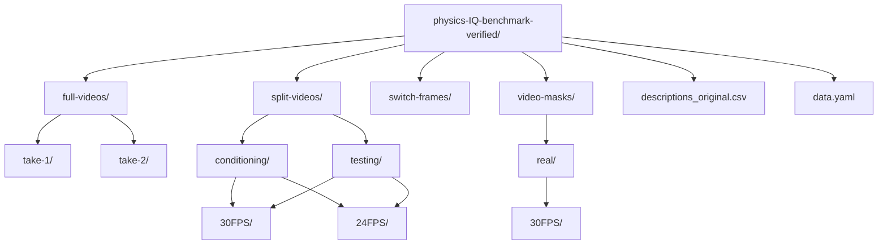
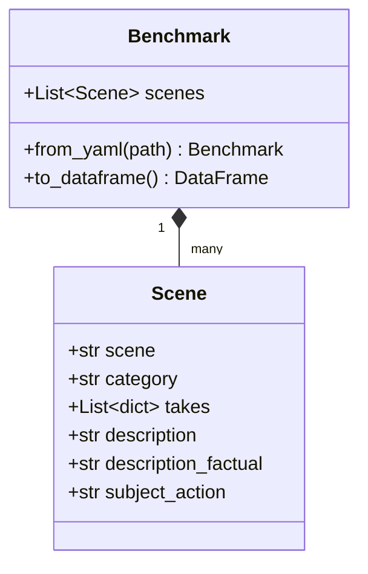

<!-- source: DeepWiki mcp.deepwiki.com · repo google-deepmind/physics-IQ-benchmark · unicode-title page 页**：7.6 dataset.py and generate_descriptions.py · patched 2026-10-26 -->

# Dataset
# Dataset

<details>
<summary>Relevant source files</summary>

The following files were used as context for generating this wiki page:

- [descriptions/data.yaml](descriptions/data.yaml)
- [descriptions/descriptions_original.csv](descriptions/descriptions_original.csv)
- [physiq/dataset.py](physiq/dataset.py)
- [physiq/download_physics_iq_data.py](physiq/download_physics_iq_data.py)
- [physiq/plot_settings.py](physiq/plot_settings.py)
- [physiq/tests/__init__.py](physiq/tests/__init__.py)

</details>


This document provides comprehensive documentation of the Physics-IQ benchmark dataset, including its structure, contents, acquisition methods, and metadata organization. The dataset contains 396 real-world physics videos across 66 unique scenarios designed to evaluate physical understanding in generative video models.

For information about using this dataset to generate videos, see [Video Generation](#3). For details on the evaluation pipeline that processes these videos, see [Evaluation Pipeline](#4).

---

## Overview

The Physics-IQ dataset consists of 396 high-quality video recordings of real-world physics experiments. Each video captures physical phenomena across five domains: Solid Mechanics, Fluid Dynamics, Optics, Thermodynamics, and Magnetism. All videos are recorded at 3840 × 2160 resolution and 30 frames per second with static camera positioning.

The benchmark exists in two primary variants:
1.  **Original Physics-IQ**: The initial dataset used for baseline evaluations.
2.  **Physics-IQ Verified**: An updated version with refined descriptions and metadata for standardized leaderboard submissions.

The dataset is organized to support two model types: **image-to-video (i2v)** models that generate from a single frame, and **multiframe-to-video (m2v)** models that use short video segments as conditioning input.

Sources: [README.md:13-19](), [README.md:33-52](), [physiq/download_physics_iq_data.py:66-73]()

---

## Dataset Organization

The Physics-IQ benchmark dataset follows a hierarchical directory structure designed to separate different data modalities and FPS variants.

### Directory Structure



**Directory Structure: Physics-IQ Verified Dataset Organization**

### Directory Descriptions

| Directory | Purpose | Contents |
|-----------|---------|----------|
| `full-videos/` | Complete unprocessed recordings | Raw video files before splitting, separated by `take-1` and `take-2`. |
| `split-videos/conditioning/` | Input for multiframe models | First 3 seconds of each scenario (multiple FPS). |
| `split-videos/testing/` | Ground truth for evaluation | Final 5 seconds after conditioning segment (multiple FPS). |
| `switch-frames/` | Input for i2v models | Single JPEG frame extracted at the 3-second transition point. |
| `video-masks/real/` | Ground truth segmentation | Binary masks for object tracking in real videos. |
| `descriptions_original.csv` | Metadata registry | Legacy CSV format for scenario descriptions and categories. |
| `data.yaml` | Source Metadata | The primary Pydantic-backed source of truth for the Verified dataset. |

For a deep dive into the folder layout and specific file counts, see [Dataset Organization](#2.1).

Sources: [physiq/download_physics_iq_data.py:77-85](), [physiq/dataset.py:24-26]()

---

## Downloading the Dataset

The dataset is hosted on Google Cloud Storage. Users should use the `download_physics_iq_data.py` script to ensure correct directory structures and automatic downsampling for non-standard frame rates.

### Using download_physics_iq_data.py

The script `download_physics_iq_data.py` manages the synchronization between the cloud bucket and local storage.

```python
# Example: Download the verified dataset at 30 and 24 FPS
python3 physiq/download_physics_iq_data.py --fps 30 24 --benchmark_base_folder ./data
```

### Key Features:
- **Automatic Downsampling**: If a requested FPS (e.g., 12 FPS) is not pre-computed on the server, the script downloads the 30 FPS version and uses `change_video_fps` from `physiq/fps_changer.py` to generate it locally [physiq/download_physics_iq_data.py:97-111]().
- **Verified vs. Original**: The `--original_physics_iq` flag toggles between the `physics-IQ-benchmark` and `physics-IQ-benchmark-verified` directory targets [physiq/download_physics_iq_data.py:66-70]().
- **Integrity**: Always downloads 30 FPS data as a base for any local resampling [physiq/download_physics_iq_data.py:57-58]().

For detailed instructions and CLI arguments, see [Downloading the Dataset](#2.2).

Sources: [physiq/download_physics_iq_data.py:46-55](), [physiq/download_physics_iq_data.py:116-138]()

---

## Physics Categories

The dataset spans five fundamental physics domains, categorized to test specific aspects of physical reasoning.

| Category | Description |
|----------|-------------|
| **Solid Mechanics** | Collisions, gravity, and material properties (e.g., `ball-and-block-fall`). |
| **Fluid Dynamics** | Liquids, gases, and buoyancy (e.g., `fill-glass-red-drink`). |
| **Optics** | Light, shadows, and reflections (e.g., `light-on-block`). |
| **Thermodynamics** | Heat, combustion, and phase changes (e.g., `lit-candle`). |
| **Magnetism** | Magnetic forces and attraction (e.g., `magnet-wrench`). |

The `Scene` data model in `physiq/dataset.py` explicitly tracks the `category` for each entry [physiq/dataset.py:34](). For a full list of scenarios and examples, see [Physics Categories](#2.3).

Sources: [descriptions/data.yaml:6-104](), [physiq/dataset.py:33-34]()

---

## Multi-View and Multi-Take Structure

Physics-IQ utilizes a redundant recording strategy to enable robust evaluation and variance quantification.

### The 3-Perspective / 2-Take Strategy
Each physical event is recorded:
1.  **From 3 Perspectives**: `left`, `center`, and `right` views are captured simultaneously.
2.  **In 2 Takes**: The entire physical setup is reset and the experiment is performed twice (`take-1` and `take-2`).

This results in **6 videos per scenario**. This structure is codified in the `Scene` class, which contains a list of `takes` mapping perspectives to unique IDs [physiq/dataset.py:35]().

For details on how this structure enables variance-normalized scoring, see [Multi-View and Multi-Take Structure](#2.4).

Sources: [physiq/dataset.py:30-36](), [descriptions/data.yaml:10-18]()

---

## Dataset Metadata and Data Model

The dataset's metadata is managed through a structured data layer in `physiq/dataset.py`, moving away from flat CSVs to a Pydantic-based hierarchy.

### Data Entities



**Entity Mapping: Metadata Data Model**

### Key Components:
- **`Benchmark` Class**: The root container for the dataset. It provides `to_dataframe()` to generate the runtime `descriptions.csv` used by the evaluation pipeline [physiq/dataset.py:59-60](), [physiq/dataset.py:92]().
- **`Scene` Class**: Represents a single physical experiment. It maps YAML keys (like `subject-action`) to Python attributes and handles multi-take ID mapping [physiq/dataset.py:30-56]().
- **Filename Inference**: The `Benchmark` class contains static methods like `_infer_test_scenario` and `_infer_fn_mask` to programmatically generate file paths based on ID, perspective, and take [physiq/dataset.py:68-90]().
- **Source of Truth**: The `descriptions/data.yaml` file is the primary source, which is loaded via `get_benchmark()` [physiq/dataset.py:131-132]().

For technical details on the Pydantic models and metadata fields, see [Dataset Metadata and Data Model](#2.5).

Sources: [physiq/dataset.py:29-60](), [physiq/dataset.py:131-132]()

---

