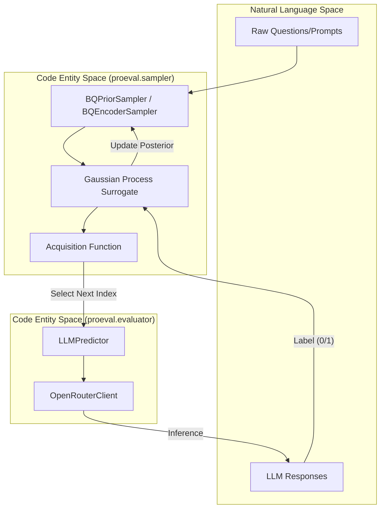
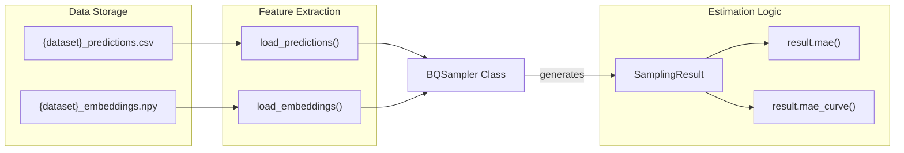

<!-- source: DeepWiki mcp.deepwiki.com · repo google-deepmind/proeval · page 1 ProEval Overview · fetched 2026-10-26 -->

# ProEval Overview

Relevant source files

The following files were used as context for generating this wiki page:

- [README.md](README.md)
- [proeval/README.md](proeval/README.md)
- [proeval/__init__.py](proeval/__init__.py)
- [pyproject.toml](pyproject.toml)

ProEval is a technical framework designed to optimize the evaluation of Large Language Models (LLMs). It addresses two primary challenges in GenAI development: the high cost of comprehensive benchmarking and the difficulty of discovering diverse failure patterns within a limited budget.

By treating model evaluation as a numerical integration problem, ProEval uses **Bayesian Quadrature (BQ)** to estimate performance metrics (like error rates) with significantly fewer samples than traditional random testing [README.md:7-13](). Furthermore, it provides proactive failure discovery mechanisms to surface model bugs across different semantic topics [proeval/README.md:200-205]().

### Key Capabilities

*   **Efficient Performance Estimation**: Achieve high-precision accuracy estimates (e.g., ±1%) using as little as 1% of a full dataset [README.md:9-10]().
*   **Proactive Failure Discovery**: Use Gaussian Process (GP) posterior states and topic-aware generation to find diverse bugs [proeval/README.md:200-210]().
*   **Transfer Learning**: Leverage performance patterns from existing models to build priors for evaluating new models [proeval/README.md:63-68]().
*   **Multi-Benchmark Support**: Validated across reasoning (GSM8K, SVAMP), safety (Jigsaw), and general knowledge (MMLU) tasks [README.md:13]().

---

### Subsystem Relationships

The ProEval codebase is organized into four major functional areas that interact to provide a full evaluation lifecycle.

#### 1. Bayesian Quadrature (BQ) Samplers
The core of ProEval resides in the `proeval.sampler` module. It implements active sampling loops where a surrogate GP model selects the most informative questions to ask an LLM next.
*   **`BQPriorSampler`**: Uses a linear kernel based on the performance of other models (Score Features - SF) [proeval/README.md:21-34]().
*   **`BQEncoderSampler`**: Uses a neural encoder to map questions into a latent space (Tuned Prompt Features - TPF) [proeval/README.md:134-152]().

#### 2. Neural Encoder (TPF)
Located in `proeval.encoder`, this subsystem trains a `QuestionEncoder` to minimize GP marginal likelihood across multiple benchmarks. This allows the system to generalize its evaluation strategy to entirely new datasets [proeval/README.md:167-175]().

#### 3. Failure Discovery & Generation
The `proeval.generator` module uses the GP's uncertainty and mean estimates to identify "hard" regions of the input space. The `TopicAwareGenerator` can then synthesize new test cases that target these specific failure modes [proeval/README.md:200-215]().

#### 4. LLM Evaluation Layer
The `proeval.evaluator` module handles the practicalities of LLM inference, including prompt templating, parallel API calls via `OpenRouterClient`, and structured response parsing [proeval/__init__.py:28-33]().

**System Interaction Diagram**

The following diagram illustrates how the core code entities interact to estimate model performance.

Sources: [proeval/__init__.py:21-55](), [proeval/README.md:21-53](), [proeval/README.md:134-152]()

---

### Core Architecture: From Data to Estimates

ProEval bridges the gap between raw benchmark data and statistical estimates by transforming model predictions into a feature space.

**Data Flow Diagram**

Sources: [proeval/README.md:41-53](), [proeval/README.md:89-102](), [README.md:37-40]()

---

### Getting Started

To begin using ProEval, you should first install the package and its dependencies.

*   **Installation**: ProEval supports modular installation via extras (e.g., `pip install -e ".[encoder]"` for PyTorch support) [README.md:25-33]().
*   **Quick Start**: A typical workflow involves initializing a `BQPriorSampler` and calling `.sample()` on a target dataset [README.md:37-53]().

For more detailed information, please refer to the child pages:

1.  **[Getting Started & Installation](#1.1)**: Environment setup and a minimal "Hello World" example.
2.  **[Repository Structure & Package Layout](#1.2)**: A guide to the file system and build configuration.

Sources: [README.md:1-104](), [proeval/README.md:1-215](), [pyproject.toml:1-117](), [proeval/__init__.py:1-55]()

---

