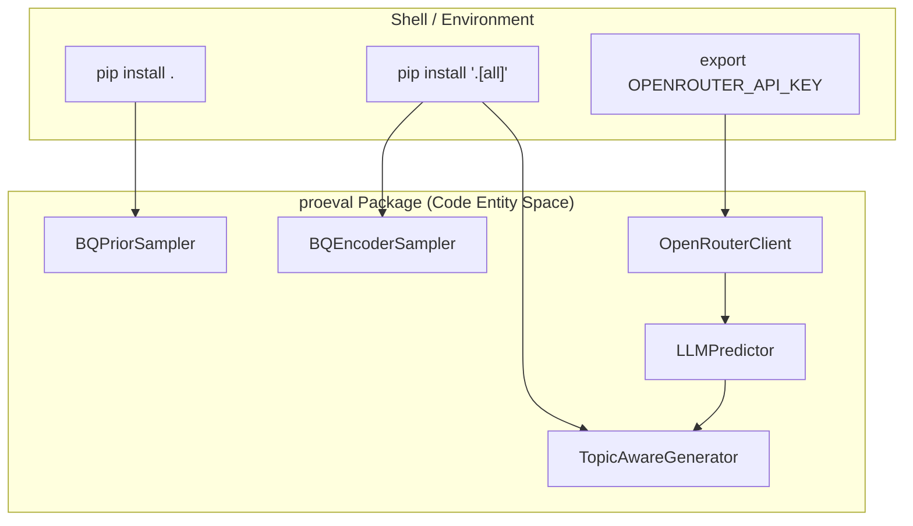
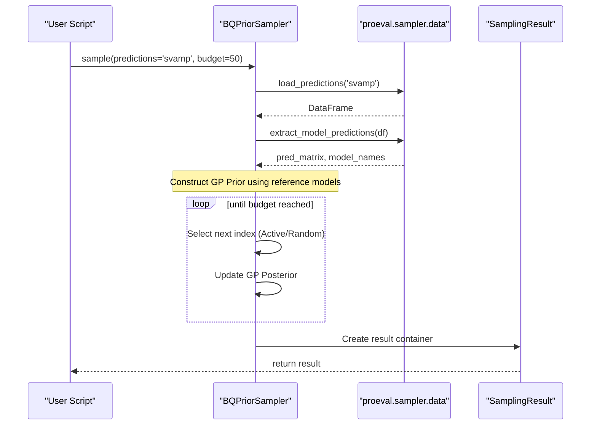

<!-- source: DeepWiki mcp.deepwiki.com · repo google-deepmind/proeval · page 1.1 Getting Started & Installation · fetched 2026-10-26 -->

# Getting Started & Installation

<details>
<summary>Relevant source files</summary>

The following files were used as context for generating this wiki page:

- [experiment/sample_usage.py](experiment/sample_usage.py)
- [pyproject.toml](pyproject.toml)
- [requirements.txt](requirements.txt)
- [setup.cfg](setup.cfg)

</details>


This page provides a comprehensive guide for setting up the ProEval environment, installing necessary dependencies, and executing a minimal performance estimation example. ProEval is designed to be modular, allowing users to install only the components necessary for their specific use case (e.g., performance estimation vs. failure discovery).

## Installation

ProEval requires **Python 3.9 or higher** [pyproject.toml:10-10](). It uses `setuptools` as the build backend [pyproject.toml:1-3]().

### Core Installation
The core package includes the primary Bayesian Quadrature (BQ) samplers and basic evaluation utilities.

```bash
# Clone the repository
git clone https://github.com/google-deepmind/proeval
cd proeval

# Install core dependencies
pip install .
```

### Optional Dependency Groups
ProEval defines several optional dependency groups in `pyproject.toml` to support advanced features [pyproject.toml:53-80]():

| Group | Command | Purpose |
| :--- | :--- | :--- |
| `encoder` | `pip install ".[encoder]"` | Neural encoder training and BQ-TPF (Tuned Prompt Features) sampler support via `torch` [pyproject.toml:55-57](). |
| `topics` | `pip install ".[topics]"` | Topic-aware test-case generation using `BERTopic` and `HDBSCAN` [pyproject.toml:59-62](). |
| `datasets` | `pip install ".[datasets]"` | HuggingFace integration for loading external evaluation datasets [pyproject.toml:64-66](). |
| `plotting` | `pip install ".[plotting]"` | Visualization utilities for experiment results using `matplotlib` and `seaborn` [pyproject.toml:68-71](). |
| `all` | `pip install ".[all]"` | Installs all the above for running the full experiment suite [pyproject.toml:73-80](). |
| `dev` | `pip install ".[dev]"` | Developer tools including `pytest`, `ruff`, and `mypy` [pyproject.toml:82-88](). |

**Sources:** [pyproject.toml:1-88](), [requirements.txt:1-12]()

---

## Environment Setup & API Configuration

ProEval interacts with Large Language Models (LLMs) via the `OpenRouterClient`. To perform active evaluation or generate new test cases, you must configure your API credentials.

### API Key Configuration
The system expects an API key for the inference provider. While the code is modular, the default implementation often relies on environment variables for authentication.

1. **Export API Key**:
   ```bash
   export OPENROUTER_API_KEY='your_api_key_here'
   ```

### Codebase Verification
You can verify the installation and environment by running the static analysis tools configured in the repository:

```bash
# Run linting with Ruff
ruff check .

# Run type checking with Mypy
mypy .
```
*Note: Mypy and Ruff are configured to exclude research artifacts in `data/` and `experiment/` to focus on the core `proeval` package [setup.cfg:33-38](), [pyproject.toml:103-103]().*

**Sources:** [setup.cfg:27-38](), [pyproject.toml:100-117]()

---

## Data Flow & System Components

The following diagram illustrates the relationship between the installation components and the primary code entities used during a typical ProEval workflow.

### Installation to Code Entity Mapping
This diagram bridges the gap between the user's environment (Natural Language/Shell Space) and the internal Python classes (Code Entity Space).


**Sources:** [pyproject.toml:53-80](), [experiment/sample_usage.py:27-37]()

---

## Minimal Quick-Start Example

The `BQPriorSampler` is the entry point for efficient performance estimation using the "Score Features" (SF) setup. It uses the performance of existing models on a benchmark to construct a prior for a new "target" model.

### Example: Estimating Gemini 2.5 Flash on SVAMP
The following script [experiment/sample_usage.py:1-50]() demonstrates how to estimate the error rate of a model using only 50 samples from a dataset of ~1,000.

```python
import numpy as np
from proeval import BQPriorSampler
from proeval.sampler import extract_model_predictions, load_predictions

def main():
    # 1. Initialize the sampler with a specified noise variance
    sampler = BQPriorSampler(noise_variance=0.3) # [experiment/sample_usage.py:32-32]

    # 2. Run active sampling for a budget of 50 samples
    # This selects indices, queries labels, and updates the GP posterior
    result = sampler.sample(
        predictions="svamp",
        target_model="gemini25_flash",
        budget=50,
    ) # [experiment/sample_usage.py:33-37]

    # 3. Validation: Compare estimate against true performance
    df = load_predictions("svamp") # [experiment/sample_usage.py:39-39]
    pred_matrix, model_names = extract_model_predictions(df) # [experiment/sample_usage.py:40-40]
    
    target_idx = model_names.index("gemini25_flash")
    true_mean = float(np.mean(pred_matrix[:, target_idx])) # [experiment/sample_usage.py:41-41]

    print(f"Estimated error rate: {result.estimates[-1]:.4f}")
    print(f"True error rate:      {true_mean:.4f}")
    print(f"MAE:                  {result.mae(true_mean):.4f}")

if __name__ == "__main__":
    main()
```

### Data Flow in `BQPriorSampler`
This diagram details how data flows through the `sample()` method to produce a `SamplingResult`.



**Sources:** [experiment/sample_usage.py:31-47](), [proeval/sampler/__init__.py]() (implied by import)

---

