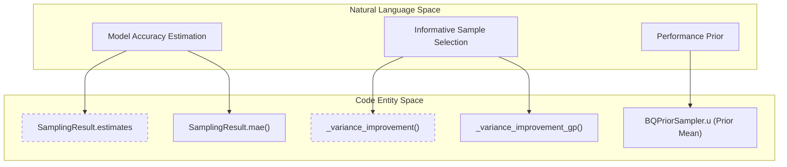
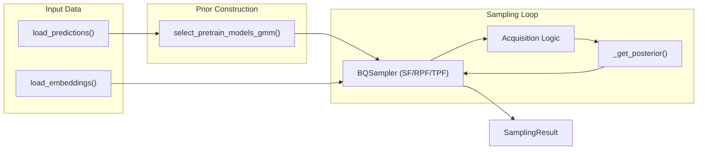

<!-- source: DeepWiki mcp.deepwiki.com · repo google-deepmind/proeval · page 2 Core Architecture: Bayesian Quadrature Sampling · fetched 2026-10-26 -->

# Core Architecture: Bayesian Quadrature Sampling

Relevant source files

The following files were used as context for generating this wiki page:

- [proeval/README.md](proeval/README.md)
- [proeval/sampler/__init__.py](proeval/sampler/__init__.py)
- [proeval/sampler/bq.py](proeval/sampler/bq.py)

The core of ProEval is a Bayesian Quadrature (BQ) framework that treats model evaluation as a numerical integration problem. Instead of simple random sampling to estimate accuracy, ProEval uses a Gaussian Process (GP) surrogate to model the relationship between prompts and model performance, actively selecting the most informative samples to minimize estimation error.

## BQ Active-Sampling Framework

ProEval treats the average performance of an LLM over a dataset as an integral of a latent performance function. By observing a small subset of labels (0 for correct, 1 for error), the system updates a GP posterior.

The framework supports three primary selection strategies:
*   **Active**: Variance-reduction acquisition that selects points to minimize the expected posterior variance of the integral (BQ-SF, BQ-RPF, BQ-TPF).
*   **Random**: Baseline selection of points at random, while still using the BQ posterior for the final estimate.
*   **Rounded**: An active strategy that rounds the final posterior mean to the nearest integer (0 or 1) before computing the estimate, useful for classification-heavy benchmarks.

### Data Flow and Code Entity Mapping

The following diagram illustrates how high-level sampling concepts map to the `proeval` codebase.

Sources: [proeval/sampler/bq.py:73-123](), [proeval/sampler/bq.py:170-205]()

---

## GP Feature Setups

ProEval implements three distinct ways to represent the "features" of a prompt for the GP surrogate.

### 1. SF (Score Features)
Implemented in `BQPriorSampler`. It uses the predictions of *other* existing models (reference models) as features. It employs a **linear kernel** and assumes that models with similar performance profiles on known benchmarks will behave similarly on new ones.
*   **Key Class**: `BQPriorSampler` [proeval/sampler/bq.py:211-260]()
*   **For details, see [BQ Samplers: BQPriorSampler & BQEncoderSampler](#2.1)**

### 2. RPF (Raw Prompt Features)
A middle-ground approach that uses raw text embeddings (e.g., from OpenAI's `text-embedding-3-large`) with a **Matérn 2.5 kernel**. It does not require a trained encoder or reference model scores, relying purely on semantic similarity.
*   **Key Function**: `_bq_matern_active_sampling` [proeval/sampler/bq.py:440-485]()
*   **For details, see [Baseline Samplers: IS, LURE & Vanilla BQ](#2.4)**

### 3. TPF (Tuned Prompt Features)
Implemented in `BQEncoderSampler`. This is the most advanced mode, using a neural encoder to map prompts into a latent space specifically optimized for GP marginal likelihood. It uses a **Matérn 2.5 kernel** over these tuned embeddings.
*   **Key Class**: `BQEncoderSampler` [proeval/sampler/bq.py:330-410]()
*   **For details, see [Neural Encoder (BQ-TPF)](#3)**

---

## System Architecture Overview

The diagram below shows how the different modules interact to produce an accuracy estimate.

Sources: [proeval/sampler/bq.py:15-56](), [proeval/sampler/data.py:30-100](), [proeval/sampler/pretrain_selector.py:30-80]()

---

## Core Components and Child Pages

### [BQ Samplers: BQPriorSampler & BQEncoderSampler](#2.1)
Details the two primary user-facing classes. It explains the `SamplingResult` container which provides `mae()` and `mae_curve()` methods for evaluation, and the `integral_variance` attribute used for uncertainty-based abstention.
*   **Source**: [proeval/sampler/bq.py:73-123]()

### [Data Loading & Train/Test Splits](#2.2)
Covers the `proeval.sampler.data` module. This is responsible for the standard label convention (1=error, 0=correct) and extracting prediction matrices from the unified CSV format.
*   **Source**: [proeval/sampler/data.py:1-120]()

### [Pretrain Model Selection (GMM)](#2.3)
Explains how the system automatically selects reference models for the SF (Score Features) prior. It uses Gaussian Mixture Models to cluster models by performance, ensuring the prior is built from models similar to the target.
*   **Source**: [proeval/sampler/pretrain_selector.py:100-160]()

### [Baseline Samplers: IS, LURE & Vanilla BQ](#2.4)
Documents the comparative baselines, including Importance Sampling (IS) and Level-Unit Relative Error (LURE), as well as "Vanilla" BQ configurations that use flat priors.
*   **Source**: [proeval/sampler/baselines.py:1-150]()

---

