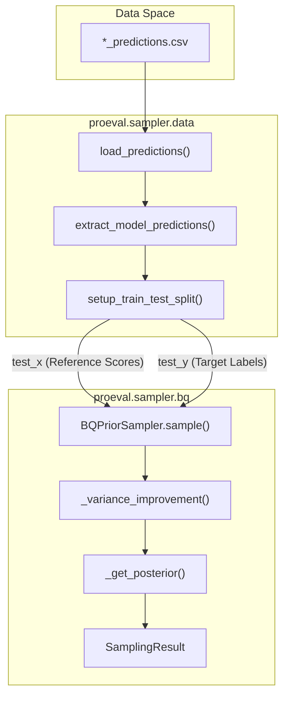
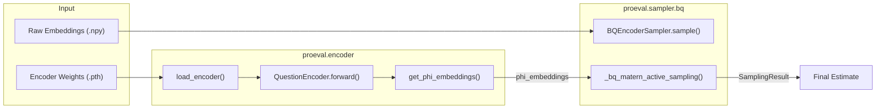

<!-- source: DeepWiki mcp.deepwiki.com · repo google-deepmind/proeval · page 2.1 BQ Samplers: BQPriorSampler & BQEncoderSampler · fetched 2026-10-26 -->

# BQ Samplers: BQPriorSampler & BQEncoderSampler

Relevant source files

The following files were used as context for generating this wiki page:

- [experiment/sample_usage.py](experiment/sample_usage.py)
- [proeval/sampler/__init__.py](proeval/sampler/__init__.py)
- [proeval/sampler/bq.py](proeval/sampler/bq.py)

The ProEval framework treats model evaluation as a numerical integration problem solved via **Bayesian Quadrature (BQ)**. This page provides a detailed technical reference for the two primary sampler classes: `BQPriorSampler` and `BQEncoderSampler`. These samplers allow for efficient estimation of LLM error rates by actively selecting the most informative samples to evaluate.

## Overview of Sampler Types

ProEval implements BQ active sampling using a Gaussian Process (GP) with three distinct feature setups:

| Feature Setup | Class / Function | Kernel | Description |
| :--- | :--- | :--- | :--- |
| **SF (Score Features)** | `BQPriorSampler` | Linear | Uses predictions from reference models as features. |
| **RPF (Raw Prompt Features)** | `_bq_matern_active_sampling` | Matérn 2.5 | Uses raw text embeddings (e.g., OpenAI) without fine-tuning. |
| **TPF (Tuned Prompt Features)** | `BQEncoderSampler` | Matérn 2.5 | Uses embeddings from a pre-trained neural `QuestionEncoder`. |

Sources: [proeval/sampler/bq.py:15-35]()

## BQPriorSampler (SF Mode)

`BQPriorSampler` implements the **Score Features (SF)** approach. It leverages the correlation between the target model and a set of reference models. If reference models (the "prior") consistently fail on a specific prompt, it is highly probable the target model will also fail.

### Implementation Details
- **Kernel:** It uses a linear kernel where features are the binary error labels (0=correct, 1=error) of reference models [proeval/sampler/bq.py:20-21]().
- **Prior Mean ($u$):** The prior mean is calculated as the average error rate of the selected reference models [proeval/sampler/bq.py:304-306]().
- **Active Selection:** It uses a variance-reduction acquisition strategy to pick samples that most significantly reduce the uncertainty of the integral (the global error rate) [proeval/sampler/bq.py:177-184]().

### Data Flow: SF Sampling
The diagram below shows how `BQPriorSampler` processes prediction data to produce an estimate.

**Title: BQPriorSampler Data Flow**

Sources: [proeval/sampler/bq.py:255-320](), [proeval/sampler/data.py:25-100]()

## BQEncoderSampler (TPF Mode)

`BQEncoderSampler` implements **Tuned Prompt Features (TPF)**. This mode is used when a neural encoder has been pre-trained to map prompt embeddings into a latent space where distance correlates with model failure patterns.

### Key Components
- **QuestionEncoder:** A neural network (MLP) that transforms raw text embeddings into $\phi$-embeddings [proeval/sampler/__init__.py:61-70]().
- **Matérn Kernel:** Unlike the linear kernel in SF, TPF uses a Matérn 2.5 kernel on the $\phi$-embeddings to capture non-linear relationships in the prompt space [proeval/sampler/bq.py:26-28]().
- **Cross-Benchmark Transfer:** The encoder is typically trained on multiple "source" benchmarks to generalize to a "target" benchmark [proeval/sampler/bq.py:440-450]().

### Integration with Neural Encoder
The sampler maps raw embeddings through the encoder before performing the BQ update loop.

**Title: BQEncoderSampler & QuestionEncoder Interaction**

Sources: [proeval/sampler/bq.py:431-488](), [proeval/sampler/__init__.py:60-83]()

## SamplingResult Container

All samplers return a `SamplingResult` object. This container stores the trajectory of the estimation process and provides utility methods for evaluation.

### Attributes
- `estimates`: An array of the posterior mean (error rate estimate) at each budget step [proeval/sampler/bq.py:89]().
- `selected_indices`: The sequence of indices chosen by the acquisition function [proeval/sampler/bq.py:90]().
- `integral_variance`: The variance of the mean estimate at each step. This represents the BQ uncertainty [proeval/sampler/bq.py:95-96]().
- `posterior_mean`: The final predicted probability of failure for every item in the test set [proeval/sampler/bq.py:91]().

### Key Methods
- `mae(true_mean)`: Returns the final Mean Absolute Error: $|estimate_{final} - true\_mean|$ [proeval/sampler/bq.py:97-99]().
- `mae_curve(true_mean)`: Returns the MAE at every step of the sampling process [proeval/sampler/bq.py:101-103]().
- `should_abstain(threshold)`: Returns `True` if the `integral_std` is higher than the threshold, indicating the sampler is too uncertain to provide a reliable estimate [proeval/sampler/bq.py:112-121]().

Sources: [proeval/sampler/bq.py:73-123]()

## Internal Acquisition Logic

The core of the active sampling is the reduction of **integral variance**. For a GP with kernel $K$, the variance of the integral (the average value) is given by $\frac{1}{N^2} \mathbf{1}^\top K \mathbf{1}$.

ProEval uses a rank-1 update to efficiently calculate how much this integral variance would decrease if a specific point $i$ were sampled:
$$\Delta_i = \frac{(\sum_j K_{ij})^2}{K_{ii} + \sigma^2}$$

The function `_find_best_i_and_update` implements this logic using optimized linear algebra (via `np.einsum`) to select the best index from the unlabeled pool [proeval/sampler/bq.py:150-167]().

Sources: [proeval/sampler/bq.py:150-193]()

---

