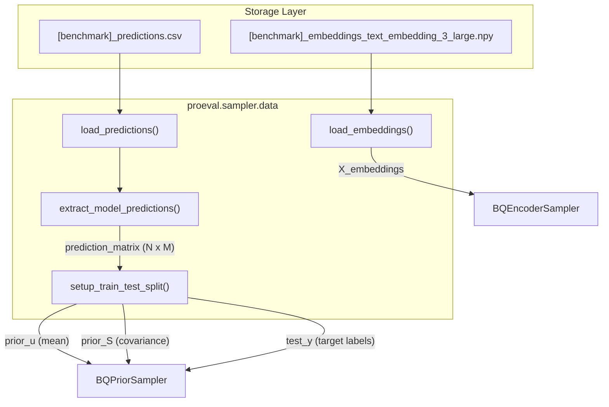
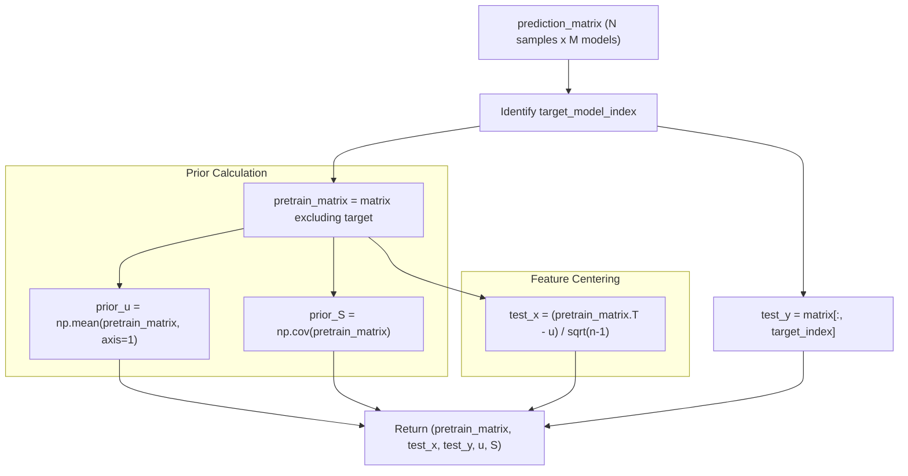

<!-- source: DeepWiki mcp.deepwiki.com · repo google-deepmind/proeval · page 2.2 Data Loading & Train/Test Splits · fetched 2026-10-26 -->

# Data Loading & Train/Test Splits

Relevant source files

The following files were used as context for generating this wiki page:

- [data/README.md](data/README.md)
- [proeval/sampler/__init__.py](proeval/sampler/__init__.py)
- [proeval/sampler/data.py](proeval/sampler/data.py)

The `proeval.sampler.data` module provides the foundational utilities for loading benchmark datasets, extracting model performance labels, and preparing the data structures required for Bayesian Quadrature (BQ) sampling. This module bridges the gap between raw CSV/NPY files stored in the `data/` directory and the mathematical representations (feature matrices and labels) used by the samplers.

### Data Flow Overview

The data flow starts with raw benchmark files and results in a structured split between "pre-train" models (used to build the GP prior) and the "target" model (the model being evaluated).

#### Logic Flow: From Files to Sampler
The following diagram illustrates how `proeval.sampler.data` transforms raw storage into BQ-ready inputs.

**Data Transformation Pipeline**

Sources: [proeval/sampler/data.py:36-40](), [data/README.md:11-18]()

---

### Label Convention and Prediction Matrix

ProEval uses a specific label convention to measure **failure rates** rather than accuracy.

*   **Convention:** `1.0` = Error (incorrect), `0.0` = Correct.
*   **Binarization:** For most benchmarks (e.g., `gsm8k`, `mmlu`), the labels are already binary error indicators [data/README.md:62]().
*   **Continuous Handling:** For safety datasets like `dices` and `dices_t2i`, ratings are continuous. `extract_model_predictions` binarizes these at a threshold of `0.5` and inverts them so that unsafe/poor responses are marked as `1` [proeval/sampler/data.py:119-123]().

The `extract_model_predictions()` function converts a `pandas.DataFrame` into a `numpy` matrix of shape `(n_samples, n_models)` [proeval/sampler/data.py:105-107]().

| Dataset Type | Original Label | ProEval Internal Label |
| :--- | :--- | :--- |
| Binary (e.g. GSM8K) | 0 (Correct) | 0 |
| Binary (e.g. GSM8K) | 1 (Error) | 1 |
| Continuous (DICES) | > 0.5 (Safe/Good) | 0 |
| Continuous (DICES) | < 0.5 (Unsafe/Poor) | 1 |

Sources: [proeval/sampler/data.py:88-126](), [data/README.md:59-63]()

---

### Core Data Loading Functions

#### `load_predictions(dataset_name, data_dir=None)`
Loads the `*_predictions.csv` file for the specified benchmark. It resolves the default directory to `data/` if not provided [proeval/sampler/data.py:36-57]().

#### `load_embeddings(dataset_name, data_dir=None, embedding_model='text_embedding_3_large')`
Loads pre-computed text embeddings from `.npy` files. These embeddings (typically from OpenAI `text-embedding-3-large`) are used as features for the `BQEncoderSampler` (TPF mode) or RPF modes [proeval/sampler/data.py:60-85]().

#### `setup_train_test_split(...)`
This is the primary function for preparing BQ sampling. It partitions the `prediction_matrix` based on a `target_model`.

*   **Target Model:** The model whose performance we wish to estimate.
*   **Pre-train Models:** The other models in the benchmark used to construct the prior mean ($\mu$) and covariance ($\Sigma$) [proeval/sampler/data.py:173-174]().
*   **Feature Construction:** In Score Feature (SF) mode, it calculates `test_x` by centering the pre-train matrix [proeval/sampler/data.py:178-184]().

**Implementation Details: Split Logic**

Sources: [proeval/sampler/data.py:129-185]()

---

### Integration with Samplers

The data returned by `setup_train_test_split` is passed directly into the `sample()` method of BQ samplers.

1.  **Prior Construction:** The `u` (mean) and `S` (covariance) define the GP prior over the evaluation space [proeval/sampler/bq.py:100-110]().
2.  **Ground Truth:** The `test_y` array serves as the "oracle" that the sampler queries during the active sampling loop.
3.  **Features:** The `test_x` (for `BQPriorSampler`) or the embeddings from `load_embeddings` (for `BQEncoderSampler`) serve as the coordinates for the GP kernel.

**Data Flow to BQ Loop**
| Variable | Origin Function | Destination | Purpose |
| :--- | :--- | :--- | :--- |
| `test_y` | `setup_train_test_split` | `BQSampler.sample` | The true labels (0/1) for budget consumption. |
| `u`, `S` | `setup_train_test_split` | `BQSampler.__init__` | Parameters for the Bayesian Quadrature prior. |
| `embeddings` | `load_embeddings` | `BQEncoderSampler.sample` | Spatial features for the Matérn/RBF kernels. |

Sources: [proeval/sampler/data.py:129-185](), [proeval/sampler/bq.py:157-165]()

---

