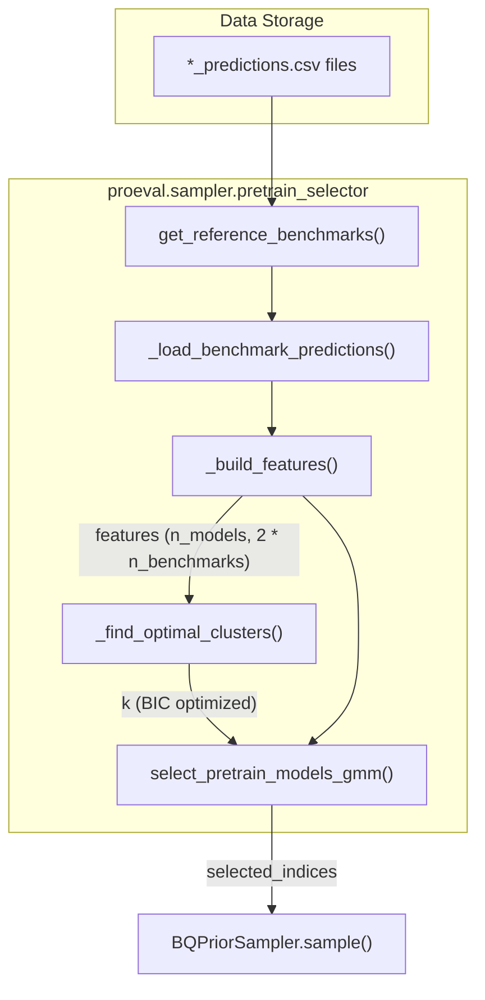
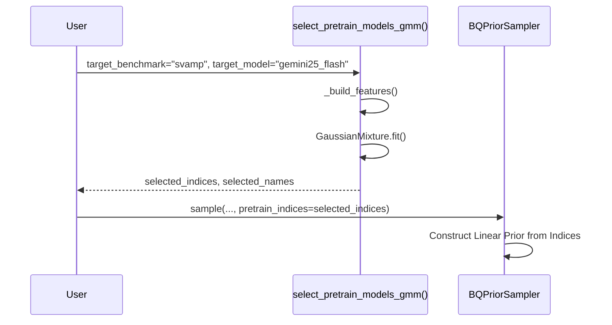

<!-- source: DeepWiki mcp.deepwiki.com · repo google-deepmind/proeval · page 2.3 Pretrain Model Selection (GMM) · fetched 2026-10-26 -->

# Pretrain Model Selection (GMM)

Relevant source files

The following files were used as context for generating this wiki page:

- [proeval/README.md](proeval/README.md)
- [proeval/sampler/__init__.py](proeval/sampler/__init__.py)
- [proeval/sampler/pretrain_selector.py](proeval/sampler/pretrain_selector.py)

The `pretrain_selector` module provides mechanisms to automatically select the most relevant reference models for constructing a Bayesian Quadrature (BQ) prior. By clustering models based on their performance profiles across reference benchmarks, ProEval ensures that the prior mean used in `BQPriorSampler` is derived from models that behave similarly to the target model, reducing noise and improving estimation accuracy [proeval/sampler/pretrain_selector.py:15-21]().

## Overview of GMM Selection

When evaluating a `target_model` on a `target_benchmark`, the `BQPriorSampler` typically uses other models' predictions as features. While using all available models is the default, it can introduce noise if the reference pool contains models with vastly different architectures or performance characteristics [proeval/README.md:65-66]().

The `select_pretrain_models_gmm()` function addresses this by:
1.  **Feature Extraction**: Representing every model as a vector of performance metrics (mean and standard deviation) across multiple reference benchmarks [proeval/sampler/pretrain_selector.py:99-104]().
2.  **Clustering**: Fitting a Gaussian Mixture Model (GMM) to these vectors to group models with similar "skill profiles" [proeval/sampler/pretrain_selector.py:186-191]().
3.  **Selection**: Identifying the cluster containing the `target_model` and returning all other models in that same cluster as the optimal pretrain sources [proeval/sampler/pretrain_selector.py:228-232]().

### Data Flow: From CSV to Model Clusters

The following diagram illustrates how raw prediction data is transformed into model clusters to inform the BQ prior.

**Figure 1: Pretrain Selection Data Flow**

**Sources:** [proeval/sampler/pretrain_selector.py:45-185](), [proeval/README.md:71-85]()

## Implementation Details

### Feature Engineering
The system builds a feature matrix where each row represents a model. For every reference benchmark $B$, two features are calculated:
*   **Mean Accuracy**: `np.mean(preds)` [proeval/sampler/pretrain_selector.py:135]().
*   **Standard Deviation**: `np.std(preds)` [proeval/sampler/pretrain_selector.py:136]().

If a model is missing predictions for a specific benchmark, the missing values are imputed using the column means (the average performance of all other models on that benchmark) [proeval/sampler/pretrain_selector.py:139-142]().

### Optimal Cluster Selection
The number of clusters ($k$) is determined dynamically using the **Bayesian Information Criterion (BIC)**. The function `_find_optimal_clusters()` iterates through potential $k$ values (up to 10) and selects the one that minimizes the BIC, balancing model fit with complexity [proeval/sampler/pretrain_selector.py:148-173]().

### Integration with BQPriorSampler
The output of the selector is a list of model indices. These are passed to the `pretrain_indices` argument of the `sample()` method [proeval/README.md:79-84]().

**Code Entity Relationship: Selector to Sampler**

**Sources:** [proeval/sampler/pretrain_selector.py:177-234](), [proeval/README.md:68-85]()

## Evaluation Settings

The selection logic supports three primary evaluation settings used throughout the ProEval experiments to ensure robust cross-validation and prevent data leakage:

| Setting | Description | Logic in Code |
| :--- | :--- | :--- |
| **New Pair** | Evaluating a known model on a known benchmark, but using other models as features. | Standard `select_pretrain_models_gmm` usage. |
| **New Benchmark** | Evaluating on a benchmark that was not seen during any prior training/selection. | `get_reference_benchmarks` excludes the `target_benchmark` [proeval/sampler/pretrain_selector.py:67](). |
| **New Model** | Evaluating a model that has no prior data in the reference set. | Features are built using the model's performance on *other* benchmarks to find its cluster [proeval/sampler/pretrain_selector.py:18-21](). |

## Key Functions

### `get_reference_benchmarks()`
Scans the `data_dir` for all available `*_predictions.csv` files and returns a list of benchmark names, excluding the one currently being targeted for evaluation [proeval/sampler/pretrain_selector.py:45-69]().

### `select_pretrain_models_gmm()`
The primary entry point. It orchestrates feature building, GMM fitting, and cluster extraction.
*   **Arguments**:
    *   `target_benchmark`: The dataset currently being evaluated [proeval/sampler/pretrain_selector.py:194]().
    *   `target_model`: The string name of the model to find peers for [proeval/sampler/pretrain_selector.py:196]().
    *   `n_clusters`: Optional override for the BIC-based selection [proeval/sampler/pretrain_selector.py:201]().
*   **Returns**: A tuple of `(selected_indices, selected_names)` [proeval/sampler/pretrain_selector.py:234]().

**Sources:** [proeval/sampler/pretrain_selector.py:45-235](), [proeval/sampler/__init__.py:42-45]()

---

