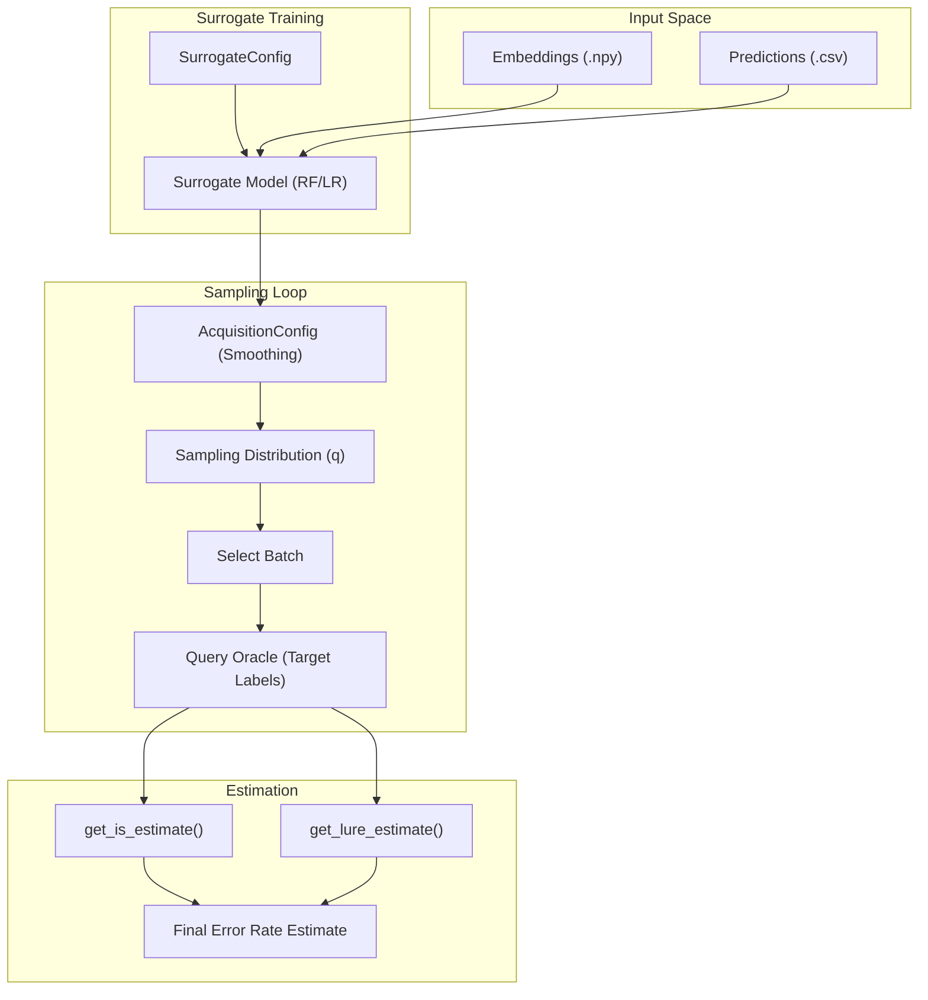
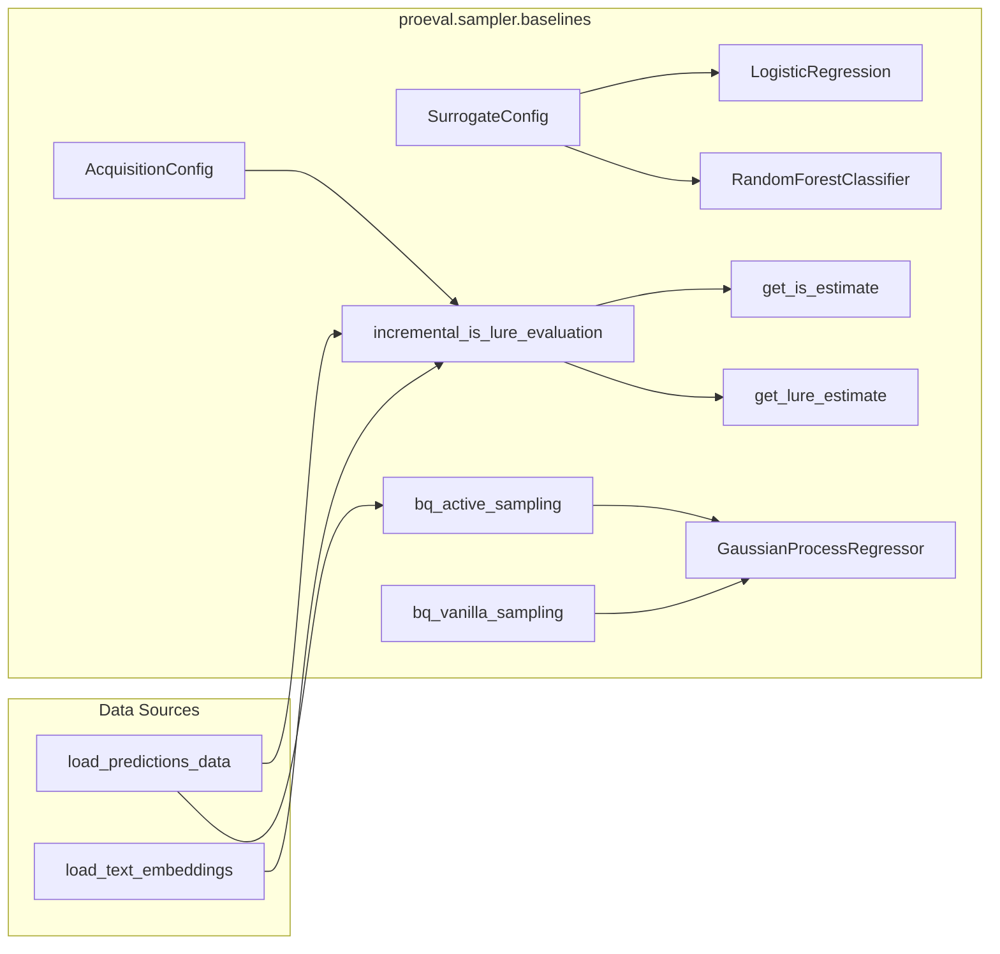

<!-- source: DeepWiki mcp.deepwiki.com · repo google-deepmind/proeval · page 2.4 Baseline Samplers: IS, LURE & Vanilla BQ · fetched 2026-10-26 -->

# Baseline Samplers: IS, LURE & Vanilla BQ

Relevant source files

The following files were used as context for generating this wiki page:

- [proeval/sampler/__init__.py](proeval/sampler/__init__.py)
- [proeval/sampler/baselines.py](proeval/sampler/baselines.py)

This page documents the baseline evaluation methods and active sampling utilities found in the `proeval.sampler.baselines` module. While ProEval focuses on Bayesian Quadrature (BQ) with advanced priors, it includes standard statistical baselines—Importance Sampling (IS) and Level-Unbiased Resampling Estimator (LURE)—as well as "Vanilla" BQ configurations for benchmarking.

## Overview of Baseline Methods

The `proeval.sampler.baselines` module provides a unified interface for running both active and passive evaluation strategies. These strategies are used to estimate the mean performance (error rate) of a target model given a limited labeling budget.

| Method | Type | Description |
| :--- | :--- | :--- |
| **Vanilla BQ** | Bayesian | Uses a GP with a standard prior (zero mean or global mean) without active acquisition. |
| **Active BQ** | Bayesian | Iteratively selects samples that maximize information gain for the GP posterior. |
| **Importance Sampling (IS)** | Statistical | Uses a surrogate model to estimate error probabilities and reweights samples to reduce variance. |
| **LURE** | Statistical | A level-unbiased resampling estimator that corrects for the bias introduced by non-uniform sampling. |
| **Random** | Statistical | Uniform random sampling (the standard evaluation baseline). |

Sources: `[proeval/sampler/baselines.py:15-19]()`

---

## Configuration Classes

The baseline module uses several `dataclass` structures to manage the hyperparameters of surrogate models and acquisition functions.

### SurrogateConfig
Defines the architecture and parameters for the proxy model used in IS and LURE to predict failure probabilities.
- `use_rf`: If `True`, uses `RandomForestClassifier`; otherwise, uses `LogisticRegression` `[proeval/sampler/baselines.py:38-38]()`.
- `lr_solver`, `lr_class_weight`, `lr_max_iter`: Parameters for the Logistic Regression surrogate `[proeval/sampler/baselines.py:40-42]()`.
- `rf_n_estimators`, `rf_max_depth`: Parameters for the Random Forest surrogate `[proeval/sampler/baselines.py:44-47]()`.

### AcquisitionConfig
Controls how the surrogate model's predictions are converted into sampling probabilities.
- `smoothing_factor`: A value (default 0.01) that mixes the surrogate's distribution with a uniform distribution to ensure exploration and prevent zero-probability assignments `[proeval/sampler/baselines.py:52-52]()`.
- `target_class`: The class index to sample (default 1 for "failure/error") `[proeval/sampler/baselines.py:53-53]()`.

Sources: `[proeval/sampler/baselines.py:35-54]()`

---

## Data Flow: From Embeddings to Estimates

The following diagram illustrates how the baseline samplers ingest data and produce performance estimates.

### Data Flow for IS/LURE Baselines

Sources: `[proeval/sampler/baselines.py:28-64]()`, `[proeval/sampler/baselines.py:446-460]()`

---

## Core Sampling Logic

### Importance Sampling (IS) & LURE
The module implements statistical estimators that use a surrogate model (trained on a small initial seed or proxy data) to bias sampling toward "hard" examples.

*   **`get_is_estimate`**: Calculates the self-normalized importance sampling estimate. It weights each sample by $w_i = \frac{p(x_i)}{q(x_i)}$, where $p$ is the uniform target distribution and $q$ is the proposal distribution from the surrogate `[proeval/sampler/baselines.py:446-460]()`.
*   **`get_lure_estimate`**: Implements the Level-Unbiased Resampling Estimator. Unlike IS, LURE is designed to be unbiased even when the surrogate model is highly inaccurate, using a specific normalization factor $(1/M)$ `[proeval/sampler/baselines.py:463-480]()`.

### Bayesian Quadrature (BQ) Implementations
*   **`bq_vanilla_sampling`**: Performs BQ using a Gaussian Process with a fixed prior. It does not use active learning; instead, it evaluates samples (often selected randomly) and computes the integral of the posterior mean `[proeval/sampler/baselines.py:349-370]()`.
*   **`bq_active_sampling`**: An iterative loop that updates the GP posterior and uses an acquisition function (typically variance reduction) to pick the next most informative point to label `[proeval/sampler/baselines.py:304-346]()`.

Sources: `[proeval/sampler/baselines.py:304-480]()`

---

## Incremental Evaluation Wrappers

To support experimental curves (showing how error decreases as budget increases), the module provides "Incremental" wrappers. These functions return a list of estimates for every budget step from 1 to $N$.

| Function | Logic |
| :--- | :--- |
| `incremental_random_evaluation` | Standard Monte Carlo mean computed at every step `[proeval/sampler/baselines.py:483-497]()`. |
| `incremental_is_lure_evaluation` | Re-calculates IS/LURE weights and estimates as the sample size grows `[proeval/sampler/baselines.py:500-550]()`. |
| `incremental_bq_evaluation` | Returns the BQ integral estimate after each new sample is added to the GP `[proeval/sampler/baselines.py:553-579]()`. |

### Logic for Smoothing-Factor Acquisition
In `incremental_is_lure_evaluation`, the sampling distribution $q$ is constructed by:
1.  Getting probabilities from the surrogate: `probs = surrogate.predict_proba(X)` `[proeval/sampler/baselines.py:518-518]()`.
2.  Applying the `smoothing_factor` from `AcquisitionConfig`:
    `q = (1 - smoothing) * probs + (smoothing * uniform)` `[proeval/sampler/baselines.py:522-522]()`.
3.  This ensures that every sample has a non-zero probability of being selected, which is a requirement for the validity of the IS/LURE estimators.

Sources: `[proeval/sampler/baselines.py:500-579]()`

---

## System Interaction: Baseline Module to Code Entities

The following diagram maps the logical sampling concepts to the specific functions and classes in `proeval.sampler.baselines`.

Sources: `[proeval/sampler/baselines.py:28-30]()`, `[proeval/sampler/baselines.py:73-88]()`, `[proeval/sampler/baselines.py:304-305]()`, `[proeval/sampler/baselines.py:500-505]()`

---

