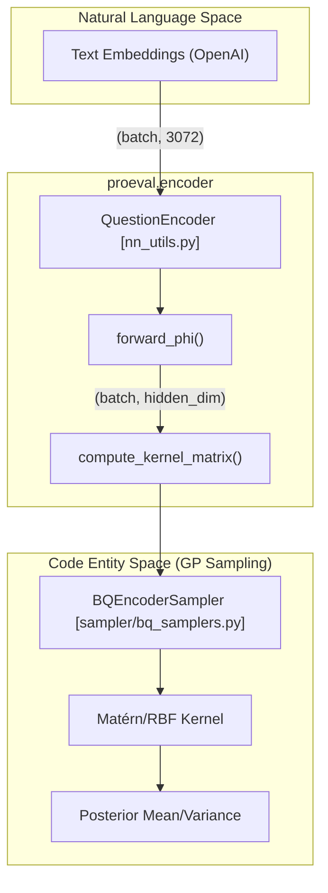
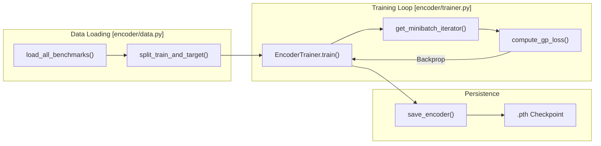

<!-- source: DeepWiki mcp.deepwiki.com · repo google-deepmind/proeval · page 3 Neural Encoder (BQ-TPF) · fetched 2026-10-26 -->

# Neural Encoder (BQ-TPF)

Relevant source files

The following files were used as context for generating this wiki page:

- [proeval/encoder/__init__.py](proeval/encoder/__init__.py)
- [proeval/encoder/nn_utils.py](proeval/encoder/nn_utils.py)
- [proeval/encoder/trainer.py](proeval/encoder/trainer.py)

The **Neural Encoder** subsystem is an optional component of ProEval that enables the **Tuned Prompt Features (TPF)** mode for Bayesian Quadrature (BQ). While standard BQ often relies on fixed features (SF) or random projections (RPF), TPF uses a trained `QuestionEncoder` to map high-dimensional natural language embeddings into a task-optimized latent space. This allows the system to transfer knowledge across different benchmarks and models, improving the efficiency of performance estimation and failure discovery.

### Purpose and Scope
The primary goal of the encoder is to learn a mapping $\phi(x)$ such that the resulting Gaussian Process (GP) kernel accurately reflects the correlation between model failures on similar questions. By minimizing the GP marginal likelihood across multiple reference benchmarks, the encoder learns to extract features that are predictive of model behavior.

For implementation details, see:
*   [QuestionEncoder Architecture & Kernel Utilities](#3.1)
*   [EncoderTrainer: Cross-Benchmark Training Pipeline](#3.2)

---

### System Overview: Natural Language to Latent Space
The following diagram illustrates how the neural encoder bridges the gap between raw text embeddings (Natural Language Space) and the optimized features used by the BQ samplers (Code Entity Space).

**Figure 1: BQ-TPF Data Flow**

**Sources:** [proeval/encoder/nn_utils.py:57-64](), [proeval/encoder/nn_utils.py:101-111](), [proeval/encoder/nn_utils.py:144-160]()

---

### The QuestionEncoder
The `QuestionEncoder` is a Multi-Layer Perceptron (MLP) defined in `proeval.encoder.nn_utils`. It takes a pre-computed embedding (typically from `text-embedding-3-large`) and produces a normalized latent representation $\phi$.

| Feature | Description |
| :--- | :--- |
| **Base Architecture** | A single `nn.Linear` layer followed by a sigmoid activation with a configurable `steepness` parameter [proeval/encoder/nn_utils.py:78-83](). |
| **Normalization** | The `_compute_phi` method centers the output and applies L2-normalization, placing embeddings on a unit sphere to ensure stable kernel lengthscales [proeval/encoder/nn_utils.py:126-141](). |
| **Kernel Support** | Supports `linear`, `matern`, and `rbf` kernels. For non-linear kernels, it maintains a learnable `log_lengthscale` [proeval/encoder/nn_utils.py:72-85](). |
| **Stability** | Uses a `_safe_cholesky` implementation with a jitter schedule to handle numerical instability during GP loss computation [proeval/encoder/nn_utils.py:37-54](). |

For details on the MLP layers and kernel math, see [QuestionEncoder Architecture & Kernel Utilities](#3.1).

**Sources:** [proeval/encoder/nn_utils.py:57-141](), [proeval/encoder/nn_utils.py:37-54]()

---

### Training and Transfer Learning
The `EncoderTrainer` orchestrates the training of the encoder using data from multiple benchmarks. The training objective is to minimize the Negative Log Marginal Likelihood (NLML) of the GP, effectively treating the encoder weights as kernel hyperparameters.

**Figure 2: Training Pipeline Entities**

**Sources:** [proeval/encoder/trainer.py:35-45](), [proeval/encoder/trainer.py:154-173](), [proeval/encoder/nn_utils.py:316-324]()

#### Evaluation Settings
The trainer supports three primary transfer learning scenarios [proeval/encoder/trainer.py:21-28]():
1.  **new_pair**: Trains on all benchmarks including the target, but excludes the target model.
2.  **new_benchmark**: Completely excludes the target benchmark from the training set.
3.  **new_model**: Similar to `new_pair`, utilizing other models' scores on the target benchmark to refine embeddings.

For details on the training loop and data splitting, see [EncoderTrainer: Cross-Benchmark Training Pipeline](#3.2).

**Sources:** [proeval/encoder/trainer.py:21-28](), [proeval/encoder/trainer.py:179-188]()

---

