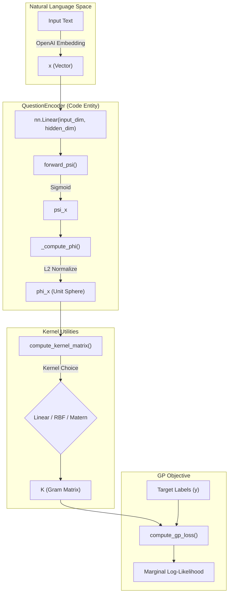
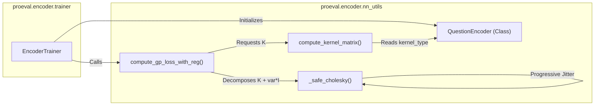

<!-- source: DeepWiki mcp.deepwiki.com · repo google-deepmind/proeval · page 3.1 QuestionEncoder Architecture & Kernel Utilities · fetched 2026-10-26 -->

# QuestionEncoder Architecture & Kernel Utilities

Relevant source files

The following files were used as context for generating this wiki page:

- [proeval/encoder/__init__.py](proeval/encoder/__init__.py)
- [proeval/encoder/nn_utils.py](proeval/encoder/nn_utils.py)

The `QuestionEncoder` is a core component of the ProEval Tuned Prompt Features (TPF) evaluation mode. It provides a learnable mapping from high-dimensional text embeddings (e.g., OpenAI `text-embedding-3-large`) into a latent space optimized for Gaussian Process (GP) regression. This allows the system to transfer knowledge across different benchmarks by learning how prompt characteristics correlate with model failure patterns.

### QuestionEncoder MLP Architecture

The `QuestionEncoder` is implemented as a PyTorch `nn.Module` [proeval/encoder/nn_utils.py:57-75](). It transforms input embeddings into a latent representation $\phi(x)$ that resides on a unit sphere.

#### Transformation Pipeline
1.  **Linear Projection**: Maps input dimension (e.g., 3072) to a hidden dimension (default 128) [proeval/encoder/nn_utils.py:83]().
2.  **$\psi(x)$ Computation**: Applies a sigmoid activation scaled by a `steepness` parameter (default 30.0) to the linear output [proeval/encoder/nn_utils.py:97-99]().
3.  **$\phi(x)$ Normalization**: The raw $\psi(x)$ is centered and L2-normalized [proeval/encoder/nn_utils.py:126-141](). This normalization ensures that pairwise distances in the $\phi$-space lie within $[0, \sqrt{2}]$, providing a stable regime for the GP lengthscale regardless of the hidden layer size [proeval/encoder/nn_utils.py:131-134]().

#### Learnable Parameters
The encoder manages three categories of parameters:
*   **Weights**: Standard `nn.Linear` weights and biases [proeval/encoder/nn_utils.py:83]().
*   **Noise Variance (`log_var`)**: A learnable parameter representing observation noise $\sigma^2$, lower-bounded by `MIN_NOISE_VAR` (0.3) to prevent overconfidence [proeval/encoder/nn_utils.py:34-34](), [proeval/encoder/nn_utils.py:84-84]().
*   **Lengthscale (`log_lengthscale`)**: A learnable parameter governing the smoothness of the GP kernel in the latent space [proeval/encoder/nn_utils.py:85-85]().

**Sources:** [proeval/encoder/nn_utils.py:57-141]()

### Kernel Utilities & Integration

The `compute_kernel_matrix()` function determines how the latent embeddings $\phi(x)$ interact to form the GP covariance [proeval/encoder/nn_utils.py:144-157]().

#### Supported Kernel Types
The encoder supports three primary kernel architectures [proeval/encoder/nn_utils.py:72-72]():

| Kernel Type | Formulation in $\phi$-space | Characteristics |
| :--- | :--- | :--- |
| **Linear** | $K = \phi\phi^T$ | Original ProEval formulation; fast computation [proeval/encoder/nn_utils.py:161-163](). |
| **RBF** | $K = \exp(-0.5 \cdot (\frac{d}{l})^2)$ | Squared Exponential; assumes high smoothness [proeval/encoder/nn_utils.py:177-179](). |
| **Matérn** | $K_{\nu=2.5}$ (default) | Balanced smoothness; robust for discrete failure signals [proeval/encoder/nn_utils.py:181-197](). |

#### Distance Computation
For non-linear kernels (RBF/Matérn), the utility computes pairwise Euclidean distances in $\phi$-space using the identity $\|a-b\|^2 = \|a\|^2 + \|b\|^2 - 2\langle a,b \rangle$ for numerical efficiency [proeval/encoder/nn_utils.py:168-171]().

**Sources:** [proeval/encoder/nn_utils.py:144-200]()

### Loss Functions & Training Logic

The encoder is trained by maximizing the Marginal Log-Likelihood (MLL) of a Gaussian Process.

#### compute_gp_loss()
This function calculates the negative log-likelihood of the target labels given the encoder's current mapping [proeval/encoder/nn_utils.py:202-218](). It constructs the full covariance matrix $C = K + \sigma^2I$ and utilizes a safe Cholesky decomposition [proeval/encoder/nn_utils.py:37-54]().
*   **Cholesky Stability**: `_safe_cholesky` applies a progressive jitter schedule (from $1e-6$ to $1.0$) to the diagonal if the matrix is not positive definite [proeval/encoder/nn_utils.py:31-31](), [proeval/encoder/nn_utils.py:44-50]().

#### compute_gp_loss_with_reg()
Extends the standard GP loss with a regularization term (default $\lambda=0.01$) to prevent the weights of the `nn.Linear` layer from exploding during the MLL optimization [proeval/encoder/nn_utils.py:257-279]().

**Sources:** [proeval/encoder/nn_utils.py:31-54](), [proeval/encoder/nn_utils.py:202-279]()

### Data Flow: From Text to Latent Space

The following diagram illustrates how raw text embeddings are processed by the `QuestionEncoder` and integrated into the GP utilities.

**Text Embedding Transformation Flow**

**Sources:** [proeval/encoder/nn_utils.py:57-141](), [proeval/encoder/nn_utils.py:144-218]()

### API for Persistence and Retrieval

The module provides high-level functions to manage encoder state and batch processing.

*   **get_phi_embeddings()**: A utility to extract $\phi(x)$ vectors for a given set of inputs, handling the conversion between NumPy and Torch tensors [proeval/encoder/nn_utils.py:311-332]().
*   **save_encoder() / load_encoder()**: Handles serialization of the model architecture and its learnable parameters (including `log_var` and `log_lengthscale`) to `.pth` files [proeval/encoder/nn_utils.py:356-388]().

**Sources:** [proeval/encoder/nn_utils.py:311-388]()

### Encoder-GP Integration Architecture

This diagram shows the relationship between the `QuestionEncoder` class and the loss functions used by the `EncoderTrainer`.

**Encoder Training System Diagram**

**Sources:** [proeval/encoder/nn_utils.py:57-86](), [proeval/encoder/nn_utils.py:144-153](), [proeval/encoder/nn_utils.py:257-265](), [proeval/encoder/trainer.py:27-38]()

---

