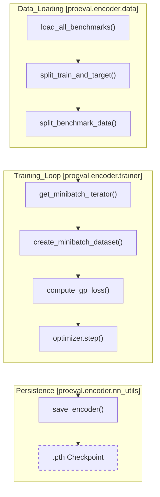
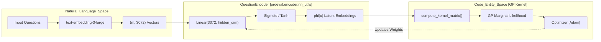

<!-- source: DeepWiki mcp.deepwiki.com · repo google-deepmind/proeval · page 3.2 EncoderTrainer: Cross-Benchmark Training Pipeline · fetched 2026-10-26 -->

# EncoderTrainer: Cross-Benchmark Training Pipeline

Relevant source files

The following files were used as context for generating this wiki page:

- [experiment/exp_train_encoder.py](experiment/exp_train_encoder.py)
- [proeval/encoder/data.py](proeval/encoder/data.py)
- [proeval/encoder/trainer.py](proeval/encoder/trainer.py)

The `EncoderTrainer` class is the central orchestration component for the neural encoder subsystem in ProEval. It manages the end-to-end lifecycle of training a `QuestionEncoder`, which transforms raw question embeddings into a latent space optimized for Bayesian Quadrature (BQ) performance estimation. This pipeline allows ProEval to leverage historical performance data from multiple models and benchmarks to form a "Tuned Prompt Features" (TPF) prior for new, unseen evaluation targets.

### Implementation and Data Flow

The `EncoderTrainer` utilizes a custom training loop designed for Gaussian Process (GP) marginal likelihood minimization. Unlike standard supervised learning, the objective is to optimize the encoder's parameters such that the resulting kernel matrix (computed in the latent space) best explains the observed error patterns across different models and benchmarks.

#### Data Preparation and Filtering
The pipeline begins by loading data through `proeval.encoder.data`. The system supports three primary training configurations that determine how the training and validation sets are constructed relative to the evaluation target:

| Setting | Description | Implementation Logic |
| :--- | :--- | :--- |
| `new_pair` | Excludes only the specific (target_model, target_benchmark) pair. | [proeval/encoder/data.py:181-182]() |
| `new_benchmark` | Completely excludes the target benchmark from training. | [proeval/encoder/data.py:182-182]() |
| `new_model` | Excludes the target model's data from all benchmarks. | [proeval/encoder/data.py:183-184]() |

#### Training Architecture
The training process is governed by the `train_encoder_minibatch` function, which iterates over "pairs" of (benchmark, model) rather than individual samples.

**Encoder Training Data Flow**

Sources: [proeval/encoder/trainer.py:154-215](), [proeval/encoder/data.py:170-194]()

### Key Functions and Classes

#### EncoderTrainer Class
The `EncoderTrainer` class (defined in `proeval/encoder/trainer.py`) encapsulates all hyperparameters and state for the training run.

*   **Initialization**: Configures the `QuestionEncoder` architecture, including `hidden_dim`, `kernel_type` (Linear, Matérn, or RBF), and GP noise variance (`init_var`). [proeval/encoder/trainer.py:270-320]()
*   **train()**: The main entry point. It loads data via `load_all_benchmarks`, applies the split logic, initializes the `QuestionEncoder`, and calls the minibatch training utility. [proeval/encoder/trainer.py:372-430]()

#### Training Utilities
*   **`split_benchmark_data`**: Splits questions within each benchmark into training and validation subsets based on a `val_ratio` (default 0.1). [proeval/encoder/trainer.py:69-106]()
*   **`get_minibatch_iterator`**: Yields batches of `(benchmark, model)` pairs. This is critical because the GP loss is calculated over the kernel matrix of a specific model's performance on a set of questions. [proeval/encoder/trainer.py:136-152]()
*   **`compute_gp_loss`**: Located in `proeval/encoder/nn_utils.py`, this function calculates the negative log marginal likelihood of the GP. It uses the `QuestionEncoder` to get latent embeddings $\phi(x)$, computes the kernel matrix $K$, and then evaluates the likelihood of the binary error labels $y$. [proeval/encoder/nn_utils.py:126-155]()

### Cross-Benchmark Mapping
The encoder serves as the bridge between the high-dimensional "Natural Language Space" (provided by models like `text-embedding-3-large`) and the "Code Entity Space" where performance patterns are learned.

**Natural Language to GP Feature Mapping**

Sources: [proeval/encoder/nn_utils.py:38-75](), [proeval/encoder/nn_utils.py:89-124]()

### Execution via CLI
The training pipeline is typically invoked via `experiment/exp_train_encoder.py`. This script provides a command-line interface to configure the `EncoderTrainer`.

**Key CLI Arguments:**
*   `--train-benchmarks`: List of benchmarks to include in the training pool (e.g., `gsm8k`, `strategyqa`). [experiment/exp_train_encoder.py:68-70]()
*   `--setting`: The holdout strategy (`new_pair`, `new_benchmark`, `new_model`). [experiment/exp_train_encoder.py:105-108]()
*   `--kernel-type`: The GP kernel used during training (`matern`, `rbf`, `linear`). [experiment/exp_train_encoder.py:91-92]()
*   `--checkpoint-path`: The destination for the resulting `.pth` file. [experiment/exp_train_encoder.py:103-104]()

### Checkpoint Persistence
Upon completion, the trainer uses `save_encoder` to export the model. The checkpoint includes:
1.  The `state_dict` of the `QuestionEncoder`.
2.  Hyperparameters (input/hidden dimensions, activation functions).
3.  Kernel configuration (type, lengthscale, noise variance).

These checkpoints are later loaded by `BQEncoderSampler` to perform active sampling on the target benchmark. [proeval/encoder/nn_utils.py:175-204]()

Sources: [experiment/exp_train_encoder.py:118-141](), [proeval/encoder/trainer.py:435-450](), [proeval/encoder/nn_utils.py:206-235]()

---

