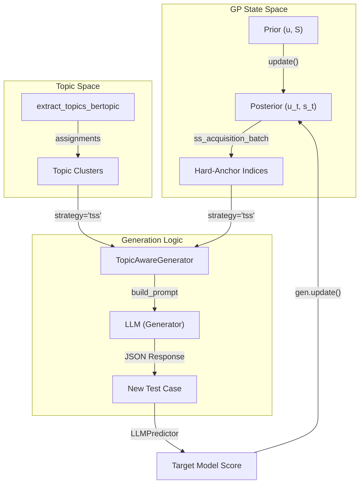
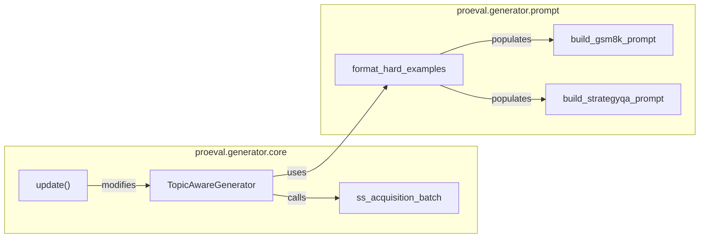

<!-- source: DeepWiki mcp.deepwiki.com · repo google-deepmind/proeval · page 4 Failure Discovery & Test Case Generation · fetched 2026-10-26 -->

# Failure Discovery & Test Case Generation

Relevant source files

The following files were used as context for generating this wiki page:

- [proeval/README.md](proeval/README.md)
- [proeval/generator/__init__.py](proeval/generator/__init__.py)
- [proeval/generator/core.py](proeval/generator/core.py)

The proactive failure discovery subsystem in ProEval is designed to surface diverse model bugs and edge cases within a constrained evaluation budget. Unlike traditional evaluation which measures average performance, this subsystem focuses on **Hard-negative Superlevel Set (HSS)** sampling to identify regions of the input space where the target model is likely to fail. It leverages the Gaussian Process (GP) posterior state—either from a learned prior or a neural encoder—to guide both the selection of existing test cases and the generation of novel ones via LLMs.

## Overview of Proactive Discovery

The discovery process combines Bayesian active sampling with topic-aware strategies to ensure that discovered failures are not only numerous but also diverse across the problem domain. The system supports two primary modes of operation:
1.  **Selection Mode**: Identifying the most difficult existing examples from a large unlabeled pool.
2.  **Generation Mode**: Using an LLM to synthesize new test cases by conditioning on "hard-anchor" examples identified by the GP.

### Discovery Workflow

The discovery loop typically follows these steps:
1.  **Prior Initialization**: The GP is initialized using either a linear prior from reference models (`prior_u`, `prior_S`) or a neural encoder (TPF) [proeval/generator/core.py:27-33]().
2.  **Topic Extraction**: For topic-aware strategies, the pool is clustered using `BERTopic` to ensure coverage across different semantic areas [proeval/generator/core.py:213-215]().
3.  **Acquisition**: The Superlevel Set (SS) acquisition function identifies indices where the model is predicted to fail (label = 1) with high uncertainty [proeval/generator/core.py:80-91]().
4.  **Generation/Selection**: The `TopicAwareGenerator` either selects these samples or uses them as few-shot context to generate new ones [proeval/generator/core.py:334-345]().
5.  **Feedback Loop**: Results from the target model are fed back via `gen.update(score)`, updating the GP posterior and refining the search for the next iteration [proeval/generator/core.py:56-57]().

### Failure Discovery Architecture

The diagram below illustrates the relationship between the GP posterior state, the topic clusters, and the generation logic.

**Figure 1: Proactive Failure Discovery Pipeline**

Sources: [proeval/generator/core.py:80-156](), [proeval/generator/core.py:213-240](), [proeval/generator/core.py:334-370]()

---

## Key Components

### Superlevel Set (SS) Acquisition
The core selection logic uses the Superlevel Set acquisition function. It targets points where the model's predicted error probability exceeds a threshold $\lambda$. The acquisition value for a point $x$ is defined as:
$$\alpha_{SS}(x) = \mathbb{1}(\mu_t(x) + \beta \cdot \sigma_t(x) \geq \lambda) \times k_t(x, x)$$
where $k_t(x, x)$ represents the posterior variance, favoring points that are both likely failures and highly uncertain [proeval/generator/core.py:117-120]().

### TopicAwareGenerator
The `TopicAwareGenerator` class manages the internal state of the discovery process. It tracks which samples have been "labeled" (tested) and uses different strategies to balance exploration (new topics) and exploitation (known failure regions) [proeval/generator/core.py:246-270]().

| Strategy | Description |
| :--- | :--- |
| `SS` | Superlevel Set selection from the existing pool [proeval/generator/core.py:438](). |
| `TSS` | Topic-aware Superlevel Set; cycles through topics and applies SS within each [proeval/generator/core.py:446](). |
| `SS-Gen` | Uses SS to find hard-anchors, then generates new cases based on them [proeval/generator/core.py:453](). |
| `Rand-T-Gen` | Randomly picks a topic and generates a new case for it [proeval/generator/core.py:461](). |

### Discovery Strategy Mapping

This diagram bridges the high-level strategies to the specific functions and variables used in the implementation.

**Figure 2: Strategy to Code Entity Mapping**

Sources: [proeval/generator/core.py:334-345](), [proeval/generator/core.py:427-465](), [proeval/generator/prompt.py:100-115]()

---

## Child Pages

### [4.1 TopicAwareGenerator & SS Acquisition](#)
Detailed reference for the `TopicAwareGenerator` class. Covers initialization with different prior modes (learned vs. encoder), the `generate()` method's various strategies, and the `ss_acquisition_batch` logic including greedy diversity sampling.
*   **Key Symbols**: `TopicAwareGenerator`, `ss_acquisition_batch`, `extract_topics_bertopic`.

### [4.2 Prompt Templates & Generation Schemas](#)
Documentation for the `proeval.generator.prompt` module. Explains how hard-anchor examples are formatted into few-shot prompts and how JSON schemas ensure the LLM-generated test cases are parsable and valid for datasets like GSM8K and StrategyQA.
*   **Key Symbols**: `build_gsm8k_prompt`, `GSM8K_SCHEMA`, `format_hard_examples`.

---
**Sources:**
- [proeval/README.md:237-270]() (Discovery overview)
- [proeval/generator/core.py:15-57]() (Module purpose and examples)
- [proeval/generator/core.py:80-156]() (SS acquisition logic)
- [proeval/generator/core.py:246-330]() (TopicAwareGenerator definition)
- [proeval/generator/core.py:427-465]() (Strategy implementation)
- [proeval/generator/prompt.py:100-115]() (Few-shot formatting)

---

