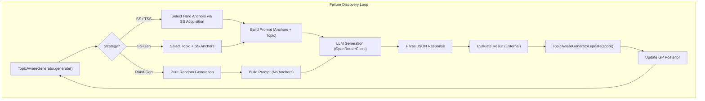
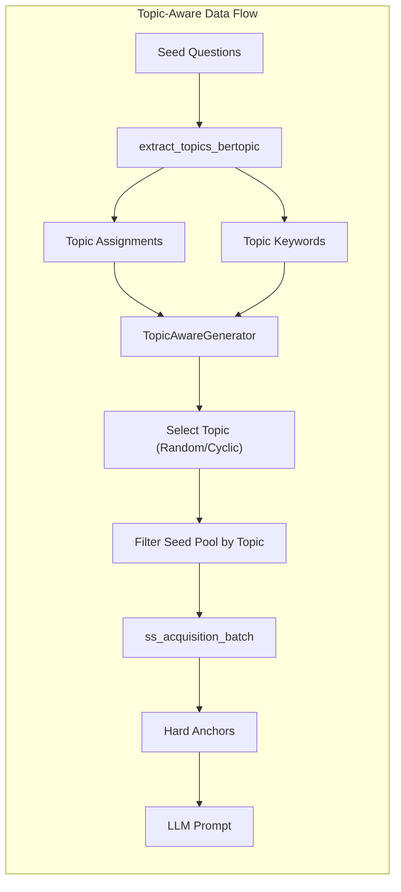

<!-- source: DeepWiki mcp.deepwiki.com · repo google-deepmind/proeval · page 4.1 TopicAwareGenerator & SS Acquisition · fetched 2026-10-26 -->

# TopicAwareGenerator & SS Acquisition

Relevant source files

The following files were used as context for generating this wiki page:

- [proeval/generator/__init__.py](proeval/generator/__init__.py)
- [proeval/generator/baselines.py](proeval/generator/baselines.py)
- [proeval/generator/core.py](proeval/generator/core.py)

The `TopicAwareGenerator` is the central component for proactive failure discovery in ProEval. It leverages the Gaussian Process (GP) posterior state from Bayesian Quadrature (BQ) to identify regions of the input space where a model is likely to fail (Superlevel Set acquisition). It then generates new, diverse test cases by combining topic-aware sampling with "hard-anchor" few-shot prompting.

## TopicAwareGenerator Class

The `TopicAwareGenerator` manages the feedback loop between the GP surrogate model, topic extraction, and an LLM-based generator. It supports two primary modes for establishing a performance prior: using pre-computed model predictions or using a neural encoder.

### Initialization & Prior Modes

The generator is initialized in one of two ways to establish the initial belief about model performance:

1.  **Without Pretrain (Prior from Predictions):** Uses `prior_u` (mean) and `prior_S` (covariance) derived from the performance of reference models on a seed dataset. [proeval/generator/core.py:29-30]().
2.  **With Pretrain (Neural Encoder):** Uses a pre-trained `QuestionEncoder` and pre-computed embeddings to compute the GP prior dynamically. [proeval/generator/core.py:31-32]().

| Parameter | Type | Description |
| :--- | :--- | :--- |
| `df` | `pd.DataFrame` | The seed dataset containing questions and ground truth. |
| `dataset` | `str` | Dataset identifier (e.g., "gsm8k", "strategyqa"). |
| `api_key` | `str` | API key for the generation LLM (OpenRouter). |
| `prior_u` | `np.ndarray` | (Optional) Prior mean vector. |
| `prior_S` | `np.ndarray` | (Optional) Prior covariance matrix. |
| `encoder_path` | `str` | (Optional) Path to `.pth` neural encoder checkpoint. |
| `embeddings_path`| `str` | (Optional) Path to `.npy` embedding file. |

**Sources:** [proeval/generator/core.py:41-57](), [proeval/generator/core.py:255-300]()

### The Generation Loop

The generator operates in an iterative loop. In each step, it selects a strategy to generate a new test case, evaluates it, and updates its internal GP state.

**Sources:** [proeval/generator/core.py:53-56](), [proeval/generator/core.py:373-458](), [proeval/generator/core.py:488-515]()

---

## Superlevel Set (SS) Acquisition

The Superlevel Set acquisition function targets points where the model is predicted to fail with high uncertainty. In ProEval, failure is labeled as `1` and success as `0`, so the "Superlevel Set" refers to the region where the failure probability is high.

### Implementation: `ss_acquisition_batch`

The core logic implements the acquisition function:
$$\alpha_{SS}(x) = \mathbb{1}(\mu_t(x) + \beta \cdot \sigma_t(x) \geq \lambda) \times k_t(x, x)$$
where $\lambda$ is the `threshold` and $k_t(x, x)$ is the posterior variance. [proeval/generator/core.py:117-121]().

Key modes in `ss_acquisition_batch`:
*   **top_n**: Returns the $n$ samples with the highest acquisition scores. [proeval/generator/core.py:135-138]().
*   **greedy**: Selects samples that maximize the SS score while maintaining diversity via embedding distance. [proeval/generator/core.py:140-154]().
*   **threshold**: Filters samples strictly above the $\lambda$ boundary and selects the one with the highest variance. [proeval/generator/core.py:125-133]().

**Sources:** [proeval/generator/core.py:80-156]()

---

## Generation Strategies

The `generate()` method supports several strategies that determine how the LLM prompt is constructed. [proeval/generator/core.py:373-410]().

| Strategy | Description | Anchor Selection |
| :--- | :--- | :--- |
| **SS** | Superlevel Set sampling from the seed pool. | `ss_acquisition` on full pool. |
| **SS-Gen** | SS sampling within a randomly selected topic. | `ss_acquisition` restricted to topic. |
| **TSS** | Topic-aware SS; cycles through topics to ensure diversity. | Topic-restricted SS. |
| **Rand-Gen** | Pure random generation baseline. | None (Random pool sample). |
| **Rand-T-Gen** | Random topic injection without BQ guidance. | None (Random pool sample). |

### Hard-Anchor Selection
For strategies using anchors (SS, SS-Gen, TSS), the generator calls `ss_acquisition_batch` to find $k$ examples from the seed dataset that the GP predicts the model will fail on. These are formatted into the prompt using `format_hard_examples` to provide few-shot context to the LLM. [proeval/generator/core.py:421-436](), [proeval/generator/prompt.py:120-137]().

**Sources:** [proeval/generator/core.py:373-458](), [proeval/generator/baselines.py:32-73]()

---

## Topic Extraction & Management

ProEval uses `BERTopic` to cluster the seed dataset questions into semantically meaningful groups.

### `extract_topics_bertopic`
This function uses a `SentenceTransformer` ("all-MiniLM-L6-v2") to embed questions, `UMAP` for dimensionality reduction, and `HDBSCAN` for clustering. It returns:
1.  A list of topic labels (top keywords).
2.  A mapping of topic IDs to questions.
3.  An array of topic assignments for every question in the dataset.

[proeval/generator/core.py:213-252]().

### Integration with GP
The `TopicAwareGenerator` stores these assignments in `self.topic_assignments`. When `strategy="tss"` or `"ss_gen"` is used, the `ss_acquisition_batch` function filters the `unlabeled_indices` to only include those belonging to the `selected_topic`. [proeval/generator/core.py:107-112](), [proeval/generator/core.py:314-319]().

**Sources:** [proeval/generator/core.py:213-252](), [proeval/generator/core.py:314-325](), [proeval/generator/core.py:415-430]()

---

## Feedback Loop: `update()`

After a test case is generated and evaluated by the `LLMPredictor`, the result must be fed back into the generator to refine the GP surrogate.

1.  **Embedding:** The new question is embedded using the same encoder/method as the seed data. [proeval/generator/core.py:494-500]().
2.  **State Update:** The embedding and the score (0 or 1) are appended to `self.X_observed` and `self.y_observed`. [proeval/generator/core.py:502-503]().
3.  **Posterior Recomputation:** The internal GP state is updated using `_get_posterior` (for prediction-based priors) or `get_posterior_embedding` (for encoder-based priors). [proeval/generator/core.py:505-515]().

**Sources:** [proeval/generator/core.py:488-515](), [proeval/generator/core.py:186-208]()

---

