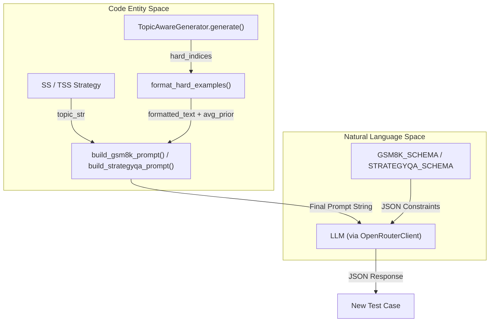
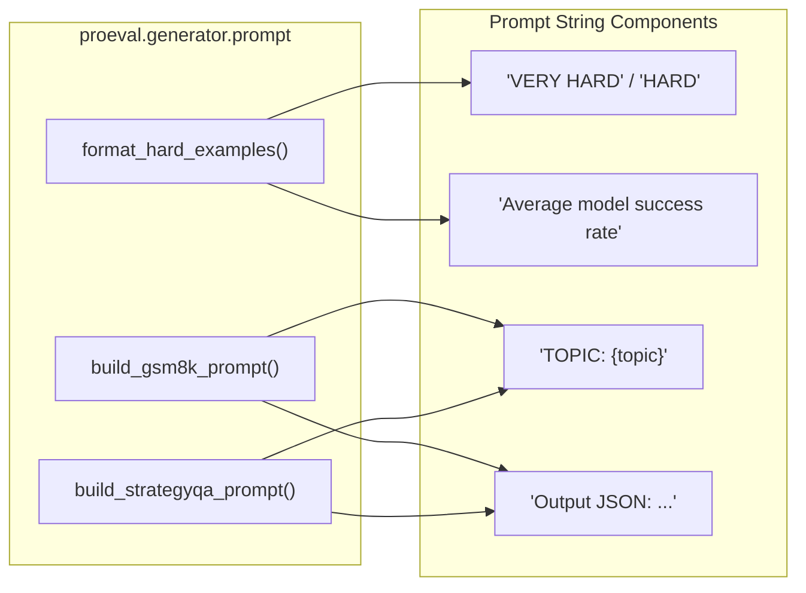

<!-- source: DeepWiki mcp.deepwiki.com · repo google-deepmind/proeval · page 4.2 Prompt Templates & Generation Schemas · fetched 2026-10-26 -->

# Prompt Templates & Generation Schemas

Relevant source files

The following files were used as context for generating this wiki page:

- [proeval/generator/core.py](proeval/generator/core.py)
- [proeval/generator/prompt.py](proeval/generator/prompt.py)

The `proeval.generator.prompt` module centralizes the construction of natural language prompts and JSON output schemas used during proactive failure discovery. It translates the mathematical state of the Bayesian Quadrature (BQ) sampler—specifically the Superlevel Set (SS) acquisition results—into structured instructions for an LLM to generate new, adversarial test cases.

### Core Components and Data Flow

The prompt generation process bridges the **Code Entity Space** (GP posteriors, indices, and dataframes) to the **Natural Language Space** (instructional text and few-shot examples).

**Prompt Generation Workflow**

Sources: [proeval/generator/core.py:68-74](), [proeval/generator/prompt.py:15-29]()

### JSON Output Schemas

To ensure that LLM-generated test cases can be parsed programmatically, ProEval utilizes JSON schemas. These schemas are passed to the `OpenRouterClient` to enforce "strict" output formats [proeval/generator/prompt.py:36-70]().

| Schema Constant | Dataset Target | Required Fields | Purpose |
| :--- | :--- | :--- | :--- |
| `GSM8K_SCHEMA` | GSM8K | `question`, `solution`, `ground_truth` | Ensures math problems include step-by-step solutions and a final numeric answer [proeval/generator/prompt.py:36-52](). |
| `STRATEGYQA_SCHEMA` | StrategyQA | `question`, `reasoning`, `ground_truth` | Ensures reasoning questions include the multi-hop logic and a boolean answer [proeval/generator/prompt.py:54-70](). |

Sources: [proeval/generator/prompt.py:36-70]()

### Few-Shot Context Injection

The function `format_hard_examples()` is the primary mechanism for injecting "hard" examples (surfaced by the BQ sampler) into the prompt. It performs two critical tasks:
1.  **Difficulty Labeling**: It maps the `prior_mean` (predicted success rate) to human-readable labels: `VERY HARD` ($<0.3$), `HARD` ($<0.5$), or `MODERATE` [proeval/generator/prompt.py:85]().
2.  **Aggregation**: It calculates the `average_prior_mean` of the selected examples to provide the LLM with a target difficulty benchmark [proeval/generator/prompt.py:91-92]().

**Entity Mapping: Code to Prompt**

Sources: [proeval/generator/prompt.py:76-92](), [proeval/generator/prompt.py:119-147]()

### Dataset-Specific Prompt Builders

The module provides specialized builders that adapt instructions based on the generation strategy (e.g., `pure_random`, `ss_gen`, or `tss`).

#### GSM8K Prompting (`build_gsm8k_prompt`)
For mathematical reasoning, the builder emphasizes "calculation traps" and "multi-step reasoning" [proeval/generator/prompt.py:125-128]().
*   **Random Strategies**: Focuses on creativity and specific topics [proeval/generator/prompt.py:100-115]().
*   **Adversarial Strategies (`ss_gen`, `tss`)**: Instructs the LLM to act as an "expert Red-Teamer" and mimic the reasoning patterns of provided hard examples [proeval/generator/prompt.py:120-132]().

#### StrategyQA Prompting (`build_strategyqa_prompt`)
For boolean reasoning, the builder emphasizes "multi-hop reasoning" and "implicit knowledge" [proeval/generator/prompt.py:159-161]().
*   **Adversarial Instructions**: Explicitly mentions that "AI models failed on these" examples to encourage the generation of harder edge cases [proeval/generator/prompt.py:183-185]().

Sources: [proeval/generator/prompt.py:98-147](), [proeval/generator/prompt.py:153-188]()

---

