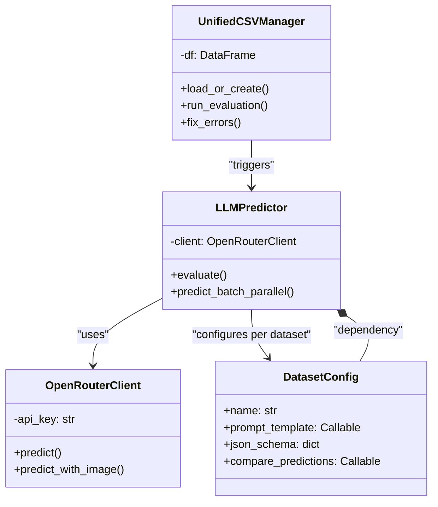

<!-- source: DeepWiki mcp.deepwiki.com · repo google-deepmind/proeval · page 5 LLM Evaluation Layer · fetched 2026-10-26 -->

# LLM Evaluation Layer

<details>
<summary>Relevant source files</summary>

The following files were used as context for generating this wiki page:

- [proeval/evaluator/__init__.py](proeval/evaluator/__init__.py)
- [proeval/evaluator/client.py](proeval/evaluator/client.py)
- [proeval/evaluator/predictor.py](proeval/evaluator/predictor.py)

</details>


The LLM Evaluation Layer is responsible for the end-to-end process of generating model predictions and calculating performance metrics. It abstracts the complexities of multi-model inference, structured response parsing, and error handling. This subsystem ensures that evaluation data is consistently formatted and persisted across different benchmarks and models.

The layer is centered around two primary components: the `LLMPredictor`, which handles the logic of prompting and parsing, and the `UnifiedCSVManager`, which manages the state of evaluation datasets on disk.

### System Interaction Overview

The following diagram illustrates how the evaluation layer bridges the gap between raw dataset questions (Natural Language Space) and structured evaluation records (Code Entity Space).

**Evaluation Data Flow**
```mermaid
graph TD
    subgraph "Natural Language Space"
        [Question] --> [LLM_Inference]
        [LLM_Inference] --> [Raw_Response]
    end

    subgraph "Code Entity Space"
        [LLMPredictor] -- "uses" --> [OpenRouterClient]
        [OpenRouterClient] -- "calls" --> [predict_function]
        [Raw_Response] -- "parsed by" --> [DatasetConfig]
        [DatasetConfig] -- "extracts" --> [prediction_field]
        [prediction_field] -- "compared via" --> [compare_predictions]
        [compare_predictions] -- "results in" --> [label_model_column]
        [label_model_column] -- "saved by" --> [UnifiedCSVManager]
    end

    [Question] -.-> [LLMPredictor]
    [UnifiedCSVManager] -.-> [Unified_CSV_File]
```
Sources: [proeval/evaluator/predictor.py:17-32](), [proeval/evaluator/csv_manager.py:24-40](), [proeval/evaluator/client.py:73-81]()

---

### LLM Inference & Response Parsing

The `LLMPredictor` class serves as the main entry point for generating predictions. It utilizes a `DatasetConfig` to determine how to format prompts for specific benchmarks (e.g., `STRATEGYQA_PROMPT`, `GSM8K_PROMPT`) and how to extract the final answer from the LLM's response.

Key features include:
*   **Parallel Inference**: The `predict_batch_parallel` method uses `ThreadPoolExecutor` to handle high-throughput evaluation.
*   **Structured Output**: It enforces JSON responses using `response_format` and `json_schema` to minimize parsing errors.
*   **Error Categorization**: Predictions that fail are categorized into specific states: `SKIPPED`, `ERROR`, `RATE_LIMITED`, or `PARSE_ERROR`.

For details on prompt templates and error handling, see [LLMPredictor & OpenRouterClient](#5.1).

Sources: [proeval/evaluator/predictor.py:129-140](), [proeval/evaluator/predictor.py:321-350](), [proeval/evaluator/predictor.py:37-86]()

---

### Data Management & Persistence

Evaluation results are managed by the `UnifiedCSVManager`. This component ensures that predictions from multiple models are stored in a single, unified schema. It tracks the raw response, the extracted prediction, and the calculated label (0 for correct, 1 for error) for every model evaluated on a dataset.

The manager handles:
*   **Checkpointing**: Periodically saving results during long-running batch evaluations to prevent data loss.
*   **Error Remediation**: The `fix_errors` method allows for re-running only the samples that previously resulted in an error state.
*   **HuggingFace Integration**: Utilities like `load_dataset_data` streamline the process of pulling benchmark data into the ProEval pipeline.

For details on the CSV schema and dataset configurations, see [UnifiedCSVManager & Dataset Configuration](#5.2).

Sources: [proeval/evaluator/csv_manager.py:43-60](), [proeval/evaluator/csv_manager.py:124-150](), [proeval/evaluator/csv_manager.py:270-300]()

---

### Class & Entity Relationships

This diagram maps the relationships between the core classes in the `proeval.evaluator` package.

**Evaluator Subsystem Class Diagram**

Sources: [proeval/evaluator/predictor.py:129-140](), [proeval/evaluator/csv_manager.py:43-55](), [proeval/evaluator/client.py:73-81](), [proeval/evaluator/predictor.py:321-330]()

### Related Child Pages
*   **[LLMPredictor & OpenRouterClient](#5.1)**: Deep dive into inference logic, parallelization, and API communication.
*   **[UnifiedCSVManager & Dataset Configuration](#5.2)**: Detailed schema definitions, checkpointing logic, and benchmark-specific configurations.

---

