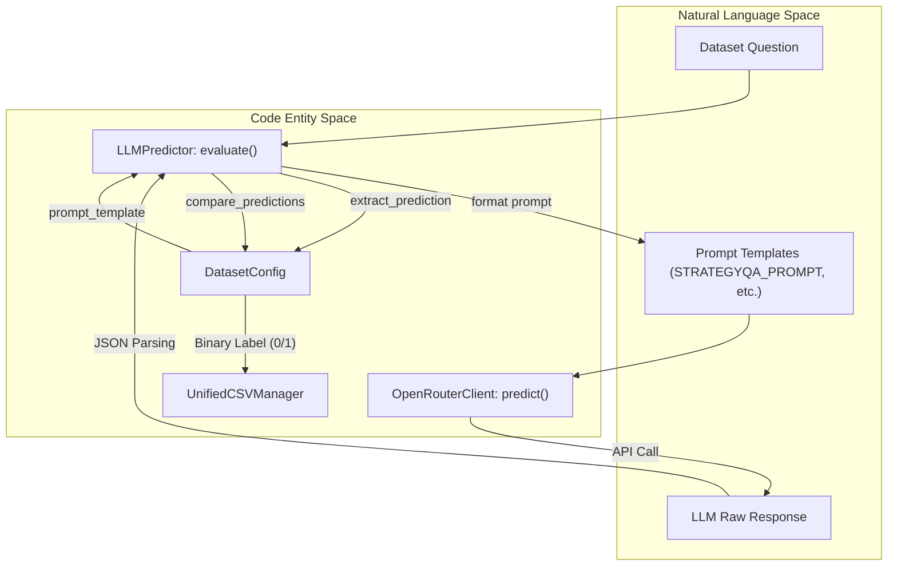
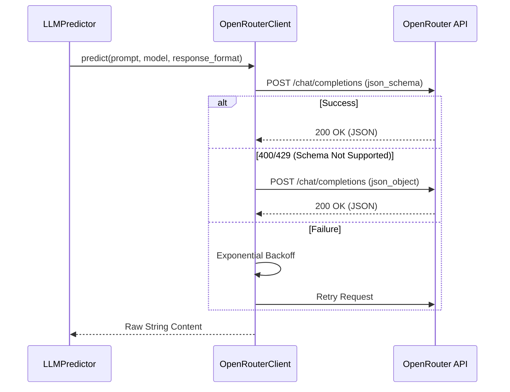

<!-- source: DeepWiki mcp.deepwiki.com · repo google-deepmind/proeval · page 5.1 LLMPredictor & OpenRouterClient · fetched 2026-10-26 -->

# LLMPredictor & OpenRouterClient

Relevant source files

The following files were used as context for generating this wiki page:

- [proeval/evaluator/__init__.py](proeval/evaluator/__init__.py)
- [proeval/evaluator/client.py](proeval/evaluator/client.py)
- [proeval/evaluator/predictor.py](proeval/evaluator/predictor.py)

The `proeval.evaluator` subsystem provides a robust layer for interacting with Large Language Models (LLMs) to perform evaluation tasks. It abstracts API communication through `OpenRouterClient` and manages high-level dataset-specific logic via `LLMPredictor`.

### LLM Prediction Pipeline

The prediction pipeline transforms raw dataset questions into structured model evaluations. It handles prompt templating, JSON-mode enforcement, parallel execution, and result parsing.

#### System Architecture and Data Flow

The following diagram illustrates the relationship between the predictor, the client, and the dataset-specific configurations.

**LLM Prediction System Map**

Sources: [proeval/evaluator/predictor.py:17-46](), [proeval/evaluator/predictor.py:129-139](), [proeval/evaluator/client.py:100-115]()

---

### LLMPredictor

The `LLMPredictor` class is the primary interface for running evaluations. It manages a `DatasetConfig` which defines how to interact with specific benchmarks.

#### Key Functions
- **`evaluate(question, ground_truth, model, ...)`**: Performs a single prediction. It formats the prompt, calls the client, parses the JSON response, and compares the result against the ground truth to generate a label (0 for correct, 1 for error) [proeval/evaluator/predictor.py:358-417]().
- **`predict_batch_parallel(data, model, ...)`**: Uses a `ThreadPoolExecutor` to run multiple evaluations concurrently, improving throughput for large datasets [proeval/evaluator/predictor.py:440-475]().

#### Error States
The predictor tracks several failure modes during the evaluation process:
| State | Description |
| :--- | :--- |
| `SKIPPED` | The item was skipped (e.g., if already processed) [proeval/evaluator/predictor.py:365](). |
| `ERROR` | A general execution error occurred during the API call [proeval/evaluator/predictor.py:410](). |
| `RATE_LIMITED` | The API provider returned a 429 status code [proeval/evaluator/client.py:167](). |
| `PARSE_ERROR` | The LLM returned a response that could not be parsed as valid JSON according to the schema [proeval/evaluator/predictor.py:401](). |

Sources: [proeval/evaluator/predictor.py:358-475](), [proeval/evaluator/client.py:167-175]()

---

### Dataset Configurations and Prompts

ProEval uses specialized prompt templates and JSON schemas to ensure models produce parseable outputs. These are encapsulated in `DatasetConfig` objects created by factory functions.

| Dataset | Prompt Template Constant | Schema Type |
| :--- | :--- | :--- |
| StrategyQA | `STRATEGYQA_PROMPT` | `yes_no_schema` |
| GSM8K | `GSM8K_PROMPT` | `numerical_schema` |
| SVAMP | `SVAMP_PROMPT` | `numerical_schema` |
| Jigsaw | `JIGSAW_PROMPT` | `yes_no_schema` |
| ToxicChat | `TOXICCHAT_PROMPT` | `yes_no_schema` |

**Example: GSM8K Prompting**
The `GSM8K_PROMPT` instructs the model to solve a math problem and provide a final numerical answer in a specific JSON field [proeval/evaluator/predictor.py:48-55](). The `create_gsm8k_config` factory defines a comparison function that allows for small floating-point differences (`1e-6`) [proeval/evaluator/predictor.py:186-194]().

Sources: [proeval/evaluator/predictor.py:37-123](), [proeval/evaluator/predictor.py:171-210]()

---

### OpenRouterClient

The `OpenRouterClient` provides a unified interface for API communication, supporting various providers through the OpenRouter aggregator.

#### Features
- **Model Mapping**: Translates friendly names (e.g., `gpt4`) to full OpenRouter identifiers (e.g., `openai/gpt-4`) [proeval/evaluator/client.py:31-58]().
- **JSON Mode Fallback**: If a request with a `json_schema` fails (status 400/429), the client automatically downgrades to a generic `json_object` request, and finally to a raw text request if necessary [proeval/evaluator/client.py:135-152]().
- **Vision Support**: The `predict_with_image` method handles base64 encoding for vision-capable models like Gemini [proeval/evaluator/client.py:179-205]().
- **Retry Logic**: Implements exponential backoff for rate limits and transient errors [proeval/evaluator/client.py:166-175]().

#### API Interaction Logic

Sources: [proeval/evaluator/client.py:100-176](), [proeval/evaluator/client.py:23-67]()

---

