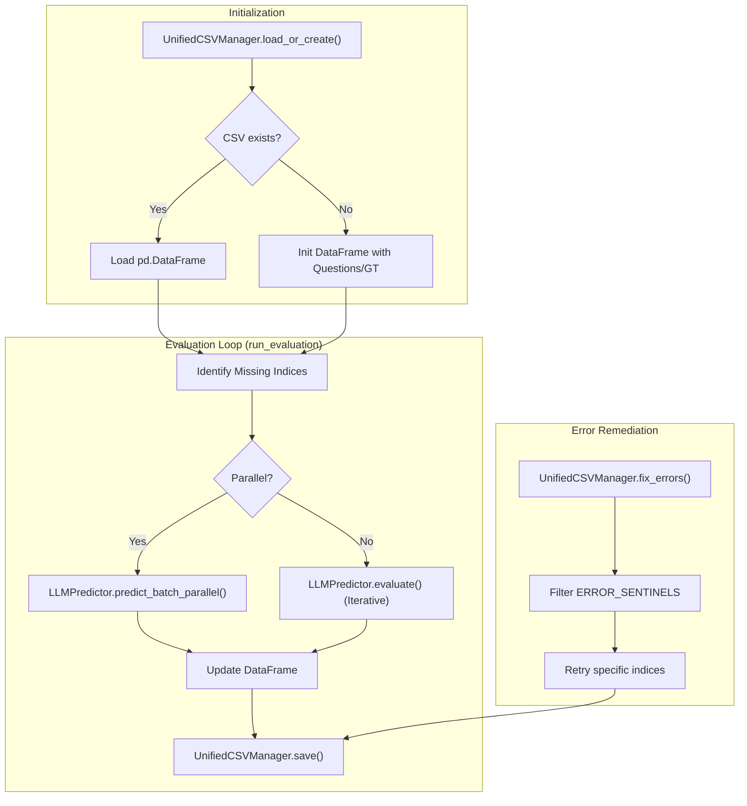
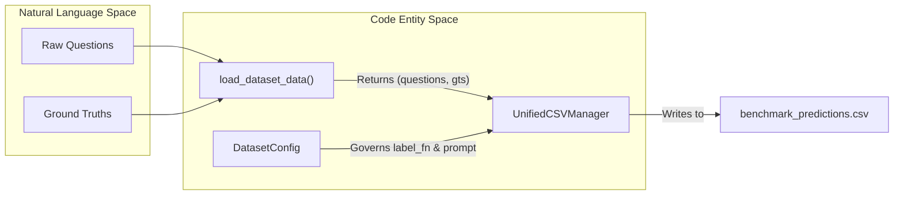

<!-- source: DeepWiki mcp.deepwiki.com · repo google-deepmind/proeval · page 5.2 UnifiedCSVManager & Dataset Configuration · fetched 2026-10-26 -->

# UnifiedCSVManager & Dataset Configuration

Relevant source files

The following files were used as context for generating this wiki page:

- [data/README.md](data/README.md)
- [proeval/evaluator/__init__.py](proeval/evaluator/__init__.py)
- [proeval/evaluator/csv_manager.py](proeval/evaluator/csv_manager.py)

The `UnifiedCSVManager` and its associated dataset configuration utilities provide the foundational persistence and data-loading layer for ProEval. This subsystem manages multi-model evaluation results in a unified format, supporting checkpointing, parallel evaluation, and error remediation.

## UnifiedCSVManager

The `UnifiedCSVManager` class, defined in `proeval/evaluator/csv_manager.py`, is responsible for maintaining a single CSV file per benchmark. This file stores questions, ground truths, and the predictions/labels for every model evaluated on that dataset.

### Core Implementation & Persistence Logic

The manager uses a `pandas.DataFrame` as an in-memory representation and persists it to a CSV file at `[dataset_name]_predictions.csv` `[proeval/evaluator/csv_manager.py:96-100]()`.

#### Key Methods

| Method | Description |
| :--- | :--- |
| `load_or_create()` | Loads an existing CSV from disk or initializes a new one with `index`, `question`, and `ground_truth` columns `[proeval/evaluator/csv_manager.py:104-124]()`. |
| `run_evaluation()` | The primary entry point for evaluating a model. It identifies which rows need evaluation (skipping existing ones), calls the `LLMPredictor`, and saves results `[proeval/evaluator/csv_manager.py:221-274]()`. |
| `fix_errors()` | Scans for rows containing `ERROR_SENTINELS` (e.g., `RATE_LIMITED`, `PARSE_ERROR`) and attempts to re-evaluate only those specific indices `[proeval/evaluator/csv_manager.py:276-309]()`. |
| `add_model_predictions()` | Appends new columns to the DataFrame for a specific model suffix `[proeval/evaluator/csv_manager.py:137-153]()`. |
| `save()` | Serializes the current state to disk, ensuring that indices and column types are preserved `[proeval/evaluator/csv_manager.py:196-203]()`. |

### Unified CSV Column Schema

The manager enforces a strict naming convention to allow multiple models to coexist in one file.

| Column Group | Column Name | Description |
| :--- | :--- | :--- |
| **Shared** | `index` | Unique integer identifier `[data/README.md:51]()`. |
| **Shared** | `question` | Input prompt (string or JSON dict) `[data/README.md:52]()`. |
| **Shared** | `ground_truth` | Reference answer `[data/README.md:53]()`. |
| **Per-Model** | `prediction_<model>` | The extracted/parsed answer from the model `[data/README.md:61]()`. |
| **Per-Model** | `label_<model>` | Error score (0.0 = correct, 1.0 = error) `[data/README.md:62]()`. |
| **Per-Model** | `raw_response_<model>` | Full JSON response including reasoning `[data/README.md:63]()`. |

**Sources:** `proeval/evaluator/csv_manager.py`, `data/README.md`

## Data Flow: Evaluation & Checkpointing

The following diagram illustrates how `UnifiedCSVManager` interacts with `LLMPredictor` to manage the evaluation lifecycle, including how it handles partial progress through checkpointing.

### Evaluation Lifecycle Diagram

**Sources:** `proeval/evaluator/csv_manager.py:221-309()`, `proeval/evaluator/predictor.py:127-185()`

## Dataset Configuration

The system uses `DatasetConfig` objects to abstract the differences between benchmarks (e.g., math vs. safety vs. knowledge). These are centralized in `DATASET_CONFIGS`.

### DatasetConfig Structure
Defined in `proeval/evaluator/predictor.py`, this class encapsulates:
* **`prompt_template`**: The base instruction for the LLM `[proeval/evaluator/predictor.py:65]()`.
* **`response_schema`**: The expected JSON structure for parsing `[proeval/evaluator/predictor.py:66]()`.
* **`label_fn`**: A function that compares the `prediction` to `ground_truth` to produce a numerical error score `[proeval/evaluator/predictor.py:67]()`.

### Configuration Registry
The `DATASET_CONFIGS` dictionary maps benchmark names to their respective configurations:
* `gsm8k`, `svamp`: Math reasoning with numeric extraction `[proeval/evaluator/predictor.py:284-315]()`.
* `mmlu`: Multiple choice (A, B, C, D) `[proeval/evaluator/predictor.py:339-361]()`.
* `strategyqa`: Yes/No reasoning `[proeval/evaluator/predictor.py:257-282]()`.
* `jigsaw`, `dices`: Safety and toxicity ratings `[proeval/evaluator/predictor.py:363-446]()`.

### Loading Dataset Data
The `load_dataset_data()` function in `proeval/evaluator/csv_manager.py` handles fetching data from HuggingFace or local caches.

**Sources:** `proeval/evaluator/predictor.py:61-75()`, `proeval/evaluator/csv_manager.py:312-385()`

## Implementation Details

### Error Sentinels
The `UnifiedCSVManager` tracks specific strings in the `prediction_<model>` column to determine if a retry is necessary `[proeval/evaluator/csv_manager.py:165-174]()`:
* `SKIPPED`: Manual bypass.
* `ERROR`: General execution failure.
* `RATE_LIMITED`: API quota exceeded.
* `PARSE_ERROR`: Model output did not match the `response_schema`.

### JSON Serialization
Because the CSVs store complex types (like dictionaries in the `question` column or JSON in `raw_response`), the manager uses `convert_numpy_types()` to ensure compatibility with standard JSON serialization when saving results `[proeval/evaluator/csv_manager.py:62-77]()`.

**Sources:** `proeval/evaluator/csv_manager.py`

---

