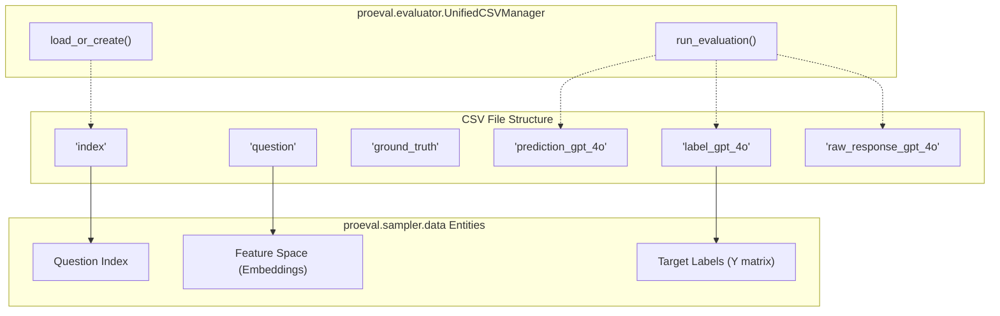
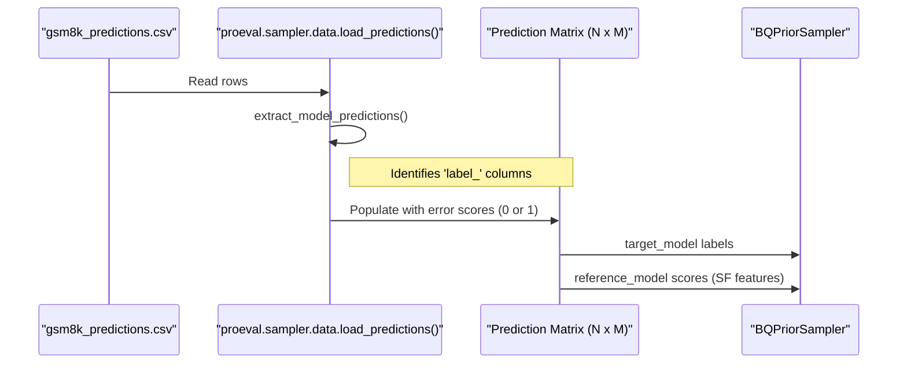

<!-- source: DeepWiki mcp.deepwiki.com · repo google-deepmind/proeval · page 6.1 Predictions CSV Format & Evaluated Models · fetched 2026-10-26 -->

# Predictions CSV Format & Evaluated Models

Relevant source files

The following files were used as context for generating this wiki page:

- [data/README.md](data/README.md)
- [data/dices_predictions.csv](data/dices_predictions.csv)
- [data/gqa_predictions.csv](data/gqa_predictions.csv)
- [data/gsm8k_predictions.csv](data/gsm8k_predictions.csv)
- [data/svamp_predictions.csv](data/svamp_predictions.csv)

This page provides a technical reference for the `*_predictions.csv` files used by ProEval. These files serve as the primary data source for the Bayesian Quadrature (BQ) samplers and failure discovery mechanisms. They contain the input prompts, ground truth answers, and the responses/labels for up to 16 large language models across eight benchmarks.

## CSV Schema Overview

The predictions files use a standardized columnar schema. Each row represents a unique evaluation example within a benchmark. The columns are partitioned into **shared columns** (identifying the instance) and **per-model column groups** (containing model-specific performance data) [data/README.md:42-45]().

### Shared Columns
These columns are common to every benchmark and occupy the first three positions in the CSV [data/README.md:47-53]().

| Column | Type | Description |
| :--- | :--- | :--- |
| `index` | `int` | Zero-based unique identifier for the example [data/README.md:51-51](). |
| `question` | `str` | The input prompt. Format varies by benchmark (e.g., plain text or JSON dict) [data/README.md:52-52](). |
| `ground_truth` | `str` | The reference answer used for evaluation [data/README.md:53-53](). |

### Per-Model Column Groups
For every evaluated model, a triplet of columns is appended to the row. The suffix `<model>` corresponds to the canonical model identifier [data/README.md:57-63]().

| Column | Type | Description |
| :--- | :--- | :--- |
| `prediction_<model>` | `str` | The parsed, short-form answer extracted from the model's response [data/README.md:61-61](). |
| `label_<model>` | `float` | The **error score**. `0.0` indicates correct; `1.0` indicates incorrect. Continuous values (e.g., `0.25`) are used for safety benchmarks [data/README.md:62-62](). |
| `raw_response_<model>` | `str` | The complete JSON response from the LLM, often including a `"reasoning"` field [data/README.md:63-63](). |

### Data Flow & Column Association
The following diagram illustrates how the `UnifiedCSVManager` maps the physical CSV structure to the internal data representations used by the `proeval` package.

**Figure 1: CSV Column to Code Entity Mapping**

Sources: [data/README.md:40-63](), [proeval/sampler/data.py:1-20]()

---

## Label Semantics

ProEval adopts an **error-centric** labeling convention. In the `label_<model>` column, a value of **0** represents a correct prediction, while **1** represents a failure [data/README.md:62-62](). This is critical for the BQ samplers, which treat the task as estimating the integral of the error function.

*   **Binary Benchmarks:** (GSM8K, SVAMP, MMLU, StrategyQA, GQA, Jigsaw) use discrete `{0.0, 1.0}` labels [data/README.md:22-31]().
*   **Continuous Benchmarks:** (DICES, DICES-T2I) use a range `{0.0, 0.25, 0.5, 0.75, 1.0}` to represent degrees of safety violations or rater disagreement [data/README.md:62-62]().

---

## Evaluated Models (16-Model Roster)

The dataset tracks 16 models across most benchmarks. Note that `gqa` and `dices_t2i` contain a subset of 14 models, excluding `gpt35_turbo` and `qwen3_32b` [data/README.md:88-90]().

| Model Identifier (`<model>`) | Provider | Canonical Name |
| :--- | :--- | :--- |
| `gpt35_turbo` | OpenAI | GPT-3.5 Turbo |
| `gpt_4o` | OpenAI | GPT-4o |
| `gpt5`, `gpt5_1`, `gpt5_2` | OpenAI | GPT-5 Series |
| `claude35_haiku` | Anthropic | Claude 3.5 Haiku |
| `claude37_sonnet` | Anthropic | Claude 3.7 Sonnet |
| `claude45_sonnet`, `claude45_opus` | Anthropic | Claude 4.5 Series |
| `gemini25_flash`, `gemini25_pro` | Google | Gemini 2.5 Series |
| `gemini3_flash`, `gemini3_pro` | Google | Gemini 3 Series |
| `gemma3_12b`, `gemma3_27b` | Google | Gemma 3 Series |
| `qwen3_32b` | Alibaba | Qwen 3 32B |

Sources: [data/README.md:65-87]()

---

## Implementation Detail: Data Loading

The function `load_predictions()` in `proeval.sampler.data` is responsible for parsing these CSVs into a structured format for the Bayesian Quadrature samplers.

**Figure 2: Data Loading and Transformation Pipeline**

### Key Functions
*   `load_predictions(path)`: Reads the CSV and returns a pandas DataFrame [proeval/sampler/data.py:12-15]().
*   `extract_model_predictions(df, model_names)`: Filters the DataFrame to return only the error labels for the specified models, effectively creating the $Y$ matrix where $Y_{i,j}$ is the error of model $j$ on question $i$ [proeval/sampler/data.py:40-45]().

Sources: [proeval/sampler/data.py:10-50](), [data/README.md:40-63]()

---

