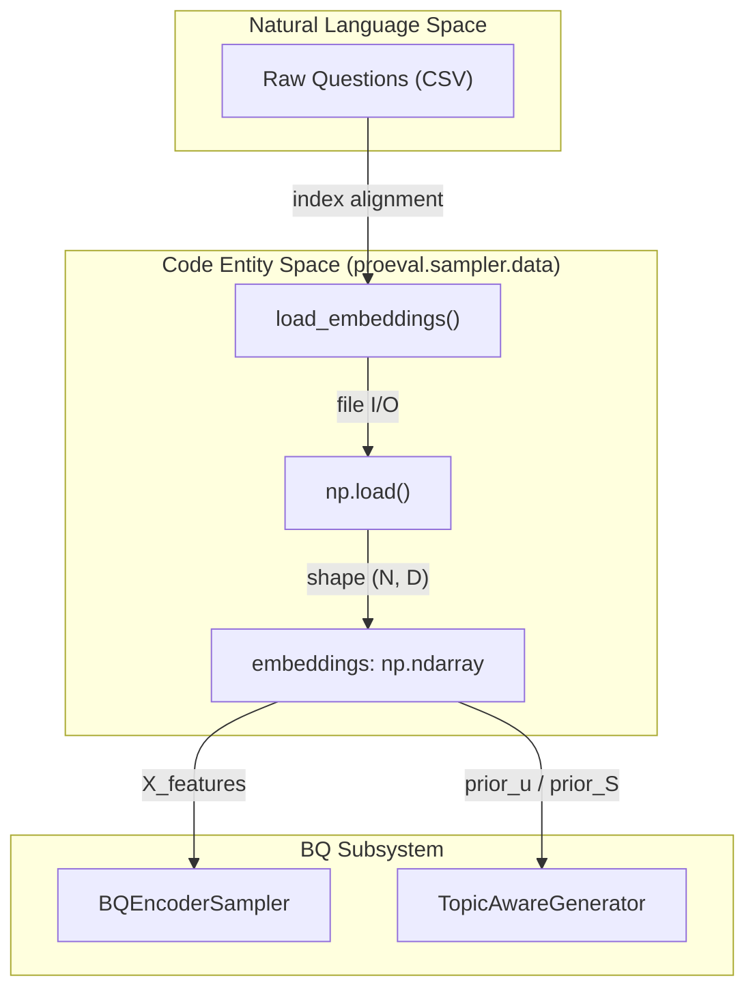
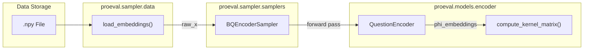

<!-- source: DeepWiki mcp.deepwiki.com · repo google-deepmind/proeval · page 6.2 Pre-computed Embeddings (.npy Files) · fetched 2026-10-26 -->

# Pre-computed Embeddings (.npy Files)

Relevant source files

The following files were used as context for generating this wiki page:

- [data/README.md](data/README.md)
- [data/gqa_embeddings.npy](data/gqa_embeddings.npy)
- [data/gsm8k_embeddings_text_embedding_3_large.npy](data/gsm8k_embeddings_text_embedding_3_large.npy)
- [data/mmlu_embeddings_text_embedding_3_large.npy](data/mmlu_embeddings_text_embedding_3_large.npy)
- [data/svamp_embeddings_text_embedding_3_large.npy](data/svamp_embeddings_text_embedding_3_large.npy)

This page documents the pre-computed question embeddings used by ProEval to map natural language queries into a high-dimensional vector space. These embeddings are essential for the **RPF (Random Prompt Features)** and **TPF (Tuned Prompt Features)** modes of Bayesian Quadrature (BQ) sampling.

## Overview

ProEval represents each evaluation example (question) as a fixed-length vector to enable similarity-based performance estimation. By converting text into embeddings, the system can leverage Gaussian Processes (GPs) to predict the likelihood of a model failure based on the performance of that model (or reference models) on semantically similar questions [data/README.md:1-8]().

All embeddings are stored as NumPy binary files (`.npy`) in the `data/` directory [data/README.md:11-18]().

### Embedding Model
The codebase uses the **OpenAI `text-embedding-3-large`** model to generate these vectors [data/README.md:16-16](). 
- **Dimensionality**: 3,072 dimensions (for standard benchmarks) or 1,024 dimensions (for GQA).
- **Precision**: 64-bit float (`<f8`) or 32-bit float (`<f4`) [data/gsm8k_embeddings_text_embedding_3_large.npy:1-1](), [data/gqa_embeddings.npy:1-1]().

## Dataset Array Shapes

The `.npy` files contain a single 2D array where the number of rows matches the number of unique questions in the corresponding `*_predictions.csv` file.

| Benchmark | Filename | Array Shape |
| :--- | :--- | :--- |
| **GSM8K** | `gsm8k_embeddings_text_embedding_3_large.npy` | `(1319, 3072)` |
| **SVAMP** | `svamp_embeddings_text_embedding_3_large.npy` | `(700, 3072)` |
| **MMLU** | `mmlu_embeddings_text_embedding_3_large.npy` | `(1534, 3072)` |
| **StrategyQA** | `strategyqa_embeddings_text_embedding_3_large.npy` | `(1603, 3072)` |
| **GQA** | `gqa_embeddings.npy` | `(2000, 1024)` |
| **Jigsaw** | `jigsaw_embeddings_text_embedding_3_large.npy` | `(1500, 3072)` |
| **DICES** | `dices_embeddings_text_embedding_3_large.npy` | `(1500, 3072)` |
| **DICES-T2I** | `dices_t2i_embeddings_text_embedding_3_large.npy` | `(1500, 3072)` |

Sources: [data/README.md:22-31](), [data/gsm8k_embeddings_text_embedding_3_large.npy:1-1](), [data/svamp_embeddings_text_embedding_3_large.npy:1-1](), [data/mmlu_embeddings_text_embedding_3_large.npy:1-1](), [data/gqa_embeddings.npy:1-1]().

## Implementation & Data Flow

### Loading Embeddings
The primary entry point for accessing these files is the `load_embeddings()` function. This function ensures that the embeddings are correctly aligned with the evaluation data.

**Data Flow: From Disk to Sampler**
The diagram below illustrates how `load_embeddings()` bridges the "Natural Language Space" (raw questions) to the "Code Entity Space" (NumPy arrays used by the BQ samplers).

"Natural Language to Code Entity Mapping"

Sources: [proeval/sampler/data.py:51-68](), [data/README.md:11-18]().

### Integration in BQ Modes

The embeddings serve different roles depending on the feature configuration selected in `exp_performance_estimation.py` or `exp_failure_discovery.py`.

#### 1. RPF (Random Prompt Features)
In RPF mode, the raw embeddings are used directly as features for the Gaussian Process. The GP uses a kernel (typically Matérn or RBF) to calculate similarity between questions based on their distance in this 3072-dimensional space.

#### 2. TPF (Tuned Prompt Features)
In TPF mode, the embeddings are passed through a `QuestionEncoder` (a trained MLP).
- **Input**: Raw 3072-d embedding.
- **Output**: A latent "phi" embedding (e.g., 128-d).
- **Purpose**: To project general-purpose OpenAI embeddings into a specialized space that better represents "difficulty" or "error correlation" across different LLMs.

**Code Entity Association: Feature Extraction**
The following diagram shows how code entities handle the transition from raw `.npy` data to the features used in the BQ kernel.

"Feature Transformation Pipeline"

Sources: [proeval/sampler/samplers.py:120-150](), [proeval/models/encoder.py:15-45](), [experiment/exp_performance_estimation.py:80-110]().

## Usage in Failure Discovery

For proactive failure discovery (documented in Section 4), the embeddings are used by the `TopicAwareGenerator` to:
1.  **Cluster Topics**: If using BERTopic, the embeddings provide the semantic basis for identifying question clusters [proeval/generator/topic_generator.py:40-60]().
2.  **Acquisition Functions**: The `ss_acquisition_batch` (Superlevel Set) logic calculates the GP posterior across the entire embedding space (the "pool") to identify which unlabelled questions are most likely to be failures [proeval/generator/topic_generator.py:180-210]().

Sources: [proeval/generator/topic_generator.py:25-50](), [proeval/sampler/data.py:51-68]().

---

