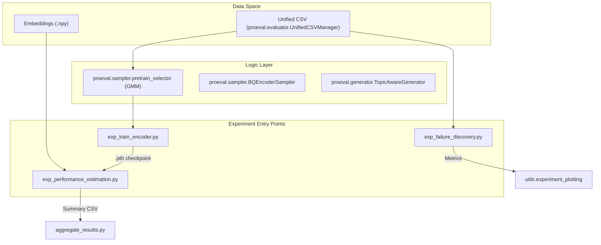
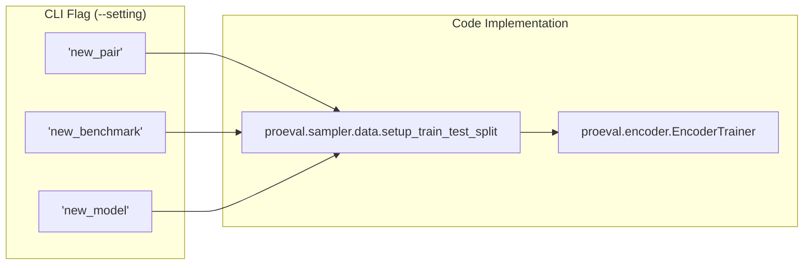

<!-- source: DeepWiki mcp.deepwiki.com · repo google-deepmind/proeval · page 7 Experiment Scripts · fetched 2026-10-26 -->

# Experiment Scripts

Relevant source files

The following files were used as context for generating this wiki page:

- [experiment/README.md](experiment/README.md)
- [experiment/__init__.py](experiment/__init__.py)
- [experiment/exp_run_all_groups.py](experiment/exp_run_all_groups.py)
- [experiment/helper.py](experiment/helper.py)

The `experiment/` directory contains the command-line interface (CLI) entry points for executing ProEval's evaluation and discovery pipelines. These scripts orchestrate the interaction between data loaders, Bayesian Quadrature (BQ) samplers, neural encoders, and LLM generators to perform systematic benchmarking of AI models.

### Framework Overview

ProEval experiments are structured around three primary GP feature setups and three problem settings to evaluate cross-model and cross-benchmark generalization.

**GP Feature Setups**
| Feature Setup | Abbreviation | Kernel | Description |
|:---|:---:|:---:|:---|
| **Score Features** | **SF** | Linear | Uses predictions from other GMM-selected models as features [experiment/README.md:16-16](). |
| **Raw Prompt Features** | **RPF** | Matérn 2.5 | Uses raw text embeddings with a neutral 0.5 prior [experiment/README.md:17-17](). |
| **Tuned Prompt Features** | **TPF** | Matérn 2.5 | Uses embeddings from a neural encoder trained on reference models [experiment/README.md:18-18](). |

**Problem Settings**
| Setting | Description |
|:---|:---|
| `new_pair` | Excludes only the specific target model–benchmark pair from training [experiment/README.md:24-24](). |
| `new_benchmark` | Excludes the entire target benchmark from the training set [experiment/README.md:25-25](). |
| `new_model` | Excludes the target model's predictions across all benchmarks [experiment/README.md:26-26](). |

---

### Core CLI Entry Points

The codebase provides five main scripts for running experiments and processing results:

1.  **`exp_performance_estimation.py`**: The primary entry point for model evaluation. It compares 14 methods (5 baselines and 9 BQ variants) to estimate the accuracy/error rate of a target model within a fixed labeling budget [experiment/README.md:51-53]().
2.  **`exp_failure_discovery.py`**: Runs proactive failure discovery using the `TopicAwareGenerator`. It supports both "seed-pool" mode (sampling from existing datasets) and "generation" mode (LLM-based synthesis of new test cases) [experiment/README.md:79-81]().
3.  **`exp_train_encoder.py`**: Trains the cross-benchmark neural encoder required for TPF (Tuned Prompt Features) experiments by minimizing GP marginal likelihood [experiment/README.md:131-134]().
4.  **`exp_run_all_groups.py`**: A unified script that automates the pipeline of training encoders and running BQ sampling across predefined domain groups (Safety, Reasoning, Math) [experiment/exp_run_all_groups.py:16-31]().
5.  **`aggregate_results.py`**: A utility to combine `summary_*.csv` files from multiple runs into a master table for analysis [experiment/README.md:162-164]().

---

### Workflow: From Setup to Results

The following diagram illustrates the flow from raw data through the experiment scripts to the final performance metrics.

**ProEval Experiment Workflow**

Sources: [experiment/README.md:51-174](), [experiment/exp_run_all_groups.py:131-207](), [experiment/helper.py:33-44]()

---

### Method Comparison Framework

Every performance estimation run evaluates a standard suite of 14 methods to ensure rigorous benchmarking against established active learning and importance sampling baselines.

| Category | Methods | Code Identifier |
|:---|:---|:---|
| **Baselines** | Random, RF+IS, LR+IS, RF+LURE, LR+LURE | `random_sampling`, `run_rf_is_evaluation`, etc. [experiment/exp_run_all_groups.py:68-75]() |
| **Random+BQ** | BQ-SF Rand, BQ-RPF Rand, BQ-TPF Rand | `bq_vanilla_sampling` [experiment/exp_run_all_groups.py:69-69]() |
| **Active+BQ** | BQ-SF, BQ-RPF, BQ-TPF | `BQEncoderSampler` [experiment/exp_run_all_groups.py:62-62]() |
| **Rounded BQ** | BQ-SF Rounded, BQ-RPF Rounded, BQ-TPF Rounded | `SamplingResult.estimates_rounded` [experiment/helper.py:29-29]() |

**Mapping CLI Flags to Code Entities**

Sources: [experiment/README.md:22-26](), [experiment/exp_run_all_groups.py:61-67](), [experiment/exp_run_all_groups.py:148-156]()

---

### Detailed Experiment Documentation

For specific instructions on running the CLI scripts and interpreting their unique flags, see the following child pages:

*   **[Performance Estimation Experiments](#7.1)**: Details on `exp_performance_estimation.py`, the 14-method table, and aggregate results.
*   **[Failure Discovery Experiments & Encoder Training](#7.2)**: Details on `exp_failure_discovery.py` (SS vs. TSS strategies) and training neural encoders via `exp_train_encoder.py`.

Sources: [experiment/README.md:51-130](), [experiment/README.md:131-160]()

---

