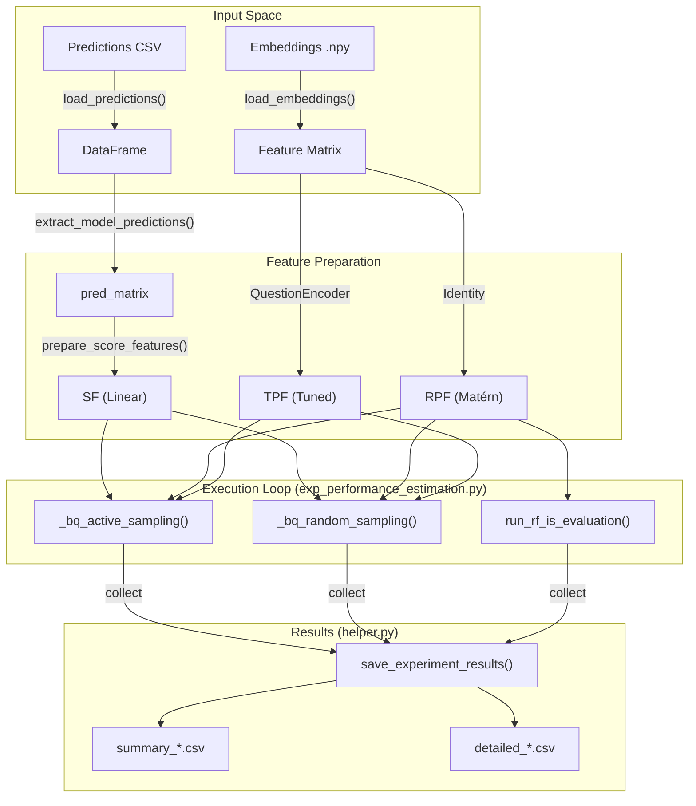
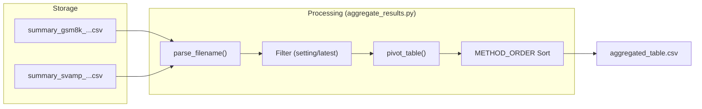

<!-- source: DeepWiki mcp.deepwiki.com · repo google-deepmind/proeval · page 7.1 Performance Estimation Experiments · fetched 2026-10-26 -->

# Performance Estimation Experiments

Relevant source files

The following files were used as context for generating this wiki page:

- [experiment/aggregate_results.py](experiment/aggregate_results.py)
- [experiment/exp_performance_estimation.py](experiment/exp_performance_estimation.py)
- [experiment/exp_run_all_groups.py](experiment/exp_run_all_groups.py)
- [experiment/helper.py](experiment/helper.py)

This page documents the experimental framework for evaluating LLM performance estimation methods. The primary goal is to estimate a target model's error rate on a benchmark dataset using a limited labeling budget. The experiments compare 14 distinct methods, including standard baselines and various configurations of the ProEval Bayesian Quadrature (BQ) sampler.

## Core Experiment Scripts

The performance estimation pipeline is driven by two main entry points and a result aggregator.

*   **`exp_performance_estimation.py`**: The unified experiment script that runs all 14 methods for a specific dataset and target model pair. It handles data loading, feature preparation for different kernels, and result persistence [experiment/exp_performance_estimation.py:16-56]().
*   **`exp_run_all_groups.py`**: A high-level orchestration script that automates the "train-then-test" workflow across domain groups (Safety, Reasoning, Math). It manages cross-benchmark encoder training before running the estimation experiments [experiment/exp_run_all_groups.py:16-37]().
*   **`aggregate_results.py`**: A utility to combine multiple summary CSV files into a single pivot table (Datasets × Methods) showing Mean Absolute Error (MAE) [experiment/aggregate_results.py:16-29]().

### CLI Configuration Flags

Both experiment scripts share a common set of configuration flags to define the problem setting and constraints:

| Flag | Description | Code Reference |
| :--- | :--- | :--- |
| `--dataset` | The target benchmark (e.g., `gsm8k`, `jigsaw`). | [experiment/exp_performance_estimation.py:53]() |
| `--target-model` | The model whose performance is being estimated. | [experiment/exp_performance_estimation.py:53]() |
| `--setting` | Problem setting: `new_pair`, `new_benchmark`, or `new_model`. | [experiment/exp_performance_estimation.py:46-49]() |
| `--budget` | Number of samples allowed for labeling. | [experiment/exp_performance_estimation.py:137]() |
| `--n-runs` | Number of randomized trials to average results. | [experiment/exp_performance_estimation.py:55]() |
| `--encoder-path` | Path to a pre-trained `.pth` checkpoint for TPF modes. | [experiment/exp_performance_estimation.py:54]() |

**Sources:** [experiment/exp_performance_estimation.py:16-56](), [experiment/exp_run_all_groups.py:16-37](), [experiment/aggregate_results.py:16-29]()

---

## The 14-Method Comparison Table

The experiments evaluate performance across three categories: traditional baselines, random selection with BQ, and active selection with BQ.

### 1. Baselines (5 Methods)
These methods use Raw Prompt Features (RPF) and standard statistical estimation techniques.
*   **Random**: Uniform random sampling with a simple mean estimate [experiment/exp_performance_estimation.py:21]().
*   **RF+IS / LR+IS**: Importance Sampling using Random Forest or Logistic Regression as the proposal distribution [experiment/exp_performance_estimation.py:22-23]().
*   **RF+LURE / LR+LURE**: Level Unbiased Resampling Estimator (LURE) combined with RF or LR surrogates [experiment/exp_performance_estimation.py:24-25]().

### 2. Random Selection + BQ (3 Methods)
Samples are selected randomly, but the estimate is derived from the BQ posterior mean [experiment/exp_performance_estimation.py:27-30]().
*   **BQ-SF Rand**: Score Features (Linear kernel).
*   **BQ-RPF Rand**: Raw Prompt Features (Matérn kernel).
*   **BQ-TPF Rand**: Tuned Prompt Features (Matérn kernel + Neural Encoder).

### 3. Active Selection + BQ (6 Methods)
Uses BQ active sampling to select the most informative points for labeling [experiment/exp_performance_estimation.py:32-38]().
*   **BQ-SF / BQ-RPF / BQ-TPF**: Standard active sampling for each feature setup.
*   **Rounded Variants**: Active BQ where the posterior mean is rounded to the nearest valid label (0 or 1) before integration [experiment/exp_performance_estimation.py:36-38]().

**Sources:** [experiment/exp_performance_estimation.py:18-38](), [experiment/helper.py:22-30]()

---

## Feature Setups & GP Kernels

The performance of BQ is heavily influenced by the features provided to the Gaussian Process (GP).

### Score Features (SF)
SF uses the performance profiles of other reference models as features. The `prepare_score_features` function centers and normalizes the prediction matrix of pre-trained models to create a linear kernel prior [experiment/exp_performance_estimation.py:94-117]().

### Raw Prompt Features (RPF)
RPF utilizes frozen embeddings (typically from `text-embedding-3-large`). It uses a Matérn 2.5 kernel and an informative prior based on the mean performance of reference models, but does not involve neural network training [experiment/exp_performance_estimation.py:42]().

### Tuned Prompt Features (TPF)
TPF uses a `QuestionEncoder` to map prompt embeddings into a latent space optimized for performance estimation. This mode requires a pre-trained encoder checkpoint [experiment/exp_performance_estimation.py:43-44]().

### Data Flow: Experiment Execution

The following diagram illustrates how `exp_performance_estimation.py` coordinates the different components to produce results.

**Estimation Experiment Data Flow**

**Sources:** [experiment/exp_performance_estimation.py:74-88](), [experiment/exp_performance_estimation.py:94-117](), [experiment/helper.py:33-44]()

---

## Results Aggregation

After running experiments across multiple datasets or models, `aggregate_results.py` is used to synthesize the data.

### Functionality
1.  **Parsing**: The `parse_filename` function extracts the dataset name, target model, budget, and setting from the CSV filenames using regex patterns [experiment/aggregate_results.py:47-81]().
2.  **Filtering**: Supports filtering by `--setting` (e.g., `new_benchmark`) or `--latest` (keeping only the most recent timestamp per dataset) [experiment/aggregate_results.py:112-122]().
3.  **Pivoting**: Creates a `pandas.pivot_table` where the index is the `Dataset` and columns are the `Method`, with cells containing the `Mean MAE` [experiment/aggregate_results.py:148-153]().
4.  **Ordering**: Columns are reordered based on the canonical `METHOD_ORDER` defined in `experiment/helper.py` [experiment/aggregate_results.py:156-158]().

### Summary Generation Process

**Aggregation Pipeline**

**Sources:** [experiment/aggregate_results.py:47-81](), [experiment/aggregate_results.py:148-158](), [experiment/helper.py:22-30]()

---

