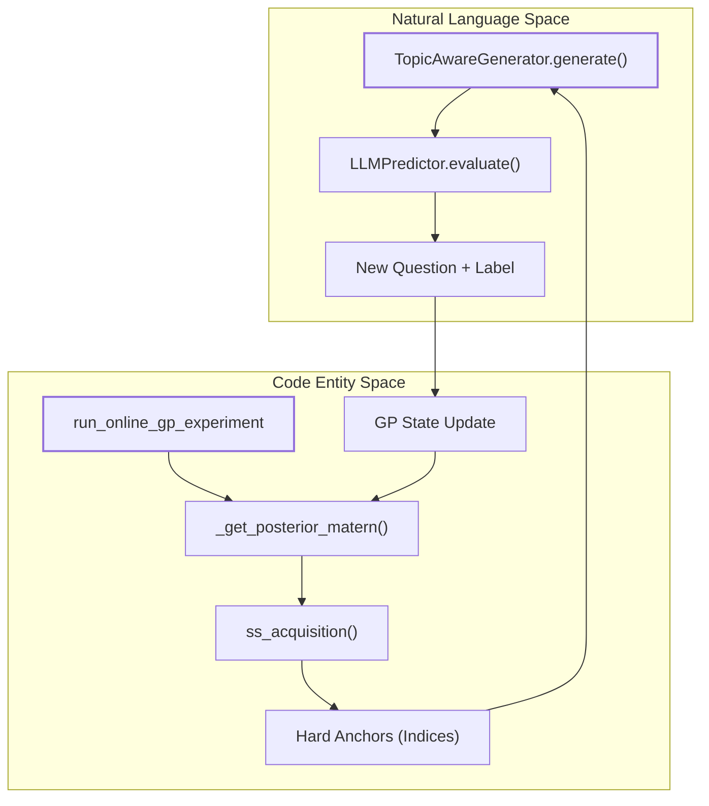

<!-- source: DeepWiki mcp.deepwiki.com · repo google-deepmind/proeval · page 7.2 Failure Discovery Experiments & Encoder Training · fetched 2026-10-26 -->

# Failure Discovery Experiments & Encoder Training

<details>
<summary>Relevant source files</summary>

The following files were used as context for generating this wiki page:

- [experiment/exp_failure_discovery.py](experiment/exp_failure_discovery.py)
- [experiment/exp_train_encoder.py](experiment/exp_train_encoder.py)
- [experiment/sample_usage.py](experiment/sample_usage.py)

</details>


This page documents the experimental pipelines for proactive failure discovery and the training of neural encoders for Tuned Prompt Features (TPF). These components enable ProEval to not only estimate performance but also actively surface diverse model failures through Gaussian Process (GP) guided acquisition and LLM-based test case generation.

## Failure Discovery Experiments

The script `exp_failure_discovery.py` implements a unified online GP framework using the **Superlevel Set (SS)** acquisition function to identify regions of the input space where the target model is likely to fail [experiment/exp_failure_discovery.py:15-20]().

### Discovery Methods
The experiment supports nine distinct methods categorized by feature type and source of data [experiment/exp_failure_discovery.py:98-103]():

| Category | Method | Description |
| :--- | :--- | :--- |
| **RPF** (Raw Prompt Features) | `SS-RPF` | SS acquisition from a static seed pool using raw text embeddings [experiment/exp_failure_discovery.py:28-28](). |
| | `SS-Gen-RPF` | SS-selected anchors from seed pool used to prompt an LLM for new test cases [experiment/exp_failure_discovery.py:29-29](). |
| | `TSS-RPF` | Topic-aware SS: uses UCB for topic selection + SS anchors for generation [experiment/exp_failure_discovery.py:30-30](). |
| **TPF** (Tuned Prompt Features) | `SS-TPF` | SS acquisition from seed pool using neural encoder embeddings [experiment/exp_failure_discovery.py:33-33](). |
| | `SS-Gen-TPF` | SS-selected anchors with LLM generation using the encoder-derived prior [experiment/exp_failure_discovery.py:34-34](). |
| | `TSS-TPF` | Topic-aware SS with generation using encoder features [experiment/exp_failure_discovery.py:35-35](). |
| **Baselines** | `Rand` | Uniform random sampling from the seed pool [experiment/exp_failure_discovery.py:38-38](). |
| | `Rand-T-Gen` | Random topic selection followed by LLM generation [experiment/exp_failure_discovery.py:39-39](). |
| | `Rand-Gen` | Pure random LLM generation of test cases [experiment/exp_failure_discovery.py:40-40](). |

### CLI Configuration
The experiment is controlled via `argparse` flags [experiment/exp_failure_discovery.py:60-60]():
*   `--dataset`: Target benchmark (e.g., `gsm8k`, `strategyqa`) [experiment/exp_failure_discovery.py:44-44]().
*   `--model`: Target LLM to discover failures for [experiment/exp_failure_discovery.py:44-44]().
*   `--iterations`: Maximum number of discovery steps [experiment/exp_failure_discovery.py:137-137]().
*   `--failure`: Budget-based stopping criterion (stop after $N$ failures found) [experiment/exp_failure_discovery.py:54-54]().
*   `--ss-beta`: The $\beta$ parameter for the SS acquisition function (controls exploration/exploitation) [experiment/exp_failure_discovery.py:141-141]().
*   `--n-topics`: Number of topics for BERTopic extraction [experiment/exp_failure_discovery.py:17-20]().

### Data Flow: Discovery Loop
The discovery process operates in an online loop where the GP posterior is updated after every sample.

#### System Interaction Diagram
This diagram shows how `run_online_gp_experiment` bridges the gap between high-level discovery strategies and the underlying GP/LLM infrastructure.


Sources: [experiment/exp_failure_discovery.py:131-153](), [proeval/generator/core.py:84-90]()

## Encoder Training (TPF)

The `exp_train_encoder.py` script facilitates the training of the `QuestionEncoder` used in TPF methods. This encoder maps high-dimensional text embeddings into a latent space optimized for GP performance estimation [experiment/exp_train_encoder.py:15-19]().

### Training Settings
The encoder can be trained under different data-exclusion regimes to simulate various real-world scenarios [experiment/exp_train_encoder.py:21-25]():
1.  **`new_pair`**: Excludes only the specific (target model, target benchmark) pair. Other models' data on the target benchmark is used for training [experiment/exp_train_encoder.py:22-23]().
2.  **`new_benchmark`**: Fully excludes the target benchmark from the training set, testing the encoder's ability to generalize across domains [experiment/exp_train_encoder.py:24-24]().
3.  **`new_model`**: Excludes all data related to the target model across all benchmarks [experiment/exp_train_encoder.py:106-108]().

### Implementation Details
The `EncoderTrainer` class manages the optimization of the GP marginal likelihood [experiment/exp_train_encoder.py:118-134]().

*   **Kernel Selection**: Supports `linear`, `matern` (default), and `rbf` kernels [experiment/exp_train_encoder.py:91-92]().
*   **Batching**: Data is sampled in pairs of (benchmark, model) to construct the covariance matrices for the GP loss [experiment/exp_train_encoder.py:85-88]().
*   **Activation**: Uses a sigmoid activation with a configurable `steepness` parameter to map latent features to probability space [experiment/exp_train_encoder.py:82-84]().

### Training Pipeline Diagram
The following diagram illustrates the flow from raw benchmark data to a saved `.pth` encoder checkpoint.

```mermaid
graph LR
    subgraph "Data Preparation"
        DS["DATASET_CONFIGS"] --> LT["load_predictions()"]
        LT --> EB["load_embeddings()"]
    end

    subgraph "EncoderTrainer Pipeline"
        EB --> ET["EncoderTrainer.train()"]
        ET --> GP["compute_gp_loss()"]
        GP --> OPT["Adam Optimizer"]
        OPT --> QE["QuestionEncoder weights"]
    end

    subgraph "Artifacts"
        QE --> CP["encoder_holdout_*.pth"]
    end

    subgraph "Discovery Usage"
        CP --> TAG["TopicAwareGenerator(encoder_path)"]
    end
```


Sources: [experiment/exp_train_encoder.py:57-57](), [experiment/exp_train_encoder.py:136-141](), [proeval/sampler/data.py:79-83]()

### Execution Example
To train an encoder for `svamp` while excluding all `svamp` data (Cross-Benchmark setting):
```bash
python -m experiment.exp_train_encoder \
    --train-benchmarks gsm8k strategyqa \
    --target-benchmark svamp \
    --target-model gemini25_flash \
    --setting new_benchmark \
    --hidden-dim 16 --kernel-type matern --epochs 200
```
Sources: [experiment/exp_train_encoder.py:35-41]()

---

