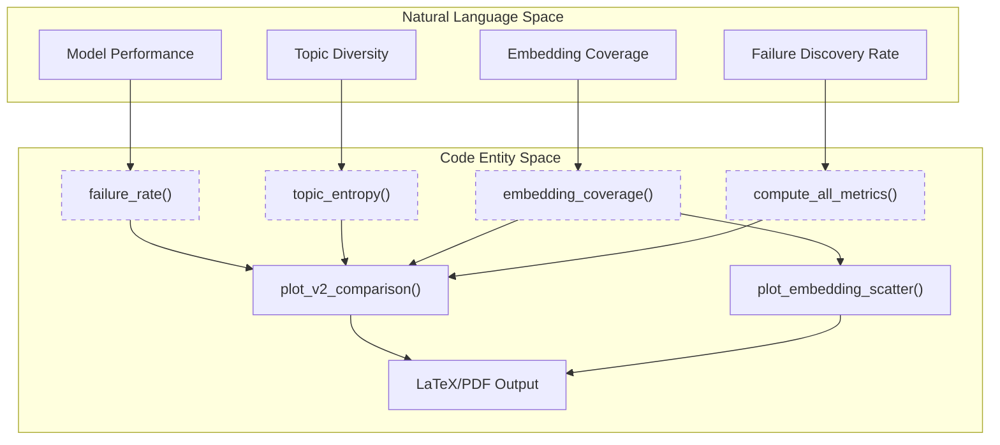
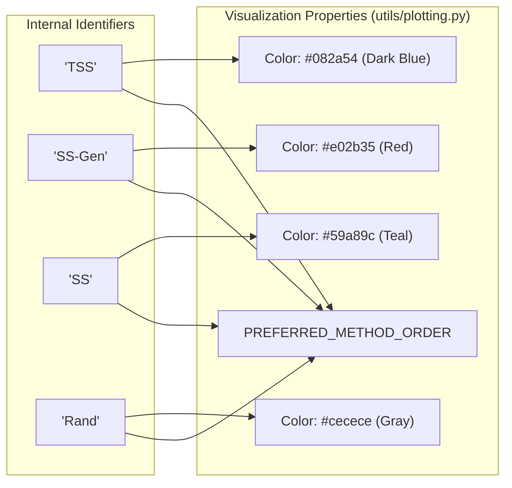

<!-- source: DeepWiki mcp.deepwiki.com · repo google-deepmind/proeval · page 8 Utilities & Visualization · fetched 2026-10-26 -->

# Utilities & Visualization

Relevant source files

The following files were used as context for generating this wiki page:

- [proeval/utils/__init__.py](proeval/utils/__init__.py)
- [proeval/utils/metrics.py](proeval/utils/metrics.py)
- [proeval/utils/model_names.py](proeval/utils/model_names.py)
- [utils/__init__.py](utils/__init__.py)
- [utils/plotting.py](utils/plotting.py)

The `proeval/utils` and `utils/` directories provide the shared infrastructure required to measure experiment success, maintain consistent model naming across benchmarks, and generate publication-quality visualizations. These utilities bridge the gap between raw Bayesian Quadrature (BQ) sampling results and interpretable performance/diversity metrics.

### System Mapping: Metrics and Visualization

The following diagram illustrates how utility functions connect the high-level evaluation concepts (Natural Language Space) to the specific code entities that implement them (Code Entity Space).

**Metric & Plotting Flow**

**Sources:** [proeval/utils/metrics.py:15-26](), [utils/plotting.py:17-26](), [utils/experiment_plotting.py:32-45]()

---

## 8.1 Metrics & Model Name Registry

The metrics subsystem handles the quantitative evaluation of both the Bayesian Quadrature estimates and the diversity of generated failure cases.

### Core Metrics
- **Performance Metrics**: `failure_rate` calculates the percentage of model errors within a sample [proeval/utils/metrics.py:130-134](). `compute_samples_to_threshold` measures efficiency by determining how many samples a method requires to reach a target Mean Absolute Error (MAE) [proeval/utils/metrics.py:191-195]().
- **Diversity Metrics**: `topic_entropy` uses Shannon entropy to measure the distribution across semantic clusters [proeval/utils/metrics.py:67-82](). `embedding_coverage` uses a Determinantal Point Process (DPP) inspired log-determinant to measure spatial spread in the embedding space [proeval/utils/metrics.py:85-114]().
- **Unified Interface**: `compute_all_metrics` provides a single entry point for processing experiment records and returning a comprehensive dictionary of results [proeval/utils/metrics.py:137-185]().

### Model Name Registry
The `MODEL_NAME_MAP` in `proeval/utils/model_names.py` serves as the canonical registry for mapping internal CSV column identifiers (e.g., `gpt4_turbo`) to external API identifiers (e.g., `openai/gpt-4-turbo`) [proeval/utils/model_names.py:24-52](). This ensures consistency when the `LLMPredictor` interacts with the OpenRouter API.

For details, see [Metrics & Model Name Registry](#8.1).

**Sources:** [proeval/utils/metrics.py:1-200](), [proeval/utils/model_names.py:1-52]()

---

## 8.2 Plotting Utilities

The plotting subsystem is split between low-level style configurations and high-level experiment visualization logic.

### Style and Configuration
The `utils/plotting.py` module defines the visual identity of ProEval figures.
- **Consistency**: `METHOD_COLORS` maps specific sampling strategies (e.g., `TSS`, `SS-Gen`, `Rand`) to fixed hex codes to ensure they remain identifiable across different plots [utils/plotting.py:68-75]().
- **LaTeX Integration**: `set_size` calculates aesthetic dimensions using the golden ratio to prevent scaling artifacts in LaTeX documents [utils/plotting.py:83-102](). `set_style` configures `matplotlib` for publication-quality output, including serif fonts and PGF backend support [utils/plotting.py:105-139]().

### Experiment Visualization
The `utils/experiment_plotting.py` module provides specialized functions for ProEval's core experiments:
- **Performance Estimation**: Plots comparing MAE curves across different BQ variants and baselines.
- **Failure Discovery**: Visualizes topic distributions and embedding space coverage. `plot_embedding_scatter` uses PCA or t-SNE to project high-dimensional question embeddings into a 2D space for visual inspection of failure clusters [utils/experiment_plotting.py:42-43]().

### Registry of Methods and Colors
The following diagram maps internal method identifiers to their standardized visualization properties.

**Method Visualization Mapping**

**Sources:** [utils/plotting.py:68-78](), [utils/experiment_plotting.py:32-33]()

For details, see [Plotting Utilities](#8.2).

**Sources:** [utils/plotting.py:1-213](), [utils/experiment_plotting.py:1-45]()

---

