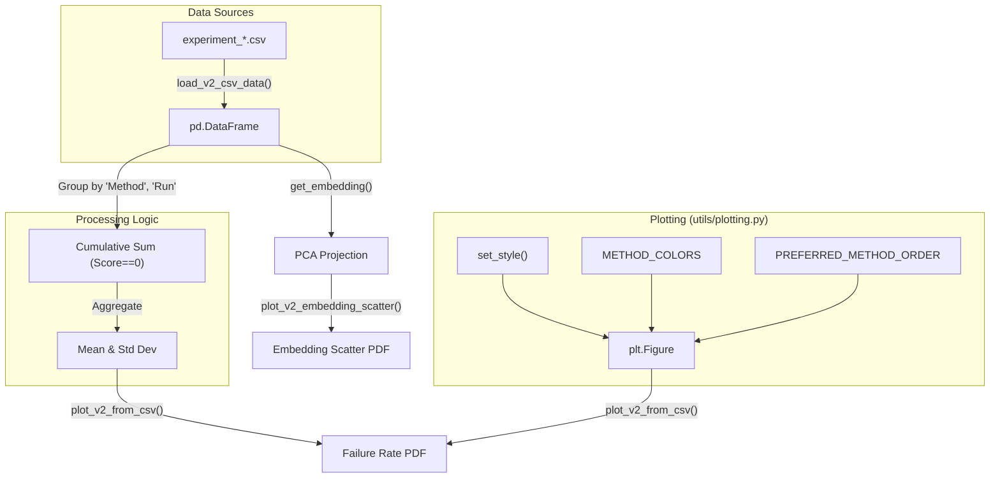
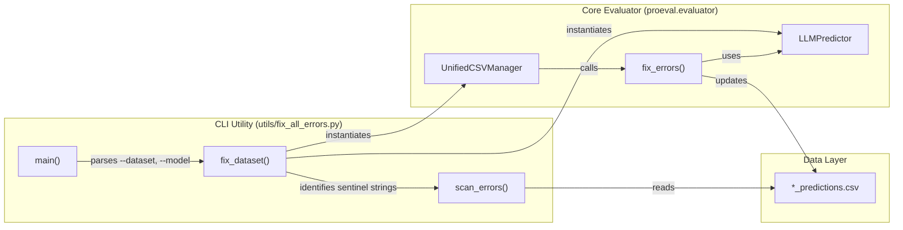

<!-- source: DeepWiki mcp.deepwiki.com · repo google-deepmind/proeval · page 8.2 Plotting Utilities · fetched 2026-10-26 -->

# Plotting Utilities

Relevant source files

The following files were used as context for generating this wiki page:

- [utils/__init__.py](utils/__init__.py)
- [utils/experiment_plotting.py](utils/experiment_plotting.py)
- [utils/fix_all_errors.py](utils/fix_all_errors.py)
- [utils/plotting.py](utils/plotting.py)

The `utils` package provides a comprehensive suite of tools for visualizing experiment results, managing publication-quality figure styles, and performing batch remediation of evaluation errors. These utilities ensure consistency across performance estimation and failure discovery visualizations.

### 1. Core Plotting Infrastructure

The `utils/plotting.py` module defines the visual identity of ProEval. it manages LaTeX-compatible styles, color palettes, and standardized figure dimensions.

#### Implementation Details
- **LaTeX Backend**: The module attempts to register the `pgf` backend to allow high-quality PDF exports that integrate seamlessly with LaTeX documents [utils/plotting.py:31-36]().
- **Standardized Sizing**: A constant `WIDTH` (506.295 pts) is used to match common academic document widths [utils/plotting.py:45](). The `set_size` function uses the golden ratio to calculate aesthetic heights based on a target width [utils/plotting.py:83-102]().
- **Style Configuration**: `set_style()` configures `matplotlib` `rcParams` to use serif fonts and specific font sizes for labels (19pt), legends (12pt), and ticks (16pt) [utils/plotting.py:105-139]().

#### Color and Marker Palettes
The system uses a strict mapping for methods to ensure that "TSS" (Topic + SS + generation) always appears in Dark Blue across different plots, while "Rand" always appears in Gray [utils/plotting.py:68-75]().

| Method Key | Color Hex | Visual Description | Role |
| :--- | :--- | :--- | :--- |
| `SS` | `#59a89c` | Teal | Active sampling (no generation) |
| `Rand` | `#cecece` | Gray | Baseline random sampling |
| `SS-Gen` | `#e02b35` | Red | Superlevel Set with LLM generation |
| `TSS` | `#082a54` | Dark Blue | Topic-Aware Superlevel Set (Best) |
| `Rand-T-Gen` | `#f0c571` | Gold | Random Topic with generation |
| `Rand-Gen` | `#a559aa` | Purple | Pure random generation |

**Sources:** [utils/plotting.py:42-79](), [utils/plotting.py:83-139]()

---

### 2. Experiment Visualization

The `utils/experiment_plotting.py` module provides high-level functions to visualize the output of failure discovery experiments. It supports both cumulative failure rate plots and embedding space analysis.

#### Failure Rate Comparison
The function `plot_v2_from_csv` processes experiment logs to generate cumulative failure curves [utils/experiment_plotting.py:156-162](). It calculates the mean and standard deviation across multiple runs and applies the preferred method order (`PREFERRED_METHOD_ORDER`) to the legend [utils/experiment_plotting.py:164-212]().

#### Embedding Space Analysis
`plot_embedding_scatter` and `plot_v2_embedding_scatter` visualize how generated test cases distribute across the latent space compared to the original seed pool [utils/experiment_plotting.py:334-338]().
- **Dimensionality Reduction**: Uses `sklearn.decomposition.PCA` to project 1536-dimensional embeddings (from `text-embedding-3-small`) into 2D [utils/experiment_plotting.py:35]().
- **Integration**: If an `OPENROUTER_API_KEY` is present, `get_embedding` fetches real vectors; otherwise, it falls back to random noise for structural testing [utils/experiment_plotting.py:81-116]().

#### Data Flow: Experiment to Plot
The following diagram illustrates how raw CSV results from the `proeval.generator` are transformed into visual insights.

**Title: Failure Discovery Visualization Pipeline**

**Sources:** [utils/experiment_plotting.py:156-212](), [utils/experiment_plotting.py:334-400](), [utils/plotting.py:105-139]()

---

### 3. Batch Error Remediation

`utils/fix_all_errors.py` is a maintenance utility designed to clean up datasets where LLM inference may have failed due to rate limits, parsing errors, or API timeouts.

#### Operation Workflow
1. **Scanning**: The `scan_errors` function iterates through a `*_predictions.csv` file, checking the `prediction_<model>` columns for sentinel strings like `SKIPPED`, `ERROR`, or `RATE_LIMITED` [utils/fix_all_errors.py:91-108]().
2. **Resolution**: It uses `proeval.evaluator.client.resolve_model_name` to map internal model keys (e.g., `gemini3_pro`) to actual API identifiers [utils/fix_all_errors.py:161-164]().
3. **Parallel Execution**: It initializes an `LLMPredictor` and calls `UnifiedCSVManager.fix_errors` to re-run only the failed rows, typically using 10 parallel workers [utils/fix_all_errors.py:166-179]().

#### System Mapping: Remediation Logic
This diagram bridges the CLI utility to the core evaluation classes.

**Title: Batch Remediation System Map**

**Sources:** [utils/fix_all_errors.py:91-108](), [utils/fix_all_errors.py:111-184](), [proeval/evaluator/__init__.py:1-56]()

---

### 4. Utility Functions Reference

| Function | File | Description |
| :--- | :--- | :--- |
| `get_method_color` | `plotting.py` | Returns the hex code for a method, falling back to `COLOR_LIST` if unknown [utils/plotting.py:183-195](). |
| `save_fig` | `plotting.py` | Saves a figure with an optional timestamp and automatic directory creation [utils/plotting.py:143-173](). |
| `load_v2_npz_data` | `experiment_plotting.py` | Loads compressed numpy results from failure discovery runs [utils/experiment_plotting.py:128-143](). |
| `get_csv_files` | `fix_all_errors.py` | Scans the `data/` directory for valid `*_predictions.csv` files matching `DATASET_CONFIGS` [utils/fix_all_errors.py:78-88](). |

**Sources:** [utils/plotting.py:143-195](), [utils/experiment_plotting.py:128-143](), [utils/fix_all_errors.py:78-88]()

---

