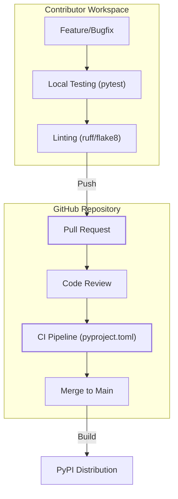
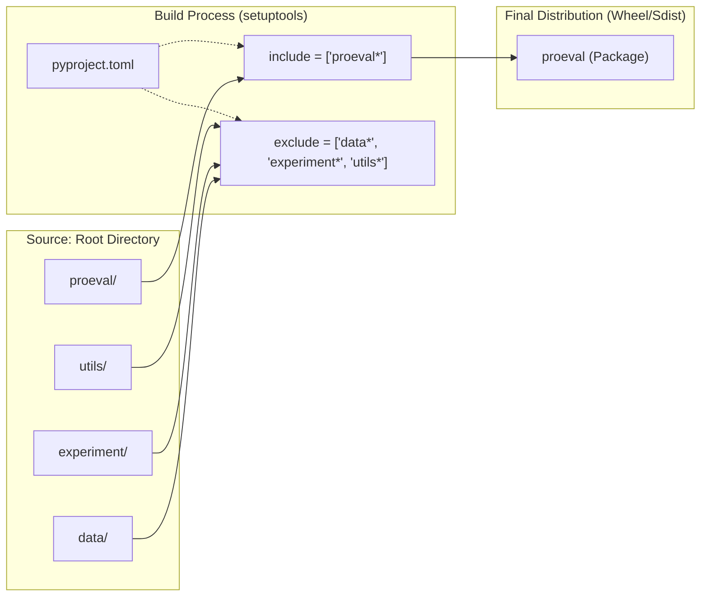

<!-- source: DeepWiki mcp.deepwiki.com · repo google-deepmind/proeval · page 9 Contributing & Licensing · fetched 2026-10-26 -->

# Contributing & Licensing

Relevant source files

The following files were used as context for generating this wiki page:

- [CONTRIBUTING.md](CONTRIBUTING.md)
- [LICENSE](LICENSE)
- [pyproject.toml](pyproject.toml)
- [setup.cfg](setup.cfg)

This page outlines the protocols for contributing to the ProEval codebase, the technical quality standards enforced via automated tooling, and the licensing terms governing the software and associated data. ProEval is an open-source project maintained by Google DeepMind, and it follows standard Google Open Source contribution processes.

## Contribution Workflow

ProEval welcomes external contributions. All submissions must follow a structured workflow to ensure code quality and legal compliance.

### Contributor License Agreement (CLA)
Before any code can be accepted, contributors must sign a Google Contributor License Agreement (CLA) [CONTRIBUTING.md:7-13](). This agreement grants permission to redistribute contributions while the contributor retains copyright [CONTRIBUTING.md:11-13](). 
*   **Individual CLA:** For personal contributions.
*   **Corporate CLA:** For contributions made on behalf of an employer.

### Pull Request Process
All changes are managed through GitHub Pull Requests (PRs).
1.  **Review Requirement:** Every submission, including those from core project members, requires a code review [CONTRIBUTING.md:30-31]().
2.  **Community Guidelines:** Contributors are expected to adhere to [Google's Open Source Community Guidelines](https://opensource.google/conduct/) [CONTRIBUTING.md:23-24]().

### Development Lifecycle Diagram

The following diagram illustrates the flow from a local contribution to the integrated codebase, mapping natural language steps to specific configuration files and processes.

**Contribution to Code Integration Flow**

Sources: [CONTRIBUTING.md:30-34](), [pyproject.toml:81-88](), [setup.cfg:11-25]()

---

## Code Quality & Tooling

The ProEval repository uses several automated tools to maintain a high standard of code health. Configuration for these tools is centralized in `pyproject.toml` and `setup.cfg`.

### Linting and Formatting
*   **Ruff:** The primary linter and formatter. It is configured with a line length of 100 and targets Python 3.9+ [pyproject.toml:105-107](). It selects rules for Error (E), Factual (F), Warning (W), Import (I), Bugbear (B), and Pyupgrade (UP) [pyproject.toml:109-110]().
*   **Flake8:** Used for legacy ecosystem support, enforcing similar line-length constraints while excluding build artifacts and the `data/` and `experiment/` directories from analysis [setup.cfg:11-25]().

### Static Type Checking
*   **Mypy:** Enforces strict typing for the `proeval` package. It is configured to ignore missing imports for third-party libraries and check untyped definitions [setup.cfg:27-32](). Like the linters, it excludes the `data/` and `experiment/` directories to focus on the core library [setup.cfg:33-38]().

### Testing and Coverage
*   **Pytest:** The testing framework for the repository. Tests are located in the `tests/` directory [pyproject.toml:113-115]().
*   **Coverage.py:** Measures test coverage specifically for the `proeval` source code, omitting `__init__.py` files and the tests themselves from the report [setup.cfg:40-45]().

### Tooling Configuration Mapping
| Tool | Config File | Key Settings |
| :--- | :--- | :--- |
| **Ruff** | `pyproject.toml` | `line-length = 100`, `target-version = "py39"` |
| **Pytest** | `pyproject.toml` | `testpaths = ["tests"]` |
| **Flake8** | `setup.cfg` | `max-line-length = 100`, `extend-ignore = E203, E501, W503` |
| **Mypy** | `setup.cfg` | `python_version = 3.9`, `check_untyped_defs = True` |

Sources: [pyproject.toml:105-117](), [setup.cfg:11-52]()

---

## Licensing Terms

ProEval is distributed under a standard open-source license, ensuring broad usability for both academic and commercial purposes.

### Software License
The codebase is licensed under the **Apache License, Version 2.0** [LICENSE:1-3](). 
*   **Permissions:** Users are granted a perpetual, worldwide, non-exclusive, no-charge, royalty-free, and irrevocable copyright and patent license to use, reproduce, and distribute the work [LICENSE:66-81]().
*   **Conditions:** Redistribution requires including a copy of the license and preserving all copyright, patent, and trademark notices [LICENSE:89-103]().

### Project Metadata
The package metadata defines the official identifiers and requirements for the project:
*   **License Identifier:** `Apache Software License` [pyproject.toml:34]().
*   **Python Requirement:** `>=3.9` [pyproject.toml:10]().
*   **Core Dependencies:** `numpy`, `pandas`, `scikit-learn`, `requests`, `tqdm` [pyproject.toml:45-51]().

### Data Licensing
While the software is Apache 2.0, the bundled datasets (located in `data/`) may be subject to their original upstream licenses (e.g., GSM8K, StrategyQA). Users should refer to the specific dataset documentation when using these artifacts for purposes outside of ProEval benchmarking.

### Package Structure and Distribution
The `pyproject.toml` file defines how the package is built and what is included in the distribution.

**Build and Package Inclusion Logic**

Sources: [pyproject.toml:97-103](), [LICENSE:1-135]()

---

