# Page: ProEval Overview

# ProEval Overview

<details>
<summary>Relevant source files</summary>

The following files were used as context for generating this wiki page:

- [README.md](README.md)
- [proeval/README.md](proeval/README.md)
- [proeval/__init__.py](proeval/__init__.py)
- [pyproject.toml](pyproject.toml)

</details>


ProEval is a technical framework designed to optimize the evaluation of Large Language Models (LLMs). It addresses two primary challenges in GenAI development: the high cost of comprehensive benchmarking and the difficulty of discovering diverse failure patterns within a limited budget.

By treating model evaluation as a numerical integration problem, ProEval uses **Bayesian Quadrature (BQ)** to estimate performance metrics (like error rates) with significantly fewer samples than traditional random testing [README.md:7-13](). Furthermore, it provides proactive failure discovery mechanisms to surface model bugs across different semantic topics [proeval/README.md:200-205]().

### Key Capabilities

*   **Efficient Performance Estimation**: Achieve high-precision accuracy estimates (e.g., ±1%) using as little as 1% of a full dataset [README.md:9-10]().
*   **Proactive Failure Discovery**: Use Gaussian Process (GP) posterior states and topic-aware generation to find diverse bugs [proeval/README.md:200-210]().
*   **Transfer Learning**: Leverage performance patterns from existing models to build priors for evaluating new models [proeval/README.md:63-68]().
*   **Multi-Benchmark Support**: Validated across reasoning (GSM8K, SVAMP), safety (Jigsaw), and general knowledge (MMLU) tasks [README.md:13]().

---

### Subsystem Relationships

The ProEval codebase is organized into four major functional areas that interact to provide a full evaluation lifecycle.

#### 1. Bayesian Quadrature (BQ) Samplers
The core of ProEval resides in the `proeval.sampler` module. It implements active sampling loops where a surrogate GP model selects the most informative questions to ask an LLM next.
*   **`BQPriorSampler`**: Uses a linear kernel based on the performance of other models (Score Features - SF) [proeval/README.md:21-34]().
*   **`BQEncoderSampler`**: Uses a neural encoder to map questions into a latent space (Tuned Prompt Features - TPF) [proeval/README.md:134-152]().

#### 2. Neural Encoder (TPF)
Located in `proeval.encoder`, this subsystem trains a `QuestionEncoder` to minimize GP marginal likelihood across multiple benchmarks. This allows the system to generalize its evaluation strategy to entirely new datasets [proeval/README.md:167-175]().

#### 3. Failure Discovery & Generation
The `proeval.generator` module uses the GP's uncertainty and mean estimates to identify "hard" regions of the input space. The `TopicAwareGenerator` can then synthesize new test cases that target these specific failure modes [proeval/README.md:200-215]().

#### 4. LLM Evaluation Layer
The `proeval.evaluator` module handles the practicalities of LLM inference, including prompt templating, parallel API calls via `OpenRouterClient`, and structured response parsing [proeval/__init__.py:28-33]().

**System Interaction Diagram**

The following diagram illustrates how the core code entities interact to estimate model performance.

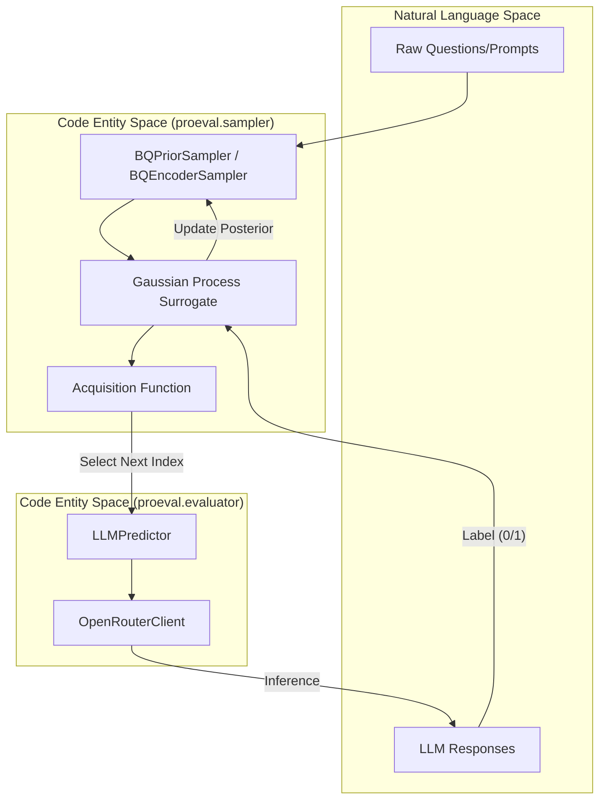
Sources: [proeval/__init__.py:21-55](), [proeval/README.md:21-53](), [proeval/README.md:134-152]()

---

### Core Architecture: From Data to Estimates

ProEval bridges the gap between raw benchmark data and statistical estimates by transforming model predictions into a feature space.

**Data Flow Diagram**

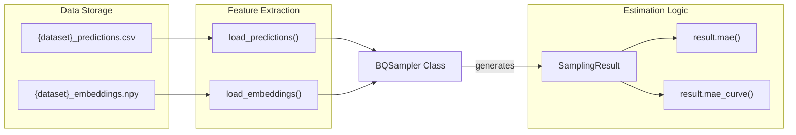
Sources: [proeval/README.md:41-53](), [proeval/README.md:89-102](), [README.md:37-40]()

---

### Getting Started

To begin using ProEval, you should first install the package and its dependencies.

*   **Installation**: ProEval supports modular installation via extras (e.g., `pip install -e ".[encoder]"` for PyTorch support) [README.md:25-33]().
*   **Quick Start**: A typical workflow involves initializing a `BQPriorSampler` and calling `.sample()` on a target dataset [README.md:37-53]().

For more detailed information, please refer to the child pages:

1.  **[Getting Started & Installation](#1.1)**: Environment setup and a minimal "Hello World" example.
2.  **[Repository Structure & Package Layout](#1.2)**: A guide to the file system and build configuration.

Sources: [README.md:1-104](), [proeval/README.md:1-215](), [pyproject.toml:1-117](), [proeval/__init__.py:1-55]()

---

# Page: Getting Started & Installation

# Getting Started & Installation

<details>
<summary>Relevant source files</summary>

The following files were used as context for generating this wiki page:

- [experiment/sample_usage.py](experiment/sample_usage.py)
- [pyproject.toml](pyproject.toml)
- [requirements.txt](requirements.txt)
- [setup.cfg](setup.cfg)

</details>


This page provides a comprehensive guide for setting up the ProEval environment, installing necessary dependencies, and executing a minimal performance estimation example. ProEval is designed to be modular, allowing users to install only the components necessary for their specific use case (e.g., performance estimation vs. failure discovery).

## Installation

ProEval requires **Python 3.9 or higher** [pyproject.toml:10-10](). It uses `setuptools` as the build backend [pyproject.toml:1-3]().

### Core Installation
The core package includes the primary Bayesian Quadrature (BQ) samplers and basic evaluation utilities.

```bash
# Clone the repository
git clone https://github.com/google-deepmind/proeval
cd proeval

# Install core dependencies
pip install .
```

### Optional Dependency Groups
ProEval defines several optional dependency groups in `pyproject.toml` to support advanced features [pyproject.toml:53-80]():

| Group | Command | Purpose |
| :--- | :--- | :--- |
| `encoder` | `pip install ".[encoder]"` | Neural encoder training and BQ-TPF (Tuned Prompt Features) sampler support via `torch` [pyproject.toml:55-57](). |
| `topics` | `pip install ".[topics]"` | Topic-aware test-case generation using `BERTopic` and `HDBSCAN` [pyproject.toml:59-62](). |
| `datasets` | `pip install ".[datasets]"` | HuggingFace integration for loading external evaluation datasets [pyproject.toml:64-66](). |
| `plotting` | `pip install ".[plotting]"` | Visualization utilities for experiment results using `matplotlib` and `seaborn` [pyproject.toml:68-71](). |
| `all` | `pip install ".[all]"` | Installs all the above for running the full experiment suite [pyproject.toml:73-80](). |
| `dev` | `pip install ".[dev]"` | Developer tools including `pytest`, `ruff`, and `mypy` [pyproject.toml:82-88](). |

**Sources:** [pyproject.toml:1-88](), [requirements.txt:1-12]()

---

## Environment Setup & API Configuration

ProEval interacts with Large Language Models (LLMs) via the `OpenRouterClient`. To perform active evaluation or generate new test cases, you must configure your API credentials.

### API Key Configuration
The system expects an API key for the inference provider. While the code is modular, the default implementation often relies on environment variables for authentication.

1. **Export API Key**:
   ```bash
   export OPENROUTER_API_KEY='your_api_key_here'
   ```

### Codebase Verification
You can verify the installation and environment by running the static analysis tools configured in the repository:

```bash
# Run linting with Ruff
ruff check .

# Run type checking with Mypy
mypy .
```
*Note: Mypy and Ruff are configured to exclude research artifacts in `data/` and `experiment/` to focus on the core `proeval` package [setup.cfg:33-38](), [pyproject.toml:103-103]().*

**Sources:** [setup.cfg:27-38](), [pyproject.toml:100-117]()

---

## Data Flow & System Components

The following diagram illustrates the relationship between the installation components and the primary code entities used during a typical ProEval workflow.

### Installation to Code Entity Mapping
This diagram bridges the gap between the user's environment (Natural Language/Shell Space) and the internal Python classes (Code Entity Space).

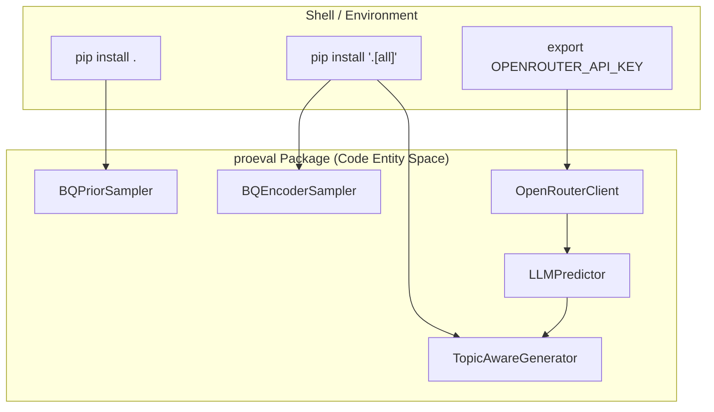
**Sources:** [pyproject.toml:53-80](), [experiment/sample_usage.py:27-37]()

---

## Minimal Quick-Start Example

The `BQPriorSampler` is the entry point for efficient performance estimation using the "Score Features" (SF) setup. It uses the performance of existing models on a benchmark to construct a prior for a new "target" model.

### Example: Estimating Gemini 2.5 Flash on SVAMP
The following script [experiment/sample_usage.py:1-50]() demonstrates how to estimate the error rate of a model using only 50 samples from a dataset of ~1,000.

```python
import numpy as np
from proeval import BQPriorSampler
from proeval.sampler import extract_model_predictions, load_predictions

def main():
    # 1. Initialize the sampler with a specified noise variance
    sampler = BQPriorSampler(noise_variance=0.3) # [experiment/sample_usage.py:32-32]

    # 2. Run active sampling for a budget of 50 samples
    # This selects indices, queries labels, and updates the GP posterior
    result = sampler.sample(
        predictions="svamp",
        target_model="gemini25_flash",
        budget=50,
    ) # [experiment/sample_usage.py:33-37]

    # 3. Validation: Compare estimate against true performance
    df = load_predictions("svamp") # [experiment/sample_usage.py:39-39]
    pred_matrix, model_names = extract_model_predictions(df) # [experiment/sample_usage.py:40-40]
    
    target_idx = model_names.index("gemini25_flash")
    true_mean = float(np.mean(pred_matrix[:, target_idx])) # [experiment/sample_usage.py:41-41]

    print(f"Estimated error rate: {result.estimates[-1]:.4f}")
    print(f"True error rate:      {true_mean:.4f}")
    print(f"MAE:                  {result.mae(true_mean):.4f}")

if __name__ == "__main__":
    main()
```

### Data Flow in `BQPriorSampler`
This diagram details how data flows through the `sample()` method to produce a `SamplingResult`.

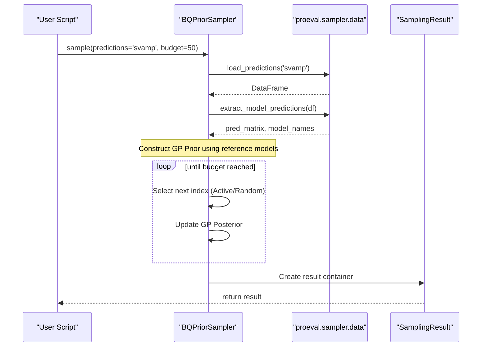

**Sources:** [experiment/sample_usage.py:31-47](), [proeval/sampler/__init__.py]() (implied by import)

---

# Page: Repository Structure & Package Layout

# Repository Structure & Package Layout

<details>
<summary>Relevant source files</summary>

The following files were used as context for generating this wiki page:

- [.gitignore](.gitignore)
- [MANIFEST.in](MANIFEST.in)
- [pyproject.toml](pyproject.toml)
- [setup.cfg](setup.cfg)

</details>


This page details the physical and logical organization of the ProEval repository. It distinguishes between the core `proeval` Python package—intended for distribution and integration—and the surrounding research artifacts, experiment harnesses, and data assets used to produce the results in the ProEval paper.

## Top-Level Directory Layout

The repository is divided into four primary directories. While `proeval/` contains the library code, the other directories provide the context and data necessary to replicate experiments.

| Directory | Purpose |
| :--- | :--- |
| `proeval/` | The core Python package containing samplers, generators, and evaluators. |
| `experiment/` | CLI scripts for running performance estimation and failure discovery benchmarks. |
| `data/` | Benchmark datasets, pre-computed LLM predictions, and text embeddings. |
| `utils/` | Shared research utilities for plotting, metrics calculation, and data cleanup. |

### Data Flow and Component Interaction

The following diagram illustrates how these top-level directories interact during a typical research workflow, such as running a Bayesian Quadrature (BQ) experiment.

**ProEval System Data Flow**
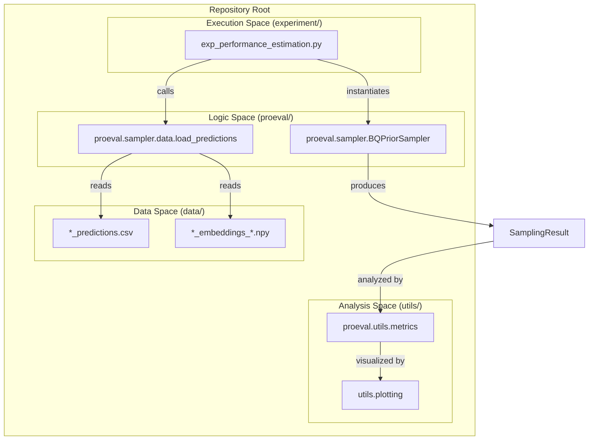
**Sources:** `pyproject.toml:100-103`(), `MANIFEST.in:8-15`()

---

## Package Build & Distribution Logic

ProEval uses a modern Python packaging stack governed by `pyproject.toml` and `MANIFEST.in`. A critical distinction is made between the **distributed library** and the **research environment**.

### Build Configuration (`pyproject.toml`)
The build system uses `setuptools` [pyproject.toml:1-3](). The configuration defines several optional dependency groups to keep the core installation lightweight:
*   `encoder`: Required for the `QuestionEncoder` and TPF-mode samplers (requires `torch`) [pyproject.toml:54-57]().
*   `topics`: Required for `TopicAwareGenerator` (requires `bertopic` and `hdbscan`) [pyproject.toml:58-62]().
*   `datasets`: Required for HuggingFace dataset integration in the evaluator [pyproject.toml:63-66]().
*   `plotting`: Required for the research visualization scripts in `utils/` [pyproject.toml:67-71]().

### Inclusion/Exclusion Rules
To prevent the distribution of bulky artifacts (like large `.npy` embedding files or experimental logs), the `MANIFEST.in` and `pyproject.toml` explicitly prune non-library code from the source distribution (sdist) and wheels.

**Package Inclusion Diagram**
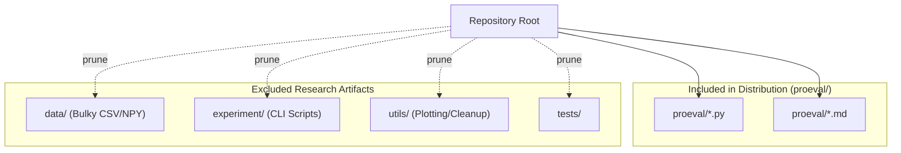

| Mechanism | Targeted Entities | Role |
| :--- | :--- | :--- |
| `MANIFEST.in` | `data`, `experiment`, `utils`, `tests` | Uses `prune` to remove directories from sdist [MANIFEST.in:12-15](). |
| `MANIFEST.in` | `*.npy`, `*.csv` | Uses `global-exclude` to strip data files [MANIFEST.in:16-17](). |
| `pyproject.toml` | `data*`, `experiment*`, `utils*` | Uses `tool.setuptools.packages.find.exclude` for wheels [pyproject.toml:103](). |
| `.gitignore` | `results/`, `data/checkpoints` | Prevents local artifacts from entering version control [.gitignore:219-221](). |

**Sources:** `MANIFEST.in:1-22`(), `pyproject.toml:97-104`(), `setup.cfg:11-38`()

---

## Directory Details

### 1. `proeval/` (The Core Package)
This is the only directory installed when running `pip install .`.
*   `sampler/`: Contains the Bayesian Quadrature logic, including `BQPriorSampler` and `BQEncoderSampler`.
*   `generator/`: Contains the `TopicAwareGenerator` for proactive failure discovery.
*   `evaluator/`: Logic for interacting with LLM APIs (e.g., `OpenRouterClient`) and managing local CSV checkpoints.
*   `encoder/`: Neural network definitions for the TPF feature space.
*   `utils/`: Internal library utilities like `metrics.py` [setup.cfg:41-43]().

### 2. `experiment/` (Research Harness)
Contains standalone scripts that orchestrate the `proeval` library to reproduce paper results.
*   `exp_performance_estimation.py`: The main entry point for evaluating BQ against baselines like Importance Sampling.
*   `exp_failure_discovery.py`: Runs the proactive generation loop.
*   `exp_train_encoder.py`: Handles the training of the neural encoder across benchmarks.

### 3. `data/` (Benchmark Assets)
Stores the raw and processed data used by the samplers.
*   `*_predictions.csv`: Matrices of model performance (1 for error, 0 for correct).
*   `*_embeddings_*.npy`: Pre-computed vector representations of questions.
*   **Note:** These are excluded from the Python package to keep the install size minimal [MANIFEST.in:12,16]().

### 4. `utils/` (Research Utilities)
Supporting code that is not part of the core API but essential for the research workflow.
*   `plotting.py`: Matplotlib/Seaborn configurations for generating paper-ready figures [pyproject.toml:67-71]().
*   `fix_all_errors.py`: A utility to retry failed LLM API calls stored in CSVs.

**Sources:** `pyproject.toml:53-88`(), `setup.cfg:11-26`(), `MANIFEST.in:11-15`()

---

# Page: Core Architecture: Bayesian Quadrature Sampling

# Core Architecture: Bayesian Quadrature Sampling

<details>
<summary>Relevant source files</summary>

The following files were used as context for generating this wiki page:

- [proeval/README.md](proeval/README.md)
- [proeval/sampler/__init__.py](proeval/sampler/__init__.py)
- [proeval/sampler/bq.py](proeval/sampler/bq.py)

</details>


The core of ProEval is a Bayesian Quadrature (BQ) framework that treats model evaluation as a numerical integration problem. Instead of simple random sampling to estimate accuracy, ProEval uses a Gaussian Process (GP) surrogate to model the relationship between prompts and model performance, actively selecting the most informative samples to minimize estimation error.

## BQ Active-Sampling Framework

ProEval treats the average performance of an LLM over a dataset as an integral of a latent performance function. By observing a small subset of labels (0 for correct, 1 for error), the system updates a GP posterior.

The framework supports three primary selection strategies:
*   **Active**: Variance-reduction acquisition that selects points to minimize the expected posterior variance of the integral (BQ-SF, BQ-RPF, BQ-TPF).
*   **Random**: Baseline selection of points at random, while still using the BQ posterior for the final estimate.
*   **Rounded**: An active strategy that rounds the final posterior mean to the nearest integer (0 or 1) before computing the estimate, useful for classification-heavy benchmarks.

### Data Flow and Code Entity Mapping

The following diagram illustrates how high-level sampling concepts map to the `proeval` codebase.

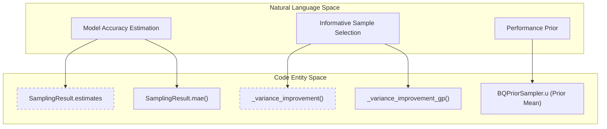
Sources: [proeval/sampler/bq.py:73-123](), [proeval/sampler/bq.py:170-205]()

---

## GP Feature Setups

ProEval implements three distinct ways to represent the "features" of a prompt for the GP surrogate.

### 1. SF (Score Features)
Implemented in `BQPriorSampler`. It uses the predictions of *other* existing models (reference models) as features. It employs a **linear kernel** and assumes that models with similar performance profiles on known benchmarks will behave similarly on new ones.
*   **Key Class**: `BQPriorSampler` [proeval/sampler/bq.py:211-260]()
*   **For details, see [BQ Samplers: BQPriorSampler & BQEncoderSampler](#2.1)**

### 2. RPF (Raw Prompt Features)
A middle-ground approach that uses raw text embeddings (e.g., from OpenAI's `text-embedding-3-large`) with a **Matérn 2.5 kernel**. It does not require a trained encoder or reference model scores, relying purely on semantic similarity.
*   **Key Function**: `_bq_matern_active_sampling` [proeval/sampler/bq.py:440-485]()
*   **For details, see [Baseline Samplers: IS, LURE & Vanilla BQ](#2.4)**

### 3. TPF (Tuned Prompt Features)
Implemented in `BQEncoderSampler`. This is the most advanced mode, using a neural encoder to map prompts into a latent space specifically optimized for GP marginal likelihood. It uses a **Matérn 2.5 kernel** over these tuned embeddings.
*   **Key Class**: `BQEncoderSampler` [proeval/sampler/bq.py:330-410]()
*   **For details, see [Neural Encoder (BQ-TPF)](#3)**

---

## System Architecture Overview

The diagram below shows how the different modules interact to produce an accuracy estimate.

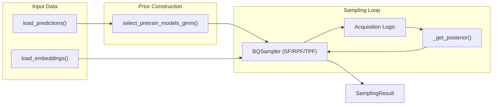
Sources: [proeval/sampler/bq.py:15-56](), [proeval/sampler/data.py:30-100](), [proeval/sampler/pretrain_selector.py:30-80]()

---

## Core Components and Child Pages

### [BQ Samplers: BQPriorSampler & BQEncoderSampler](#2.1)
Details the two primary user-facing classes. It explains the `SamplingResult` container which provides `mae()` and `mae_curve()` methods for evaluation, and the `integral_variance` attribute used for uncertainty-based abstention.
*   **Source**: [proeval/sampler/bq.py:73-123]()

### [Data Loading & Train/Test Splits](#2.2)
Covers the `proeval.sampler.data` module. This is responsible for the standard label convention (1=error, 0=correct) and extracting prediction matrices from the unified CSV format.
*   **Source**: [proeval/sampler/data.py:1-120]()

### [Pretrain Model Selection (GMM)](#2.3)
Explains how the system automatically selects reference models for the SF (Score Features) prior. It uses Gaussian Mixture Models to cluster models by performance, ensuring the prior is built from models similar to the target.
*   **Source**: [proeval/sampler/pretrain_selector.py:100-160]()

### [Baseline Samplers: IS, LURE & Vanilla BQ](#2.4)
Documents the comparative baselines, including Importance Sampling (IS) and Level-Unit Relative Error (LURE), as well as "Vanilla" BQ configurations that use flat priors.
*   **Source**: [proeval/sampler/baselines.py:1-150]()

---

# Page: BQ Samplers: BQPriorSampler & BQEncoderSampler

# BQ Samplers: BQPriorSampler & BQEncoderSampler

<details>
<summary>Relevant source files</summary>

The following files were used as context for generating this wiki page:

- [experiment/sample_usage.py](experiment/sample_usage.py)
- [proeval/sampler/__init__.py](proeval/sampler/__init__.py)
- [proeval/sampler/bq.py](proeval/sampler/bq.py)

</details>


The ProEval framework treats model evaluation as a numerical integration problem solved via **Bayesian Quadrature (BQ)**. This page provides a detailed technical reference for the two primary sampler classes: `BQPriorSampler` and `BQEncoderSampler`. These samplers allow for efficient estimation of LLM error rates by actively selecting the most informative samples to evaluate.

## Overview of Sampler Types

ProEval implements BQ active sampling using a Gaussian Process (GP) with three distinct feature setups:

| Feature Setup | Class / Function | Kernel | Description |
| :--- | :--- | :--- | :--- |
| **SF (Score Features)** | `BQPriorSampler` | Linear | Uses predictions from reference models as features. |
| **RPF (Raw Prompt Features)** | `_bq_matern_active_sampling` | Matérn 2.5 | Uses raw text embeddings (e.g., OpenAI) without fine-tuning. |
| **TPF (Tuned Prompt Features)** | `BQEncoderSampler` | Matérn 2.5 | Uses embeddings from a pre-trained neural `QuestionEncoder`. |

Sources: [proeval/sampler/bq.py:15-35]()

## BQPriorSampler (SF Mode)

`BQPriorSampler` implements the **Score Features (SF)** approach. It leverages the correlation between the target model and a set of reference models. If reference models (the "prior") consistently fail on a specific prompt, it is highly probable the target model will also fail.

### Implementation Details
- **Kernel:** It uses a linear kernel where features are the binary error labels (0=correct, 1=error) of reference models [proeval/sampler/bq.py:20-21]().
- **Prior Mean ($u$):** The prior mean is calculated as the average error rate of the selected reference models [proeval/sampler/bq.py:304-306]().
- **Active Selection:** It uses a variance-reduction acquisition strategy to pick samples that most significantly reduce the uncertainty of the integral (the global error rate) [proeval/sampler/bq.py:177-184]().

### Data Flow: SF Sampling
The diagram below shows how `BQPriorSampler` processes prediction data to produce an estimate.

**Title: BQPriorSampler Data Flow**
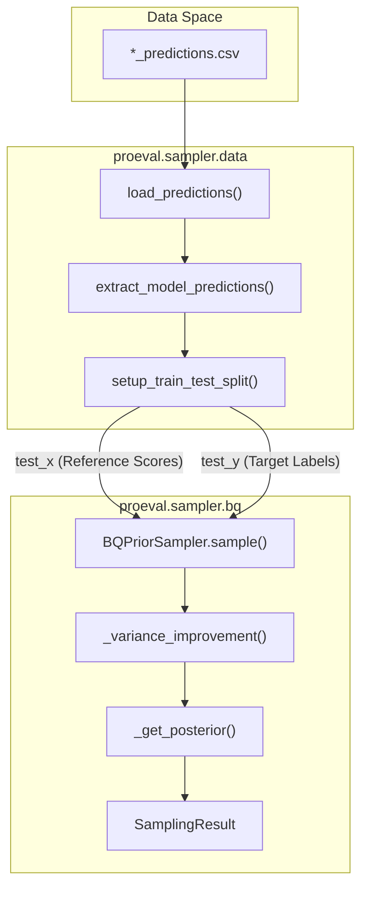
Sources: [proeval/sampler/bq.py:255-320](), [proeval/sampler/data.py:25-100]()

## BQEncoderSampler (TPF Mode)

`BQEncoderSampler` implements **Tuned Prompt Features (TPF)**. This mode is used when a neural encoder has been pre-trained to map prompt embeddings into a latent space where distance correlates with model failure patterns.

### Key Components
- **QuestionEncoder:** A neural network (MLP) that transforms raw text embeddings into $\phi$-embeddings [proeval/sampler/__init__.py:61-70]().
- **Matérn Kernel:** Unlike the linear kernel in SF, TPF uses a Matérn 2.5 kernel on the $\phi$-embeddings to capture non-linear relationships in the prompt space [proeval/sampler/bq.py:26-28]().
- **Cross-Benchmark Transfer:** The encoder is typically trained on multiple "source" benchmarks to generalize to a "target" benchmark [proeval/sampler/bq.py:440-450]().

### Integration with Neural Encoder
The sampler maps raw embeddings through the encoder before performing the BQ update loop.

**Title: BQEncoderSampler & QuestionEncoder Interaction**
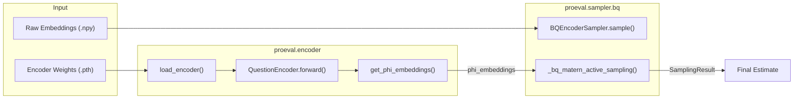
Sources: [proeval/sampler/bq.py:431-488](), [proeval/sampler/__init__.py:60-83]()

## SamplingResult Container

All samplers return a `SamplingResult` object. This container stores the trajectory of the estimation process and provides utility methods for evaluation.

### Attributes
- `estimates`: An array of the posterior mean (error rate estimate) at each budget step [proeval/sampler/bq.py:89]().
- `selected_indices`: The sequence of indices chosen by the acquisition function [proeval/sampler/bq.py:90]().
- `integral_variance`: The variance of the mean estimate at each step. This represents the BQ uncertainty [proeval/sampler/bq.py:95-96]().
- `posterior_mean`: The final predicted probability of failure for every item in the test set [proeval/sampler/bq.py:91]().

### Key Methods
- `mae(true_mean)`: Returns the final Mean Absolute Error: $|estimate_{final} - true\_mean|$ [proeval/sampler/bq.py:97-99]().
- `mae_curve(true_mean)`: Returns the MAE at every step of the sampling process [proeval/sampler/bq.py:101-103]().
- `should_abstain(threshold)`: Returns `True` if the `integral_std` is higher than the threshold, indicating the sampler is too uncertain to provide a reliable estimate [proeval/sampler/bq.py:112-121]().

Sources: [proeval/sampler/bq.py:73-123]()

## Internal Acquisition Logic

The core of the active sampling is the reduction of **integral variance**. For a GP with kernel $K$, the variance of the integral (the average value) is given by $\frac{1}{N^2} \mathbf{1}^\top K \mathbf{1}$.

ProEval uses a rank-1 update to efficiently calculate how much this integral variance would decrease if a specific point $i$ were sampled:
$$\Delta_i = \frac{(\sum_j K_{ij})^2}{K_{ii} + \sigma^2}$$

The function `_find_best_i_and_update` implements this logic using optimized linear algebra (via `np.einsum`) to select the best index from the unlabeled pool [proeval/sampler/bq.py:150-167]().

Sources: [proeval/sampler/bq.py:150-193]()

---

# Page: Data Loading & Train/Test Splits

# Data Loading & Train/Test Splits

<details>
<summary>Relevant source files</summary>

The following files were used as context for generating this wiki page:

- [data/README.md](data/README.md)
- [proeval/sampler/__init__.py](proeval/sampler/__init__.py)
- [proeval/sampler/data.py](proeval/sampler/data.py)

</details>


The `proeval.sampler.data` module provides the foundational utilities for loading benchmark datasets, extracting model performance labels, and preparing the data structures required for Bayesian Quadrature (BQ) sampling. This module bridges the gap between raw CSV/NPY files stored in the `data/` directory and the mathematical representations (feature matrices and labels) used by the samplers.

### Data Flow Overview

The data flow starts with raw benchmark files and results in a structured split between "pre-train" models (used to build the GP prior) and the "target" model (the model being evaluated).

#### Logic Flow: From Files to Sampler
The following diagram illustrates how `proeval.sampler.data` transforms raw storage into BQ-ready inputs.

**Data Transformation Pipeline**
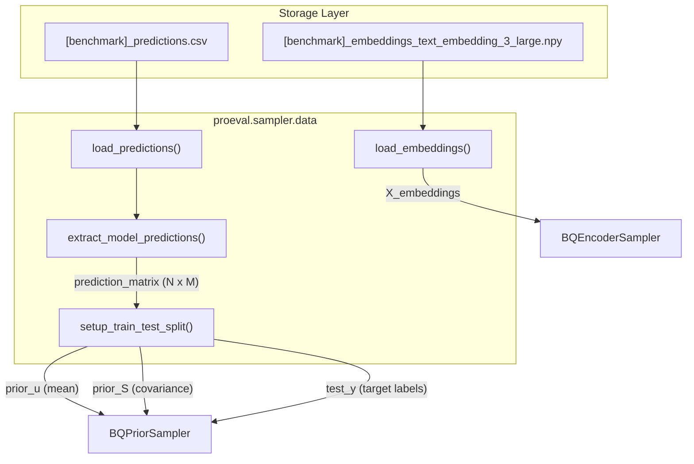
Sources: [proeval/sampler/data.py:36-40](), [data/README.md:11-18]()

---

### Label Convention and Prediction Matrix

ProEval uses a specific label convention to measure **failure rates** rather than accuracy.

*   **Convention:** `1.0` = Error (incorrect), `0.0` = Correct.
*   **Binarization:** For most benchmarks (e.g., `gsm8k`, `mmlu`), the labels are already binary error indicators [data/README.md:62]().
*   **Continuous Handling:** For safety datasets like `dices` and `dices_t2i`, ratings are continuous. `extract_model_predictions` binarizes these at a threshold of `0.5` and inverts them so that unsafe/poor responses are marked as `1` [proeval/sampler/data.py:119-123]().

The `extract_model_predictions()` function converts a `pandas.DataFrame` into a `numpy` matrix of shape `(n_samples, n_models)` [proeval/sampler/data.py:105-107]().

| Dataset Type | Original Label | ProEval Internal Label |
| :--- | :--- | :--- |
| Binary (e.g. GSM8K) | 0 (Correct) | 0 |
| Binary (e.g. GSM8K) | 1 (Error) | 1 |
| Continuous (DICES) | > 0.5 (Safe/Good) | 0 |
| Continuous (DICES) | < 0.5 (Unsafe/Poor) | 1 |

Sources: [proeval/sampler/data.py:88-126](), [data/README.md:59-63]()

---

### Core Data Loading Functions

#### `load_predictions(dataset_name, data_dir=None)`
Loads the `*_predictions.csv` file for the specified benchmark. It resolves the default directory to `data/` if not provided [proeval/sampler/data.py:36-57]().

#### `load_embeddings(dataset_name, data_dir=None, embedding_model='text_embedding_3_large')`
Loads pre-computed text embeddings from `.npy` files. These embeddings (typically from OpenAI `text-embedding-3-large`) are used as features for the `BQEncoderSampler` (TPF mode) or RPF modes [proeval/sampler/data.py:60-85]().

#### `setup_train_test_split(...)`
This is the primary function for preparing BQ sampling. It partitions the `prediction_matrix` based on a `target_model`.

*   **Target Model:** The model whose performance we wish to estimate.
*   **Pre-train Models:** The other models in the benchmark used to construct the prior mean ($\mu$) and covariance ($\Sigma$) [proeval/sampler/data.py:173-174]().
*   **Feature Construction:** In Score Feature (SF) mode, it calculates `test_x` by centering the pre-train matrix [proeval/sampler/data.py:178-184]().

**Implementation Details: Split Logic**
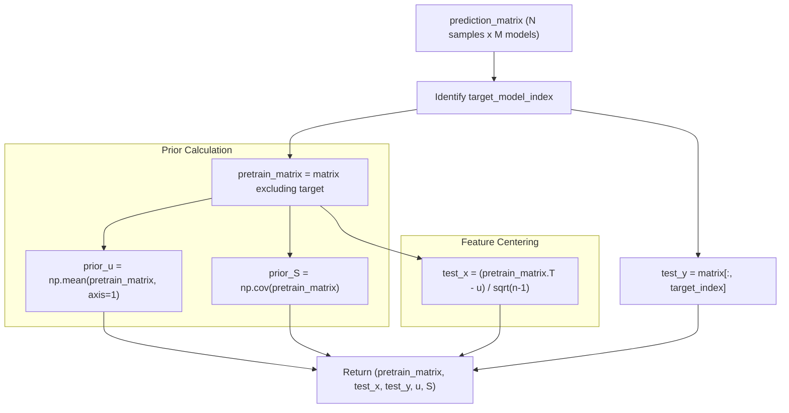
Sources: [proeval/sampler/data.py:129-185]()

---

### Integration with Samplers

The data returned by `setup_train_test_split` is passed directly into the `sample()` method of BQ samplers.

1.  **Prior Construction:** The `u` (mean) and `S` (covariance) define the GP prior over the evaluation space [proeval/sampler/bq.py:100-110]().
2.  **Ground Truth:** The `test_y` array serves as the "oracle" that the sampler queries during the active sampling loop.
3.  **Features:** The `test_x` (for `BQPriorSampler`) or the embeddings from `load_embeddings` (for `BQEncoderSampler`) serve as the coordinates for the GP kernel.

**Data Flow to BQ Loop**
| Variable | Origin Function | Destination | Purpose |
| :--- | :--- | :--- | :--- |
| `test_y` | `setup_train_test_split` | `BQSampler.sample` | The true labels (0/1) for budget consumption. |
| `u`, `S` | `setup_train_test_split` | `BQSampler.__init__` | Parameters for the Bayesian Quadrature prior. |
| `embeddings` | `load_embeddings` | `BQEncoderSampler.sample` | Spatial features for the Matérn/RBF kernels. |

Sources: [proeval/sampler/data.py:129-185](), [proeval/sampler/bq.py:157-165]()

---

# Page: Pretrain Model Selection (GMM)

# Pretrain Model Selection (GMM)

<details>
<summary>Relevant source files</summary>

The following files were used as context for generating this wiki page:

- [proeval/README.md](proeval/README.md)
- [proeval/sampler/__init__.py](proeval/sampler/__init__.py)
- [proeval/sampler/pretrain_selector.py](proeval/sampler/pretrain_selector.py)

</details>


The `pretrain_selector` module provides mechanisms to automatically select the most relevant reference models for constructing a Bayesian Quadrature (BQ) prior. By clustering models based on their performance profiles across reference benchmarks, ProEval ensures that the prior mean used in `BQPriorSampler` is derived from models that behave similarly to the target model, reducing noise and improving estimation accuracy [proeval/sampler/pretrain_selector.py:15-21]().

## Overview of GMM Selection

When evaluating a `target_model` on a `target_benchmark`, the `BQPriorSampler` typically uses other models' predictions as features. While using all available models is the default, it can introduce noise if the reference pool contains models with vastly different architectures or performance characteristics [proeval/README.md:65-66]().

The `select_pretrain_models_gmm()` function addresses this by:
1.  **Feature Extraction**: Representing every model as a vector of performance metrics (mean and standard deviation) across multiple reference benchmarks [proeval/sampler/pretrain_selector.py:99-104]().
2.  **Clustering**: Fitting a Gaussian Mixture Model (GMM) to these vectors to group models with similar "skill profiles" [proeval/sampler/pretrain_selector.py:186-191]().
3.  **Selection**: Identifying the cluster containing the `target_model` and returning all other models in that same cluster as the optimal pretrain sources [proeval/sampler/pretrain_selector.py:228-232]().

### Data Flow: From CSV to Model Clusters

The following diagram illustrates how raw prediction data is transformed into model clusters to inform the BQ prior.

**Figure 1: Pretrain Selection Data Flow**
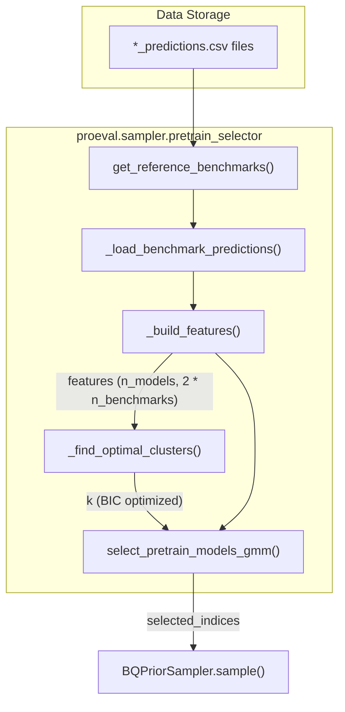
**Sources:** [proeval/sampler/pretrain_selector.py:45-185](), [proeval/README.md:71-85]()

## Implementation Details

### Feature Engineering
The system builds a feature matrix where each row represents a model. For every reference benchmark $B$, two features are calculated:
*   **Mean Accuracy**: `np.mean(preds)` [proeval/sampler/pretrain_selector.py:135]().
*   **Standard Deviation**: `np.std(preds)` [proeval/sampler/pretrain_selector.py:136]().

If a model is missing predictions for a specific benchmark, the missing values are imputed using the column means (the average performance of all other models on that benchmark) [proeval/sampler/pretrain_selector.py:139-142]().

### Optimal Cluster Selection
The number of clusters ($k$) is determined dynamically using the **Bayesian Information Criterion (BIC)**. The function `_find_optimal_clusters()` iterates through potential $k$ values (up to 10) and selects the one that minimizes the BIC, balancing model fit with complexity [proeval/sampler/pretrain_selector.py:148-173]().

### Integration with BQPriorSampler
The output of the selector is a list of model indices. These are passed to the `pretrain_indices` argument of the `sample()` method [proeval/README.md:79-84]().

**Code Entity Relationship: Selector to Sampler**
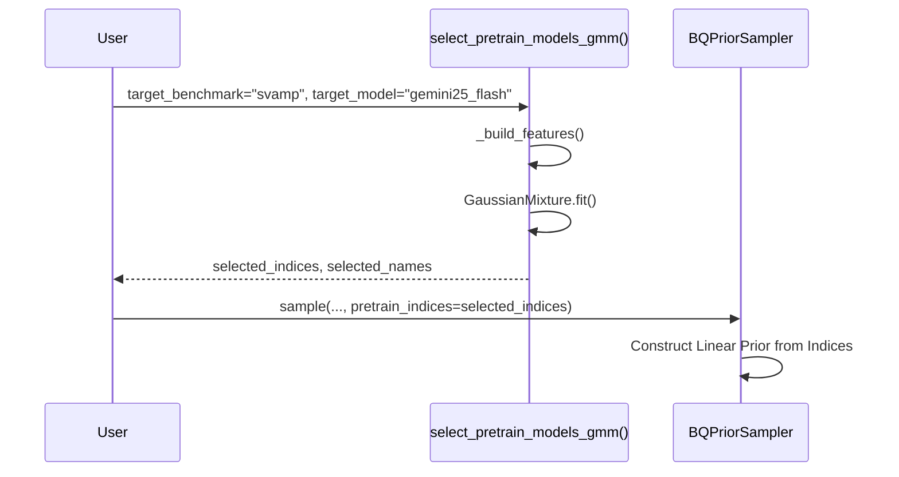
**Sources:** [proeval/sampler/pretrain_selector.py:177-234](), [proeval/README.md:68-85]()

## Evaluation Settings

The selection logic supports three primary evaluation settings used throughout the ProEval experiments to ensure robust cross-validation and prevent data leakage:

| Setting | Description | Logic in Code |
| :--- | :--- | :--- |
| **New Pair** | Evaluating a known model on a known benchmark, but using other models as features. | Standard `select_pretrain_models_gmm` usage. |
| **New Benchmark** | Evaluating on a benchmark that was not seen during any prior training/selection. | `get_reference_benchmarks` excludes the `target_benchmark` [proeval/sampler/pretrain_selector.py:67](). |
| **New Model** | Evaluating a model that has no prior data in the reference set. | Features are built using the model's performance on *other* benchmarks to find its cluster [proeval/sampler/pretrain_selector.py:18-21](). |

## Key Functions

### `get_reference_benchmarks()`
Scans the `data_dir` for all available `*_predictions.csv` files and returns a list of benchmark names, excluding the one currently being targeted for evaluation [proeval/sampler/pretrain_selector.py:45-69]().

### `select_pretrain_models_gmm()`
The primary entry point. It orchestrates feature building, GMM fitting, and cluster extraction.
*   **Arguments**:
    *   `target_benchmark`: The dataset currently being evaluated [proeval/sampler/pretrain_selector.py:194]().
    *   `target_model`: The string name of the model to find peers for [proeval/sampler/pretrain_selector.py:196]().
    *   `n_clusters`: Optional override for the BIC-based selection [proeval/sampler/pretrain_selector.py:201]().
*   **Returns**: A tuple of `(selected_indices, selected_names)` [proeval/sampler/pretrain_selector.py:234]().

**Sources:** [proeval/sampler/pretrain_selector.py:45-235](), [proeval/sampler/__init__.py:42-45]()

---

# Page: Baseline Samplers: IS, LURE & Vanilla BQ

# Baseline Samplers: IS, LURE & Vanilla BQ

<details>
<summary>Relevant source files</summary>

The following files were used as context for generating this wiki page:

- [proeval/sampler/__init__.py](proeval/sampler/__init__.py)
- [proeval/sampler/baselines.py](proeval/sampler/baselines.py)

</details>


This page documents the baseline evaluation methods and active sampling utilities found in the `proeval.sampler.baselines` module. While ProEval focuses on Bayesian Quadrature (BQ) with advanced priors, it includes standard statistical baselines—Importance Sampling (IS) and Level-Unbiased Resampling Estimator (LURE)—as well as "Vanilla" BQ configurations for benchmarking.

## Overview of Baseline Methods

The `proeval.sampler.baselines` module provides a unified interface for running both active and passive evaluation strategies. These strategies are used to estimate the mean performance (error rate) of a target model given a limited labeling budget.

| Method | Type | Description |
| :--- | :--- | :--- |
| **Vanilla BQ** | Bayesian | Uses a GP with a standard prior (zero mean or global mean) without active acquisition. |
| **Active BQ** | Bayesian | Iteratively selects samples that maximize information gain for the GP posterior. |
| **Importance Sampling (IS)** | Statistical | Uses a surrogate model to estimate error probabilities and reweights samples to reduce variance. |
| **LURE** | Statistical | A level-unbiased resampling estimator that corrects for the bias introduced by non-uniform sampling. |
| **Random** | Statistical | Uniform random sampling (the standard evaluation baseline). |

Sources: `[proeval/sampler/baselines.py:15-19]()`

---

## Configuration Classes

The baseline module uses several `dataclass` structures to manage the hyperparameters of surrogate models and acquisition functions.

### SurrogateConfig
Defines the architecture and parameters for the proxy model used in IS and LURE to predict failure probabilities.
- `use_rf`: If `True`, uses `RandomForestClassifier`; otherwise, uses `LogisticRegression` `[proeval/sampler/baselines.py:38-38]()`.
- `lr_solver`, `lr_class_weight`, `lr_max_iter`: Parameters for the Logistic Regression surrogate `[proeval/sampler/baselines.py:40-42]()`.
- `rf_n_estimators`, `rf_max_depth`: Parameters for the Random Forest surrogate `[proeval/sampler/baselines.py:44-47]()`.

### AcquisitionConfig
Controls how the surrogate model's predictions are converted into sampling probabilities.
- `smoothing_factor`: A value (default 0.01) that mixes the surrogate's distribution with a uniform distribution to ensure exploration and prevent zero-probability assignments `[proeval/sampler/baselines.py:52-52]()`.
- `target_class`: The class index to sample (default 1 for "failure/error") `[proeval/sampler/baselines.py:53-53]()`.

Sources: `[proeval/sampler/baselines.py:35-54]()`

---

## Data Flow: From Embeddings to Estimates

The following diagram illustrates how the baseline samplers ingest data and produce performance estimates.

### Data Flow for IS/LURE Baselines
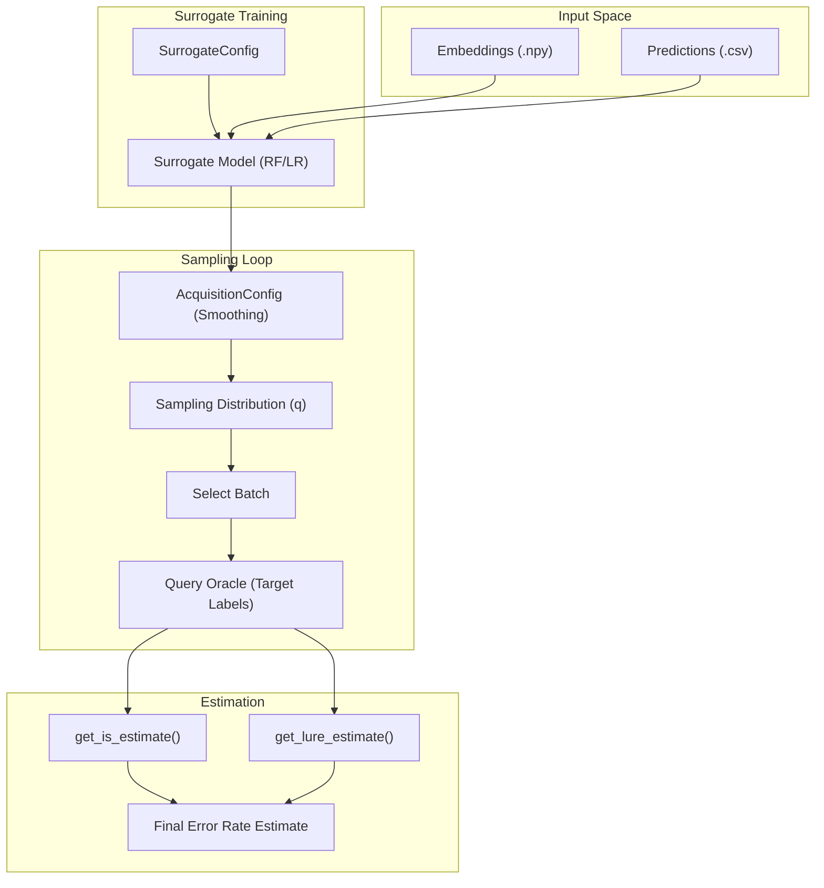
Sources: `[proeval/sampler/baselines.py:28-64]()`, `[proeval/sampler/baselines.py:446-460]()`

---

## Core Sampling Logic

### Importance Sampling (IS) & LURE
The module implements statistical estimators that use a surrogate model (trained on a small initial seed or proxy data) to bias sampling toward "hard" examples.

*   **`get_is_estimate`**: Calculates the self-normalized importance sampling estimate. It weights each sample by $w_i = \frac{p(x_i)}{q(x_i)}$, where $p$ is the uniform target distribution and $q$ is the proposal distribution from the surrogate `[proeval/sampler/baselines.py:446-460]()`.
*   **`get_lure_estimate`**: Implements the Level-Unbiased Resampling Estimator. Unlike IS, LURE is designed to be unbiased even when the surrogate model is highly inaccurate, using a specific normalization factor $(1/M)$ `[proeval/sampler/baselines.py:463-480]()`.

### Bayesian Quadrature (BQ) Implementations
*   **`bq_vanilla_sampling`**: Performs BQ using a Gaussian Process with a fixed prior. It does not use active learning; instead, it evaluates samples (often selected randomly) and computes the integral of the posterior mean `[proeval/sampler/baselines.py:349-370]()`.
*   **`bq_active_sampling`**: An iterative loop that updates the GP posterior and uses an acquisition function (typically variance reduction) to pick the next most informative point to label `[proeval/sampler/baselines.py:304-346]()`.

Sources: `[proeval/sampler/baselines.py:304-480]()`

---

## Incremental Evaluation Wrappers

To support experimental curves (showing how error decreases as budget increases), the module provides "Incremental" wrappers. These functions return a list of estimates for every budget step from 1 to $N$.

| Function | Logic |
| :--- | :--- |
| `incremental_random_evaluation` | Standard Monte Carlo mean computed at every step `[proeval/sampler/baselines.py:483-497]()`. |
| `incremental_is_lure_evaluation` | Re-calculates IS/LURE weights and estimates as the sample size grows `[proeval/sampler/baselines.py:500-550]()`. |
| `incremental_bq_evaluation` | Returns the BQ integral estimate after each new sample is added to the GP `[proeval/sampler/baselines.py:553-579]()`. |

### Logic for Smoothing-Factor Acquisition
In `incremental_is_lure_evaluation`, the sampling distribution $q$ is constructed by:
1.  Getting probabilities from the surrogate: `probs = surrogate.predict_proba(X)` `[proeval/sampler/baselines.py:518-518]()`.
2.  Applying the `smoothing_factor` from `AcquisitionConfig`:
    `q = (1 - smoothing) * probs + (smoothing * uniform)` `[proeval/sampler/baselines.py:522-522]()`.
3.  This ensures that every sample has a non-zero probability of being selected, which is a requirement for the validity of the IS/LURE estimators.

Sources: `[proeval/sampler/baselines.py:500-579]()`

---

## System Interaction: Baseline Module to Code Entities

The following diagram maps the logical sampling concepts to the specific functions and classes in `proeval.sampler.baselines`.

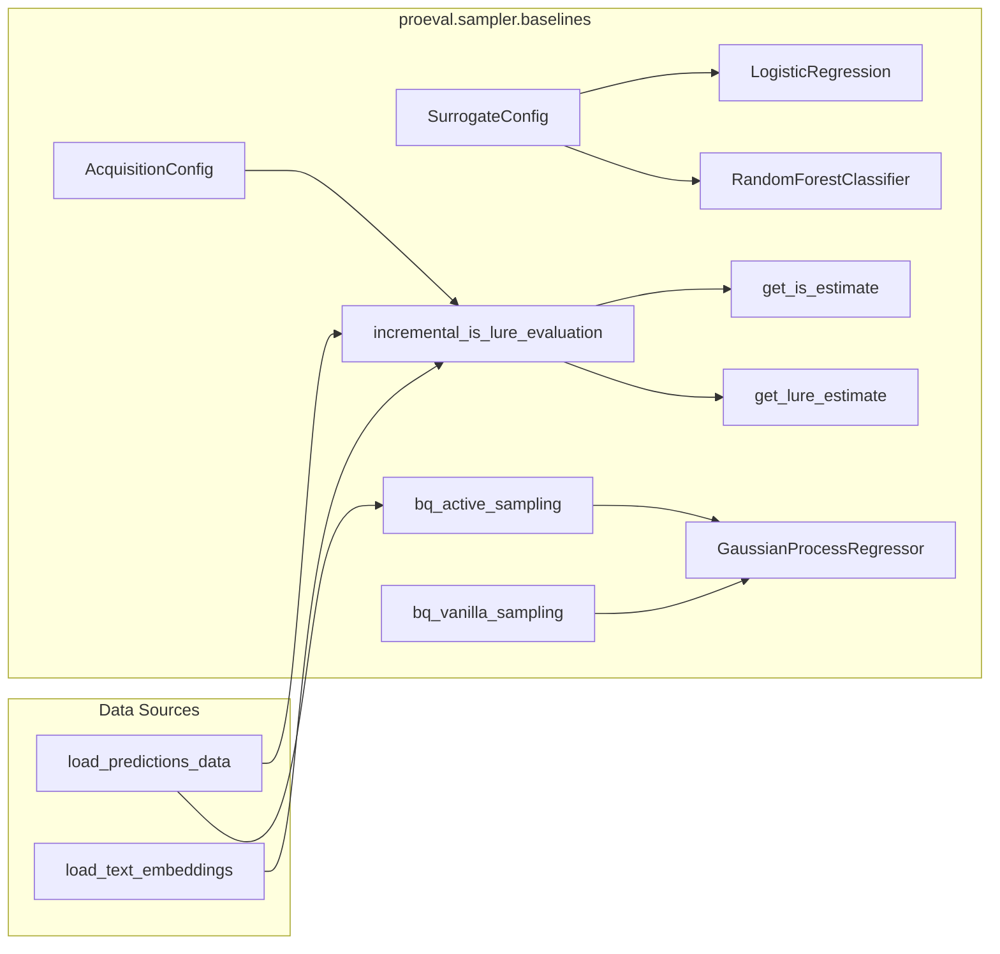

Sources: `[proeval/sampler/baselines.py:28-30]()`, `[proeval/sampler/baselines.py:73-88]()`, `[proeval/sampler/baselines.py:304-305]()`, `[proeval/sampler/baselines.py:500-505]()`

---

# Page: Neural Encoder (BQ-TPF)

# Neural Encoder (BQ-TPF)

<details>
<summary>Relevant source files</summary>

The following files were used as context for generating this wiki page:

- [proeval/encoder/__init__.py](proeval/encoder/__init__.py)
- [proeval/encoder/nn_utils.py](proeval/encoder/nn_utils.py)
- [proeval/encoder/trainer.py](proeval/encoder/trainer.py)

</details>


The **Neural Encoder** subsystem is an optional component of ProEval that enables the **Tuned Prompt Features (TPF)** mode for Bayesian Quadrature (BQ). While standard BQ often relies on fixed features (SF) or random projections (RPF), TPF uses a trained `QuestionEncoder` to map high-dimensional natural language embeddings into a task-optimized latent space. This allows the system to transfer knowledge across different benchmarks and models, improving the efficiency of performance estimation and failure discovery.

### Purpose and Scope
The primary goal of the encoder is to learn a mapping $\phi(x)$ such that the resulting Gaussian Process (GP) kernel accurately reflects the correlation between model failures on similar questions. By minimizing the GP marginal likelihood across multiple reference benchmarks, the encoder learns to extract features that are predictive of model behavior.

For implementation details, see:
*   [QuestionEncoder Architecture & Kernel Utilities](#3.1)
*   [EncoderTrainer: Cross-Benchmark Training Pipeline](#3.2)

---

### System Overview: Natural Language to Latent Space
The following diagram illustrates how the neural encoder bridges the gap between raw text embeddings (Natural Language Space) and the optimized features used by the BQ samplers (Code Entity Space).

**Figure 1: BQ-TPF Data Flow**
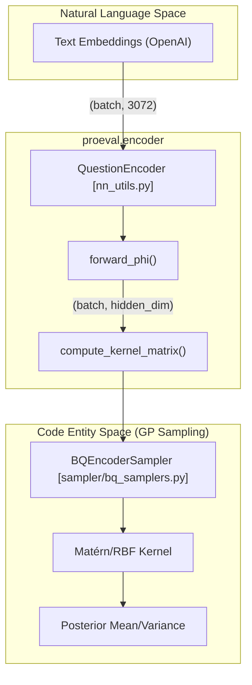
**Sources:** [proeval/encoder/nn_utils.py:57-64](), [proeval/encoder/nn_utils.py:101-111](), [proeval/encoder/nn_utils.py:144-160]()

---

### The QuestionEncoder
The `QuestionEncoder` is a Multi-Layer Perceptron (MLP) defined in `proeval.encoder.nn_utils`. It takes a pre-computed embedding (typically from `text-embedding-3-large`) and produces a normalized latent representation $\phi$.

| Feature | Description |
| :--- | :--- |
| **Base Architecture** | A single `nn.Linear` layer followed by a sigmoid activation with a configurable `steepness` parameter [proeval/encoder/nn_utils.py:78-83](). |
| **Normalization** | The `_compute_phi` method centers the output and applies L2-normalization, placing embeddings on a unit sphere to ensure stable kernel lengthscales [proeval/encoder/nn_utils.py:126-141](). |
| **Kernel Support** | Supports `linear`, `matern`, and `rbf` kernels. For non-linear kernels, it maintains a learnable `log_lengthscale` [proeval/encoder/nn_utils.py:72-85](). |
| **Stability** | Uses a `_safe_cholesky` implementation with a jitter schedule to handle numerical instability during GP loss computation [proeval/encoder/nn_utils.py:37-54](). |

For details on the MLP layers and kernel math, see [QuestionEncoder Architecture & Kernel Utilities](#3.1).

**Sources:** [proeval/encoder/nn_utils.py:57-141](), [proeval/encoder/nn_utils.py:37-54]()

---

### Training and Transfer Learning
The `EncoderTrainer` orchestrates the training of the encoder using data from multiple benchmarks. The training objective is to minimize the Negative Log Marginal Likelihood (NLML) of the GP, effectively treating the encoder weights as kernel hyperparameters.

**Figure 2: Training Pipeline Entities**
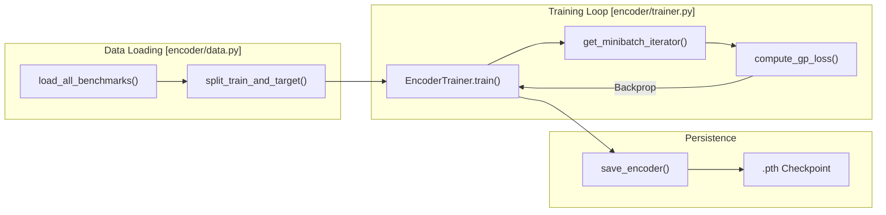
**Sources:** [proeval/encoder/trainer.py:35-45](), [proeval/encoder/trainer.py:154-173](), [proeval/encoder/nn_utils.py:316-324]()

#### Evaluation Settings
The trainer supports three primary transfer learning scenarios [proeval/encoder/trainer.py:21-28]():
1.  **new_pair**: Trains on all benchmarks including the target, but excludes the target model.
2.  **new_benchmark**: Completely excludes the target benchmark from the training set.
3.  **new_model**: Similar to `new_pair`, utilizing other models' scores on the target benchmark to refine embeddings.

For details on the training loop and data splitting, see [EncoderTrainer: Cross-Benchmark Training Pipeline](#3.2).

**Sources:** [proeval/encoder/trainer.py:21-28](), [proeval/encoder/trainer.py:179-188]()

---

# Page: QuestionEncoder Architecture & Kernel Utilities

# QuestionEncoder Architecture & Kernel Utilities

<details>
<summary>Relevant source files</summary>

The following files were used as context for generating this wiki page:

- [proeval/encoder/__init__.py](proeval/encoder/__init__.py)
- [proeval/encoder/nn_utils.py](proeval/encoder/nn_utils.py)

</details>


The `QuestionEncoder` is a core component of the ProEval Tuned Prompt Features (TPF) evaluation mode. It provides a learnable mapping from high-dimensional text embeddings (e.g., OpenAI `text-embedding-3-large`) into a latent space optimized for Gaussian Process (GP) regression. This allows the system to transfer knowledge across different benchmarks by learning how prompt characteristics correlate with model failure patterns.

### QuestionEncoder MLP Architecture

The `QuestionEncoder` is implemented as a PyTorch `nn.Module` [proeval/encoder/nn_utils.py:57-75](). It transforms input embeddings into a latent representation $\phi(x)$ that resides on a unit sphere.

#### Transformation Pipeline
1.  **Linear Projection**: Maps input dimension (e.g., 3072) to a hidden dimension (default 128) [proeval/encoder/nn_utils.py:83]().
2.  **$\psi(x)$ Computation**: Applies a sigmoid activation scaled by a `steepness` parameter (default 30.0) to the linear output [proeval/encoder/nn_utils.py:97-99]().
3.  **$\phi(x)$ Normalization**: The raw $\psi(x)$ is centered and L2-normalized [proeval/encoder/nn_utils.py:126-141](). This normalization ensures that pairwise distances in the $\phi$-space lie within $[0, \sqrt{2}]$, providing a stable regime for the GP lengthscale regardless of the hidden layer size [proeval/encoder/nn_utils.py:131-134]().

#### Learnable Parameters
The encoder manages three categories of parameters:
*   **Weights**: Standard `nn.Linear` weights and biases [proeval/encoder/nn_utils.py:83]().
*   **Noise Variance (`log_var`)**: A learnable parameter representing observation noise $\sigma^2$, lower-bounded by `MIN_NOISE_VAR` (0.3) to prevent overconfidence [proeval/encoder/nn_utils.py:34-34](), [proeval/encoder/nn_utils.py:84-84]().
*   **Lengthscale (`log_lengthscale`)**: A learnable parameter governing the smoothness of the GP kernel in the latent space [proeval/encoder/nn_utils.py:85-85]().

**Sources:** [proeval/encoder/nn_utils.py:57-141]()

### Kernel Utilities & Integration

The `compute_kernel_matrix()` function determines how the latent embeddings $\phi(x)$ interact to form the GP covariance [proeval/encoder/nn_utils.py:144-157]().

#### Supported Kernel Types
The encoder supports three primary kernel architectures [proeval/encoder/nn_utils.py:72-72]():

| Kernel Type | Formulation in $\phi$-space | Characteristics |
| :--- | :--- | :--- |
| **Linear** | $K = \phi\phi^T$ | Original ProEval formulation; fast computation [proeval/encoder/nn_utils.py:161-163](). |
| **RBF** | $K = \exp(-0.5 \cdot (\frac{d}{l})^2)$ | Squared Exponential; assumes high smoothness [proeval/encoder/nn_utils.py:177-179](). |
| **Matérn** | $K_{\nu=2.5}$ (default) | Balanced smoothness; robust for discrete failure signals [proeval/encoder/nn_utils.py:181-197](). |

#### Distance Computation
For non-linear kernels (RBF/Matérn), the utility computes pairwise Euclidean distances in $\phi$-space using the identity $\|a-b\|^2 = \|a\|^2 + \|b\|^2 - 2\langle a,b \rangle$ for numerical efficiency [proeval/encoder/nn_utils.py:168-171]().

**Sources:** [proeval/encoder/nn_utils.py:144-200]()

### Loss Functions & Training Logic

The encoder is trained by maximizing the Marginal Log-Likelihood (MLL) of a Gaussian Process.

#### compute_gp_loss()
This function calculates the negative log-likelihood of the target labels given the encoder's current mapping [proeval/encoder/nn_utils.py:202-218](). It constructs the full covariance matrix $C = K + \sigma^2I$ and utilizes a safe Cholesky decomposition [proeval/encoder/nn_utils.py:37-54]().
*   **Cholesky Stability**: `_safe_cholesky` applies a progressive jitter schedule (from $1e-6$ to $1.0$) to the diagonal if the matrix is not positive definite [proeval/encoder/nn_utils.py:31-31](), [proeval/encoder/nn_utils.py:44-50]().

#### compute_gp_loss_with_reg()
Extends the standard GP loss with a regularization term (default $\lambda=0.01$) to prevent the weights of the `nn.Linear` layer from exploding during the MLL optimization [proeval/encoder/nn_utils.py:257-279]().

**Sources:** [proeval/encoder/nn_utils.py:31-54](), [proeval/encoder/nn_utils.py:202-279]()

### Data Flow: From Text to Latent Space

The following diagram illustrates how raw text embeddings are processed by the `QuestionEncoder` and integrated into the GP utilities.

**Text Embedding Transformation Flow**
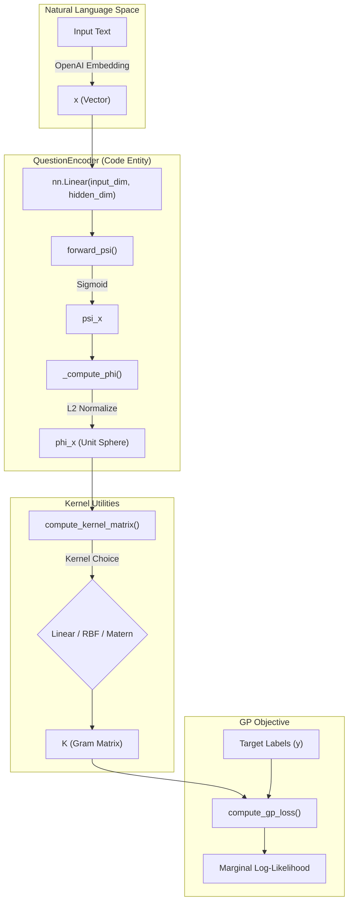
**Sources:** [proeval/encoder/nn_utils.py:57-141](), [proeval/encoder/nn_utils.py:144-218]()

### API for Persistence and Retrieval

The module provides high-level functions to manage encoder state and batch processing.

*   **get_phi_embeddings()**: A utility to extract $\phi(x)$ vectors for a given set of inputs, handling the conversion between NumPy and Torch tensors [proeval/encoder/nn_utils.py:311-332]().
*   **save_encoder() / load_encoder()**: Handles serialization of the model architecture and its learnable parameters (including `log_var` and `log_lengthscale`) to `.pth` files [proeval/encoder/nn_utils.py:356-388]().

**Sources:** [proeval/encoder/nn_utils.py:311-388]()

### Encoder-GP Integration Architecture

This diagram shows the relationship between the `QuestionEncoder` class and the loss functions used by the `EncoderTrainer`.

**Encoder Training System Diagram**
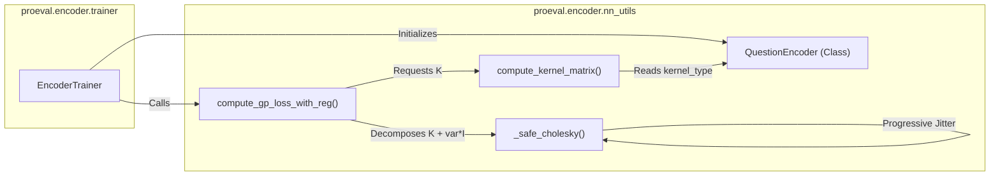
**Sources:** [proeval/encoder/nn_utils.py:57-86](), [proeval/encoder/nn_utils.py:144-153](), [proeval/encoder/nn_utils.py:257-265](), [proeval/encoder/trainer.py:27-38]()

---

# Page: EncoderTrainer: Cross-Benchmark Training Pipeline

# EncoderTrainer: Cross-Benchmark Training Pipeline

<details>
<summary>Relevant source files</summary>

The following files were used as context for generating this wiki page:

- [experiment/exp_train_encoder.py](experiment/exp_train_encoder.py)
- [proeval/encoder/data.py](proeval/encoder/data.py)
- [proeval/encoder/trainer.py](proeval/encoder/trainer.py)

</details>


The `EncoderTrainer` class is the central orchestration component for the neural encoder subsystem in ProEval. It manages the end-to-end lifecycle of training a `QuestionEncoder`, which transforms raw question embeddings into a latent space optimized for Bayesian Quadrature (BQ) performance estimation. This pipeline allows ProEval to leverage historical performance data from multiple models and benchmarks to form a "Tuned Prompt Features" (TPF) prior for new, unseen evaluation targets.

### Implementation and Data Flow

The `EncoderTrainer` utilizes a custom training loop designed for Gaussian Process (GP) marginal likelihood minimization. Unlike standard supervised learning, the objective is to optimize the encoder's parameters such that the resulting kernel matrix (computed in the latent space) best explains the observed error patterns across different models and benchmarks.

#### Data Preparation and Filtering
The pipeline begins by loading data through `proeval.encoder.data`. The system supports three primary training configurations that determine how the training and validation sets are constructed relative to the evaluation target:

| Setting | Description | Implementation Logic |
| :--- | :--- | :--- |
| `new_pair` | Excludes only the specific (target_model, target_benchmark) pair. | [proeval/encoder/data.py:181-182]() |
| `new_benchmark` | Completely excludes the target benchmark from training. | [proeval/encoder/data.py:182-182]() |
| `new_model` | Excludes the target model's data from all benchmarks. | [proeval/encoder/data.py:183-184]() |

#### Training Architecture
The training process is governed by the `train_encoder_minibatch` function, which iterates over "pairs" of (benchmark, model) rather than individual samples.

**Encoder Training Data Flow**
```mermaid
graph TD
    subgraph "Data_Loading [proeval.encoder.data]"
        A["load_all_benchmarks()"] --> B["split_train_and_target()"]
        B --> C["split_benchmark_data()"]
    end

    subgraph "Training_Loop [proeval.encoder.trainer]"
        C --> D["get_minibatch_iterator()"]
        D --> E["create_minibatch_dataset()"]
        E --> F["compute_gp_loss()"]
        F --> G["optimizer.step()"]
    end

    subgraph "Persistence [proeval.encoder.nn_utils]"
        G --> H["save_encoder()"]
        H --> I[".pth Checkpoint"]
    end

    style I stroke-width:2px,stroke-dasharray: 5 5
```
Sources: [proeval/encoder/trainer.py:154-215](), [proeval/encoder/data.py:170-194]()

### Key Functions and Classes

#### EncoderTrainer Class
The `EncoderTrainer` class (defined in `proeval/encoder/trainer.py`) encapsulates all hyperparameters and state for the training run.

*   **Initialization**: Configures the `QuestionEncoder` architecture, including `hidden_dim`, `kernel_type` (Linear, Matérn, or RBF), and GP noise variance (`init_var`). [proeval/encoder/trainer.py:270-320]()
*   **train()**: The main entry point. It loads data via `load_all_benchmarks`, applies the split logic, initializes the `QuestionEncoder`, and calls the minibatch training utility. [proeval/encoder/trainer.py:372-430]()

#### Training Utilities
*   **`split_benchmark_data`**: Splits questions within each benchmark into training and validation subsets based on a `val_ratio` (default 0.1). [proeval/encoder/trainer.py:69-106]()
*   **`get_minibatch_iterator`**: Yields batches of `(benchmark, model)` pairs. This is critical because the GP loss is calculated over the kernel matrix of a specific model's performance on a set of questions. [proeval/encoder/trainer.py:136-152]()
*   **`compute_gp_loss`**: Located in `proeval/encoder/nn_utils.py`, this function calculates the negative log marginal likelihood of the GP. It uses the `QuestionEncoder` to get latent embeddings $\phi(x)$, computes the kernel matrix $K$, and then evaluates the likelihood of the binary error labels $y$. [proeval/encoder/nn_utils.py:126-155]()

### Cross-Benchmark Mapping
The encoder serves as the bridge between the high-dimensional "Natural Language Space" (provided by models like `text-embedding-3-large`) and the "Code Entity Space" where performance patterns are learned.

**Natural Language to GP Feature Mapping**
```mermaid
graph LR
    subgraph "Natural_Language_Space"
        A["Input Questions"] --> B["text-embedding-3-large"]
        B --> C["(m, 3072) Vectors"]
    end

    subgraph "QuestionEncoder [proeval.encoder.nn_utils]"
        C --> D["Linear(3072, hidden_dim)"]
        D --> E["Sigmoid / Tanh"]
        E --> F["phi(x) Latent Embeddings"]
    end

    subgraph "Code_Entity_Space [GP Kernel]"
        F --> G["compute_kernel_matrix()"]
        G --> H["GP Marginal Likelihood"]
        H --> I["Optimizer [Adam]"]
    end

    I -.->|"Updates Weights"| D
```
Sources: [proeval/encoder/nn_utils.py:38-75](), [proeval/encoder/nn_utils.py:89-124]()

### Execution via CLI
The training pipeline is typically invoked via `experiment/exp_train_encoder.py`. This script provides a command-line interface to configure the `EncoderTrainer`.

**Key CLI Arguments:**
*   `--train-benchmarks`: List of benchmarks to include in the training pool (e.g., `gsm8k`, `strategyqa`). [experiment/exp_train_encoder.py:68-70]()
*   `--setting`: The holdout strategy (`new_pair`, `new_benchmark`, `new_model`). [experiment/exp_train_encoder.py:105-108]()
*   `--kernel-type`: The GP kernel used during training (`matern`, `rbf`, `linear`). [experiment/exp_train_encoder.py:91-92]()
*   `--checkpoint-path`: The destination for the resulting `.pth` file. [experiment/exp_train_encoder.py:103-104]()

### Checkpoint Persistence
Upon completion, the trainer uses `save_encoder` to export the model. The checkpoint includes:
1.  The `state_dict` of the `QuestionEncoder`.
2.  Hyperparameters (input/hidden dimensions, activation functions).
3.  Kernel configuration (type, lengthscale, noise variance).

These checkpoints are later loaded by `BQEncoderSampler` to perform active sampling on the target benchmark. [proeval/encoder/nn_utils.py:175-204]()

Sources: [experiment/exp_train_encoder.py:118-141](), [proeval/encoder/trainer.py:435-450](), [proeval/encoder/nn_utils.py:206-235]()

---

# Page: Failure Discovery & Test Case Generation

# Failure Discovery & Test Case Generation

<details>
<summary>Relevant source files</summary>

The following files were used as context for generating this wiki page:

- [proeval/README.md](proeval/README.md)
- [proeval/generator/__init__.py](proeval/generator/__init__.py)
- [proeval/generator/core.py](proeval/generator/core.py)

</details>


The proactive failure discovery subsystem in ProEval is designed to surface diverse model bugs and edge cases within a constrained evaluation budget. Unlike traditional evaluation which measures average performance, this subsystem focuses on **Hard-negative Superlevel Set (HSS)** sampling to identify regions of the input space where the target model is likely to fail. It leverages the Gaussian Process (GP) posterior state—either from a learned prior or a neural encoder—to guide both the selection of existing test cases and the generation of novel ones via LLMs.

## Overview of Proactive Discovery

The discovery process combines Bayesian active sampling with topic-aware strategies to ensure that discovered failures are not only numerous but also diverse across the problem domain. The system supports two primary modes of operation:
1.  **Selection Mode**: Identifying the most difficult existing examples from a large unlabeled pool.
2.  **Generation Mode**: Using an LLM to synthesize new test cases by conditioning on "hard-anchor" examples identified by the GP.

### Discovery Workflow

The discovery loop typically follows these steps:
1.  **Prior Initialization**: The GP is initialized using either a linear prior from reference models (`prior_u`, `prior_S`) or a neural encoder (TPF) [proeval/generator/core.py:27-33]().
2.  **Topic Extraction**: For topic-aware strategies, the pool is clustered using `BERTopic` to ensure coverage across different semantic areas [proeval/generator/core.py:213-215]().
3.  **Acquisition**: The Superlevel Set (SS) acquisition function identifies indices where the model is predicted to fail (label = 1) with high uncertainty [proeval/generator/core.py:80-91]().
4.  **Generation/Selection**: The `TopicAwareGenerator` either selects these samples or uses them as few-shot context to generate new ones [proeval/generator/core.py:334-345]().
5.  **Feedback Loop**: Results from the target model are fed back via `gen.update(score)`, updating the GP posterior and refining the search for the next iteration [proeval/generator/core.py:56-57]().

### Failure Discovery Architecture

The diagram below illustrates the relationship between the GP posterior state, the topic clusters, and the generation logic.

**Figure 1: Proactive Failure Discovery Pipeline**
```mermaid
graph TD
    subgraph "GP State Space"
        A["Prior (u, S)"] -- "update()" --> B["Posterior (u_t, s_t)"]
        B -- "ss_acquisition_batch" --> C["Hard-Anchor Indices"]
    end

    subgraph "Topic Space"
        D["extract_topics_bertopic"] -- "assignments" --> E["Topic Clusters"]
    end

    subgraph "Generation Logic"
        C & E -- "strategy='tss'" --> F["TopicAwareGenerator"]
        F -- "build_prompt" --> G["LLM (Generator)"]
        G -- "JSON Response" --> H["New Test Case"]
    end

    H -- "LLMPredictor" --> I["Target Model Score"]
    I -- "gen.update()" --> B
```
Sources: [proeval/generator/core.py:80-156](), [proeval/generator/core.py:213-240](), [proeval/generator/core.py:334-370]()

---

## Key Components

### Superlevel Set (SS) Acquisition
The core selection logic uses the Superlevel Set acquisition function. It targets points where the model's predicted error probability exceeds a threshold $\lambda$. The acquisition value for a point $x$ is defined as:
$$\alpha_{SS}(x) = \mathbb{1}(\mu_t(x) + \beta \cdot \sigma_t(x) \geq \lambda) \times k_t(x, x)$$
where $k_t(x, x)$ represents the posterior variance, favoring points that are both likely failures and highly uncertain [proeval/generator/core.py:117-120]().

### TopicAwareGenerator
The `TopicAwareGenerator` class manages the internal state of the discovery process. It tracks which samples have been "labeled" (tested) and uses different strategies to balance exploration (new topics) and exploitation (known failure regions) [proeval/generator/core.py:246-270]().

| Strategy | Description |
| :--- | :--- |
| `SS` | Superlevel Set selection from the existing pool [proeval/generator/core.py:438](). |
| `TSS` | Topic-aware Superlevel Set; cycles through topics and applies SS within each [proeval/generator/core.py:446](). |
| `SS-Gen` | Uses SS to find hard-anchors, then generates new cases based on them [proeval/generator/core.py:453](). |
| `Rand-T-Gen` | Randomly picks a topic and generates a new case for it [proeval/generator/core.py:461](). |

### Discovery Strategy Mapping

This diagram bridges the high-level strategies to the specific functions and variables used in the implementation.

**Figure 2: Strategy to Code Entity Mapping**
```mermaid
graph LR
    subgraph "proeval.generator.core"
        TAG["TopicAwareGenerator"]
        SS_ACQ["ss_acquisition_batch"]
        UP["update()"]
    end

    subgraph "proeval.generator.prompt"
        BGP["build_gsm8k_prompt"]
        BSP["build_strategyqa_prompt"]
        FHE["format_hard_examples"]
    end

    TAG -- "calls" --> SS_ACQ
    TAG -- "uses" --> FHE
    FHE -- "populates" --> BGP
    FHE -- "populates" --> BSP
    UP -- "modifies" --> TAG
```
Sources: [proeval/generator/core.py:334-345](), [proeval/generator/core.py:427-465](), [proeval/generator/prompt.py:100-115]()

---

## Child Pages

### [4.1 TopicAwareGenerator & SS Acquisition](#)
Detailed reference for the `TopicAwareGenerator` class. Covers initialization with different prior modes (learned vs. encoder), the `generate()` method's various strategies, and the `ss_acquisition_batch` logic including greedy diversity sampling.
*   **Key Symbols**: `TopicAwareGenerator`, `ss_acquisition_batch`, `extract_topics_bertopic`.

### [4.2 Prompt Templates & Generation Schemas](#)
Documentation for the `proeval.generator.prompt` module. Explains how hard-anchor examples are formatted into few-shot prompts and how JSON schemas ensure the LLM-generated test cases are parsable and valid for datasets like GSM8K and StrategyQA.
*   **Key Symbols**: `build_gsm8k_prompt`, `GSM8K_SCHEMA`, `format_hard_examples`.

---
**Sources:**
- [proeval/README.md:237-270]() (Discovery overview)
- [proeval/generator/core.py:15-57]() (Module purpose and examples)
- [proeval/generator/core.py:80-156]() (SS acquisition logic)
- [proeval/generator/core.py:246-330]() (TopicAwareGenerator definition)
- [proeval/generator/core.py:427-465]() (Strategy implementation)
- [proeval/generator/prompt.py:100-115]() (Few-shot formatting)

---

# Page: TopicAwareGenerator & SS Acquisition

# TopicAwareGenerator & SS Acquisition

<details>
<summary>Relevant source files</summary>

The following files were used as context for generating this wiki page:

- [proeval/generator/__init__.py](proeval/generator/__init__.py)
- [proeval/generator/baselines.py](proeval/generator/baselines.py)
- [proeval/generator/core.py](proeval/generator/core.py)

</details>


The `TopicAwareGenerator` is the central component for proactive failure discovery in ProEval. It leverages the Gaussian Process (GP) posterior state from Bayesian Quadrature (BQ) to identify regions of the input space where a model is likely to fail (Superlevel Set acquisition). It then generates new, diverse test cases by combining topic-aware sampling with "hard-anchor" few-shot prompting.

## TopicAwareGenerator Class

The `TopicAwareGenerator` manages the feedback loop between the GP surrogate model, topic extraction, and an LLM-based generator. It supports two primary modes for establishing a performance prior: using pre-computed model predictions or using a neural encoder.

### Initialization & Prior Modes

The generator is initialized in one of two ways to establish the initial belief about model performance:

1.  **Without Pretrain (Prior from Predictions):** Uses `prior_u` (mean) and `prior_S` (covariance) derived from the performance of reference models on a seed dataset. [proeval/generator/core.py:29-30]().
2.  **With Pretrain (Neural Encoder):** Uses a pre-trained `QuestionEncoder` and pre-computed embeddings to compute the GP prior dynamically. [proeval/generator/core.py:31-32]().

| Parameter | Type | Description |
| :--- | :--- | :--- |
| `df` | `pd.DataFrame` | The seed dataset containing questions and ground truth. |
| `dataset` | `str` | Dataset identifier (e.g., "gsm8k", "strategyqa"). |
| `api_key` | `str` | API key for the generation LLM (OpenRouter). |
| `prior_u` | `np.ndarray` | (Optional) Prior mean vector. |
| `prior_S` | `np.ndarray` | (Optional) Prior covariance matrix. |
| `encoder_path` | `str` | (Optional) Path to `.pth` neural encoder checkpoint. |
| `embeddings_path`| `str` | (Optional) Path to `.npy` embedding file. |

**Sources:** [proeval/generator/core.py:41-57](), [proeval/generator/core.py:255-300]()

### The Generation Loop

The generator operates in an iterative loop. In each step, it selects a strategy to generate a new test case, evaluates it, and updates its internal GP state.

```mermaid
graph TD
    subgraph "Failure Discovery Loop"
    A["TopicAwareGenerator.generate()"] --> B{"Strategy?"}
    B -- "SS / TSS" --> C["Select Hard Anchors via SS Acquisition"]
    B -- "SS-Gen" --> D["Select Topic + SS Anchors"]
    B -- "Rand-Gen" --> E["Pure Random Generation"]
    
    C --> F["Build Prompt (Anchors + Topic)"]
    D --> F
    E --> G["Build Prompt (No Anchors)"]
    
    F --> H["LLM Generation (OpenRouterClient)"]
    G --> H
    
    H --> I["Parse JSON Response"]
    I --> J["Evaluate Result (External)"]
    J --> K["TopicAwareGenerator.update(score)"]
    K --> L["Update GP Posterior"]
    L --> A
    end
```
**Sources:** [proeval/generator/core.py:53-56](), [proeval/generator/core.py:373-458](), [proeval/generator/core.py:488-515]()

---

## Superlevel Set (SS) Acquisition

The Superlevel Set acquisition function targets points where the model is predicted to fail with high uncertainty. In ProEval, failure is labeled as `1` and success as `0`, so the "Superlevel Set" refers to the region where the failure probability is high.

### Implementation: `ss_acquisition_batch`

The core logic implements the acquisition function:
$$\alpha_{SS}(x) = \mathbb{1}(\mu_t(x) + \beta \cdot \sigma_t(x) \geq \lambda) \times k_t(x, x)$$
where $\lambda$ is the `threshold` and $k_t(x, x)$ is the posterior variance. [proeval/generator/core.py:117-121]().

Key modes in `ss_acquisition_batch`:
*   **top_n**: Returns the $n$ samples with the highest acquisition scores. [proeval/generator/core.py:135-138]().
*   **greedy**: Selects samples that maximize the SS score while maintaining diversity via embedding distance. [proeval/generator/core.py:140-154]().
*   **threshold**: Filters samples strictly above the $\lambda$ boundary and selects the one with the highest variance. [proeval/generator/core.py:125-133]().

**Sources:** [proeval/generator/core.py:80-156]()

---

## Generation Strategies

The `generate()` method supports several strategies that determine how the LLM prompt is constructed. [proeval/generator/core.py:373-410]().

| Strategy | Description | Anchor Selection |
| :--- | :--- | :--- |
| **SS** | Superlevel Set sampling from the seed pool. | `ss_acquisition` on full pool. |
| **SS-Gen** | SS sampling within a randomly selected topic. | `ss_acquisition` restricted to topic. |
| **TSS** | Topic-aware SS; cycles through topics to ensure diversity. | Topic-restricted SS. |
| **Rand-Gen** | Pure random generation baseline. | None (Random pool sample). |
| **Rand-T-Gen** | Random topic injection without BQ guidance. | None (Random pool sample). |

### Hard-Anchor Selection
For strategies using anchors (SS, SS-Gen, TSS), the generator calls `ss_acquisition_batch` to find $k$ examples from the seed dataset that the GP predicts the model will fail on. These are formatted into the prompt using `format_hard_examples` to provide few-shot context to the LLM. [proeval/generator/core.py:421-436](), [proeval/generator/prompt.py:120-137]().

**Sources:** [proeval/generator/core.py:373-458](), [proeval/generator/baselines.py:32-73]()

---

## Topic Extraction & Management

ProEval uses `BERTopic` to cluster the seed dataset questions into semantically meaningful groups.

### `extract_topics_bertopic`
This function uses a `SentenceTransformer` ("all-MiniLM-L6-v2") to embed questions, `UMAP` for dimensionality reduction, and `HDBSCAN` for clustering. It returns:
1.  A list of topic labels (top keywords).
2.  A mapping of topic IDs to questions.
3.  An array of topic assignments for every question in the dataset.

[proeval/generator/core.py:213-252]().

### Integration with GP
The `TopicAwareGenerator` stores these assignments in `self.topic_assignments`. When `strategy="tss"` or `"ss_gen"` is used, the `ss_acquisition_batch` function filters the `unlabeled_indices` to only include those belonging to the `selected_topic`. [proeval/generator/core.py:107-112](), [proeval/generator/core.py:314-319]().

```mermaid
graph LR
    subgraph "Topic-Aware Data Flow"
    A["Seed Questions"] --> B["extract_topics_bertopic"]
    B --> C["Topic Assignments"]
    B --> D["Topic Keywords"]
    
    C --> E["TopicAwareGenerator"]
    D --> E
    
    E --> F["Select Topic (Random/Cyclic)"]
    F --> G["Filter Seed Pool by Topic"]
    G --> H["ss_acquisition_batch"]
    H --> I["Hard Anchors"]
    I --> J["LLM Prompt"]
    end
```

**Sources:** [proeval/generator/core.py:213-252](), [proeval/generator/core.py:314-325](), [proeval/generator/core.py:415-430]()

---

## Feedback Loop: `update()`

After a test case is generated and evaluated by the `LLMPredictor`, the result must be fed back into the generator to refine the GP surrogate.

1.  **Embedding:** The new question is embedded using the same encoder/method as the seed data. [proeval/generator/core.py:494-500]().
2.  **State Update:** The embedding and the score (0 or 1) are appended to `self.X_observed` and `self.y_observed`. [proeval/generator/core.py:502-503]().
3.  **Posterior Recomputation:** The internal GP state is updated using `_get_posterior` (for prediction-based priors) or `get_posterior_embedding` (for encoder-based priors). [proeval/generator/core.py:505-515]().

**Sources:** [proeval/generator/core.py:488-515](), [proeval/generator/core.py:186-208]()

---

# Page: Prompt Templates & Generation Schemas

# Prompt Templates & Generation Schemas

<details>
<summary>Relevant source files</summary>

The following files were used as context for generating this wiki page:

- [proeval/generator/core.py](proeval/generator/core.py)
- [proeval/generator/prompt.py](proeval/generator/prompt.py)

</details>


The `proeval.generator.prompt` module centralizes the construction of natural language prompts and JSON output schemas used during proactive failure discovery. It translates the mathematical state of the Bayesian Quadrature (BQ) sampler—specifically the Superlevel Set (SS) acquisition results—into structured instructions for an LLM to generate new, adversarial test cases.

### Core Components and Data Flow

The prompt generation process bridges the **Code Entity Space** (GP posteriors, indices, and dataframes) to the **Natural Language Space** (instructional text and few-shot examples).

**Prompt Generation Workflow**
```mermaid
graph TD
    subgraph "Code Entity Space"
        A["TopicAwareGenerator.generate()"] -- "hard_indices" --> B["format_hard_examples()"]
        C["SS / TSS Strategy"] -- "topic_str" --> D["build_gsm8k_prompt() / build_strategyqa_prompt()"]
    end

    subgraph "Natural Language Space"
        B -- "formatted_text + avg_prior" --> D
        D -- "Final Prompt String" --> E["LLM (via OpenRouterClient)"]
        F["GSM8K_SCHEMA / STRATEGYQA_SCHEMA"] -- "JSON Constraints" --> E
    end

    E -- "JSON Response" --> G["New Test Case"]
```
Sources: [proeval/generator/core.py:68-74](), [proeval/generator/prompt.py:15-29]()

### JSON Output Schemas

To ensure that LLM-generated test cases can be parsed programmatically, ProEval utilizes JSON schemas. These schemas are passed to the `OpenRouterClient` to enforce "strict" output formats [proeval/generator/prompt.py:36-70]().

| Schema Constant | Dataset Target | Required Fields | Purpose |
| :--- | :--- | :--- | :--- |
| `GSM8K_SCHEMA` | GSM8K | `question`, `solution`, `ground_truth` | Ensures math problems include step-by-step solutions and a final numeric answer [proeval/generator/prompt.py:36-52](). |
| `STRATEGYQA_SCHEMA` | StrategyQA | `question`, `reasoning`, `ground_truth` | Ensures reasoning questions include the multi-hop logic and a boolean answer [proeval/generator/prompt.py:54-70](). |

Sources: [proeval/generator/prompt.py:36-70]()

### Few-Shot Context Injection

The function `format_hard_examples()` is the primary mechanism for injecting "hard" examples (surfaced by the BQ sampler) into the prompt. It performs two critical tasks:
1.  **Difficulty Labeling**: It maps the `prior_mean` (predicted success rate) to human-readable labels: `VERY HARD` ($<0.3$), `HARD` ($<0.5$), or `MODERATE` [proeval/generator/prompt.py:85]().
2.  **Aggregation**: It calculates the `average_prior_mean` of the selected examples to provide the LLM with a target difficulty benchmark [proeval/generator/prompt.py:91-92]().

**Entity Mapping: Code to Prompt**
```mermaid
graph LR
    subgraph "proeval.generator.prompt"
        FE["format_hard_examples()"]
        BGP["build_gsm8k_prompt()"]
        BSP["build_strategyqa_prompt()"]
    end

    subgraph "Prompt String Components"
        T1["'VERY HARD' / 'HARD'"]
        T2["'Average model success rate'"]
        T3["'TOPIC: {topic}'"]
        T4["'Output JSON: ...'"]
    end

    FE --> T1
    FE --> T2
    BGP --> T3
    BGP --> T4
    BSP --> T3
    BSP --> T4
```
Sources: [proeval/generator/prompt.py:76-92](), [proeval/generator/prompt.py:119-147]()

### Dataset-Specific Prompt Builders

The module provides specialized builders that adapt instructions based on the generation strategy (e.g., `pure_random`, `ss_gen`, or `tss`).

#### GSM8K Prompting (`build_gsm8k_prompt`)
For mathematical reasoning, the builder emphasizes "calculation traps" and "multi-step reasoning" [proeval/generator/prompt.py:125-128]().
*   **Random Strategies**: Focuses on creativity and specific topics [proeval/generator/prompt.py:100-115]().
*   **Adversarial Strategies (`ss_gen`, `tss`)**: Instructs the LLM to act as an "expert Red-Teamer" and mimic the reasoning patterns of provided hard examples [proeval/generator/prompt.py:120-132]().

#### StrategyQA Prompting (`build_strategyqa_prompt`)
For boolean reasoning, the builder emphasizes "multi-hop reasoning" and "implicit knowledge" [proeval/generator/prompt.py:159-161]().
*   **Adversarial Instructions**: Explicitly mentions that "AI models failed on these" examples to encourage the generation of harder edge cases [proeval/generator/prompt.py:183-185]().

Sources: [proeval/generator/prompt.py:98-147](), [proeval/generator/prompt.py:153-188]()

---

# Page: LLM Evaluation Layer

# LLM Evaluation Layer

<details>
<summary>Relevant source files</summary>

The following files were used as context for generating this wiki page:

- [proeval/evaluator/__init__.py](proeval/evaluator/__init__.py)
- [proeval/evaluator/client.py](proeval/evaluator/client.py)
- [proeval/evaluator/predictor.py](proeval/evaluator/predictor.py)

</details>


The LLM Evaluation Layer is responsible for the end-to-end process of generating model predictions and calculating performance metrics. It abstracts the complexities of multi-model inference, structured response parsing, and error handling. This subsystem ensures that evaluation data is consistently formatted and persisted across different benchmarks and models.

The layer is centered around two primary components: the `LLMPredictor`, which handles the logic of prompting and parsing, and the `UnifiedCSVManager`, which manages the state of evaluation datasets on disk.

### System Interaction Overview

The following diagram illustrates how the evaluation layer bridges the gap between raw dataset questions (Natural Language Space) and structured evaluation records (Code Entity Space).

**Evaluation Data Flow**
```mermaid
graph TD
    subgraph "Natural Language Space"
        [Question] --> [LLM_Inference]
        [LLM_Inference] --> [Raw_Response]
    end

    subgraph "Code Entity Space"
        [LLMPredictor] -- "uses" --> [OpenRouterClient]
        [OpenRouterClient] -- "calls" --> [predict_function]
        [Raw_Response] -- "parsed by" --> [DatasetConfig]
        [DatasetConfig] -- "extracts" --> [prediction_field]
        [prediction_field] -- "compared via" --> [compare_predictions]
        [compare_predictions] -- "results in" --> [label_model_column]
        [label_model_column] -- "saved by" --> [UnifiedCSVManager]
    end

    [Question] -.-> [LLMPredictor]
    [UnifiedCSVManager] -.-> [Unified_CSV_File]
```
Sources: [proeval/evaluator/predictor.py:17-32](), [proeval/evaluator/csv_manager.py:24-40](), [proeval/evaluator/client.py:73-81]()

---

### LLM Inference & Response Parsing

The `LLMPredictor` class serves as the main entry point for generating predictions. It utilizes a `DatasetConfig` to determine how to format prompts for specific benchmarks (e.g., `STRATEGYQA_PROMPT`, `GSM8K_PROMPT`) and how to extract the final answer from the LLM's response.

Key features include:
*   **Parallel Inference**: The `predict_batch_parallel` method uses `ThreadPoolExecutor` to handle high-throughput evaluation.
*   **Structured Output**: It enforces JSON responses using `response_format` and `json_schema` to minimize parsing errors.
*   **Error Categorization**: Predictions that fail are categorized into specific states: `SKIPPED`, `ERROR`, `RATE_LIMITED`, or `PARSE_ERROR`.

For details on prompt templates and error handling, see [LLMPredictor & OpenRouterClient](#5.1).

Sources: [proeval/evaluator/predictor.py:129-140](), [proeval/evaluator/predictor.py:321-350](), [proeval/evaluator/predictor.py:37-86]()

---

### Data Management & Persistence

Evaluation results are managed by the `UnifiedCSVManager`. This component ensures that predictions from multiple models are stored in a single, unified schema. It tracks the raw response, the extracted prediction, and the calculated label (0 for correct, 1 for error) for every model evaluated on a dataset.

The manager handles:
*   **Checkpointing**: Periodically saving results during long-running batch evaluations to prevent data loss.
*   **Error Remediation**: The `fix_errors` method allows for re-running only the samples that previously resulted in an error state.
*   **HuggingFace Integration**: Utilities like `load_dataset_data` streamline the process of pulling benchmark data into the ProEval pipeline.

For details on the CSV schema and dataset configurations, see [UnifiedCSVManager & Dataset Configuration](#5.2).

Sources: [proeval/evaluator/csv_manager.py:43-60](), [proeval/evaluator/csv_manager.py:124-150](), [proeval/evaluator/csv_manager.py:270-300]()

---

### Class & Entity Relationships

This diagram maps the relationships between the core classes in the `proeval.evaluator` package.

**Evaluator Subsystem Class Diagram**
```mermaid
classDiagram
    class UnifiedCSVManager {
        +load_or_create()
        +run_evaluation()
        +fix_errors()
        -df: DataFrame
    }
    class LLMPredictor {
        +evaluate()
        +predict_batch_parallel()
        -client: OpenRouterClient
    }
    class DatasetConfig {
        +name: str
        +prompt_template: Callable
        +json_schema: dict
        +compare_predictions: Callable
    }
    class OpenRouterClient {
        +predict()
        +predict_with_image()
        -api_key: str
    }

    UnifiedCSVManager --> LLMPredictor : "triggers"
    LLMPredictor --> OpenRouterClient : "uses"
    LLMPredictor --> DatasetConfig : "configures per dataset"
    DatasetConfig --* LLMPredictor : "dependency"
```
Sources: [proeval/evaluator/predictor.py:129-140](), [proeval/evaluator/csv_manager.py:43-55](), [proeval/evaluator/client.py:73-81](), [proeval/evaluator/predictor.py:321-330]()

### Related Child Pages
*   **[LLMPredictor & OpenRouterClient](#5.1)**: Deep dive into inference logic, parallelization, and API communication.
*   **[UnifiedCSVManager & Dataset Configuration](#5.2)**: Detailed schema definitions, checkpointing logic, and benchmark-specific configurations.

---

# Page: LLMPredictor & OpenRouterClient

# LLMPredictor & OpenRouterClient

<details>
<summary>Relevant source files</summary>

The following files were used as context for generating this wiki page:

- [proeval/evaluator/__init__.py](proeval/evaluator/__init__.py)
- [proeval/evaluator/client.py](proeval/evaluator/client.py)
- [proeval/evaluator/predictor.py](proeval/evaluator/predictor.py)

</details>


The `proeval.evaluator` subsystem provides a robust layer for interacting with Large Language Models (LLMs) to perform evaluation tasks. It abstracts API communication through `OpenRouterClient` and manages high-level dataset-specific logic via `LLMPredictor`.

### LLM Prediction Pipeline

The prediction pipeline transforms raw dataset questions into structured model evaluations. It handles prompt templating, JSON-mode enforcement, parallel execution, and result parsing.

#### System Architecture and Data Flow

The following diagram illustrates the relationship between the predictor, the client, and the dataset-specific configurations.

**LLM Prediction System Map**
```mermaid
graph TD
    subgraph "Natural Language Space"
        A["Dataset Question"]
        B["Prompt Templates (STRATEGYQA_PROMPT, etc.)"]
        C["LLM Raw Response"]
    end

    subgraph "Code Entity Space"
        D["LLMPredictor: evaluate()"]
        E["DatasetConfig"]
        F["OpenRouterClient: predict()"]
        G["UnifiedCSVManager"]
    end

    A --> D
    E -- "prompt_template" --> D
    D -- "format prompt" --> B
    B --> F
    F -- "API Call" --> C
    C -- "JSON Parsing" --> D
    D -- "extract_prediction" --> E
    D -- "compare_predictions" --> E
    E -- "Binary Label (0/1)" --> G
```
Sources: [proeval/evaluator/predictor.py:17-46](), [proeval/evaluator/predictor.py:129-139](), [proeval/evaluator/client.py:100-115]()

---

### LLMPredictor

The `LLMPredictor` class is the primary interface for running evaluations. It manages a `DatasetConfig` which defines how to interact with specific benchmarks.

#### Key Functions
- **`evaluate(question, ground_truth, model, ...)`**: Performs a single prediction. It formats the prompt, calls the client, parses the JSON response, and compares the result against the ground truth to generate a label (0 for correct, 1 for error) [proeval/evaluator/predictor.py:358-417]().
- **`predict_batch_parallel(data, model, ...)`**: Uses a `ThreadPoolExecutor` to run multiple evaluations concurrently, improving throughput for large datasets [proeval/evaluator/predictor.py:440-475]().

#### Error States
The predictor tracks several failure modes during the evaluation process:
| State | Description |
| :--- | :--- |
| `SKIPPED` | The item was skipped (e.g., if already processed) [proeval/evaluator/predictor.py:365](). |
| `ERROR` | A general execution error occurred during the API call [proeval/evaluator/predictor.py:410](). |
| `RATE_LIMITED` | The API provider returned a 429 status code [proeval/evaluator/client.py:167](). |
| `PARSE_ERROR` | The LLM returned a response that could not be parsed as valid JSON according to the schema [proeval/evaluator/predictor.py:401](). |

Sources: [proeval/evaluator/predictor.py:358-475](), [proeval/evaluator/client.py:167-175]()

---

### Dataset Configurations and Prompts

ProEval uses specialized prompt templates and JSON schemas to ensure models produce parseable outputs. These are encapsulated in `DatasetConfig` objects created by factory functions.

| Dataset | Prompt Template Constant | Schema Type |
| :--- | :--- | :--- |
| StrategyQA | `STRATEGYQA_PROMPT` | `yes_no_schema` |
| GSM8K | `GSM8K_PROMPT` | `numerical_schema` |
| SVAMP | `SVAMP_PROMPT` | `numerical_schema` |
| Jigsaw | `JIGSAW_PROMPT` | `yes_no_schema` |
| ToxicChat | `TOXICCHAT_PROMPT` | `yes_no_schema` |

**Example: GSM8K Prompting**
The `GSM8K_PROMPT` instructs the model to solve a math problem and provide a final numerical answer in a specific JSON field [proeval/evaluator/predictor.py:48-55](). The `create_gsm8k_config` factory defines a comparison function that allows for small floating-point differences (`1e-6`) [proeval/evaluator/predictor.py:186-194]().

Sources: [proeval/evaluator/predictor.py:37-123](), [proeval/evaluator/predictor.py:171-210]()

---

### OpenRouterClient

The `OpenRouterClient` provides a unified interface for API communication, supporting various providers through the OpenRouter aggregator.

#### Features
- **Model Mapping**: Translates friendly names (e.g., `gpt4`) to full OpenRouter identifiers (e.g., `openai/gpt-4`) [proeval/evaluator/client.py:31-58]().
- **JSON Mode Fallback**: If a request with a `json_schema` fails (status 400/429), the client automatically downgrades to a generic `json_object` request, and finally to a raw text request if necessary [proeval/evaluator/client.py:135-152]().
- **Vision Support**: The `predict_with_image` method handles base64 encoding for vision-capable models like Gemini [proeval/evaluator/client.py:179-205]().
- **Retry Logic**: Implements exponential backoff for rate limits and transient errors [proeval/evaluator/client.py:166-175]().

#### API Interaction Logic
```mermaid
sequenceDiagram
    participant P as LLMPredictor
    participant C as OpenRouterClient
    participant API as OpenRouter API

    P->>C: predict(prompt, model, response_format)
    C->>API: POST /chat/completions (json_schema)
    alt Success
        API-->>C: 200 OK (JSON)
    else 400/429 (Schema Not Supported)
        C->>API: POST /chat/completions (json_object)
        API-->>C: 200 OK (JSON)
    else Failure
        C->>C: Exponential Backoff
        C->>API: Retry Request
    end
    C-->>P: Raw String Content
```
Sources: [proeval/evaluator/client.py:100-176](), [proeval/evaluator/client.py:23-67]()

---

# Page: UnifiedCSVManager & Dataset Configuration

# UnifiedCSVManager & Dataset Configuration

<details>
<summary>Relevant source files</summary>

The following files were used as context for generating this wiki page:

- [data/README.md](data/README.md)
- [proeval/evaluator/__init__.py](proeval/evaluator/__init__.py)
- [proeval/evaluator/csv_manager.py](proeval/evaluator/csv_manager.py)

</details>


The `UnifiedCSVManager` and its associated dataset configuration utilities provide the foundational persistence and data-loading layer for ProEval. This subsystem manages multi-model evaluation results in a unified format, supporting checkpointing, parallel evaluation, and error remediation.

## UnifiedCSVManager

The `UnifiedCSVManager` class, defined in `proeval/evaluator/csv_manager.py`, is responsible for maintaining a single CSV file per benchmark. This file stores questions, ground truths, and the predictions/labels for every model evaluated on that dataset.

### Core Implementation & Persistence Logic

The manager uses a `pandas.DataFrame` as an in-memory representation and persists it to a CSV file at `[dataset_name]_predictions.csv` `[proeval/evaluator/csv_manager.py:96-100]()`.

#### Key Methods

| Method | Description |
| :--- | :--- |
| `load_or_create()` | Loads an existing CSV from disk or initializes a new one with `index`, `question`, and `ground_truth` columns `[proeval/evaluator/csv_manager.py:104-124]()`. |
| `run_evaluation()` | The primary entry point for evaluating a model. It identifies which rows need evaluation (skipping existing ones), calls the `LLMPredictor`, and saves results `[proeval/evaluator/csv_manager.py:221-274]()`. |
| `fix_errors()` | Scans for rows containing `ERROR_SENTINELS` (e.g., `RATE_LIMITED`, `PARSE_ERROR`) and attempts to re-evaluate only those specific indices `[proeval/evaluator/csv_manager.py:276-309]()`. |
| `add_model_predictions()` | Appends new columns to the DataFrame for a specific model suffix `[proeval/evaluator/csv_manager.py:137-153]()`. |
| `save()` | Serializes the current state to disk, ensuring that indices and column types are preserved `[proeval/evaluator/csv_manager.py:196-203]()`. |

### Unified CSV Column Schema

The manager enforces a strict naming convention to allow multiple models to coexist in one file.

| Column Group | Column Name | Description |
| :--- | :--- | :--- |
| **Shared** | `index` | Unique integer identifier `[data/README.md:51]()`. |
| **Shared** | `question` | Input prompt (string or JSON dict) `[data/README.md:52]()`. |
| **Shared** | `ground_truth` | Reference answer `[data/README.md:53]()`. |
| **Per-Model** | `prediction_<model>` | The extracted/parsed answer from the model `[data/README.md:61]()`. |
| **Per-Model** | `label_<model>` | Error score (0.0 = correct, 1.0 = error) `[data/README.md:62]()`. |
| **Per-Model** | `raw_response_<model>` | Full JSON response including reasoning `[data/README.md:63]()`. |

**Sources:** `proeval/evaluator/csv_manager.py`, `data/README.md`

## Data Flow: Evaluation & Checkpointing

The following diagram illustrates how `UnifiedCSVManager` interacts with `LLMPredictor` to manage the evaluation lifecycle, including how it handles partial progress through checkpointing.

### Evaluation Lifecycle Diagram
```mermaid
graph TD
    subgraph "Initialization"
        A["UnifiedCSVManager.load_or_create()"] --> B{"CSV exists?"}
        B -- "Yes" --> C["Load pd.DataFrame"]
        B -- "No" --> D["Init DataFrame with Questions/GT"]
    end

    subgraph "Evaluation Loop (run_evaluation)"
        E["Identify Missing Indices"] --> F{"Parallel?"}
        F -- "Yes" --> G["LLMPredictor.predict_batch_parallel()"]
        F -- "No" --> H["LLMPredictor.evaluate() (Iterative)"]
        G --> I["Update DataFrame"]
        H --> I
        I --> J["UnifiedCSVManager.save()"]
    end

    subgraph "Error Remediation"
        K["UnifiedCSVManager.fix_errors()"] --> L["Filter ERROR_SENTINELS"]
        L --> M["Retry specific indices"]
        M --> J
    end

    C --> E
    D --> E
```
**Sources:** `proeval/evaluator/csv_manager.py:221-309()`, `proeval/evaluator/predictor.py:127-185()`

## Dataset Configuration

The system uses `DatasetConfig` objects to abstract the differences between benchmarks (e.g., math vs. safety vs. knowledge). These are centralized in `DATASET_CONFIGS`.

### DatasetConfig Structure
Defined in `proeval/evaluator/predictor.py`, this class encapsulates:
* **`prompt_template`**: The base instruction for the LLM `[proeval/evaluator/predictor.py:65]()`.
* **`response_schema`**: The expected JSON structure for parsing `[proeval/evaluator/predictor.py:66]()`.
* **`label_fn`**: A function that compares the `prediction` to `ground_truth` to produce a numerical error score `[proeval/evaluator/predictor.py:67]()`.

### Configuration Registry
The `DATASET_CONFIGS` dictionary maps benchmark names to their respective configurations:
* `gsm8k`, `svamp`: Math reasoning with numeric extraction `[proeval/evaluator/predictor.py:284-315]()`.
* `mmlu`: Multiple choice (A, B, C, D) `[proeval/evaluator/predictor.py:339-361]()`.
* `strategyqa`: Yes/No reasoning `[proeval/evaluator/predictor.py:257-282]()`.
* `jigsaw`, `dices`: Safety and toxicity ratings `[proeval/evaluator/predictor.py:363-446]()`.

### Loading Dataset Data
The `load_dataset_data()` function in `proeval/evaluator/csv_manager.py` handles fetching data from HuggingFace or local caches.

```mermaid
graph LR
    subgraph "Natural Language Space"
        Q["Raw Questions"]
        GT["Ground Truths"]
    end

    subgraph "Code Entity Space"
        LDS["load_dataset_data()"]
        DC["DatasetConfig"]
        UCM["UnifiedCSVManager"]
    end

    Q & GT --> LDS
    LDS -->|"Returns (questions, gts)"| UCM
    DC -->|"Governs label_fn & prompt"| UCM
    UCM -->|"Writes to"| CSV["benchmark_predictions.csv"]
```

**Sources:** `proeval/evaluator/predictor.py:61-75()`, `proeval/evaluator/csv_manager.py:312-385()`

## Implementation Details

### Error Sentinels
The `UnifiedCSVManager` tracks specific strings in the `prediction_<model>` column to determine if a retry is necessary `[proeval/evaluator/csv_manager.py:165-174]()`:
* `SKIPPED`: Manual bypass.
* `ERROR`: General execution failure.
* `RATE_LIMITED`: API quota exceeded.
* `PARSE_ERROR`: Model output did not match the `response_schema`.

### JSON Serialization
Because the CSVs store complex types (like dictionaries in the `question` column or JSON in `raw_response`), the manager uses `convert_numpy_types()` to ensure compatibility with standard JSON serialization when saving results `[proeval/evaluator/csv_manager.py:62-77]()`.

**Sources:** `proeval/evaluator/csv_manager.py`

---

# Page: Benchmark Datasets

# Benchmark Datasets

<details>
<summary>Relevant source files</summary>

The following files were used as context for generating this wiki page:

- [data/README.md](data/README.md)
- [data/dices_predictions.csv](data/dices_predictions.csv)
- [data/gsm8k_predictions.csv](data/gsm8k_predictions.csv)
- [data/jigsaw_predictions.csv](data/jigsaw_predictions.csv)
- [data/mmlu_predictions.csv](data/mmlu_predictions.csv)
- [data/strategyqa_predictions.csv](data/strategyqa_predictions.csv)
- [data/svamp_predictions.csv](data/svamp_predictions.csv)

</details>


The ProEval framework bundles eight evaluation benchmarks in the `data/` directory to validate its performance estimation and failure discovery capabilities. These datasets span multiple domains, including mathematical reasoning, safety, toxicity detection, and visual question answering. Each benchmark includes a set of unique questions, ground truth labels, and a comprehensive matrix of predictions from up to 16 modern Large Language Models (LLMs).

## Dataset Overview

The benchmarks are stored as CSV files for model predictions and NPY files for pre-computed text embeddings. The row counts in the table below refer to unique evaluation examples (questions).

| Dataset | Domain | # Rows | # Models | Label Type |
| :--- | :--- | :--- | :--- | :--- |
| `gsm8k` | Math reasoning | ~1,319 | 16 | Binary |
| `svamp` | Math word problems | 700 | 16 | Binary |
| `mmlu` | Multi-task knowledge | ~1,534 | 16 | Binary |
| `strategyqa` | Yes/no reasoning | ~1,603 | 16 | Binary |
| `gqa` | Visual question answering | ~2,000 | 14 | Binary |
| `jigsaw` | Toxicity detection | ~1,500 | 16 | Binary |
| `dices` | Safety rating | ~1,500 | 16 | Continuous |
| `dices_t2i` | Text-to-image safety | ~1,500 | 14 | Continuous |

Sources: [data/README.md:22-31](), [data/README.md:88-90]()

## Data Structures and Code Integration

The `proeval` package interacts with these datasets primarily through the `proeval.sampler.data` module. This module provides utilities to load the prediction matrices and associated embeddings into memory for use by the Bayesian Quadrature (BQ) samplers.

### Natural Language to Code Entity Mapping

The following diagram illustrates how the benchmark data files are mapped to internal Python objects used by the system.

**Benchmark Data Flow**
```mermaid
graph TD
    subgraph "File System (data/)"
        CSV["{benchmark}_predictions.csv"]
        NPY["{benchmark}_embeddings_text_embedding_3_large.npy"]
    end

    subgraph "Data Loading (proeval.sampler.data)"
        L_PRED["load_predictions()"]
        L_EMB["load_embeddings()"]
        EXTRACT["extract_model_predictions()"]
    end

    subgraph "Core Objects"
        DF["pandas.DataFrame (Predictions)"]
        EMB_ARR["numpy.ndarray (Embeddings)"]
        TARGET_VEC["y_true (Target Model Labels)"]
        SCORE_MAT["X_scores (Reference Model Labels)"]
    end

    CSV --> L_PRED
    NPY --> L_EMB
    L_PRED --> DF
    L_EMB --> EMB_ARR
    DF --> EXTRACT
    EXTRACT --> TARGET_VEC
    EXTRACT --> SCORE_MAT
```
Sources: [proeval/sampler/data.py:12-70](), [data/README.md:13-18]()

## Usage in Samplers and Evaluators

The datasets serve two distinct roles in the ProEval ecosystem:

1.  **Evaluation Ground Truth**: For the `BQPriorSampler` and `BQEncoderSampler`, the `label_<model>` columns provide the ground truth error scores (0.0 for correct, 1.0 for error) used to simulate an "oracle" during active sampling experiments.
2.  **Failure Discovery Context**: For the `TopicAwareGenerator`, the `question` and `ground_truth` columns provide the context needed to extract topics (via BERTopic) and generate hard examples for proactive testing.

**Relationship between Benchmark Data and System Components**
```mermaid
graph LR
    subgraph "Data Attributes"
        LABELS["label_{model} (0.0 or 1.0)"]
        TEXT["question (str)"]
        EMB["embeddings (npy)"]
    end

    subgraph "System Components"
        BQ["BQ Samplers (SF/RPF/TPF)"]
        TAG["TopicAwareGenerator"]
        EVAL["LLMPredictor"]
    end

    LABELS -- "Oracle Labels" --> BQ
    TEXT -- "Topic Extraction" --> TAG
    TEXT -- "Prompt Construction" --> EVAL
    EMB -- "Kernel Computation" --> BQ
```
Sources: [proeval/sampler/data.py:86-110](), [proeval/generator/topic_generator.py:44-70](), [data/README.md:57-63]()

## Child Pages

For more technical details on the data formats and the specific models included in the benchmarks, refer to the following sub-pages:

*   **[Predictions CSV Format & Evaluated Models](#6.1)**: Detailed reference for the `*_predictions.csv` schema, including shared columns (`index`, `question`, `ground_truth`), per-model column groups, and the 16-model roster.
*   **[Pre-computed Embeddings (.npy Files)](#6.2)**: Documentation for the `OpenAI text-embedding-3-large` embeddings, array shapes, and how they are utilized in RPF and TPF sampling modes.

Sources: [data/README.md:40-91](), [data/README.md:118-125]()

---

# Page: Predictions CSV Format & Evaluated Models

# Predictions CSV Format & Evaluated Models

<details>
<summary>Relevant source files</summary>

The following files were used as context for generating this wiki page:

- [data/README.md](data/README.md)
- [data/dices_predictions.csv](data/dices_predictions.csv)
- [data/gqa_predictions.csv](data/gqa_predictions.csv)
- [data/gsm8k_predictions.csv](data/gsm8k_predictions.csv)
- [data/svamp_predictions.csv](data/svamp_predictions.csv)

</details>


This page provides a technical reference for the `*_predictions.csv` files used by ProEval. These files serve as the primary data source for the Bayesian Quadrature (BQ) samplers and failure discovery mechanisms. They contain the input prompts, ground truth answers, and the responses/labels for up to 16 large language models across eight benchmarks.

## CSV Schema Overview

The predictions files use a standardized columnar schema. Each row represents a unique evaluation example within a benchmark. The columns are partitioned into **shared columns** (identifying the instance) and **per-model column groups** (containing model-specific performance data) [data/README.md:42-45]().

### Shared Columns
These columns are common to every benchmark and occupy the first three positions in the CSV [data/README.md:47-53]().

| Column | Type | Description |
| :--- | :--- | :--- |
| `index` | `int` | Zero-based unique identifier for the example [data/README.md:51-51](). |
| `question` | `str` | The input prompt. Format varies by benchmark (e.g., plain text or JSON dict) [data/README.md:52-52](). |
| `ground_truth` | `str` | The reference answer used for evaluation [data/README.md:53-53](). |

### Per-Model Column Groups
For every evaluated model, a triplet of columns is appended to the row. The suffix `<model>` corresponds to the canonical model identifier [data/README.md:57-63]().

| Column | Type | Description |
| :--- | :--- | :--- |
| `prediction_<model>` | `str` | The parsed, short-form answer extracted from the model's response [data/README.md:61-61](). |
| `label_<model>` | `float` | The **error score**. `0.0` indicates correct; `1.0` indicates incorrect. Continuous values (e.g., `0.25`) are used for safety benchmarks [data/README.md:62-62](). |
| `raw_response_<model>` | `str` | The complete JSON response from the LLM, often including a `"reasoning"` field [data/README.md:63-63](). |

### Data Flow & Column Association
The following diagram illustrates how the `UnifiedCSVManager` maps the physical CSV structure to the internal data representations used by the `proeval` package.

**Figure 1: CSV Column to Code Entity Mapping**
```mermaid
graph TD
    subgraph "CSV File Structure"
        A1["'index'"]
        A2["'question'"]
        A3["'ground_truth'"]
        B1["'prediction_gpt_4o'"]
        B2["'label_gpt_4o'"]
        B3["'raw_response_gpt_4o'"]
    end

    subgraph "proeval.sampler.data Entities"
        C1["Question Index"]
        C2["Feature Space (Embeddings)"]
        C3["Target Labels (Y matrix)"]
    end

    A1 --> C1
    A2 --> C2
    B2 --> C3
    
    subgraph "proeval.evaluator.UnifiedCSVManager"
        D1["load_or_create()"]
        D2["run_evaluation()"]
    end
    
    D1 -.-> A1
    D2 -.-> B1
    D2 -.-> B2
    D2 -.-> B3
```
Sources: [data/README.md:40-63](), [proeval/sampler/data.py:1-20]()

---

## Label Semantics

ProEval adopts an **error-centric** labeling convention. In the `label_<model>` column, a value of **0** represents a correct prediction, while **1** represents a failure [data/README.md:62-62](). This is critical for the BQ samplers, which treat the task as estimating the integral of the error function.

*   **Binary Benchmarks:** (GSM8K, SVAMP, MMLU, StrategyQA, GQA, Jigsaw) use discrete `{0.0, 1.0}` labels [data/README.md:22-31]().
*   **Continuous Benchmarks:** (DICES, DICES-T2I) use a range `{0.0, 0.25, 0.5, 0.75, 1.0}` to represent degrees of safety violations or rater disagreement [data/README.md:62-62]().

---

## Evaluated Models (16-Model Roster)

The dataset tracks 16 models across most benchmarks. Note that `gqa` and `dices_t2i` contain a subset of 14 models, excluding `gpt35_turbo` and `qwen3_32b` [data/README.md:88-90]().

| Model Identifier (`<model>`) | Provider | Canonical Name |
| :--- | :--- | :--- |
| `gpt35_turbo` | OpenAI | GPT-3.5 Turbo |
| `gpt_4o` | OpenAI | GPT-4o |
| `gpt5`, `gpt5_1`, `gpt5_2` | OpenAI | GPT-5 Series |
| `claude35_haiku` | Anthropic | Claude 3.5 Haiku |
| `claude37_sonnet` | Anthropic | Claude 3.7 Sonnet |
| `claude45_sonnet`, `claude45_opus` | Anthropic | Claude 4.5 Series |
| `gemini25_flash`, `gemini25_pro` | Google | Gemini 2.5 Series |
| `gemini3_flash`, `gemini3_pro` | Google | Gemini 3 Series |
| `gemma3_12b`, `gemma3_27b` | Google | Gemma 3 Series |
| `qwen3_32b` | Alibaba | Qwen 3 32B |

Sources: [data/README.md:65-87]()

---

## Implementation Detail: Data Loading

The function `load_predictions()` in `proeval.sampler.data` is responsible for parsing these CSVs into a structured format for the Bayesian Quadrature samplers.

**Figure 2: Data Loading and Transformation Pipeline**
```mermaid
sequenceDiagram
    participant CSV as "gsm8k_predictions.csv"
    participant Loader as "proeval.sampler.data.load_predictions()"
    participant Matrix as "Prediction Matrix (N x M)"
    participant Sampler as "BQPriorSampler"

    CSV->>Loader: Read rows
    Loader->>Loader: extract_model_predictions()
    Note right of Loader: Identifies 'label_' columns
    Loader->>Matrix: Populate with error scores (0 or 1)
    Matrix->>Sampler: target_model labels
    Matrix->>Sampler: reference_model scores (SF features)
```

### Key Functions
*   `load_predictions(path)`: Reads the CSV and returns a pandas DataFrame [proeval/sampler/data.py:12-15]().
*   `extract_model_predictions(df, model_names)`: Filters the DataFrame to return only the error labels for the specified models, effectively creating the $Y$ matrix where $Y_{i,j}$ is the error of model $j$ on question $i$ [proeval/sampler/data.py:40-45]().

Sources: [proeval/sampler/data.py:10-50](), [data/README.md:40-63]()

---

# Page: Pre-computed Embeddings (.npy Files)

# Pre-computed Embeddings (.npy Files)

<details>
<summary>Relevant source files</summary>

The following files were used as context for generating this wiki page:

- [data/README.md](data/README.md)
- [data/gqa_embeddings.npy](data/gqa_embeddings.npy)
- [data/gsm8k_embeddings_text_embedding_3_large.npy](data/gsm8k_embeddings_text_embedding_3_large.npy)
- [data/mmlu_embeddings_text_embedding_3_large.npy](data/mmlu_embeddings_text_embedding_3_large.npy)
- [data/svamp_embeddings_text_embedding_3_large.npy](data/svamp_embeddings_text_embedding_3_large.npy)

</details>


This page documents the pre-computed question embeddings used by ProEval to map natural language queries into a high-dimensional vector space. These embeddings are essential for the **RPF (Random Prompt Features)** and **TPF (Tuned Prompt Features)** modes of Bayesian Quadrature (BQ) sampling.

## Overview

ProEval represents each evaluation example (question) as a fixed-length vector to enable similarity-based performance estimation. By converting text into embeddings, the system can leverage Gaussian Processes (GPs) to predict the likelihood of a model failure based on the performance of that model (or reference models) on semantically similar questions [data/README.md:1-8]().

All embeddings are stored as NumPy binary files (`.npy`) in the `data/` directory [data/README.md:11-18]().

### Embedding Model
The codebase uses the **OpenAI `text-embedding-3-large`** model to generate these vectors [data/README.md:16-16](). 
- **Dimensionality**: 3,072 dimensions (for standard benchmarks) or 1,024 dimensions (for GQA).
- **Precision**: 64-bit float (`<f8`) or 32-bit float (`<f4`) [data/gsm8k_embeddings_text_embedding_3_large.npy:1-1](), [data/gqa_embeddings.npy:1-1]().

## Dataset Array Shapes

The `.npy` files contain a single 2D array where the number of rows matches the number of unique questions in the corresponding `*_predictions.csv` file.

| Benchmark | Filename | Array Shape |
| :--- | :--- | :--- |
| **GSM8K** | `gsm8k_embeddings_text_embedding_3_large.npy` | `(1319, 3072)` |
| **SVAMP** | `svamp_embeddings_text_embedding_3_large.npy` | `(700, 3072)` |
| **MMLU** | `mmlu_embeddings_text_embedding_3_large.npy` | `(1534, 3072)` |
| **StrategyQA** | `strategyqa_embeddings_text_embedding_3_large.npy` | `(1603, 3072)` |
| **GQA** | `gqa_embeddings.npy` | `(2000, 1024)` |
| **Jigsaw** | `jigsaw_embeddings_text_embedding_3_large.npy` | `(1500, 3072)` |
| **DICES** | `dices_embeddings_text_embedding_3_large.npy` | `(1500, 3072)` |
| **DICES-T2I** | `dices_t2i_embeddings_text_embedding_3_large.npy` | `(1500, 3072)` |

Sources: [data/README.md:22-31](), [data/gsm8k_embeddings_text_embedding_3_large.npy:1-1](), [data/svamp_embeddings_text_embedding_3_large.npy:1-1](), [data/mmlu_embeddings_text_embedding_3_large.npy:1-1](), [data/gqa_embeddings.npy:1-1]().

## Implementation & Data Flow

### Loading Embeddings
The primary entry point for accessing these files is the `load_embeddings()` function. This function ensures that the embeddings are correctly aligned with the evaluation data.

**Data Flow: From Disk to Sampler**
The diagram below illustrates how `load_embeddings()` bridges the "Natural Language Space" (raw questions) to the "Code Entity Space" (NumPy arrays used by the BQ samplers).

"Natural Language to Code Entity Mapping"
```mermaid
graph TD
    subgraph "Natural Language Space"
        A["Raw Questions (CSV)"]
    end

    subgraph "Code Entity Space (proeval.sampler.data)"
        B["load_embeddings()"]
        C["np.load()"]
        D["embeddings: np.ndarray"]
    end

    subgraph "BQ Subsystem"
        E["BQEncoderSampler"]
        F["TopicAwareGenerator"]
    end

    A -- "index alignment" --> B
    B -- "file I/O" --> C
    C -- "shape (N, D)" --> D
    D -- "X_features" --> E
    D -- "prior_u / prior_S" --> F
```
Sources: [proeval/sampler/data.py:51-68](), [data/README.md:11-18]().

### Integration in BQ Modes

The embeddings serve different roles depending on the feature configuration selected in `exp_performance_estimation.py` or `exp_failure_discovery.py`.

#### 1. RPF (Random Prompt Features)
In RPF mode, the raw embeddings are used directly as features for the Gaussian Process. The GP uses a kernel (typically Matérn or RBF) to calculate similarity between questions based on their distance in this 3072-dimensional space.

#### 2. TPF (Tuned Prompt Features)
In TPF mode, the embeddings are passed through a `QuestionEncoder` (a trained MLP).
- **Input**: Raw 3072-d embedding.
- **Output**: A latent "phi" embedding (e.g., 128-d).
- **Purpose**: To project general-purpose OpenAI embeddings into a specialized space that better represents "difficulty" or "error correlation" across different LLMs.

**Code Entity Association: Feature Extraction**
The following diagram shows how code entities handle the transition from raw `.npy` data to the features used in the BQ kernel.

"Feature Transformation Pipeline"
```mermaid
graph LR
    subgraph "Data Storage"
        NPY[".npy File"]
    end

    subgraph "proeval.sampler.data"
        LE["load_embeddings()"]
    end

    subgraph "proeval.sampler.samplers"
        ES["BQEncoderSampler"]
    end

    subgraph "proeval.models.encoder"
        QE["QuestionEncoder"]
        GP["compute_kernel_matrix()"]
    end

    NPY --> LE
    LE -- "raw_x" --> ES
    ES -- "forward pass" --> QE
    QE -- "phi_embeddings" --> GP
```
Sources: [proeval/sampler/samplers.py:120-150](), [proeval/models/encoder.py:15-45](), [experiment/exp_performance_estimation.py:80-110]().

## Usage in Failure Discovery

For proactive failure discovery (documented in Section 4), the embeddings are used by the `TopicAwareGenerator` to:
1.  **Cluster Topics**: If using BERTopic, the embeddings provide the semantic basis for identifying question clusters [proeval/generator/topic_generator.py:40-60]().
2.  **Acquisition Functions**: The `ss_acquisition_batch` (Superlevel Set) logic calculates the GP posterior across the entire embedding space (the "pool") to identify which unlabelled questions are most likely to be failures [proeval/generator/topic_generator.py:180-210]().

Sources: [proeval/generator/topic_generator.py:25-50](), [proeval/sampler/data.py:51-68]().

---

# Page: Experiment Scripts

# Experiment Scripts

<details>
<summary>Relevant source files</summary>

The following files were used as context for generating this wiki page:

- [experiment/README.md](experiment/README.md)
- [experiment/__init__.py](experiment/__init__.py)
- [experiment/exp_run_all_groups.py](experiment/exp_run_all_groups.py)
- [experiment/helper.py](experiment/helper.py)

</details>


The `experiment/` directory contains the command-line interface (CLI) entry points for executing ProEval's evaluation and discovery pipelines. These scripts orchestrate the interaction between data loaders, Bayesian Quadrature (BQ) samplers, neural encoders, and LLM generators to perform systematic benchmarking of AI models.

### Framework Overview

ProEval experiments are structured around three primary GP feature setups and three problem settings to evaluate cross-model and cross-benchmark generalization.

**GP Feature Setups**
| Feature Setup | Abbreviation | Kernel | Description |
|:---|:---:|:---:|:---|
| **Score Features** | **SF** | Linear | Uses predictions from other GMM-selected models as features [experiment/README.md:16-16](). |
| **Raw Prompt Features** | **RPF** | Matérn 2.5 | Uses raw text embeddings with a neutral 0.5 prior [experiment/README.md:17-17](). |
| **Tuned Prompt Features** | **TPF** | Matérn 2.5 | Uses embeddings from a neural encoder trained on reference models [experiment/README.md:18-18](). |

**Problem Settings**
| Setting | Description |
|:---|:---|
| `new_pair` | Excludes only the specific target model–benchmark pair from training [experiment/README.md:24-24](). |
| `new_benchmark` | Excludes the entire target benchmark from the training set [experiment/README.md:25-25](). |
| `new_model` | Excludes the target model's predictions across all benchmarks [experiment/README.md:26-26](). |

---

### Core CLI Entry Points

The codebase provides five main scripts for running experiments and processing results:

1.  **`exp_performance_estimation.py`**: The primary entry point for model evaluation. It compares 14 methods (5 baselines and 9 BQ variants) to estimate the accuracy/error rate of a target model within a fixed labeling budget [experiment/README.md:51-53]().
2.  **`exp_failure_discovery.py`**: Runs proactive failure discovery using the `TopicAwareGenerator`. It supports both "seed-pool" mode (sampling from existing datasets) and "generation" mode (LLM-based synthesis of new test cases) [experiment/README.md:79-81]().
3.  **`exp_train_encoder.py`**: Trains the cross-benchmark neural encoder required for TPF (Tuned Prompt Features) experiments by minimizing GP marginal likelihood [experiment/README.md:131-134]().
4.  **`exp_run_all_groups.py`**: A unified script that automates the pipeline of training encoders and running BQ sampling across predefined domain groups (Safety, Reasoning, Math) [experiment/exp_run_all_groups.py:16-31]().
5.  **`aggregate_results.py`**: A utility to combine `summary_*.csv` files from multiple runs into a master table for analysis [experiment/README.md:162-164]().

---

### Workflow: From Setup to Results

The following diagram illustrates the flow from raw data through the experiment scripts to the final performance metrics.

**ProEval Experiment Workflow**
```mermaid
graph TD
    subgraph "Data Space"
        CSV["Unified CSV (proeval.evaluator.UnifiedCSVManager)"]
        EMB["Embeddings (.npy)"]
    end

    subgraph "Experiment Entry Points"
        TRAIN["exp_train_encoder.py"]
        EST["exp_performance_estimation.py"]
        DISC["exp_failure_discovery.py"]
    end

    subgraph "Logic Layer"
        GMM["proeval.sampler.pretrain_selector (GMM)"]
        SAMPLER["proeval.sampler.BQEncoderSampler"]
        GEN["proeval.generator.TopicAwareGenerator"]
    end

    CSV --> GMM
    GMM --> TRAIN
    TRAIN -->|".pth checkpoint"| EST
    EMB --> EST
    CSV --> DISC
    
    EST -->|Summary CSV| AGG["aggregate_results.py"]
    DISC -->|Metrics| PLOT["utils.experiment_plotting"]
```
Sources: [experiment/README.md:51-174](), [experiment/exp_run_all_groups.py:131-207](), [experiment/helper.py:33-44]()

---

### Method Comparison Framework

Every performance estimation run evaluates a standard suite of 14 methods to ensure rigorous benchmarking against established active learning and importance sampling baselines.

| Category | Methods | Code Identifier |
|:---|:---|:---|
| **Baselines** | Random, RF+IS, LR+IS, RF+LURE, LR+LURE | `random_sampling`, `run_rf_is_evaluation`, etc. [experiment/exp_run_all_groups.py:68-75]() |
| **Random+BQ** | BQ-SF Rand, BQ-RPF Rand, BQ-TPF Rand | `bq_vanilla_sampling` [experiment/exp_run_all_groups.py:69-69]() |
| **Active+BQ** | BQ-SF, BQ-RPF, BQ-TPF | `BQEncoderSampler` [experiment/exp_run_all_groups.py:62-62]() |
| **Rounded BQ** | BQ-SF Rounded, BQ-RPF Rounded, BQ-TPF Rounded | `SamplingResult.estimates_rounded` [experiment/helper.py:29-29]() |

**Mapping CLI Flags to Code Entities**
```mermaid
graph LR
    subgraph "CLI Flag (--setting)"
        NP["'new_pair'"]
        NB["'new_benchmark'"]
        NM["'new_model'"]
    end

    subgraph "Code Implementation"
        SPLIT["proeval.sampler.data.setup_train_test_split"]
        TRAINER["proeval.encoder.EncoderTrainer"]
    end

    NP --> SPLIT
    NB --> SPLIT
    NM --> SPLIT
    SPLIT --> TRAINER
```
Sources: [experiment/README.md:22-26](), [experiment/exp_run_all_groups.py:61-67](), [experiment/exp_run_all_groups.py:148-156]()

---

### Detailed Experiment Documentation

For specific instructions on running the CLI scripts and interpreting their unique flags, see the following child pages:

*   **[Performance Estimation Experiments](#7.1)**: Details on `exp_performance_estimation.py`, the 14-method table, and aggregate results.
*   **[Failure Discovery Experiments & Encoder Training](#7.2)**: Details on `exp_failure_discovery.py` (SS vs. TSS strategies) and training neural encoders via `exp_train_encoder.py`.

Sources: [experiment/README.md:51-130](), [experiment/README.md:131-160]()

---

# Page: Performance Estimation Experiments

# Performance Estimation Experiments

<details>
<summary>Relevant source files</summary>

The following files were used as context for generating this wiki page:

- [experiment/aggregate_results.py](experiment/aggregate_results.py)
- [experiment/exp_performance_estimation.py](experiment/exp_performance_estimation.py)
- [experiment/exp_run_all_groups.py](experiment/exp_run_all_groups.py)
- [experiment/helper.py](experiment/helper.py)

</details>


This page documents the experimental framework for evaluating LLM performance estimation methods. The primary goal is to estimate a target model's error rate on a benchmark dataset using a limited labeling budget. The experiments compare 14 distinct methods, including standard baselines and various configurations of the ProEval Bayesian Quadrature (BQ) sampler.

## Core Experiment Scripts

The performance estimation pipeline is driven by two main entry points and a result aggregator.

*   **`exp_performance_estimation.py`**: The unified experiment script that runs all 14 methods for a specific dataset and target model pair. It handles data loading, feature preparation for different kernels, and result persistence [experiment/exp_performance_estimation.py:16-56]().
*   **`exp_run_all_groups.py`**: A high-level orchestration script that automates the "train-then-test" workflow across domain groups (Safety, Reasoning, Math). It manages cross-benchmark encoder training before running the estimation experiments [experiment/exp_run_all_groups.py:16-37]().
*   **`aggregate_results.py`**: A utility to combine multiple summary CSV files into a single pivot table (Datasets × Methods) showing Mean Absolute Error (MAE) [experiment/aggregate_results.py:16-29]().

### CLI Configuration Flags

Both experiment scripts share a common set of configuration flags to define the problem setting and constraints:

| Flag | Description | Code Reference |
| :--- | :--- | :--- |
| `--dataset` | The target benchmark (e.g., `gsm8k`, `jigsaw`). | [experiment/exp_performance_estimation.py:53]() |
| `--target-model` | The model whose performance is being estimated. | [experiment/exp_performance_estimation.py:53]() |
| `--setting` | Problem setting: `new_pair`, `new_benchmark`, or `new_model`. | [experiment/exp_performance_estimation.py:46-49]() |
| `--budget` | Number of samples allowed for labeling. | [experiment/exp_performance_estimation.py:137]() |
| `--n-runs` | Number of randomized trials to average results. | [experiment/exp_performance_estimation.py:55]() |
| `--encoder-path` | Path to a pre-trained `.pth` checkpoint for TPF modes. | [experiment/exp_performance_estimation.py:54]() |

**Sources:** [experiment/exp_performance_estimation.py:16-56](), [experiment/exp_run_all_groups.py:16-37](), [experiment/aggregate_results.py:16-29]()

---

## The 14-Method Comparison Table

The experiments evaluate performance across three categories: traditional baselines, random selection with BQ, and active selection with BQ.

### 1. Baselines (5 Methods)
These methods use Raw Prompt Features (RPF) and standard statistical estimation techniques.
*   **Random**: Uniform random sampling with a simple mean estimate [experiment/exp_performance_estimation.py:21]().
*   **RF+IS / LR+IS**: Importance Sampling using Random Forest or Logistic Regression as the proposal distribution [experiment/exp_performance_estimation.py:22-23]().
*   **RF+LURE / LR+LURE**: Level Unbiased Resampling Estimator (LURE) combined with RF or LR surrogates [experiment/exp_performance_estimation.py:24-25]().

### 2. Random Selection + BQ (3 Methods)
Samples are selected randomly, but the estimate is derived from the BQ posterior mean [experiment/exp_performance_estimation.py:27-30]().
*   **BQ-SF Rand**: Score Features (Linear kernel).
*   **BQ-RPF Rand**: Raw Prompt Features (Matérn kernel).
*   **BQ-TPF Rand**: Tuned Prompt Features (Matérn kernel + Neural Encoder).

### 3. Active Selection + BQ (6 Methods)
Uses BQ active sampling to select the most informative points for labeling [experiment/exp_performance_estimation.py:32-38]().
*   **BQ-SF / BQ-RPF / BQ-TPF**: Standard active sampling for each feature setup.
*   **Rounded Variants**: Active BQ where the posterior mean is rounded to the nearest valid label (0 or 1) before integration [experiment/exp_performance_estimation.py:36-38]().

**Sources:** [experiment/exp_performance_estimation.py:18-38](), [experiment/helper.py:22-30]()

---

## Feature Setups & GP Kernels

The performance of BQ is heavily influenced by the features provided to the Gaussian Process (GP).

### Score Features (SF)
SF uses the performance profiles of other reference models as features. The `prepare_score_features` function centers and normalizes the prediction matrix of pre-trained models to create a linear kernel prior [experiment/exp_performance_estimation.py:94-117]().

### Raw Prompt Features (RPF)
RPF utilizes frozen embeddings (typically from `text-embedding-3-large`). It uses a Matérn 2.5 kernel and an informative prior based on the mean performance of reference models, but does not involve neural network training [experiment/exp_performance_estimation.py:42]().

### Tuned Prompt Features (TPF)
TPF uses a `QuestionEncoder` to map prompt embeddings into a latent space optimized for performance estimation. This mode requires a pre-trained encoder checkpoint [experiment/exp_performance_estimation.py:43-44]().

### Data Flow: Experiment Execution

The following diagram illustrates how `exp_performance_estimation.py` coordinates the different components to produce results.

**Estimation Experiment Data Flow**
```mermaid
graph TD
    subgraph "Input Space"
        A["Predictions CSV"] -- "load_predictions()" --> B["DataFrame"]
        C["Embeddings .npy"] -- "load_embeddings()" --> D["Feature Matrix"]
    end

    subgraph "Feature Preparation"
        B -- "extract_model_predictions()" --> E["pred_matrix"]
        E -- "prepare_score_features()" --> SF["SF (Linear)"]
        D -- "Identity" --> RPF["RPF (Matérn)"]
        D -- "QuestionEncoder" --> TPF["TPF (Tuned)"]
    end

    subgraph "Execution Loop (exp_performance_estimation.py)"
        SF & RPF & TPF --> F["_bq_active_sampling()"]
        SF & RPF & TPF --> G["_bq_random_sampling()"]
        RPF --> H["run_rf_is_evaluation()"]
    end

    subgraph "Results (helper.py)"
        F & G & H -- "collect" --> I["save_experiment_results()"]
        I --> J["summary_*.csv"]
        I --> K["detailed_*.csv"]
    end
```
**Sources:** [experiment/exp_performance_estimation.py:74-88](), [experiment/exp_performance_estimation.py:94-117](), [experiment/helper.py:33-44]()

---

## Results Aggregation

After running experiments across multiple datasets or models, `aggregate_results.py` is used to synthesize the data.

### Functionality
1.  **Parsing**: The `parse_filename` function extracts the dataset name, target model, budget, and setting from the CSV filenames using regex patterns [experiment/aggregate_results.py:47-81]().
2.  **Filtering**: Supports filtering by `--setting` (e.g., `new_benchmark`) or `--latest` (keeping only the most recent timestamp per dataset) [experiment/aggregate_results.py:112-122]().
3.  **Pivoting**: Creates a `pandas.pivot_table` where the index is the `Dataset` and columns are the `Method`, with cells containing the `Mean MAE` [experiment/aggregate_results.py:148-153]().
4.  **Ordering**: Columns are reordered based on the canonical `METHOD_ORDER` defined in `experiment/helper.py` [experiment/aggregate_results.py:156-158]().

### Summary Generation Process

**Aggregation Pipeline**
```mermaid
graph LR
    subgraph "Storage"
        CSV1["summary_gsm8k_...csv"]
        CSV2["summary_svamp_...csv"]
    end

    subgraph "Processing (aggregate_results.py)"
        P["parse_filename()"]
        F["Filter (setting/latest)"]
        PV["pivot_table()"]
        O["METHOD_ORDER Sort"]
    end

    CSV1 & CSV2 --> P
    P --> F
    F --> PV
    PV --> O
    O --> OUT["aggregated_table.csv"]
```

**Sources:** [experiment/aggregate_results.py:47-81](), [experiment/aggregate_results.py:148-158](), [experiment/helper.py:22-30]()

---

# Page: Failure Discovery Experiments & Encoder Training

# Failure Discovery Experiments & Encoder Training

<details>
<summary>Relevant source files</summary>

The following files were used as context for generating this wiki page:

- [experiment/exp_failure_discovery.py](experiment/exp_failure_discovery.py)
- [experiment/exp_train_encoder.py](experiment/exp_train_encoder.py)
- [experiment/sample_usage.py](experiment/sample_usage.py)

</details>


This page documents the experimental pipelines for proactive failure discovery and the training of neural encoders for Tuned Prompt Features (TPF). These components enable ProEval to not only estimate performance but also actively surface diverse model failures through Gaussian Process (GP) guided acquisition and LLM-based test case generation.

## Failure Discovery Experiments

The script `exp_failure_discovery.py` implements a unified online GP framework using the **Superlevel Set (SS)** acquisition function to identify regions of the input space where the target model is likely to fail [experiment/exp_failure_discovery.py:15-20]().

### Discovery Methods
The experiment supports nine distinct methods categorized by feature type and source of data [experiment/exp_failure_discovery.py:98-103]():

| Category | Method | Description |
| :--- | :--- | :--- |
| **RPF** (Raw Prompt Features) | `SS-RPF` | SS acquisition from a static seed pool using raw text embeddings [experiment/exp_failure_discovery.py:28-28](). |
| | `SS-Gen-RPF` | SS-selected anchors from seed pool used to prompt an LLM for new test cases [experiment/exp_failure_discovery.py:29-29](). |
| | `TSS-RPF` | Topic-aware SS: uses UCB for topic selection + SS anchors for generation [experiment/exp_failure_discovery.py:30-30](). |
| **TPF** (Tuned Prompt Features) | `SS-TPF` | SS acquisition from seed pool using neural encoder embeddings [experiment/exp_failure_discovery.py:33-33](). |
| | `SS-Gen-TPF` | SS-selected anchors with LLM generation using the encoder-derived prior [experiment/exp_failure_discovery.py:34-34](). |
| | `TSS-TPF` | Topic-aware SS with generation using encoder features [experiment/exp_failure_discovery.py:35-35](). |
| **Baselines** | `Rand` | Uniform random sampling from the seed pool [experiment/exp_failure_discovery.py:38-38](). |
| | `Rand-T-Gen` | Random topic selection followed by LLM generation [experiment/exp_failure_discovery.py:39-39](). |
| | `Rand-Gen` | Pure random LLM generation of test cases [experiment/exp_failure_discovery.py:40-40](). |

### CLI Configuration
The experiment is controlled via `argparse` flags [experiment/exp_failure_discovery.py:60-60]():
*   `--dataset`: Target benchmark (e.g., `gsm8k`, `strategyqa`) [experiment/exp_failure_discovery.py:44-44]().
*   `--model`: Target LLM to discover failures for [experiment/exp_failure_discovery.py:44-44]().
*   `--iterations`: Maximum number of discovery steps [experiment/exp_failure_discovery.py:137-137]().
*   `--failure`: Budget-based stopping criterion (stop after $N$ failures found) [experiment/exp_failure_discovery.py:54-54]().
*   `--ss-beta`: The $\beta$ parameter for the SS acquisition function (controls exploration/exploitation) [experiment/exp_failure_discovery.py:141-141]().
*   `--n-topics`: Number of topics for BERTopic extraction [experiment/exp_failure_discovery.py:17-20]().

### Data Flow: Discovery Loop
The discovery process operates in an online loop where the GP posterior is updated after every sample.

#### System Interaction Diagram
This diagram shows how `run_online_gp_experiment` bridges the gap between high-level discovery strategies and the underlying GP/LLM infrastructure.

```mermaid
graph TD
    subgraph "Natural Language Space"
        A["TopicAwareGenerator.generate()"] --> B["LLMPredictor.evaluate()"]
        B --> C["New Question + Label"]
    end

    subgraph "Code Entity Space"
        D["run_online_gp_experiment"] --> E["_get_posterior_matern()"]
        E --> F["ss_acquisition()"]
        F --> G["Hard Anchors (Indices)"]
        G --> A
        C --> H["GP State Update"]
        H --> E
    end

    style D stroke-width:2px
    style A stroke-width:2px
```
Sources: [experiment/exp_failure_discovery.py:131-153](), [proeval/generator/core.py:84-90]()

## Encoder Training (TPF)

The `exp_train_encoder.py` script facilitates the training of the `QuestionEncoder` used in TPF methods. This encoder maps high-dimensional text embeddings into a latent space optimized for GP performance estimation [experiment/exp_train_encoder.py:15-19]().

### Training Settings
The encoder can be trained under different data-exclusion regimes to simulate various real-world scenarios [experiment/exp_train_encoder.py:21-25]():
1.  **`new_pair`**: Excludes only the specific (target model, target benchmark) pair. Other models' data on the target benchmark is used for training [experiment/exp_train_encoder.py:22-23]().
2.  **`new_benchmark`**: Fully excludes the target benchmark from the training set, testing the encoder's ability to generalize across domains [experiment/exp_train_encoder.py:24-24]().
3.  **`new_model`**: Excludes all data related to the target model across all benchmarks [experiment/exp_train_encoder.py:106-108]().

### Implementation Details
The `EncoderTrainer` class manages the optimization of the GP marginal likelihood [experiment/exp_train_encoder.py:118-134]().

*   **Kernel Selection**: Supports `linear`, `matern` (default), and `rbf` kernels [experiment/exp_train_encoder.py:91-92]().
*   **Batching**: Data is sampled in pairs of (benchmark, model) to construct the covariance matrices for the GP loss [experiment/exp_train_encoder.py:85-88]().
*   **Activation**: Uses a sigmoid activation with a configurable `steepness` parameter to map latent features to probability space [experiment/exp_train_encoder.py:82-84]().

### Training Pipeline Diagram
The following diagram illustrates the flow from raw benchmark data to a saved `.pth` encoder checkpoint.

```mermaid
graph LR
    subgraph "Data Preparation"
        DS["DATASET_CONFIGS"] --> LT["load_predictions()"]
        LT --> EB["load_embeddings()"]
    end

    subgraph "EncoderTrainer Pipeline"
        EB --> ET["EncoderTrainer.train()"]
        ET --> GP["compute_gp_loss()"]
        GP --> OPT["Adam Optimizer"]
        OPT --> QE["QuestionEncoder weights"]
    end

    subgraph "Artifacts"
        QE --> CP["encoder_holdout_*.pth"]
    end

    subgraph "Discovery Usage"
        CP --> TAG["TopicAwareGenerator(encoder_path)"]
    end
```
Sources: [experiment/exp_train_encoder.py:57-57](), [experiment/exp_train_encoder.py:136-141](), [proeval/sampler/data.py:79-83]()

### Execution Example
To train an encoder for `svamp` while excluding all `svamp` data (Cross-Benchmark setting):
```bash
python -m experiment.exp_train_encoder \
    --train-benchmarks gsm8k strategyqa \
    --target-benchmark svamp \
    --target-model gemini25_flash \
    --setting new_benchmark \
    --hidden-dim 16 --kernel-type matern --epochs 200
```
Sources: [experiment/exp_train_encoder.py:35-41]()

---

# Page: Utilities & Visualization

# Utilities & Visualization

<details>
<summary>Relevant source files</summary>

The following files were used as context for generating this wiki page:

- [proeval/utils/__init__.py](proeval/utils/__init__.py)
- [proeval/utils/metrics.py](proeval/utils/metrics.py)
- [proeval/utils/model_names.py](proeval/utils/model_names.py)
- [utils/__init__.py](utils/__init__.py)
- [utils/plotting.py](utils/plotting.py)

</details>


The `proeval/utils` and `utils/` directories provide the shared infrastructure required to measure experiment success, maintain consistent model naming across benchmarks, and generate publication-quality visualizations. These utilities bridge the gap between raw Bayesian Quadrature (BQ) sampling results and interpretable performance/diversity metrics.

### System Mapping: Metrics and Visualization

The following diagram illustrates how utility functions connect the high-level evaluation concepts (Natural Language Space) to the specific code entities that implement them (Code Entity Space).

**Metric & Plotting Flow**
```mermaid
graph TD
    subgraph "Natural Language Space"
        A["Model Performance"]
        B["Topic Diversity"]
        C["Embedding Coverage"]
        D["Failure Discovery Rate"]
    end

    subgraph "Code Entity Space"
        A --> M1["failure_rate()"]
        B --> M2["topic_entropy()"]
        C --> M3["embedding_coverage()"]
        D --> M4["compute_all_metrics()"]
        
        M1 & M2 & M3 & M4 --> P1["plot_v2_comparison()"]
        M3 --> P2["plot_embedding_scatter()"]
        
        P1 & P2 --> V["LaTeX/PDF Output"]
    end

    style M1 stroke-dasharray: 5 5
    style M2 stroke-dasharray: 5 5
    style M3 stroke-dasharray: 5 5
    style M4 stroke-dasharray: 5 5
```
**Sources:** [proeval/utils/metrics.py:15-26](), [utils/plotting.py:17-26](), [utils/experiment_plotting.py:32-45]()

---

## 8.1 Metrics & Model Name Registry

The metrics subsystem handles the quantitative evaluation of both the Bayesian Quadrature estimates and the diversity of generated failure cases.

### Core Metrics
- **Performance Metrics**: `failure_rate` calculates the percentage of model errors within a sample [proeval/utils/metrics.py:130-134](). `compute_samples_to_threshold` measures efficiency by determining how many samples a method requires to reach a target Mean Absolute Error (MAE) [proeval/utils/metrics.py:191-195]().
- **Diversity Metrics**: `topic_entropy` uses Shannon entropy to measure the distribution across semantic clusters [proeval/utils/metrics.py:67-82](). `embedding_coverage` uses a Determinantal Point Process (DPP) inspired log-determinant to measure spatial spread in the embedding space [proeval/utils/metrics.py:85-114]().
- **Unified Interface**: `compute_all_metrics` provides a single entry point for processing experiment records and returning a comprehensive dictionary of results [proeval/utils/metrics.py:137-185]().

### Model Name Registry
The `MODEL_NAME_MAP` in `proeval/utils/model_names.py` serves as the canonical registry for mapping internal CSV column identifiers (e.g., `gpt4_turbo`) to external API identifiers (e.g., `openai/gpt-4-turbo`) [proeval/utils/model_names.py:24-52](). This ensures consistency when the `LLMPredictor` interacts with the OpenRouter API.

For details, see [Metrics & Model Name Registry](#8.1).

**Sources:** [proeval/utils/metrics.py:1-200](), [proeval/utils/model_names.py:1-52]()

---

## 8.2 Plotting Utilities

The plotting subsystem is split between low-level style configurations and high-level experiment visualization logic.

### Style and Configuration
The `utils/plotting.py` module defines the visual identity of ProEval figures.
- **Consistency**: `METHOD_COLORS` maps specific sampling strategies (e.g., `TSS`, `SS-Gen`, `Rand`) to fixed hex codes to ensure they remain identifiable across different plots [utils/plotting.py:68-75]().
- **LaTeX Integration**: `set_size` calculates aesthetic dimensions using the golden ratio to prevent scaling artifacts in LaTeX documents [utils/plotting.py:83-102](). `set_style` configures `matplotlib` for publication-quality output, including serif fonts and PGF backend support [utils/plotting.py:105-139]().

### Experiment Visualization
The `utils/experiment_plotting.py` module provides specialized functions for ProEval's core experiments:
- **Performance Estimation**: Plots comparing MAE curves across different BQ variants and baselines.
- **Failure Discovery**: Visualizes topic distributions and embedding space coverage. `plot_embedding_scatter` uses PCA or t-SNE to project high-dimensional question embeddings into a 2D space for visual inspection of failure clusters [utils/experiment_plotting.py:42-43]().

### Registry of Methods and Colors
The following diagram maps internal method identifiers to their standardized visualization properties.

**Method Visualization Mapping**
```mermaid
graph LR
    subgraph "Internal Identifiers"
        M1["'TSS'"]
        M2["'SS-Gen'"]
        M3["'SS'"]
        M4["'Rand'"]
    end

    subgraph "Visualization Properties (utils/plotting.py)"
        M1 --> C1["Color: #082a54 (Dark Blue)"]
        M2 --> C2["Color: #e02b35 (Red)"]
        M3 --> C3["Color: #59a89c (Teal)"]
        M4 --> C4["Color: #cecece (Gray)"]
        
        M1 & M2 & M3 & M4 --> ORDER["PREFERRED_METHOD_ORDER"]
    end
```
**Sources:** [utils/plotting.py:68-78](), [utils/experiment_plotting.py:32-33]()

For details, see [Plotting Utilities](#8.2).

**Sources:** [utils/plotting.py:1-213](), [utils/experiment_plotting.py:1-45]()

---

# Page: Metrics & Model Name Registry

# Metrics & Model Name Registry

<details>
<summary>Relevant source files</summary>

The following files were used as context for generating this wiki page:

- [proeval/utils/__init__.py](proeval/utils/__init__.py)
- [proeval/utils/metrics.py](proeval/utils/metrics.py)
- [proeval/utils/model_names.py](proeval/utils/model_names.py)

</details>


This page documents the utility modules within `proeval/utils` that handle performance measurement, diversity analysis, and model naming conventions. These utilities provide the mathematical foundation for evaluating failure discovery results and ensure consistency across CSV data columns and external API identifiers.

## Overview of Utilities

The `proeval.utils` package is divided into two primary concerns:
1.  **Metrics (`metrics.py`)**: Functions for calculating Shannon entropy, Determinantal Point Process (DPP) inspired diversity, and Bayesian Quadrature (BQ) specific convergence statistics.
2.  **Model Names (`model_names.py`)**: A centralized registry mapping internal dataset column suffixes to canonical OpenRouter model strings.

### Data Flow: Metrics Computation

The following diagram illustrates how raw experiment records (containing questions, topics, and error scores) are processed through the metrics pipeline to produce diversity and failure reports.

**Metrics Processing Pipeline**
```mermaid
graph TD
    subgraph "Input Data Space"
        [Records] --> [r.get_topic]
        [Records] --> [r.get_question]
        [Records] --> [r.get_score]
    end

    subgraph "proeval.utils.metrics"
        [r.get_topic] --> [topic_entropy]
        [r.get_question] --> [get_question_embeddings]
        [get_question_embeddings] --> [embedding_coverage]
        [r.get_score] --> [failure_rate]
        
        [topic_entropy] --> [overall_diversity]
        [embedding_coverage] --> [overall_diversity]
        
        [compute_all_metrics] --- [topic_entropy]
        [compute_all_metrics] --- [embedding_coverage]
        [compute_all_metrics] --- [failure_rate]
    end

    subgraph "Output Space"
        [overall_diversity] --> [Summary_Dict]
        [failure_rate] --> [Summary_Dict]
    end
```
**Sources:** [proeval/utils/metrics.py:137-185](), [proeval/utils/metrics.py:19-25]()

---

## Diversity & Performance Metrics

The metrics module focuses on measuring the "quality" of a set of discovered failures or evaluated samples. Quality is defined by both the frequency of failures and the diversity of the questions that triggered them.

### Topic Entropy
The `topic_entropy` function calculates the Shannon entropy of the distribution of topics in a set of samples [proeval/utils/metrics.py:67-83]().
*   **Implementation**: It uses `collections.Counter` to determine topic frequencies and computes `-sum(p * log2(p))` [proeval/utils/metrics.py:75-78]().
*   **Normalization**: If `normalize=True`, the result is scaled by the maximum possible entropy (`log2(num_unique_topics)`) and returned as a percentage (0–100%) [proeval/utils/metrics.py:79-81]().

### Embedding Coverage
`embedding_coverage` provides a measure of how well the samples cover the semantic space, inspired by Determinantal Point Processes (DPP) [proeval/utils/metrics.py:85-114]().
*   **Logic**: It constructs a similarity matrix $K$ using the inner product of normalized embeddings [proeval/utils/metrics.py:104-107]().
*   **Diversity Measure**: The log-determinant of $K$ (plus a regularization term) serves as the diversity score. A higher log-determinant indicates that the vectors are more orthogonal and thus more diverse [proeval/utils/metrics.py:108-114]().
*   **Embedding Retrieval**: If embeddings are not provided, `get_question_embeddings` calls the OpenRouter API using the `openai/text-embedding-3-small` model [proeval/utils/metrics.py:37-64]().

### Failure Rate
The `failure_rate` function calculates the percentage of records where the score is exactly `1.0` (representing a failure/error in the ProEval convention) [proeval/utils/metrics.py:130-134]().

### BQ Experiment Statistics
For performance estimation experiments, `compute_samples_to_threshold` determines the efficiency of a sampling method [proeval/utils/metrics.py:191-205]().
*   **Goal**: It identifies the index (number of samples) at which the Mean Absolute Error (MAE) of the BQ estimate consistently falls below specific thresholds (e.g., 5%, 2%, 1%) [proeval/utils/metrics.py:194]().

**Sources:** [proeval/utils/metrics.py:1-205](), [proeval/utils/__init__.py:24-47]()

---

## Model Name Registry

The `proeval/utils/model_names.py` file contains the `MODEL_NAME_MAP`, which acts as the source of truth for translating between the "Code Entity Space" (CSV columns) and the "Natural Language Space" (API identifiers).

### Canonical Mapping
This mapping is essential for the `LLMPredictor` when it needs to route requests to OpenRouter based on the model targeted in an experiment [proeval/utils/model_names.py:15-22]().

| CSV Suffix (Internal) | OpenRouter Identifier (External) |
| :--- | :--- |
| `gpt4_turbo` | `openai/gpt-4-turbo` |
| `claude35_sonnet` | `anthropic/claude-3.5-sonnet` |
| `gemini25_flash` | `google/gemini-2.5-flash` |
| `qwen3_32b` | `qwen/qwen3-32b` |

**Sources:** [proeval/utils/model_names.py:24-52]()

### Column Suffix Conventions
In the unified prediction CSVs (e.g., `gsm8k_predictions.csv`), model-specific data is stored in columns suffixed with the keys from `MODEL_NAME_MAP`.

**Entity Mapping: CSV to API**
```mermaid
graph LR
    subgraph "CSV Entity Space (Code)"
        [col:label_gpt4_turbo] --> [Suffix: gpt4_turbo]
        [col:prediction_gpt4_turbo] --> [Suffix: gpt4_turbo]
    end

    subgraph "proeval.utils.model_names"
        [Suffix: gpt4_turbo] -- "MODEL_NAME_MAP lookup" --> [ID: openai/gpt-4-turbo]
    end

    subgraph "External API Space"
        [ID: openai/gpt-4-turbo] -- "REST Request" --> [OpenRouter_Endpoint]
    end
```
**Sources:** [proeval/utils/model_names.py:15-30](), [proeval/utils/__init__.py:35]()

---

## Result Presentation

The `print_results_table` function is used by experiment scripts to output a formatted summary of Bayesian Quadrature performance [proeval/utils/metrics.py:25]().

### Table Schema
The function aggregates data across multiple runs to display:
*   **Method**: The sampling strategy (e.g., `BQ-SF-Active`, `Random`).
*   **MAE @ N**: The Mean Absolute Error at specific sample budgets (e.g., 50, 100, 200).
*   **Samples to X%**: The mean and standard deviation of samples required to reach a target error threshold.

**Sources:** [proeval/utils/metrics.py:25](), [proeval/utils/metrics.py:191-205]()

---

# Page: Plotting Utilities

# Plotting Utilities

<details>
<summary>Relevant source files</summary>

The following files were used as context for generating this wiki page:

- [utils/__init__.py](utils/__init__.py)
- [utils/experiment_plotting.py](utils/experiment_plotting.py)
- [utils/fix_all_errors.py](utils/fix_all_errors.py)
- [utils/plotting.py](utils/plotting.py)

</details>


The `utils` package provides a comprehensive suite of tools for visualizing experiment results, managing publication-quality figure styles, and performing batch remediation of evaluation errors. These utilities ensure consistency across performance estimation and failure discovery visualizations.

### 1. Core Plotting Infrastructure

The `utils/plotting.py` module defines the visual identity of ProEval. it manages LaTeX-compatible styles, color palettes, and standardized figure dimensions.

#### Implementation Details
- **LaTeX Backend**: The module attempts to register the `pgf` backend to allow high-quality PDF exports that integrate seamlessly with LaTeX documents [utils/plotting.py:31-36]().
- **Standardized Sizing**: A constant `WIDTH` (506.295 pts) is used to match common academic document widths [utils/plotting.py:45](). The `set_size` function uses the golden ratio to calculate aesthetic heights based on a target width [utils/plotting.py:83-102]().
- **Style Configuration**: `set_style()` configures `matplotlib` `rcParams` to use serif fonts and specific font sizes for labels (19pt), legends (12pt), and ticks (16pt) [utils/plotting.py:105-139]().

#### Color and Marker Palettes
The system uses a strict mapping for methods to ensure that "TSS" (Topic + SS + generation) always appears in Dark Blue across different plots, while "Rand" always appears in Gray [utils/plotting.py:68-75]().

| Method Key | Color Hex | Visual Description | Role |
| :--- | :--- | :--- | :--- |
| `SS` | `#59a89c` | Teal | Active sampling (no generation) |
| `Rand` | `#cecece` | Gray | Baseline random sampling |
| `SS-Gen` | `#e02b35` | Red | Superlevel Set with LLM generation |
| `TSS` | `#082a54` | Dark Blue | Topic-Aware Superlevel Set (Best) |
| `Rand-T-Gen` | `#f0c571` | Gold | Random Topic with generation |
| `Rand-Gen` | `#a559aa` | Purple | Pure random generation |

**Sources:** [utils/plotting.py:42-79](), [utils/plotting.py:83-139]()

---

### 2. Experiment Visualization

The `utils/experiment_plotting.py` module provides high-level functions to visualize the output of failure discovery experiments. It supports both cumulative failure rate plots and embedding space analysis.

#### Failure Rate Comparison
The function `plot_v2_from_csv` processes experiment logs to generate cumulative failure curves [utils/experiment_plotting.py:156-162](). It calculates the mean and standard deviation across multiple runs and applies the preferred method order (`PREFERRED_METHOD_ORDER`) to the legend [utils/experiment_plotting.py:164-212]().

#### Embedding Space Analysis
`plot_embedding_scatter` and `plot_v2_embedding_scatter` visualize how generated test cases distribute across the latent space compared to the original seed pool [utils/experiment_plotting.py:334-338]().
- **Dimensionality Reduction**: Uses `sklearn.decomposition.PCA` to project 1536-dimensional embeddings (from `text-embedding-3-small`) into 2D [utils/experiment_plotting.py:35]().
- **Integration**: If an `OPENROUTER_API_KEY` is present, `get_embedding` fetches real vectors; otherwise, it falls back to random noise for structural testing [utils/experiment_plotting.py:81-116]().

#### Data Flow: Experiment to Plot
The following diagram illustrates how raw CSV results from the `proeval.generator` are transformed into visual insights.

**Title: Failure Discovery Visualization Pipeline**
```mermaid
graph TD
    subgraph "Data Sources"
        A["experiment_*.csv"] -- "load_v2_csv_data()" --> B["pd.DataFrame"]
    end

    subgraph "Processing Logic"
        B -- "Group by 'Method', 'Run'" --> C["Cumulative Sum (Score==0)"]
        C -- "Aggregate" --> D["Mean & Std Dev"]
    end

    subgraph "Plotting (utils/plotting.py)"
        E["set_style()"] --> F["plt.Figure"]
        G["METHOD_COLORS"] --> F
        H["PREFERRED_METHOD_ORDER"] --> F
    end

    D & F -- "plot_v2_from_csv()" --> I["Failure Rate PDF"]
    B -- "get_embedding()" --> J["PCA Projection"]
    J -- "plot_v2_embedding_scatter()" --> K["Embedding Scatter PDF"]
```
**Sources:** [utils/experiment_plotting.py:156-212](), [utils/experiment_plotting.py:334-400](), [utils/plotting.py:105-139]()

---

### 3. Batch Error Remediation

`utils/fix_all_errors.py` is a maintenance utility designed to clean up datasets where LLM inference may have failed due to rate limits, parsing errors, or API timeouts.

#### Operation Workflow
1. **Scanning**: The `scan_errors` function iterates through a `*_predictions.csv` file, checking the `prediction_<model>` columns for sentinel strings like `SKIPPED`, `ERROR`, or `RATE_LIMITED` [utils/fix_all_errors.py:91-108]().
2. **Resolution**: It uses `proeval.evaluator.client.resolve_model_name` to map internal model keys (e.g., `gemini3_pro`) to actual API identifiers [utils/fix_all_errors.py:161-164]().
3. **Parallel Execution**: It initializes an `LLMPredictor` and calls `UnifiedCSVManager.fix_errors` to re-run only the failed rows, typically using 10 parallel workers [utils/fix_all_errors.py:166-179]().

#### System Mapping: Remediation Logic
This diagram bridges the CLI utility to the core evaluation classes.

**Title: Batch Remediation System Map**
```mermaid
graph LR
    subgraph "CLI Utility (utils/fix_all_errors.py)"
        MAIN["main()"] -- "parses --dataset, --model" --> FIX["fix_dataset()"]
        FIX -- "identifies sentinel strings" --> SCAN["scan_errors()"]
    end

    subgraph "Core Evaluator (proeval.evaluator)"
        FIX -- "instantiates" --> CM["UnifiedCSVManager"]
        FIX -- "instantiates" --> LP["LLMPredictor"]
        CM -- "calls" --> FE["fix_errors()"]
        FE -- "uses" --> LP
    end

    subgraph "Data Layer"
        SCAN -- "reads" --> CSV["*_predictions.csv"]
        FE -- "updates" --> CSV
    end
```
**Sources:** [utils/fix_all_errors.py:91-108](), [utils/fix_all_errors.py:111-184](), [proeval/evaluator/__init__.py:1-56]()

---

### 4. Utility Functions Reference

| Function | File | Description |
| :--- | :--- | :--- |
| `get_method_color` | `plotting.py` | Returns the hex code for a method, falling back to `COLOR_LIST` if unknown [utils/plotting.py:183-195](). |
| `save_fig` | `plotting.py` | Saves a figure with an optional timestamp and automatic directory creation [utils/plotting.py:143-173](). |
| `load_v2_npz_data` | `experiment_plotting.py` | Loads compressed numpy results from failure discovery runs [utils/experiment_plotting.py:128-143](). |
| `get_csv_files` | `fix_all_errors.py` | Scans the `data/` directory for valid `*_predictions.csv` files matching `DATASET_CONFIGS` [utils/fix_all_errors.py:78-88](). |

**Sources:** [utils/plotting.py:143-195](), [utils/experiment_plotting.py:128-143](), [utils/fix_all_errors.py:78-88]()

---

# Page: Contributing & Licensing

# Contributing & Licensing

<details>
<summary>Relevant source files</summary>

The following files were used as context for generating this wiki page:

- [CONTRIBUTING.md](CONTRIBUTING.md)
- [LICENSE](LICENSE)
- [pyproject.toml](pyproject.toml)
- [setup.cfg](setup.cfg)

</details>


This page outlines the protocols for contributing to the ProEval codebase, the technical quality standards enforced via automated tooling, and the licensing terms governing the software and associated data. ProEval is an open-source project maintained by Google DeepMind, and it follows standard Google Open Source contribution processes.

## Contribution Workflow

ProEval welcomes external contributions. All submissions must follow a structured workflow to ensure code quality and legal compliance.

### Contributor License Agreement (CLA)
Before any code can be accepted, contributors must sign a Google Contributor License Agreement (CLA) [CONTRIBUTING.md:7-13](). This agreement grants permission to redistribute contributions while the contributor retains copyright [CONTRIBUTING.md:11-13](). 
*   **Individual CLA:** For personal contributions.
*   **Corporate CLA:** For contributions made on behalf of an employer.

### Pull Request Process
All changes are managed through GitHub Pull Requests (PRs).
1.  **Review Requirement:** Every submission, including those from core project members, requires a code review [CONTRIBUTING.md:30-31]().
2.  **Community Guidelines:** Contributors are expected to adhere to [Google's Open Source Community Guidelines](https://opensource.google/conduct/) [CONTRIBUTING.md:23-24]().

### Development Lifecycle Diagram

The following diagram illustrates the flow from a local contribution to the integrated codebase, mapping natural language steps to specific configuration files and processes.

**Contribution to Code Integration Flow**
```mermaid
graph TD
    subgraph "Contributor Workspace"
        A["Feature/Bugfix"] --> B["Local Testing (pytest)"]
        B --> C["Linting (ruff/flake8)"]
    end

    subgraph "GitHub Repository"
        D["Pull Request"] --> E["Code Review"]
        E --> F["CI Pipeline (pyproject.toml)"]
        F --> G["Merge to Main"]
    end

    C -- "Push" --> D
    G -- "Build" --> H["PyPI Distribution"]

    style D stroke-width:2px
    style F stroke-width:2px
```
Sources: [CONTRIBUTING.md:30-34](), [pyproject.toml:81-88](), [setup.cfg:11-25]()

---

## Code Quality & Tooling

The ProEval repository uses several automated tools to maintain a high standard of code health. Configuration for these tools is centralized in `pyproject.toml` and `setup.cfg`.

### Linting and Formatting
*   **Ruff:** The primary linter and formatter. It is configured with a line length of 100 and targets Python 3.9+ [pyproject.toml:105-107](). It selects rules for Error (E), Factual (F), Warning (W), Import (I), Bugbear (B), and Pyupgrade (UP) [pyproject.toml:109-110]().
*   **Flake8:** Used for legacy ecosystem support, enforcing similar line-length constraints while excluding build artifacts and the `data/` and `experiment/` directories from analysis [setup.cfg:11-25]().

### Static Type Checking
*   **Mypy:** Enforces strict typing for the `proeval` package. It is configured to ignore missing imports for third-party libraries and check untyped definitions [setup.cfg:27-32](). Like the linters, it excludes the `data/` and `experiment/` directories to focus on the core library [setup.cfg:33-38]().

### Testing and Coverage
*   **Pytest:** The testing framework for the repository. Tests are located in the `tests/` directory [pyproject.toml:113-115]().
*   **Coverage.py:** Measures test coverage specifically for the `proeval` source code, omitting `__init__.py` files and the tests themselves from the report [setup.cfg:40-45]().

### Tooling Configuration Mapping
| Tool | Config File | Key Settings |
| :--- | :--- | :--- |
| **Ruff** | `pyproject.toml` | `line-length = 100`, `target-version = "py39"` |
| **Pytest** | `pyproject.toml` | `testpaths = ["tests"]` |
| **Flake8** | `setup.cfg` | `max-line-length = 100`, `extend-ignore = E203, E501, W503` |
| **Mypy** | `setup.cfg` | `python_version = 3.9`, `check_untyped_defs = True` |

Sources: [pyproject.toml:105-117](), [setup.cfg:11-52]()

---

## Licensing Terms

ProEval is distributed under a standard open-source license, ensuring broad usability for both academic and commercial purposes.

### Software License
The codebase is licensed under the **Apache License, Version 2.0** [LICENSE:1-3](). 
*   **Permissions:** Users are granted a perpetual, worldwide, non-exclusive, no-charge, royalty-free, and irrevocable copyright and patent license to use, reproduce, and distribute the work [LICENSE:66-81]().
*   **Conditions:** Redistribution requires including a copy of the license and preserving all copyright, patent, and trademark notices [LICENSE:89-103]().

### Project Metadata
The package metadata defines the official identifiers and requirements for the project:
*   **License Identifier:** `Apache Software License` [pyproject.toml:34]().
*   **Python Requirement:** `>=3.9` [pyproject.toml:10]().
*   **Core Dependencies:** `numpy`, `pandas`, `scikit-learn`, `requests`, `tqdm` [pyproject.toml:45-51]().

### Data Licensing
While the software is Apache 2.0, the bundled datasets (located in `data/`) may be subject to their original upstream licenses (e.g., GSM8K, StrategyQA). Users should refer to the specific dataset documentation when using these artifacts for purposes outside of ProEval benchmarking.

### Package Structure and Distribution
The `pyproject.toml` file defines how the package is built and what is included in the distribution.

**Build and Package Inclusion Logic**
```mermaid
graph LR
    subgraph "Source: Root Directory"
        DIR_PRO["proeval/"]
        DIR_DATA["data/"]
        DIR_EXP["experiment/"]
        DIR_UTILS["utils/"]
    end

    subgraph "Build Process (setuptools)"
        CONFIG["pyproject.toml"]
        INC["include = ['proeval*']"]
        EXC["exclude = ['data*', 'experiment*', 'utils*']"]
    end

    subgraph "Final Distribution (Wheel/Sdist)"
        PKG["proeval (Package)"]
    end

    DIR_PRO --> INC
    DIR_DATA --> EXC
    DIR_EXP --> EXC
    DIR_UTILS --> EXC
    INC --> PKG
    CONFIG -.-> INC
    CONFIG -.-> EXC
```
Sources: [pyproject.toml:97-103](), [LICENSE:1-135]()

---

# Page: Glossary

# Glossary

<details>
<summary>Relevant source files</summary>

The following files were used as context for generating this wiki page:

- [README.md](README.md)
- [data/README.md](data/README.md)
- [experiment/README.md](experiment/README.md)
- [proeval/README.md](proeval/README.md)
- [proeval/encoder/nn_utils.py](proeval/encoder/nn_utils.py)
- [proeval/evaluator/predictor.py](proeval/evaluator/predictor.py)
- [proeval/generator/core.py](proeval/generator/core.py)
- [proeval/sampler/__init__.py](proeval/sampler/__init__.py)
- [proeval/sampler/baselines.py](proeval/sampler/baselines.py)
- [proeval/sampler/bq.py](proeval/sampler/bq.py)

</details>


This page provides definitions for codebase-specific terminology, mathematical abbreviations, and domain concepts used throughout the ProEval repository. It serves as a technical reference for understanding the implementation details of Bayesian Quadrature (BQ) sampling and proactive failure discovery.

## Core Concepts & Abbreviations

### BQ (Bayesian Quadrature)
A method for numerical integration that treats the integral of a function as a Bayesian inference problem. In ProEval, BQ is used to estimate the average performance (e.g., accuracy or error rate) of a model across a benchmark by modeling the model's binary success/failure labels with a Gaussian Process (GP).
*   **Implementation**: `proeval.sampler.bq` [proeval/sampler/bq.py:15-56]()
*   **Key Classes**: `BQSampler` [proeval/sampler/bq.py:214-214](), `BQPriorSampler` [proeval/sampler/bq.py:249-249]()

### GP Feature Setups (SF, RPF, TPF)
The codebase categorizes experiments and samplers based on the features used by the Gaussian Process surrogate:

| Term | Full Name | Kernel | Description |
| :--- | :--- | :--- | :--- |
| **SF** | Score Features | Linear | Uses predictions/scores from *other* models as features. [proeval/sampler/bq.py:20-22]() |
| **RPF** | Raw Prompt Features | Matérn 2.5 | Uses raw text embeddings (e.g., OpenAI `text-embedding-3-large`) as features. [proeval/sampler/bq.py:22-25]() |
| **TPF** | Tuned Prompt Features | Matérn 2.5 | Uses embeddings from a trained `QuestionEncoder` that maps text to a performance-aware latent space. [proeval/sampler/bq.py:26-28]() |

**Sources**: [proeval/sampler/bq.py:15-56](), [experiment/README.md:12-19]()

### SS (Superlevel Set) Acquisition
A proactive acquisition function designed to discover failure cases. It selects samples where the GP posterior indicates a high probability of the model failing (label = 1).
*   **Formula**: $SS(x) = \mathbb{1}(\mu_t(x) + \beta \cdot \sigma_t(x) \geq \lambda) \times k_t(x, x)$
*   **Code Pointer**: `ss_acquisition_batch` [proeval/generator/core.py:80-156]()

### Problem Settings
ProEval evaluates transferability across three distinct data-splitting scenarios:
*   **`new_pair`**: The target model and benchmark pair is held out; other benchmarks for this model and other models for this benchmark are available. [experiment/README.md:24-24]()
*   **`new_benchmark`**: The entire target benchmark is held out from training. [experiment/README.md:25-25]()
*   **`new_model`**: The target model is entirely unseen across all benchmarks. [experiment/README.md:26-26]()

---

## Technical Entities & Code Mapping

### Sampler Subsystem
The sampling logic bridges the gap between raw benchmark data and the Bayesian estimation of error rates.

**Natural Language to Code Entity Map: Sampling**

```mermaid
graph TD
    subgraph "Natural Language Concepts"
        A["Active Sampling Strategy"]
        B["Performance Estimate"]
        C["Prior Information"]
    end

    subgraph "Code Entity Space (proeval/sampler/)"
        D["BQSampler.sample()"]
        E["SamplingResult"]
        F["select_pretrain_models_gmm()"]
        G["_get_posterior()"]
    end

    A -- "implements" --> D
    D -- "returns" --> E
    C -- "filtered by" --> F
    D -- "updates state via" --> G
    E -- "contains" --> H["estimates (ndarray)"]
```
**Sources**: [proeval/sampler/bq.py:214-247](), [proeval/sampler/bq.py:74-123](), [proeval/sampler/pretrain_selector.py:101-168]()

### Neural Encoder Subsystem
The encoder transforms text embeddings into $\phi$ (phi) embeddings used for the TPF setup.

**Natural Language to Code Entity Map: Encoder**

```mermaid
graph LR
    subgraph "Mathematical Space"
        Input["Text Embedding (x)"]
        Psi["Latent Activation (ψ)"]
        Phi["Normalized Embedding (φ)"]
        Kernel["Kernel Matrix (K)"]
    end

    subgraph "Code Entity Space (proeval/encoder/nn_utils.py)"
        Class["QuestionEncoder"]
        FPsi["forward_psi()"]
        FPhi["forward_phi()"]
        CKM["compute_kernel_matrix()"]
    end

    Input --> FPsi
    FPsi --> Psi
    Psi -- "centered & L2 normalized" --> FPhi
    FPhi --> Phi
    Phi --> CKM
    CKM --> Kernel
    Class -- "manages" --> FPsi
    Class -- "manages" --> FPhi
```
**Sources**: [proeval/encoder/nn_utils.py:57-142](), [proeval/encoder/nn_utils.py:144-200]()

---

## Glossary Table

| Term | Definition | Code Reference |
| :--- | :--- | :--- |
| **Budget** | The maximum number of samples (labels) the sampler is allowed to acquire. | [proeval/sampler/bq.py:230-230]() |
| **GMM Selector** | A Gaussian Mixture Model used to cluster reference models by performance profile to select the best prior. | [proeval/sampler/pretrain_selector.py:101-101]() |
| **Integral Variance** | The variance of the BQ mean estimate; used to determine if the sampler should "abstain". | [proeval/sampler/bq.py:84-87](), [proeval/sampler/bq.py:112-121]() |
| **Jitter** | Small values added to the diagonal of a matrix to ensure Cholesky decomposition stability. | [proeval/encoder/nn_utils.py:31-54]() |
| **Noise Variance** | A GP hyperparameter representing observation noise; higher values lead to smoother estimates. | [proeval/sampler/bq.py:220-220]() |
| **Phi ($\phi$)** | The output of the `QuestionEncoder`, which is centered and L2-normalized onto a unit sphere. | [proeval/encoder/nn_utils.py:126-141]() |
| **Seed Pool** | A pre-existing set of labeled examples used for "offline" failure discovery experiments. | [experiment/README.md:127-127]() |
| **TSS** | Topic-aware Superlevel Set; a generation strategy combining topic modeling with SS acquisition. | [proeval/generator/core.py:54-54]() |

**Sources**: [proeval/sampler/bq.py:74-123](), [proeval/encoder/nn_utils.py:31-141](), [proeval/sampler/pretrain_selector.py:101-168](), [experiment/README.md:12-127]()