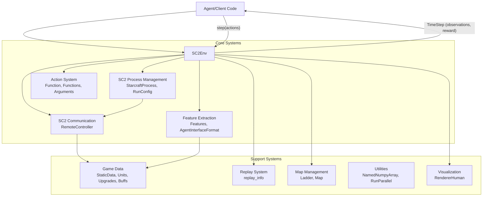
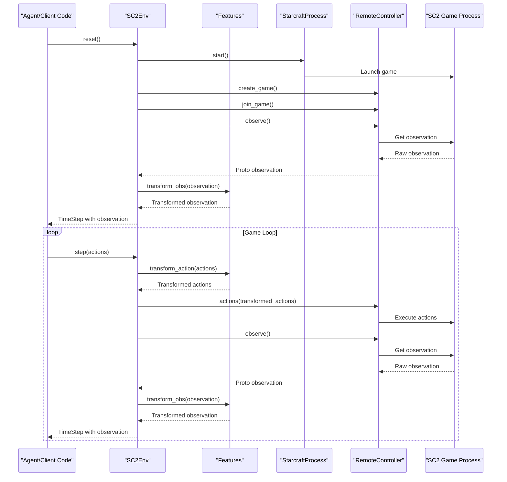
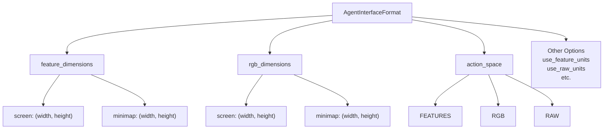
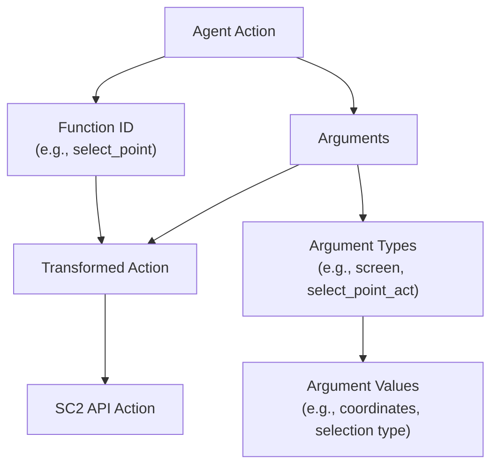

<!-- source: DeepWiki mcp.deepwiki.com · repo google-deepmind/pysc2 · page 1 Overview · fetched 2026-10-26 -->

# Overview

<details>
<summary>Relevant source files</summary>

The following files were used as context for generating this wiki page:

- [pysc2/bin/update_battle_net_cache.py](pysc2/bin/update_battle_net_cache.py)
- [pysc2/env/sc2_env.py](pysc2/env/sc2_env.py)
- [pysc2/lib/features.py](pysc2/lib/features.py)
- [pysc2/lib/point_flag.py](pysc2/lib/point_flag.py)
- [pysc2/lib/replay.py](pysc2/lib/replay.py)
- [setup.py](setup.py)

</details>


PySC2 is DeepMind's Python component of the StarCraft II Learning Environment (SC2LE), providing an interface for reinforcement learning (RL) agents to interact with StarCraft II. It handles the communication with the StarCraft II API, transforms game observations into formats suitable for machine learning algorithms, and translates agent actions into game commands.

For installation and setup instructions, see [Installation and Setup](#1.1). For a more detailed explanation of the architecture, see [Architecture Overview](#1.2).

Sources: [setup.py:19-34]()

## System Purpose

PySC2 provides a standardized environment for reinforcement learning research using StarCraft II as a platform. It:

1. Abstracts away the complexity of communicating with the StarCraft II API
2. Provides observations in formats suitable for machine learning (feature layers, RGB pixels, raw unit data)
3. Defines an action space that allows agents to control units in the game
4. Supports both single-player and multi-player scenarios
5. Facilitates replay analysis and agent evaluation

As described in the setup file:
```
PySC2 is DeepMind's Python component of the StarCraft II Learning Environment
(SC2LE). It exposes Blizzard Entertainment's StarCraft II Machine Learning API
as a Python RL Environment. This is a collaboration between DeepMind and
Blizzard to develop StarCraft II into a rich environment for RL research. PySC2
provides an interface for RL agents to interact with StarCraft 2, getting
observations and sending actions.
```

Sources: [setup.py:19-34]()

## High-Level Architecture

### Core Components Diagram



The central component is the Environment System (primarily the `SC2Env` class), which coordinates process management, communication, feature extraction, and action handling. Agent code interacts with the Environment to send actions and receive observations.

Sources: [pysc2/env/sc2_env.py:90-768]()

### Environment Interaction Flow



This diagram illustrates the interaction flow between an agent and the StarCraft II environment. The agent calls `reset()` to start a new episode and `step(actions)` to execute actions and receive observations.

Sources: 
- [pysc2/env/sc2_env.py:483-504]() - reset() method
- [pysc2/env/sc2_env.py:507-536]() - step() method
- [pysc2/env/sc2_env.py:615-626]() - _get_observations() method

## Environment System

The `SC2Env` class is the primary interface for agents, following the standard RL environment pattern with `reset()` and `step()` methods. The environment handles:

1. Setting up and managing StarCraft II game processes
2. Communicating with the game via the SC2 API
3. Transforming observations and actions
4. Managing game state and episode flow
5. Providing rewards based on game outcomes or score

### Key SC2Env Parameters

| Parameter | Description |
|-----------|-------------|
| map_name | Name of a SC2 map or Map instance |
| players | List of Agent and Bot instances specifying players |
| agent_interface_format | Specifies observation and action formats |
| step_mul | How many game steps per agent step |
| game_steps_per_episode | Maximum steps per episode (0 for no limit) |
| visualize | Whether to show game window |
| save_replay_episodes | Save a replay after this many episodes |
| score_index | Reward source (-1 for win/loss, ≥0 for score metrics) |

Sources: [pysc2/env/sc2_env.py:97-174]() - SC2Env.__init__ method

## Observation System

The observation system transforms game state into formats suitable for machine learning through the `Features` class and `AgentInterfaceFormat` configuration.

### Agent Interface Format



The `AgentInterfaceFormat` class configures how observations and actions are formatted, including:

- **Observation formats**: Feature layers, RGB pixels, raw unit data
- **Screen and minimap dimensions**: Size of spatial observations
- **Action space**: Which type of actions to use (feature-based, RGB-based, or raw)
- **Additional options**: Unit data, camera position, etc.

Sources: [pysc2/lib/features.py:465-729]() - AgentInterfaceFormat class

### Feature Layers

Feature layers provide spatial game information as 2D grids. Key layers include:

| Layer | Description |
|-------|-------------|
| height_map | Terrain height |
| visibility_map | Fog of war state |
| player_relative | Self, ally, neutral, enemy units |
| unit_type | Type IDs of units |
| unit_hit_points | Health of units |
| unit_density | Density of units |
| selected | Currently selected units |

Sources: [pysc2/lib/features.py:350-398]() - Screen and minimap feature definitions

## Action System

PySC2 structures actions as function calls with arguments, such as:
- `select_point` with arguments for screen coordinates and selection type
- `move_camera` with minimap coordinates
- `build_structure` with structure type and location

The action space is defined by:
1. **Functions**: What actions can be performed (select, move, build, etc.)
2. **Arguments**: Parameters for the functions (coordinates, unit types, etc.)
3. **Valid Actions**: What actions are available in the current game state



Sources: [pysc2/lib/features.py:884-917]() - Action system initialization

## Usage Example

A typical interaction with PySC2:

```python
from pysc2.env import sc2_env
from pysc2.lib import features, actions

# Create the environment
env = sc2_env.SC2Env(
    map_name="Simple64",
    players=[sc2_env.Agent(sc2_env.Race.terran),
             sc2_env.Bot(sc2_env.Race.random, sc2_env.Difficulty.medium)],
    agent_interface_format=features.AgentInterfaceFormat(
        feature_dimensions=features.Dimensions(
            screen=(84, 84),
            minimap=(64, 64)),
        use_feature_units=True),
    step_mul=8,
    visualize=True)

# Main loop
try:
    obs = env.reset()
    while True:
        # Agent selects action based on observation
        action = actions.FunctionCall(actions.FUNCTIONS.no_op.id, [])
        obs = env.step([action])
        if obs[0].last():  # Episode end
            obs = env.reset()
finally:
    env.close()
```

Sources: [pysc2/env/sc2_env.py:90-768](), [pysc2/lib/features.py:465-729]()

## Map and Replay Support

PySC2 includes systems for managing maps and replay files:

- **Map Management**: Locating, loading, and creating SC2 maps
- **Replay System**: Reading replay files for analysis or imitation learning
- **Battle.net Cache**: Utilities to download map data required for replays

Sources:
- [pysc2/lib/replay.py:17-34]() - Replay utilities
- [pysc2/bin/update_battle_net_cache.py:15-120]() - Battle.net cache updating

## Extension Points

PySC2 can be extended through:

1. **Custom Agents**: Implementing new AI algorithms
2. **Custom Maps**: Creating specialized scenarios
3. **Custom Features**: Defining new observation formats
4. **Custom Rewards**: Implementing domain-specific reward functions

For more detailed information on specific components, see the related wiki pages:
- [Environment System](#2) for details on SC2Env and environment variants
- [Feature System](#3) for observation specifications and transformations
- [Action System](#4) for action space details and transformations
- [Process Management](#5) for managing SC2 game processes

---

