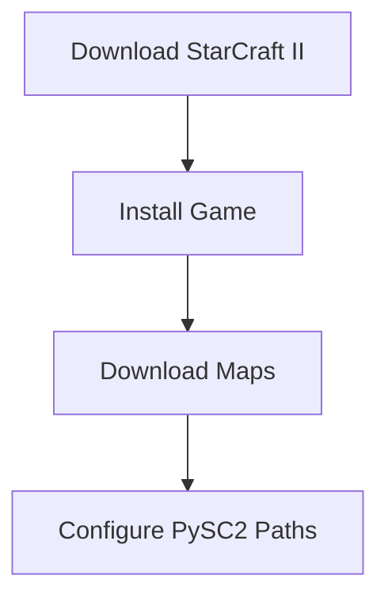
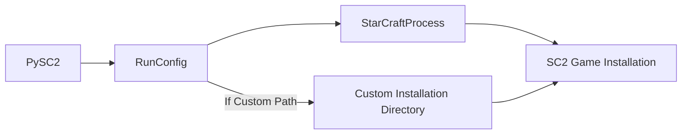
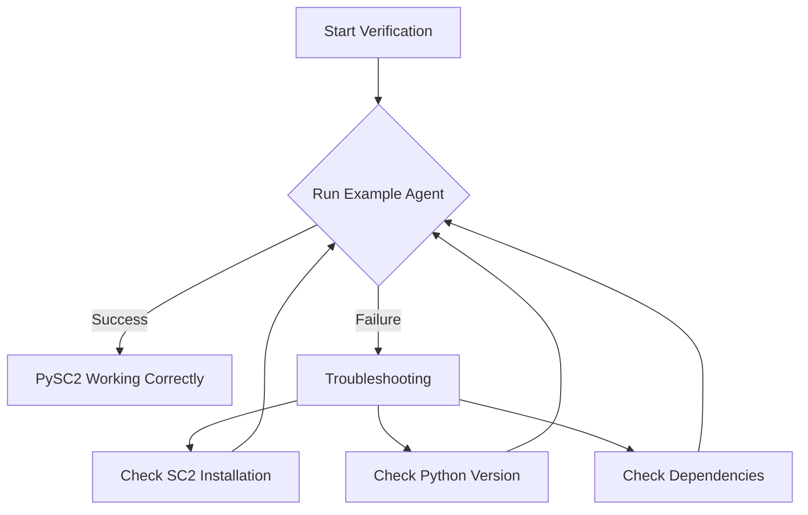
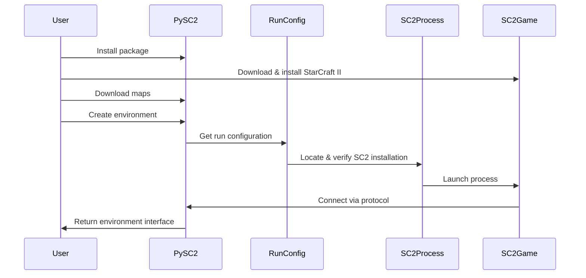

<!-- source: DeepWiki mcp.deepwiki.com · repo google-deepmind/pysc2 · page 1.1 Installation and Setup · fetched 2026-10-26 -->

# Installation and Setup

<details>
<summary>Relevant source files</summary>

The following files were used as context for generating this wiki page:

- [pysc2/bin/BUILD](pysc2/bin/BUILD)
- [pysc2/bin/replay_version.py](pysc2/bin/replay_version.py)
- [pysc2/bin/update_battle_net_cache.py](pysc2/bin/update_battle_net_cache.py)
- [pysc2/lib/BUILD](pysc2/lib/BUILD)
- [pysc2/lib/point_flag.py](pysc2/lib/point_flag.py)
- [pysc2/lib/replay.py](pysc2/lib/replay.py)
- [setup.py](setup.py)

</details>


This document provides comprehensive instructions for installing PySC2 (Python StarCraft II Learning Environment) and setting up the required components for using it. It covers installation prerequisites, package installation, downloading StarCraft II, configuring the environment, and verifying the setup.

For an overview of the PySC2 architecture and capabilities, see [Overview](#1).

## Prerequisites

Before installing PySC2, ensure your system meets the following requirements:

| Requirement | Details |
|-------------|---------|
| **Python Version** | PySC2 supports Python 3.8, 3.9, 3.10, and 3.11 |
| **Operating System** | Linux, Windows, or macOS |
| **StarCraft II** | A compatible version must be installed (see below) |
| **Disk Space** | ~30GB for StarCraft II game installation |

Sources: [setup.py:98-101]()

## Installing PySC2

PySC2 can be installed via pip, directly from PyPI or from the source code.

### Installation from PyPI

The simplest way to install PySC2 is using pip:

```bash
pip install pysc2
```

This command installs the latest version of PySC2 (version 4.0.0 as of this documentation) along with all required dependencies.

### Installation from Source

To install from source code:

```bash
git clone https://github.com/google-deepmind/pysc2.git
cd pysc2
pip install -e .
```

Sources: [setup.py:45-104]()

## Dependencies

PySC2 requires the following Python dependencies, which are automatically installed with pip:

| Dependency | Purpose |
|------------|---------|
| `absl-py` | Google's Abseil Python Common Libraries |
| `deepdiff` | Deep difference calculation for Python data structures |
| `dm_env` | DeepMind environment interface |
| `mpyq` | MPQ archive file reader |
| `numpy` | Numerical computing library |
| `portpicker` | Tool for finding available network ports |
| `protobuf` | Protocol buffers for serializing data |
| `pygame` | Game development library (used for visualization) |
| `s2clientprotocol` | StarCraft II client protocol definitions |
| `s2protocol` | StarCraft II replay protocol parser |
| `sk-video` | Video processing utilities |
| `websocket-client` | WebSocket client library |

Sources: [setup.py:66-82]()

## Installing StarCraft II

PySC2 requires a StarCraft II installation to function. 



### Windows and macOS

1. Download and install StarCraft II from the [Blizzard website](https://starcraft2.com)
2. PySC2 should automatically find your StarCraft II installation in the standard location

### Linux

Linux requires a slightly different approach since StarCraft II doesn't natively provide Linux packages:

1. Download the Linux package from Blizzard:
   ```
   wget http://blzdistsc2-a.akamaihd.net/Linux/SC2.4.10.zip
   ```
2. Extract the package:
   ```
   unzip -P iagreetotheeula SC2.4.10.zip
   ```
3. Move the package to your preferred installation location

## Downloading Maps

StarCraft II maps used for machine learning research need to be downloaded separately:

```bash
# Example command to download maps
python -m pysc2.bin.download_maps
```

## Configuration

PySC2 uses a run configuration system to locate and manage the StarCraft II installation. The configuration automatically searches for the game in standard installation paths.



### Custom Game Location

If StarCraft II is installed in a non-standard location, you can specify it when initializing the run configuration:

```python
from pysc2 import run_configs
run_config = run_configs.get(game_version=None, base_build=None, data_dir="path/to/SC2")
```

Sources: [pysc2/bin/update_battle_net_cache.py:108-116]()

## Replay Support

To enable support for StarCraft II replays, you may need to update the Battle.net cache:

```bash
python -m pysc2.bin.update_battle_net_cache [path_to_replays]
```

This command downloads necessary cache files from Battle.net servers required to properly parse and play back replays.

Sources: [pysc2/bin/update_battle_net_cache.py:63-105](), [pysc2/lib/replay.py:16-34](), [pysc2/bin/replay_version.py:15-66]()

## Command-Line Tools

PySC2 comes with several command-line tools to help you work with the environment:

| Tool | Purpose |
|------|---------|
| `pysc2_agent` | Run agent-based experiments |
| `pysc2_play` | Play StarCraft II with PySC2 features |
| `pysc2_replay_info` | Display information about replay files |

Sources: [setup.py:83-89]()

## Verification

To verify your installation, run one of the example scripts:

```bash
python -m pysc2.bin.agent
```

This should launch StarCraft II and run a simple agent in the game environment. If the game launches and the agent works, your installation is correct.



## Environment Setup Process

The following diagram illustrates the overall environment setup process:



Sources: [pysc2/bin/BUILD:147-164](), [pysc2/lib/BUILD:300-311]()

This completes the installation and setup process for PySC2. After following these steps, you should have a working environment ready for running StarCraft II agents and experiments.

---

