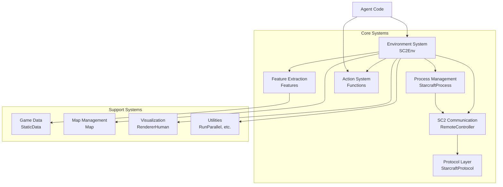
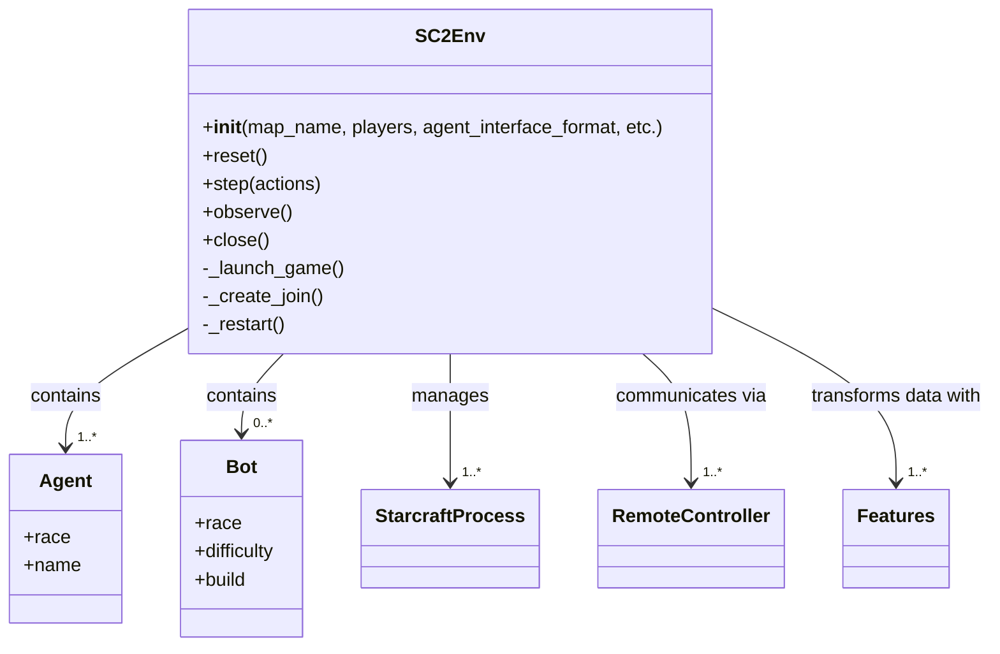
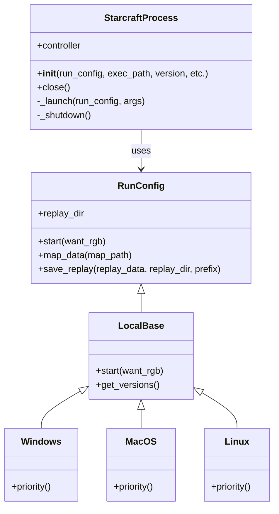
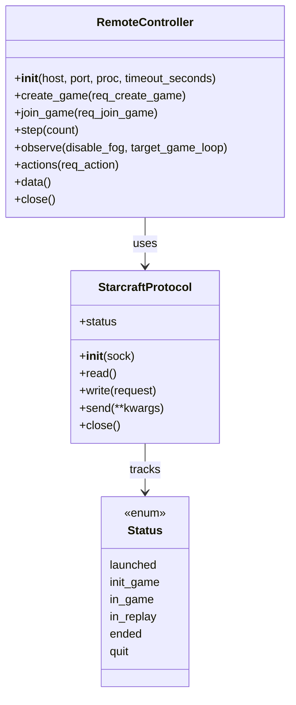
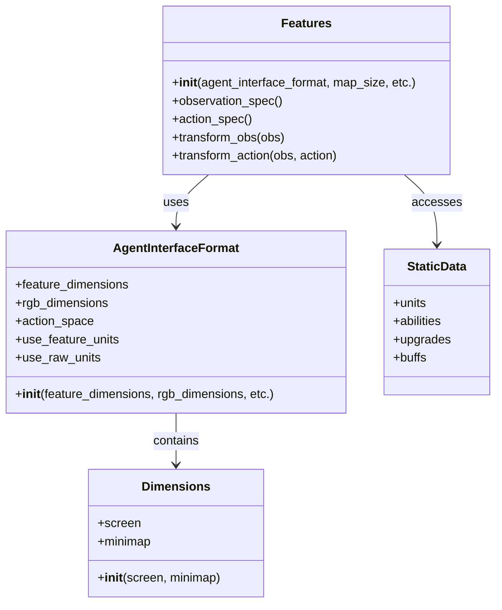
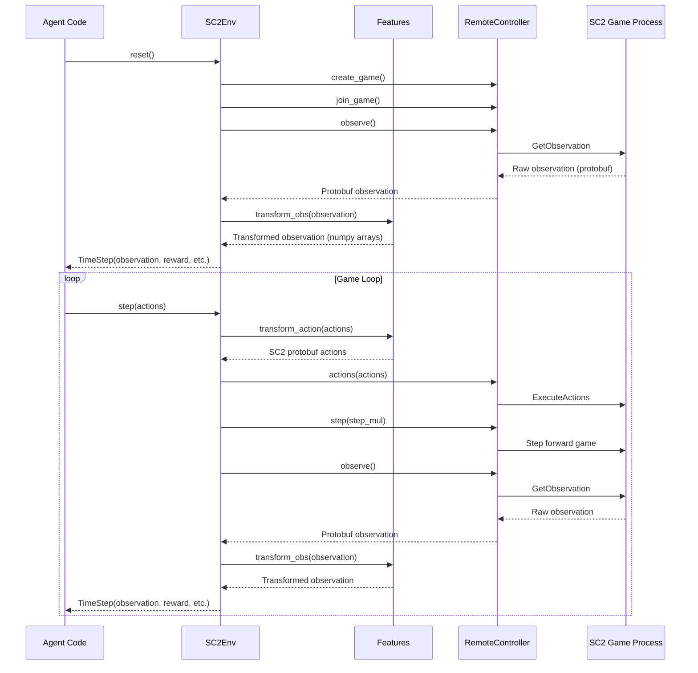
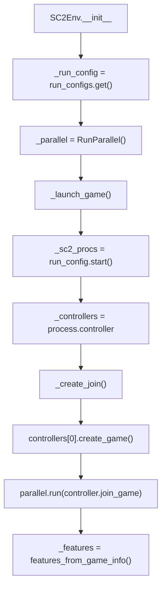
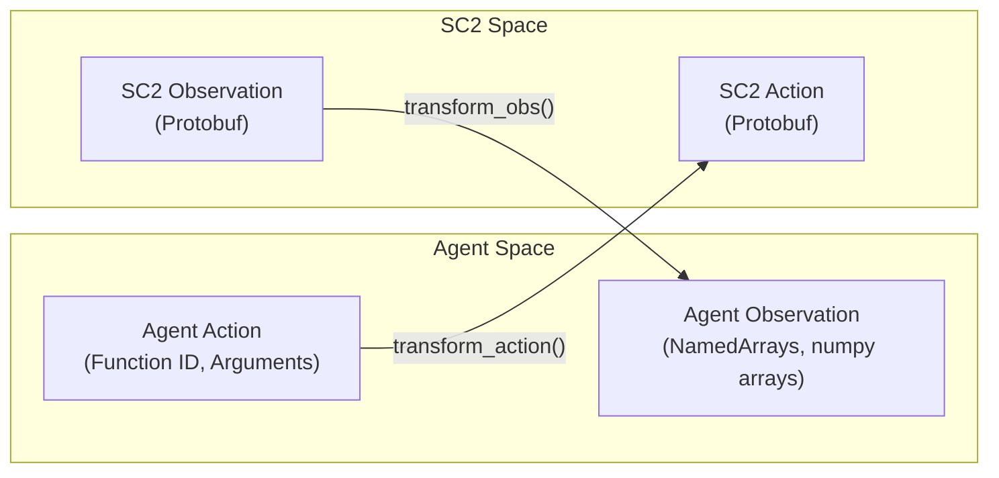

<!-- source: DeepWiki mcp.deepwiki.com · repo google-deepmind/pysc2 · page 1.2 Architecture Overview · fetched 2026-10-26 -->

# Architecture Overview

Relevant source files

The following files were used as context for generating this wiki page:

- [pysc2/bin/reencode_replays.py](pysc2/bin/reencode_replays.py)
- [pysc2/env/sc2_env.py](pysc2/env/sc2_env.py)
- [pysc2/lib/features.py](pysc2/lib/features.py)
- [pysc2/lib/protocol.py](pysc2/lib/protocol.py)
- [pysc2/lib/remote_controller.py](pysc2/lib/remote_controller.py)
- [pysc2/lib/sc_process.py](pysc2/lib/sc_process.py)
- [pysc2/run_configs/__init__.py](pysc2/run_configs/__init__.py)
- [pysc2/run_configs/platforms.py](pysc2/run_configs/platforms.py)
- [pysc2/tests/protocol_error_test.py](pysc2/tests/protocol_error_test.py)

## Purpose and Scope

This document describes the high-level architecture of the PySC2 library, outlining the key components and their relationships. PySC2 provides a Python interface for interacting with StarCraft II, enabling reinforcement learning agents to play the game. This overview covers the major systems, their organization, and data flow patterns within the codebase. For detailed API documentation, see [Environment System](#2).

## High-Level Architecture

PySC2 follows a layered architecture that abstracts the complexity of communicating with the StarCraft II game process. The system is organized into core components that handle primary functionality and support systems that provide auxiliary capabilities.

Sources: [pysc2/env/sc2_env.py:90-764](), [pysc2/lib/features.py:920-1201](), [pysc2/lib/sc_process.py:48-218]()

## Key Components

### 1. Environment System (SC2Env)

The `SC2Env` class is the central component acting as the primary interface between agent code and StarCraft II. It's an implementation of a Gym-like environment that manages game instances, handles observations and actions, and coordinates between different subsystems.

Sources: [pysc2/env/sc2_env.py:90-218](), [pysc2/env/sc2_env.py:383-446]()

### 2. Process Management

The `StarcraftProcess` class manages launching, monitoring, and terminating StarCraft II game processes. The `RunConfig` hierarchy handles platform-specific aspects of finding and launching the SC2 binary.

Sources: [pysc2/lib/sc_process.py:48-218](), [pysc2/run_configs/platforms.py:50-201]()

### 3. Communication System

The communication system handles the exchange of messages between Python and the StarCraft II process. It consists of the `RemoteController` class, which provides a high-level API for game control, and the `StarcraftProtocol` class, which manages the WebSocket connection and protocol details.

Sources: [pysc2/lib/remote_controller.py:128-382](), [pysc2/lib/protocol.py:72-192]()

### 4. Feature System

The feature system transforms raw SC2 observations into formats suitable for agent consumption. It defines how to render feature layers and provides specifications for observations and actions.

Sources: [pysc2/lib/features.py:426-788](), [pysc2/lib/features.py:920-1201]()

## Data Flow

The diagram below illustrates how data flows through the PySC2 system during a typical interaction cycle:

Sources: [pysc2/env/sc2_env.py:483-721](), [pysc2/lib/remote_controller.py:242-273]()

## Implementation Details

### SC2Env Initialization and Game Creation

The environment setup process involves initializing the SC2 processes, creating a game, and joining it:

Sources: [pysc2/env/sc2_env.py:97-266](), [pysc2/env/sc2_env.py:328-365]()

### Observation and Action Processing

A key functionality is transforming between agent-friendly formats and SC2's internal representations:

1. **Actions**: Agent actions are transformed into SC2 protocol buffer format
2. **Observations**: SC2 observations are transformed into numpy arrays with named fields

Sources: [pysc2/lib/features.py:1229-1305](), [pysc2/lib/features.py:1306-1479]()

## Platform Support

PySC2 supports multiple platforms through platform-specific `RunConfig` implementations that handle finding and launching the SC2 binary.

| Platform | Class | Description |
|----------|-------|-------------|
| Windows | `Windows` | Handles Windows-specific paths and executable naming |
| MacOS | `MacOS` | Handles MacOS-specific paths and app bundle structure |
| Linux | `Linux` | Handles Linux-specific library dependencies and rendering options |
| Cygwin | `Cygwin` | Special handling for running Windows binaries under Cygwin |

Sources: [pysc2/run_configs/platforms.py:109-201]()

## Error Handling

PySC2 implements several error handling mechanisms to deal with communication issues, protocol errors, and game state changes:

1. `ConnectionError`: When there are issues with the WebSocket connection
2. `ProtocolError`: When SC2 responds with an error due to an invalid request
3. `RequestError`: When a specific request fails with an error code

The system includes decorators like `catch_game_end`, `valid_status`, and `skip_status` to handle specific error conditions gracefully.

Sources: [pysc2/lib/remote_controller.py:44-52](), [pysc2/lib/protocol.py:48-55](), [pysc2/lib/remote_controller.py:75-125]()

---

