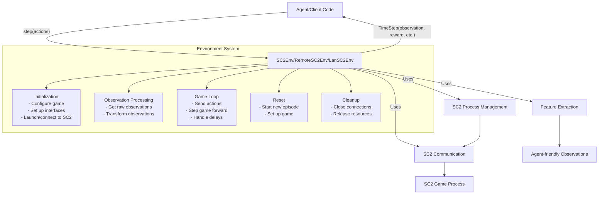
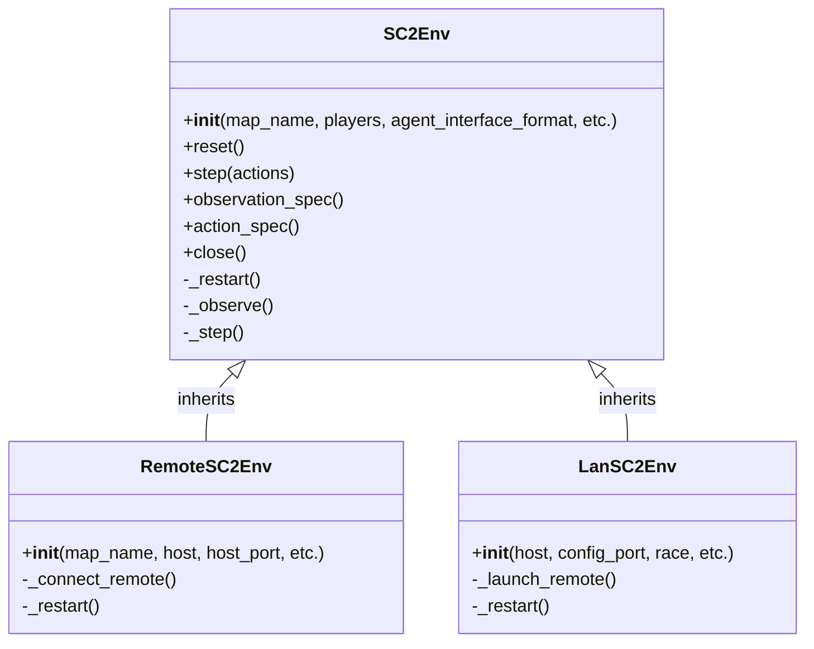
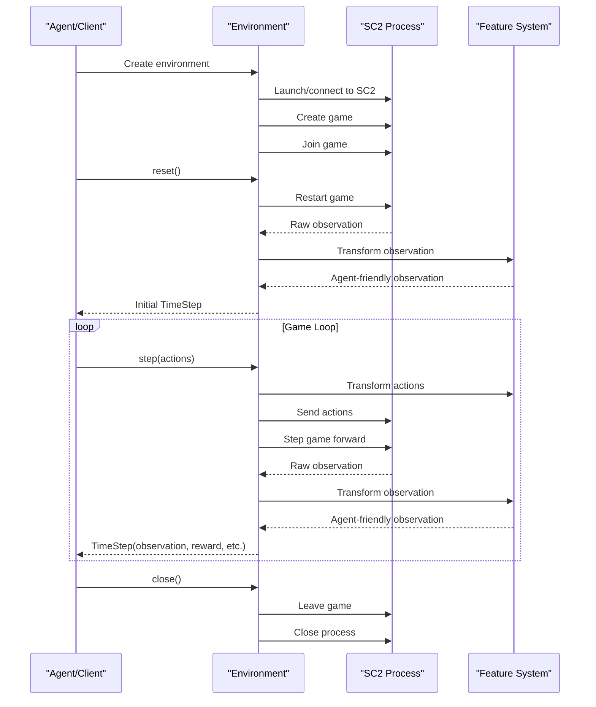
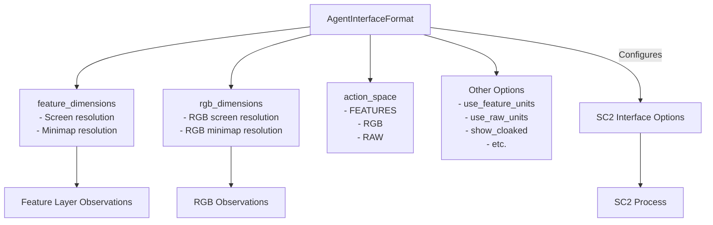
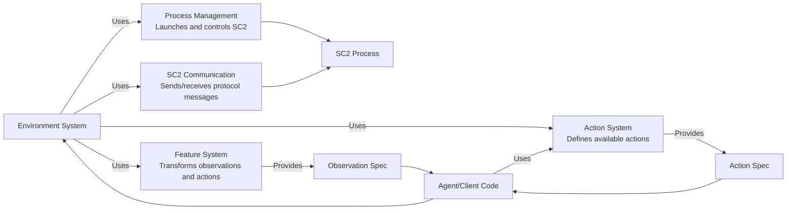

<!-- source: DeepWiki mcp.deepwiki.com · repo google-deepmind/pysc2 · page 2 Environment System · fetched 2026-10-26 -->

# Environment System

<details>
<summary>Relevant source files</summary>

The following files were used as context for generating this wiki page:

- [pysc2/bin/agent_remote.py](pysc2/bin/agent_remote.py)
- [pysc2/bin/play_vs_agent.py](pysc2/bin/play_vs_agent.py)
- [pysc2/env/lan_sc2_env.py](pysc2/env/lan_sc2_env.py)
- [pysc2/env/remote_sc2_env.py](pysc2/env/remote_sc2_env.py)
- [pysc2/env/sc2_env.py](pysc2/env/sc2_env.py)
- [pysc2/lib/features.py](pysc2/lib/features.py)

</details>


The Environment System is the core interface between agents and StarCraft II in PySC2. It provides a standardized way to setup, connect to, and interact with StarCraft II game instances. The environment handles game initialization, observation processing, action execution, and game state management. For information about specific feature extraction and observation formats, see [Feature System](#3).

## Overview

The Environment System establishes communication with StarCraft II, manages the game lifecycle, and provides a reinforcement learning-compatible interface for agents. It supports multiple usage modes including single-player against built-in AI, multiplayer over LAN, and connecting to remote StarCraft II instances.



Sources: [pysc2/env/sc2_env.py:90-766]()

## Core Environment Classes

The Environment System is composed of three main environment classes, each designed for different use cases.



Sources: [pysc2/env/sc2_env.py:90-766](), [pysc2/env/remote_sc2_env.py:33-214](), [pysc2/env/lan_sc2_env.py:199-363]()

### SC2Env

`SC2Env` is the primary environment class that launches and controls StarCraft II instances directly. It's typically used for single-player agent training against built-in AI or for local multi-agent scenarios.

Key features:
- Launches StarCraft II processes
- Creates and joins games based on configuration
- Processes observations and actions
- Controls game stepping
- Handles episode resets and process cleanup

```python
# Example usage
env = SC2Env(
    map_name="Simple64",
    players=[Agent(Race.terran), Bot(Race.protoss, Difficulty.medium)],
    agent_interface_format=AgentInterfaceFormat(
        feature_dimensions=Dimensions(screen=84, minimap=64)
    ),
    step_mul=8
)
```

Sources: [pysc2/env/sc2_env.py:90-766]()

### RemoteSC2Env

`RemoteSC2Env` connects to an already-running StarCraft II instance rather than launching a new one. This is useful for connecting to games started by other systems, such as remote servers or the SC2AI ladder.

Key differences from `SC2Env`:
- Doesn't launch StarCraft II processes
- Connects to a remote host via WebSocket
- Used primarily for competitions and ladder play

Sources: [pysc2/env/remote_sc2_env.py:33-214]()

### LanSC2Env

`LanSC2Env` is designed for LAN games, typically for human vs. agent matches. It connects to a game that has been set up by another script and handles port forwarding and networking.

Key differences from `SC2Env`:
- Optimized for human vs. agent play
- Handles TCP/UDP communication for LAN games
- Used in conjunction with scripts like `play_vs_agent.py`

Sources: [pysc2/env/lan_sc2_env.py:199-363](), [pysc2/bin/play_vs_agent.py:107-282]()

## Environment Workflow

The environment follows a specific workflow from initialization to termination, providing a standard reinforcement learning interface.



Sources: [pysc2/env/sc2_env.py:483-521](), [pysc2/env/sc2_env.py:506-552](), [pysc2/env/sc2_env.py:739-766]()

### Initialization

Environment initialization involves several key steps:

1. Validating configuration parameters
2. Setting up interface formats for communication with SC2
3. Launching SC2 processes or connecting to existing ones
4. Creating and joining a game

The most important configuration parameters include:
- `map_name`: The SC2 map to play on
- `players`: List of players (agents and/or bots)
- `agent_interface_format`: Defines observation and action formats
- `step_mul`: Number of game steps per agent step

Sources: [pysc2/env/sc2_env.py:97-285]()

### Observation and Reward Processing

Observations in the environment system follow this flow:

1. Raw observations are received from SC2
2. Observations are transformed using the Feature System
3. Rewards are calculated based on game state or score
4. A `TimeStep` is created with the observation, reward, and other information

The following table outlines key components of the observation:

| Component | Description | Source |
|-----------|-------------|--------|
| Feature Layers | 2D grids representing game state | Feature System |
| RGB Frames | Visual representation of the game | Feature System |
| Game Data | Score, resources, unit counts, etc. | Raw SC2 Observation |
| Game Loop | Current game simulation step | Raw SC2 Observation |
| Player Data | Resources, supply, etc. | Raw SC2 Observation |
| Unit Data | Unit types, positions, health, etc. | Raw SC2 Observation |

Sources: [pysc2/env/sc2_env.py:615-637](), [pysc2/env/sc2_env.py:657-720]()

### Action Processing

Actions flow from the agent to StarCraft II as follows:

1. Agent provides actions in the agent-friendly format
2. Environment transforms actions to SC2 protocol format
3. Actions are sent to SC2 for execution
4. Delayed actions are handled if configured

The environment can also handle delayed actions, which are useful for simulating realistic human reaction times:

```python
# Example of configuring delayed actions
agent_interface_format = AgentInterfaceFormat(
    feature_dimensions=Dimensions(screen=84, minimap=64),
    action_delay_fn=lambda: random.randint(1, 3)  # Random delay of 1-3 steps
)
```

Sources: [pysc2/env/sc2_env.py:506-552](), [pysc2/env/sc2_env.py:554-605]()

### Reset and Termination

The environment provides methods to reset (start a new episode) and close (clean up resources):

- `reset()`: Starts a new episode, restarts the game if needed
- `close()`: Cleans up resources, closes connections, and terminates processes

Sources: [pysc2/env/sc2_env.py:483-521](), [pysc2/env/sc2_env.py:739-766]()

## Interface Formats

The Environment System uses `AgentInterfaceFormat` to define how observations and actions are structured. This configuration determines what data is available to agents and how they can interact with the game.



The main components of `AgentInterfaceFormat` include:

- `feature_dimensions`: Resolution for feature layers
- `rgb_dimensions`: Resolution for RGB rendering
- `action_space`: Which action space to use (FEATURES, RGB, or RAW)
- Various flags for enabling additional observation data

Sources: [pysc2/lib/features.py:465-629](), [pysc2/env/sc2_env.py:52-56]()

## Integration with Other PySC2 Systems

The Environment System integrates with several other PySC2 components to provide a complete interface to StarCraft II.



Key integration points:

1. **Process Management**: The environment uses the Run Config system to launch and manage SC2 processes
2. **Communication**: Uses SC2 protocol (protobuf) to communicate with the game
3. **Feature System**: Transforms raw SC2 observations into agent-friendly formats
4. **Action System**: Defines available actions and transforms agent actions to SC2 protocol format

Sources: [pysc2/env/sc2_env.py:235-236](), [pysc2/env/sc2_env.py:427-429]()

## Usage Examples

Here are some common usage patterns for the Environment System:

### Basic Single-Player Environment

```python
from pysc2.env import sc2_env
from pysc2.lib import actions, features

env = sc2_env.SC2Env(
    map_name="Simple64",
    players=[sc2_env.Agent(sc2_env.Race.terran),
             sc2_env.Bot(sc2_env.Race.random, sc2_env.Difficulty.medium)],
    agent_interface_format=features.AgentInterfaceFormat(
        feature_dimensions=features.Dimensions(screen=84, minimap=64),
        use_feature_units=True),
    step_mul=8,
    game_steps_per_episode=0,
    visualize=True)

observation = env.reset()
for _ in range(1000):
    action = # agent selects action
    observation = env.step(action)
env.close()
```

### Remote Environment for Competition

```python
from pysc2.env import remote_sc2_env
from pysc2.lib import features

env = remote_sc2_env.RemoteSC2Env(
    host="competition-server.example",
    host_port=4567,
    lan_port=5678,
    race=sc2_env.Race.terran,
    agent_interface_format=features.AgentInterfaceFormat(
        feature_dimensions=features.Dimensions(screen=84, minimap=64)))
```

Sources: [pysc2/env/sc2_env.py:90-766](), [pysc2/env/remote_sc2_env.py:33-214]()

---

