<!-- source: DeepWiki mcp.deepwiki.com · repo google-deepmind/pysc2 · page 2.1 SC2Env · fetched 2026-10-26 -->

# SC2Env

Relevant source files

The following files were used as context for generating this wiki page:

- [pysc2/env/sc2_env.py](pysc2/env/sc2_env.py)
- [pysc2/lib/features.py](pysc2/lib/features.py)

SC2Env is the primary environment class for interacting with StarCraft II in the PySC2 library. It provides a reinforcement learning-friendly interface that handles game execution, action processing, and observation transformation.

For information about remote environments for networked play, see [Remote and LAN Environments](#2.2).

## Overview

SC2Env serves as the main point of interaction between agent code and the StarCraft II game. It manages game processes, transforms observations between SC2's protocol format and agent-friendly data structures, and handles action execution.

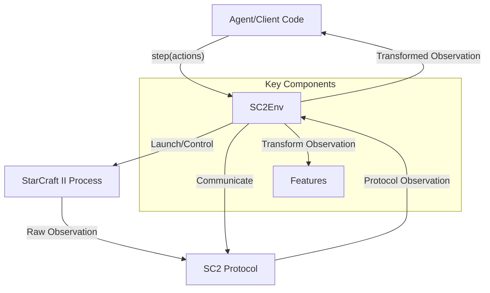

Sources: [pysc2/env/sc2_env.py:90-92](). [pysc2/env/sc2_env.py:486-562]()

## Initialization and Configuration

SC2Env is initialized with a variety of parameters that configure the game environment, from map selection to interface format and scoring mechanisms.

### Key Parameters

| Parameter | Description | Default |
|-----------|-------------|---------|
| `map_name` | Name of SC2 map or Map instance | Required |
| `players` | List of Agent and Bot instances | Required |
| `agent_interface_format` | How observations/actions are formatted | Required |
| `step_mul` | Game steps per agent step | Map default |
| `realtime` | Use realtime mode instead of step-based | False |
| `game_steps_per_episode` | Steps before episode ends | Map default |
| `disable_fog` | Whether to disable fog of war | False |
| `visualize` | Show human visualization | False |
| `save_replay_episodes` | Save replay after n episodes | 0 |

### Initialization Flow

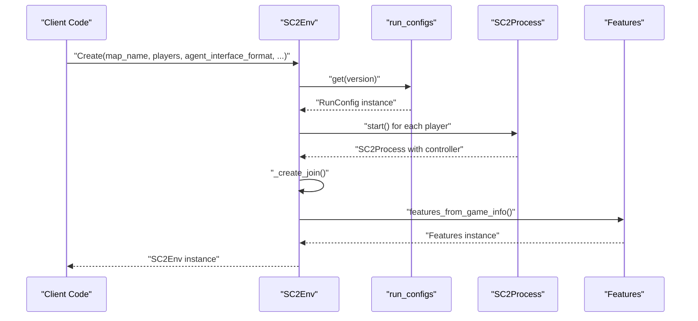

Sources: [pysc2/env/sc2_env.py:97-175](). [pysc2/env/sc2_env.py:261-264](). [pysc2/env/sc2_env.py:328-429]()

## Core API Methods

SC2Env implements the core environment API methods that agents interact with:

### reset()

Resets the environment to start a new episode. Returns the initial observation.

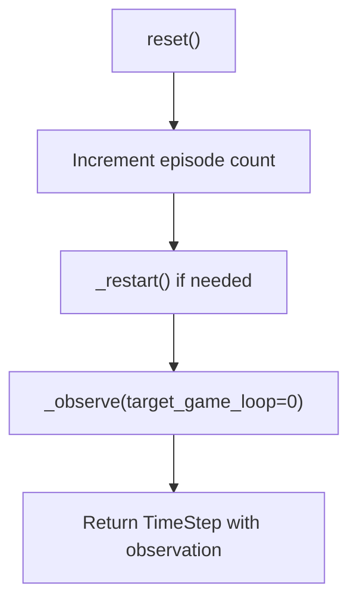

Sources: [pysc2/env/sc2_env.py:483-504]() 

### step(actions, step_mul=None)

Applies actions to the environment, advances the game state, and returns observations.

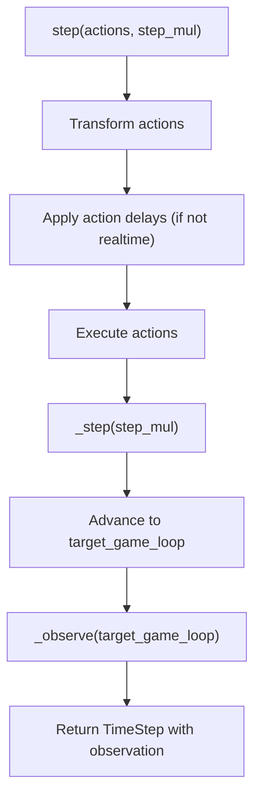

Sources: [pysc2/env/sc2_env.py:506-535](). [pysc2/env/sc2_env.py:537-552]()

### observation_spec() and action_spec()

Return specifications of the observation and action spaces:

- `observation_spec()`: Returns the structure of observations
- `action_spec()`: Returns the valid action space

Sources: [pysc2/env/sc2_env.py:449-455]()

### close()

Cleans up all resources, including SC2 processes and network connections.

Sources: [pysc2/env/sc2_env.py:739-766]()

## Game Flow and State Transitions

SC2Env manages the game state through a series of steps and observations:

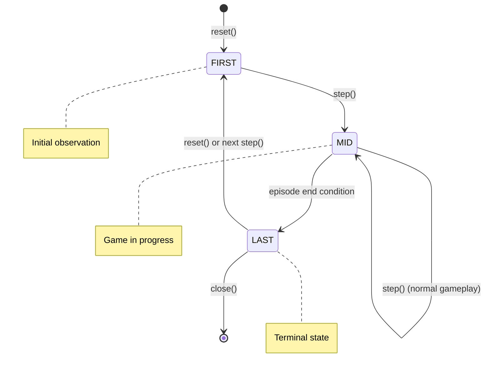

Sources: [pysc2/env/sc2_env.py:483-504](). [pysc2/env/sc2_env.py:506-535](). [pysc2/env/sc2_env.py:657-721]()

## Observation and Action Processing

SC2Env converts between SC2's protocol format and agent-friendly formats using the `Features` class.

### Observation Flow

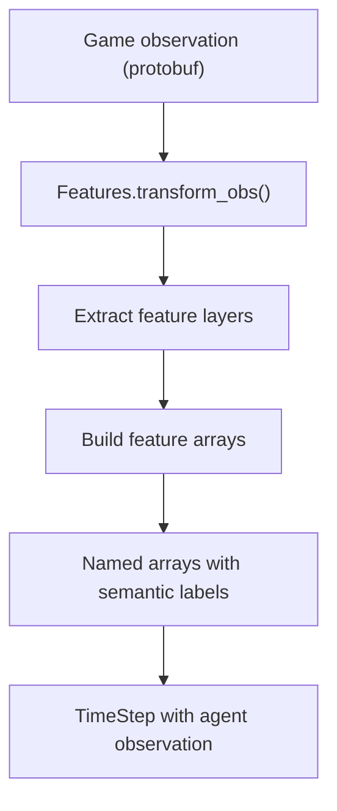

Sources: [pysc2/env/sc2_env.py:615-626](). [pysc2/lib/features.py:1126-1541]()

### Action Flow

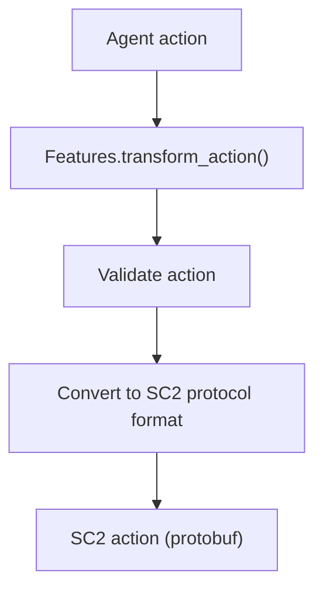

Sources: [pysc2/env/sc2_env.py:524-526](). [pysc2/lib/features.py:1574-1676]()

## Real-time vs Step-Based Execution

SC2Env supports two execution modes:

1. **Step-based execution** (default): The environment advances by a fixed number of game steps with each call to `step()`
2. **Real-time execution**: The game simulation advances automatically at real-time speed, with `step()` capturing the current state

In real-time mode, SC2Env provides additional tracking of action delays to help understand how the simulation's timing affects agent performance.

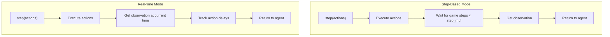

Sources: [pysc2/env/sc2_env.py:152-158](). [pysc2/env/sc2_env.py:537-552](). [pysc2/env/sc2_env.py:638-655]()

## Feature Layers and Interfaces

SC2Env uses the `AgentInterfaceFormat` class to configure how the game state is represented to the agent. This includes:

1. Feature layer representations (spatial grid observations)
2. RGB representations (screen and minimap images)
3. Raw unit data
4. Entity-based observations (feature units)

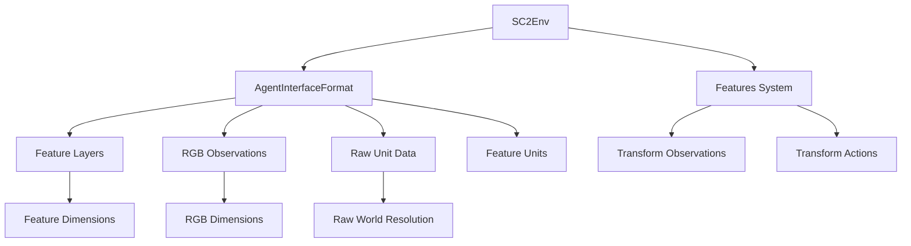

Sources: [pysc2/env/sc2_env.py:247-259](). [pysc2/lib/features.py:465-628]()

## Internal Components

SC2Env orchestrates several internal components to provide its functionality:

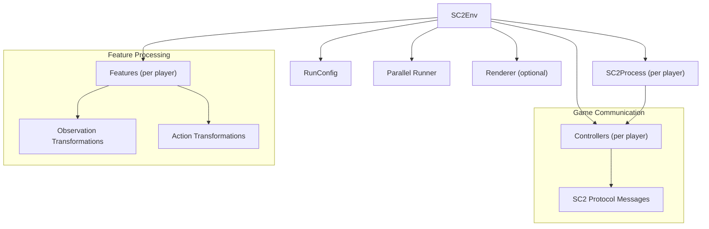

Sources: [pysc2/env/sc2_env.py:235-262](). [pysc2/env/sc2_env.py:419-429]()

## Multiplayer Support

SC2Env supports both single-player and multi-player configurations:

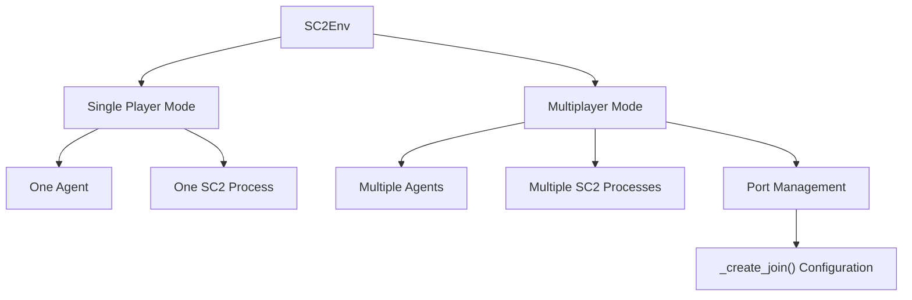

Sources: [pysc2/env/sc2_env.py:181-195](). [pysc2/env/sc2_env.py:328-417]()

## Usage Example

While this page doesn't provide example code, here's the typical usage pattern for SC2Env:

1. Create an `AgentInterfaceFormat` object defining observation and action formats
2. Initialize SC2Env with map, players, and interface format
3. Implement an agent loop that calls `reset()` and `step(actions)`
4. Call `close()` when finished

For detailed usage examples, see the scripts in the PySC2 repository.

Sources: [pysc2/env/sc2_env.py:97-175]()

---

