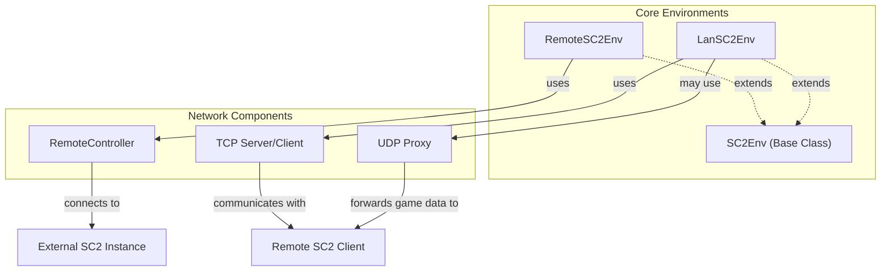
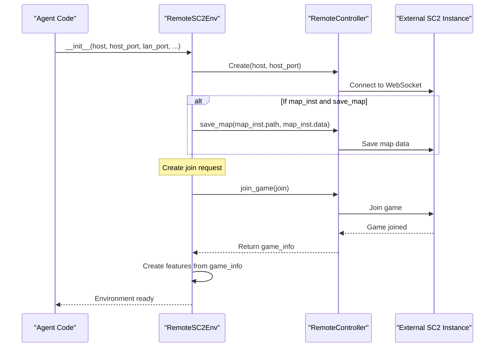
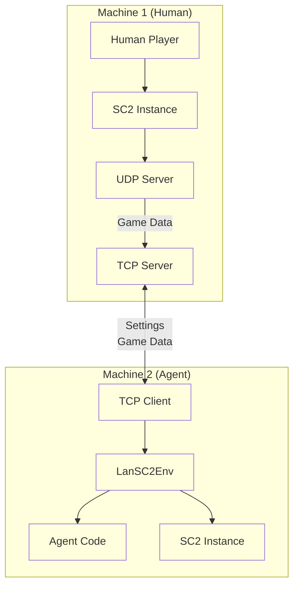
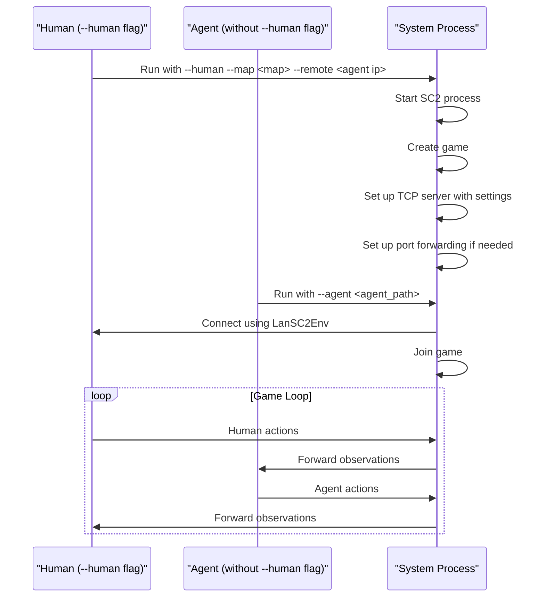

<!-- source: DeepWiki mcp.deepwiki.com · repo google-deepmind/pysc2 · page 2.2 Remote and LAN Environments · fetched 2026-10-26 -->

# Remote and LAN Environments

<details>
<summary>Relevant source files</summary>

The following files were used as context for generating this wiki page:

- [pysc2/bin/agent_remote.py](pysc2/bin/agent_remote.py)
- [pysc2/bin/play_vs_agent.py](pysc2/bin/play_vs_agent.py)
- [pysc2/env/lan_sc2_env.py](pysc2/env/lan_sc2_env.py)
- [pysc2/env/remote_sc2_env.py](pysc2/env/remote_sc2_env.py)

</details>


## Purpose and Overview

The PySC2 library provides specialized environment classes for playing StarCraft II across networks: `RemoteSC2Env` and `LanSC2Env`. These environments extend the base `SC2Env` class (covered in [SC2Env](#2.1)) but are designed specifically for network play scenarios where the SC2 instances may be running on different machines.

These environments enable:
- Playing against other agents or humans over networks
- Participating in ladder matches (sc2ai.net)
- Testing agents in distributed environments
- Creating multiplayer training scenarios

Sources: [pysc2/env/remote_sc2_env.py:33-42](), [pysc2/env/lan_sc2_env.py:199-201]()

## Environment Architecture

### Relationship to Standard Environment



Sources: [pysc2/env/remote_sc2_env.py:33-41](), [pysc2/env/lan_sc2_env.py:199-201]()

## RemoteSC2Env

`RemoteSC2Env` connects to a remote SC2 instance that is already running. Unlike the standard `SC2Env`, it doesn't start any SC2 instances itself but only connects to an existing one.

### Key Features

- Connects to an already running SC2 process
- Joins an existing game (doesn't create one)
- Assumes a 2-player game configuration
- Works best with `play_vs_agent.py` or for ladder matches

### Initialization Parameters

| Parameter | Type | Description |
|-----------|------|-------------|
| `map_name` | str/Map | Name of an SC2 map or Map instance |
| `save_map` | bool | Whether to save map data before joining |
| `host` | str | Host where the SC2 process is running (default: "127.0.0.1") |
| `host_port` | int | WebSocket port for the SC2 process |
| `lan_port` | int/sequence | LAN ports for game connection |
| `race` | Race | Race for this agent (default: random) |
| `name` | str | Name of the agent for replays |
| `agent_interface_format` | AgentInterfaceFormat | Format for agent-environment communication |
| `discount` | float | Discount factor returned as part of observation |
| `visualize` | bool | Whether to show a window with camera and feature layers |
| `step_mul` | int | Game steps per agent step |
| `realtime` | bool | Whether to use realtime mode |
| `replay_dir` | str | Directory to save replays |
| `replay_prefix` | str | Prefix for replay files |

Sources: [pysc2/env/remote_sc2_env.py:42-107]()

### Connection Flow



Sources: [pysc2/env/remote_sc2_env.py:174-209]()

### Important Implementation Details

- The `_connect_remote` method handles the connection to the remote SC2 instance and joining the game
- Cannot restart games (`_restart` raises `RestartError`)
- The `close` method properly leaves the game so that another game can be created in the same SC2 process
- LAN ports can be specified either as a base port (from which others are implied) or as an explicit list of 4 ports

Sources: [pysc2/env/remote_sc2_env.py:156-172](), [pysc2/env/remote_sc2_env.py:174-209](), [pysc2/env/remote_sc2_env.py:211-214]()

## LanSC2Env

`LanSC2Env` is specifically designed for playing LAN games against humans. It handles the complex networking required for connecting two SC2 instances over a network.

### Key Features

- Designed for human vs agent gameplay over LAN
- Sets up TCP and UDP communication channels
- Handles port forwarding between machines
- Meant to be used with the `play_vs_agent.py` script

### Initialization Parameters

| Parameter | Type | Description |
|-----------|------|-------------|
| `host` | str | Host IP (must be localhost: "127.0.0.1" or "::1") |
| `config_port` | int | Port for configuration sharing |
| `race` | Race | Race for this agent (default: random) |
| `name` | str | Name of the agent for replays |
| `agent_interface_format` | AgentInterfaceFormat | Format for agent-environment communication |
| `discount` | float | Discount factor returned as part of observation |
| `visualize` | bool | Whether to show a window with camera and feature layers |
| `step_mul` | int | Game steps per agent step |
| `realtime` | bool | Whether to use realtime mode |
| `replay_dir` | str | Directory to save replays |
| `replay_prefix` | str | Prefix for replay files |

Sources: [pysc2/env/lan_sc2_env.py:206-256]()

### Network Communication



Sources: [pysc2/env/lan_sc2_env.py:300-346](), [pysc2/bin/play_vs_agent.py:152-222]()

### Launch Process

1. The `_launch_remote` method establishes a connection to the TCP server to receive game settings
2. If the game is remote, it sets up UDP server and creates daemon threads for UDP-TCP communication
3. It starts the SC2 process with appropriate ports
4. Creates a join request with the correct game and base ports
5. Saves the map and joins the game
6. Retrieves game info and creates feature extractors

Sources: [pysc2/env/lan_sc2_env.py:299-346]()

### Network Helpers

`LanSC2Env` includes several helper functions and classes to manage network communication:

- `Addr` class: Encapsulates an IP address and port
- `daemon_thread`: Creates daemon threads for async communication
- `udp_server`/`tcp_server`: Create respective server sockets
- `tcp_client`: Connects to a TCP server and retrieves settings
- `udp_to_tcp`/`tcp_to_udp`: Helper functions for data forwarding
- `forward_ports`: Sets up SSH port forwarding between machines

Sources: [pysc2/env/lan_sc2_env.py:40-192]()

## Helper Scripts

### play_vs_agent.py

This script facilitates playing against an agent over LAN:



Key features:
- Must be called twice: once for the human (`--human` flag) and once for the agent
- Human plays on the host machine, agent runs on potentially a different machine
- Sets up SSH tunneling if the agent is on a remote machine
- Handles UDP proxying since SSH doesn't forward UDP

Sources: [pysc2/bin/play_vs_agent.py:15-34](), [pysc2/bin/play_vs_agent.py:107-152](), [pysc2/bin/play_vs_agent.py:153-222]()

### agent_remote.py

This script allows running an agent with an SC2 instance that isn't owned:

- Can be used for the sc2ai.net ladder
- Handles human vs agent games
- Port forwards between machines if needed

When used for ladder play:
```bash
python -m pysc2.bin.agent_remote --agent <import path> --host_port <GamePort> --lan_port <StartPort>
```

When playing vs humans:
```bash
python -m pysc2.bin.agent_remote --human --map <MapName>
```

Sources: [pysc2/bin/agent_remote.py:15-41](), [pysc2/bin/agent_remote.py:120-148](), [pysc2/bin/agent_remote.py:151-226]()

## Usage Examples

### RemoteSC2Env for Ladder Play

```python
# Connect to a ladder match
env = RemoteSC2Env(
    host="127.0.0.1",
    host_port=game_port,  # WebSocket port provided by ladder
    lan_port=start_port,  # Base port provided by ladder
    race=sc2_env.Race.terran,
    agent_interface_format=sc2_env.AgentInterfaceFormat(
        feature_dimensions=sc2_env.Dimensions(
            screen=84,
            minimap=64
        )
    )
)
```

### LanSC2Env for Human vs Agent Play

```python
# On the agent machine, after the human has started the game
env = LanSC2Env(
    host="127.0.0.1",
    config_port=14380,  # Port shown by play_vs_agent.py on human side
    race=sc2_env.Race.zerg,
    agent_interface_format=sc2_env.AgentInterfaceFormat(
        feature_dimensions=sc2_env.Dimensions(
            screen=84,
            minimap=64
        )
    )
)
```

## Limitations and Considerations

1. **Restart Limitation**: Neither `RemoteSC2Env` nor `LanSC2Env` can restart games since coordinating restarts between multiple machines would be complex.

2. **Port Requirements**: 
   - `RemoteSC2Env` requires 4 consecutive ports for LAN play (2 for server, 2 for client)
   - `LanSC2Env` requires a config port plus 4 game ports

3. **Network Restrictions**:
   - SC2 only allows LAN games on localhost
   - SSH tunneling or other port forwarding is needed for remote play
   - UDP communication must be properly handled (SC2 uses UDP for game data)

4. **Platform Differences**:
   - There can be observation differences between Mac/Win and Linux
   - Mac may experience performance issues when running background instances

Sources: [pysc2/env/remote_sc2_env.py:211-214](), [pysc2/env/lan_sc2_env.py:347-350](), [pysc2/bin/agent_remote.py:26-41]()

---

