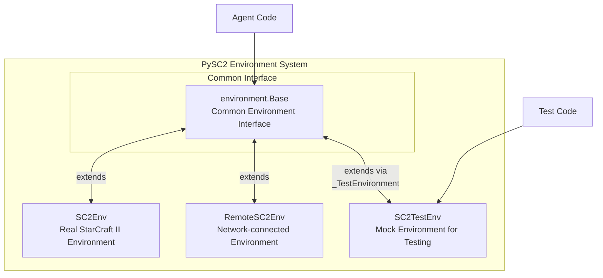
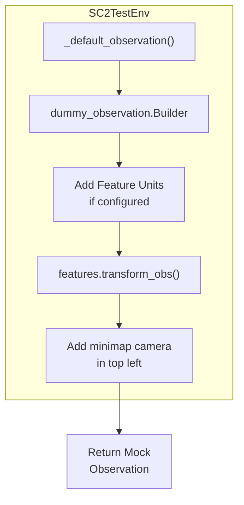

<!-- source: DeepWiki mcp.deepwiki.com · repo google-deepmind/pysc2 · page 2.3 Mock Environment · fetched 2026-10-26 -->

# Mock Environment

<details>
<summary>Relevant source files</summary>

The following files were used as context for generating this wiki page:

- [pysc2/bin/check_apm.py](pysc2/bin/check_apm.py)
- [pysc2/env/mock_sc2_env.py](pysc2/env/mock_sc2_env.py)
- [pysc2/env/mock_sc2_env_comparison_test.py](pysc2/env/mock_sc2_env_comparison_test.py)
- [pysc2/env/mock_sc2_env_test.py](pysc2/env/mock_sc2_env_test.py)
- [pysc2/tests/multi_player_env_test.py](pysc2/tests/multi_player_env_test.py)

</details>


## Purpose and Scope

The Mock Environment system in PySC2 provides a way to simulate the StarCraft II environment without requiring an actual running game instance. This is particularly useful for testing agent code, running unit tests, and development scenarios where launching the full StarCraft II game would be unnecessary or impractical. This document covers the mock environment implementation, its usage patterns, and how it relates to the real environment system described in [SC2Env](#2.1) and [Remote and LAN Environments](#2.2).

Sources: [pysc2/env/mock_sc2_env.py:14-14]()

## Mock Environment Architecture

The Mock Environment system includes two primary classes that form a hierarchy:

1. `_TestEnvironment` - A lightweight base implementation that provides configurable timesteps
2. `SC2TestEnv` - A specific implementation that mimics the `SC2Env` class by returning mock observations

```mermaid
classDiagram
    direction TB
    class "environment.Base" {
        +reset()
        +step()
        +observation_spec()
        +action_spec()
    }
    class "_TestEnvironment" {
        -_num_agents
        -_observation_spec
        -_action_spec
        -_episode_steps
        +next_timestep
        +episode_length
        +reset()
        +step()
        +action_spec()
        +observation_spec()
        -_default_observation()
    }
    class "SC2TestEnv" {
        -_game_info
        -_agent_interface_formats
        -_features
        +game_info
        +save_replay()
        -_default_observation()
    }
    "environment.Base" <|-- "_TestEnvironment"
    "_TestEnvironment" <|-- "SC2TestEnv"
```

Sources: [pysc2/env/mock_sc2_env.py:30-135](), [pysc2/env/mock_sc2_env.py:138-297]()

## How Mock Environment Fits in PySC2

The Mock Environment serves as a testing substitute for the real SC2Env in the PySC2 architecture:



Sources: [pysc2/env/mock_sc2_env.py:30-31](), [pysc2/env/mock_sc2_env.py:138-140]()

## _TestEnvironment Class

The `_TestEnvironment` class is a generic test environment base class that implements the `environment.Base` interface. It provides configurable behavior for testing.

### Key Features

- Returns the same timesteps on every observation call (configurable via `next_timestep` attribute)
- Supports customizable episode length
- Generates default observations of zeros with the correct shape and data type
- Tracks episode progress

### Configuration Properties

| Property | Description | Default Value |
|----------|-------------|---------------|
| `next_timestep` | The timesteps to return on the next call to `step()` | Zeros with correct shapes |
| `episode_length` | Episode length in number of transitions | `float('inf')` |

Sources: [pysc2/env/mock_sc2_env.py:30-135]()

## SC2TestEnv Class

The `SC2TestEnv` class extends `_TestEnvironment` and specifically mimics the `SC2Env` class from the main environment system. It is designed to be a drop-in replacement for unit tests and development scenarios.

### Key Features

- Mimics the interface of `SC2Env`
- Provides mock observations with the correct structure
- Supports feature layers, RGB observations, and feature units
- Has a default episode length of 10 steps
- Includes dummy game information

### Initialization Parameters

The `SC2TestEnv` constructor accepts most of the same parameters as `SC2Env`, including:

- `map_name` - Ignored in the mock environment
- `players` - List of agent and bot specifications
- `agent_interface_format` - Specifies observation and action spaces
- Various other parameters that are recorded but ignored in the mock implementation

Example initialization:

```python
mock_env = SC2TestEnv(
    map_name='nonexistent_map',
    agent_interface_format=features.AgentInterfaceFormat(
        feature_dimensions=features.Dimensions(screen=64, minimap=32),
        use_feature_units=True),
    players=[sc2_env.Agent(sc2_env.Race.protoss, 'player')])
```

Sources: [pysc2/env/mock_sc2_env.py:138-256](), [pysc2/env/mock_sc2_env_test.py:126-142]()

## Mock Observations

The mock environment generates dummy observations that match the structure of real observations but contain minimal data.

### Feature Screen and Minimap Observations

Mock observations include feature screen and minimap layers with appropriate dimensions. The minimap camera is simulated with a bounding box in the top left of the minimap.

### Feature Units

If `use_feature_units=True` is specified in the agent interface format, the mock environment will include a basic feature unit (a neutral LabBot) in the observation.



Sources: [pysc2/env/mock_sc2_env.py:264-297]()

## Game Information

The mock environment generates dummy game information to match what would be returned by a real SC2 environment:

- Start location and map size are set to predefined constants
- Player information reflects the configured players
- Interface options match what was requested in `agent_interface_format`

The dummy map size is defined as a constant:

```python
DUMMY_MAP_SIZE = 256
```

Sources: [pysc2/env/mock_sc2_env.py:27-27](), [pysc2/env/mock_sc2_env.py:300-350]()

## Usage in Tests

The primary use case for the mock environment is in unit tests, where it can replace the real SC2 environment. This is typically done using Python's `mock.patch` to substitute the `SC2TestEnv` for `SC2Env`.

Example usage pattern:

```python
@mock.patch('pysc2.env.sc2_env.SC2Env', mock_sc2_env.SC2TestEnv)
def test_something():
    env = sc2_env.SC2Env(...)  # Actually creates a SC2TestEnv
    # Test code here
```

Sources: [pysc2/env/mock_sc2_env.py:144-153](), [pysc2/env/mock_sc2_env_comparison_test.py:23-66]()

## Comparing Mock and Real Environments

The mock environment is designed to be API-compatible with the real environment, meaning they should have the same method signatures and return similar data structures.

To verify this, the `mock_sc2_env_comparison_test.py` file contains tests that compare the observation and action specifications between the real and mock environments.

Key comparisons:
- Both should return identical `observation_spec()` results
- Both should return identical `action_spec()` results
- The shape and type of observations should match

Sources: [pysc2/env/mock_sc2_env_comparison_test.py:61-66]()

## Episode Structure

Like the real environment, the mock environment follows the episode structure of the RL environment model:

1. `reset()` - Returns a `FIRST` timestep
2. Repeated calls to `step(actions)` - Returns `MID` timesteps
3. After `episode_length` steps - Returns a `LAST` timestep, followed by another `FIRST` timestep on the next call

The episode length in `SC2TestEnv` defaults to 10 steps, but can be modified through the `episode_length` attribute.

Sources: [pysc2/env/mock_sc2_env.py:80-120](), [pysc2/env/mock_sc2_env_test.py:141-142]()

## Limitations

The mock environment has some notable limitations:

1. It does not simulate game dynamics or logic - actions don't affect future observations
2. It returns the same observation pattern repeatedly
3. It doesn't support the realtime mode available in the real environment
4. It can't actually save replays, though it provides a non-functional `save_replay()` method

Sources: [pysc2/env/mock_sc2_env.py:224-225](), [pysc2/env/mock_sc2_env.py:261-262]()

## Summary

The Mock Environment system provides a lightweight, configurable replacement for the real StarCraft II environment. It supports the same interface but doesn't require the actual game to be running, making it ideal for testing and development. By using the `SC2TestEnv` class, developers can test agent code and environment interactions without the overhead of launching the StarCraft II game.

---

