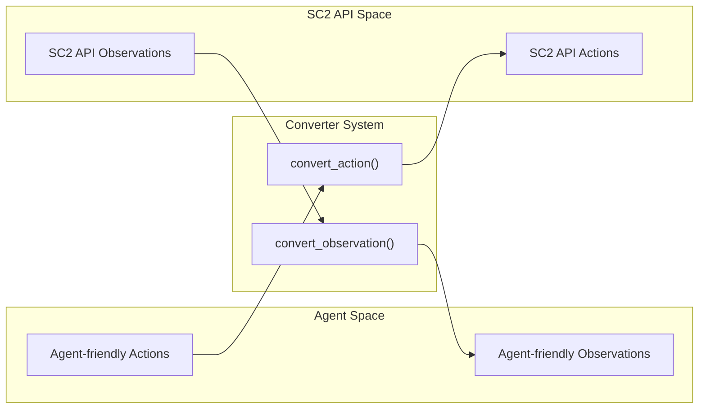
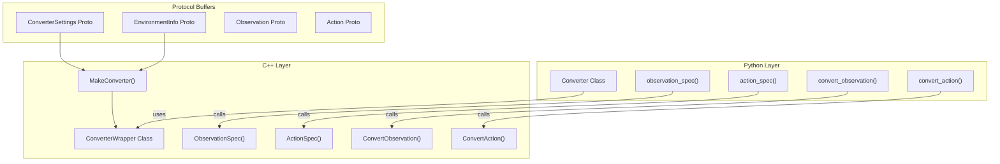
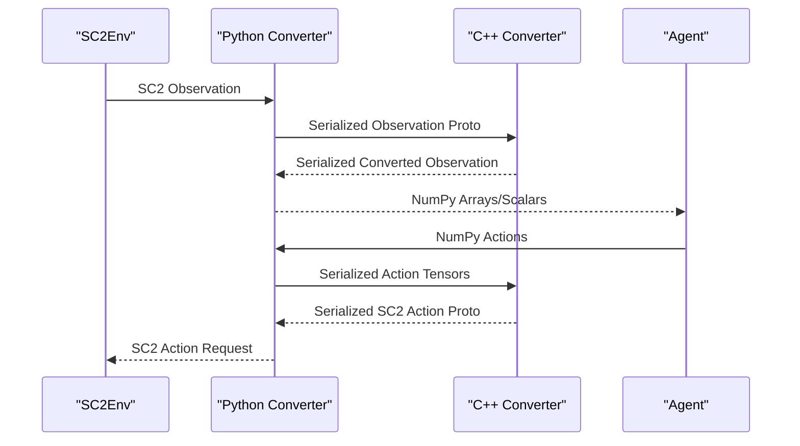
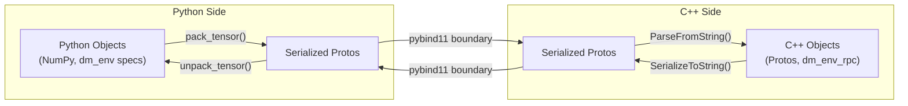
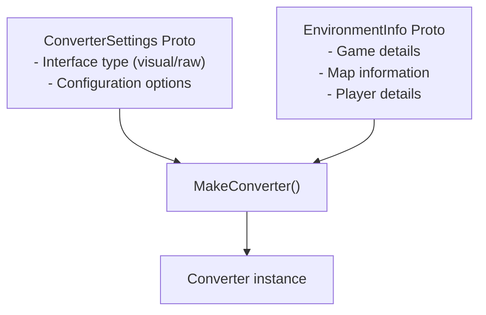

<!-- source: DeepWiki mcp.deepwiki.com · repo google-deepmind/pysc2 · page 2.4 Converter System · fetched 2026-10-26 -->

# Converter System

<details>
<summary>Relevant source files</summary>

The following files were used as context for generating this wiki page:

- [pysc2/env/converter/cc/python/BUILD](pysc2/env/converter/cc/python/BUILD)
- [pysc2/env/converter/cc/python/converter.cc](pysc2/env/converter/cc/python/converter.cc)
- [pysc2/env/converter/converter.py](pysc2/env/converter/converter.py)

</details>


The Converter System in PySC2 translates between SC2 API formats and agent-friendly formats, enabling standard interaction between machine learning agents and the StarCraft II environment. This system enriches observations and standardizes the interface for both observations and actions, allowing developers to work with more convenient data structures rather than dealing directly with the raw SC2 API.

This page documents the purpose, architecture, and usage of the Converter System. For information about the Environment System that uses this converter, see [Environment System](#2).

## Overview and Purpose

The Converter System serves as a transformation layer that:

1. Converts SC2 API observations into structured, agent-friendly formats
2. Transforms agent actions into valid SC2 API action requests
3. Provides standardized specifications for observations and actions
4. Supports different interface modes (visual and raw) based on agent requirements



Sources: [pysc2/env/converter/converter.py:14-19](), [pysc2/env/converter/converter.py:33-49]()

## Architecture

The Converter System consists of a Python wrapper around a C++ implementation. This design provides both performance and ease of use:

1. The C++ core handles the computationally intensive transformation operations
2. The Python wrapper provides a user-friendly interface that works with NumPy arrays and dm_env specs
3. Protocol Buffers (protos) are used for serialization/deserialization at the language boundary



Sources: [pysc2/env/converter/converter.py:33-49](), [pysc2/env/converter/cc/python/converter.cc:27-109]()

## Key Components

### Converter Class

The `Converter` class is the main entry point for the Converter System. It provides methods for:

- Getting observation and action specifications
- Converting observations from SC2 API format to agent format
- Converting actions from agent format to SC2 API format

The converter maintains state throughout an episode, so a new converter should be created for each episode.

```python
# Example instantiation
converter = Converter(settings=converter_settings, environment_info=env_info)

# Get specifications
obs_spec = converter.observation_spec()
action_spec = converter.action_spec()

# Convert observation
agent_observation = converter.convert_observation(sc2_observation)

# Convert action
sc2_action = converter.convert_action(agent_action)
```

Sources: [pysc2/env/converter/converter.py:33-138]()

### Interface Types

The Converter System supports two primary interface types:

| Interface Type | Description | Best For |
|----------------|-------------|----------|
| Visual | Focuses on spatial features and actions similar to human gameplay, including camera positioning | Agents that learn from human-like inputs |
| Raw | Emphasizes numeric unit data and direct unit control, with less emphasis on spatial representation | Agents focused on strategic decision-making |

These interface types are configured through the `ConverterSettings` proto when initializing the converter.

Sources: [pysc2/env/converter/converter.py:33-49]()

## Data Flow

The following diagram illustrates how data flows through the Converter System during a typical interaction cycle:



Sources: [pysc2/env/converter/converter.py:83-138](), [pysc2/env/converter/cc/python/converter.cc:60-93]()

## Technical Implementation

### Python-C++ Boundary

The Converter System uses pybind11 to expose the C++ implementation to Python. Protocol Buffers are serialized and deserialized at this boundary:

1. When Python calls C++: Objects are serialized to string format
2. When C++ returns to Python: Results are serialized to string format
3. In the Python layer: Serialized data is converted to Python-friendly types (NumPy arrays, scalars)



Sources: [pysc2/env/converter/cc/python/converter.cc:27-109](), [pysc2/env/converter/converter.py:97-133]()

### ConverterWrapper

The `ConverterWrapper` class in C++ handles the serialization and deserialization at the pybind11 boundary. It wraps the core `Converter` C++ implementation and provides the following methods:

- `ObservationSpec()`: Returns the specifications for observations
- `ActionSpec()`: Returns the specifications for actions
- `ConvertObservation()`: Transforms SC2 observations to agent format
- `ConvertAction()`: Transforms agent actions to SC2 API format

Sources: [pysc2/env/converter/cc/python/converter.cc:28-94]()

### Creating a Converter

The converter is created using the `MakeConverter` function, which takes serialized `ConverterSettings` and `EnvironmentInfo` protos:



Sources: [pysc2/env/converter/cc/python/converter.cc:96-109](), [pysc2/env/converter/converter.py:51-56]()

## Usage Guidelines

### Lifecycle Management

The Converter System maintains state throughout an episode, which means:

1. A new converter should be created for each episode
2. `convert_observation` and `convert_action` should be called alternately
3. The converter should not be reused across episodes

### Error Handling

The Converter System includes error handling for:

- Parsing failures when deserializing protos
- Conversion failures when processing observations or actions
- Invalid specifications

Errors are propagated as exceptions with descriptive messages to help diagnose issues.

Sources: [pysc2/env/converter/converter.py:97-108](), [pysc2/env/converter/cc/python/converter.cc:86-89]()

### Integration with Environment

The Converter System is typically used within the Environment System, but it can also be used independently for specific conversion tasks. When used with an environment, the typical pattern is:

1. Environment receives raw observation from SC2
2. Converter transforms the observation for the agent
3. Agent processes the observation and produces an action
4. Converter transforms the agent action into SC2 API format
5. Environment sends the action to SC2

## Summary

The Converter System provides a crucial translation layer between the SC2 API and agent code, standardizing the interface and making it easier to develop machine learning agents for StarCraft II. By supporting different interface types and handling the complexity of converting between formats, it allows developers to focus on agent design rather than API integration.

---

