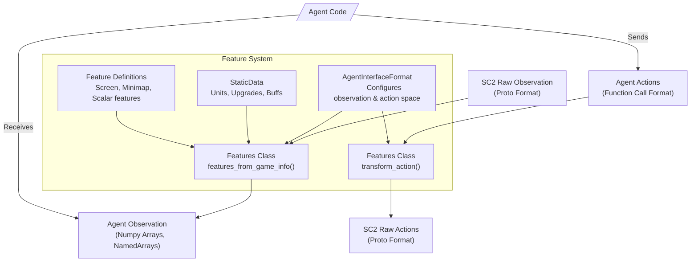
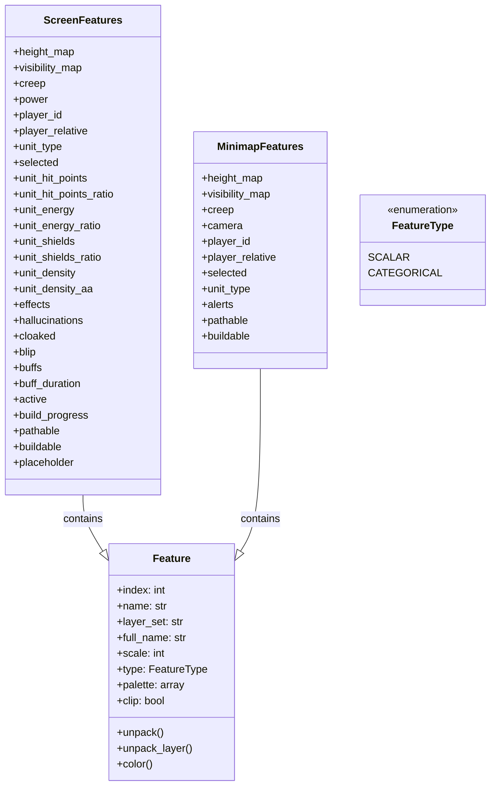
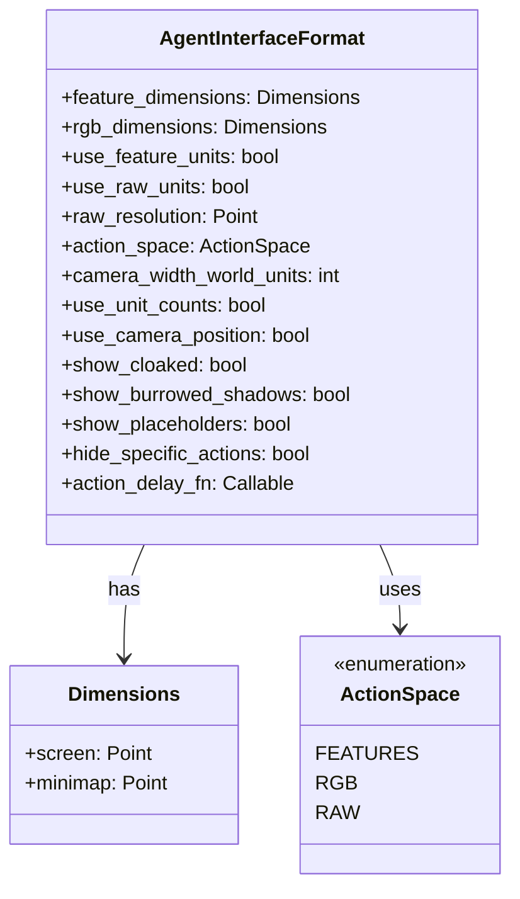
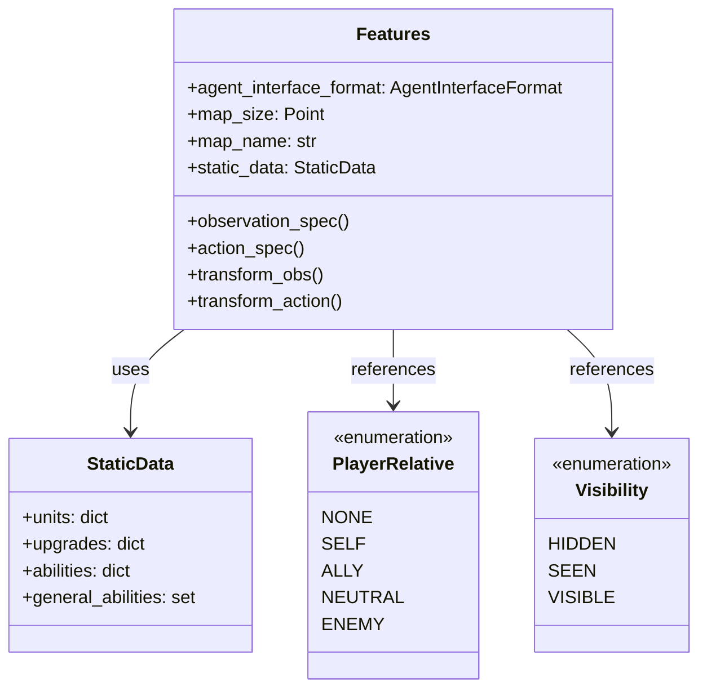
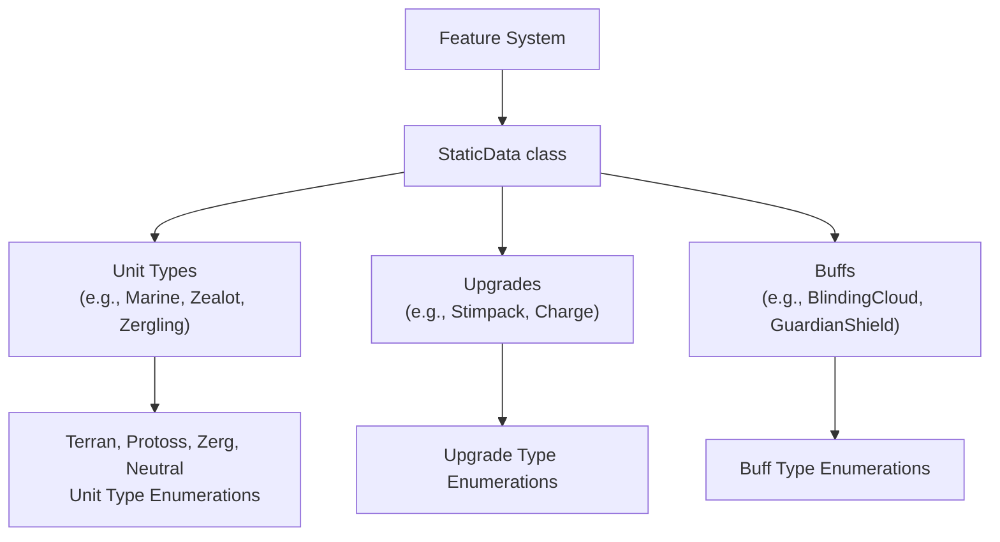

<!-- source: DeepWiki mcp.deepwiki.com · repo google-deepmind/pysc2 · page 3 Feature System · fetched 2026-10-26 -->

# Feature System

<details>
<summary>Relevant source files</summary>

The following files were used as context for generating this wiki page:

- [pysc2/bin/gen_data.py](pysc2/bin/gen_data.py)
- [pysc2/env/sc2_env.py](pysc2/env/sc2_env.py)
- [pysc2/lib/buffs.py](pysc2/lib/buffs.py)
- [pysc2/lib/features.py](pysc2/lib/features.py)
- [pysc2/lib/static_data.py](pysc2/lib/static_data.py)
- [pysc2/lib/units.py](pysc2/lib/units.py)
- [pysc2/lib/upgrades.py](pysc2/lib/upgrades.py)

</details>


The Feature System is a core component of PySC2 that transforms raw StarCraft II observations into formats suitable for machine learning agents. It converts complex game state data into structured observations like feature layers (grid-based representations), RGB pixels, or raw unit data. This system acts as the interface between the low-level SC2 game engine and the high-level agent code, ensuring that observations and actions are properly formatted for consumption by learning algorithms.

For information about how agents interact with the environment, see [Environment System](#2). For details on how agents execute actions, see [Action System](#4).

## Architecture Overview

The Feature System's primary responsibility is to translate between the game's native representation and agent-friendly formats, making it an essential bridge between the StarCraft II game engine and reinforcement learning agents.



Sources:
- [pysc2/lib/features.py:920-1150]()
- [pysc2/env/sc2_env.py:427-465]()

## Feature Types and Definition

The Feature System defines various categories of features that represent different aspects of the game state. These are organized into screen features (for the visible game area), minimap features (for the entire map), and non-spatial features like player statistics and unit counts.

### Screen and Minimap Features

Screen and minimap features are grid-based representations of the game state, where each grid cell contains information about that location in the game world.



Sources:
- [pysc2/lib/features.py:239-302]()
- [pysc2/lib/features.py:303-383]()
- [pysc2/lib/features.py:350-382]()
- [pysc2/lib/features.py:385-398]()

### Feature Categories

Features are classified into two main types:

| Feature Type | Description | Examples |
|--------------|-------------|----------|
| **Scalar** | Continuous values that represent quantities | health, energy, height map |
| **Categorical** | Discrete values that represent categories or states | unit types, player IDs, visibility |

Each feature has a defined scale (maximum value), a feature type, and methods for unpacking the raw observation data into numpy arrays.

Sources:
- [pysc2/lib/features.py:39-42]()

## Agent Interface Format

The `AgentInterfaceFormat` class is the central configuration component that determines what observations an agent receives and what actions it can take. It allows customization of:

1. Feature layers (screen and minimap dimensions)
2. RGB render views (screen and minimap dimensions)
3. Raw unit data options
4. Action space configuration



Sources:
- [pysc2/lib/features.py:426-453]()
- [pysc2/lib/features.py:465-729]()

The `parse_agent_interface_format` function provides a convenient way to create an `AgentInterfaceFormat` from keyword arguments:

```python
# Example usage
agent_interface = parse_agent_interface_format(
    feature_screen=84,
    feature_minimap=64,
    rgb_screen=None,
    use_feature_units=True,
    action_space="FEATURES"
)
```

Sources:
- [pysc2/lib/features.py:732-800]()

## Features Class and Observation Transformation

The `Features` class is the core component responsible for transforming between SC2 observation protos and agent-friendly observation formats. It handles both the conversion of observations from SC2 to the agent and actions from the agent to SC2.



The `features_from_game_info` function is used to create a `Features` object based on the game information:

```python
# Creation of Features object from game info
features = features_from_game_info(
    game_info=game_info,
    agent_interface_format=agent_interface_format,
    map_name="MapName"
)
```

Sources:
- [pysc2/lib/features.py:803-881]()
- [pysc2/lib/features.py:920-1150]()

## Observation Structure

When the Feature System transforms raw observations, it creates a structured observation with multiple components:

| Component | Description | Type |
|-----------|-------------|------|
| **feature_screen** | Screen feature layers | NamedNumpyArray with layers like unit_type, player_relative, etc. |
| **feature_minimap** | Minimap feature layers | NamedNumpyArray with layers like visibility_map, player_relative, etc. |
| **player** | Player-specific information | NamedNumpyArray with values like minerals, vespene, food_used, etc. |
| **available_actions** | Actions available in the current state | Array of action IDs |
| **unit_counts** | Counts of each unit type | Array of (unit_type, count) pairs |
| **feature_units** | Detailed information about visible units | Array of unit features |
| **raw_units** | Raw unit data | Array of unit data including units outside the screen |
| **game_loop** | Current game time in loops | Integer |

Sources:
- [pysc2/lib/features.py:1055-1086]() 
- [pysc2/lib/features.py:166-214]() (FeatureUnit enum)
- [pysc2/lib/features.py:134-148]() (Player enum)

## Static Data Integration

The Feature System includes integration with static game data to interpret unit types, buffs, and upgrades. This data is accessed through the `StaticData` class.



Sources:
- [pysc2/lib/static_data.py:17-51]()
- [pysc2/lib/units.py:20-300]()
- [pysc2/lib/upgrades.py:20-110]()
- [pysc2/lib/buffs.py:20-68]()

## Feature Layers vs Raw Observations

The Feature System supports multiple observation formats to accommodate different agent designs:

| Format | Description | Advantages | Use Case |
|--------|-------------|------------|----------|
| **Feature Layers** | Grid-based representation with different semantic channels | Structured for convolutional networks, human-interpretable | ML agents using CNN architectures |
| **RGB Observations** | Visual representation of the game similar to what humans see | Realistic visual input, useful for transfer learning | Computer vision approaches, human-like agents |
| **Raw Units** | Direct access to unit data including position and properties | Complete information, no spatial discretization | Algorithmic agents, structured approaches |

Each format has different requirements for the agent interface configuration.

Sources:
- [pysc2/lib/features.py:465-547]()
- [pysc2/lib/features.py:1090-1110]()

## Using the Feature System in the Environment

The Feature System is integrated into the `SC2Env` environment, which uses it to transform observations and actions:

```python
# Example of environment initialization with feature system configuration
env = SC2Env(
    map_name="Simple64",
    players=[Agent(Race.terran)],
    agent_interface_format=features.AgentInterfaceFormat(
        feature_dimensions=features.Dimensions(screen=84, minimap=64),
        use_feature_units=True
    )
)

# Environment creates Features instance
self._features = [
    features.features_from_game_info(
        game_info=g, 
        agent_interface_format=aif, 
        map_name=self._map_name
    )
    for g, aif in zip(self._game_info, self._interface_formats)
]

# Feature System used to transform observations during environment step
obs, agent_obs = parallel_observe(c, f)  # c=controller, f=features

# Feature System used to transform actions
actions = [[f.transform_action(o.observation, a, skip_available=skip)
            for a in to_list(acts)]
           for f, o, acts in zip(self._features, self._obs, actions)]
```

Sources:
- [pysc2/env/sc2_env.py:427-429]()
- [pysc2/env/sc2_env.py:617-625]()
- [pysc2/env/sc2_env.py:524-527]()

## Customizing the Feature System

To customize the Feature System for different agent designs, you can configure the `AgentInterfaceFormat`:

```python
# Feature layers only
agent_interface = features.AgentInterfaceFormat(
    feature_dimensions=features.Dimensions(screen=84, minimap=64)
)

# RGB only
agent_interface = features.AgentInterfaceFormat(
    rgb_dimensions=features.Dimensions(screen=256, minimap=128)
)

# Raw units
agent_interface = features.AgentInterfaceFormat(
    use_raw_units=True,
    raw_resolution=64
)

# Combined observation spaces
agent_interface = features.AgentInterfaceFormat(
    feature_dimensions=features.Dimensions(screen=84, minimap=64),
    rgb_dimensions=features.Dimensions(screen=256, minimap=128),
    use_raw_units=True,
    action_space=actions.ActionSpace.FEATURES  # Specify which to use for actions
)
```

This configuration flexibility allows you to tailor the observation space to the specific requirements of your agent.

Sources:
- [pysc2/lib/features.py:465-628]()

---

