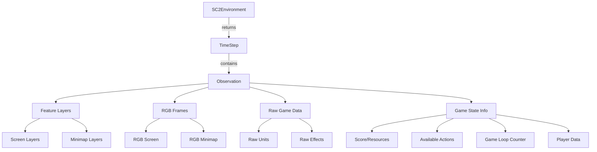
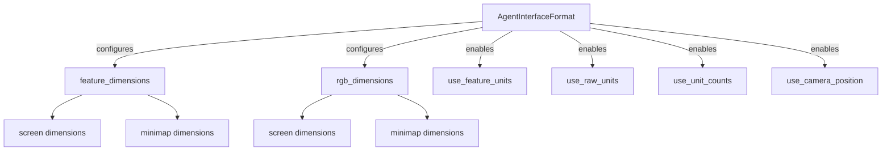
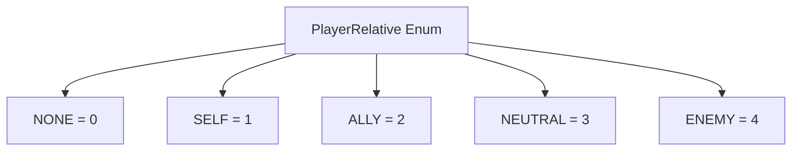
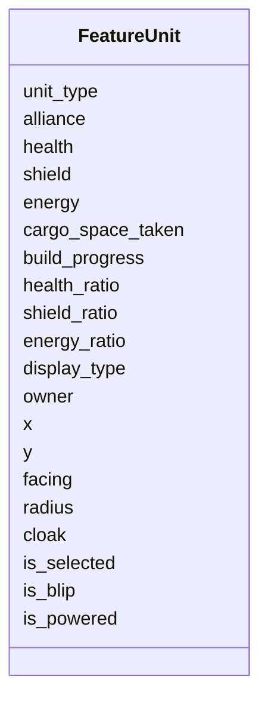
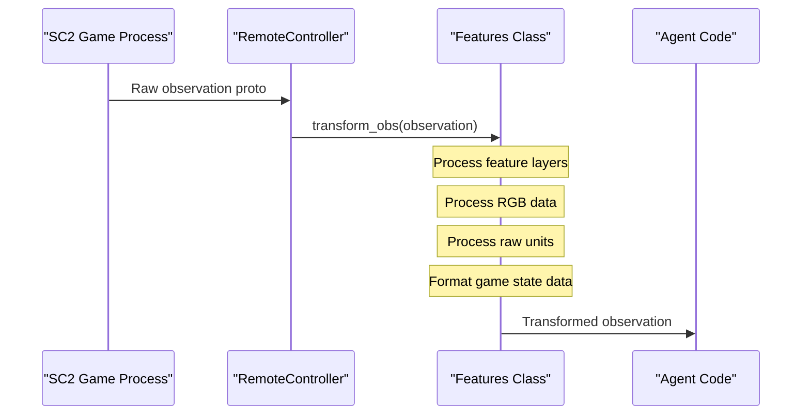

<!-- source: DeepWiki mcp.deepwiki.com · repo google-deepmind/pysc2 · page 3.1 Observation Specification · fetched 2026-10-26 -->

# Observation Specification

<details>
<summary>Relevant source files</summary>

The following files were used as context for generating this wiki page:

- [pysc2/agents/scripted_agent.py](pysc2/agents/scripted_agent.py)
- [pysc2/env/sc2_env.py](pysc2/env/sc2_env.py)
- [pysc2/lib/features.py](pysc2/lib/features.py)
- [pysc2/lib/features_test.py](pysc2/lib/features_test.py)
- [pysc2/tests/easy_scripted_test.py](pysc2/tests/easy_scripted_test.py)

</details>


This document details the observation specification system in PySC2, which defines the structure and content of the data that agents receive from the StarCraft II environment at each timestep. Understanding this specification is essential for developing agents that can process and interpret the game state correctly.

For information about the action system that allows agents to control units in the game, see [Action System](#4) and [Action Specification](#4.1).

## Overview of Observation Structure

The observation specification defines the format, dimensions, and types of data available to agents. PySC2 provides several observation formats, allowing you to choose between feature layers, RGB pixels, or raw game data depending on your agent's needs.



Sources: [pysc2/env/sc2_env.py:448-452](), [pysc2/lib/features.py:1033-1111]()

## Configuring the Observation Space

Before receiving observations, you must configure the observation space through the `AgentInterfaceFormat` class, which specifies what data you want to receive.



Sources: [pysc2/lib/features.py:465-729]()

### Example Configuration

When creating an environment, you specify the observation format:

```python
agent_interface_format = sc2_env.AgentInterfaceFormat(
    feature_dimensions=sc2_env.Dimensions(screen=84, minimap=64),
    use_feature_units=True,
    use_raw_units=False,
    rgb_dimensions=None
)

env = sc2_env.SC2Env(
    map_name="CollectMineralShards",
    players=[sc2_env.Agent(sc2_env.Race.terran)],
    agent_interface_format=agent_interface_format
)
```

Sources: [pysc2/tests/easy_scripted_test.py:30-39](), [pysc2/tests/easy_scripted_test.py:63-74]()

## Feature Layer Observations

Feature layers provide a structured, spatial representation of the game state. They consist of 2D grids where each cell represents information about that location in the game.

### Screen Feature Layers

Screen feature layers provide detailed information about the visible play area:

| Layer Name | Description | Value Range | Type |
|------------|-------------|------------|------|
| height_map | Terrain height | 0-255 | Scalar |
| visibility_map | Fog of war | 0-3 | Categorical |
| creep | Zerg creep | 0-1 | Categorical |
| power | Protoss power | 0-1 | Categorical |
| player_id | Controlling player | 0-16 | Categorical |
| player_relative | Relationship to player | 0-4 | Categorical |
| unit_type | Type of unit | 0-max unit types | Categorical |
| selected | Selected units | 0-1 | Categorical |
| unit_hit_points | Unit health | 0-1600 | Scalar |
| unit_hit_points_ratio | Unit health ratio | 0-255 | Scalar |
| unit_energy | Unit energy | 0-1000 | Scalar |
| unit_shields | Unit shields | 0-1000 | Scalar |
| unit_density | Unit density | 0-16 | Scalar |
| effects | Active effects | 0-16 | Categorical |

Sources: [pysc2/lib/features.py:303-382]()

### Minimap Feature Layers

Minimap feature layers provide a zoomed-out view of the game map:

| Layer Name | Description | Value Range | Type |
|------------|-------------|------------|------|
| height_map | Terrain height | 0-255 | Scalar |
| visibility_map | Fog of war | 0-3 | Categorical |
| creep | Zerg creep | 0-1 | Categorical |
| camera | Current camera view | 0-1 | Categorical |
| player_id | Controlling player | 0-16 | Categorical |
| player_relative | Relationship to player | 0-4 | Categorical |
| selected | Selected units | 0-1 | Categorical |

Sources: [pysc2/lib/features.py:328-399]()

### Player Relative Values

The `player_relative` feature layer indicates the relationship between units and the player:



Sources: [pysc2/lib/features.py:44-50](), [pysc2/agents/scripted_agent.py:22-24]()

## RGB Observations

RGB observations provide raw pixel data of the screen and minimap, similar to what a human player would see.

| Name | Shape | Description |
|------|-------|-------------|
| rgb_screen | (height, width, 3) | RGB pixel values of the screen |
| rgb_minimap | (height, width, 3) | RGB pixel values of the minimap |

Sources: [pysc2/lib/features.py:1079-1085]()

## Raw Unit Observations

Raw units provide direct access to unit data without having to interpret feature layers.



Sources: [pysc2/lib/features.py:166-214]()

## Non-Spatial Observations

In addition to spatial data, PySC2 provides several non-spatial observations:

| Name | Shape | Description |
|------|-------|-------------|
| game_loop | (1,) | Current game tick |
| player | (11,) | Player resources and supply |
| score_cumulative | (13,) | Cumulative score and resource metrics |
| available_actions | (0,) | Set of available action IDs |
| single_select | (0, 7) | Information about a selected unit |
| multi_select | (0, 7) | Information about multiple selected units |
| build_queue | (0, 7) | Units being produced |
| control_groups | (10, 2) | Saved unit selections |

Sources: [pysc2/lib/features.py:1046-1063]()

## Observation Transformation Process

The following diagram illustrates how raw SC2 observations are transformed into the agent-friendly format:



Sources: [pysc2/env/sc2_env.py:615-626](), [pysc2/lib/features.py:1126-1546]()

## Accessing Observations

When interacting with the environment, observations are accessed through the `TimeStep` object returned by the `step()` method:

```python
# Example of accessing observations
timestep = env.step(actions)
observation = timestep.observation

# Access feature layers
screen_features = observation["feature_screen"]
minimap_features = observation["feature_minimap"]

# Access unit information if enabled
if "feature_units" in observation:
    units = observation["feature_units"]

# Access game state
available_actions = observation["available_actions"]
player_resources = observation["player"]
```

Sources: [pysc2/env/sc2_env.py:507-521](), [pysc2/agents/scripted_agent.py:39-49]()

## Observation Value Ranges

Feature layers contain both scalar and categorical data. Understanding the value ranges is important for correct interpretation:

- **Scalar features**: Represent continuous values (e.g., health, height) scaled to a specific range.
- **Categorical features**: Represent discrete categories (e.g., unit type, player relationship).

For example, in `player_relative`, the value 4 indicates an enemy unit, while 1 indicates your own units.

Sources: [pysc2/lib/features.py:39-42](), [pysc2/lib/features.py:350-382]()

## Building Custom Agents

When building agents, you need to process these observations to make decisions. Here's a simple example of how an agent might use the `player_relative` feature to locate and move toward neutral units (minerals):

```python
def step(self, obs):
    # Check if Move action is available
    if FUNCTIONS.Move_screen.id in obs.observation.available_actions:
        # Get player_relative feature layer
        player_relative = obs.observation.feature_screen.player_relative
        
        # Find neutral units (minerals)
        neutral_units = (player_relative == PLAYER_NEUTRAL)
        neutral_unit_locations = neutral_units.nonzero()
        
        # Get coordinates of neutral units
        y, x = neutral_unit_locations
        locations = list(zip(x, y))
        
        if locations:
            # Move to closest neutral unit
            target = locations[0]
            return FUNCTIONS.Move_screen("now", target)
            
    # If no action available or no target, do nothing
    return FUNCTIONS.no_op()
```

Sources: [pysc2/agents/scripted_agent.py:36-49]()

## Additional Considerations

1. **Observation Processing Overhead**: Processing feature layers can be computationally expensive. Consider which format is most appropriate for your agent.

2. **Resolution Trade-offs**: Higher resolution observations provide more detail but increase computational requirements and potentially slow down learning.

3. **Observation Combinations**: You can enable multiple observation types simultaneously (e.g., feature layers and raw units) to give your agent different perspectives on the game state.

Sources: [pysc2/lib/features.py:559-596]()

---

