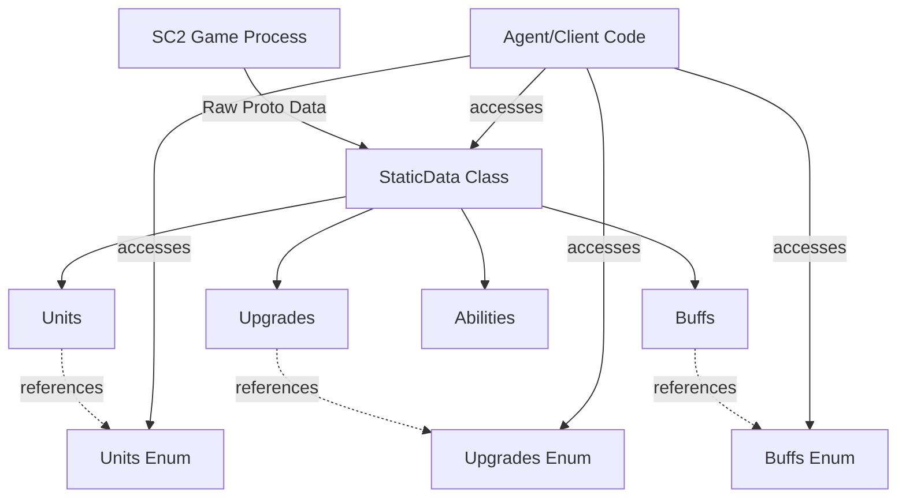
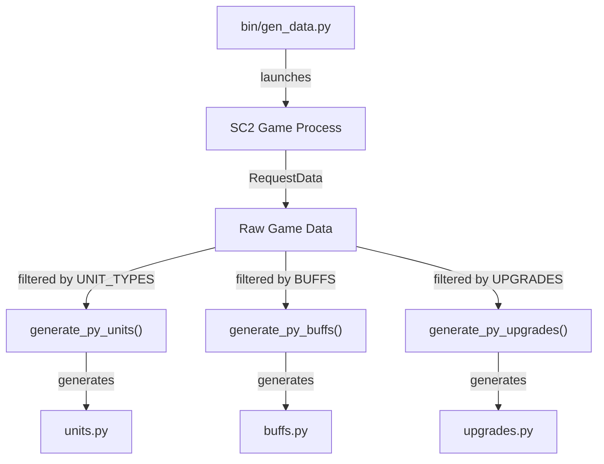
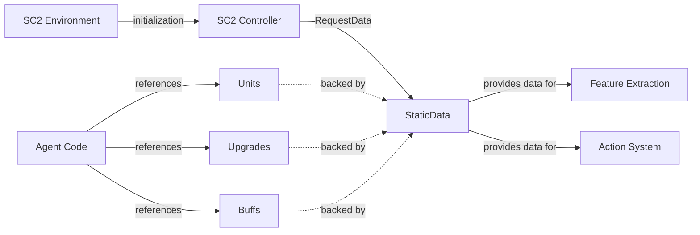

<!-- source: DeepWiki mcp.deepwiki.com · repo google-deepmind/pysc2 · page 3.2 Static Data · fetched 2026-10-26 -->

# Static Data

<details>
<summary>Relevant source files</summary>

The following files were used as context for generating this wiki page:

- [pysc2/bin/gen_data.py](pysc2/bin/gen_data.py)
- [pysc2/lib/buffs.py](pysc2/lib/buffs.py)
- [pysc2/lib/static_data.py](pysc2/lib/static_data.py)
- [pysc2/lib/units.py](pysc2/lib/units.py)
- [pysc2/lib/upgrades.py](pysc2/lib/upgrades.py)

</details>


The Static Data system in PySC2 provides access to StarCraft II game data in a structured and easily accessible format. This system transforms raw protocol buffer data from the StarCraft II API into Python-friendly data structures containing information about units, upgrades, buffs, and abilities. For information about how these data are used in observations, see [Observation Specification](#3.1).

## Overview

The Static Data system serves as a centralized repository for constants and game entity information that remains unchanged throughout gameplay. This includes:

1. Unit types and their properties
2. Available upgrades and their IDs
3. Status effects (buffs) and their IDs
4. Abilities and their mappings

These data are essential for interpreting observations, making informed decisions in agent code, and translating between human-readable names and internal game IDs.



**Static Data System Overview**

Sources: [pysc2/lib/static_data.py:17-51](), [pysc2/lib/units.py:19-300](), [pysc2/lib/upgrades.py:20-110](), [pysc2/lib/buffs.py:20-68]()

## StaticData Class

The core of this system is the `StaticData` class, which processes and exposes game data in a more accessible format than the raw protocol buffers.

```python
class StaticData(object):
    def __init__(self, data):
        """Takes data from RequestData."""
        self._units = {u.unit_id: u.name for u in data.units}
        self._unit_stats = {u.unit_id: u for u in data.units}
        self._upgrades = {a.upgrade_id: a for a in data.upgrades}
        self._abilities = {a.ability_id: a for a in data.abilities}
        self._general_abilities = {a.remaps_to_ability_id
                                 for a in data.abilities
                                 if a.remaps_to_ability_id}
```

The `StaticData` class provides several properties for accessing different categories of game data:

| Property | Returns | Description |
|----------|---------|-------------|
| `units` | dict | Maps unit IDs to unit names |
| `unit_stats` | dict | Maps unit IDs to full unit data objects |
| `upgrades` | dict | Maps upgrade IDs to upgrade data objects |
| `abilities` | dict | Maps ability IDs to ability data objects |
| `general_abilities` | set | Set of general ability IDs |

Sources: [pysc2/lib/static_data.py:17-51]()

## Units

The units component provides enumerations for all unit types in the game, organized by race. This allows for more readable code by using symbolic names rather than numeric IDs.

```mermaid
classDiagram
    class "enum.IntEnum" {
        +int value
        +str name
    }
    
    class "Neutral" {
        +MineralField
        +VespeneGeyser
        +XelNagaTower
        +etc...
    }
    
    class "Protoss" {
        +Probe
        +Zealot
        +Stalker
        +etc...
    }
    
    class "Terran" {
        +SCV
        +Marine
        +Marauder
        +etc...
    }
    
    class "Zerg" {
        +Drone
        +Zergling
        +Hydralisk
        +etc...
    }
    
    "enum.IntEnum" <|-- "Neutral"
    "enum.IntEnum" <|-- "Protoss"
    "enum.IntEnum" <|-- "Terran" 
    "enum.IntEnum" <|-- "Zerg"
```

**Unit Type Enumeration Hierarchy**

Units are categorized into four enumerations:

1. `Neutral` - Resource nodes, destructible objects, and neutral entities
2. `Protoss` - All Protoss units, buildings, and structures
3. `Terran` - All Terran units, buildings, and structures
4. `Zerg` - All Zerg units, buildings, and structures

The `get_unit_type` utility function takes a unit ID and returns the corresponding enum value by checking each race's enumeration.

```python
def get_unit_type(unit_id):
    for race in (Neutral, Protoss, Terran, Zerg):
        try:
            return race(unit_id)
        except ValueError:
            pass  # Wrong race.
```

Sources: [pysc2/lib/units.py:19-300]()

## Upgrades and Buffs

Similar to units, upgrades and buffs are also represented as integer enumerations for consistent and readable reference.

### Upgrades

The `Upgrades` enumeration provides symbolic names for all upgrades in the game. These include weapon and armor upgrades, ability unlocks, and unit-specific enhancements.

```python
class Upgrades(enum.IntEnum):
    """The list of upgrades, as generated by bin/gen_data.py."""
    AdaptiveTalons = 293
    AdrenalGlands = 65
    AdvancedBallistics = 140
    # ... and many more
```

Sources: [pysc2/lib/upgrades.py:20-110]()

### Buffs

The `Buffs` enumeration represents temporary status effects that can be applied to units.

```python
class Buffs(enum.IntEnum):
    """The list of buffs, as generated by bin/gen_data.py."""
    BansheeCloak = 7
    BlindingCloud = 83
    # ... and many more
```

Sources: [pysc2/lib/buffs.py:20-68]()

## Generating Static Data

The static data enumerations are generated using the `gen_data.py` script, which:

1. Connects to a StarCraft II game instance
2. Retrieves raw data through the protocol
3. Processes it into enumerations
4. Outputs Python code for the enumeration classes

This process ensures that the static data reflects the current version of StarCraft II.



**Static Data Generation Process**

Sources: [pysc2/bin/gen_data.py:28-94]()

## Static Data Lists

The `static_data.py` file also contains predefined lists of valid entity IDs that have been observed in-game:

1. `ABILITIES` - A list of all ability IDs found in replay analysis
2. `UNIT_TYPES` - A list of known unit type IDs
3. `BUFFS` - A list of observed buff IDs
4. `UPGRADES` - A list of observed upgrade IDs

These lists serve as filters during the enum generation process to include only valid and relevant game entities.

Sources: [pysc2/lib/static_data.py:54-128]()

## Integration with the PySC2 Environment

The Static Data system interacts with the broader PySC2 architecture in the following ways:



**Static Data Integration**

1. During environment initialization, the SC2 controller requests static data from the game
2. The `StaticData` instance is created with this information
3. Feature extraction uses this data to interpret raw observations
4. The action system uses this data to validate and transform actions
5. Agent code directly references the enum values for clarity and type safety

Sources: [pysc2/lib/static_data.py:17-51]()

## Using Static Data in Agent Code

Here's a practical example of how static data is used in agent implementation:

```python
# Checking if a unit is a Marine
if unit.unit_type == units.Terran.Marine:
    # Issue a Stimpack command
    return actions.FUNCTIONS.Effect_Stim_quick("now")

# Checking for upgrades
if upgrades.Upgrades.Stimpack in observation.upgrades:
    # We have researched Stimpack
    pass

# Checking for buffs
if buffs.Buffs.Stimpack in unit.buff_ids:
    # This unit is under the effect of Stimpack
    pass
```

By using these enumerations, agent code becomes more readable and less error-prone compared to using raw numeric IDs.

Sources: [pysc2/lib/units.py:19-300](), [pysc2/lib/upgrades.py:20-110](), [pysc2/lib/buffs.py:20-68]()

---

