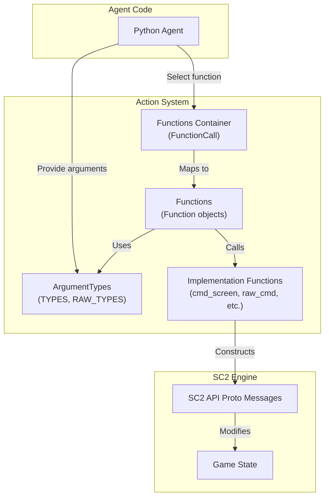
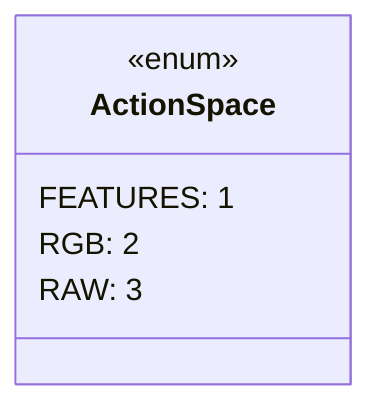
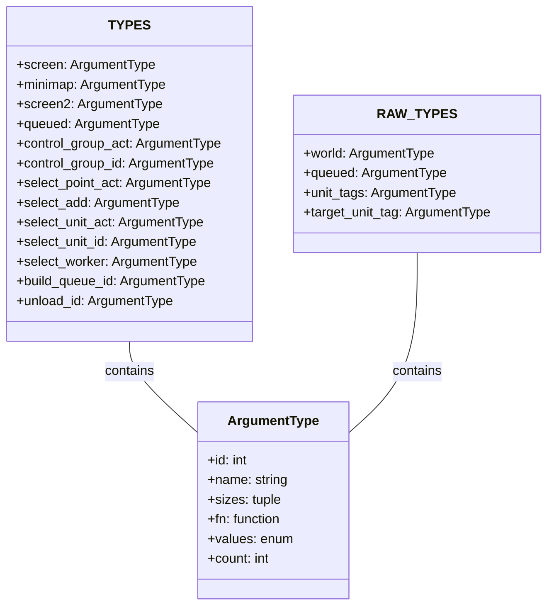
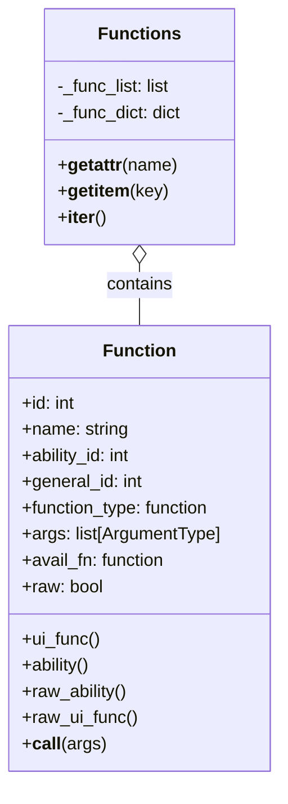
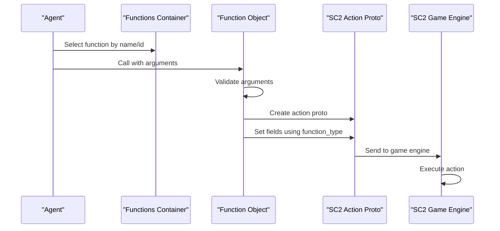
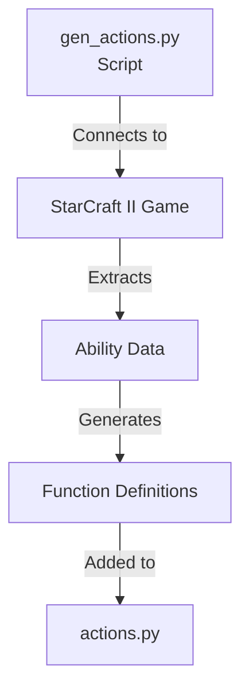
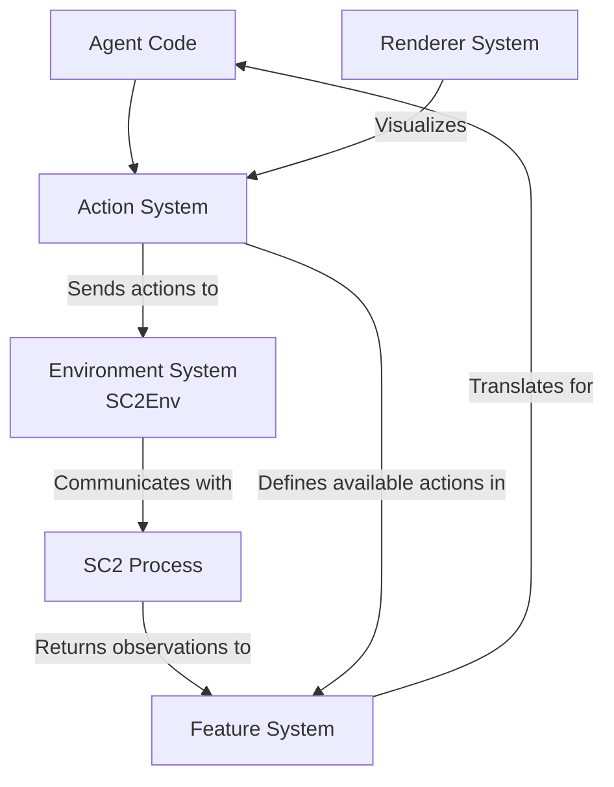

<!-- source: DeepWiki mcp.deepwiki.com · repo google-deepmind/pysc2 · page 4 Action System · fetched 2026-10-26 -->

# Action System

<details>
<summary>Relevant source files</summary>

The following files were used as context for generating this wiki page:

- [pysc2/bin/gen_actions.py](pysc2/bin/gen_actions.py)
- [pysc2/bin/replay_actions.py](pysc2/bin/replay_actions.py)
- [pysc2/lib/actions.py](pysc2/lib/actions.py)

</details>


The Action System is a core component of PySC2 that provides the interface for agents to control units and execute commands in StarCraft II. It transforms high-level commands (like "Attack" or "Build") into the precise format that the StarCraft II API understands, allowing agents to interact with the game environment effectively.

This document covers the Action System architecture, the different action spaces, function representations, argument handling, and how to properly use the action system to control units in StarCraft II.

For information about processing observations from the game, see [Feature System](#3).

Sources: [pysc2/lib/actions.py:14-25]()

## System Overview

The Action System acts as the translation layer between agent commands and the StarCraft II engine. It defines a structured set of functions that map to game actions and provides mechanisms to specify arguments for those functions.



The Action System consists of several key components:
1. **ActionSpace** - Defines the different spaces in which actions can be performed
2. **ArgumentType** - Represents types of arguments that functions accept
3. **Function** - Represents individual actions available to agents
4. **Functions** - A container for all available functions

Sources: [pysc2/lib/actions.py:27-42](), [pysc2/lib/actions.py:463-533]()

## Action Spaces

PySC2 defines three action spaces, each representing a different way to interact with the game:



- **FEATURES** - Act in feature layer pixel space using screen/minimap coordinates
- **RGB** - Act in RGB pixel space using screen/minimap coordinates 
- **RAW** - Act with unit tags, directly referencing specific units

The action space determines how actions are encoded and which arguments they require. For FEATURES and RGB spaces, screen coordinates are used to target positions, while RAW actions use unit tags to identify units.

Sources: [pysc2/lib/actions.py:27-31]()

## Arguments System

Arguments provide the parameters for executing actions. The Action System defines structured argument types to ensure proper validation and conversion.

### Argument Types

The `ArgumentType` class represents a single argument type with information about its dimensions, conversion functions, and valid values.



The system defines two sets of argument types:
1. **TYPES** - For feature layer and RGB actions
2. **RAW_TYPES** - For raw actions

Sources: [pysc2/lib/actions.py:216-273](), [pysc2/lib/actions.py:397-421]()

### Argument Specifications

Each argument type has specific characteristics:

| Argument Type | Description | Used In | Possible Values |
|---------------|-------------|---------|----------------|
| screen | Point on screen | FEATURES, RGB | Coordinates (x,y) |
| minimap | Point on minimap | FEATURES, RGB | Coordinates (x,y) |
| queued | Queue command | All | now (0), queued (1) |
| control_group_act | Control group action | FEATURES, RGB | recall, set, append, set_and_steal, append_and_steal |
| unit_tags | Unit identifiers | RAW | List of unit tag integers |
| world | World coordinates | RAW | Coordinates (x,y) |

Sources: [pysc2/lib/actions.py:345-394](), [pysc2/lib/actions.py:397-421]()

## Function System

The `Function` class represents individual actions that agents can perform. Each function has a unique ID, name, and set of required arguments.



Functions are classified into several types:
1. **UI Functions** - Interface actions like selection, camera movement
2. **Ability Functions** - Unit abilities like attack, build, train
3. **Raw Functions** - Direct unit control with unit tags

Sources: [pysc2/lib/actions.py:463-533](), [pysc2/lib/actions.py:535-572]()

## Function Categories

PySC2 provides hundreds of functions representing different actions in StarCraft II. These functions are logically grouped into categories:

1. **Selection Functions** - Select units, control groups, etc.
   - Examples: `select_point`, `select_rect`, `select_army`

2. **Command Functions** - Issue commands to selected units
   - Examples: `Attack_screen`, `Move_screen`, `Patrol_minimap`  

3. **Build Functions** - Construct buildings
   - Examples: `Build_SupplyDepot_screen`, `Build_Pylon_screen`

4. **Training Functions** - Train new units
   - Examples: `Train_Marine_quick`, `Train_Zealot_quick`  

5. **Research Functions** - Research upgrades
   - Examples: `Research_Stimpack_quick`, `Research_WarpGate_quick`

6. **Effect Functions** - Use special abilities
   - Examples: `Effect_Stim_quick`, `Effect_PsiStorm_screen`

Sources: [pysc2/lib/actions.py:578-1158]()

## Using the Action System

To use the Action System, agents create function calls with appropriate arguments:

```python
# Example (not actual code):
# Move camera to coordinates [30, 40] on minimap
actions.FunctionCall(actions.FUNCTIONS.move_camera.id, [[30, 40]])

# Attack with selected units at screen position [20, 30]
actions.FunctionCall(actions.FUNCTIONS.Attack_screen.id, [[0], [20, 30]])
  # [0] = not queued, [20, 30] = screen coordinates
```

The action flow proceeds as follows:



Sources: [pysc2/lib/actions.py:521-523]()

## Function and Argument Validation

The Action System validates function calls to ensure they have the correct arguments before sending them to the game:

1. Each function has a predefined list of required argument types
2. Arguments must match the expected dimensions and types
3. Some functions are only available in certain game states

For example, `Attack_screen` requires a `queued` argument and a `screen` coordinate argument.

Sources: [pysc2/lib/actions.py:423-449]()

## Action Generation

The function definitions in `actions.py` are partially generated using `gen_actions.py`, which extracts ability information from the StarCraft II API. This ensures the Action System accurately reflects the current version of the game.



Sources: [pysc2/bin/gen_actions.py:14-177]()

## Relationship to Other Systems

The Action System interacts with other PySC2 components:



The Environment System uses the Action System to process agent commands, and the Feature System uses it to determine what actions are available based on the current game state.

Sources: [pysc2/bin/replay_actions.py:290-311]()

## Conclusion

The Action System is the primary interface for controlling units in StarCraft II through PySC2. It provides a comprehensive set of functions that map to game commands and a structured way to specify arguments for those functions. By understanding the Action System, agent developers can create sophisticated strategies and behaviors for their StarCraft II agents.

For more details on argument specifications and function definitions, see [Action Specification](#4.1).

---

