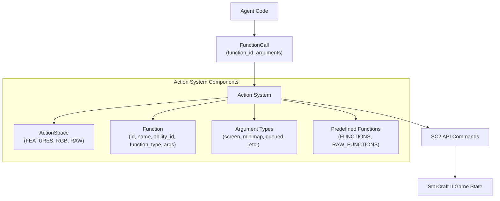
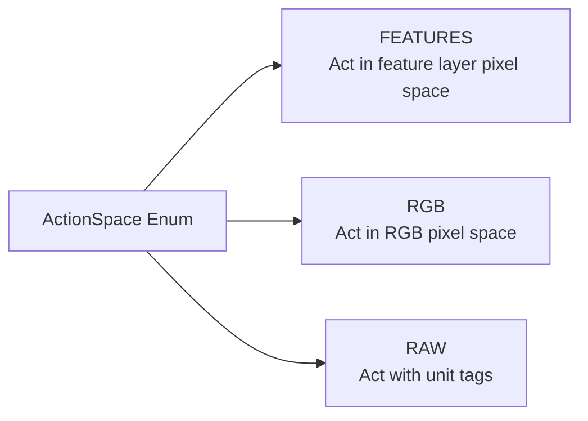
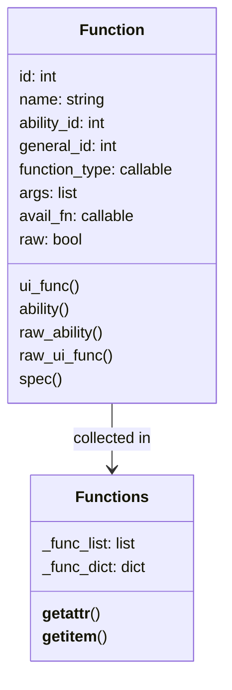
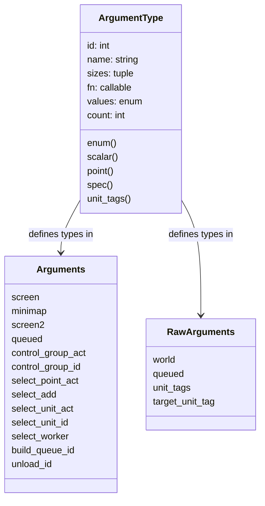
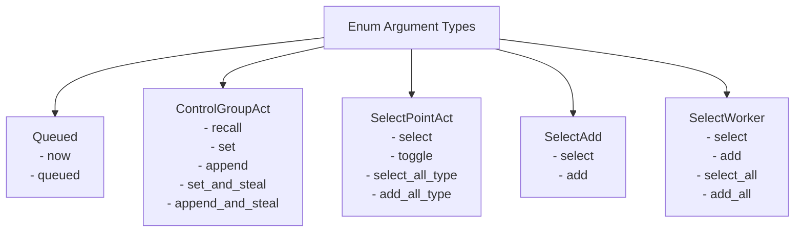
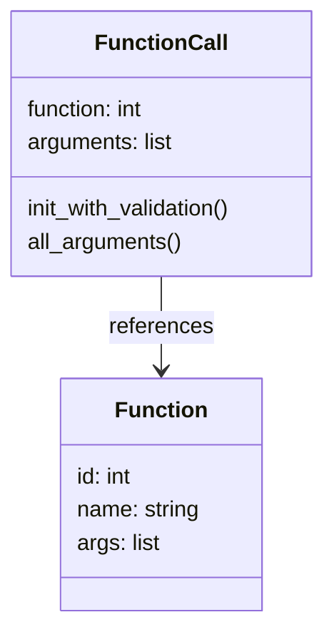
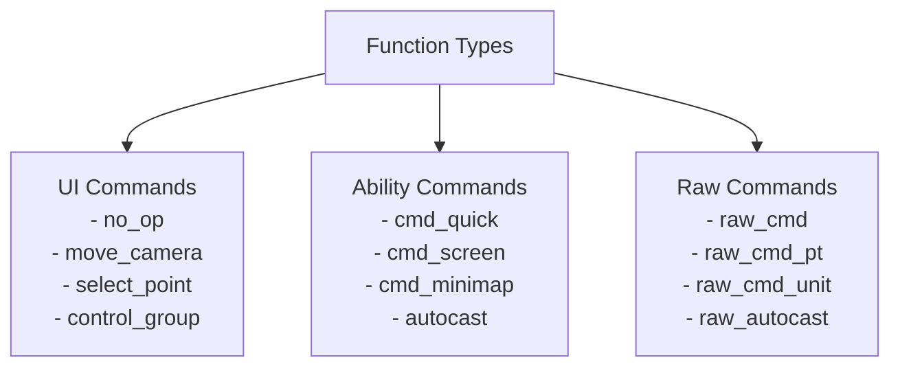

<!-- source: DeepWiki mcp.deepwiki.com · repo google-deepmind/pysc2 · page 4.1 Action Specification · fetched 2026-10-26 -->

# Action Specification

<details>
<summary>Relevant source files</summary>

The following files were used as context for generating this wiki page:

- [pysc2/lib/actions.py](pysc2/lib/actions.py)

</details>


This document details the action specification system in PySC2, which defines how agent actions are represented, validated, and converted into StarCraft II game commands. For information about how actions are generated and defined in the system, see [Action Generation](#4.2).

## 1. Action System Overview

The action system in PySC2 provides a structured way for agents to interact with the StarCraft II environment. Actions are represented as function calls with specific arguments, which are then translated into appropriate commands for the game.



Sources: [pysc2/lib/actions.py:27-30](), [pysc2/lib/actions.py:463-573](), [pysc2/lib/actions.py:216-337]()

### Action Spaces

PySC2 supports three distinct action spaces that determine how agents interact with the game:



| Action Space | Description | Use Case |
|--------------|-------------|----------|
| `FEATURES` | Actions in feature layer pixel space | For agents that work with processed feature layers |
| `RGB` | Actions in RGB pixel space | For agents that work with raw visual data |
| `RAW` | Actions with unit tags | For agents that work directly with game entities |

Sources: [pysc2/lib/actions.py:27-30]()

## 2. Function Structure

Functions in PySC2 represent the available actions an agent can take. Each function is uniquely identified and includes information about the required arguments and how to convert the action to StarCraft II API commands.



Sources: [pysc2/lib/actions.py:463-532](), [pysc2/lib/actions.py:535-573]()

### Function Categories

Functions in PySC2 are organized into categories based on their functionality:

1. **UI Functions** - Interface actions like selection and control groups
2. **Ability Functions** - Game unit abilities like attack, build, research
3. **Raw Functions** - Direct unit control using tags rather than screen coordinates

Examples of common functions include:

| Category | Function Name | Description |
|----------|---------------|-------------|
| UI | `no_op` | Do nothing |
| UI | `select_point` | Select a unit at a point |
| UI | `select_army` | Select the entire army |
| Ability | `Attack_screen` | Attack at a screen position |
| Ability | `Build_Barracks_screen` | Build a barracks at a screen position |
| Ability | `Research_Stimpack_quick` | Research stimpack technology |
| Raw | `raw_cmd_unit` | Issue a raw command to a unit |
| Raw | `raw_move_camera` | Move the camera using raw commands |

Sources: [pysc2/lib/actions.py:578-1161](), [pysc2/lib/actions.py:1181-1746]()

## 3. Argument Types

Actions require specific arguments depending on their function type. The argument system provides a way to define, validate, and process these arguments.



Sources: [pysc2/lib/actions.py:216-273](), [pysc2/lib/actions.py:276-308](), [pysc2/lib/actions.py:314-337]()

### Common Argument Types

The most frequently used argument types include:

| Argument | Description | Example Usage |
|----------|-------------|---------------|
| `screen` | A point on the screen | Specify target location for building placement |
| `minimap` | A point on the minimap | Moving camera or commanding units across the map |
| `queued` | Boolean for action queuing | Whether to execute immediately or queue after other actions |
| `control_group_id` | Which control group to use | Assigning units to control groups 0-9 |
| `unit_tags` | List of unit tags | Identifying specific units for raw commands |

Sources: [pysc2/lib/actions.py:398-414](), [pysc2/lib/actions.py:416-421]()

### Enum Argument Types

Some arguments use enum types to represent specific choices:



Sources: [pysc2/lib/actions.py:346-394]()

## 4. Function Calls

Function calls are the primary way agents interact with the StarCraft II environment. They combine a function identifier with specific arguments to form a complete action.



### Creating Function Calls

There are multiple ways to create function calls:

1. **Direct creation** using the function ID and argument list:
   ```python
   FunctionCall(FUNCTIONS.Move_screen.id, [[1], [23, 46]])
   ```

2. **Validation-based creation** for safer operation:
   ```python
   FunctionCall.init_with_validation(
       function=FUNCTIONS.Attack_screen.id,
       arguments=[[0], [30, 40]]
   )
   ```

3. **Using function objects** for cleaner code:
   ```python
   FUNCTIONS.select_army(select_add=False)
   ```

Sources: [pysc2/lib/actions.py:1767-1851](), [pysc2/lib/actions.py:521-523]()

## 5. Implementation Details

### Function Type Mapping

Functions are mapped to their implementation based on function types:



Each function type defines how the arguments are processed and converted to StarCraft II protocol commands.

Sources: [pysc2/lib/actions.py:33-190](), [pysc2/lib/actions.py:425-448]()

### Pre-defined Functions

PySC2 provides over 500 pre-defined functions for common game actions. These functions are organized in the `FUNCTIONS` and `RAW_FUNCTIONS` collections.

Examples of pre-defined functions include:
- Basic commands: `no_op`, `move_camera`
- Unit selection: `select_point`, `select_rect`, `select_army`
- Building construction: `Build_Barracks_screen`, `Build_Pylon_screen`
- Unit training: `Train_Marine_quick`, `Train_Zealot_quick`
- Research: `Research_Stimpack_quick`, `Research_WarpGate_quick`
- Abilities: `Effect_Stim_quick`, `Effect_PsiStorm_screen`

Sources: [pysc2/lib/actions.py:578-1161](), [pysc2/lib/actions.py:1181-1746]()

## 6. Using the Action System in Agent Code

To use the action system in agent code, you typically:

1. **Import the necessary components**:
   ```python
   from pysc2.lib import actions
   ```

2. **Check valid actions** in the current state:
   ```python
   available_actions = obs.observation.available_actions
   ```

3. **Create and return function calls** based on your agent's decision:
   ```python
   if actions.FUNCTIONS.Move_screen.id in available_actions:
       return actions.FUNCTIONS.Move_screen("now", [x, y])
   ```

4. **Handle raw actions** if using the raw action space:
   ```python
   if actions.RAW_FUNCTIONS.Attack_unit.id in available_actions:
       return actions.RAW_FUNCTIONS.Attack_unit("now", [my_units], enemy_unit_tag)
   ```

Sources: [pysc2/lib/actions.py:1767-1851](), [pysc2/lib/actions.py:463-573]()

## 7. Action Validation and Available Actions

StarCraft II restricts which actions are available in any given game state. For example, you can't train a unit if you don't have the required building, or research a technology without the prerequisite structure.

The environment provides a list of available actions in each observation:

```python
available_actions = obs.observation.available_actions
```

The `Function` class includes an `avail_fn` attribute that determines when a function is available. For UI functions, this checks conditions like:

- `select_idle_worker`: Available when there are idle workers
- `select_army`: Available when there are army units
- `select_warp_gates`: Available when there are warp gates

Sources: [pysc2/lib/actions.py:583-597]()

## 8. Relationship with Feature Layers

Actions in the FEATURES and RGB action spaces often require coordinates on the screen or minimap. These coordinates correspond to the feature layers provided in the observation, allowing agents to process visual information and act on it.

The feature system (see [Observation Specification](#3.1)) provides spatial observations that agents use to determine where to apply their actions.

Sources: [pysc2/lib/actions.py:33-40](), [pysc2/lib/actions.py:127-141]()

---

