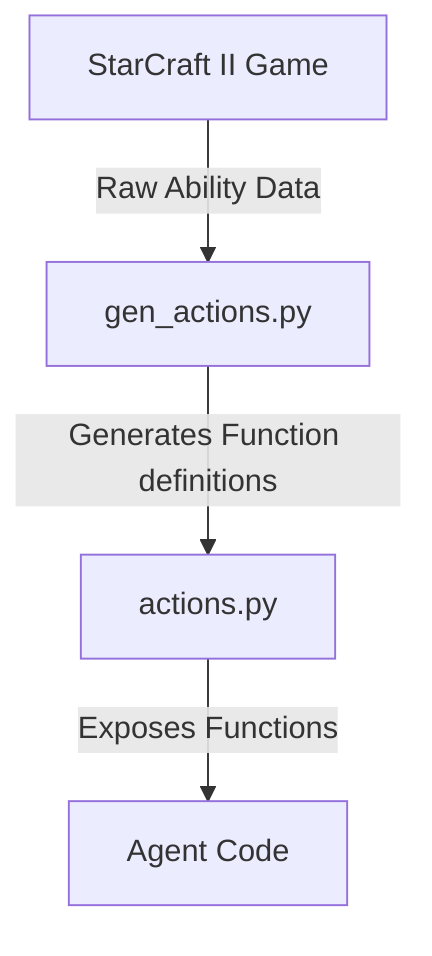
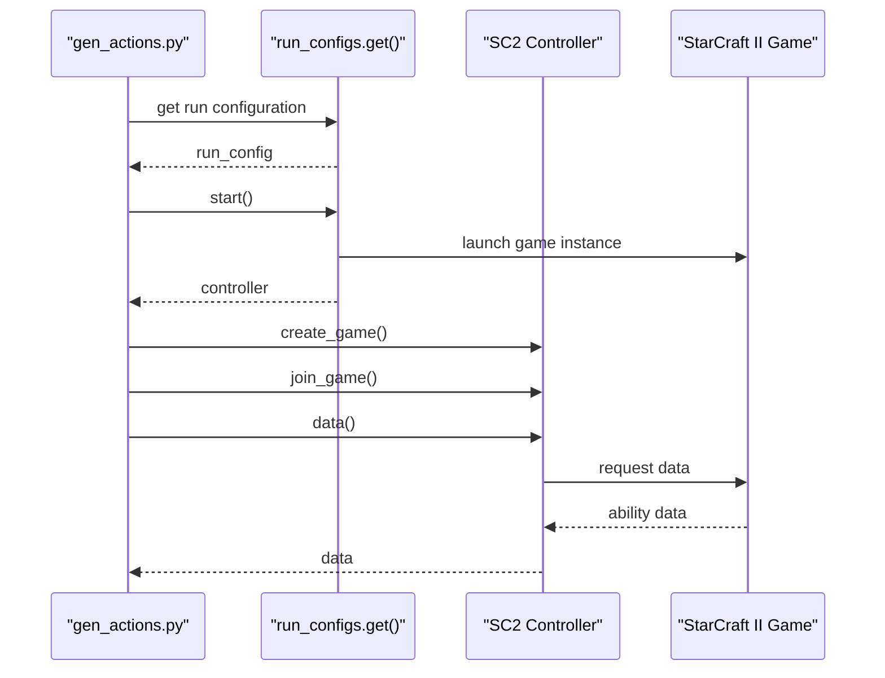
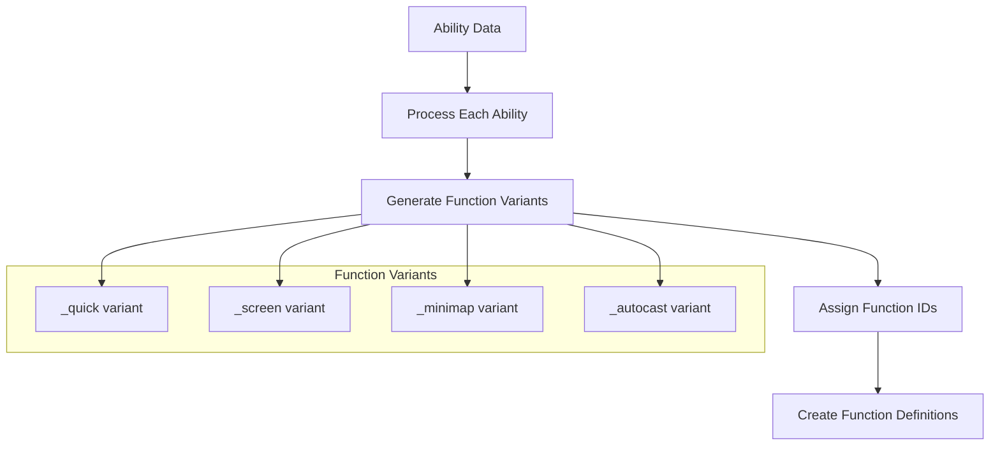
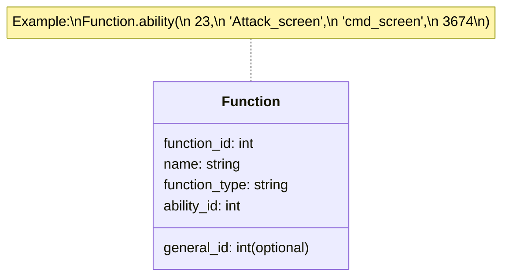
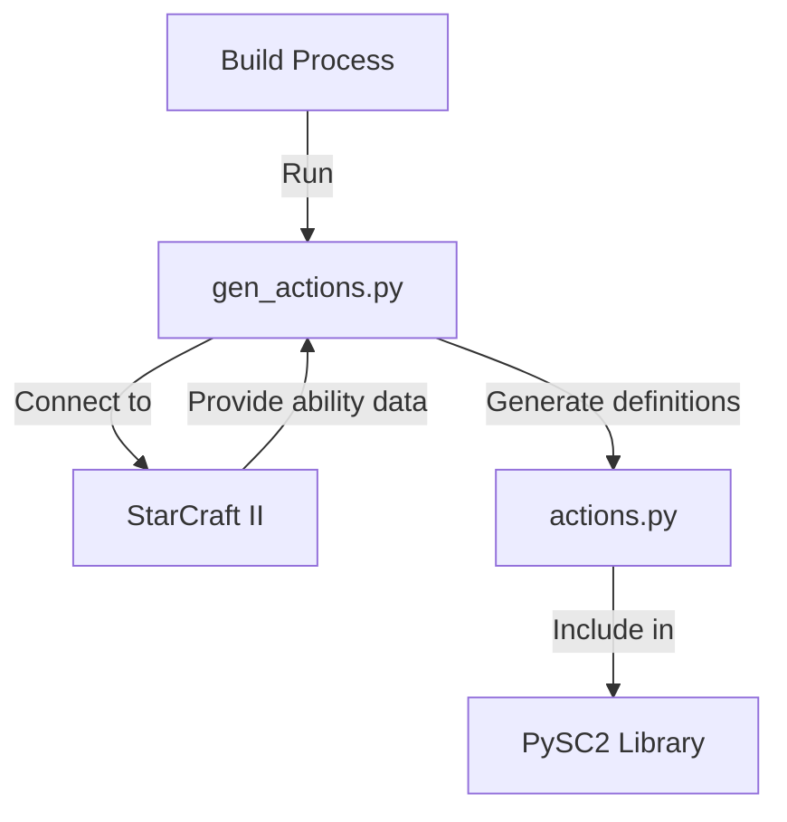

<!-- source: DeepWiki mcp.deepwiki.com · repo google-deepmind/pysc2 · page 4.2 Action Generation · fetched 2026-10-26 -->

# Action Generation

<details>
<summary>Relevant source files</summary>

The following files were used as context for generating this wiki page:

- [pysc2/bin/gen_actions.py](pysc2/bin/gen_actions.py)
- [pysc2/bin/replay_actions.py](pysc2/bin/replay_actions.py)

</details>


## Purpose and Scope

This document explains how PySC2 generates action definitions that agents can use to interact with the StarCraft II environment. It covers the process of extracting raw ability information from StarCraft II and transforming it into Python functions that agents can call. For information about how to use these actions in your agent, see [Action Specification](#4.1).

## Overview

The action generation system in PySC2 bridges the gap between StarCraft II's internal ability system and the higher-level function calls that agents use. This automatic generation process ensures that all valid StarCraft II actions are properly exposed to agents with appropriate targeting methods and arguments.



Sources: [pysc2/bin/gen_actions.py:15-24]()

## Action Generation Process

### Step 1: Retrieving Ability Data

The process begins by connecting to StarCraft II and retrieving raw ability data. The system launches a StarCraft II instance, creates a game, and extracts information about all available abilities, including:

- Ability IDs
- Targeting requirements
- Friendly names
- Button names
- Minimap compatibility
- Autocast options



Sources: [pysc2/bin/gen_actions.py:36-52]()

### Step 2: Transforming Abilities into Functions

Once the raw ability data is retrieved, it's processed to generate Python function definitions. Each StarCraft II ability can result in multiple function definitions depending on its targeting capabilities:

- `_quick` - For abilities that require no target or can target the current selection
- `_screen` - For abilities that target a point on the screen
- `_minimap` - For abilities that can target a point on the minimap
- `_autocast` - For abilities that support autocast

The generator assigns unique function IDs to each action variant and creates appropriate function names based on the ability names.



Sources: [pysc2/bin/gen_actions.py:124-154]()

### Function Generation Rules

The system applies specific rules to determine which function variants to generate:

1. If the ability requires no target or can target the current selection, a `_quick` variant is created
2. If the ability requires a target point, a `_screen` variant is created
3. If the ability allows minimap targeting, a `_minimap` variant is also created
4. If the ability supports autocast, an `_autocast` variant is created

These rules ensure that each ability is properly exposed with all appropriate targeting methods.

| Ability Target Type | Generated Function Variants |
|---------------------|----------------------------|
| None/PointOrNone | `_quick` |
| Not None | `_screen` |
| Allow Minimap = True | `_screen`, `_minimap` |
| Allow Autocast = True | `+ _autocast` variant |

Sources: [pysc2/bin/gen_actions.py:142-154]()

## Action Function Structure

Each generated function includes:

1. A unique function ID
2. A human-readable name derived from the ability name
3. A function type (cmd_quick, cmd_screen, cmd_minimap, or autocast)
4. The original SC2 ability ID
5. Optionally, a reference to the general ability it remaps to



Sources: [pysc2/bin/gen_actions.py:126-130]()

## Command-line Tools

### gen_actions.py

The `gen_actions.py` script is the primary tool for generating action definitions. It connects to StarCraft II, extracts ability data, and outputs either:

- Python code for inclusion in `actions.py` (when run with `--command=python`)
- CSV data for analysis and documentation (when run with `--command=csv`)

Example usage:
```
python -m pysc2.bin.gen_actions --command=python --map=Acropolis
```

Sources: [pysc2/bin/gen_actions.py:30-33](), [pysc2/bin/gen_actions.py:157-164]()

### replay_actions.py

The `replay_actions.py` script analyzes StarCraft II replay files to gather statistics about action usage. This tool is valuable for understanding which actions are commonly used in real games and how they're triggered, which can inform the action generation process.

The script reports statistics including:
- Actions and abilities used by players
- Units, buffs, upgrades, and effects observed
- Camera movements and selection commands
- Valid vs. actually used actions

Example usage:
```
python -m pysc2.bin.replay_actions --replays=/path/to/replays --parallel=4
```

Sources: [pysc2/bin/replay_actions.py:15-24](), [pysc2/bin/replay_actions.py:357-406]()

## Action Generation During Build Process

The action generation process is typically run during the build process of PySC2, generating the action definitions that are then included in the library. This ensures that the library has up-to-date definitions that match the current version of StarCraft II.



Sources: [pysc2/bin/gen_actions.py:157-164]()

## Special Cases and Exclusions

Some abilities are intentionally excluded from the generation process:

1. **Frivolous actions** - Actions like Dance and Cheer that have no strategic value
2. **Cancel slot actions** - These require a slot ID and are exposed differently
3. **Unload unit actions** - These also require special handling

These exclusions are defined in the `skip_abilities` set in `gen_actions.py`.

Sources: [pysc2/bin/gen_actions.py:168-173]()

## Integration with Feature System

The action generation system works in conjunction with the feature system ([Feature System](#3)) to provide a complete interface between agents and the StarCraft II environment:

1. The action system defines what actions an agent can take
2. The feature system translates observations from StarCraft II into a format agents can understand
3. Together, they provide a complete interface for reinforcement learning agents

Sources: [pysc2/bin/replay_actions.py:290-294]()

---

