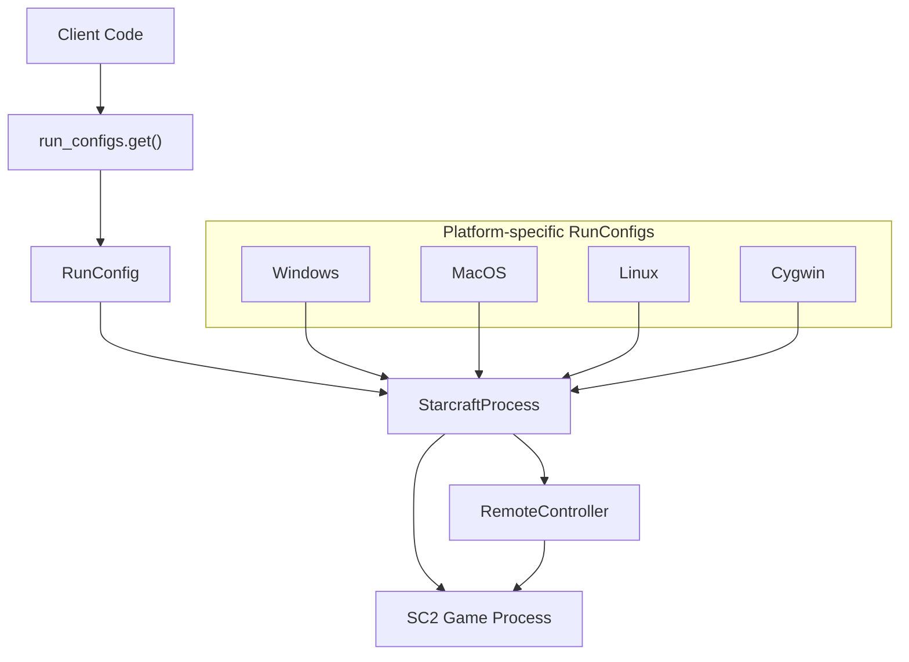
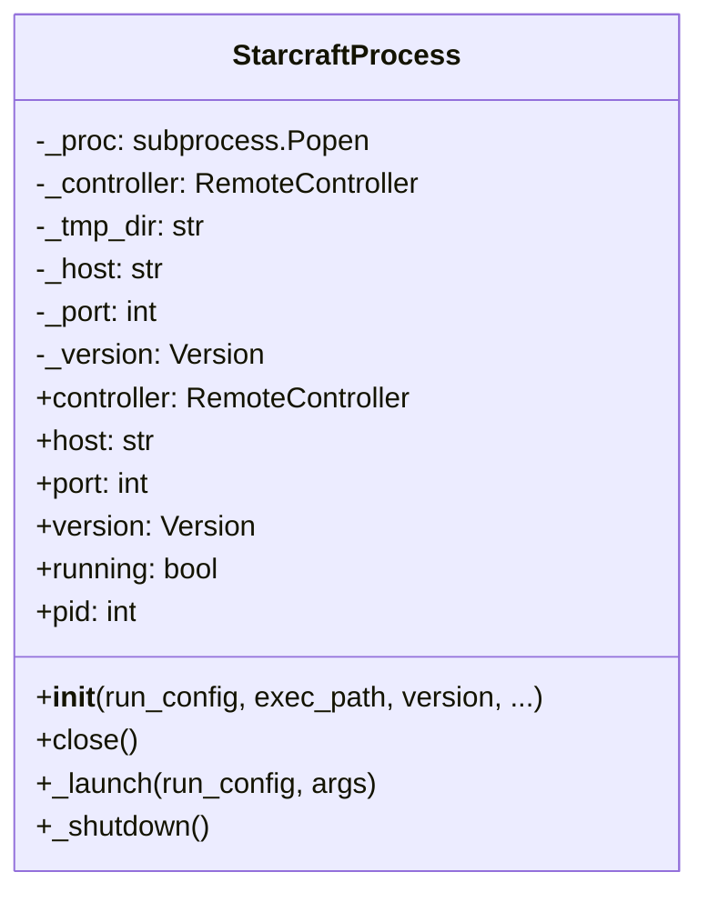
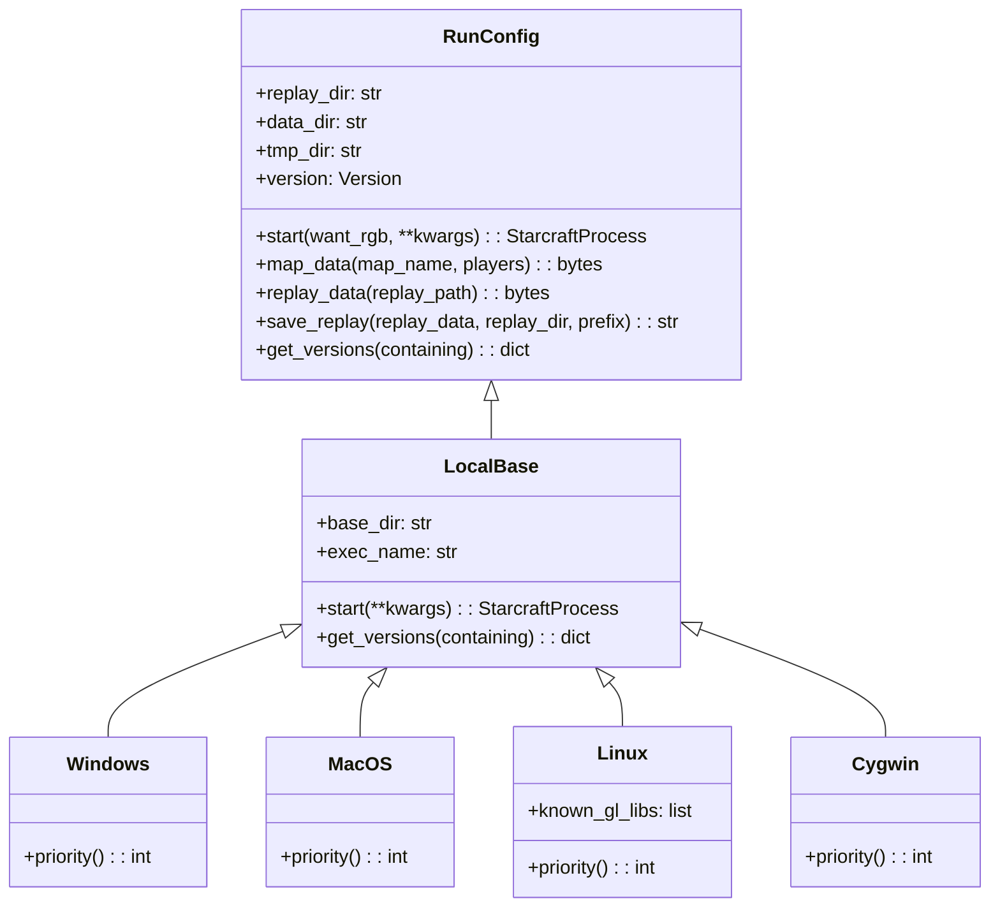
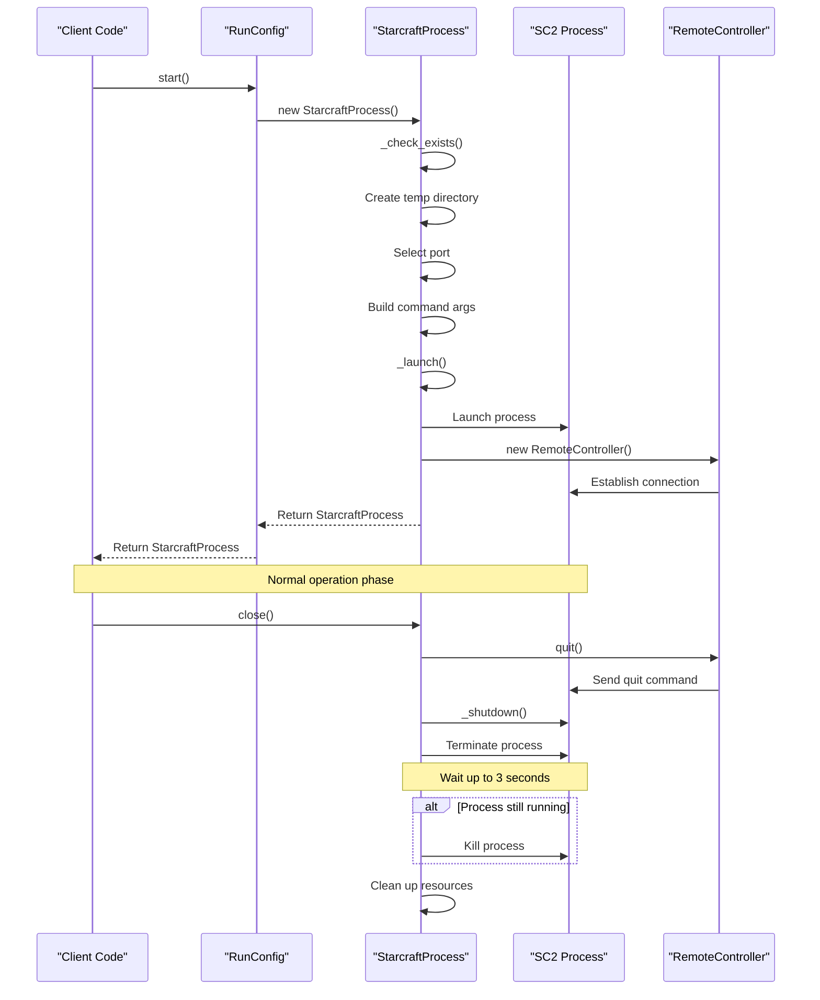

<!-- source: DeepWiki mcp.deepwiki.com · repo google-deepmind/pysc2 · page 5 Process Management · fetched 2026-10-26 -->

# Process Management

<details>
<summary>Relevant source files</summary>

The following files were used as context for generating this wiki page:

- [pysc2/lib/gfile.py](pysc2/lib/gfile.py)
- [pysc2/lib/sc_process.py](pysc2/lib/sc_process.py)
- [pysc2/run_configs/__init__.py](pysc2/run_configs/__init__.py)
- [pysc2/run_configs/lib.py](pysc2/run_configs/lib.py)
- [pysc2/run_configs/platforms.py](pysc2/run_configs/platforms.py)

</details>


The Process Management system in PySC2 is responsible for launching, configuring, and managing StarCraft II game processes. It handles finding the appropriate StarCraft II executable, configuring platform-specific parameters, and establishing communication with the game processes across different operating systems.

For information about communicating with the SC2 process after it's launched, see [Remote Controller](#5.2).

## Overview

The Process Management system launches StarCraft II as a subprocess, configures its command-line parameters based on the user's platform and requirements, and establishes a communication channel to control the game. This system provides a unified interface that works across Windows, macOS, and Linux, abstracting away platform-specific details and ensuring proper resource cleanup.

### System Architecture



Sources: [pysc2/run_configs/__init__.py:27-43](), [pysc2/lib/sc_process.py:48-218]()

## Core Components

### StarcraftProcess

The `StarcraftProcess` class is the primary component responsible for launching and managing SC2 processes:



Sources: [pysc2/lib/sc_process.py:48-218]()

The `StarcraftProcess` class:
- Validates the SC2 executable path
- Creates a temporary directory for SC2 to use
- Selects an available port for communication
- Constructs command-line arguments for SC2
- Launches the SC2 process as a subprocess
- Establishes a connection via a `RemoteController`
- Manages process cleanup on close

### RunConfig System

The `RunConfig` class serves as a base class for platform-specific configurations:



Sources: [pysc2/run_configs/lib.py:108-237](), [pysc2/run_configs/platforms.py:50-201]()

Each platform-specific implementation:
- Detects the SC2 installation location
- Sets up platform-specific environment variables
- Provides a priority method for automatic platform detection
- Configures platform-specific rendering options

## Process Lifecycle

The lifecycle of an SC2 process involves several stages:



Sources: [pysc2/lib/sc_process.py:58-142](), [pysc2/lib/sc_process.py:144-182](), [pysc2/lib/sc_process.py:220-232]()

### Process Initialization

The initialization process:
1. The client calls `run_configs.get()` to obtain a platform-specific `RunConfig`
2. The client calls `run_config.start()` to start an SC2 process
3. The `RunConfig` implementation constructs and returns a `StarcraftProcess`
4. The `StarcraftProcess` constructor launches the SC2 process and establishes communication

### Process Shutdown

The shutdown process:
1. The client calls `process.close()` (or exits a context manager)
2. The `StarcraftProcess.close()` method:
   - Tells SC2 to quit via the `RemoteController`
   - Terminates the process if it doesn't exit promptly
   - Kills the process if termination doesn't work
   - Releases the port used for communication
   - Cleans up temporary directories

## Version Management

StarCraft II versions are managed using the `Version` class:

```python
Version(game_version, build_version, data_version, binary)
```

Where:
- `game_version`: Semantic version string (e.g., "4.10.0")
- `build_version`: Build number (e.g., 75689)
- `data_version`: MD5 hash of game data
- `binary`: Optional binary version information

The system maintains a dictionary of supported versions in `VERSIONS` and can automatically select the appropriate version based on user requests.

Sources: [pysc2/run_configs/lib.py:23-26](), [pysc2/run_configs/lib.py:35-105]()

## Platform-Specific Configurations

### Windows Configuration

Windows configuration detects SC2 in standard installation paths:
- Checks `SC2PATH` environment variable
- Reads from `~/Documents/StarCraft II/ExecuteInfo.txt`
- Falls back to `C:/Program Files (x86)/StarCraft II`

### MacOS Configuration

MacOS configuration finds SC2 in:
- `SC2PATH` environment variable
- `~/Library/Application Support/Blizzard` (reading ExecuteInfo.txt)
- `/Applications/StarCraft II`

### Linux Configuration

Linux requires additional configuration for graphics rendering:
- Sets up the `LD_LIBRARY_PATH` to include SC2's library directory
- Detects available OpenGL libraries for hardware rendering
- Falls back to software rendering with OSMesa if available
- Uses headless mode if no rendering libraries are found

Sources: [pysc2/run_configs/platforms.py:109-201]()

## Usage Examples

### Basic Usage

```python
import pysc2.run_configs as run_configs

# Get default run config for the current platform
run_config = run_configs.get()

# Start a StarCraft II process
with run_config.start() as controller:
    # Use controller to interact with SC2
    controller.create_game(...)
```

### Using a Specific Version

```python
import pysc2.run_configs as run_configs

# Use a specific version
run_config = run_configs.get(version="4.10.0")

# Start SC2 with this version
with run_config.start() as controller:
    # Controller now connects to SC2 version 4.10.0
    pass
```

### Platform-Specific Configuration

```python
# Use command-line flags to control SC2 process
# --sc2_verbose: Enable SC2 verbose logging
# --sc2_port: Connect to existing SC2 instance instead of launching one
# --sc2_version: Specify which version to use
```

## Best Practices

1. **Always clean up processes**: Use context managers (`with` statements) to ensure proper cleanup.
2. **Handle version compatibility**: Specify compatible versions when needed.
3. **Platform awareness**: Be mindful of platform-specific requirements, especially on Linux.
4. **Port management**: Let the system handle port selection to avoid conflicts.
5. **Temporary directories**: Use the built-in temporary directory management.

Sources: [pysc2/lib/sc_process.py:144-182]()

## Related Pages

For more information about interacting with SC2 processes:
- [StarCraft Process](#5.1): Details on how SC2 processes are launched and managed
- [Remote Controller](#5.2): Documentation of the communication protocol with SC2 processes
- [Run Configurations](#5.3): Guide to run configurations for different platforms and versions

---

