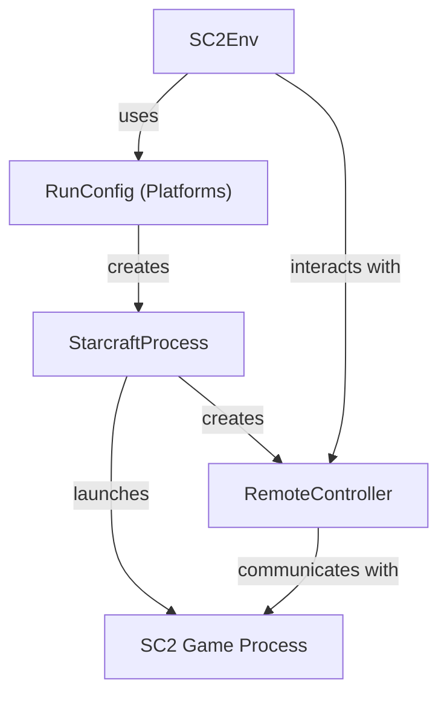
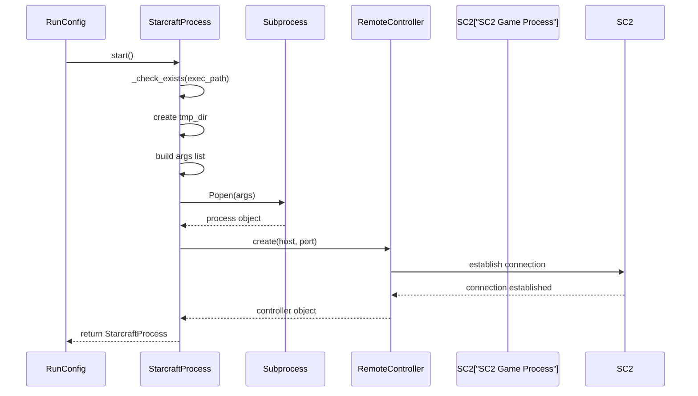
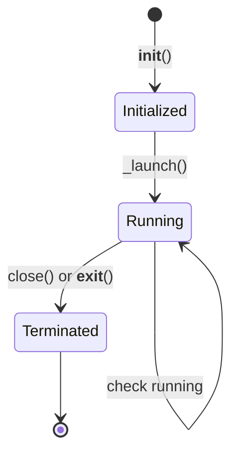
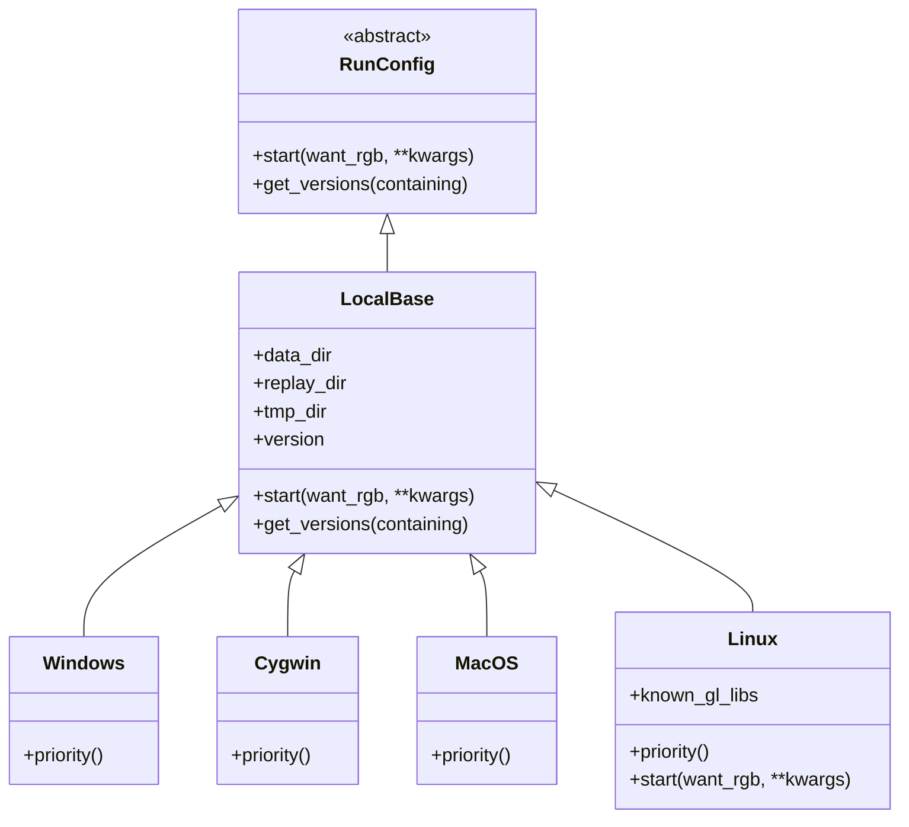
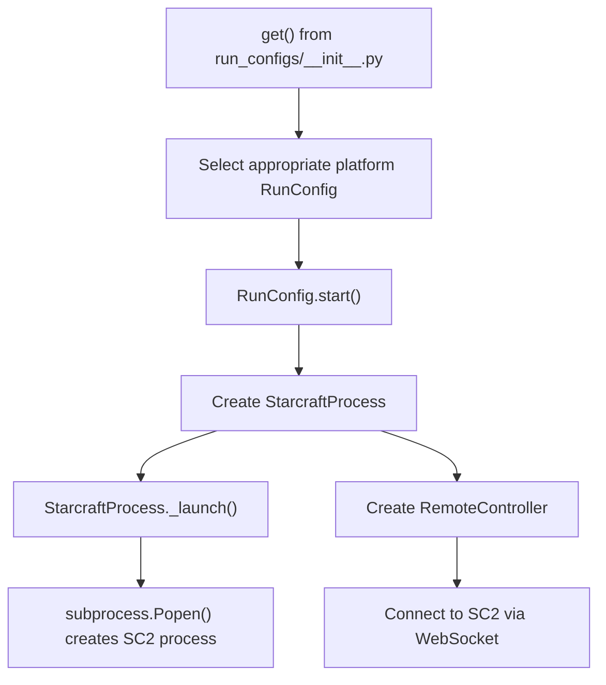

<!-- source: DeepWiki mcp.deepwiki.com · repo google-deepmind/pysc2 · page 5.1 StarCraft Process · fetched 2026-10-26 -->

# StarCraft Process

<details>
<summary>Relevant source files</summary>

The following files were used as context for generating this wiki page:

- [pysc2/lib/sc_process.py](pysc2/lib/sc_process.py)
- [pysc2/run_configs/__init__.py](pysc2/run_configs/__init__.py)
- [pysc2/run_configs/platforms.py](pysc2/run_configs/platforms.py)

</details>


This document explains the StarCraft II process management system in PySC2, which is responsible for launching, configuring, and communicating with StarCraft II game instances. The `StarcraftProcess` class is the core component that handles the lifecycle of SC2 processes across different platforms. For information about the communication protocol with SC2 processes, see [Remote Controller](#5.2).

## Overview

The StarCraft Process management system provides the following capabilities:

- Launching SC2 executables with appropriate command-line arguments
- Managing the lifecycle of SC2 processes (start, monitor, terminate)
- Setting up communication channels between PySC2 and SC2
- Platform-specific configurations (Windows, MacOS, Linux, Cygwin)
- Temporary file management
- Graceful process termination

This system serves as the foundation for the Environment system that provides the interface between agents and the StarCraft II game.

Sources: [pysc2/lib/sc_process.py:14-14](), [pysc2/lib/sc_process.py:48-53]()

## Architecture

The StarCraft Process management system integrates with other PySC2 components as shown below:



Sources: [pysc2/lib/sc_process.py:48-56](), [pysc2/run_configs/platforms.py:83-84]()

## StarcraftProcess Class

The `StarcraftProcess` class ([pysc2/lib/sc_process.py:48-218]()) is the central component responsible for launching and managing StarCraft II processes.

### Initialization

When a `StarcraftProcess` is created, it:

1. Creates a temporary directory for SC2
2. Selects a port for WebSocket communication
3. Builds command-line arguments for SC2
4. Launches the SC2 process
5. Establishes a `RemoteController` for communication



Sources: [pysc2/lib/sc_process.py:58-141]()

### Key Parameters

The `StarcraftProcess` initialization accepts several key parameters:

| Parameter | Description | Default |
|-----------|-------------|---------|
| `run_config` | RunConfig instance with platform settings | Required |
| `exec_path` | Path to the SC2 executable | Required |
| `version` | Version object containing SC2 version info | Required |
| `full_screen` | Whether to launch SC2 in full screen | False |
| `host` | IP address for the WebSocket server | "127.0.0.1" |
| `port` | Port number for the WebSocket server | Auto-selected |
| `connect` | Whether to create a RemoteController | True |
| `window_size` | Screen dimensions if not full screen | (640, 480) |
| `extra_args` | Additional command-line args for SC2 | None |

Sources: [pysc2/lib/sc_process.py:58-78]()

### Process Lifecycle

The `StarcraftProcess` class provides methods for managing the SC2 process lifecycle:



Key lifecycle methods include:

- **Initialization**: `__init__` sets up and launches the process
- **Shutdown**: `close` terminates the process and cleans up resources
- **Status Check**: `running` property checks if the process is still active
- **Context Manager**: `__enter__` and `__exit__` support the `with` statement pattern

Sources: [pysc2/lib/sc_process.py:143-182](), [pysc2/lib/sc_process.py:208-217]()

## Platform-Specific Configurations

The RunConfig system provides platform-specific implementations for launching SC2 on different operating systems:



Each platform implementation:
1. Determines the default installation path for SC2
2. Provides the appropriate executable name
3. Sets up any platform-specific environment variables
4. Adds platform-specific command-line arguments

Sources: [pysc2/run_configs/platforms.py:50-201]()

### Windows Configuration

For Windows, SC2 is typically found in `C:\Program Files (x86)\StarCraft II` or can be discovered through the `ExecuteInfo.txt` file. The executable is `SC2_x64.exe` located in the `Support64` directory.

Sources: [pysc2/run_configs/platforms.py:109-123]()

### MacOS Configuration

For MacOS, SC2 is typically found in `/Applications/StarCraft II` or can be discovered through the `ExecuteInfo.txt` file. The executable is located at `SC2.app/Contents/MacOS/SC2`.

Sources: [pysc2/run_configs/platforms.py:140-154]()

### Linux Configuration

Linux requires additional configuration for graphics libraries. The system will:
1. Check for available OpenGL libraries (EGL or OSMesa)
2. Set up the `LD_LIBRARY_PATH` to include SC2's library directory
3. Add appropriate command-line arguments for rendering

If no suitable graphics libraries are found, it will default to headless mode without rendering.

Sources: [pysc2/run_configs/platforms.py:157-201]()

## Launching Process

The process of launching SC2 happens in several stages:



1. The `get()` function in `run_configs/__init__.py` selects the appropriate platform configuration
2. `RunConfig.start()` is called to initialize the process
3. The platform-specific `start()` method creates a `StarcraftProcess`
4. `StarcraftProcess._launch()` uses `subprocess.Popen()` to create the actual process
5. A `RemoteController` is created to communicate with the SC2 process

Sources: [pysc2/run_configs/__init__.py:27-43](), [pysc2/run_configs/platforms.py:67-84](), [pysc2/lib/sc_process.py:191-199]()

## Common Usage Pattern

The recommended way to use `StarcraftProcess` is through the context manager pattern, which ensures proper cleanup of resources:

```python
# Example usage (not actual code)
run_config = run_configs.get()
with run_config.start() as controller:
    # Use controller to interact with SC2
    controller.create_game(...)
    controller.join_game(...)
    # Game interactions...
# When the with block exits, StarcraftProcess is automatically closed
```

The context manager ensures that:
1. The SC2 process is properly terminated
2. The temporary directory is cleaned up
3. The network port is released
4. The controller connection is closed

Sources: [pysc2/lib/sc_process.py:174-178]()

## Process Termination

When a `StarcraftProcess` is closed, it follows a specific shutdown sequence:

1. Attempt to quit gracefully through the controller
2. Close the controller connection
3. Terminate the process with a grace period
4. Force kill the process if it doesn't exit within the timeout
5. Clean up temporary files and release the port

The `_shutdown_proc()` function implements a graduated shutdown approach, first trying to terminate gracefully and then forcing termination if necessary.

Sources: [pysc2/lib/sc_process.py:143-156](), [pysc2/lib/sc_process.py:201-206](), [pysc2/lib/sc_process.py:220-232]()

## Error Handling

The system includes specific error handling for common failure scenarios:

- `SC2LaunchError`: Custom exception for SC2 launch failures
- Executable validation: Checks if the executable exists and is executable
- Path validation: Verifies that the SC2 installation directory exists
- Version compatibility: Ensures that the SC2 version supports the API

Sources: [pysc2/lib/sc_process.py:44-45](), [pysc2/lib/sc_process.py:184-189](), [pysc2/run_configs/platforms.py:62-64](), [pysc2/run_configs/platforms.py:70-75]()

---

