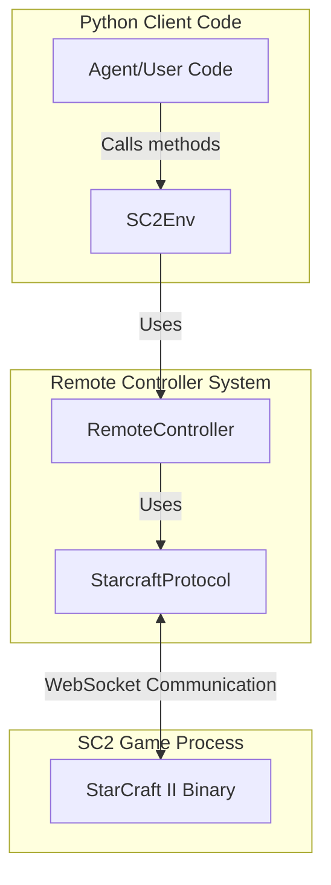
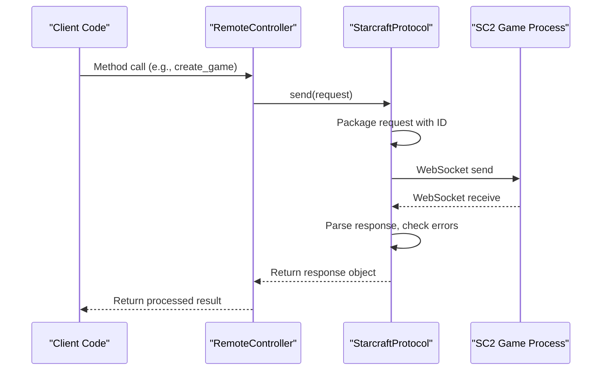
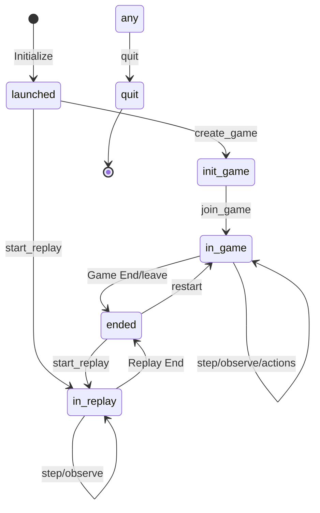
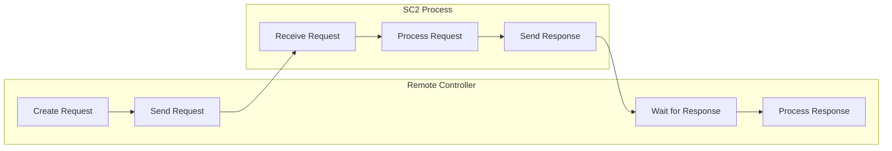

<!-- source: DeepWiki mcp.deepwiki.com · repo google-deepmind/pysc2 · page 5.2 Remote Controller · fetched 2026-10-26 -->

# Remote Controller

<details>
<summary>Relevant source files</summary>

The following files were used as context for generating this wiki page:

- [pysc2/bin/reencode_replays.py](pysc2/bin/reencode_replays.py)
- [pysc2/lib/protocol.py](pysc2/lib/protocol.py)
- [pysc2/lib/remote_controller.py](pysc2/lib/remote_controller.py)
- [pysc2/tests/protocol_error_test.py](pysc2/tests/protocol_error_test.py)

</details>


The Remote Controller system is the core communication layer between Python client code and the StarCraft II (SC2) game process in PySC2. It handles establishing connections, sending commands, receiving observations, and managing the protocol state.

For information about launching and managing SC2 processes, see [StarCraft Process](#5.1). For configurations across different platforms, see [Run Configurations](#5.3).

## 1. Purpose and Functionality

The Remote Controller provides a Python interface to interact with the SC2 binary through a WebSocket connection. All operations are implemented as blocking calls, waiting for responses before returning results to ensure synchronous behavior.



Sources: [pysc2/lib/remote_controller.py:128-138](). [pysc2/lib/protocol.py:72-73]()

## 2. System Architecture

The Remote Controller system consists of two main components:

1. **RemoteController** - High-level interface providing methods for game operations
2. **StarcraftProtocol** - Low-level protocol handler managing WebSocket communication

### 2.1 Communication Flow



Sources: [pysc2/lib/remote_controller.py:140-146](). [pysc2/lib/protocol.py:124-153]()

### 2.2 State Management

The RemoteController maintains and enforces a state machine that tracks the current status of the connection and game. Operations are only allowed in specific states.



Sources: [pysc2/lib/remote_controller.py:85-97](). [pysc2/lib/protocol.py:42]()

## 3. Key Components

### 3.1 RemoteController Class

The `RemoteController` class is the primary interface for SC2 communication, providing methods for all game operations:

| Category | Methods | Description |
|----------|---------|-------------|
| Game Creation | `create_game`, `join_game` | Create and join SC2 games |
| Game Control | `restart`, `leave`, `quit` | Control game lifecycle |
| Observation | `observe`, `data`, `game_info` | Get game state information |
| Actions | `actions`, `act` | Send commands to units in-game |
| Replay | `start_replay`, `save_replay`, `replay_info` | Manage replay functionality |
| Debug | `debug`, `query` | Debug commands and queries |

Sources: [pysc2/lib/remote_controller.py:128-382]()

### 3.2 StarcraftProtocol Class

The `StarcraftProtocol` class handles the low-level communication protocol:

- Manages WebSocket connection and communication
- Handles message serialization/deserialization
- Provides error handling and status tracking
- Maps between request and response objects

Sources: [pysc2/lib/protocol.py:72-192]()

## 4. Communication Protocol

### 4.1 Request-Response Pattern

All communication with the SC2 process follows a request-response pattern:



Sources: [pysc2/lib/remote_controller.py:188-190](). [pysc2/lib/protocol.py:124-153]()

### 4.2 Protocol Buffers

The communication uses Protocol Buffers (protobuf) for serialization:

- Requests and responses are defined in `s2clientprotocol` package
- `sc_pb` (sc2api_pb2) contains the main API definitions
- Messages are serialized to binary before transmission
- Responses are parsed and validated after reception

Sources: [pysc2/lib/remote_controller.py:29-30](). [pysc2/lib/protocol.py:29]()

## 5. Error Handling

The RemoteController implements several error handling mechanisms:

### 5.1 Connection Errors

- `ConnectError`: Raised when connection to SC2 fails
- `ConnectionError`: Handles WebSocket connection issues
- Timeout mechanism to prevent indefinite waiting

Sources: [pysc2/lib/remote_controller.py:44-45](). [pysc2/lib/protocol.py:48-49]()

### 5.2 Protocol Errors

- `RequestError`: Raised when SC2 returns an error in response
- `ProtocolError`: Indicates protocol violations or unexpected states
- Decorators to enforce valid state transitions and error checking

Sources: [pysc2/lib/remote_controller.py:48-52](). [pysc2/lib/protocol.py:53-54](). [pysc2/tests/protocol_error_test.py:29-75]()

## 6. Usage Examples

### 6.1 Creating and Joining a Game

```python
# Create a game with specific settings
create_game_request = sc_pb.RequestCreateGame(...)
controller.create_game(create_game_request)

# Join the game
join_game_request = sc_pb.RequestJoinGame(...)
controller.join_game(join_game_request)
```

### 6.2 Game Loop

```python
# Main game loop
while True:
    # Get observation
    obs = controller.observe()
    
    # Determine actions
    actions = determine_actions(obs)
    
    # Send actions
    controller.actions(sc_pb.RequestAction(actions=actions))
    
    # Step simulation forward
    controller.step()
```

Sources: [pysc2/lib/remote_controller.py:242-246](). [pysc2/lib/remote_controller.py:281-283](). [pysc2/lib/remote_controller.py:289-297]()

## 7. Advanced Features

### 7.1 Replay Handling

The RemoteController provides methods to save and load replays:

- `save_replay()`: Saves the current game as a replay
- `replay_info()`: Extracts metadata from a replay file
- `start_replay()`: Loads and plays back a replay

Sources: [pysc2/lib/remote_controller.py:337-342](). [pysc2/lib/remote_controller.py:374-378](). [pysc2/bin/reencode_replays.py:53-61]()

### 7.2 Debugging Tools

Debug functionality is available via:

- `debug()`: Send debug commands to the game
- `query()`: Query game state information
- Verbose protocol logging with the `sc2_verbose_protocol` flag

Sources: [pysc2/lib/remote_controller.py:346-350](). [pysc2/lib/remote_controller.py:354-356](). [pysc2/lib/protocol.py:32-35]()

## 8. Performance Considerations

The RemoteController includes several performance-enhancing features:

- Caching of last observation to handle stubs
- Decorators to track timing via the `stopwatch` module
- Support for targeted observation requests

Sources: [pysc2/lib/remote_controller.py:247-273](). [pysc2/lib/remote_controller.py:147]()

## 9. Implementation Details

### 9.1 Connection Establishment

The RemoteController automatically establishes a WebSocket connection to the SC2 process:

```python
url = "ws://%s:%s/sc2api" % (host, port)
sock = websocket.create_connection(url, timeout=timeout_seconds)
```

It implements retry logic with increasing delays to handle the case where the SC2 process is still starting up.

Sources: [pysc2/lib/remote_controller.py:147-176]()

### 9.2 Decorator Pattern

The code makes extensive use of decorators to:

1. Validate state before executing operations
2. Check for errors in responses
3. Track performance with stopwatch
4. Handle special cases (e.g., game end conditions)

```python
@valid_status(Status.in_game, Status.in_replay)
@catch_game_end
@sw.decorate
def step(self, count=1):
    # Method implementation
```

Sources: [pysc2/lib/remote_controller.py:75-125]()

---

