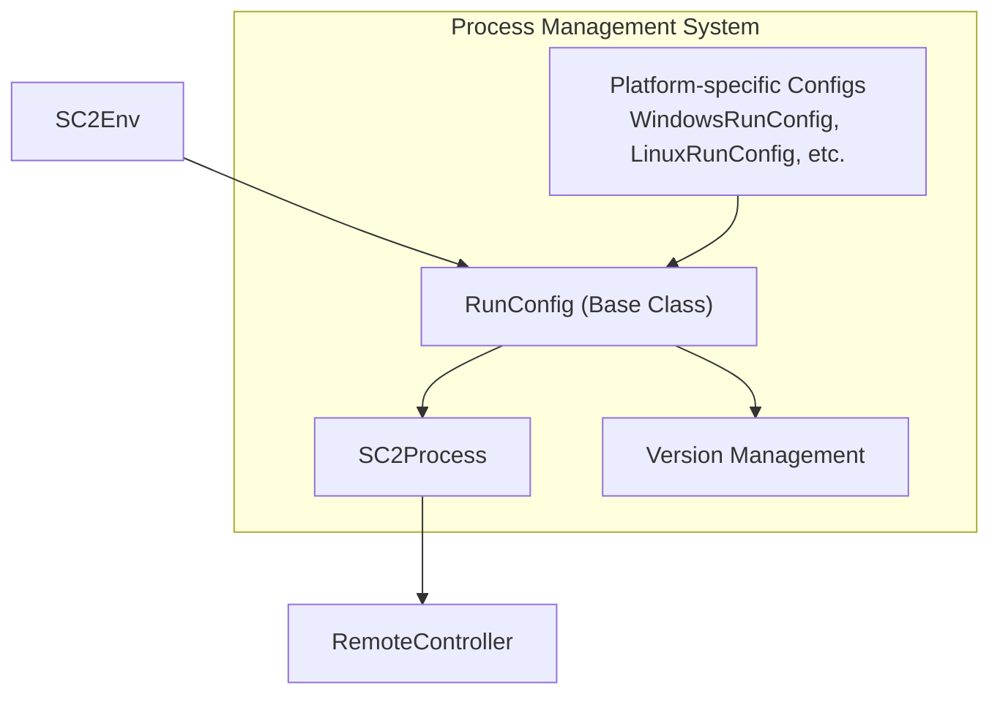
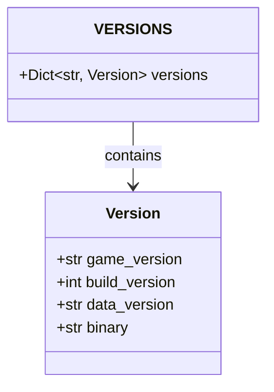
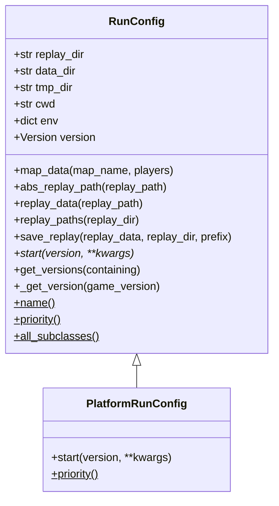
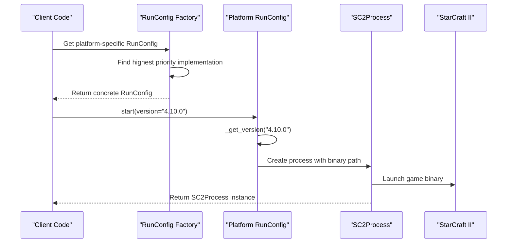
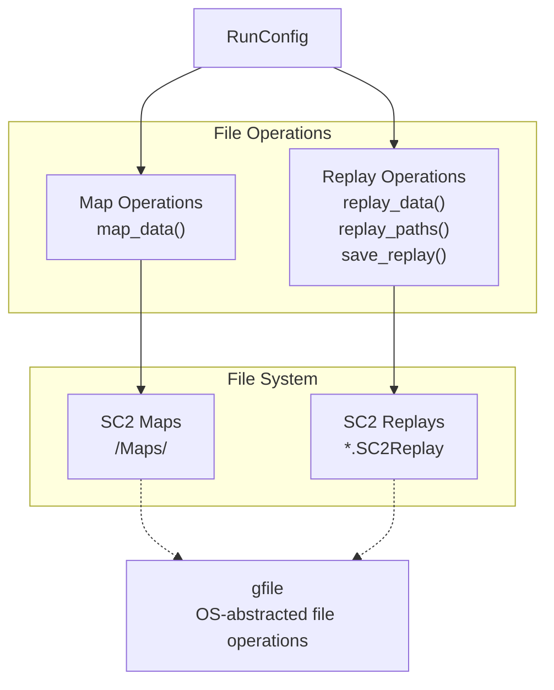

<!-- source: DeepWiki mcp.deepwiki.com · repo google-deepmind/pysc2 · page 5.3 Run Configurations · fetched 2026-10-26 -->

# Run Configurations

<details>
<summary>Relevant source files</summary>

The following files were used as context for generating this wiki page:

- [pysc2/lib/gfile.py](pysc2/lib/gfile.py)
- [pysc2/run_configs/lib.py](pysc2/run_configs/lib.py)

</details>


Run Configurations in PySC2 provide platform-specific implementations for managing StarCraft II processes across different operating systems and game versions. This system handles the launching, version management, and file system interactions needed to run StarCraft II programmatically.

For information about StarCraft process management, see [StarCraft Process](#5.1). For details on communication with SC2 processes, see [Remote Controller](#5.2).

## Overview

Run configurations serve as a bridge between platform-agnostic environment code and the platform-specific requirements for running StarCraft II. They provide unified interfaces for:

1. Locating and launching the StarCraft II binary
2. Managing game versions and compatibility
3. Handling file system operations (maps, replays)
4. Providing appropriate environment variables and working directories



Sources: [pysc2/run_configs/lib.py:108-238]()

## Version Management

StarCraft II versions are represented by the `Version` class, which contains:

- `game_version`: The human-readable version (e.g., "4.10.0")
- `build_version`: The internal build number
- `data_version`: A hash representing the data files version
- `binary`: The binary path or command (platform-specific)

The `VERSIONS` dictionary maps game version strings to their corresponding `Version` objects. PySC2 maintains a comprehensive list of supported game versions from 3.13.0 to 5.0.9.



Sources: [pysc2/run_configs/lib.py:23-105]()

## RunConfig Base Class

The `RunConfig` class serves as an abstract base class that platform-specific run configurations extend. It provides common functionality for:

### Key Properties

- **Directory Management**: Handles replay, data, and temporary directories
- **Version Selection**: Validates and retrieves specific game versions
- **Map Loading**: Loads map data from the filesystem
- **Replay Handling**: Saves and loads replay files

### Notable Methods

| Method | Purpose |
|--------|---------|
| `map_data(map_name, players)` | Retrieves map data by name or path |
| `replay_data(replay_path)` | Reads replay file data |
| `save_replay(replay_data, replay_dir, prefix)` | Saves replay data to a file |
| `start(version, **kwargs)` | Launches the game process |
| `get_versions(containing)` | Returns available game versions |
| `_get_version(game_version)` | Resolves version references to full Version objects |



Sources: [pysc2/run_configs/lib.py:108-238]()

## Initialization and Configuration

When creating a `RunConfig` instance, you need to provide several directories and configuration parameters:

```python
RunConfig(
    replay_dir,  # Where to find replays
    data_dir,    # Where SC2 should find data and battle.net cache
    tmp_dir,     # Temporary directory
    version,     # Game version to run
    cwd=None,    # Current working directory
    env=None     # Environment variables
)
```

The system automatically selects the appropriate platform-specific implementation based on the current operating system. Each platform implementation defines a `priority()` method - the one with the highest priority that's valid for the current system is selected.



Sources: [pysc2/run_configs/lib.py:111-128](), [pysc2/run_configs/lib.py:194-196](), [pysc2/run_configs/lib.py:198-213]()

## Working with Game Files

### Map Management

The `RunConfig` class provides methods for working with map files:

- `map_data(map_name, players=None)`: Retrieves the map data by name
  - Automatically looks for player-count specific versions (e.g., "(2)Example.SC2Map")
  - Raises `ValueError` if the map cannot be found

### Replay Handling

Several methods support working with replay files:

- `abs_replay_path(replay_path)`: Converts relative paths to absolute paths
- `replay_data(replay_path)`: Reads and returns the contents of a replay file
- `replay_paths(replay_dir)`: Generator yielding paths to all replays in a directory
- `save_replay(replay_data, replay_dir, prefix=None)`: Saves replay data to a file
  - Automatically generates timestamped filenames
  - Returns the path to the saved replay



Sources: [pysc2/run_configs/lib.py:130-193](), [pysc2/lib/gfile.py:1-28]()

## Extending for Custom Configurations

The `RunConfig` system is designed to be extensible. Platform-specific subclasses must implement:

1. The `start(version=None, **kwargs)` method to launch SC2 processes
2. The `priority()` class method to determine selection order

Custom run configurations can be created by subclassing `RunConfig` and implementing these methods. The `all_subclasses()` class method is used internally to discover all available implementations.

Sources: [pysc2/run_configs/lib.py:194-213]()

## Usage Examples

### Basic Usage

When creating an SC2 environment, a run configuration is automatically selected based on your platform:

```python
from pysc2.env import sc2_env

env = sc2_env.SC2Env(
    map_name="Simple64",
    players=[sc2_env.Agent(sc2_env.Race.terran), 
             sc2_env.Bot(sc2_env.Race.random, sc2_env.Difficulty.easy)],
    agent_interface_format=features.AgentInterfaceFormat(
        feature_dimensions=features.Dimensions(screen=84, minimap=64),
        use_feature_units=True),
    # The run configuration is automatically selected
)
```

### Explicit Run Configuration

For more control, you can explicitly create a run configuration:

```python
from pysc2.run_configs import configs

# Get the appropriate run config for your platform
run_config = configs.get()

# Start a specific version
with run_config.start(version="4.10.0") as controller:
    # Use the controller to interact with SC2
    controller.create_game(...)
```

Sources: [pysc2/run_configs/lib.py:194-196]()

## Platform-Specific Considerations

Different platforms have unique requirements for running StarCraft II:

- **Windows**: Uses registry keys to locate installations
- **Linux**: Requires Wine or a native Linux build
- **MacOS**: Uses application bundles in standard locations

Each platform implementation handles these differences while providing a consistent interface to the rest of the PySC2 system.

Sources: [pysc2/run_configs/lib.py:108-109]()

---

