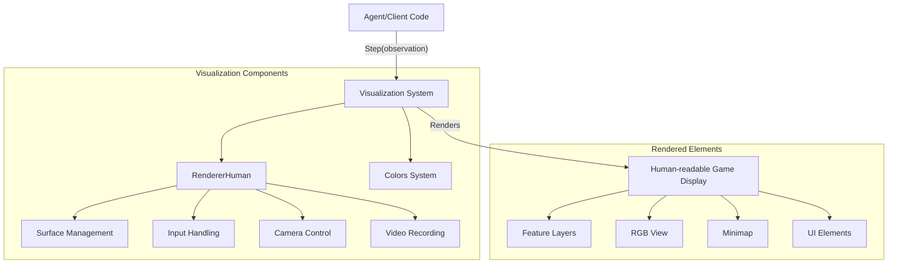
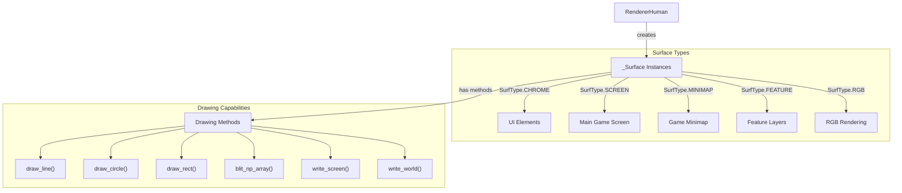
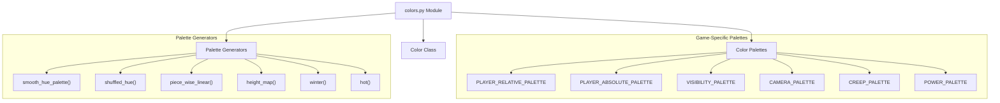

<!-- source: DeepWiki mcp.deepwiki.com · repo google-deepmind/pysc2 · page 6 Visualization · fetched 2026-10-26 -->

# Visualization

<details>
<summary>Relevant source files</summary>

The following files were used as context for generating this wiki page:

- [pysc2/bin/benchmark_observe.py](pysc2/bin/benchmark_observe.py)
- [pysc2/lib/colors.py](pysc2/lib/colors.py)
- [pysc2/lib/point.py](pysc2/lib/point.py)
- [pysc2/lib/point_test.py](pysc2/lib/point_test.py)
- [pysc2/lib/renderer_human.py](pysc2/lib/renderer_human.py)

</details>


The Visualization system in PySC2 provides tools for rendering StarCraft II game states in a human-readable format. This system allows users to visualize game observations, interact with the rendered game environment, and understand agent behavior. For information on the underlying Feature Extraction system that generates the data to be visualized, see [Feature System](#3).

## Overview

The visualization system centers around rendering game observations in various formats, including feature layers and RGB. It uses pygame as the underlying graphics engine and offers both interactive and non-interactive visualization capabilities.



Sources: [pysc2/lib/renderer_human.py:14-48](), [pysc2/lib/renderer_human.py:253-308]()

## Core Components

### RendererHuman

The primary class that manages visualization is `RendererHuman`. This class handles initialization of pygame windows, rendering of game observations, and processing of user input for interactive visualization.

```mermaid
classDiagram
    class RendererHuman {
        +__init__(fps, step_mul, render_sync, render_feature_grid, video)
        +init(game_info, static_data)
        +close()
        +get_actions(run_config, controller)
        +render_thread()
        +draw_screen(surf)
        +draw_mini_map(surf)
        +draw_feature_layer(surf, feature)
        +draw_raw_layer(surf, obs, layer_name, color_map)
    }
    
    class _Surface {
        +surf
        +surf_type
        +surf_rect
        +world_to_surf
        +world_to_obs
        +draw
        +draw_line()
        +draw_circle()
        +draw_rect()
        +blit_np_array()
        +write_screen()
        +write_world()
    }
    
    RendererHuman --> _Surface : "creates"
    RendererHuman --> "Colors" : "uses"
    RendererHuman --> "Point/Rect" : "uses for geometry"
```

Sources: [pysc2/lib/renderer_human.py:253-308](), [pysc2/lib/renderer_human.py:119-198]()

The `RendererHuman` offers several configuration options:

- `fps`: Controls the frames per second for rendering
- `step_mul`: Number of game steps per observation
- `render_sync`: Whether to wait for rendering before continuing
- `render_feature_grid`: Whether to display the grid of feature layers
- `video`: Path to write video output (enables render_sync when specified)

Sources: [pysc2/lib/renderer_human.py:301-313]()

### Surface System

The visualization system uses a concept of "surfaces" to manage different rendering areas. Each surface represents a specific part of the visualization (e.g., main screen, minimap, feature layer grid) and has associated properties for rendering and interaction.



Sources: [pysc2/lib/renderer_human.py:82-89](), [pysc2/lib/renderer_human.py:119-198]()

### Coordinate Transformations

The visualization system handles multiple coordinate systems and provides transformations between them:

1. **World Coordinates**: The native game space coordinates
2. **Screen Coordinates**: Pixel coordinates in the rendered view
3. **Observer Coordinates**: Coordinates used for camera manipulation

The system uses the `Point` and `Rect` classes for geometric operations and coordinate transformations.

Sources: [pysc2/lib/renderer_human.py:446-569](), [pysc2/lib/point.py:21-151]()

## Color System

The visualization uses a comprehensive color system to represent different game elements. The `colors.py` module provides:

- Basic colors (black, white, red, etc.)
- Gradient generators for continuous values
- Special palettes for game-specific features



Sources: [pysc2/lib/colors.py:25-61](), [pysc2/lib/colors.py:171-208]()

## Usage Patterns

### Initialization and Rendering

To use the visualization system:

1. Create a `RendererHuman` instance with desired configuration
2. Initialize it with game information
3. Push observations to the renderer
4. Process user input if needed

```python
# Example initialization (conceptual)
renderer = RendererHuman(fps=22.4, render_feature_grid=True)
renderer.init(game_info, static_data)

# Game loop
while True:
    actions = renderer.get_actions(run_config, controller)
    if actions == ActionCmd.QUIT:
        break
    # Process actions, get new observations...
    renderer.render(observations)
```

Sources: [pysc2/lib/renderer_human.py:301-344](), [pysc2/lib/renderer_human.py:751-845]()

### Performance Considerations

The visualization system can impact performance, especially when rendering feature layers or RGB views. For performance-critical applications:

- Consider using `render_sync=False` to avoid blocking on rendering
- Adjust `fps` and `step_mul` to control rendering frequency
- Disable `render_feature_grid` if all feature layers aren't needed

A benchmark utility is available to measure observation and rendering times:

Sources: [pysc2/bin/benchmark_observe.py:15-150]()

## Interactive Features

The visualization system provides interactive features through keyboard and mouse input:

- Camera movement with arrow keys
- Zoom in/out with Ctrl+Plus/Minus
- Selection of units with mouse clicks
- Issuing commands through hotkeys
- Saving replays
- Toggling between RGB and feature layer rendering

The system also provides a help screen with keyboard shortcuts.

Sources: [pysc2/lib/renderer_human.py:255-292](), [pysc2/lib/renderer_human.py:751-886]()

## Video Recording

The visualization system supports recording videos of gameplay or agent behavior. This is useful for documenting agent performance or creating demonstrations.

To enable video recording, provide a filename to the `video` parameter when creating the `RendererHuman` instance:

```python
renderer = RendererHuman(video="agent_gameplay.mp4")
```

This automatically enables synchronized rendering and writes frames to the specified video file.

Sources: [pysc2/lib/renderer_human.py:301-333]()

## Advanced Usage: Integration with Feature Layers

The visualization system can render both RGB views and feature layers. Feature layers provide semantic information about the game state, such as unit types, visibility, and player-relative positioning.

The table below shows common feature layers and their visualization:

| Feature Layer | Description | Visualization Method |
|---------------|-------------|---------------------|
| player_relative | Shows units by player relationship (self, ally, neutral, enemy) | PLAYER_RELATIVE_PALETTE |
| visibility | Shows map visibility (hidden, fog, visible) | VISIBILITY_PALETTE |
| height_map | Shows terrain height | height_map() palette |
| creep | Shows zerg creep coverage | CREEP_PALETTE |
| power | Shows protoss power fields | POWER_PALETTE |

Sources: [pysc2/lib/renderer_human.py:654-665](), [pysc2/lib/colors.py:171-208]()

---

