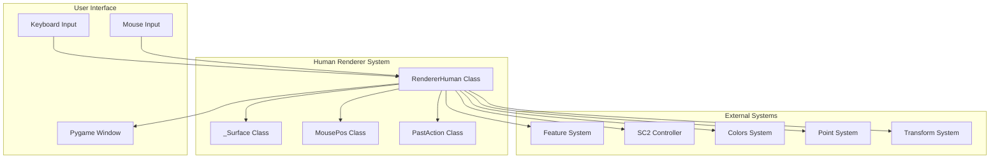
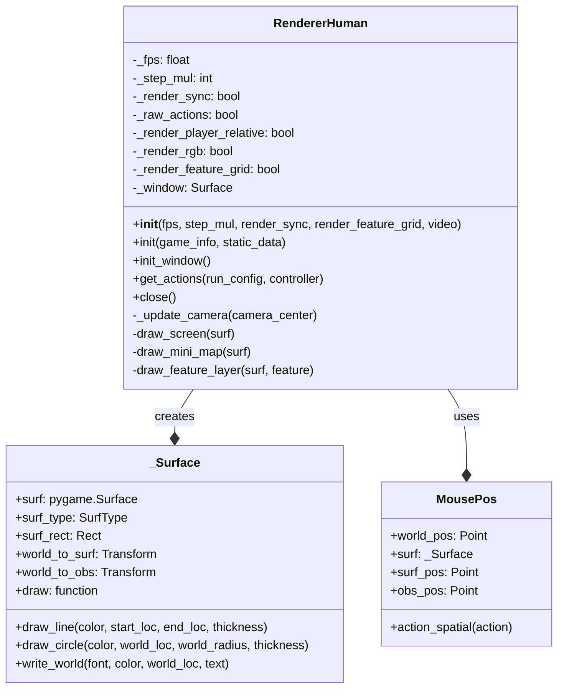
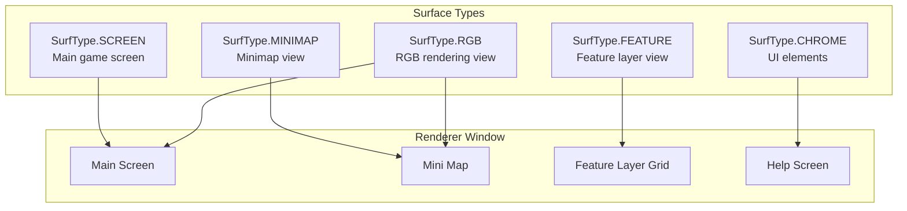
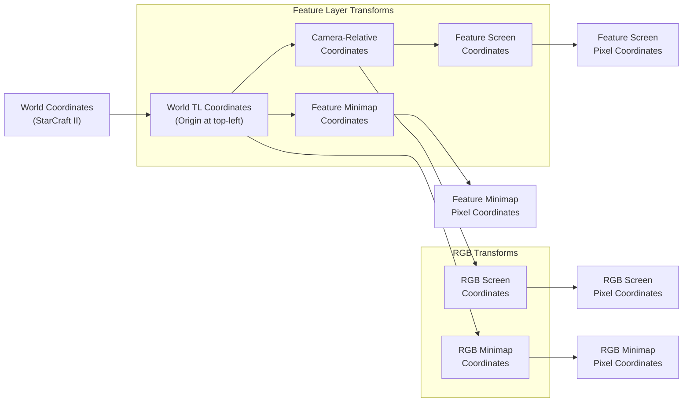
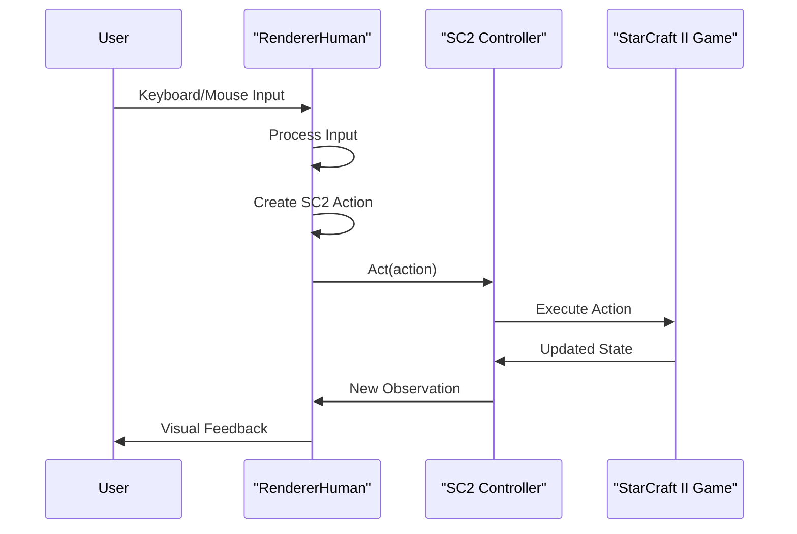

<!-- source: DeepWiki mcp.deepwiki.com · repo google-deepmind/pysc2 · page 6.1 Human Renderer · fetched 2026-10-26 -->

# Human Renderer

<details>
<summary>Relevant source files</summary>

The following files were used as context for generating this wiki page:

- [pysc2/bin/benchmark_observe.py](pysc2/bin/benchmark_observe.py)
- [pysc2/lib/colors.py](pysc2/lib/colors.py)
- [pysc2/lib/point.py](pysc2/lib/point.py)
- [pysc2/lib/point_test.py](pysc2/lib/point_test.py)
- [pysc2/lib/renderer_human.py](pysc2/lib/renderer_human.py)

</details>


The Human Renderer is a visualization system in PySC2 that provides an interactive graphical interface for viewing and interacting with StarCraft II observations. It uses pygame to render game states, allowing users to observe the game environment, control units, and execute commands through a graphical user interface. This component bridges the gap between raw StarCraft II data and human-readable visualizations, making it invaluable for debugging agents, analyzing game states, and manual play testing.

Sources: [pysc2/lib/renderer_human.py:14-14](), [pysc2/lib/renderer_human.py:253-254]()

## Architecture Overview

The Human Renderer transforms StarCraft II observations into visual representations and handles user inputs to generate game actions. It supports both feature layer and RGB rendering modes, providing flexibility for different visualization needs.



Sources: [pysc2/lib/renderer_human.py:253-336](), [pysc2/lib/renderer_human.py:120-197](), [pysc2/lib/renderer_human.py:200-211](), [pysc2/lib/renderer_human.py:222-226]()

## Core Components

### RendererHuman Class

The `RendererHuman` class is the main component responsible for visualization and user interaction. It manages the pygame window, handles input events, and renders the game state.



Sources: [pysc2/lib/renderer_human.py:253-726](), [pysc2/lib/renderer_human.py:120-197](), [pysc2/lib/renderer_human.py:200-211]()

### Surface Types and Rendering Areas

The renderer divides the game view into different surface types, each with specific purposes:



Sources: [pysc2/lib/renderer_human.py:82-89](), [pysc2/lib/renderer_human.py:410-701]()

## Initialization and Usage

### Creating and Initializing the Renderer

To use the Human Renderer, you need to create an instance and initialize it with game information and static data:

```python
renderer = RendererHuman(fps=22.4, step_mul=1, render_sync=False, 
                         render_feature_grid=True, video=None)
renderer.init(game_info, static_data)
```

The initialization process sets up the pygame window, configures the rendering surfaces, and establishes coordinate transformations for rendering game elements.

Sources: [pysc2/lib/renderer_human.py:302-408](), [pysc2/lib/renderer_human.py:346-408]()

### Rendering Parameters

The renderer supports several configuration options:

| Parameter | Description | Default |
|-----------|-------------|---------|
| fps | Frames per second target | 22.4 |
| step_mul | Game steps per observation | 1 |
| render_sync | Wait for observation to render before continuing | False |
| render_feature_grid | Show grid of feature layers when both RGB and features are available | True |
| video | Filename to save video (enables render_sync) | None |

Sources: [pysc2/lib/renderer_human.py:302-325]()

## Coordinate Transformations

The renderer uses several coordinate systems and transformations between them:

1. **World Coordinates**: The native StarCraft II world coordinates
2. **Screen Coordinates**: Pixel coordinates in the rendering window
3. **Observation Coordinates**: Coordinates used in the observation data



The renderer implements these transformations to correctly map game world points to screen positions and handle user input mapping back to game coordinates.

Sources: [pysc2/lib/renderer_human.py:461-566](), [pysc2/lib/point.py:15-152]()

## User Interaction

### Keyboard Shortcuts

The Human Renderer provides numerous keyboard shortcuts for interacting with the game:

| Key | Function |
|-----|----------|
| F1 | Select idle worker |
| F2 | Select army |
| F3 | Select larva (zerg) or warp gates (protoss) |
| F4 | Quit the game |
| F5 | Restart the map |
| F8 | Save a replay |
| F9 | Toggle RGB rendering |
| F10 | Toggle rendering the player_relative layer |
| F11 | Toggle synchronous rendering |
| F12 | Toggle raw/feature layer actions |
| Ctrl++ | Zoom in |
| Ctrl+- | Zoom out |
| PgUp/PgDn | Increase/decrease the max game speed |
| Ctrl+PgUp/PgDn | Increase/decrease the step multiplier |
| Pause | Pause the game |
| ? | Show help screen |
| Arrow keys | Move camera |
| 0-9 | Control groups |

Sources: [pysc2/lib/renderer_human.py:275-292](), [pysc2/lib/renderer_human.py:255-263](), [pysc2/lib/renderer_human.py:751-884]()

### Mouse Interactions

The renderer supports several mouse interactions:

1. **Left-click**:
   - On minimap: Move camera
   - On screen with no queued action: Start unit selection
   - On screen with queued action: Execute the action at target location

2. **Right-click**:
   - Issue a "Smart" command to selected units
   - Cancel queued action

3. **Mouse wheel**:
   - Used for scrolling through options

Sources: [pysc2/lib/renderer_human.py:73-80](), [pysc2/lib/renderer_human.py:857-884]()

## Action Processing

The Human Renderer translates user inputs into StarCraft II actions that are sent to the game:



The `get_actions` method processes user inputs and returns appropriate actions to be executed by the controller.

Sources: [pysc2/lib/renderer_human.py:751-885](), [pysc2/lib/renderer_human.py:887-970]()

## Rendering Capabilities

### Feature Layer Rendering

The renderer can visualize feature layers that represent different aspects of the game state, such as:
- Unit types
- Player relative (self, ally, neutral, enemy)
- Visibility
- Terrain height
- Pathing grid
- Placement grid

Each feature layer is rendered with appropriate color maps to distinguish different values.

Sources: [pysc2/lib/renderer_human.py:596-688](), [pysc2/lib/colors.py:171-177](), [pysc2/lib/colors.py:199-208]()

### RGB Rendering

When RGB rendering is enabled, the renderer displays the game using the RGB observations provided by the StarCraft II client, providing a more visually realistic representation.

Sources: [pysc2/lib/renderer_human.py:573-592]()

## Performance Considerations

The renderer includes performance monitoring capabilities to track rendering times and game frame rates:

```python
self._game_times = collections.deque(maxlen=100)  # Avg FPS over 100 frames
self._render_times = collections.deque(maxlen=100)
```

It also uses the `stopwatch` utility to measure and report performance metrics, which can be valuable for debugging and optimization.

Sources: [pysc2/lib/renderer_human.py:328-329](), [pysc2/lib/benchmark_observe.py:15-150]()

## Integration with PySC2

The Human Renderer integrates with the broader PySC2 system, particularly with:

1. **Environment System**: The renderer works with the SC2Env to visualize observations
2. **Feature System**: It relies on the Feature system to interpret and display feature layers
3. **Controller**: It sends actions to the StarCraft II game through the controller

To use the renderer within the environment system, typically:

```python
env = SC2Env(...)
renderer = RendererHuman()
renderer.init(env.game_info(), env.static_data())

# In the game loop
obs = env.step(actions)
renderer.render(obs)
cmd = renderer.get_actions(env.run_config, env.controller)
```

Sources: [pysc2/lib/renderer_human.py:752-885]()

## Conclusion

The Human Renderer provides a powerful visualization and interaction interface for StarCraft II observations in PySC2. It allows users to view the game state in different formats (feature layers or RGB), interact with the game through a familiar keyboard and mouse interface, and visualize complex game data in an intuitive way. This makes it an essential tool for debugging agents, analyzing gameplay, and testing new strategies manually.

---

