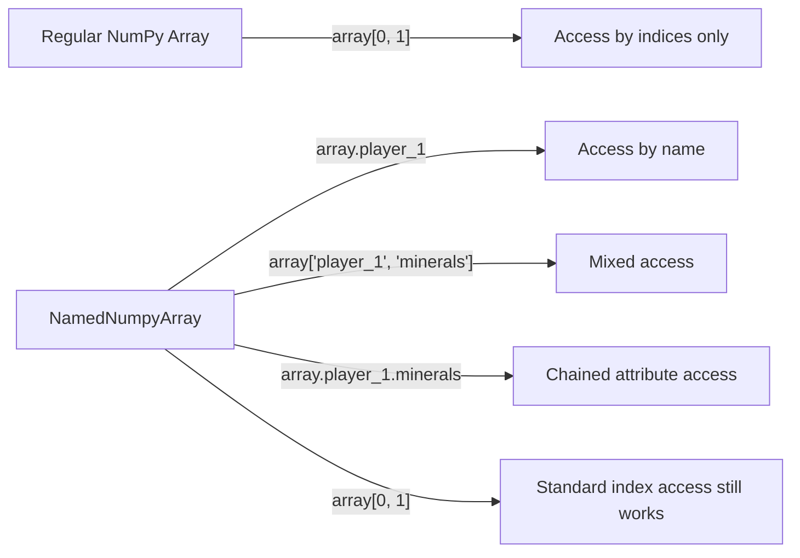
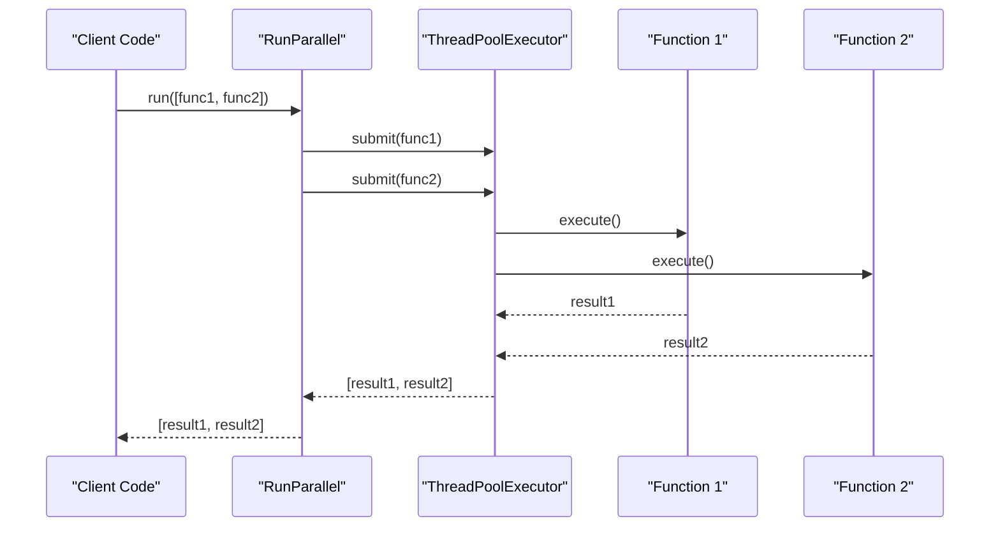
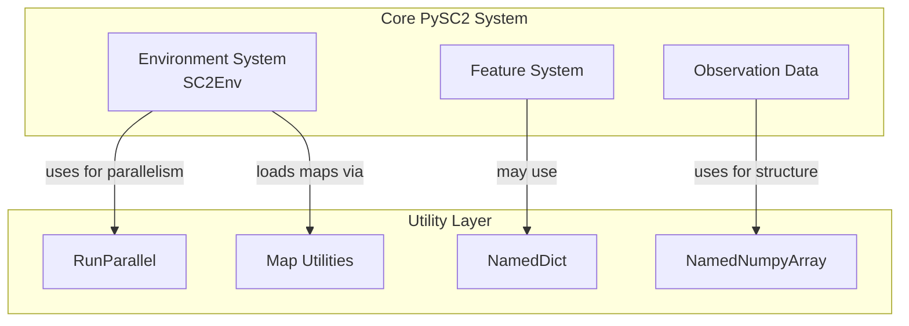

<!-- source: DeepWiki mcp.deepwiki.com · repo google-deepmind/pysc2 · page 7 Utilities · fetched 2026-10-26 -->

# Utilities

<details>
<summary>Relevant source files</summary>

The following files were used as context for generating this wiki page:

- [pysc2/lib/named_array.py](pysc2/lib/named_array.py)
- [pysc2/lib/named_array_test.py](pysc2/lib/named_array_test.py)
- [pysc2/lib/run_parallel.py](pysc2/lib/run_parallel.py)
- [pysc2/maps/ladder.py](pysc2/maps/ladder.py)
- [pysc2/maps/lib.py](pysc2/maps/lib.py)
- [pysc2/tests/debug_test.py](pysc2/tests/debug_test.py)

</details>


The PySC2 library includes several utility classes and functions that provide common functionality used throughout the codebase. This page documents these utilities, with a focus on the `NamedNumpyArray` class for named indexing of NumPy arrays and the `RunParallel` class for concurrent execution. For information about map management utilities, see [Maps and Map Management](#7.2).

## NamedNumpyArray

The `NamedNumpyArray` class provides a powerful extension to NumPy arrays by allowing array dimensions to be accessed by name rather than just by numeric indices. This makes code more readable and less error-prone, especially when working with complex, multi-dimensional observations.

```mermaid
classDiagram
    class "numpy.ndarray" {
        +shape
        +dtype
        +__getitem__(indices)
        +__setitem__(indices, value)
    }
    
    class "NamedNumpyArray" {
        -_index_names : list
        +__new__(values, names, *args, **kwargs)
        +__getattr__(name)
        +__setattr__(name, value)
        +__getitem__(indices)
        +__setitem__(indices, value)
        -_indices(indices)
        -_get_index(dim, index)
    }
    
    "numpy.ndarray" <|-- "NamedNumpyArray" : extends
```

Sources: [pysc2/lib/named_array.py:39-272]()

### Key Features

- **Named Indexing**: Access array elements using named indices (`array.element_name` or `array["element_name"]`)
- **Compatibility with NumPy**: Preserves all standard NumPy functionality while adding named access
- **Multiple Dimensions**: Supports naming each dimension independently
- **Flexible Name Sources**: Names can be defined as lists, tuples, namedtuples, or IntEnums
- **Slicing Support**: Full support for array slicing while preserving names
- **Pickling Support**: Can be pickled and unpickled
- **Representation**: Custom string representation showing array values along with their names

### Usage Examples



Sources: [pysc2/lib/named_array.py:39-272](), [pysc2/lib/named_array_test.py:92-123]()

#### Basic Usage

```python
# Create a 1D named array
units = NamedNumpyArray([5, 10, 15], ["marines", "marauders", "medivacs"])
units.marines  # Returns 5
units["marauders"]  # Returns 10
units[2]  # Returns 15 (standard numeric indexing still works)

# Create a 2D named array (first dimension named, second dimension unnamed)
resources = NamedNumpyArray([[100, 0], [200, 50]], [["player_1", "player_2"], None])
resources.player_1  # Returns [100, 0]
resources["player_2", 1]  # Returns 50
```

Sources: [pysc2/lib/named_array_test.py:81-123]()

#### Advanced Usage

```python
# Using enums for names
units = NamedNumpyArray([5, 10, 15], [UnitEnum])  # UnitEnum.MARINE = 0, etc.
units.MARINE  # Returns 5

# Multi-dimensional naming
game_state = NamedNumpyArray(
    [[[[0, 1], [2, 3]], [[4, 5], [6, 7]]],
     [[[8, 9], [10, 11]], [[12, 13], [14, 15]]]],
    [["player_1", "player_2"], ["base_1", "base_2"], ["mineral", "gas"], ["current", "max"]]
)
game_state.player_1.base_2.mineral.current  # Returns 4
```

Sources: [pysc2/lib/named_array_test.py:278-298]()

### Implementation Details

The `NamedNumpyArray` class is implemented as a subclass of NumPy's `ndarray` with additional functionality for named indexing. The class stores the mapping between names and indices in the `_index_names` attribute, which is a list of dictionaries (one per dimension) mapping names to indices.

Key methods include:
- `__new__`: Initializes the named array and validates the names
- `__getattr__` and `__setattr__`: Handle attribute-style access
- `__getitem__` and `__setitem__`: Overridden to handle named indexing
- `_indices` and `_get_index`: Convert string indices to numeric indices

Sources: [pysc2/lib/named_array.py:39-272]()

## RunParallel

The `RunParallel` class provides a simple interface for executing multiple functions in parallel using a thread pool. This is particularly useful for running multiple instances of StarCraft II environments concurrently.

```mermaid
classDiagram
    class "RunParallel" {
        -_timeout : number
        -_executor : ThreadPoolExecutor
        -_workers : number
        +__init__(timeout=None)
        +run(funcs)
        +shutdown(wait=True)
    }
    
    class "ThreadPoolExecutor" {
        +submit()
        +shutdown()
    }
    
    "RunParallel" --> "ThreadPoolExecutor" : uses
```

Sources: [pysc2/lib/run_parallel.py:24-86]()

### Key Features

- **Parallel Execution**: Run multiple functions concurrently
- **Timeout Control**: Optional timeout for function execution
- **Dynamic Sizing**: Thread pool size adapts to the number of functions
- **Exception Handling**: Propagates the first exception encountered in any function
- **Resource Management**: Properly cleans up resources when no longer needed

### Usage Examples



Sources: [pysc2/lib/run_parallel.py:32-77]()

#### Basic Usage

```python
# Create the parallel runner
runner = RunParallel()

# Define functions to run in parallel
def func1():
    return "result1"
    
def func2(arg):
    return f"result2: {arg}"

# Run functions in parallel
results = runner.run([
    func1,                  # Direct function reference
    (func2, "argument")     # Function with arguments via functools.partial
])
# results = ["result1", "result2: argument"]
```

Sources: [pysc2/lib/run_parallel.py:32-77]()

#### Common Use Case: Multiple SC2 Environments

```python
# Create environments
envs = [sc2_env.SC2Env(...) for _ in range(4)]

# Create runner
runner = RunParallel()

# Reset all environments in parallel
timesteps = runner.run([(env.reset,) for env in envs])

# Step all environments in parallel
actions = [get_action(timestep) for timestep in timesteps]
next_timesteps = runner.run([(env.step, [action]) for env, action in zip(envs, actions)])
```

Sources: [pysc2/lib/run_parallel.py:32-77]()

### Implementation Details

The `RunParallel` class uses Python's `concurrent.futures.ThreadPoolExecutor` to manage the thread pool. The main method is `run`, which takes an iterable of functions or function arguments and returns their results in the same order.

Key implementation aspects:
- The thread pool is lazily initialized and grown as needed
- Single-function calls bypass the thread pool for efficiency
- Exceptions from any function are propagated to the caller
- Resources are properly cleaned up through the `shutdown` method

Sources: [pysc2/lib/run_parallel.py:24-86]()

## NamedDict

The `NamedDict` class is a simple utility that extends the standard Python dictionary to allow attribute-style access to dictionary elements.

```mermaid
classDiagram
    class "dict" {
        +__getitem__(key)
        +__setitem__(key, value)
    }
    
    class "NamedDict" {
        +__init__(*args, **kwargs)
    }
    
    "dict" <|-- "NamedDict" : extends
```

Sources: [pysc2/lib/named_array.py:27-32]()

### Usage Example

```python
# Create a named dictionary
config = NamedDict(width=800, height=600, title="Window")

# Access elements using attribute notation
config.width      # Returns 800
config["height"]  # Returns 600 (standard dictionary access still works)

# Add new elements
config.depth = 32
config["fullscreen"] = False
```

Sources: [pysc2/lib/named_array.py:27-32](), [pysc2/lib/named_array_test.py:28-37]()

## Utilities Relationships

The following diagram illustrates how the utility classes relate to the broader PySC2 system:



Sources: [pysc2/lib/named_array.py:39-272](), [pysc2/lib/run_parallel.py:24-86](), [pysc2/lib/named_array.py:27-32](), [pysc2/maps/lib.py:44-113]()

This diagram shows how the utility classes support the core PySC2 system. The `NamedNumpyArray` class is used to structure observation data, making it easier to access. The `RunParallel` class enables parallelism in the environment system, allowing multiple SC2 environments to run concurrently. The map utilities provide map loading and management functionality.

---

