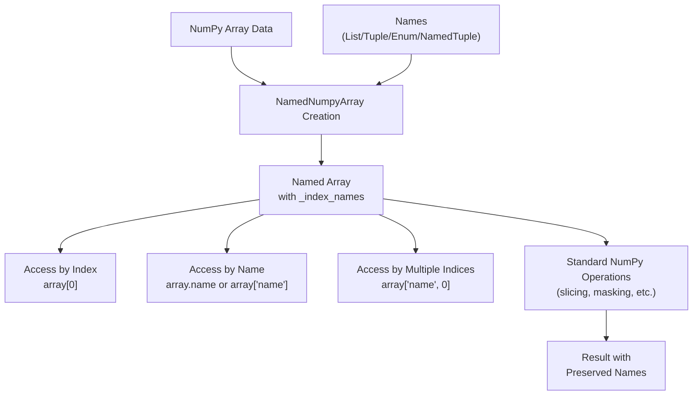
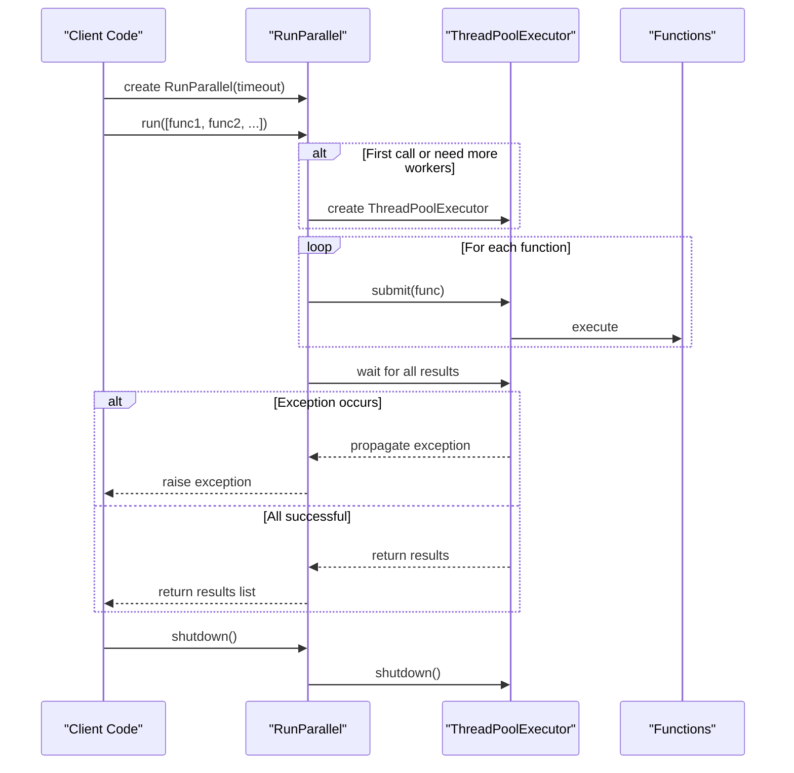
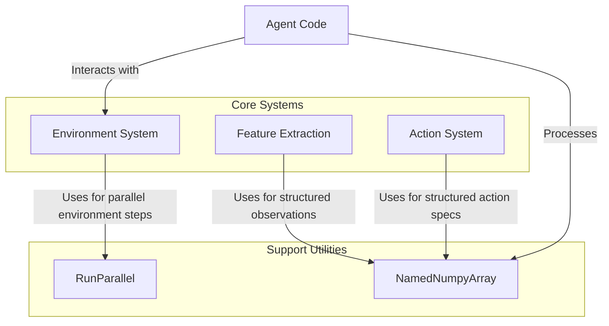

<!-- source: DeepWiki mcp.deepwiki.com · repo google-deepmind/pysc2 · page 7.1 NamedNumpyArray and RunParallel · fetched 2026-10-26 -->

# NamedNumpyArray and RunParallel

<details>
<summary>Relevant source files</summary>

The following files were used as context for generating this wiki page:

- [pysc2/lib/named_array.py](pysc2/lib/named_array.py)
- [pysc2/lib/named_array_test.py](pysc2/lib/named_array_test.py)
- [pysc2/lib/run_parallel.py](pysc2/lib/run_parallel.py)
- [pysc2/tests/debug_test.py](pysc2/tests/debug_test.py)

</details>


This page documents two important utility classes in the PySC2 codebase: `NamedNumpyArray` and `RunParallel`. These utilities provide enhanced data structures and parallel execution capabilities that are used throughout the PySC2 system.

## Purpose and Scope

`NamedNumpyArray` extends NumPy arrays with named indexing capabilities, allowing for more readable and maintainable code when working with complex multi-dimensional data. `RunParallel` provides a simple thread pool implementation for executing multiple functions concurrently, which is particularly useful for operations with synchronization barriers.

These utilities are part of PySC2's support infrastructure and are used by various components of the system, including observation handling, feature extraction, and agent execution.

## NamedNumpyArray

`NamedNumpyArray` is a subclass of `numpy.ndarray` that allows naming dimensions and accessing elements by these names, while maintaining all the functionality of regular NumPy arrays.

### Key Features

- Access array elements using both numeric indices and named indices
- Support for multi-dimensional arrays with names for any dimension
- Compatible with standard NumPy operations (slicing, masking, etc.)
- Names can be specified as lists, tuples, namedtuples, or IntEnum instances
- Preserves names through operations like slicing and masking when possible

Sources: [pysc2/lib/named_array.py:39-272]()

### Structure and Implementation

```mermaid
classDiagram
    class "numpy.ndarray" {
        +shape
        +dtype
        +__getitem__(indices)
        +__setitem__(indices, value)
    }
    
    class "NamedNumpyArray" {
        -_index_names
        +__new__(values, names, *args, **kwargs)
        +__array_finalize__(obj)
        +__getattr__(name)
        +__setattr__(name, value)
        +__getitem__(indices)
        +__setitem__(indices, value)
        -_indices(indices)
        -_get_index(dim, index)
    }
    
    class "NamedDict" {
        +__init__(*args, **kwargs)
    }
    
    "numpy.ndarray" <|-- "NamedNumpyArray"
    "dict" <|-- "NamedDict"
```

The `NamedNumpyArray` class uses several key implementation details:

1. It stores names for each dimension in a private `_index_names` attribute
2. It overrides `__getitem__` and `__setitem__` to handle named indexing
3. It implements `__getattr__` and `__setattr__` to allow attribute-style access
4. It includes pickling support for serialization

Sources: [pysc2/lib/named_array.py:39-272]()

### Usage Examples

Creating a simple 1D named array:

```python
# Create a named array with dimension ['a', 'b', 'c']
array = NamedNumpyArray([1, 3, 6], ["a", "b", "c"])

# Access by numeric indices
array[0]  # returns 1
array[1]  # returns 3

# Access by named indices
array.a   # returns 1
array["b"]  # returns 3
```

Creating a multi-dimensional named array:

```python
# Create a 2D named array with names for the first dimension
array = NamedNumpyArray([[1, 3], [6, 8]], [["a", "b"], None])

# Access full rows
array.a   # returns [1, 3]
array["b"]  # returns [6, 8]

# Access specific elements
array["a", 1]  # returns 3
array["b", 0]  # returns 6
```

Using with enums or namedtuples:

```python
class UnitType(enum.IntEnum):
    Marine = 0
    Marauder = 1

unit_counts = NamedNumpyArray([10, 5], UnitType)
unit_counts.Marine  # returns 10
unit_counts[UnitType.Marauder]  # returns 5
```

Sources: [pysc2/lib/named_array_test.py:92-156](), [pysc2/lib/named_array_test.py:180-236]()

### Common Operations

`NamedNumpyArray` supports all standard NumPy operations while maintaining named access:

| Operation | Example | Result |
|-----------|---------|--------|
| Slicing | `array[1:3]` | Sub-array with preserved names |
| Masking | `array[array > 3]` | Elements matching condition |
| Adding a dimension | `array[np.newaxis]` | Array with added dimension |
| Indexing with lists | `array[[0, 2]]` | Array with selected indices |

Sources: [pysc2/lib/named_array_test.py:126-146](), [pysc2/lib/named_array_test.py:239-244]()

### Data Flow



Sources: [pysc2/lib/named_array.py:39-272]()

## RunParallel

`RunParallel` is a thread pool utility for running a set of functions in parallel. It's particularly useful for operations where multiple functions need to be executed concurrently and their results collected.

### Key Features

- Simple API for running multiple functions in parallel
- Automatic handling of thread pool creation and management
- Support for timeouts when waiting for function results
- Proper propagation of exceptions from worker threads
- Automatic cleanup of resources

Sources: [pysc2/lib/run_parallel.py:24-86]()

### Structure and Implementation

```mermaid
classDiagram
    class "RunParallel" {
        -_timeout
        -_executor
        -_workers
        +__init__(timeout=None)
        +run(funcs)
        +shutdown(wait=True)
        +__del__()
    }
    
    class "ThreadPoolExecutor" {
        +submit(fn)
        +shutdown(wait)
    }
    
    "RunParallel" --> "ThreadPoolExecutor" : uses
```

The implementation details include:

1. Lazy initialization of the thread pool, only created when needed
2. Dynamic sizing of the thread pool based on the number of functions
3. Handling of exceptions by propagating the first exception encountered
4. Proper cleanup of resources through the `shutdown` method
5. Special handling for single-function calls (bypasses threading)

Sources: [pysc2/lib/run_parallel.py:24-86]()

### Usage Pattern



Sources: [pysc2/lib/run_parallel.py:32-77]()

### Usage Examples

Basic usage:

```python
# Create a RunParallel instance
runner = RunParallel()

# Define functions to run
def func1():
    return "result1"
    
def func2():
    return "result2"

# Run functions in parallel
results = runner.run([func1, func2])
# results = ["result1", "result2"]
```

With timeout:

```python
# Create a RunParallel instance with a timeout
runner = RunParallel(timeout=10)  # 10 second timeout

# Run functions in parallel with timeout
results = runner.run([func1, func2])
```

With partial functions:

```python
# Using functools.partial to pass arguments
from functools import partial

def process_data(data):
    return data * 2

# Run with different data for each function
results = runner.run([
    partial(process_data, 5),
    partial(process_data, 10)
])
# results = [10, 20]
```

Sources: [pysc2/lib/run_parallel.py:32-77]()

### Applications in PySC2

In PySC2, `RunParallel` is primarily used for operations that require running multiple game instances or agents in parallel, such as:

1. Running multiple environments in parallel for faster training or evaluation
2. Executing simultaneous operations across multiple StarCraft II instances
3. Processing multiple observations or generating multiple actions concurrently

Sources: [pysc2/tests/debug_test.py:29-96]()

## Integration in the PySC2 System

Both utilities play supporting roles in the larger PySC2 architecture:



Key integration points:

1. `NamedNumpyArray` is used to structure observations, making it easier to access specific observation data with meaningful names
2. It also helps structure action specifications, allowing agents to reference actions by name
3. `RunParallel` enables concurrent execution of environment steps, especially when running multiple agent evaluations

Sources: [pysc2/lib/named_array.py:14-18](), [pysc2/lib/run_parallel.py:14-18]()

## Summary

`NamedNumpyArray` and `RunParallel` are utility classes that enhance the functionality of the PySC2 library:

- `NamedNumpyArray` extends NumPy arrays with named indexing capabilities, making it easier to work with complex multi-dimensional data structures like game observations.
- `RunParallel` provides a simple thread pool implementation for concurrent execution, enabling parallel operations across multiple environments or agents.

Together, these utilities contribute to the efficiency, readability, and maintainability of the PySC2 codebase.

---

